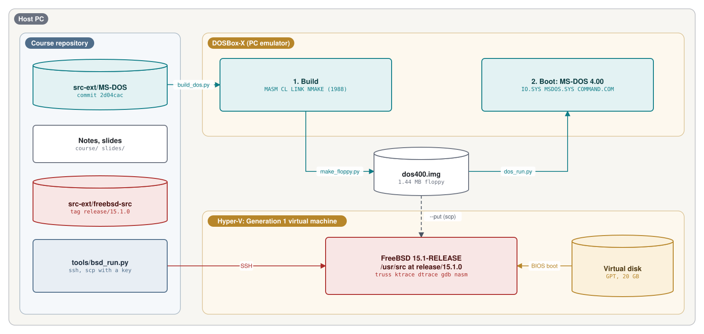
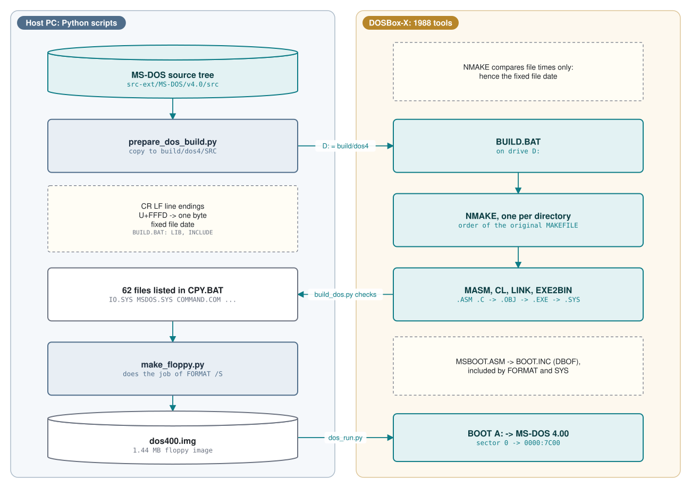
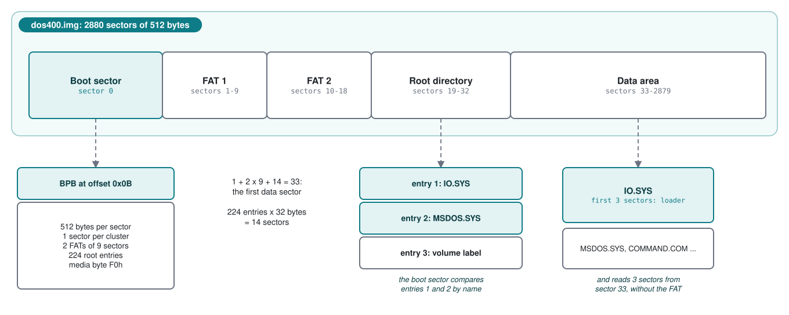
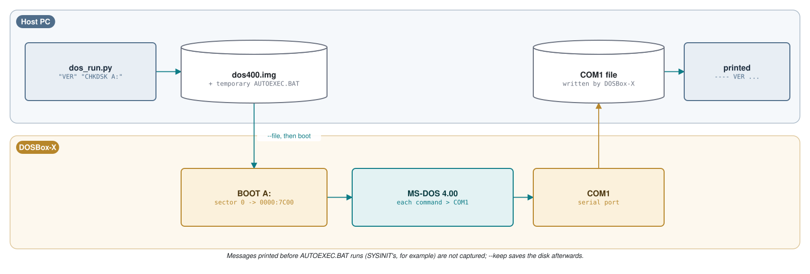

# Module 0: The lab

This module sets up everything the other modules use: the two source trees at fixed commits, MS-DOS 4.00
built from its own source code and booted from a disk image, and a FreeBSD 15.1 machine. Everything about
MS-DOS in this module was run on the course author's machine; commands and outputs shown are real.

**Learning goals.** After this module you can:

- Get the MS-DOS 4.00 and FreeBSD 15.1 sources at the exact commits the course cites, and follow a citation
  from the notes to the source line.
- Build MS-DOS 4.00 from source with its original 1988 toolchain, and explain the four problems the build
  scripts have to work around in the 2024 source release.
- Make a bootable floppy image and explain why its layout is constrained by the boot sector.
- Run MS-DOS 4.00 interactively and unattended, and capture program output.
- Install a FreeBSD 15.1 virtual machine that boots through the BIOS, with its source tree in `/usr/src`.
- Move a disk image between the two systems and inspect it with tools on both sides.

**Prerequisites.**

- A Windows, Linux or macOS computer with Python 3.10 or later and git.
- About 5 GB of free disk space, most of it for the FreeBSD virtual machine.

## 0.1 The lab at a glance



| Part | What it is | Used in |
|---|---|---|
| Course repository | Notes, tools, slides | All modules |
| `src-ext/MS-DOS` | The MS-DOS source release, pinned | All modules |
| `src-ext/freebsd-src` | Part of the FreeBSD source tree, pinned | All modules |
| DOSBox-X | PC emulator that runs the DOS build tools and boots our DOS | All modules |
| `build/images/dos400.img` | 1.44 MB floppy image with MS-DOS 4.00 built from source | All modules |
| FreeBSD 15.1 virtual machine | A full FreeBSD system with its own source | All modules |

## 0.2 The sources and how the notes cite them

Every statement in this course about what the code does is tied to a specific line in a specific version.
The two trees are pinned:

| Project | Repository | Pinned at |
|---|---|---|
| MS-DOS 4.00 | `github.com/microsoft/MS-DOS`, folder `v4.0` | commit `2d04cacc5322951f187bb17e017c12920ac8ebe2` |
| FreeBSD 15.1 | `github.com/freebsd/freebsd-src` | tag `release/15.1.0`, commit `96841ea08dcfa84b954a32dc5ae1a26c28966cf4` |

The FreeBSD release itself records the same commit: the `REVISION` file next to the 15.1 release files on
`download.freebsd.org` contains `96841ea08dcf`, and `GITBRANCH` contains `releng/15.1`.

Fetch both trees into `src-ext/` from the root of the course repository. On Windows:

```console
PS> .\tools\fetch_sources.ps1
MS-DOS      2d04cacc5322951f187bb17e017c12920ac8ebe2
freebsd-src 96841ea08dcfa84b954a32dc5ae1a26c28966cf4 (release/15.1.0)
```

On Linux or macOS the script also runs under PowerShell 7 (`pwsh`). Without PowerShell, the equivalent is:

```sh
git clone https://github.com/microsoft/MS-DOS.git src-ext/MS-DOS
git -C src-ext/MS-DOS checkout 2d04cacc5322951f187bb17e017c12920ac8ebe2
git clone --depth 1 --filter=blob:none --sparse --branch release/15.1.0 \
    https://github.com/freebsd/freebsd-src.git src-ext/freebsd-src
git -C src-ext/freebsd-src sparse-checkout set stand/i386 stand/common stand/libsa stand/lua \
    stand/defaults stand/forth sys/kern sys/sys sys/amd64 sys/x86 sys/i386/include sys/vm \
    sys/fs/msdosfs sys/geom sys/dev/null sys/conf bin/sh sbin/fdisk sbin/init usr.sbin/boot0cfg \
    usr.bin/login usr.bin/alias lib/libc/sys lib/libc/amd64 lib/libsys/amd64 include \
    share/examples/kld share/mk
```

The FreeBSD tree is a sparse, shallow checkout: only the directories the course reads, without history
(`tools/fetch_sources.ps1` has the authoritative list). In the FreeBSD virtual machine you will have the
complete tree (section 0.6).

### Following a citation

Source listings in the notes look like this:

**Listing 0.1** -- The build environment the release expects ([`SETENV.BAT` lines 1-12](https://github.com/microsoft/MS-DOS/blob/2d04cacc5322951f187bb17e017c12920ac8ebe2/v4.0/src/SETENV.BAT#L1-L12))

```bat
@echo off
echo setting up system to build the MS-DOS 4.01 SOURCE BAK...
set CL=
set LINK=
set MASM=
set COUNTRY=usa-ms
set BAKROOT=d:
rem BAKROOT points to the home drive/directory of the sources.
set LIB=%BAKROOT%\src\tools\lib
set INIT=%BAKROOT%\src\tools
set INCLUDE=%BAKROOT%\src\tools\inc
set PATH=%BAKROOT%\src\tools
```

The link in the caption opens exactly those lines at the pinned commit. A line containing only `⋮` in a
listing means that source lines were left out. Every listing in the course is checked mechanically against
the pinned sources with `tools/check_citations.py`, which you can also use to print any range yourself:

```console
$ python tools/check_citations.py --excerpt dos v4.0/src/BOOT/MSBOOT.ASM 253 268
$ python tools/check_citations.py --excerpt bsd stand/i386/boot0/boot0.S 1 40
```

Two conventions of the MS-DOS source are worth knowing before you read it. Change markers such as `;AN000;`
and `;AC000;` at the end of a line mean "new for DOS 4.00" and "changed for DOS 4.00"; the boot sector's
revision history spells this out
([`MSBOOT.ASM` lines 51-55](https://github.com/microsoft/MS-DOS/blob/2d04cacc5322951f187bb17e017c12920ac8ebe2/v4.0/src/BOOT/MSBOOT.ASM#L51-L55)).
Comments starting with initials, such as `J.K.`, are notes from individual developers. Note also line 2 of
Listing 0.1: the build script calls the tree "MS-DOS 4.01", while the release and its boot sector say 4.00.
The course uses the name the binaries report, "MS-DOS Version 4.00" (section 0.5).

## 0.3 Building MS-DOS 4.00 from source

### What is in the tree

The `v4.0/src` folder is a complete build tree, including its own compilers:

| Folder | Contents | Module |
|---|---|---|
| `BOOT` | The boot sector, `MSBOOT.ASM` | 1 |
| `BIOS` | `IO.SYS`: loader, resident device drivers, `SYSINIT` | 1, 2 |
| `DOS` | `MSDOS.SYS`: the kernel (INT 21h services, FAT, buffers, EXEC, memory) | 2 |
| `CMD` | The commands: `COMMAND.COM`, `FORMAT`, `SYS`, `FDISK`, `DEBUG`, `CHKDSK` and more | 1, 3 |
| `DEV` | Installable device drivers: `ANSI.SYS`, `RAMDRIVE.SYS`, `SMARTDRV.SYS`, `DISPLAY.SYS` ... | 2 |
| `MEMM` | `EMM386.SYS`, a 386 expanded-memory manager running in virtual 8086 mode | 2 |
| `SELECT` | The installation program | - |
| `INC`, `H` | Shared assembler include files and C headers (structures used by everything) | 1-3 |
| `MESSAGES`, `MAPPER`, `LIB` | Message files, helper routines, libraries | - |
| `TOOLS` | The 1988 toolchain: MASM 5.10, CL 5.10, LINK 3.65, NMAKE 1.00.05 and helpers | 0 |

The tools in `TOOLS` are DOS programs: they need a DOS to run on. The course uses DOSBox-X, an open-source
PC emulator with a built-in DOS, to run them. Download DOSBox-X from its official GitHub releases page
(`github.com/joncampbell123/dosbox-x/releases`). The course was tested with the Windows portable build
`dosbox-x-vsbuild-win64-2026.10.01-portable.zip`; on Windows, unzip it into `build/tools/dosbox-x/` and the
course scripts find it there. On other systems, install DOSBox-X from your package manager and make sure
`dosbox-x` is on the `PATH`, or set the `DOSBOX_X` environment variable to its full path.

### The original build procedure

`RUNME.BAT` in the release describes the build in three steps: set up the environment with `SETENV.BAT`, run
`NMAKE` at the top level, then collect the binaries with `CPY.BAT`
([`RUNME.BAT` lines 10-32](https://github.com/microsoft/MS-DOS/blob/2d04cacc5322951f187bb17e017c12920ac8ebe2/v4.0/src/RUNME.BAT#L10-L32)).
The top-level `MAKEFILE` enters each part in turn and runs `NMAKE` there
([`MAKEFILE` lines 5-24](https://github.com/microsoft/MS-DOS/blob/2d04cacc5322951f187bb17e017c12920ac8ebe2/v4.0/src/MAKEFILE#L5-L24)),
and `CPY.BAT` lists the 62 files that make up the product
([`CPY.BAT`](https://github.com/microsoft/MS-DOS/blob/2d04cacc5322951f187bb17e017c12920ac8ebe2/v4.0/src/CPY.BAT)).

### Four problems, and how the course scripts solve them

Followed literally, that procedure does not work on the source as published in 2024. The script
`tools/prepare_dos_build.py` makes a build copy of the tree in `build/dos4/SRC` and fixes four problems. None
of the fixes changes what the code does.

| Problem | Symptom | Fix |
|---|---|---|
| Line endings: git stores the files with LF line endings; the 1988 tools expect CR LF | Assembler and `NMAKE` errors | Convert every text file to CR LF. Files are classed as text or binary by content, not extension (see below) |
| 20 files contain U+FFFD, the Unicode replacement character, where the original had code page 437 box-drawing characters | `getmsg.asm(473): error A2106: Line too long` | Map each U+FFFD back to a single byte (`?`). The original characters are lost; only comments, `%OUT` build messages and the installer's screens are affected |
| `SETENV.BAT` points `LIB` and `INCLUDE` at `tools\lib` and `tools\inc` (Listing 0.1), which do not exist; the C headers and libraries are in `TOOLS\BLD\INC` and `TOOLS\BLD\LIB` | C compiler cannot find `stdio.h` and libraries | Generate `BUILD.BAT` with the corrected paths |
| File times: DOSBox-X stamps the files it creates with its own clock, which can be behind the host's clock | `NMAKE` thinks fresh outputs are older than the sources and rebuilds them; the second run of the message tool `NOSRVBLD` hangs | Give all copied sources a fixed past date (25 April 2024) |

The damaged line that stops the first build is
[`GETMSG.ASM` line 473](https://github.com/microsoft/MS-DOS/blob/2d04cacc5322951f187bb17e017c12920ac8ebe2/v4.0/src/MAPPER/GETMSG.ASM#L473):
a comment that was a row of box-drawing characters and is now 66 replacement characters of three bytes each.

The content-based text test matters for two small files that are not source code. Some makefiles feed a file
to `EXE2BIN`'s standard input to answer its prompt for a base segment:

**Listing 0.2** -- A makefile answers a prompt from a file ([`MAKEFILE` lines 38-41](https://github.com/microsoft/MS-DOS/blob/2d04cacc5322951f187bb17e017c12920ac8ebe2/v4.0/src/DEV/DISPLAY/MAKEFILE#L38-L41))

```make
display.sys: display.obj init.obj parser.obj display.lnk makefile zero.dat
        link @display.lnk
        exe2bin display.exe display.sys < zero.dat
        del display.exe
```

In the repository `ZERO.DAT` holds the character `0` followed by a bare line feed. `EXE2BIN` reads its answer
with DOS line input, which ends at a carriage return, so with a bare line feed it waits forever. Converted to
`0` CR LF, it works. `BIOS\LOCSCR` plays the same role for `IO.SYS`.

The file-time problem shows how `NMAKE` decides what to rebuild: only by comparing modification times. The
rules for message files live in `TOOLS.INI`:

**Listing 0.3** -- Inference rules for message files ([`TOOLS.INI` lines 60-67](https://github.com/microsoft/MS-DOS/blob/2d04cacc5322951f187bb17e017c12920ac8ebe2/v4.0/src/TOOLS/TOOLS.INI#L60-L67))

```ini
.exe.com:
        reloc $*.exe $*.com

.skl.cl1:
        nosrvbld $*.skl $(msg)\$(COUNTRY).msg

.skl.ctl:
        buildmsg $(msg)\$(COUNTRY) $*.skl
```

A `.skl` "skeleton" file lists the messages a program uses; `NOSRVBLD` and `BUILDMSG` turn it, together with
the country's message file `USA-MS.MSG`, into include files (`.CL1`, `.CTL` and others) that the assembler
reads. When the generated files look older than `COMMAND.SKL`, `NMAKE` runs the rule again. We did not
investigate why `NOSRVBLD` then stops responding; with consistent times it is never run twice.

### Running the build

```console
$ python tools/build_dos.py
build/dos4: 1225 text files converted to CRLF (20 repaired from UTF-8), 55 binary files copied
build finished in 1.7 min; 0 error lines; 62/62 CPY.BAT outputs present
```

`build_dos.py` runs `prepare_dos_build.py`, starts DOSBox-X with `build/dos4` mounted as drive `D:`, runs the
generated `BUILD.BAT` (one `NMAKE` per directory, in the order of the original makefiles), waits for it to
finish, and checks the log `build/dos4/BUILD.LOG` and the 62 outputs listed in `CPY.BAT`. The time above is
from the author's laptop. Two kinds of message in the log are expected. `***** Possible stack size error in ...`
is printed by the sources themselves: the `EndProc` macro warns at assembly time when a procedure's pushes and
pops do not appear to balance
([`DOSMAC.INC` lines 150-159](https://github.com/microsoft/MS-DOS/blob/2d04cacc5322951f187bb17e017c12920ac8ebe2/v4.0/src/INC/DOSMAC.INC#L150-L159)).
`LINK : warning L4021: no stack segment` appears for programs that are converted to `.COM` files or device
drivers, which do not have a stack segment of their own.



The three files that make up the operating system proper, as built:

| File | Size (bytes) | Built in | What it is |
|---|---|---|---|
| `IO.SYS` | 33,321 | `BIOS` | Loader, resident drivers and `SYSINIT` (Module 1) |
| `MSDOS.SYS` | 37,376 | `DOS` | The kernel (Module 2) |
| `COMMAND.COM` | 37,556 | `CMD\COMMAND` | The shell (Module 3) |

The boot sector is built too, but not as a file of its own on the disk:

**Listing 0.4** -- The boot sector becomes an include file ([`MAKEFILE` lines 20-25](https://github.com/microsoft/MS-DOS/blob/2d04cacc5322951f187bb17e017c12920ac8ebe2/v4.0/src/BOOT/MAKEFILE#L20-L25))

```make
msboot.bin: msboot.obj
        link msboot;
        exe2bin msboot.exe msboot.bin
        dbof msboot.bin boot.inc 7c00 200
        copy boot.inc $(inc)
        del boot.inc
```

`MSBOOT.ASM` is assembled at origin `0x7C00`, the address where the BIOS will load it. `DBOF` cuts the 0x200
(512) bytes starting at offset 0x7C00 out of the binary and writes them as assembler data into `BOOT.INC`.
`FORMAT` and `SYS` both include that file
([`MSFOR.ASM` lines 199-200](https://github.com/microsoft/MS-DOS/blob/2d04cacc5322951f187bb17e017c12920ac8ebe2/v4.0/src/CMD/FORMAT/MSFOR.ASM#L199-L200),
[`SYS1.ASM` lines 261-263](https://github.com/microsoft/MS-DOS/blob/2d04cacc5322951f187bb17e017c12920ac8ebe2/v4.0/src/CMD/SYS/SYS1.ASM#L261-L263)):
the boot sector travels inside the programs that write it to disks. The same trick puts the master boot
record inside `FDISK` (Module 1).

## 0.4 A bootable floppy image

To boot our DOS we need a disk with the boot sector in sector 0 and the system files on it. On a real PC that
is the job of `FORMAT /S` or `SYS`, which are DOS programs; we would need a running DOS to run them. The
script `tools/make_floppy.py` plays their role instead and writes a 1.44 MB floppy image directly.

The layout cannot be arbitrary, because the boot sector is only 512 bytes and makes strong assumptions:

**Listing 0.5** -- The boot sector checks the first two directory entries ([`MSBOOT.ASM` lines 253-268](https://github.com/microsoft/MS-DOS/blob/2d04cacc5322951f187bb17e017c12920ac8ebe2/v4.0/src/BOOT/MSBOOT.ASM#L253-L268))

```asm
; Now we scan for the presence of IBMBIO  COM and IBMDOS  COM.  Check the
; first directory entry.
;
        MOV     DI,BX
        MOV     CX,11
        MOV     SI,OFFSET BIO           ; point to "ibmbio  com"
        REPZ    CMPSB                   ; see if the same
        JNZ     CKERR                   ; if not there advise the user
;
; Found the BIOS.  Check the second directory entry.
;
        LEA     DI,[BX+20h]
        MOV     SI,OFFSET DOS           ; point to "ibmdos  com"
        MOV     CX,11
        REPZ    CMPSB
        JZ      DoLoad
```

The comments say `IBMBIO COM`, the names in IBM's version. Which names are compared depends on a build switch:

**Listing 0.6** -- Two products from one source ([`MSBOOT.ASM` lines 500-506](https://github.com/microsoft/MS-DOS/blob/2d04cacc5322951f187bb17e017c12920ac8ebe2/v4.0/src/BOOT/MSBOOT.ASM#L500-L506))

```asm
        IF IBMCOPYRIGHT
BIO     DB      "IBMBIO  COM"
DOS     DB      "IBMDOS  COM"
        ELSE
BIO     DB      "IO      SYS"
DOS     DB      "MSDOS   SYS"
        ENDIF
```

Our build is Microsoft's: the assembled boot sector contains `IO      SYS` and `MSDOS   SYS`, and its OEM
name field reads `MSDOS4.0`. Names are stored as 8 + 3 characters padded with spaces, exactly as in a
directory entry, so `REPZ CMPSB` can compare 11 bytes directly.

So the image builder must:

1. Put `IO.SYS` in the first root directory entry and `MSDOS.SYS` in the second (Listing 0.5). The volume
   label therefore comes third.
2. Start `IO.SYS` at the first data sector, contiguously for at least its first three sectors. The boot sector
   reads `IBMLOADSIZE` = 3 sectors from the start of the data area without consulting the FAT
   ([`MSBOOT.ASM` line 68](https://github.com/microsoft/MS-DOS/blob/2d04cacc5322951f187bb17e017c12920ac8ebe2/v4.0/src/BOOT/MSBOOT.ASM#L68),
   [lines 296-324](https://github.com/microsoft/MS-DOS/blob/2d04cacc5322951f187bb17e017c12920ac8ebe2/v4.0/src/BOOT/MSBOOT.ASM#L296-L324)).
   Those three sectors contain a small loader that reads the rest of `IO.SYS` (Module 1).
3. Fill in the BIOS Parameter Block (BPB) of the boot sector for a 1.44 MB disk. The BPB fields start at
   offset 0x0B of the sector
   ([`MSBOOT.ASM` lines 106-129](https://github.com/microsoft/MS-DOS/blob/2d04cacc5322951f187bb17e017c12920ac8ebe2/v4.0/src/BOOT/MSBOOT.ASM#L106-L129));
   the values in the source are placeholders that `FORMAT` overwrites.

| BPB field (`MSBOOT.ASM` name) | Value in the source | Value for a 1.44 MB disk |
|---|---|---|
| Bytes per sector (`ByteSec`) | 512 | 512 |
| Sectors per cluster | 8 | 1 |
| Reserved sectors (`cSecRes`) | 1 | 1 |
| Number of FATs (`cFat`) | 2 | 2 |
| Root directory entries (`DirNum`) | 512 | 224 |
| Total sectors (`cTotSec`) | 4\*17\*305-1 = 20739 | 2880 |
| Media byte (`MEDIA`) | 0F8h (hard disk) | 0F0h |
| Sectors per FAT (`cSecFat`) | 8 | 9 |
| Sectors per track (`SECLIM`) | 17 | 18 |
| Heads (`HDLIM`) | 4 | 2 |
| Boot drive (`Phydrv`) | 80h (first hard disk) | 00h (first floppy) |

With these values the disk has 1 boot sector, two FATs of 9 sectors, and a root directory of 14 sectors
(224 entries of 32 bytes), so the data area, and `IO.SYS`, starts at sector 33.



```console
$ python tools/make_floppy.py
build/images/dos400.img: 64 files, 1,180,672 bytes used, 276,992 bytes free
```

The image contains the three system files, a short `CONFIG.SYS` and `AUTOEXEC.BAT`, and all the programs and
drivers from `CPY.BAT`, including `DEBUG.COM`, `EDLIN.COM`, `FDISK.EXE`, `FORMAT.COM`, `SYS.COM`,
`CHKDSK.COM`, `MEM.EXE` and `SORT.EXE`.

## 0.5 Running MS-DOS 4.00

### Interactively

```console
$ python tools/dos_run.py
created build/images/dos400.img
booting build/images/dos400.img (changes are saved to the image; close the window to stop)
```

DOSBox-X starts with its own built-in DOS, mounts the image as drive `A:` and runs `BOOT A:`, which loads
sector 0 of the image to `0000:7C00` and jumps to it, exactly as a PC BIOS does. From that moment the
built-in DOS is gone: the machine runs our boot sector, our `IO.SYS`, our `MSDOS.SYS` and our `COMMAND.COM`.
Changes you make (new files, an edited `CONFIG.SYS`) are written to the image. Use `--image` to keep several
images, and delete an image to start again from a clean one.

### Unattended, with captured output

For experiments and homework it is easier to run commands and get their output as text:

```console
$ python tools/dos_run.py "VER" "CHKDSK A:" "DIR *. | SORT"
```

**Output 0.1** -- MS-DOS 4.00, built from source, running three commands

```text
---- VER

MS-DOS Version 4.00
---- CHKDSK A:

Volume DOS400LAB   created 04-25-2024 12:00p
Volume Serial Number is 1988-0400

   1457664 bytes total disk space
     71168 bytes in 3 hidden files
   1109504 bytes in 62 user files
    276992 bytes available on disk

       512 bytes in each allocation unit
      2847 total allocation units on disk
       541 available allocation units on disk

    655360 total bytes memory
    581552 bytes free
---- DIR *.  (pipe)  SORT


        2 File(s)     276480 bytes free
 Directory of  A:\
 Volume in drive A is DOS400LAB
 Volume Serial Number is 1988-0400
17142B4A             0 11-08-26  11:20p
17142B55             0 11-08-26  11:20p
```

`dos_run.py` writes a temporary `AUTOEXEC.BAT` that runs each command with its output redirected to the
serial port `COM1`, and tells DOSBox-X to write everything sent to `COM1` into a file. Look at the last
command: `DIR *.` lists files without an extension, and two such files exist while it runs, with zero bytes
and names made of hexadecimal digits. Nothing created them except the pipe itself. Module 3 explains them.



Options: `--file A:\NAME.EXT=path` copies a file from your computer into the root directory first (for
example a program you assembled, or your own `CONFIG.SYS`; with nothing after `=` it removes the file),
`--keep image.img` saves the disk afterwards so you can inspect what the commands wrote, `--show` shows the
emulator window, `--timeout` stops a run that waits for input, and `--conf-extra SECTION.KEY=VALUE` changes
the emulated PC for one run (for example `--conf-extra cpu.cputype=286` or `--conf-extra dosbox.memsize=1`;
Module 8 uses it). Messages printed before
`AUTOEXEC.BAT` runs (by `SYSINIT`, for example) are not captured; `tools/screen.asm` is a short program
that copies the text screen to the output, so running it as the first command captures them too.

Because the commands run from `AUTOEXEC.BAT`, a batch file of your own must be started with `CALL NAME` or
`COMMAND /C NAME`: a batch file that starts another one without `CALL` hands over control for good, so the
commands after it never run and `dos_run.py` waits until `--timeout`. Output also travels at the serial port's
speed, about 240 bytes per second (a 4,800-byte `TYPE` takes 20 seconds), so for long output redirect it to a
file, add `--keep`, and read the file from the saved image.
### Your own programs

`nasm` assembles `.COM` programs for DOS directly:

**Example 0.1** -- A complete DOS program in NASM syntax (`hello.asm`)

```asm
        org     0x100           ; .COM programs are loaded at offset 100h, after the PSP
        mov     dx, msg
        mov     ah, 0x09        ; INT 21h function 09h: write a '$'-terminated string
        int     0x21
        mov     ax, 0x4C00      ; INT 21h function 4Ch: terminate with return code 0
        int     0x21
msg     db      "Hello from MS-DOS 4.00", 13, 10, "$"
```

```console
$ nasm -f bin -o hello.com hello.asm
$ python tools/dos_run.py --file A:\HELLO.COM=hello.com "HELLO"
---- HELLO
Hello from MS-DOS 4.00
```

`nasm` is available from `nasm.us`, from most Linux and macOS package managers, and as a FreeBSD package.

### The 1988 toolchain: `dos_tools.py`

The MS-DOS source tree contains the compilers it was built with, so you can also write DOS programs in C or in
MASM syntax with the tools of the time: Microsoft C 5.10 (`CL`), the Macro Assembler 5.10 (`MASM`), `LINK`,
`LIB` and `EXE2BIN`. `tools/dos_tools.py` runs them in DOSBox-X on a folder of your computer, which it mounts as
drive `D:`; the toolchain is drive `T:`, with `INCLUDE` and `LIB` set to the corrected paths of section 0.3.
DOS text files need CR LF line endings.

**Example 0.2** -- A complete DOS program in C (`HELLO.C`, saved with CR LF line endings in `build/tmp-00`)

```c
#include <stdio.h>

int main(void)
{
    printf("Hello from Microsoft C 5.10\n");
    return 0;
}
```

`CL` compiles and links it in one step; then the program runs on MS-DOS 4.00:

```console
$ python tools/dos_tools.py --dir build/tmp-00 "CL HELLO.C"
---- CL HELLO.C
HELLO.C

Microsoft (R) Overlay Linker  Version 3.65
Copyright (C) Microsoft Corp 1983-1988.  All rights reserved.

Object Modules [.OBJ]: HELLO.OBJ
Run File [HELLO.EXE]: HELLO.EXE /NOI
List File [NUL.MAP]: NUL
Libraries [.LIB]:
$ python tools/dos_run.py --file A:\HELLO.EXE=build/tmp-00/HELLO.EXE "HELLO"
---- HELLO
Hello from Microsoft C 5.10
```

The tools run on DOSBox-X's built-in DOS, not on our MS-DOS 4.00: about 1.5 MB of compilers do not fit on the
lab floppy next to the system. The programs they produce are ordinary DOS programs, and you always run them on
MS-DOS 4.00 with `dos_run.py --file`. Modules 4, 5 and 9 use this toolchain; Module 5 explains what `CL` and
`LINK` do in each step.

### Debugging

DOSBox-X has a built-in debugger: its command-line help lists `-break-start` ("Break into debugger at
startup"). The boot-sector tracing exercise in Module 1 (Exercise 1.2) uses a second emulator, QEMU, with
GDB, and DOSBox-X's debugger as the alternative: `qemu-system-i386 -fda build/images/dos400.img` boots the
same image, and with the extra options `-s -S` QEMU waits for a GDB connection on TCP port 1234 before it
runs the first instruction.

## 0.6 The FreeBSD 15.1 machine

The course's FreeBSD machine is a virtual machine running the official FreeBSD 15.1 disk image. Everything in
this section was done on the course author's Windows 11 PC with Hyper-V, and every FreeBSD output in the course
was captured in that machine. Other hypervisors work too (see the end of this section), but only the Hyper-V
procedure was tested.

### Which kind of virtual machine

Module 1 studies how a PC boots through the BIOS, so the FreeBSD machine must boot that way too:

- **Hyper-V**: a **Generation 1** virtual machine. Generation 2 machines boot through UEFI.
- **QEMU**: the default firmware (SeaBIOS) is a BIOS.
- **VirtualBox, VMware**: leave EFI disabled in the machine settings.

Give it 2 CPUs, 2 GB of memory and a 20 GB disk.

### Creating the machine (Hyper-V)

1. With your browser, download `FreeBSD-15.1-RELEASE-amd64-ufs.vhd.xz` (665 MB) and `CHECKSUM.SHA256` from
   `https://download.freebsd.org/releases/VM-IMAGES/15.1-RELEASE/amd64/Latest/`.
2. In Windows PowerShell, as a member of the "Hyper-V Administrators" group, run the course script with the
   image's hash from `CHECKSUM.SHA256`:

   ```console
   PS> .\tools\new_bsd_vm.ps1 -ImageXz $HOME\Downloads\FreeBSD-15.1-RELEASE-amd64-ufs.vhd.xz -Sha256 a6b6632af7d6308008850480c1c9f1b0730455baa6351de517f226a2aa7c840b
   ```

   The script checks the hash, decompresses the image (2.5 GB), converts it to VHDX, enlarges it to 20 GB,
   creates the Generation 1 machine `FreeBSD151-Course` on Hyper-V's "Default Switch" (which gives it an
   address by DHCP and Internet access through the host), takes a checkpoint and starts it.
3. Open the console (`vmconnect.exe localhost FreeBSD151-Course`). The first boot enlarges the root file system
   to fill the 20 GB disk and ends at a `login:` prompt. Log in as `root`; the official images have no root
   password at the console.

Check what you are running, and how the disk is laid out:

**Output 0.2** -- The course VM after its first boot (FreeBSD 15.1)

```text
# freebsd-version -kru; uname -a
15.1-RELEASE
15.1-RELEASE
15.1-RELEASE
FreeBSD freebsd 15.1-RELEASE FreeBSD 15.1-RELEASE releng/15.1-n283562-96841ea08dcf GENERIC amd64
# gpart show
=>      34  41942966  da0  GPT  (20G)
        34       121    1  freebsd-boot  (61K)
       155     66584    2  efi  (33M)
     66739   2097152    3  freebsd-swap  (1.0G)
   2163891  39775053    4  freebsd-ufs  (19G)
  41938944      4056       - free -  (2.0M)
```

The `uname` line names the exact source commit the release was built from, `96841ea08dcf`: the commit the
course cites. The disk is partitioned with GPT and has both a 61 KB `freebsd-boot` partition (for BIOS boot,
holding `gptboot`, Module 1) and an EFI partition (for UEFI boot); `sysctl machdep.bootmethod` prints `BIOS`
on a Generation 1 machine.

### Tools and sources

Still as root on the console, install the course's packages and fetch the source tree at the release tag:

```sh
pkg install git-lite nasm gdb
git clone --depth 1 --branch release/15.1.0 https://git.FreeBSD.org/src.git /usr/src
git -C /usr/src rev-parse HEAD   # must print 96841ea08dcfa84b954a32dc5ae1a26c28966cf4
```

(`pkg` installs its own package manager the first time; answer `y`. `git clone` takes a few minutes and
prints a harmless warning that the tag "is not a commit": `release/15.1.0` is an annotated tag.) `truss`,
`ktrace`/`kdump`, `procstat`, `dtrace`, `gpart`, `mdconfig`, `boot0cfg`, `readelf`, `objdump` and `hexdump`
are part of the base system. Their manual pages (`man truss`, `man 8 boot0cfg`, and `man 9 ...` for kernel
interfaces) are part of the course reading.

If `freebsd-version` reports a patch level such as `15.1-RELEASE-p3`, security updates have been applied to
the binaries. The sources the course cites are those of `release/15.1.0`; for the code studied in this course
that difference does not matter, but keep it in mind if you compare a binary with the source byte for byte.

### Working from the host: SSH and `bsd_run.py`

Typing everything on the VM console is tiring. The course tools use SSH with a key that only this machine
accepts. On the host, create the key (press Enter twice for an empty passphrase):

```console
PS> ssh-keygen -t ed25519 -f build\freebsd\vm\id_course -C dos-bsd-course
```

Then, on the VM console, install the public key (type it from `build\freebsd\vm\id_course.pub`), allow root to
log in with keys only, and start `sshd`:

```sh
mkdir -p /root/.ssh && chmod 700 /root/.ssh
echo 'ssh-ed25519 AAAA... dos-bsd-course' > /root/.ssh/authorized_keys
chmod 600 /root/.ssh/authorized_keys
printf 'PermitRootLogin prohibit-password\nPasswordAuthentication no\n' >> /etc/ssh/sshd_config
sysrc sshd_enable=YES && service sshd start
```

Take a second checkpoint now (`Checkpoint-VM -Name FreeBSD151-Course -SnapshotName course-ready`): whatever
goes wrong later, you can return to this state in seconds. From now on, `tools/bsd_run.py` runs commands in the
VM and prints their output, like `dos_run.py` does for MS-DOS; it finds the VM's address through Hyper-V and
starts the VM if it is off:

```console
$ python tools/bsd_run.py "freebsd-version -kru" "ldd /bin/ls"
$ python tools/bsd_run.py --put hello.c:/root/lab/hello.c "cc -o hello hello.c && ./hello"
$ python tools/bsd_run.py --shell
```

`--put` and `--get` copy files with `scp`; `--shell` opens an interactive session. The machine is reachable
only from your own PC (Hyper-V's Default Switch), and root can log in only with the key.

### Other hypervisors

On QEMU, use the `...-ufs.qcow2.xz` image of the same folder; on VirtualBox or VMware, `...-ufs.vmdk.xz`; or
install from `FreeBSD-15.1-RELEASE-amd64-disc1.iso` (folder `releases/ISO-IMAGES/15.1/`, accept the defaults
for a UFS installation). These routes were not tested for the course; the steps after the first login are the
same. To use `bsd_run.py`, set `BSD_HOST` to the machine's address.
### Moving the DOS image to FreeBSD

FreeBSD can read the floppy image directly, through a memory disk backed by the file. Copy the image into the
virtual machine and mount it read-only:

```console
$ python tools/bsd_run.py --put build/images/dos400.img:/tmp/dos400.img "mdconfig -a -t vnode -f /tmp/dos400.img" "fstyp /dev/md0" "mount -t msdosfs -o ro /dev/md0 /mnt && ls /mnt | wc -l && ls -lo /mnt/IO.SYS /mnt/MSDOS.SYS /mnt/COMMAND.COM" "umount /mnt && mdconfig -d -u 0"
```

**Output 0.3** -- The MS-DOS 4.00 floppy image, seen by FreeBSD 15.1

```text
---- mdconfig -a -t vnode -f /tmp/dos400.img
md0
---- fstyp /dev/md0
msdosfs
---- mount -t msdosfs -o ro /dev/md0 /mnt && ls /mnt | wc -l && ls -lo /mnt/IO.SYS /mnt/MSDOS.SYS /mnt/COMMAND.COM
      64
-rwxr-xr-x  1 root wheel uarch                37556 Apr 25  2024 /mnt/COMMAND.COM
-r-xr-xr-x  1 root wheel hidden,rdonly,system 33321 Apr 25  2024 /mnt/IO.SYS
-r-xr-xr-x  1 root wheel hidden,rdonly,system 37376 Apr 25  2024 /mnt/MSDOS.SYS
---- umount /mnt && mdconfig -d -u 0
```

`ls -lo` shows the DOS attributes as BSD file flags: `hidden,rdonly,system` on the two system files and the
archive bit (`uarch`) on `COMMAND.COM`. The MS-DOS kernel and FreeBSD's `msdosfs` are two independent
implementations of the same on-disk format; Module 2 compares them line by line. The same image is also useful
raw: `hexdump -C -n 512 /tmp/dos400.img` shows the boot sector that MS-DOS's `MSBOOT.ASM` produced.

### Keeping the machine safe

Some homework writes boot code. Do that on memory disks (`mdconfig -a -t malloc -s 64m`) or on a second
virtual disk, never on the disk the virtual machine boots from. Take a checkpoint (Hyper-V) or snapshot
(QEMU, VirtualBox) before each lab session.

## 0.7 Exercise

### Exercise 0.1: Check your lab

Difficulty: basic. Estimated time: 2 h.

Tasks:

1. Fetch the sources and print Listing 0.5 with `tools/check_citations.py --excerpt`. Open the link in the
   listing caption and confirm that it shows the same lines.
2. Build MS-DOS 4.00 with `tools/build_dos.py`. Record the build time and the SHA-256 hashes of `IO.SYS`,
   `MSDOS.SYS` and `COMMAND.COM`, and compare them with two classmates. The builds should be identical, byte for
   byte, on every machine. Explain why: what would have to be different in a build system for two builds of
   the same source to produce different files? Name two things that commonly make modern builds differ.
3. Make the floppy image and run `VER`, `MEM` and `CHKDSK A:` unattended.
4. Assemble Example 0.1, change its message, and run it in MS-DOS 4.00.
5. Install the FreeBSD 15.1 virtual machine, check `/usr/src` against the pinned commit, and mount the floppy
   image read-only. Count the files that `ls -la /mnt` shows and compare with `CHKDSK`'s "3 hidden files" and
   "62 user files" in Output 0.1. Explain the difference.

Deliverables: a one-page lab report with the outputs of steps 2, 3 and 5, and your program from step 4.

Hints: if a `dos_run.py` command never finishes, the program is probably waiting for keyboard input; add
`--show` to see the screen. If the build stops, look at the end of `build/dos4/BUILD.LOG`: the last
`=====` line tells you which directory was being built.

## Further reading

- The MS-DOS source release and its README: `github.com/microsoft/MS-DOS`.
- DOSBox-X documentation and wiki: `dosbox-x.com`.
- The FreeBSD Handbook, chapters "Installing FreeBSD" and "Virtualization": `docs.freebsd.org/en/books/handbook/`.
- Ray Duncan (ed.), *The MS-DOS Encyclopedia*, Microsoft Press, 1988: the contemporary reference for
  MS-DOS programming, including the boot process and the `.COM` and `.EXE` formats.
