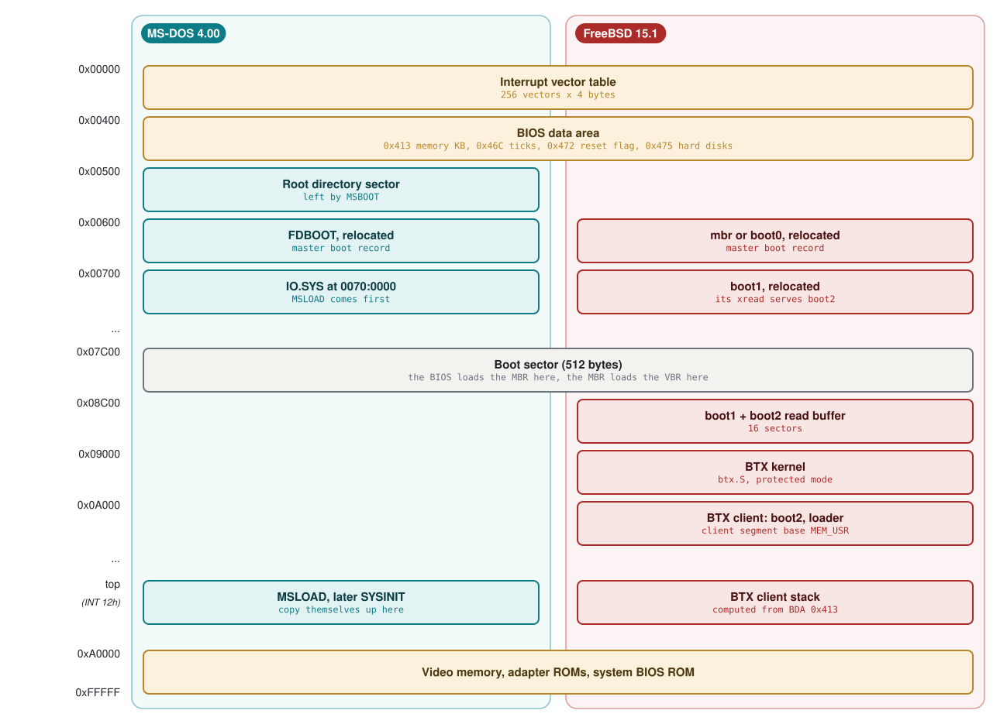
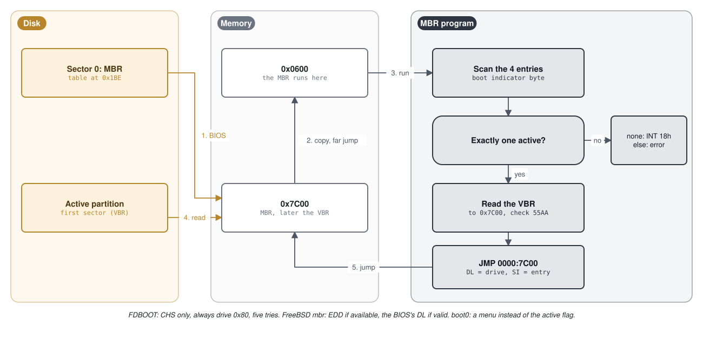
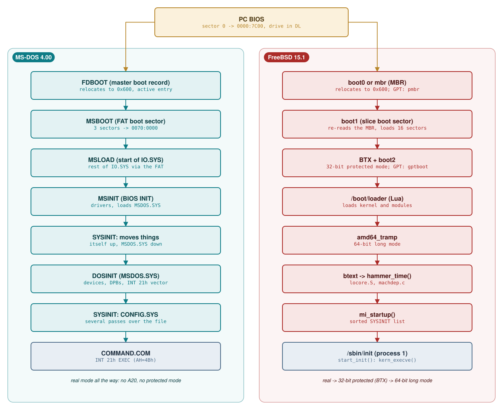
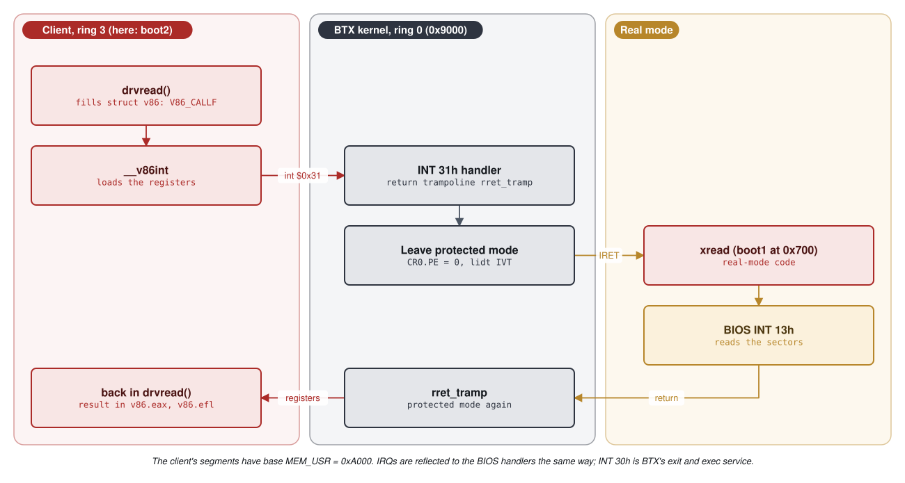
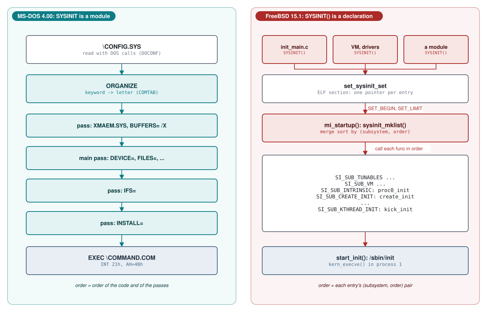
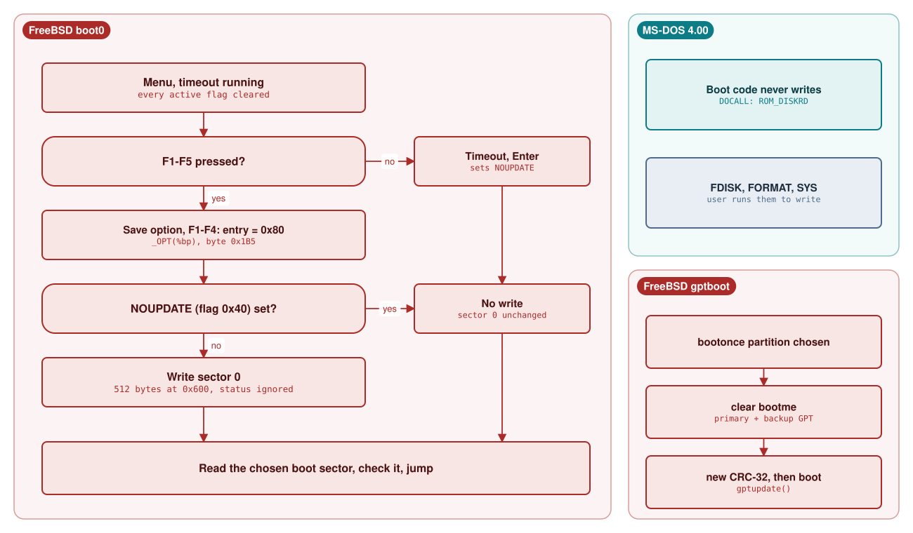

# Module 1: Booting: from the BIOS to the first user program

When a PC is switched on, no operating system is in memory. Firmware reads one 512-byte sector from a disk, jumps into it, and from that moment the operating system has to pull itself up by its own bootstraps: find more code, load it, set up the machine, and finally start a program that a user can talk to. This module follows that path in two real code bases. On MS-DOS 4.00 we read the FDISK master boot record, the FAT boot sector `MSBOOT.ASM`, the `IO.SYS` loader, and the `SYSINIT` module that processes `CONFIG.SYS` and starts `COMMAND.COM`. On FreeBSD 15.1 we read `mbr.S` and the `boot0` boot manager, `boot1`/`boot2`, the BTX mini-kernel, the Lua-scripted loader, and the kernel's own start-up path from `locore.S` through `hammer_time()` and `mi_startup()` to `start_init()`, which runs `/sbin/init`. The module ends at exactly that point: the first user program. System calls, process creation, file systems and the shell are covered in Modules 2 and 3.

**Learning goals.** After this module you can:

- Explain the PC BIOS boot contract (load address `0000:7C00`, the `0x55AA` signature, the boot drive in `DL`, `INT 13h` disk services) and compute real-mode segment:offset addresses.
- Read and annotate the MS-DOS 4.00 and FreeBSD 15.1 master boot records: relocation, the partition-table walk, the active flag, and loading the next sector.
- Decode a FAT boot sector and its BIOS Parameter Block (BPB) field by field, and trace how `MSBOOT` finds and loads `IO.SYS`.
- Describe FreeBSD's BIOS boot chain (`boot0` or `mbr`, `boot1`, `boot2` or `gptboot`, BTX, `loader`) and explain why it switches to protected mode while MS-DOS never does.
- Trace MS-DOS initialisation from `IO.SYS` through `SYSINIT`, `CONFIG.SYS` and the `EXEC` of `COMMAND.COM`.
- Trace FreeBSD kernel start-up from the loader's trampoline through `btext`, `hammer_time()` and `mi_startup()` to `start_init()`.
- Contrast MS-DOS's `SYSINIT` module with FreeBSD's `SYSINIT()` linker-set framework, including how each lets third-party code join the boot.
- Evaluate boot-time design trade-offs (512-byte limits, writing to disk during boot, real mode versus protected mode) in the context of the hardware each system targeted.

**Prerequisites.**

- C, and a first exposure to x86 assembly (registers, `mov`, `call`, `int`). This module teaches the 16-bit real-mode details it needs.
- The lab environment from Module 0 (`00-lab.md`): QEMU, DOSBox-X, the MS-DOS 4.00 floppy image `build/images/dos400.img` built from this source tree, the boot blocks in `build/freebsd/boot/`, and the FreeBSD 15.1 amd64 VM with `/usr/src`.

## 1.1 The PC BIOS boot contract

### Real mode and segment:offset addresses

Every x86 processor, including a modern 64-bit one, starts in *real mode*, the execution mode of the original 8086/8088. In real mode there is no memory protection and no paging. Addresses are formed from two 16-bit values, a *segment* and an *offset*:

    linear address = segment * 16 + offset

The result is a 20-bit *linear address*, so real mode can reach 1 MB (`0x00000`-`0xFFFFF`). We write segment:offset pairs as `0000:7C00` and linear addresses as `0x7C00`. Many pairs name the same byte: `0000:7C00`, `07C0:0000` and `0700:0C00` all denote linear `0x7C00`. The segment registers are `CS` (code), `DS` and `ES` (data) and `SS` (stack); `lodsb` implicitly reads `DS:SI` and `stosb` writes `ES:DI`. A *far jump* (`JMP FAR`, opcode `0xEA`) loads both `CS` and `IP`; a near jump only changes `IP`. Most boot code sets `DS`, `ES` and `SS` to zero so that offsets equal linear addresses in the first 64 KB.

A *paragraph* is 16 bytes, the granularity of segments. MS-DOS sizes almost everything in paragraphs; you will see shifts by 4 (`* 16`) and by 6 (KB to paragraphs: `* 1024 / 16`) throughout its start-up code.

### What the BIOS does

The *BIOS* (Basic Input/Output System) is firmware in ROM. After its power-on self test it reads the first sector of the boot device (cylinder 0, head 0, sector 1) to linear address `0x7C00`, on most machines checks that the last two bytes are `0x55, 0xAA`, and jumps to it in real mode with the BIOS drive number in `DL` (`0x00` for the first floppy, `0x80` for the first hard disk). Both code bases describe this contract in their own comments.

**Listing 1.1** -- MSBOOT's own description of what the ROM does before it runs ([`MSBOOT.ASM` lines 30-39](https://github.com/microsoft/MS-DOS/blob/2d04cacc5322951f187bb17e017c12920ac8ebe2/v4.0/src/BOOT/MSBOOT.ASM#L30-L39))

```asm
; The ROM in the IBM PC starts the boot process by performing a hardware
; initialization and a verification of all external devices.  If all goes
; well, it will then load from the boot drive the sector from track 0, head 0,
; sector 1.  This sector is placed at physical address 07C00h.  The initial
; registers are set up as follows:  CS=DS=ES=SS=0.  IP=7C00h, SP=0400H.
;
; The code in this sector is responsible for locating the MSDOS device drivers
; (IBMBIO) and for placing the directory sector with this information at
; physical address 00500h.  After loading in this sector, it reads in the
; entirety of the BIOS at BIOSEG:0 and does a long jump to that point.
```

The comment records the IBM PC's behaviour in the mid-1980s (`SP=0400H`, all segment registers zero). Later BIOSes do not guarantee those values, and neither system relies on them: both reload `DS`, `ES`, `SS` and `SP` first. Neither reloads `CS`: both rely on the BIOS entering at `CS:IP = 0:7C00`. FreeBSD's `boot0` documents the weaker modern contract: only `CS:IP = 0:0x7c00` and the drive number in `DL` ([boot0.S lines 78-89](https://github.com/freebsd/freebsd-src/blob/96841ea08dcfa84b954a32dc5ae1a26c28966cf4/stand/i386/boot0/boot0.S#L78-L89)).

Two parts of the contract matter in what follows. First, the *signature*: a boot sector ends with the bytes `0x55, 0xAA`. MS-DOS writes them as `db 55h,0aah`; FreeBSD writes the little-endian word `.word 0xaa55` (MAGIC), which is the same two bytes. Second, the *boot drive*: the BIOS passes it in `DL`, but, as we will see, MS-DOS's boot sector ignores `DL` for its reads and uses a drive number that FORMAT stored inside the sector.

### The BIOS services the boot code uses

Boot code cannot contain disk or screen drivers; it calls the BIOS through software interrupts. The *interrupt vector table* (IVT) at linear `0x0000`-`0x03FF` holds 256 four-byte `segment:offset` pointers, and `INT n` calls the routine at vector `n`. The *BIOS data area* (BDA) at `0x0400`-`0x04FF` holds firmware variables. The table lists the main ones our two systems use; boot0 also reads the 18.2 Hz tick counter (`INT 1Ah`) for its timeout, and boot1 asks for the drive geometry (`INT 13h AH=08h`).

| Service | Purpose | MS-DOS 4.00 example | FreeBSD 15.1 example |
|---|---|---|---|
| `INT 13h AH=02h` | Read sectors by cylinder/head/sector (CHS) | [`DOCALL` in MSBOOT](https://github.com/microsoft/MS-DOS/blob/2d04cacc5322951f187bb17e017c12920ac8ebe2/v4.0/src/BOOT/MSBOOT.ASM#L484-L494) | [`main.7` in mbr.S](https://github.com/freebsd/freebsd-src/blob/96841ea08dcfa84b954a32dc5ae1a26c28966cf4/stand/i386/mbr/mbr.S#L114-L115) |
| `INT 13h AH=03h` | Write sectors | not used by any boot sector | [boot0 write-back](https://github.com/freebsd/freebsd-src/blob/96841ea08dcfa84b954a32dc5ae1a26c28966cf4/stand/i386/boot0/boot0.S#L457-L463) |
| `INT 13h AH=00h` | Reset the disk system | [MSBOOT line 201](https://github.com/microsoft/MS-DOS/blob/2d04cacc5322951f187bb17e017c12920ac8ebe2/v4.0/src/BOOT/MSBOOT.ASM#L201-L203) | [boot1 retry](https://github.com/freebsd/freebsd-src/blob/96841ea08dcfa84b954a32dc5ae1a26c28966cf4/stand/i386/boot2/boot1.S#L336-L341) |
| `INT 13h AH=41h/42h` | EDD ("packet", LBA) read | not used | [mbr.S `main.5`](https://github.com/freebsd/freebsd-src/blob/96841ea08dcfa84b954a32dc5ae1a26c28966cf4/stand/i386/mbr/mbr.S#L94-L111) |
| `INT 10h AH=0Eh` | Print one character (teletype) | [`WRITE`](https://github.com/microsoft/MS-DOS/blob/2d04cacc5322951f187bb17e017c12920ac8ebe2/v4.0/src/BOOT/MSBOOT.ASM#L413-L419) | [`putstr`](https://github.com/freebsd/freebsd-src/blob/96841ea08dcfa84b954a32dc5ae1a26c28966cf4/stand/i386/mbr/mbr.S#L139-L145) |
| `INT 16h` | Read or poll the keyboard | [wait for a key](https://github.com/microsoft/MS-DOS/blob/2d04cacc5322951f187bb17e017c12920ac8ebe2/v4.0/src/BOOT/MSBOOT.ASM#L276-L277) | [boot0 `read_key`](https://github.com/freebsd/freebsd-src/blob/96841ea08dcfa84b954a32dc5ae1a26c28966cf4/stand/i386/boot0/boot0.S#L344-L361) |
| `INT 12h` | Conventional memory size in KB | [MSLOAD](https://github.com/microsoft/MS-DOS/blob/2d04cacc5322951f187bb17e017c12920ac8ebe2/v4.0/src/BIOS/MSLOAD.ASM#L240-L242) | BTX reads the same value from BDA `0x413` ([`BDA_MEM`](https://github.com/freebsd/freebsd-src/blob/96841ea08dcfa84b954a32dc5ae1a26c28966cf4/stand/i386/btx/btx/btx.S#L98)) |
| `INT 18h` | "No bootable device" | [FDBOOT line 45](https://github.com/microsoft/MS-DOS/blob/2d04cacc5322951f187bb17e017c12920ac8ebe2/v4.0/src/CMD/FDISK/FDBOOT.ASM#L45) | [mbr.S line 70](https://github.com/freebsd/freebsd-src/blob/96841ea08dcfa84b954a32dc5ae1a26c28966cf4/stand/i386/mbr/mbr.S#L70) |
| `INT 19h` | Re-run the bootstrap | [MSBOOT line 282](https://github.com/microsoft/MS-DOS/blob/2d04cacc5322951f187bb17e017c12920ac8ebe2/v4.0/src/BOOT/MSBOOT.ASM#L282) | boot1 jumps to `F000:FFF0` instead ([lines 242-243](https://github.com/freebsd/freebsd-src/blob/96841ea08dcfa84b954a32dc5ae1a26c28966cf4/stand/i386/boot2/boot1.S#L242-L243)) |

*CHS addressing* names a sector by cylinder (0-1023), head (0-255) and sector (1-63). `INT 13h` packs these into registers in a way that only makes sense historically: `CH` holds the low 8 bits of the cylinder, bits 6-7 of `CL` hold cylinder bits 8-9, bits 0-5 of `CL` hold the sector, and `DH` holds the head. The partition-table entries of an MBR use the same packed format ([boot0.S lines 65-73](https://github.com/freebsd/freebsd-src/blob/96841ea08dcfa84b954a32dc5ae1a26c28966cf4/stand/i386/boot0/boot0.S#L65-L73)), which is why both MBRs can load `CX` and `DH` straight from a table entry. The 10-bit cylinder field limits CHS to 1024 cylinders; `boot1` checks exactly this (`cmpl $0x3ff,%eax`, [boot1.S lines 311-313](https://github.com/freebsd/freebsd-src/blob/96841ea08dcfa84b954a32dc5ae1a26c28966cf4/stand/i386/boot2/boot1.S#L311-L313)). The *Enhanced Disk Drive* (EDD) extensions remove the limit: `INT 13h AH=42h` takes a 16-byte *disk address packet* holding a 64-bit *logical block address* (LBA). MS-DOS 4.00 predates these extensions; FreeBSD uses them whenever the BIOS reports support.

### Memory in the first megabyte

The diagram shows the first megabyte as the boot code of both systems uses it. Addresses are linear.



The FreeBSD addresses come from the `.set` lines in [boot1.S](https://github.com/freebsd/freebsd-src/blob/96841ea08dcfa84b954a32dc5ae1a26c28966cf4/stand/i386/boot2/boot1.S#L16-L24) and [btx.S](https://github.com/freebsd/freebsd-src/blob/96841ea08dcfa84b954a32dc5ae1a26c28966cf4/stand/i386/btx/btx/btx.S#L18-L30); the MS-DOS ones from [MSBOOT.ASM's EQUs](https://github.com/microsoft/MS-DOS/blob/2d04cacc5322951f187bb17e017c12920ac8ebe2/v4.0/src/BOOT/MSBOOT.ASM#L62-L69). The upper limit of conventional memory is not a constant: both systems ask the BIOS. On a 640 KB machine it is `0xA0000`.

### UEFI is out of scope

Modern PCs usually boot through UEFI firmware, which loads PE/COFF executables from a FAT-formatted EFI system partition and never runs a 512-byte boot sector. FreeBSD 15.1 supports UEFI with a separate loader under `stand/efi`, which this module does not cover. Everything below assumes a BIOS boot, which is also what QEMU's default firmware (SeaBIOS) provides in the lab.

## 1.2 The master boot record

A hard disk can hold several operating systems, so its first sector does not belong to any one of them. That sector, the *master boot record* (MBR), contains a small program, a 64-byte *partition table* at offset `0x1BE` with four 16-byte entries, and the signature at `0x1FE`. Each entry describes one *partition* (FreeBSD's documentation calls MBR partitions *slices*):

| Offset in entry | Size | Meaning |
|---|---|---|
| 0 | 1 | Boot indicator: `0x80` = active (boot this one), `0x00` = not active |
| 1 | 3 | First sector in packed CHS form (head, then sector/cylinder as in `INT 13h`) |
| 4 | 1 | Partition type (`0x01` FAT12, `0x04` FAT16 < 32 MB, `0x06` FAT16 >= 32 MB, `0x05` extended, `0xA5` FreeBSD) |
| 5 | 3 | Last sector in packed CHS form |
| 8 | 4 | LBA of the first sector ("relative sectors") |
| 12 | 4 | Number of sectors |

The layout is the one documented in [boot0.S](https://github.com/freebsd/freebsd-src/blob/96841ea08dcfa84b954a32dc5ae1a26c28966cf4/stand/i386/boot0/boot0.S#L62-L74) and written field by field by MS-DOS FDISK in [`write_master_boot_to_disk()`](https://github.com/microsoft/MS-DOS/blob/2d04cacc5322951f187bb17e017c12920ac8ebe2/v4.0/src/CMD/FDISK/DISKOUT.C#L144-L193). The MBR program's job is always the same: choose a partition, load that partition's first sector (its *volume boot record*) to `0x7C00`, check its signature, and jump to it with `DL` still naming the drive.



### Relocation: making room at 0x7C00

There is an immediate problem. The MBR is itself running at `0x7C00`, the address where the next boot sector must be loaded, because every boot sector expects to run there. So every MBR begins by copying itself somewhere else and continuing there. Both MS-DOS and FreeBSD choose linear `0x600`.

**Listing 1.2** -- The MS-DOS 4.00 MBR relocates itself from 0:7C00 to 0:0600 ([`FDBOOT.ASM` lines 12-34](https://github.com/microsoft/MS-DOS/blob/2d04cacc5322951f187bb17e017c12920ac8ebe2/v4.0/src/CMD/FDISK/FDBOOT.ASM#L12-L34))

```asm
_data   segment public
        assume  cs:_data,ds:_data

        org 600h

        cli             ;no interrupts for now
        xor ax,ax
        mov ss,ax
        mov sp,7c00h    ;new stack at 0:7c00
        mov si,sp       ;where this boot record starts - 0:7c00
        push ax
        pop es          ;seg regs the same
        push ax
        pop ds
        sti             ;interrupts ok now
        cld
        mov di,0600h    ;where to relocate this boot record to
        mov cx,100h
        repnz movsw     ;relocate to 0:0600
;       jmp entry2
        db   0eah
        dw   $+4,0
entry2:
```

`ORG 600h` tells the assembler that the code will *execute* at `0x600`, although the BIOS loads it at `0x7C00`; the first instructions use no absolute addresses, so they work at either place. `repnz movsw` with `CX = 100h` copies 256 words, the whole sector (`repnz` acts like `rep` for `movsw`). The jump into the copy is hand-assembled: `db 0eah` is the far-jump opcode and `dw $+4,0` supplies offset `$+4` (the 5-byte instruction's end, which is `entry2` in the copy) and segment `0`.

### Choosing the partition

**Listing 1.3** -- FDBOOT walks the partition table and insists on exactly one active entry ([`FDBOOT.ASM` lines 35-55](https://github.com/microsoft/MS-DOS/blob/2d04cacc5322951f187bb17e017c12920ac8ebe2/v4.0/src/CMD/FDISK/FDBOOT.ASM#L35-L55))

```asm
        mov si,offset tab      ;partition table
        mov bl,4        ;number of table entries
next:
        cmp byte ptr[si],80h  ;is this a bootable entry?
        je boot         ;yes
        cmp byte ptr[si],0    ;no, is boot indicator zero?
        jne bad         ;no, it must be x"00" or x"80" to be valid
        add si,16       ;yes, go to next entry
        dec bl
        jnz next
        int 18h         ;no bootable entries - go to rom basic
boot:
        mov dx,[si]     ;head and drive to boot from
        mov cx,[si+2]   ;cyl, sector to boot from
        mov bp,si       ;save table entry address to pass to partition boot record
next1:
        add si,16       ;next table entry
        dec bl          ;# entries left
        jz tabok        ;all entries look ok
        cmp byte ptr[si],0    ;all remaining entries should begin with zero
        je next1        ;this one is ok
```

The rule is strict: an entry's first byte must be `0x80` or `0x00`, and exactly one may be `0x80`; anything else prints "Invalid partition table" and stops in `hold: jmp hold`. With no active entry the code executes `INT 18h`, which on the original IBM PC started ROM BASIC (hence the comment). Line 47, `mov dx,[si]`, loads `DL` from the boot-indicator byte (`0x80`) and `DH` from the head byte: the MS-DOS MBR always reads from BIOS drive `0x80`, whatever the BIOS passed in `DL`. The read that follows ([lines 70-93](https://github.com/microsoft/MS-DOS/blob/2d04cacc5322951f187bb17e017c12920ac8ebe2/v4.0/src/CMD/FDISK/FDBOOT.ASM#L70-L93)) is attempted up to five times, with a disk reset after each failure, the loaded sector must carry the signature at `0x7DFE`, and `SI` is left pointing at the active entry before the far jump to `0:7C00`.

### How FDISK carries the MBR inside FDISK.EXE

The 512 bytes are compiled into FDISK. Its makefile assembles and links `FDBOOT.ASM`, converts it to a flat image with `exe2bin` (which, because of `ORG 600h`, begins with `0x600` bytes of padding), and runs `dbof fdboot.bin fdboot.inc 600 200` to extract the sector as assembler `db` lines ([FDISK/MAKEFILE lines 74-80](https://github.com/microsoft/MS-DOS/blob/2d04cacc5322951f187bb17e017c12920ac8ebe2/v4.0/src/CMD/FDISK/MAKEFILE#L74-L80); `dbof` is a build tool in `v4.0/src/TOOLS`). The FAT boot sector is built the same way (`dbof msboot.bin boot.inc 7c00 200`, [BOOT/MAKEFILE](https://github.com/microsoft/MS-DOS/blob/2d04cacc5322951f187bb17e017c12920ac8ebe2/v4.0/src/BOOT/MAKEFILE#L20-L25)). [`BOOTREC.ASM`](https://github.com/microsoft/MS-DOS/blob/2d04cacc5322951f187bb17e017c12920ac8ebe2/v4.0/src/CMD/FDISK/BOOTREC.ASM#L26-L31) then includes the generated file twice, under the public label `_master_boot_record`. That is deliberate: the C code declares `extern unsigned char master_boot_record[2][512]` ([GLOBAL.C](https://github.com/microsoft/MS-DOS/blob/2d04cacc5322951f187bb17e017c12920ac8ebe2/v4.0/src/CMD/FDISK/GLOBAL.C#L39-L40)), one template per fixed disk. At start-up FDISK reads each disk's sector 0 and, if it already carries the signature, copies it over the template ([FDISK.C lines 719-731](https://github.com/microsoft/MS-DOS/blob/2d04cacc5322951f187bb17e017c12920ac8ebe2/v4.0/src/CMD/FDISK/FDISK.C#L719-L731)). So FDISK 4.00 installs its own boot code only on a disk without a valid MBR. When it writes, [`write_master_boot_to_disk()`](https://github.com/microsoft/MS-DOS/blob/2d04cacc5322951f187bb17e017c12920ac8ebe2/v4.0/src/CMD/FDISK/DISKOUT.C#L117-L196) overwrites only the changed partition entries and forces `0x55, 0xAA` into bytes 510-511.

### FreeBSD's mbr.S

FreeBSD ships two MBR programs. `/boot/mbr` (`stand/i386/mbr/mbr.S`) is a plain "boot the active partition" MBR like FDISK's; `/boot/boot0` is an interactive boot manager. Their makefiles both set `ORG=0x600` ([mbr Makefile](https://github.com/freebsd/freebsd-src/blob/96841ea08dcfa84b954a32dc5ae1a26c28966cf4/stand/i386/mbr/Makefile#L9), [boot0 Makefile](https://github.com/freebsd/freebsd-src/blob/96841ea08dcfa84b954a32dc5ae1a26c28966cf4/stand/i386/boot0/Makefile#L37-L41)), so both relocate to `0x600` as FDBOOT does. `mbr.S` copies only the part of itself from label `main` onward, then scans the table:

**Listing 1.4** -- mbr.S scans all four entries and rejects more than one active partition ([`mbr.S` lines 52-70](https://github.com/freebsd/freebsd-src/blob/96841ea08dcfa84b954a32dc5ae1a26c28966cf4/stand/i386/mbr/mbr.S#L52-L70))

```asm
# Scan the partition table looking for an active entry.  Note that %ch is
# zero from the repeated string instruction above.  We save the offset of
# the active partition in %si and scan the entire table to ensure that only
# one partition is marked active.
#
main:           xorw %si,%si                    # No active partition
                movw $partbl,%bx                # Partition table
                movb $0x4,%cl                   # Number of entries
main.1:         cmpb %ch,(%bx)                  # Null entry?
                je main.2                       # Yes
                jg err_pt                       # If 0x1..0x7f
                testw %si,%si                   # Active already found?
                jnz err_pt                      # Yes
                movw %bx,%si                    # Point to active
main.2:         addb $0x10,%bl                  # Till
                loop main.1                     #  done
                testw %si,%si                   # Active found?
                jnz main.3                      # Yes
                int $0x18                       # BIOS: Diskless boot
```

The comparison `cmpb %ch,(%bx)` with `CH = 0` uses signed arithmetic: values `0x01`-`0x7F` are "greater" and rejected as invalid, while `0x80`-`0xFF` are negative and accepted as active. The policy matches FDBOOT's, but FreeBSD trusts the BIOS's `DL` when it names an existing hard disk (the BIOS data area byte at `0x475` holds the number of hard disks) and only falls back to the table's first byte otherwise ([lines 75-81](https://github.com/freebsd/freebsd-src/blob/96841ea08dcfa84b954a32dc5ae1a26c28966cf4/stand/i386/mbr/mbr.S#L75-L81)). The read prefers EDD ([lines 86-117](https://github.com/freebsd/freebsd-src/blob/96841ea08dcfa84b954a32dc5ae1a26c28966cf4/stand/i386/mbr/mbr.S#L86-L117)): six `push` instructions build the 16-byte disk address packet on the stack (size `0x10`, one sector, buffer offset and segment, and the 64-bit LBA from bytes 8-11 of the entry with a zero high half), and `INT 13h AX=4200h` reads it. The `flags` byte enabling this path sits just before the partition table ([lines 151-155](https://github.com/freebsd/freebsd-src/blob/96841ea08dcfa84b954a32dc5ae1a26c28966cf4/stand/i386/mbr/mbr.S#L151-L155)) and defaults to `0x80`; in the lab's `build/freebsd/boot/mbr` the byte at offset `0x1BD` is indeed `0x80`, preceded by `0x90` (NOP) padding from `.org PT_OFF-1,0x90`. The three error messages are word for word those of MS-DOS's FDISK ([`FDISK5.SKL`](https://github.com/microsoft/MS-DOS/blob/2d04cacc5322951f187bb17e017c12920ac8ebe2/v4.0/src/CMD/FDISK/FDISK5.SKL#L1-L14)).

### FreeBSD's boot0: a menu in 512 bytes

`boot0` does the same job interactively: it prints one line per bootable partition (`F1 FreeBSD`, `F2 Win`, ...), an entry for the next disk, and waits for a key with a timeout. Its source warns that it "uses many tricks to save space and fit in one sector" ([lines 37-42](https://github.com/freebsd/freebsd-src/blob/96841ea08dcfa84b954a32dc5ae1a26c28966cf4/stand/i386/boot0/boot0.S#L37-L42)). The first trick is in the relocation:

**Listing 1.5** -- boot0 relocates itself and builds a fake partition entry at 0x800 ([`boot0.S` lines 172-199](https://github.com/freebsd/freebsd-src/blob/96841ea08dcfa84b954a32dc5ae1a26c28966cf4/stand/i386/boot0/boot0.S#L172-L199))

```asm
start:          cld                             # String ops inc
                xorw %ax,%ax                    # Zero
                movw %ax,%es                    # Address
                movw %ax,%ds                    #  data
                movw %ax,%ss                    # Set up
                movw $LOAD,%sp                  #  stack

        /*
         * Copy this code to the address it was linked for, 0x600 by default.
         */
                movw %sp,%si                    # Source
                movw $start,%di                 # Destination
                movw $0x100,%cx                 # Word count
                rep                             # Relocate
                movsw                           #  code
        /*
         * After the code, (i.e. at %di+0, 0x800) create a partition entry,
         * initialized to LBA 0 / CHS 0:0:1.
         * Set %bp to point to the partition and also, with negative offsets,
         * to the variables embedded in the bootblock (nextdrv and so on).
         */
                movw %di,%bp                    # Address variables
                movb $0x8,%cl                   # Words to clear
                rep                             # Zero
                stosw                           #  them
                incb -0xe(%di)                  # Set the S field to 1

                jmp main-LOAD+ORIGIN            # Jump to relocated code
```

After `rep movsw`, `DI` points just past the copy, at `0x800`. boot0 points `BP` there and zeroes 16 bytes to make a fake partition entry for CHS 0:0:1 / LBA 0, sector 0 of a disk (`incb -0xe(%di)` sets its sector field to 1). That entry is used for "next drive" (F5) and, as Study case 1.B shows, for writing sector 0 back. `BP` also reaches boot0's configuration bytes at the end of the sector through *negative* offsets (`_FLAGS(%bp)`, `_OPT(%bp)`, [the `.set` block](https://github.com/freebsd/freebsd-src/blob/96841ea08dcfa84b954a32dc5ae1a26c28966cf4/stand/i386/boot0/boot0.S#L139-L157)): a `[bp-n]` operand costs one displacement byte, an absolute address two.

**Listing 1.6** -- The menu loop: one line per enabled, non-empty partition (type lookup elided) ([`boot0.S` lines 252-288](https://github.com/freebsd/freebsd-src/blob/96841ea08dcfa84b954a32dc5ae1a26c28966cf4/stand/i386/boot0/boot0.S#L252-L288))

```asm
                movw $(partbl+0x4),%bx          # Partition table (+4)
                xorw %dx,%dx                    # Item number

        /*
         * Loop around on the partition table, printing values until we
         * pass a 256 byte boundary.
         */
read_entry:     movb %ch,-0x4(%bx)              # Zero active flag (ch == 0)
                btw %dx,_FLAGS(%bp)             # Entry enabled?
                jnc next_entry                  # No
                movb (%bx),%al                  # Load type
                test %al, %al                   # skip empty partition
                jz next_entry
⋮
                addw $(TLEN-1), %di             # Adjust
                movb (%di),%cl                  # Partition
                addw %cx,%di                    #  description
                callw putx                      # Display it

next_entry:     incw %dx                        # Next item
                addb $0x10,%bl                  # Next entry
                jnc read_entry                  # Till done
```

The loop starts `BX` at `partbl+4` and adds 16 per entry; after four entries the low byte of `BX` overflows past a 256-byte boundary, setting the carry flag, so `jnc read_entry` ends the loop without a counter register. Each entry's active flag is cleared (`movb %ch,-0x4(%bx)`); boot0 will set it again on the entry the user picks. The elided lines look up the partition type with `repne scasb` in `bootable_ids`; a parallel table of one-byte relative offsets (`desc_ofs`) then finds the name string. Strings end with a byte whose bit 7 is set instead of a terminating zero, which saves one byte per string ([lines 630-645](https://github.com/freebsd/freebsd-src/blob/96841ea08dcfa84b954a32dc5ae1a26c28966cf4/stand/i386/boot0/boot0.S#L630-L645)).

The shipped `boot0` is built with `OPTS ?= -DVOLUME_SERIAL -DPXE` ([Makefile line 16](https://github.com/freebsd/freebsd-src/blob/96841ea08dcfa84b954a32dc5ae1a26c28966cf4/stand/i386/boot0/Makefile#L16)). `VOLUME_SERIAL` moves the data area to `0x1AE` to make room for a 4-byte Windows disk signature, and `PXE` adds an `F6 PXE` entry. To pay for them, `SAVE_MEMORY` and `SAVE_MORE_MEMORY` drop the type entries `0x01`, `0x04` and `0x05` and the `DOS` string ([lines 18-30](https://github.com/freebsd/freebsd-src/blob/96841ea08dcfa84b954a32dc5ae1a26c28966cf4/stand/i386/boot0/boot0.S#L18-L30), [lines 592-645](https://github.com/freebsd/freebsd-src/blob/96841ea08dcfa84b954a32dc5ae1a26c28966cf4/stand/i386/boot0/boot0.S#L592-L645)). The lab's `build/freebsd/boot/boot0` confirms it: there is no `DOS` text in the file, so a FAT16 partition (type `0x06`) is labelled `Win`.

### boot0cfg(8): configuring the boot manager from user space

Because boot0's options are bytes inside the sector, `boot0cfg(8)` can change them without reassembling anything: it reads sector 0, recognises boot0, edits the bytes at offsets it knows for each of two layouts ([the `b0_ofs` table](https://github.com/freebsd/freebsd-src/blob/96841ea08dcfa84b954a32dc5ae1a26c28966cf4/usr.sbin/boot0cfg/boot0cfg.c#L55-L73)), and writes the sector back. [`boot0bs()`](https://github.com/freebsd/freebsd-src/blob/96841ea08dcfa84b954a32dc5ae1a26c28966cf4/usr.sbin/boot0cfg/boot0cfg.c#L511-L540) identifies the layout by comparing the first 12 code bytes (`FC 31 C0 8E C0 8E D8 8E D0 BC 00 7C`, the start of Listing 1.5, also the first 12 bytes of the lab's `boot0` file) and looking for `Drive ` at `0x1B2` (original layout) or `0x1AE` (volume-serial layout). The comment in boot0.S says the first instructions must never change for exactly this reason ([lines 166-170](https://github.com/freebsd/freebsd-src/blob/96841ea08dcfa84b954a32dc5ae1a26c28966cf4/stand/i386/boot0/boot0.S#L166-L170)). If the disk device cannot be opened for writing directly, [`write_mbr()`](https://github.com/freebsd/freebsd-src/blob/96841ea08dcfa84b954a32dc5ae1a26c28966cf4/usr.sbin/boot0cfg/boot0cfg.c#L371-L429) falls back to asking the GEOM partition class to install the sector through its `bootcode` verb.

| | MS-DOS 4.00 FDBOOT | FreeBSD `mbr` | FreeBSD `boot0` |
|---|---|---|---|
| Runs at | `0:0600` | `0:0600` | `0:0600` |
| Partition choice | the single `0x80` entry | the single active entry | user menu, default after timeout |
| Disk access | CHS only | EDD if present, else CHS | EDD if flag `0x80` set, else CHS |
| Drive used | always `0x80` (from table byte) | BIOS `DL` if valid | BIOS `DL`, or forced by `setdrv` |
| Writes to disk | never | never | yes, the chosen default (see Study case 1.B) |
| Configured by | FDISK partition table only | `gpart`, `fdisk(8)` | `boot0cfg(8)` |

## 1.3 The volume boot record and the first stage

The sector that the MBR loads, the first sector of a partition (or sector 0 of a floppy, which has no MBR), is the *volume boot record* (VBR). Here the two systems diverge completely. The MS-DOS VBR loads the operating system almost directly: it finds `IO.SYS` and jumps into it. FreeBSD's VBR is the first of several stages that eventually switch the processor to protected mode and run a full program loader.



### MSBOOT: the FAT boot sector

`v4.0/src/BOOT/MSBOOT.ASM` assembles to one 512-byte sector. FORMAT and SYS do not read it from a file: as with FDISK, the `BOOT` makefile turns the binary into `INC\BOOT.INC`, and FORMAT includes it (`INCLUDE BOOT.INC`, [MSFOR.ASM lines 199-200](https://github.com/microsoft/MS-DOS/blob/2d04cacc5322951f187bb17e017c12920ac8ebe2/v4.0/src/CMD/FORMAT/MSFOR.ASM#L199-L200)), as does SYS ([SYS1.ASM line 263](https://github.com/microsoft/MS-DOS/blob/2d04cacc5322951f187bb17e017c12920ac8ebe2/v4.0/src/CMD/SYS/SYS1.ASM#L263)). The sector begins with a jump over a data table, the *BIOS Parameter Block* (BPB), which describes the FAT file system on the medium. FAT itself (clusters, the file allocation table, directory entries) is the subject of a later module; here we only need the fields MSBOOT uses.

**Listing 1.7** -- The extended BPB at the start of the MS-DOS 4.00 boot sector ([`MSBOOT.ASM` lines 98-129](https://github.com/microsoft/MS-DOS/blob/2d04cacc5322951f187bb17e017c12920ac8ebe2/v4.0/src/BOOT/MSBOOT.ASM#L98-L129))

```asm
;J.K. Extened_BPB

if ibmcopyright
          DB      "IBM  "
else
          DB      "MSDOS"
endif
          DB      "4.0"                 ;AN005;
ByteSec   DW      cbSec                 ; SIZE OF A PHYSICAL SECTOR
          DB      8                     ; SECTORS PER ALLOCATION UNIT
cSecRes   DW      1                     ; NUMBER OF RESERVED SECTORS
cFat      DB      2                     ; NUMBER OF FATS
DirNum    DW      512                   ; NUMBER OF DIREC ENTRIES
cTotSec   DW      4*17*305-1            ; NUMBER OF SECTORS - NUMBER OF HIDDEN SECTORS
                                        ;  (0 when 32 bit sector number)
MEDIA     DB      0F8H                  ; MEDIA BYTE
cSecFat   DW      8                     ; NUMBER OF FAT SECTORS
SECLIM    DW      17                    ; SECTORS PER TRACK
HDLIM     DW      4                     ; NUMBER OF SURFACES
Ext_cSecHid label dword
cSecHid_L DW      1                     ;AN000; NUMBER OF HIDDEN SECTORS
cSecHid_H dw      0                     ;AN000; high order word of Hiden Sectors
Ext_cTotSec label dword
ctotsec_L dw      0                     ;AN000; 32 bit version of NUMBER OF SECTORS
ctotsec_H dw      0                     ;AN000; (when 16 bit version is zero)
;
Phydrv    db     80h                    ;AN004;
Curhd     db      0h                    ;AN004; Current Head
Ext_Boot_Sig    db    41                ;AN000;
Boot_Serial     dd    0                 ;AN000;
Boot_Vol_Label  db    'NO NAME    '     ;AN000;
Boot_System_id  db    'FAT12   '        ;AN000;
```

The values assembled here (`0F8h` media byte, 17 sectors per track, 4 heads, `4*17*305-1` sectors) describe a small hard disk and are only defaults. FORMAT copies the real BPB of the medium over them before writing the sector ([`WriteBootSector`](https://github.com/microsoft/MS-DOS/blob/2d04cacc5322951f187bb17e017c12920ac8ebe2/v4.0/src/CMD/FORMAT/MSFOR.ASM#L1088-L1095)) and patches `Phydrv` to `00h` for floppies or `80h` for hard disks ([MSFOR.ASM lines 299-310](https://github.com/microsoft/MS-DOS/blob/2d04cacc5322951f187bb17e017c12920ac8ebe2/v4.0/src/CMD/FORMAT/MSFOR.ASM#L299-L310)). Everything from `Ext_cSecHid` on is new in 4.00: 32-bit hidden and total sector counts for partitions larger than 32 MB, the drive number, an *extended boot signature* (decimal 41, which is `29h`), a volume serial number, a volume label and a file-system name. The same layout is declared as a structure, `EXT_IBMBOOT_HEADER`, in [`INC\BOOTFORM.INC`](https://github.com/microsoft/MS-DOS/blob/2d04cacc5322951f187bb17e017c12920ac8ebe2/v4.0/src/INC/BOOTFORM.INC#L10-L36), which FORMAT, SYS and `MSLOAD` share. Study case 1.A gives every field's byte offset.

The first instructions set up a stack just below the sector (`SS:SP = 0000:7C00`, [lines 151-158](https://github.com/microsoft/MS-DOS/blob/2d04cacc5322951f187bb17e017c12920ac8ebe2/v4.0/src/BOOT/MSBOOT.ASM#L151-L158)) and then patch the floppy controller's parameter table ([lines 167-192](https://github.com/microsoft/MS-DOS/blob/2d04cacc5322951f187bb17e017c12920ac8ebe2/v4.0/src/BOOT/MSBOOT.ASM#L167-L192)). Interrupt vector `1Eh` is not code: the BIOS uses it as a pointer to an 11-byte *diskette parameter table*. MSBOOT copies that table into its own sector, sets the head-settle time and the end-of-track value (the last sector number of a track, taken from `SECLIM` in the BPB), and points vector `1Eh` at the copy. The original vector stays on the stack for the error path. Then `INT 13h` with `AX = 0` resets the disk system, using the `DL` the BIOS passed. The copy's destination, `Sec9`, is `UDATA+0`, which is the address of `START` itself: the table overwrites instructions that have already executed. The assembler-time check `if $ le BIOS$_L` prints a warning (`%OUT Don't destroy unexcuted code yet!!!`) during assembly if this trick would ever overwrite code that has not run yet; `%OUT` only prints a message, so it does not stop the build (the lab build does not print it).

Next MSBOOT computes where the root directory and the data area begin, in 32-bit arithmetic (`DX:AX`):

**Listing 1.8** -- Computing the first root-directory sector and the first data sector ([`MSBOOT.ASM` lines 209-235](https://github.com/microsoft/MS-DOS/blob/2d04cacc5322951f187bb17e017c12920ac8ebe2/v4.0/src/BOOT/MSBOOT.ASM#L209-L235))

```asm
        xor     ax,ax                   ;AN000;
        cmp     cTotSec,ax              ;AN000; 32 bit calculation?
        je      Dir_Cont                ;AN000;
        mov     cx,cTotSec              ;AN000;
        mov     cTotSec_L,cx            ;AN000; cTotSec_L,cTotSec_H will be used for calculation
Dir_Cont:                               ;AN000;
        MOV     AL,cFat                 ;Determine sector dir starts on
        MUL     cSecFat                 ;DX;AX
        ADD     AX,cSecHid_L
        adc     DX,cSecHid_H            ;AN000;
        ADD     AX,cSecRes
        ADC     DX,0
        MOV     [DIR$_L],AX             ; DX;AX = cFat*cSecFat + cSecRes + cSecHid
        mov     [DIR$_H],DX             ;AN000;
        MOV     [BIOS$_L],AX
        mov     [BIOS$_H],DX            ;AN000;
;
; Take into account size of directory (only know number of directory entries)
;
        MOV     AX,cbDirEnt             ; bytes per directory entry
        MUL     DirNum                  ; convert to bytes in directory
        MOV     BX,ByteSec              ; add in sector size
        ADD     AX,BX
        DEC     AX                      ; decrement so that we round up
        DIV     BX                      ; convert to sector number
        ADD     [BIOS$_L],AX            ; Start sector # of Data area
        adc     [BIOS$_H],0             ;AN000;
```

In formula form, with all numbers taken from the BPB:

    DIR$  = cSecHid + cSecRes + cFat * cSecFat
    BIOS$ = DIR$ + ceil(DirNum * 32 / ByteSec)

For a 1.44 MB floppy (1 reserved sector, 2 FATs of 9 sectors, 224 root entries, no hidden sectors) that is `DIR$ = 19` and `BIOS$ = 19 + 14 = 33`. The variable is called `BIOS$` because the first data sector is where `IO.SYS`, the "DOS BIOS", must begin.

**Listing 1.9** -- Reading the first directory sector to 0:0500 and checking the first two names ([`MSBOOT.ASM` lines 243-268](https://github.com/microsoft/MS-DOS/blob/2d04cacc5322951f187bb17e017c12920ac8ebe2/v4.0/src/BOOT/MSBOOT.ASM#L243-L268))

```asm
        MOV     BX,DirOff               ; sector to go in at 00500h
        mov     dx,[DIR$_H]             ;AN000;
        MOV     AX,[DIR$_L]             ; logical sector of directory
        CALL    DODIV                   ; convert to sector, track, head
        jc      CKErr                   ;AN000; Overflow? BPB must be wrong!!
;        MOV     AX,0201H                ; disk read 1 sector
        mov     al, 1                   ;AN000; disk read 1 sector
        CALL    DOCALL                  ; do the disk read
        JB      CKERR                   ; if errors try to recover
;
; Now we scan for the presence of IBMBIO  COM and IBMDOS  COM.  Check the
; first directory entry.
;
        MOV     DI,BX
        MOV     CX,11
        MOV     SI,OFFSET BIO           ; point to "ibmbio  com"
        REPZ    CMPSB                   ; see if the same
        JNZ     CKERR                   ; if not there advise the user
;
; Found the BIOS.  Check the second directory entry.
;
        LEA     DI,[BX+20h]
        MOV     SI,OFFSET DOS           ; point to "ibmdos  com"
        MOV     CX,11
        REPZ    CMPSB
        JZ      DoLoad
```

MSBOOT reads one directory sector to linear `0x500` and compares the first two 32-byte directory entries with the 11-character names `BIO` and `DOS`. The comments still say `IBMBIO COM` and `IBMDOS COM`, but the names actually assembled depend on a build switch ([lines 500-506](https://github.com/microsoft/MS-DOS/blob/2d04cacc5322951f187bb17e017c12920ac8ebe2/v4.0/src/BOOT/MSBOOT.ASM#L500-L506)): `IBMBIO  COM`/`IBMDOS  COM` if `IBMCOPYRIGHT`, otherwise `IO      SYS`/`MSDOS   SYS`. `IBMCOPYRIGHT` is set to `FALSE` in [`INC\VERSION.INC`](https://github.com/microsoft/MS-DOS/blob/2d04cacc5322951f187bb17e017c12920ac8ebe2/v4.0/src/INC/VERSION.INC#L35), so this tree builds the Microsoft names `IO.SYS` and `MSDOS.SYS`. That matches the rest of the build: the `BIOS` makefile produces `io.sys` (`dest = io`, [line 3](https://github.com/microsoft/MS-DOS/blob/2d04cacc5322951f187bb17e017c12920ac8ebe2/v4.0/src/BIOS/MAKEFILE#L3)), and [`CPY.BAT`](https://github.com/microsoft/MS-DOS/blob/2d04cacc5322951f187bb17e017c12920ac8ebe2/v4.0/src/CPY.BAT#L1-L2) copies `bios\io.sys` and `dos\msdos.sys`. In a boot sector assembled from this tree, the 22 bytes `IO      SYSMSDOS   SYS` sit at offsets `0x1DB`-`0x1F0`.

If either name does not match, or a read fails, MSBOOT prints "Non-System disk or disk error / Replace and press any key when ready" (from [`USA-MS.MSG`](https://github.com/microsoft/MS-DOS/blob/2d04cacc5322951f187bb17e017c12920ac8ebe2/v4.0/src/MESSAGES/USA-MS.MSG#L547-L550) via [`BOOT.SKL`](https://github.com/microsoft/MS-DOS/blob/2d04cacc5322951f187bb17e017c12920ac8ebe2/v4.0/src/BOOT/BOOT.SKL#L1-L8)), waits for a key, restores vector `1Eh`, and executes `INT 19h` to restart the BIOS boot ([lines 274-282](https://github.com/microsoft/MS-DOS/blob/2d04cacc5322951f187bb17e017c12920ac8ebe2/v4.0/src/BOOT/MSBOOT.ASM#L274-L282)). There are no retries.

**Listing 1.10** -- Loading the first three sectors of IO.SYS to 0070:0000 and jumping there ([`MSBOOT.ASM` lines 301-411](https://github.com/microsoft/MS-DOS/blob/2d04cacc5322951f187bb17e017c12920ac8ebe2/v4.0/src/BOOT/MSBOOT.ASM#L301-L411))

```asm
DoLoad:
        mov     BX,BioOff               ;offset of ibmbio(IBMLOAD) to be loaded.
        mov     CX,IBMLOADSIZE          ;# of sectors to read.
        mov     AX, [BIOS$_L]           ;Sector number to read.
        mov     DX, [BIOS$_H]           ;AN000;
Do_While:                               ;AN000;
        push    AX                      ;AN000;
        push    DX                      ;AN000;
        push    CX                      ;AN000;
        call    DODIV                   ;AN000; DX;AX = sector number.
        jc      Load_Failure            ;AN000; Adjust stack. Show error message
        mov     al, 1                   ;AN000; Read 1 sector at a time.
                                        ;This is to handle a case of media
                                        ;when the first sector of IBMLOAD is the
                                        ;the last sector in a track.
        call    DOCALL                  ;AN000; Read the sector.
        pop     CX                      ;AN000;
        pop     DX                      ;AN000;
        pop     AX                      ;AN000;
        jc      CkErr                   ;AN000; Read error?
        add     AX,1                    ;AN000; Next sector number.
        adc     DX,0                    ;AN000;
        add     BX,ByteSec              ;AN000; adjust buffer address.
        loop    Do_While                ;AN000;
⋮
DISKOK:
        MOV     CH,Media
        MOV     DL,PhyDrv
        MOV     bx,[BIOS$_L]            ;AN000; J.K.I1.Get bios sector in bx
        mov     ax,[BIOS$_H]            ;AN000; J.K.I1.
        JMP     FAR PTR BIOS            ;CRANK UP THE DOS
```

Only `IBMLOADSIZE` = 3 sectors are loaded, one at a time, starting at the first data sector, to `0000:0700`. MSBOOT never looks at the FAT or at the starting-cluster field of the directory entry; it simply assumes that `IO.SYS` begins in the first data cluster and that its first three sectors are contiguous. Those three sectors hold `MSLOAD`, a second-stage loader that knows how to follow the FAT (Section 1.4). The far jump to `BIOS`, declared as `SEGBIOS SEGMENT AT BIOSEG` with `BIOSEG EQU 70H`, goes to `0070:0000`, the same byte as `0000:0700`. The hand-off registers are `CH` = media byte, `DL` = `Phydrv` (the drive number FORMAT stored, not the one the BIOS passed), and `AX:BX` = the 32-bit first data sector.

These choices produce the well-known constraints on a bootable MS-DOS disk, and each one is visible in the code:

1. `IO.SYS` and `MSDOS.SYS` must be the first two entries of the root directory (the two `REPZ CMPSB` comparisons).
2. `IO.SYS` must start at the first data sector, and its first three sectors must be contiguous (the `DoLoad` loop reads from `BIOS$` without consulting the FAT).
3. `MSLOAD` must fit in three sectors; `IBMLOADSIZE` must agree in MSBOOT and in `BOOTFORM.INC` ([the comment in BOOTFORM.INC](https://github.com/microsoft/MS-DOS/blob/2d04cacc5322951f187bb17e017c12920ac8ebe2/v4.0/src/INC/BOOTFORM.INC#L41-L45) says so). In the lab build, `MSLOAD.COM` is 1,247 bytes.
4. The high word of every sector number must be smaller than the number of sectors per track, or `DODIV` refuses with the carry flag set to avoid a divide overflow. Study case 1.A works out what that means for where a bootable partition may start: its root directory and first data sectors must lie below sector `SECLIM` x 65536 of the disk.

This is why `SYS.COM` exists: an ordinary `COPY` does not place files at the start of the directory and of the data area.

### FreeBSD boot1: the first sector of the slice

On an MBR-partitioned disk, FreeBSD keeps a 16-sector boot block at the start of its slice: the file `/boot/boot`, which is `boot1` (512 bytes) followed by `boot2` (7,680 bytes). The Makefile builds it with `cat boot1 boot2 > boot` and pads `boot2` to `BOOT2SIZE= 7680` ([boot2 Makefile lines 44-63](https://github.com/freebsd/freebsd-src/blob/96841ea08dcfa84b954a32dc5ae1a26c28966cf4/stand/i386/boot2/Makefile#L44-L63)); in `build/freebsd/boot/` the three files are 512, 7,680 and 8,192 bytes long. Like the MS-DOS sector, `boot1` starts with a jump and a BPB, but an empty one: the comment explains that some IBM firmware ("El Torito emulation") *writes* into the BPB area of the loaded sector, so FreeBSD reserves those bytes to keep the firmware from corrupting code ([lines 43-78](https://github.com/freebsd/freebsd-src/blob/96841ea08dcfa84b954a32dc5ae1a26c28966cf4/stand/i386/boot2/boot1.S#L43-L78)). MS-DOS conventions had become part of the PC platform. `boot1` then copies itself to `0x700` (that copy's `xread` routine is used later by `boot2`). Unlike MSBOOT, it does not trust a stored partition location: it re-reads the MBR and makes two passes over the table, first for an *active* slice of type `0xA5`, then for any slice of that type ([lines 136-167](https://github.com/freebsd/freebsd-src/blob/96841ea08dcfa84b954a32dc5ae1a26c28966cf4/stand/i386/boot2/boot1.S#L136-L167)). Then it loads 16 sectors and starts the next stage:

**Listing 1.11** -- boot1 loads boot1+boot2, moves the boot2 client, enables A20 and jumps into BTX ([`boot1.S` lines 186-218](https://github.com/freebsd/freebsd-src/blob/96841ea08dcfa84b954a32dc5ae1a26c28966cf4/stand/i386/boot2/boot1.S#L186-L218))

```asm
main.5:         mov %dx,MEM_ARG                 # Save args
                movb $NSECT,%dh                 # Sector count
                callw nread                     # Read disk
                mov $MEM_BTX,%bx                # BTX
                mov 0xa(%bx),%si                # Get BTX length and set
                add %bx,%si                     #  %si to start of boot2.bin
                mov $MEM_USR+SIZ_PAG*2,%di      # Client page 2
                mov $MEM_BTX+(NSECT-1)*SIZ_SEC,%cx # Byte
                sub %si,%cx                     #  count
                rep                             # Relocate
                movsb                           #  client
⋮
seta20:         cli                             # Disable interrupts
seta20.1:       dec %cx                         # Timeout?
                jz seta20.3                     # Yes
                inb $0x64,%al                   # Get status
                testb $0x2,%al                  # Busy?
                jnz seta20.1                    # Yes
                movb $0xd1,%al                  # Command: Write
                outb %al,$0x64                  #  output port
seta20.2:       inb $0x64,%al                   # Get status
                testb $0x2,%al                  # Busy?
                jnz seta20.2                    # Yes
                movb $0xdf,%al                  # Enable
                outb %al,$0x60                  #  A20
seta20.3:       sti                             # Enable interrupts

                jmp start+MEM_JMP-MEM_ORG       # Start BTX
```

Three details deserve comment. The 16 sectors land at `0x8C00`; since the first is `boot1` itself and the second a 512-byte disk-label sector, BTX begins exactly at `0x9000`, its link address. The `boot2` client is copied to `0xC000`, which is `MEM_USR + 0x2000`, the address `btxld -E 0x2000` linked it for. And the code opens the *A20 gate*: the 8086 wrapped addresses above 1 MB back to 0, and the IBM AT kept that behaviour by gating address line 20 through the keyboard controller (command `0xD1` to port `0x64`, then `0xDF` to port `0x60`). Protected-mode code that wants memory above 1 MB must open the gate. The MS-DOS 4.00 boot path (`BOOT`, `BIOS` and `DOS` directories) contains no A20 code at all; it has no use for memory above 1 MB at boot time.

### boot2: a UFS reader that runs as a BTX client

`boot2.c` is C code, compiled for 32-bit protected mode, that must still fit in a few kilobytes. It knows the UFS file system (it includes `ufsread.c`), the MBR and BSD disk labels, and the ELF and a.out executable formats. Its `main()` ([boot2.c lines 198-246](https://github.com/freebsd/freebsd-src/blob/96841ea08dcfa84b954a32dc5ae1a26c28966cf4/stand/i386/boot2/boot2.c#L198-L246)) reads an optional configuration file, then loads the third stage unless a key is pressed. `PATH_CONFIG`, `PATH_DOTCONFIG` and `PATH_LOADER` are `/boot/config`, `/boot.config` and `/boot/loader` ([`stand/common/paths.h`](https://github.com/freebsd/freebsd-src/blob/96841ea08dcfa84b954a32dc5ae1a26c28966cf4/stand/common/paths.h#L31-L33)); `PATH_KERNEL` is `/boot/kernel/kernel` ([`sys/sys/boot.h`](https://github.com/freebsd/freebsd-src/blob/96841ea08dcfa84b954a32dc5ae1a26c28966cf4/sys/sys/boot.h#L33)). If the user presses a key within about three seconds, or loading `/boot/loader` fails, `boot2` prints its `boot:` prompt and can load a kernel directly. Note `ARGS` = `0x900`: `boot1` left the drive number and slice there (`mov %dx,MEM_ARG`).

How does protected-mode C code read a disk through a real-mode BIOS? It asks BTX:

**Listing 1.12** -- boot2 reads sectors by asking BTX to far-call xread in the relocated boot1 ([`boot2.c` lines 580-603](https://github.com/freebsd/freebsd-src/blob/96841ea08dcfa84b954a32dc5ae1a26c28966cf4/stand/i386/boot2/boot2.c#L580-L603))

```c
static int
drvread(void *buf, unsigned lba, unsigned nblk)
{
        static unsigned c = 0x2d5c7c2f;

        if (!OPT_CHECK(RBX_QUIET)) {
                xputc(c = c << 8 | c >> 24);
                xputc('\b');
        }
        v86.ctl = V86_ADDR | V86_CALLF | V86_FLAGS;
        v86.addr = XREADORG;            /* call to xread in boot1 */
        v86.es = VTOPSEG(buf);
        v86.eax = lba;
        v86.ebx = VTOPOFF(buf);
        v86.ecx = lba >> 16;
        v86.edx = nblk << 8 | dsk.drive;
        v86int();
        v86.ctl = V86_FLAGS;
        if (V86_CY(v86.efl)) {
                printf("error %u lba %u\n", v86.eax >> 8 & 0xff, lba);
                return (-1);
        }
        return (0);
}
```

The `v86` structure holds the registers for a real-mode call; `V86_CALLF` asks for a far call to the real-mode address `XREADORG`, which the Makefile computes from the location of `xread` in `boot1` relocated to `0x700` ([Makefile lines 85-90](https://github.com/freebsd/freebsd-src/blob/96841ea08dcfa84b954a32dc5ae1a26c28966cf4/stand/i386/boot2/Makefile#L85-L90)). `boot2` prints characters the same way, with `v86.addr = 0x10` for `INT 10h` ([`putc()`](https://github.com/freebsd/freebsd-src/blob/96841ea08dcfa84b954a32dc5ae1a26c28966cf4/stand/i386/boot2/boot2.c#L188-L196)).

### BTX: a tiny protected-mode kernel for boot programs

BTX ("boot extender") is a tiny kernel that runs at `0x9000` (its header carries the magic `BTX`, [btx.S lines 115-126](https://github.com/freebsd/freebsd-src/blob/96841ea08dcfa84b954a32dc5ae1a26c28966cf4/stand/i386/btx/btx/btx.S#L115-L126)). It switches the processor to 32-bit protected mode by setting bit 0 of `CR0`, then starts one *client* program (`boot2`, `gptboot`, or the loader) in ring 3 by building an interrupt frame and executing `IRET` ([lines 188-234](https://github.com/freebsd/freebsd-src/blob/96841ea08dcfa84b954a32dc5ae1a26c28966cf4/stand/i386/btx/btx/btx.S#L188-L234)). It offers the client two services: `INT 30h` (exit, or exec a new program in ring 0) and `INT 31h` (call a real-mode BIOS routine). The client's code and data segments have their base at `MEM_USR` = `0xA000` and privilege level 3 ([the GDT](https://github.com/freebsd/freebsd-src/blob/96841ea08dcfa84b954a32dc5ae1a26c28966cf4/stand/i386/btx/btx/btx.S#L996-L1003): descriptors with access bytes `0xFA` and `0xF2`). So a client pointer `p` refers to linear address `p + 0xA000`; this is why `boot2` and the loader use the `PTOV()` and `VTOP()` macros ([`btxv86.h`](https://github.com/freebsd/freebsd-src/blob/96841ea08dcfa84b954a32dc5ae1a26c28966cf4/stand/i386/btx/lib/btxv86.h#L63-L64)). The initial stack pointer is computed from the BIOS memory size at BDA `0x413`.

The interesting part is `INT 31h`. The library routine `__v86int` loads the registers from the `v86` structure and executes `int $0x31` ([`btxv86.S`](https://github.com/freebsd/freebsd-src/blob/96841ea08dcfa84b954a32dc5ae1a26c28966cf4/stand/i386/btx/lib/btxv86.S#L50-L57)). BTX's handler then does something you might not expect from the names:

**Listing 1.13** -- BTX leaves protected mode to run the BIOS routine in real mode ([`btx.S` lines 563-584](https://github.com/freebsd/freebsd-src/blob/96841ea08dcfa84b954a32dc5ae1a26c28966cf4/stand/i386/btx/btx/btx.S#L563-L584))

```asm
intusr.6:       movl -0x08(%esi),%ebx           # Copy user flags to real
                movl %ebx,MEM_ESPR-0x0c         #  mode return trampoline
                movl $rret_tramp,%ebx           # Set return trampoline
                movl %ebx,MEM_ESPR-0x10         #  CS:IP
                movl %eax,MEM_ESPR-0x16         # Real mode target CS:IP
                ljmpw $SEL_RCODE,$intusr.7      # Change to 16-bit segment
                .code16
intusr.7:       movl %cr0,%eax                  # Leave
                dec %al                         #  protected
                movl %eax,%cr0                  #  mode
                ljmpw $0x0,$intusr.8
intusr.8:       xorw %ax,%ax                    # Reset %ds
                movw %ax,%ds                    #  and
                movw %ax,%ss                    #  %ss
                lidt ivtdesc                    # Set IVT
                popl %es                        # Restore
                popl %ds                        #  seg
                popl %fs                        #  regs
                popl %gs
                popal                           # Restore gp regs
                movw $MEM_ESPR-0x16,%sp         # Switch to real mode stack
                iret                            # Call target routine
```

The code clears the protection-enable bit in `CR0` (`dec %al`), reloads the real-mode IVT, and `IRET`s into the BIOS routine with a return address pointing at `rret_tramp`, which re-enters protected mode and restores the result registers to the client (the segment registers through `btx_v86`); the library's `__v86int` then stores them in the client's `v86` structure ([lines 607-689](https://github.com/freebsd/freebsd-src/blob/96841ea08dcfa84b954a32dc5ae1a26c28966cf4/stand/i386/btx/btx/btx.S#L607-L689)). Hardware interrupts that arrive while the client runs are handled the same way: BTX reprograms the interrupt controllers so IRQs arrive at vectors `0x20`-`0x2F` ([`setpic`](https://github.com/freebsd/freebsd-src/blob/96841ea08dcfa84b954a32dc5ae1a26c28966cf4/stand/i386/btx/btx/btx.S#L190-L191)) and reflects each one to the BIOS handler in real mode ([lines 394-428](https://github.com/freebsd/freebsd-src/blob/96841ea08dcfa84b954a32dc5ae1a26c28966cf4/stand/i386/btx/btx/btx.S#L394-L428)).



A note on terminology: the interface is called "V86" (`struct __v86`, `V86_CALLF`, the message "Invalid VM86 Request"), which suggests *virtual 8086 mode*, a protected-mode sub-mode in which 8086 code runs under a monitor. The 15.1 source does not use that mode. Nothing in `btx.S` sets the `PSL_VM` flag; the constant is only tested when printing a register dump ([line 738](https://github.com/freebsd/freebsd-src/blob/96841ea08dcfa84b954a32dc5ae1a26c28966cf4/stand/i386/btx/btx/btx.S#L738)). BIOS calls are made by switching the CPU back to real mode, as Listing 1.13 shows. When you read older material, check it against the pinned source.

### gptboot: the same idea for GPT disks

On a disk with a GUID Partition Table (GPT), sector 0 holds a *protective MBR*, `/boot/pmbr`, whose code ([pmbr.S lines 98-162](https://github.com/freebsd/freebsd-src/blob/96841ea08dcfa84b954a32dc5ae1a26c28966cf4/stand/i386/pmbr/pmbr.S#L98-L162)) reads the GPT header (signature `EFI PART`) and loads the `freebsd-boot` partition (up to 545 KB: it stops at `0x90000`). That partition contains `gptboot`, the GPT counterpart of `boot1`+`boot2`. `gptboot(8)` describes how it picks a `freebsd-ufs` partition, honouring the `bootme` and `bootonce` attributes, before loading `/boot/loader` exactly as `boot2` does. The lab's `gptboot` file is 61,859 bytes (`btxld` combines `gptldr.S`, the C program and BTX, [gptboot Makefile lines 43-61](https://github.com/freebsd/freebsd-src/blob/96841ea08dcfa84b954a32dc5ae1a26c28966cf4/stand/i386/gptboot/Makefile#L43-L61)) and can include features `boot2` lacks, such as GELI disk-encryption support. Study case 1.B returns to `gptboot`, because it also writes to the disk during boot.

## 1.4 Second stage and kernel initialisation

### MS-DOS: from MSLOAD to COMMAND.COM

`IO.SYS` is two programs glued together. The `BIOS` makefile links the resident BIOS and the initialisation code into `msbio.bin`, then prepends the loader: `copy /b msload.com+msbio.bin $(dest).sys` ([BIOS/MAKEFILE lines 156-166](https://github.com/microsoft/MS-DOS/blob/2d04cacc5322951f187bb17e017c12920ac8ebe2/v4.0/src/BIOS/MAKEFILE#L156-L166)). The link order in [`MSBIO.LNK`](https://github.com/microsoft/MS-DOS/blob/2d04cacc5322951f187bb17e017c12920ac8ebe2/v4.0/src/BIOS/MSBIO.LNK#L1-L13) puts the resident device drivers first and the initialisation code (`MSINIT`, `SYSINIT1`, `SYSCONF`, `SYSINIT2`, `SYSIMES`) last, so that the latter can be discarded.

**Step 1, MSLOAD.** MSBOOT jumped to the first byte of `MSLOAD` at `0070:0000`. `MSLOAD` must load the rest of `IO.SYS` to that same address, overwriting itself, so it first asks `INT 12h` for the memory size, reserves a one-sector FAT buffer at the top, copies itself just below it, and "returns" into the copy with a far `RET` after pushing the new `CS:IP` ([MSLOAD.ASM lines 240-265](https://github.com/microsoft/MS-DOS/blob/2d04cacc5322951f187bb17e017c12920ac8ebe2/v4.0/src/BIOS/MSLOAD.ASM#L240-L265)), a common 8086 idiom for an indirect far jump. It then reads the BPB from the boot sector still at `0:7C00`, follows the FAT chain of `IO.SYS` (reading FAT sectors only as they are needed), loads each further cluster after the part already in memory, and finally jumps to `0070:0000` with the same register contract MSBOOT used ([`GO_IBMBIO`](https://github.com/microsoft/MS-DOS/blob/2d04cacc5322951f187bb17e017c12920ac8ebe2/v4.0/src/BIOS/MSLOAD.ASM#L716-L723)). The header comment lists what this design fixed in 4.00: `IO.SYS` no longer has to be contiguous, and its size is no longer limited to 29 KB ([lines 1-23](https://github.com/microsoft/MS-DOS/blob/2d04cacc5322951f187bb17e017c12920ac8ebe2/v4.0/src/BIOS/MSLOAD.ASM#L1-L23); the title on line 3 is "Non-Contiguous IBMBIO Loader").

**Step 2, the BIOS INIT.** The first instruction of the resident BIOS is `JMP INIT` ([`MSBDATA.INC`](https://github.com/microsoft/MS-DOS/blob/2d04cacc5322951f187bb17e017c12920ac8ebe2/v4.0/src/BIOS/MSBDATA.INC#L13-L15)). `INIT` in `BIOS/MSINIT.ASM` saves and replaces the `INT 13h` and `INT 19h` vectors ([lines 421-450](https://github.com/microsoft/MS-DOS/blob/2d04cacc5322951f187bb17e017c12920ac8ebe2/v4.0/src/BIOS/MSINIT.ASM#L421-L450)), asks the BIOS for equipment and memory size (`INT 11h`, `INT 12h`), sets up the resident drivers' tables, and computes two segment addresses: `CURRENT_DOS_LOCATION`, where `MSDOS.SYS` will be read now (just past the BIOS and `SYSINIT`), and `FINAL_DOS_LOCATION`, where it will live (just past the *resident* part of the BIOS). Then it loads `MSDOS.SYS`, using a sector MSBOOT left behind:

**Listing 1.14** -- MSINIT finds MSDOS.SYS through the directory sector MSBOOT left at 0:0500 ([`MSINIT.ASM` lines 1368-1392](https://github.com/microsoft/MS-DOS/blob/2d04cacc5322951f187bb17e017c12920ac8ebe2/v4.0/src/BIOS/MSINIT.ASM#L1368-L1392))

```asm
;       THE BOOT PROGRAM HAS LEFT THE DIRECTORY AT 0:500

        PUSH    DS
        XOR     DI,DI
        MOV     DS,DI                   ; ES:DI POINTS TO LOAD LOCATION
        MOV     BX,DS:WORD PTR [53AH]   ;   CLUS=*53A;
        POP     DS                      ;
⋮
        ADD     AX,CODE

        MOV     ES,AX                   ;
        CALL    GETCLUS                 ;       CLUS = GETCLUS (CLUS);
```

`53Ah` is `500h + 20h + 1Ah`: the starting-cluster field (offset `1Ah`) of the *second* directory entry (offset `20h`) in the sector MSBOOT read to `0:0500`. The boot sector's leftovers are part of the interface between stages. `MSINIT` follows the FAT chain with `GETCLUS` until an end-of-chain marker (`0FF7h` or higher for FAT12, `0FFF7h` for FAT16) and then executes `JMP SYSINIT` ([lines 1394-1411](https://github.com/microsoft/MS-DOS/blob/2d04cacc5322951f187bb17e017c12920ac8ebe2/v4.0/src/BIOS/MSINIT.ASM#L1394-L1411)).

**Step 3, SYSINIT moves things into place.** `SYSINIT` (in `BIOS/SYSINIT1.ASM`) is a *relocating* initialiser: it runs from wherever it is, moves itself out of the way, and then rearranges memory.

**Listing 1.15** -- SYSINIT relocates itself to the top of memory, moves MSDOS.SYS down, and calls DOSINIT ([`SYSINIT1.ASM` lines 460-512](https://github.com/microsoft/MS-DOS/blob/2d04cacc5322951f187bb17e017c12920ac8ebe2/v4.0/src/BIOS/SYSINIT1.ASM#L460-L512))

```asm
        MOV     AX,OFFSET SYSSIZE
        Call    ParaRound
        SUB     CX,AX                   ;Compute new sysinit location
        MOV     ES,CX
        MOV     CX,OFFSET SYSSIZE + 1
        SHR     CX,1                    ;Divide by 2 to get words
        REP     MOVSW                   ;RELOCATE SYSINIT
⋮
        MOV     AX,[CURRENT_DOS_LOCATION]   ; Where it is (set by BIOS)
        MOV     DS,AX
        MOV     AX,[FINAL_DOS_LOCATION]     ; Where it is going (set by BIOS)
        MOV     ES,AX

        ASSUME  ES:NOTHING

        XOR     SI,SI
        MOV     DI,SI

        MOV     CX,DOSSIZE/2
        REP     MOVSW

        LDS     SI,[DEVICE_LIST]        ; Set for call to DOSINIT
        MOV     DX,[MEMORY_SIZE]        ; Set for call to DOSINIT
⋮
        MOV     SP,OFFSET LOCSTACK      ; Set stack
⋮
LOCSTACK LABEL BYTE

        CALL    MSDOS                   ; Call DOSINIT
```

The first block copies `SYSINIT` to the top of memory and continues there with the same far-`RET` trick as `MSLOAD`. The second moves the DOS kernel down from `CURRENT_DOS_LOCATION` to `FINAL_DOS_LOCATION`, a fixed `DOSSIZE` = `0A000h` bytes (40 KB, [line 66](https://github.com/microsoft/MS-DOS/blob/2d04cacc5322951f187bb17e017c12920ac8ebe2/v4.0/src/BIOS/SYSINIT1.ASM#L66)) whatever the file's size, overwriting the original copy of `SYSINIT`. The stack is set to `LOCSTACK`, a label placed *after* the code that has just run, so the stack grows down over instructions that will never execute again. Finally `CALL MSDOS` performs a far call into the kernel's initialisation entry, `DOSINIT`, passing the head of the BIOS device-driver list in `DS:SI` and the memory size in `DX`.

`DOSINIT` ([`DOS/MSINIT.ASM` lines 170-191](https://github.com/microsoft/MS-DOS/blob/2d04cacc5322951f187bb17e017c12920ac8ebe2/v4.0/src/DOS/MSINIT.ASM#L170-L191)) lives in a segment of class `LAST`, which the comment says "MUST appear last in the link map": once it returns, its own code becomes free memory. It initialises the character devices, builds the drive parameter blocks for the block devices, and installs the DOS interrupt vectors, including `INT 21h`, the system-call entry point that Module 2 studies ([lines 469-476](https://github.com/microsoft/MS-DOS/blob/2d04cacc5322951f187bb17e017c12920ac8ebe2/v4.0/src/DOS/MSINIT.ASM#L469-L476): `addr_int_command` is vector `21h` according to [`INC\VECTOR.INC`](https://github.com/microsoft/MS-DOS/blob/2d04cacc5322951f187bb17e017c12920ac8ebe2/v4.0/src/INC/VECTOR.INC#L6-L20)).

**Step 4, CONFIG.SYS and the shell.** Back in `SYSINIT`, DOS system calls now work, and `SYSINIT` uses them like an application: it allocates memory, opens files and reads `\CONFIG.SYS` (`DOCONF`, [SYSCONF.ASM lines 599-614](https://github.com/microsoft/MS-DOS/blob/2d04cacc5322951f187bb17e017c12920ac8ebe2/v4.0/src/BIOS/SYSCONF.ASM#L599-L614)). It processes the file in several passes (Section 1.5), possibly loads `SHARE.EXE`, frees its temporary memory, and finally starts the shell:

**Listing 1.16** -- SYSINIT starts the command interpreter with INT 21h function 4Bh (EXEC) ([`SYSINIT1.ASM` lines 828-849](https://github.com/microsoft/MS-DOS/blob/2d04cacc5322951f187bb17e017c12920ac8ebe2/v4.0/src/BIOS/SYSINIT1.ASM#L828-L849))

```asm
OKLD:
        MOV     AH,CLOSE
        INT     21H                     ; Close file
        POP     DX                      ; Recover pointer to name
        PUSH    CS
        POP     ES
        ASSUME  ES:SYSINITSEG
        MOV     BX,OFFSET COMEXE        ; Point to EXEC block
        MOV     WORD PTR [BX.EXEC0_COM_LINE+2],CS       ; Set segments
        MOV     WORD PTR [BX.EXEC0_5C_FCB+2],CS
        MOV     WORD PTR [BX.EXEC0_6C_FCB+2],CS
        XOR     AX,AX                   ;Load and go
        MOV     AH,EXEC
        STC                             ;IN CASE OF INT 24
        INT     21H                     ;GO START UP COMMAND
        ENDIF
; NOTE FALL THROUGH IF EXEC RETURNS (an error)

COMERR:
        MOV     DX,OFFSET BADCOM        ;WANT TO PRINT COMMAND ERROR
        INVOKE  BADFIL
STALL:  JMP     STALL
```

The program is `COMMND`, which defaults to `\COMMAND.COM` ([SYSINIT2.ASM line 1493](https://github.com/microsoft/MS-DOS/blob/2d04cacc5322951f187bb17e017c12920ac8ebe2/v4.0/src/BIOS/SYSINIT2.ASM#L1493-L1494)) and can be changed with `SHELL=`; the default command line is `/P` ([`COMMAND_LINE`, line 279](https://github.com/microsoft/MS-DOS/blob/2d04cacc5322951f187bb17e017c12920ac8ebe2/v4.0/src/BIOS/SYSINIT1.ASM#L279-L280), where the `/` is replaced by the current switch character), which tells `COMMAND.COM` that it is the permanent, primary shell. `EXEC` with `AL = 0` means "load and run". If it ever returns, the shell could not be started: `SYSINIT` prints an error and spins in `STALL: JMP STALL`. When the `EXEC` succeeds, `COMMAND.COM` is the first user program and this module's story on the MS-DOS side ends. How `EXEC` builds a process is part of Module 2.

### FreeBSD: the loader

`/boot/loader` is a BTX client, just like `boot2`, but much larger: its Makefile links it with `btxld` against the BTX loader and kernel ([loader Makefile lines 113-120](https://github.com/freebsd/freebsd-src/blob/96841ea08dcfa84b954a32dc5ae1a26c28966cf4/stand/i386/loader/Makefile#L113-L120)) and refuses to build if the binary exceeds `LOADERSIZE` = 500,000 bytes, because the loader, BTX and their stacks must fit in the 640 KB below the video memory ([lines 20-40](https://github.com/freebsd/freebsd-src/blob/96841ea08dcfa84b954a32dc5ae1a26c28966cf4/stand/i386/loader/Makefile#L20-L40)). Even in 2026, FreeBSD's BIOS boot path works inside the same 640 KB that MS-DOS 4.00 had.

The loader's C `main()` ([`stand/i386/loader/main.c`](https://github.com/freebsd/freebsd-src/blob/96841ea08dcfa84b954a32dc5ae1a26c28966cf4/stand/i386/loader/main.c#L106-L274)) sizes memory through the BIOS, sets up a heap and consoles, probes disks and PCI, and calls `interact()`, which starts the scripting interpreter. In FreeBSD 15.1 the default interpreter is Lua (`LOADER_DEFAULT_INTERP?=lua` when Lua is enabled, [`stand/defs.mk`](https://github.com/freebsd/freebsd-src/blob/96841ea08dcfa84b954a32dc5ae1a26c28966cf4/stand/defs.mk#L196-L206)); the lab's `/boot/loader` and `/boot/loader_lua` files are identical (same SHA-256). The script it runs is short:

**Listing 1.17** -- loader.lua reads the configuration and either shows the menu or loads the kernel ([`loader.lua` lines 34-59](https://github.com/freebsd/freebsd-src/blob/96841ea08dcfa84b954a32dc5ae1a26c28966cf4/stand/lua/loader.lua#L34-L59))

```lua
require("cli")
local color = require("color")
local core = require("core")
local config = require("config")
local password = require("password")

config.load()

if core.isUEFIBoot() then
        loader.perform("efi-autoresizecons")
end
-- Our console may have been setup with different settings before we get
-- here, so make sure we reset everything back to default.
if color.isEnabled() then
        printc(core.KEYSTR_RESET)
end
try_include("local")
password.check()
if not core.isMenuSkipped() then
        require("menu").run()
else
        -- Load kernel/modules before we go
        config.loadelf()
        -- Load platform entropy if possible
        core.loadEntropy()
end
```

`config.load()` reads the files named in `loader_conf_files`; the defaults file sets `kernel="kernel"` (the directory under `/boot`) and `loader_conf_files="/boot/device.hints /boot/loader.conf"` ([`stand/defaults/loader.conf`](https://github.com/freebsd/freebsd-src/blob/96841ea08dcfa84b954a32dc5ae1a26c28966cf4/stand/defaults/loader.conf#L13-L16)). Every `name_load="YES"` line marks a module for loading ([the pattern in `config.lua`](https://github.com/freebsd/freebsd-src/blob/96841ea08dcfa84b954a32dc5ae1a26c28966cf4/stand/lua/config.lua#L254-L265)), and [`loadModule()`](https://github.com/freebsd/freebsd-src/blob/96841ea08dcfa84b954a32dc5ae1a26c28966cf4/stand/lua/config.lua#L377-L438) turns each one into a `load` command. The loader reads the kernel ELF file and the modules into memory itself; the kernel does not need any disk driver to obtain its first modules. The menu's boot entry, or the autoboot timeout, finally executes the kernel through `elf64_exec()`, the handler for 64-bit ELF files ([elf64_freebsd.c lines 69-118](https://github.com/freebsd/freebsd-src/blob/96841ea08dcfa84b954a32dc5ae1a26c28966cf4/stand/i386/libi386/elf64_freebsd.c#L69-L118)). It calls `bi_load64()`, builds minimal page tables, and leaves through a trampoline. `bi_load64()` ([`bootinfo64.c`](https://github.com/freebsd/freebsd-src/blob/96841ea08dcfa84b954a32dc5ae1a26c28966cf4/stand/i386/libi386/bootinfo64.c#L132-L183)) packs everything the kernel must know into a *module metadata* list placed after the last loaded file: for each file a name, a type, an address and a size, plus, for the kernel, the boot flags (`MODINFOMD_HOWTO`), a pointer to a copy of the loader's environment variables (`MODINFOMD_ENVP`), the BIOS memory map and the end address. The record types are defined in [`sys/sys/linker.h`](https://github.com/freebsd/freebsd-src/blob/96841ea08dcfa84b954a32dc5ae1a26c28966cf4/sys/sys/linker.h#L234-L265). `modulep` is the physical address of that list. The page tables map every 1 GB slot of the 64-bit address space onto the first gigabyte of physical memory with 2 MB pages, crude but enough for the kernel, linked at a high virtual address, to start running. Then `__exec()` (BTX's `INT 30h` exec service) calls the trampoline in ring 0:

**Listing 1.18** -- amd64_tramp switches from 32-bit protected mode to 64-bit long mode and jumps to the kernel ([`amd64_tramp.S` lines 77-111](https://github.com/freebsd/freebsd-src/blob/96841ea08dcfa84b954a32dc5ae1a26c28966cf4/stand/i386/libi386/amd64_tramp.S#L77-L111))

```asm
        /* Turn on EFER.LME */
        movl    $MSR_EFER, %ecx
        rdmsr
        orl     $EFER_LME, %eax
        wrmsr
⋮
        /* Set %cr3 for PT4 */
        movl    $VTOP(PT4), %eax
        movl    %eax, %cr3

        /* Turn on paging (implicitly sets EFER.LMA) */
        movl    %cr0, %eax
        orl     $CR0_PG, %eax
        movl    %eax, %cr0
⋮
        lgdt    (%eax)
        ljmp    $0x8, $VTOP(longmode)

        .code64
longmode:
        /* We're still running V=P, jump to entry point */
        movl    %esi, %eax
        salq    $32, %rax
        orq     %rdi, %rax
        pushq   %rax
        ret
```

This is the standard sequence for entering *long mode*: set `EFER.LME`, enable physical address extension in `CR4` (elided lines 83-86), load `CR3` with the top-level page table, and enable paging in `CR0`, which activates long mode in a 32-bit compatibility segment. A far jump to a 64-bit code segment (`0x00209800` in the GDT: the L bit set) completes the switch, and `pushq %rax; ret` jumps to the 64-bit entry address. The `VTOP` macro adds `0xA000`, BTX's client base, because this code was linked as a BTX client but runs with flat ring-0 segments.

### FreeBSD: kernel entry, hammer_time() and mi_startup()

The kernel's ELF entry point is `btext` in `locore.S`:

**Listing 1.19** -- btext: the first kernel instructions on amd64 ([`locore.S` lines 54-88](https://github.com/freebsd/freebsd-src/blob/96841ea08dcfa84b954a32dc5ae1a26c28966cf4/sys/amd64/amd64/locore.S#L54-L88))

```asm
 * We are called with the stack looking like this:
 * 0(%rsp) = 32 bit return address (cannot be used)
 * 4(%rsp) = 32 bit modulep
 * 8(%rsp) = 32 bit kernend
 *
 * We are already in long mode, on a 64 bit %cs and running at KERNBASE.
 */
ENTRY(btext)

        /* Don't trust what the loader gives for rflags. */
        pushq   $PSL_KERNEL
        popfq

        /* Get onto a stack that we can trust - there is no going back now. */
        movq    %rsp, %rbp
        movq    $bootstack,%rsp

⋮
        /* Grab metadata pointers from the loader. */
        movl    4(%rbp),%edi            /* modulep (arg 1) */
        movl    8(%rbp),%esi            /* kernend (arg 2) */
        xorq    %rbp, %rbp

        call    hammer_time             /* set up cpu for unix operation */
        movq    %rax,%rsp               /* set up kstack for mi_startup() */
        call    mi_startup              /* autoconfiguration, mountroot etc */
0:      hlt
        jmp     0b
```

The two 32-bit arguments are still on the stack exactly where the trampoline left them, after the 32-bit return address pushed by BTX's call. `btext` passes them in `%rdi`/`%rsi` (the first two argument registers of the amd64 calling convention) to `hammer_time()`, the machine-dependent initialisation in `sys/amd64/amd64/machdep.c`. "Hammer" was AMD's code name for its first 64-bit processors.

`hammer_time()` begins by calling `init_ops.parse_preload_data(modulep)` ([machdep.c lines 1292-1318](https://github.com/freebsd/freebsd-src/blob/96841ea08dcfa84b954a32dc5ae1a26c28966cf4/sys/amd64/amd64/machdep.c#L1292-L1318)), which points `preload_metadata` at the list built by `bi_load64()` and extracts the boot flags and the kernel environment ([`native_parse_preload_data()`](https://github.com/freebsd/freebsd-src/blob/96841ea08dcfa84b954a32dc5ae1a26c28966cf4/sys/amd64/amd64/machdep.c#L1139-L1163)), so `loader.conf` settings are visible from the kernel's first C function. It then stores `0x1234` at `0x472` for a BIOS boot: the BIOS data area's warm-boot flag, which `boot1` also sets before it reboots ([boot1.S line 242](https://github.com/freebsd/freebsd-src/blob/96841ea08dcfa84b954a32dc5ae1a26c28966cf4/stand/i386/boot2/boot1.S#L242)). The rest of `hammer_time()` ([lines 1320-1625](https://github.com/freebsd/freebsd-src/blob/96841ea08dcfa84b954a32dc5ae1a26c28966cf4/sys/amd64/amd64/machdep.c#L1320-L1625)) identifies the CPU, builds the GDT, IDT and TSS, initialises the console and physical memory (`getmemsize()`), and returns the kernel stack of *thread0*, the first kernel thread. `btext` switches to that stack and calls `mi_startup()`, the machine-independent ("mi") start-up in `sys/kern/init_main.c`:

**Listing 1.20** -- mi_startup() sorts the SYSINIT list and calls every entry in order ([`init_main.c` lines 258-335](https://github.com/freebsd/freebsd-src/blob/96841ea08dcfa84b954a32dc5ae1a26c28966cf4/sys/kern/init_main.c#L258-L335))

```c
void
mi_startup(void)
{
⋮
        /* Construct and sort sysinit list. */
        sysinit_mklist(&sysinit_list, SET_BEGIN(sysinit_set), SET_LIMIT(sysinit_set));
⋮
        /*
         * Perform each system initialization task from the ordered list.  Note
         * that if sysinit_list is modified (e.g. by a KLD) we will nonetheless
         * always perform the earlist-sorted sysinit at each step; using the
         * STAILQ_FOREACH macro would result in items being skipped if inserted
         * earlier than the "current item".
         */
        while ((sip = STAILQ_FIRST(&sysinit_list)) != NULL) {
                STAILQ_REMOVE_HEAD(&sysinit_list, next);
                STAILQ_INSERT_TAIL(&sysinit_done_list, sip, next);

                if (sip->subsystem == SI_SUB_DUMMY)
                        continue;       /* skip dummy task(s)*/
⋮
                /* Call function */
                (*(sip->func))(sip->udata);

#if defined(VERBOSE_SYSINIT)
                if (verbose)
                        printf("done.\n");
#endif

                /* Check off the one we're just done */
                last = sip->subsystem;
        }
```

That loop is the whole kernel start-up: every subsystem, from the console banner to the virtual-memory system, the scheduler and device drivers, is a `SYSINIT` entry in one sorted list. Section 1.5 explains where the list comes from.

### FreeBSD: creating and starting init

The first user process is also created by `SYSINIT` entries. `create_init()` runs at `SI_SUB_CREATE_INIT`: it calls `fork1()` on `thread0` to make process 1, stopped (`RFSTOPPED`), and arranges for it to run `start_init()` in kernel mode when it is first scheduled ([`create_init()`](https://github.com/freebsd/freebsd-src/blob/96841ea08dcfa84b954a32dc5ae1a26c28966cf4/sys/kern/init_main.c#L819-L859)). Much later, at `SI_SUB_KTHREAD_INIT`, `kick_init()` makes it runnable ([`kick_init()`](https://github.com/freebsd/freebsd-src/blob/96841ea08dcfa84b954a32dc5ae1a26c28966cf4/sys/kern/init_main.c#L864-L874)). When process 1 runs, `start_init()` mounts the root file system and turns itself into the first user program:

**Listing 1.21** -- start_init() tries each path in init_path until kern_execve() succeeds ([`init_main.c` lines 763-812](https://github.com/freebsd/freebsd-src/blob/96841ea08dcfa84b954a32dc5ae1a26c28966cf4/sys/kern/init_main.c#L763-L812))

```c
        free_init_path = tmp_init_path = strdup(init_path, M_TEMP);

        while ((path = strsep(&tmp_init_path, ":")) != NULL) {
                if (bootverbose)
                        printf("start_init: trying %s\n", path);
⋮
                memset(td->td_frame, 0, sizeof(*td->td_frame));
                oldvmspace = p->p_vmspace;
                error = kern_execve(td, &args, NULL, oldvmspace);
                KASSERT(error != 0,
                    ("kern_execve returned success, not EJUSTRETURN"));
                if (error == EJUSTRETURN) {
                        exec_cleanup(td, oldvmspace);
                        free(free_init_path, M_TEMP);
                        TSEXIT();
                        return;
                }
                if (error != ENOENT)
                        printf("exec %s: error %d\n", path, error);
        }
        free(free_init_path, M_TEMP);
        printf("init: not found in path %s\n", init_path);
        panic("no init");
}
```

The default `init_path` is `/sbin/init:/sbin/oinit:/sbin/init.bak:/rescue/init` ([lines 702-712](https://github.com/freebsd/freebsd-src/blob/96841ea08dcfa84b954a32dc5ae1a26c28966cf4/sys/kern/init_main.c#L702-L712)), and the loader variable `init_path` can override it. A successful `kern_execve()` returns `EJUSTRETURN`: the process's address space has been replaced by `/sbin/init`, and when this kernel function returns, the thread "returns" to user mode at the program's entry point. If no candidate can be executed, the kernel panics with "no init". This is the FreeBSD counterpart of `SYSINIT`'s `EXEC` of `COMMAND.COM` in Listing 1.16, and the end of this module's story. What `execve` does in detail, and what `init(8)` does next, are covered in Modules 2 and 3.

## 1.5 Two SYSINITs

Both systems call their start-up code "SYSINIT", and the coincidence is a useful teaching device, because the two ideas are almost opposite.



**MS-DOS's SYSINIT is a module**: code in `IO.SYS` (`SYSINIT1.ASM`, `SYSCONF.ASM`, `SYSINIT2.ASM`) that runs once, moves itself and the kernel around memory, calls `DOSINIT`, interprets a text file, and disappears when the shell starts. Its order of work is the order of its instructions; its extensibility comes from `CONFIG.SYS`, whose lines are reduced to one-letter command codes:

**Listing 1.22** -- The CONFIG.SYS keyword table: each keyword becomes a one-letter command code ([`SYSINIT2.ASM` lines 1500-1522](https://github.com/microsoft/MS-DOS/blob/2d04cacc5322951f187bb17e017c12920ac8ebe2/v4.0/src/BIOS/SYSINIT2.ASM#L1500-L1522))

```asm
COMTAB  LABEL   BYTE
;;;;       DB      8,"AVAILDEV",'A'     ; NO LONGER SUPPORTED
        DB      7,"BUFFERS",  'B'
        DB      5,"BREAK",    'C'
        DB      6,"DEVICE",   'D'
        DB      5,"FILES",    'F'
        DB      4,"FCBS",     'X'
        DB      9,"LASTDRIVE",'L'
        db     10,"MULTITRACK", 'M'     ;AN002;
        DB      8,"DRIVPARM", 'P'       ; RS for DOS 3.2
                IF     STACKSW
        DB      6,"STACKS",   'K'       ; BAS for DOS 3.2
                ENDIF
        DB      7,"COUNTRY",  'Q'
        DB      5,"SHELL",    'S'
        db      7,"INSTALL",  'I'       ;AN000;
        db      3,"IFS",      'J'       ;AN000;
        db      4,"CPSW",     'W'       ;AN000;
;;;;       DB      8,"SWITCHAR",'W'     ; NO LONGER SUPPORTED
        db      7,"COMMENT",  'Y'       ;AN000;
        db      3,"REM",      '0'       ;AN004;
        db      8,"SWITCHES", '1'       ;AN013;
        DB      0
```

`ORGANIZE` ([SYSINIT2.ASM lines 400-470](https://github.com/microsoft/MS-DOS/blob/2d04cacc5322951f187bb17e017c12920ac8ebe2/v4.0/src/BIOS/SYSINIT2.ASM#L400-L470)) upper-cases the file, matches each line's first word against `COMTAB` with `REPE CMPSB`, and stores the letter in place of the keyword; unknown keywords become `Z` ("Unrecognized command in CONFIG.SYS"). `DOCONF` then dispatches on the letters (`TryB` for `BUFFERS=`, `TRYDJ` for `DEVICE=` and `IFS=`, and so on). In 4.00 the file is processed in several passes over the same buffer, selected by `Multi_Pass_Id` ([SYSCONF.ASM lines 797-853](https://github.com/microsoft/MS-DOS/blob/2d04cacc5322951f187bb17e017c12920ac8ebe2/v4.0/src/BIOS/SYSCONF.ASM#L797-L853)): an initial pass that loads `XMAEM.SYS` and pre-scans `BUFFERS=` for the `/X` (expanded memory) option, the main pass for everything else, a pass for `IFS=` lines, and a last pass that runs the `INSTALL=` programs. So, for example, every `INSTALL=` program runs after every `DEVICE=` driver, whatever their order in the file.

**FreeBSD's SYSINIT() is a declaration**: a macro that any kernel source file, or any loadable module, uses to say "call this function with this argument at this stage of start-up". No central file lists the stages' contents.

**Listing 1.23** -- struct sysinit and the SYSINIT() macro (non-TSLOG variant) ([`kernel.h` lines 226-282](https://github.com/freebsd/freebsd-src/blob/96841ea08dcfa84b954a32dc5ae1a26c28966cf4/sys/sys/kernel.h#L226-L282))

```c
struct sysinit {
        enum sysinit_sub_id     subsystem;      /* subsystem identifier */
        enum sysinit_elem_order order;          /* init order within subsystem */
        STAILQ_ENTRY(sysinit)   next;           /* singly-linked list */
        sysinit_cfunc_t func;                   /* function */
        const void      *udata;                 /* multiplexer/argument */
};
⋮
#define C_SYSINIT(uniquifier, subsystem, order, func, ident)    \
        static struct sysinit uniquifier ## _sys_init = {       \
                subsystem,                                      \
                order,                                          \
                { NULL },                                       \
                func,                                           \
                (ident)                                         \
        };                                                      \
        DATA_WSET(sysinit_set, uniquifier ## _sys_init)
#endif

#define SYSINIT(uniquifier, subsystem, order, func, ident)      \
        C_SYSINIT(uniquifier, subsystem, order,                 \
        (sysinit_cfunc_t)(sysinit_nfunc_t)func, (void *)(ident))
```

Each use creates a static `struct sysinit` and adds a pointer to it to the linker set `sysinit_set` through `DATA_WSET`. A *linker set* is FreeBSD's way of building an array out of declarations scattered over many object files:

**Listing 1.24** -- A linker-set entry is a pointer placed in an ELF section named set_<name> ([`linker_set.h` lines 66-72](https://github.com/freebsd/freebsd-src/blob/96841ea08dcfa84b954a32dc5ae1a26c28966cf4/sys/sys/linker_set.h#L66-L72))

```c
#define __MAKE_SET_QV(set, sym, qv)                     \
        __WEAK(__CONCAT(__start_set_,set));             \
        __WEAK(__CONCAT(__stop_set_,set));              \
        static void const * qv                          \
        __NOASAN                                        \
        __set_##set##_sym_##sym __section("set_" #set)  \
        __used = &(sym)
```

Every pointer goes into the ELF section `set_sysinit_set`. The linker concatenates same-named sections from all object files and, because the section name is a valid C identifier, defines the symbols `__start_set_sysinit_set` and `__stop_set_sysinit_set` around the result. `SET_BEGIN` and `SET_LIMIT` ([lines 88-95](https://github.com/freebsd/freebsd-src/blob/96841ea08dcfa84b954a32dc5ae1a26c28966cf4/sys/sys/linker_set.h#L88-L95)) refer to those symbols, which is how `mi_startup()` (Listing 1.20) finds all entries without anyone having registered them at run time. `sysinit_mklist()` copies the pointers into a list and merge-sorts it ([lines 190-206](https://github.com/freebsd/freebsd-src/blob/96841ea08dcfa84b954a32dc5ae1a26c28966cf4/sys/kern/init_main.c#L190-L206)) with `sysinit_compar()`, which orders entries by `subsystem` and then by `order` ([lines 175-188](https://github.com/freebsd/freebsd-src/blob/96841ea08dcfa84b954a32dc5ae1a26c28966cf4/sys/kern/init_main.c#L175-L188)). The subsystem numbers form a coarse timeline: `SI_SUB_TUNABLES` (`0x0700000`), `SI_SUB_COPYRIGHT`, `SI_SUB_VM` (`0x1000000`), `SI_SUB_KLD`, `SI_SUB_INTRINSIC` (process 0), `SI_SUB_CREATE_INIT` (`0x2500000`), `SI_SUB_DRIVERS`, `SI_SUB_CONFIGURE`, `SI_SUB_VFS`, ..., `SI_SUB_ROOT_CONF`, `SI_SUB_KTHREAD_INIT` (`0xe000000`), up to `SI_SUB_LAST` ([`enum sysinit_sub_id`](https://github.com/freebsd/freebsd-src/blob/96841ea08dcfa84b954a32dc5ae1a26c28966cf4/sys/sys/kernel.h#L81-L182)); `SI_ORDER_*` values order entries within one subsystem ([lines 184-198](https://github.com/freebsd/freebsd-src/blob/96841ea08dcfa84b954a32dc5ae1a26c28966cf4/sys/sys/kernel.h#L184-L198)). The values are explicit numbers with gaps "to provide for binary compatibility with inserted elements": a module compiled today must still sort correctly against a kernel that later adds a stage. Examples from `init_main.c` itself: process 0 is set up by `SYSINIT(p0init, SI_SUB_INTRINSIC, SI_ORDER_FIRST, proc0_init, NULL)` ([line 649](https://github.com/freebsd/freebsd-src/blob/96841ea08dcfa84b954a32dc5ae1a26c28966cf4/sys/kern/init_main.c#L649)), and the two init steps of Section 1.4 are at [line 859](https://github.com/freebsd/freebsd-src/blob/96841ea08dcfa84b954a32dc5ae1a26c28966cf4/sys/kern/init_main.c#L859) and [line 874](https://github.com/freebsd/freebsd-src/blob/96841ea08dcfa84b954a32dc5ae1a26c28966cf4/sys/kern/init_main.c#L874). Even kernel tunables (values from `loader.conf` read with `TUNABLE_INT`) are implemented as `SYSINIT` entries at `SI_SUB_TUNABLES` ([lines 318-330](https://github.com/freebsd/freebsd-src/blob/96841ea08dcfa84b954a32dc5ae1a26c28966cf4/sys/sys/kernel.h#L318-L330)).

One documentation detail: the `SYSINIT(9)` manual page for 15.1 still shows the list link as `SLIST_ENTRY`, while the 15.1 header uses `STAILQ_ENTRY` and `mi_startup()` uses `STAILQ_MERGESORT`. As elsewhere in this course, the source is the reference.

| | MS-DOS 4.00 SYSINIT | FreeBSD 15.1 SYSINIT() |
|---|---|---|
| What it is | A module of `IO.SYS` (about 225 KB of assembler source in three files) | A macro creating a `struct sysinit` in a linker set |
| Who decides the order | The programmer, by the order of instructions, plus the fixed passes over `CONFIG.SYS` | Each entry's (subsystem, order) pair; `mi_startup()` sorts |
| Configuration input | `CONFIG.SYS`, parsed by SYSINIT itself | `loader.conf`, parsed by the loader and passed as kernel environment |
| Third-party code joins by | `DEVICE=`, `IFS=`, `INSTALL=` lines that name files | Being linked into the kernel or loaded as a module with its own `SYSINIT` entries |
| Runs | Once, in real mode, then its memory is freed | Once per entry at boot; modules loaded later run their own entries at load time |
| Ends with | `INT 21h` `EXEC` of the shell (Listing 1.16) | `kern_execve()` of `/sbin/init` in process 1 |

Study case 1.C looks at the third-party paths in detail.

## Study cases

### Study case 1.A: The 512 bytes

**Goal.** Account for every byte of two boot sectors, MS-DOS 4.00's FAT boot sector and FreeBSD 15.1's `boot0`, and relate each region to the source line that produced it.

**Guided walk.** Start with MSBOOT. The table gives the layout of the sector as assembled from this tree (it is the image that ends up in `INC\BOOT.INC`; the lab build's `BOOT\MSBOOT.BIN` holds it at file offset `0x7C00`). On a formatted disk, FORMAT will have replaced the BPB values and `Phydrv`; on the lab image `build/images/dos400.img`, `tools/make_floppy.py` did the same (Module 0, Section 0.4).

| Offset | Size | Field (MSBOOT.ASM name) | Assembled value |
|---|---|---|---|
| `0x000` | 3 | `JMP START` (+ `NOP`) | `EB 3C 90` |
| `0x003` | 8 | OEM name | `MSDOS4.0` |
| `0x00B` | 2 | `ByteSec`, bytes per sector | `0x0200` |
| `0x00D` | 1 | sectors per cluster | `0x08` |
| `0x00E` | 2 | `cSecRes`, reserved sectors | `0x0001` |
| `0x010` | 1 | `cFat`, number of FATs | `0x02` |
| `0x011` | 2 | `DirNum`, root directory entries | `0x0200` |
| `0x013` | 2 | `cTotSec`, total sectors (16-bit) | `0x5103` (= 4*17*305-1) |
| `0x015` | 1 | `MEDIA`, media descriptor | `0xF8` |
| `0x016` | 2 | `cSecFat`, sectors per FAT | `0x0008` |
| `0x018` | 2 | `SECLIM`, sectors per track | `0x0011` |
| `0x01A` | 2 | `HDLIM`, heads | `0x0004` |
| `0x01C` | 4 | `Ext_cSecHid`, hidden sectors | `0x00000001` |
| `0x020` | 4 | `Ext_cTotSec`, total sectors (32-bit) | `0` |
| `0x024` | 1 | `Phydrv`, BIOS drive number | `0x80` |
| `0x025` | 1 | `Curhd`, scratch "current head" | `0x00` |
| `0x026` | 1 | `Ext_Boot_Sig` | `0x29` (decimal 41) |
| `0x027` | 4 | `Boot_Serial` | `0` (set by FORMAT) |
| `0x02B` | 11 | `Boot_Vol_Label` | `NO NAME` + spaces |
| `0x036` | 8 | `Boot_System_id` | `FAT12` + spaces |
| `0x03E` | 341 | code, from `START` to the end of `DOCALL` | |
| `0x193` | 72 | `SYSMSG`, CR/LF-framed and NUL-terminated | "Non-System disk or disk error..." |
| `0x1DB` | 22 | `BIO`, `DOS` file names | `IO      SYS`, `MSDOS   SYS` |
| `0x1F1` | 13 | unused (zero) | |
| `0x1FE` | 2 | signature | `55 AA` |

The variables `BIOS$`, `CURTRK`, `CURSEC` and `DIR$` overlay the first instructions, like the diskette table (`UDATA`, [lines 136-144](https://github.com/microsoft/MS-DOS/blob/2d04cacc5322951f187bb17e017c12920ac8ebe2/v4.0/src/BOOT/MSBOOT.ASM#L136-L144)). The assembler computes the remaining space as `Free EQU (cbSec - 4) - ($-$start)`, 11 bytes, and `BOOT.SKL` warns translators that the message can grow by at most that much. Space pressure explains the arithmetic routine too:

**Listing 1.25** -- DODIV converts a 32-bit sector number to sector, head and track ([`MSBOOT.ASM` lines 428-438](https://github.com/microsoft/MS-DOS/blob/2d04cacc5322951f187bb17e017c12920ac8ebe2/v4.0/src/BOOT/MSBOOT.ASM#L428-L438))

```asm
DODIV:
        cmp     dx,Seclim               ;AN000; To prevent overflow!!!
        jae     DivOverFlow             ;AN000; Compare high word with the divisor.
        DIV     SECLIM                  ;AX = Total tracks, DX = sector number
        INC     DL                      ;Since we assume SecLim < 255 (a byte), DH =0.
                                        ;Cursec is 1-based.
        MOV     CURSEC, DL              ;save it
        XOR     DX,DX
        DIV     HDLIM
        MOV     CURHD,DL                ;Also, Hdlim < 255.
        MOV     CURTRK,AX
```

An 8086 `DIV` divides `DX:AX` by a 16-bit value and faults if the quotient does not fit in 16 bits. `DODIV` therefore refuses (carry set) when the high word is not smaller than `SECLIM`. A full 32-bit division is present in the file, commented out with "We don't have space for the following full 32 bit division" ([lines 446-478](https://github.com/microsoft/MS-DOS/blob/2d04cacc5322951f187bb17e017c12920ac8ebe2/v4.0/src/BOOT/MSBOOT.ASM#L446-L478)). The consequence: every sector MSBOOT reads must have a number below `SECLIM * 65536`. With 17 sectors per track that is 1,114,112 sectors (570,425,344 bytes, about 544 MB); with 63 sectors per track, 4,128,768 sectors (about 2 GB). Also note what is *not* checked: `DOCALL` ([lines 484-494](https://github.com/microsoft/MS-DOS/blob/2d04cacc5322951f187bb17e017c12920ac8ebe2/v4.0/src/BOOT/MSBOOT.ASM#L484-L494)) shifts `DH` (cylinder bits 8-15) left by 6, so cylinder bits above bit 9 are silently lost, and a directory beyond cylinder 1023 would be read from the wrong place and fail the name check.

Now `boot0`. The second table was derived from the lab's `build/freebsd/boot/boot0` (512 bytes) with `hexdump -C` and matched against `boot0.S` assembled with the default options `-DVOLUME_SERIAL -DPXE`.

| Offset | Size | Content (boot0.S label) | Bytes in the shipped file |
|---|---|---|---|
| `0x000` | 381 | code, `start` to the end of `intx13` | starts `FC 31 C0 8E C0 ...` |
| `0x17D` | 18 | `prompt` ("F6  PXE", "Boot:"), `item`, `crlf` | `46 36 20 20 50 58 45 0D ...` |
| `0x18F` | 7 | `bootable_ids` | `83 A5 A6 A9 06 07 0B` |
| `0x196` | 8 | `desc_ofs`, one-byte relative offsets | `0C 10 13 12 05 04 03 01` |
| `0x19E` | 16 | `os_misc`, `os_win`, `os_linux`, `os_freebsd`/`os_bsd` | `BF 57 69 EE 4C ...` |
| `0x1AE` | 6 | `drive`: `Drive ` | `44 72 69 76 65 20` |
| `0x1B4` | 4 | `nxtdrv`, `opt` (default: F1), `setdrv_num`, `flags` | `00 00 80 8F` |
| `0x1B8` | 4 | volume serial (Windows disk signature) | `A8 A8 A8 A8` |
| `0x1BC` | 2 | `ticks` | `B6 00` (182 ticks, about 10 s) |
| `0x1BE` | 64 | `partbl`, the partition table | zeros in the file |
| `0x1FE` | 2 | `MAGIC` | `55 AA` |

In the source ([boot0.S lines 647-673](https://github.com/freebsd/freebsd-src/blob/96841ea08dcfa84b954a32dc5ae1a26c28966cf4/stand/i386/boot0/boot0.S#L647-L673)), `.org (0x200 + B0_OFF),0x90` pads with `NOP`s up to the parameter block, and the final `.org 0x200` is a "safety check": if the code grew too large, assembly fails instead of silently moving the table. MSBOOT only warns: `if Free LT 0` prints "FATAL PROBLEM: boot sector is too large" with `%out`, and the build goes on ([lines 508-526](https://github.com/microsoft/MS-DOS/blob/2d04cacc5322951f187bb17e017c12920ac8ebe2/v4.0/src/BOOT/MSBOOT.ASM#L508-L526)). Note the high-bit string terminator (`'n'|0x80` is `EE`) and the shared bytes: `os_freebsd` is `Free` followed directly by `os_bsd`'s `BSD`.

**What to notice.**

- Both sectors keep their configuration *inside* the sector at fixed offsets that external tools depend on: FORMAT and SYS write MSBOOT's BPB and `Phydrv`; `boot0cfg` edits `opt`, `flags`, `ticks` and the serial. Both sources contain comments warning that these offsets must not move ([MSBOOT lines 517-524](https://github.com/microsoft/MS-DOS/blob/2d04cacc5322951f187bb17e017c12920ac8ebe2/v4.0/src/BOOT/MSBOOT.ASM#L517-L524), [boot0.S lines 648-655](https://github.com/freebsd/freebsd-src/blob/96841ea08dcfa84b954a32dc5ae1a26c28966cf4/stand/i386/boot0/boot0.S#L648-L655)).
- MSBOOT spends its bytes on file-system knowledge (BPB arithmetic, directory names); boot0 knows nothing about any file system and spends its bytes on a user interface.
- Both check the 512-byte limit at assembly time, but only boot0's build fails on overflow; MSBOOT's assembly prints a warning.

| | MSBOOT (FAT VBR) | boot0 (MBR) |
|---|---|---|
| Code bytes | 341 | 381 |
| Data the OS cares about | BPB (`0x00B`-`0x03D`) | partition table (`0x1BE`-`0x1FD`) |
| Configuration bytes | BPB, `Phydrv` (written by FORMAT/SYS) | `0x1B4`-`0x1BD` (written by boot0cfg and by boot0 itself) |
| Disk interface | CHS, `DODIV` limited by `SECLIM * 65536` | EDD packets or CHS |
| Space-saving tricks | variables over executed code; 16-bit-only division | `BP`-relative variables; high-bit string ends; carry-terminated loop |
| Free bytes | 11 by `Free`, 13 zero bytes | none spare: `DOS` label dropped to fit PXE |

**Discussion questions.**

1. MSBOOT trusts the BPB in its own sector; `boot1` re-reads the MBR to find its slice. What happens to each when a partition is moved to a different starting sector with a disk-copy tool?
2. If you had to add one feature to MSBOOT, for example a retry loop on read errors, which existing bytes would you sacrifice, and which constraint from Section 1.3 might become stricter?
3. The shipped `boot0` labels a FAT16 partition "Win" because "DOS" did not fit next to the PXE entry. Is that an acceptable trade-off for a boot manager? Who is affected?

### Study case 1.B: Boot code that writes to the disk

**Goal.** Understand why `boot0` writes its own sector back to disk during every interactive boot, why MS-DOS boot code never writes, and how `gptboot` performs a safer kind of boot-time write.

**Guided walk.** After a valid key press, `boot0` records the choice and then rewrites sector 0:

**Listing 1.26** -- boot0 saves the selected option and writes its whole sector back ([`boot0.S` lines 428-463](https://github.com/freebsd/freebsd-src/blob/96841ea08dcfa84b954a32dc5ae1a26c28966cf4/stand/i386/boot0/boot0.S#L428-L463))

```asm
                movb %al,_OPT(%bp)              # Save option
⋮
                movw %bp,%si                    # Partition for write
                movb (%si),%dl                  # Drive number, saved above
                movw %si,%bx                    # Partition for read
                cmpb $0x4,%al                   # F5/#5 pressed?
                pushf                           # Save results for later
                je 1f                           # Yes, F5

        /*
         * F1..F4 was pressed, so make %bx point to the currently
         * selected partition, and leave the drive number unchanged.
         */
                shlb $0x4,%al                   # Point to
                addw $partbl,%ax                #  selected
                xchgw %bx,%ax                   #  partition
                movb $0x80,(%bx)                # Flag active
        /*
         * If not asked to do a write-back (flags 0x40) don't do one.
         * Around the call, save the partition pointer to %bx and
         * restore to %si which is where the next stage expects it.
         */
        1:      pushw %bx                       # Save
                testb $NOUPDATE,_FLAGS(%bp)     # No updates?
                jnz 2f                          # skip update
                movw $start,%bx                 # Data to write
                movb $0x3,%ah                   # Write sector
                callw intx13                    #  to disk
        2:      popw %si                        # Restore
```

`_OPT(%bp)` is the `opt` byte at `0x1B5` of the in-memory copy. The selected entry gets `0x80`; the menu loop had already cleared every active flag (Listing 1.6), so exactly one entry is active, the invariant FDBOOT checks. `intx13` with `AH=3` and the fake entry at `BP` (LBA 0) writes the 512 bytes at `0x600`, code, options and modified table, to sector 0; in packet mode it turns `AX=0301h` into `4300h`, the EDD write with "verify off" ([lines 552-576](https://github.com/freebsd/freebsd-src/blob/96841ea08dcfa84b954a32dc5ae1a26c28966cf4/stand/i386/boot0/boot0.S#L552-L576)). Four details matter:

1. It happens only after an explicit key press: on timeout or Enter, `use_default` sets `NOUPDATE` first ([lines 366-368](https://github.com/freebsd/freebsd-src/blob/96841ea08dcfa84b954a32dc5ae1a26c28966cf4/stand/i386/boot0/boot0.S#L366-L368)); a forced drive (`setdrv`) also disables updates.
2. It happens *before* the chosen boot sector is read and checked, so an unbootable choice still becomes the default and the active partition.
3. Its return status is ignored (`2: popw %si` follows the call), so write-protected media still boot.
4. `boot0cfg -o noupdate` sets flag `0x40` permanently; the default `flags` value `0x8f` does not ([Makefile lines 19-30](https://github.com/freebsd/freebsd-src/blob/96841ea08dcfa84b954a32dc5ae1a26c28966cf4/stand/i386/boot0/Makefile#L19-L30)).

`gptboot` also writes during boot, but differently. For a partition marked `bootonce`, it clears `bootme` in both the primary and the backup GPT *before* booting, so that a failed test boot falls back to the old system next time:

**Listing 1.27** -- gptboot clears BOOTME in both GPT copies before trying a BOOTONCE partition ([`gpt.c` lines 161-179](https://github.com/freebsd/freebsd-src/blob/96841ea08dcfa84b954a32dc5ae1a26c28966cf4/stand/libsa/gpt.c#L161-L179))

```c
found:
        dskp->part = curent + 1;
        ent = &gpttable[curent];
        dskp->start = ent->ent_lba_start;
        if (ent->ent_attr & GPT_ENT_ATTR_BOOTONCE) {
                /*
                 * Clear BOOTME, but leave BOOTONCE set before trying to
                 * boot from this partition.
                 */
                if (hdr_primary_lba > 0) {
                        table_primary[curent].ent_attr &= ~GPT_ENT_ATTR_BOOTME;
                        gptupdate("primary", dskp, &hdr_primary, table_primary);
                }
                if (hdr_backup_lba > 0) {
                        table_backup[curent].ent_attr &= ~GPT_ENT_ATTR_BOOTME;
                        gptupdate("backup", dskp, &hdr_backup, table_backup);
                }
        }
        return (0);
```

`gptupdate()` rewrites only the sector holding that entry, then recomputes the CRC-32 of the partition array and of the header before writing the header ([gpt.c lines 51-88](https://github.com/freebsd/freebsd-src/blob/96841ea08dcfa84b954a32dc5ae1a26c28966cf4/stand/libsa/gpt.c#L51-L88)); with two checksummed copies, a damaged write can be detected and repaired.

MS-DOS 4.00 is the opposite case. MSBOOT's only disk routine, `DOCALL`, always uses `ROM_DISKRD equ 2`, and FDBOOT only reads and resets: MS-DOS boot code never writes. Boot sectors are written only by programs the user runs: FORMAT ([`WriteBootSector`](https://github.com/microsoft/MS-DOS/blob/2d04cacc5322951f187bb17e017c12920ac8ebe2/v4.0/src/CMD/FORMAT/MSFOR.ASM#L1088-L1100)), SYS, and FDISK, whose [`write_master_boot_to_disk()`](https://github.com/microsoft/MS-DOS/blob/2d04cacc5322951f187bb17e017c12920ac8ebe2/v4.0/src/CMD/FDISK/DISKOUT.C#L117-L196) is the only way to change the active partition.



**What to notice.** Writing at boot time buys a feature (a remembered default) at the price of risk on the most critical sector of the disk. FreeBSD limits the risk: no write unless the user acted, a bit to forbid writes, and in `gptboot` a redundant, checksummed format. MS-DOS keeps boot code read-only and puts all policy into explicit user tools; on a 1980s machine with one OS, the active flag was memory enough.

| | MS-DOS 4.00 | FreeBSD boot0 | FreeBSD gptboot |
|---|---|---|---|
| Writes during boot | never | sector 0, after a key press | GPT entry sector and header, primary and backup |
| What is remembered | nothing | default option, active flag | `bootme`/`bootonce`/`bootfailed` attributes |
| Integrity protection | n/a | none (status ignored) | CRC-32 of table and header, two copies |
| How to disable | n/a | `boot0cfg -o noupdate` | do not set `bootonce` |
| Who sets the default | FDISK (active flag) | the user at the menu, or `boot0cfg -s` | `gpart set -a ...` |

**Discussion questions.**

1. Sketch a failure scenario in which boot0's write-back leaves a machine unbootable. Which of the four details above makes it less likely?
2. Would it have been reasonable for FDBOOT to remember the last-booted partition? Consider the hardware (floppy-based recovery, 10 MB hard disks, often one OS) and the number of free bytes.
3. `gptboot` clears `bootme` *before* trying the partition, not after. Why is that order essential for the "boot once, fall back on failure" feature?

### Study case 1.C: How third-party code joins the boot

**Goal.** Compare how an outside vendor's code becomes part of the running system at boot: an MS-DOS `DEVICE=` driver or `INSTALL=` program versus a FreeBSD kernel module with `SYSINIT` entries.

**Guided walk, MS-DOS.** For a `DEVICE=` line, `SYSINIT` checks that the file fits below its own code, loads it with `EXEC` function 3 ("load overlay", [SYSCONF.ASM lines 1396-1402](https://github.com/microsoft/MS-DOS/blob/2d04cacc5322951f187bb17e017c12920ac8ebe2/v4.0/src/BIOS/SYSCONF.ASM#L1396-L1402)), and talks to it through the *device driver protocol* DOS uses for all I/O: a *request header* is passed to the driver's *strategy* routine, then its *interrupt* routine, both named in the driver's header.

**Listing 1.28** -- SYSINIT calls the new driver's INIT, then links its header at the head of the DOS device list ([`SYSCONF.ASM` lines 1476-1650](https://github.com/microsoft/MS-DOS/blob/2d04cacc5322951f187bb17e017c12920ac8ebe2/v4.0/src/BIOS/SYSCONF.ASM#L1476-L1650))

```asm
        MOV     BX,SDEVSTRAT
        invoke  CALLDEV                 ;   CallDev (SDevStrat);
        MOV     BX,SDEVINT
        invoke  CALLDEV                 ;   CallDev (SDevInt);
⋮
LINKIT:
        LES     DI,CS:[DOSINFO]         ;ES:DI = DOS TABLE
        MOV     CX,WORD PTR ES:[DI.SYSI_DEV]    ;DX:CX = HEAD OF LIST
        MOV     DX,WORD PTR ES:[DI.SYSI_DEV+2]

        LDS     SI,CS:[ENTRY_POINT]     ;DS:SI = DEVICE LOCATION
        MOV     WORD PTR ES:[DI.SYSI_DEV],SI    ;SET HEAD OF LIST IN DOS
        MOV     WORD PTR ES:[DI.SYSI_DEV+2],DS
        MOV     AX,DS:[SI]              ;GET POINTER TO NEXT DEVICE
        MOV     WORD PTR CS:[ENTRY_POINT],AX    ;AND SAVE IT

        MOV     WORD PTR DS:[SI],CX     ;LINK IN THE DRIVER
        MOV     WORD PTR DS:[SI+2],DX
```

INIT returns the driver's *break address*, the end of its resident part; `SYSINIT` keeps only that much memory (`Set_Break`), so drivers discard their own initialisation code just as `IO.SYS` does. A block driver also reports its units and their BPBs, and `SYSINIT` builds a drive parameter block for each, assigning the next free drive letters up to 26 ([lines 1562-1636](https://github.com/microsoft/MS-DOS/blob/2d04cacc5322951f187bb17e017c12920ac8ebe2/v4.0/src/BIOS/SYSCONF.ASM#L1562-L1636)). `LINKIT` inserts the driver at the *head* of the list anchored in `SYSI_DEV`. `INSTALL=` lines are simpler: in the last pass `Do_Install_Exec` runs each program with `EXEC`, typically a terminate-and-stay-resident program ([lines 836-840](https://github.com/microsoft/MS-DOS/blob/2d04cacc5322951f187bb17e017c12920ac8ebe2/v4.0/src/BIOS/SYSCONF.ASM#L836-L840)).

**Guided walk, FreeBSD.** A kernel module is an ELF object with its own `set_sysinit_set` section. `DECLARE_MODULE()` itself expands to a `SYSINIT` that registers the module at the chosen subsystem ([`sys/sys/module.h` lines 140-149](https://github.com/freebsd/freebsd-src/blob/96841ea08dcfa84b954a32dc5ae1a26c28966cf4/sys/sys/module.h#L140-L149)). How the module's entries run depends on when it arrives. Modules that the loader preloaded (`name_load="YES"`) are linked by `linker_preload()`, itself a `SYSINIT` at `SI_SUB_KLD`, which merges their entries into the kernel's sorted list:

**Listing 1.29** -- Preloaded modules' SYSINITs are merged into the global list during boot ([`kern_linker.c` lines 1834-1850](https://github.com/freebsd/freebsd-src/blob/96841ea08dcfa84b954a32dc5ae1a26c28966cf4/sys/kern/kern_linker.c#L1834-L1850))

```c
                linker_file_register_modules(lf);
                if (!TAILQ_EMPTY(&lf->modules))
                        lf->flags |= LINKER_FILE_MODULES;
                if (linker_file_lookup_set(lf, "sysinit_set", &si_start,
                    &si_stop, NULL) == 0)
                        sysinit_add(si_start, si_stop);
                linker_file_register_sysctls(lf, true);
                lf->flags |= LINKER_FILE_LINKED;
⋮
SYSINIT(preload, SI_SUB_KLD, SI_ORDER_MIDDLE, linker_preload, NULL);
```

Because `mi_startup()` always takes the *first* entry of the list (see the comment in Listing 1.20), a preloaded driver's `SI_SUB_DRIVERS` entries run exactly where a built-in driver's would. A module loaded later with `kldload(8)` arrives after `mi_startup()` has finished; `linker_file_sysinit()` then sorts only that file's entries, with a bubble sort, and runs them at once:

**Listing 1.30** -- kldload: a module's own SYSINITs are sorted and run when it is loaded ([`kern_linker.c` lines 205-224](https://github.com/freebsd/freebsd-src/blob/96841ea08dcfa84b954a32dc5ae1a26c28966cf4/sys/kern/kern_linker.c#L205-L224))

```c
        if (linker_file_lookup_set(lf, "sysinit_set", &start, &stop, NULL) != 0)
                return;
        /*
         * Perform a bubble sort of the system initialization objects by
         * their subsystem (primary key) and order (secondary key).
         *
         * Since some things care about execution order, this is the operation
         * which ensures continued function.
         */
        for (sipp = start; sipp < stop; sipp++) {
                for (xipp = sipp + 1; xipp < stop; xipp++) {
                        if ((*sipp)->subsystem < (*xipp)->subsystem ||
                            ((*sipp)->subsystem == (*xipp)->subsystem &&
                            (*sipp)->order <= (*xipp)->order))
                                continue;       /* skip */
                        save = *sipp;
                        *sipp = *xipp;
                        *xipp = save;
                }
        }
```

Dependencies are declared with `MODULE_DEPEND`; a preloaded file whose dependency is missing is not linked ("cannot find dependency", [lines 1801-1823](https://github.com/freebsd/freebsd-src/blob/96841ea08dcfa84b954a32dc5ae1a26c28966cf4/sys/kern/kern_linker.c#L1801-L1823)). `share/examples/kld/syscall` shows the pattern in a few lines ([`SYSCALL_MODULE`](https://github.com/freebsd/freebsd-src/blob/96841ea08dcfa84b954a32dc5ae1a26c28966cf4/share/examples/kld/syscall/module/syscall.c#L83)).

**What to notice.**

- MS-DOS orders third-party code by its position in a text file plus fixed passes; FreeBSD by numbers the code declares about itself. A `CONFIG.SYS` user can reorder drivers; a FreeBSD user can only choose which modules load.
- An MS-DOS driver joins by *protocol* (a header and two entry points); a FreeBSD module joins by *linking* (relocation against kernel symbols, then the linker set).
- MS-DOS puts a new driver ahead of the built-in ones in the device chain, so any search from the head finds it first; FreeBSD modules register through explicit kernel interfaces.

| | MS-DOS 4.00 `DEVICE=` / `INSTALL=` | FreeBSD 15.1 module |
|---|---|---|
| Named by | a path in `CONFIG.SYS` | `name_load="YES"` in `loader.conf`, or `kldload` |
| Loaded by | `SYSINIT`, with `INT 21h` `EXEC` | the loader (preload) or the kernel linker |
| Initialised through | INIT request to strategy/interrupt routines | its `SYSINIT` entries, sorted by (subsystem, order) |
| Ordering | file order and pass number | declared numbers, merged with the kernel's own |
| Dependencies | none expressed | `MODULE_DEPEND`, checked at link time |
| Failure handling | message with line number, boot continues | message, module not linked, boot continues (unless the module was essential, e.g. the root file system) |

**Discussion questions.**

1. A `CONFIG.SYS` contains `DEVICE=A.SYS` and `DEVICE=B.SYS`, and B needs A. How does MS-DOS guarantee the order? How would the same requirement be expressed for two FreeBSD modules?
2. Why does `linker_file_sysinit()` get away with a bubble sort, while `mi_startup()` uses a merge sort? Estimate the number of entries in each case (Exercise 1.6 measures one of them).
3. MS-DOS lets a driver replace `CON` simply by being loaded. What does FreeBSD's design gain and lose by not allowing a module to silently take over an existing device name?

## Homework

### Exercise 1.1: Decode two boot sectors byte by byte

Difficulty: basic. Estimated time: 2 h.

Tasks:

1. Dump sector 0 of the lab floppy image `build/images/dos400.img` (Module 0), for example with `xxd -l 512 build/images/dos400.img` on the host or `hexdump -C -n 512 /tmp/dos400.img` in the FreeBSD VM. Fill in a copy of the MSBOOT table from Study case 1.A with the values found on the image, and mark every field that differs from the assembled defaults.
2. From your BPB, compute `DIR$` and `BIOS$` (Listing 1.8 gives the formulas). Dump sector `DIR$` of the image and show that its first two 32-byte entries are `IO.SYS` and `MSDOS.SYS`. Read the starting-cluster field (offset `1Ah`) of each entry.
3. In the FreeBSD VM, dump `/boot/boot0` and the first sector of the VM's boot disk (find its name with `geom disk list`; then `dd if=/dev/<disk> count=1 2>/dev/null | hexdump -C`). Say whether the disk uses an MBR with `boot0`/`mbr` or a protective MBR (`pmbr`, partition type `0xEE`), and decode the partition-table entries.

Deliverables: annotated dumps, the completed table, and a short note on each difference from the defaults, citing who changed it: on a real PC, FORMAT or SYS (for example the FORMAT code that patches `Phydrv`); for the lab image, `tools/make_floppy.py`, which plays their role (Module 0, Section 0.4).

Hints: all multi-byte fields are little-endian. `gpart show` confirms your decoding of the partition table.

### Exercise 1.2: Trace MSBOOT into IO.SYS

Difficulty: intermediate. Estimated time: 3 h.

Tasks:

1. Boot the MS-DOS 4.00 floppy image in QEMU stopped at the first instruction: `qemu-system-i386 -fda build/images/dos400.img -s -S`. Attach GDB (`target remote :1234`, `set architecture i8086`), set a breakpoint at linear `0x7C00`, and continue. Record `CS`, `IP`, `DL` and `SP` as the BIOS left them.
2. Find the far jump `EA 00 00 70 00` in your boot sector (in a sector assembled from this tree it is at offset `0x142`, linear `0x7D42`), break there, and record `CS:IP`, `AX`, `BX`, `CH` and `DL`. Single-step once and record `CS:IP` again.
3. Explain every recorded value from the source (Listing 1.10 and [MSBOOT lines 167-192](https://github.com/microsoft/MS-DOS/blob/2d04cacc5322951f187bb17e017c12920ac8ebe2/v4.0/src/BOOT/MSBOOT.ASM#L167-L192)), including why `DL` before the jump need not equal `DL` at `0x7C00`.
4. Inspect linear `0x0500`-`0x053F` and the vector at `0x0078` (vector `1Eh`). Explain both with source references.

Deliverables: a register table for the two breakpoints, GDB transcript excerpts, and explanations.

Hints: GDB shows `EIP`, not `CS:IP`; compute linear addresses yourself. QEMU's gdbstub breakpoints use linear addresses. If you have no GDB on the host, or prefer `CS:IP` notation, use the DOSBox-X debugger instead (start it with `-break-start`, Module 0); its `BOOT A:` loads the sector exactly as a BIOS does.

### Exercise 1.3: Write a two-sector boot program

Difficulty: intermediate. Estimated time: 3 h.

Write, in NASM syntax, a 512-byte boot sector that sets up its segments and stack, prints a message with `INT 10h AH=0Eh`, loads the *second* sector of the same floppy to `0000:7E00` with `INT 13h AH=02h` (using the drive number the BIOS passed in `DL`), checks the carry flag, and jumps to the loaded code, which prints a second message and halts. Start from this skeleton:

**Template** -- skeleton for the exercise (not taken from either source tree)

```asm
        org 0x7C00
        bits 16
start:  cli
        xor ax, ax
        ; TODO: set DS, ES, SS and SP (compare MSBOOT lines 151-158)
        sti
        ; TODO: save DL, print msg1, read CHS (0,0,2) to 0000:7E00
        ; TODO: on error print msg_err and halt; else jmp 0x0000:0x7E00
msg1:   db "Stage 1 says hello", 13, 10, 0
        times 510-($-$$) db 0
        dw 0xAA55
stage2: ; TODO: print a second message, then: cli / hlt
        times 1024-($-$$) db 0
```

Build with `nasm -f bin boot.asm -o boot.bin`, pad the image to 1,474,560 bytes (a 1.44 MB floppy), and run `qemu-system-i386 -fda boot.img`.

Deliverables: source, a screenshot, and a half-page explanation of each design decision with a comparison to FDBOOT and `mbr.S` (Listing 1.2 and Listing 1.4). Extension (optional): retry the read three times with a disk reset in between, as FDBOOT does, and report the size cost in bytes.

Hints: `ndisasm -o 0x7C00 boot.bin` checks your result. Remember that `INT 10h AH=0Eh` may change registers you rely on; read the BIOS documentation (Ralf Brown's Interrupt List) for each call.

### Exercise 1.4: CONFIG.SYS experiments

Difficulty: intermediate. Estimated time: 2.5 h.

Using the lab floppy image and `tools/dos_run.py` (Module 0, Section 0.5), boot with each of these `CONFIG.SYS` files and record what you observe. Install each file with `--file A:\CONFIG.SYS=<your file>` (`--file A:\CONFIG.SYS=` with nothing after `=` removes it). `SYSINIT` prints its messages before `AUTOEXEC.BAT` runs, so they are not in the captured output; either watch them with `--show`, or assemble `tools/screen.asm` with NASM, add it with `--file A:\SCREEN.COM=SCREEN.COM` and run `SCREEN` first: it copies the text screen to the output. Use `--timeout` for case 5, and commands such as `MEM` and `CHKDSK A:` to measure memory. Each unattended run starts from a fresh copy of the image, so the cases do not affect each other.

1. No `CONFIG.SYS` at all.
2. `BUFFERS=30` and `FILES=40`.
3. A line with a misspelled keyword (`BUFFRES=20`) placed as line 2.
4. `INSTALL=\KEYB.COM` (with suitable parameters) placed *before* `DEVICE=\ANSI.SYS`; both files are on the image.
5. `SHELL=` naming a file that does not exist.

For each case, explain the observed behaviour with references to `SYSCONF.ASM`, `SYSINIT1.ASM` or `SYSINIT2.ASM` permalinks: which code path ran, which message text was printed and where it is defined (`v4.0/src/MESSAGES/USA-MS.MSG`), and what happened to the boot.

Deliverables: a table of the five cases (configuration, observation, explanation with permalinks).

Hints: case 3 involves `ORGANIZE` and `BADOP`; case 4 involves `Multi_Pass_Id`; case 5 ends in `COMERR`.

### Exercise 1.5: Watch boot0 remember your choice

Difficulty: intermediate. Estimated time: 2.5 h.

In the FreeBSD VM (as root), build a small MBR disk image without touching the VM's own disk:

```sh
mdconfig -a -t malloc -s 64m          # prints the unit, e.g. md0
gpart create -s mbr md0
gpart add -t freebsd -s 16m md0
gpart add -t fat16 -s 16m md0
gpart bootcode -b /boot/boot0 md0
boot0cfg -v md0
dd if=/dev/md0 of=/tmp/b0.img bs=1m
```

Tasks:

1. Record the `boot0cfg -v` output and the bytes `0x1B4`-`0x1BD` and the four boot-indicator bytes of `/tmp/b0.img`.
2. Copy the image to the host, boot it with `qemu-system-i386 -hda b0.img`, and press `F2`. Explain what you see. Power off, dump sector 0 again and compare.
3. Repeat with `boot0cfg -o noupdate md0` applied before copying. Repeat once more but let the menu time out.
4. Explain every byte that changed, or did not change, using Listing 1.26 and Listing 1.6.

Deliverables: the dumps before and after each run, and the explanations.

Hints: the partitions contain no boot sectors, so no choice will actually boot; that is useful, not a problem. Detach the memory disk with `mdconfig -d -u 0` when done.

### Exercise 1.6: Measure and order the kernel's SYSINITs

Difficulty: advanced. Estimated time: 4 h.

Tasks:

1. Count the `SYSINIT` entries linked into the installed kernel: `readelf -S /boot/kernel/kernel` shows the size of section `set_sysinit_set`; each entry is one 8-byte pointer. Explain why this works using Listing 1.24.
2. Write a kernel module `sysinit_demo` with three `SYSINIT`s that print a line each: one at `SI_SUB_DRIVERS, SI_ORDER_ANY`, one at `SI_SUB_DRIVERS, SI_ORDER_FIRST`, one at `SI_SUB_CONFIGURE, SI_ORDER_FIRST`, declared in the source in that (wrong) order. Use `share/examples/kld/syscall/module/Makefile` as the model for your Makefile.
3. Load it with `kldload ./sysinit_demo.ko` and record the order of the messages in `dmesg`. Then install it in `/boot/modules`, add `sysinit_demo_load="YES"` and `sysinit_demo_name="/boot/modules/sysinit_demo.ko"` to `/boot/loader.conf` (the `_name` key is handled by [config.lua lines 266-274](https://github.com/freebsd/freebsd-src/blob/96841ea08dcfa84b954a32dc5ae1a26c28966cf4/stand/lua/config.lua#L266-L274)), reboot, and find your messages in the boot messages. Explain both orders with Listing 1.30, Listing 1.29 and Listing 1.20.
4. Optional: build and boot the `GENERIC-DEBUG` kernel configuration, which adds `options DDB` and `options VERBOSE_SYSINIT=0` ([`sys/conf/std.debug`](https://github.com/freebsd/freebsd-src/blob/96841ea08dcfa84b954a32dc5ae1a26c28966cf4/sys/conf/std.debug#L1-L18), [`GENERIC-DEBUG`](https://github.com/freebsd/freebsd-src/blob/96841ea08dcfa84b954a32dc5ae1a26c28966cf4/sys/amd64/conf/GENERIC-DEBUG#L1-L9)). Boot once with `set debug.verbose_sysinit=1` at the loader prompt, and once enter the debugger with `sysctl debug.kdb.enter=1` and run `show sysinit` (defined at [init_main.c lines 909-926](https://github.com/freebsd/freebsd-src/blob/96841ea08dcfa84b954a32dc5ae1a26c28966cf4/sys/kern/init_main.c#L909-L926)). Locate your module's entries.

**Template** -- starting point for the module (not taken from the FreeBSD tree)

```c
#include <sys/param.h>
#include <sys/kernel.h>
#include <sys/systm.h>

static void
demo(void *arg)
{
	printf("sysinit_demo: %s\n", (const char *)arg);
}
SYSINIT(demo_any, SI_SUB_DRIVERS, SI_ORDER_ANY, demo, "drivers/any");
/* TODO: two more SYSINITs */
```

Deliverables: the source, the two `dmesg` excerpts, and a one-page explanation.

Hints: the stock `GENERIC` kernel has `options KDB` but not `options DDB` ([GENERIC lines 96-98](https://github.com/freebsd/freebsd-src/blob/96841ea08dcfa84b954a32dc5ae1a26c28966cf4/sys/amd64/conf/GENERIC#L96-L98)), so `show sysinit` needs the debug kernel. A file without any module declaration still loads ([kern_linker.c lines 490-512](https://github.com/freebsd/freebsd-src/blob/96841ea08dcfa84b954a32dc5ae1a26c28966cf4/sys/kern/kern_linker.c#L490-L512)), but adding `DECLARE_MODULE` is good practice; note at which subsystem its own `SYSINIT` runs.

### Exercise 1.7: Essay: extensible boot then and now

Difficulty: intermediate. Estimated time: 3 h.

Write 1,200-1,500 words comparing how MS-DOS 4.00 and FreeBSD 15.1 let administrators and third-party vendors extend the boot process (`CONFIG.SYS` with `DEVICE=`, `INSTALL=`, `SHELL=`; `loader.conf`, modules and `SYSINIT()`). Address ordering, error handling, what happens when an extension is broken, who can change the configuration, and how each design fits the hardware it was built for (an 8088/80286 PC with 256-640 KB of RAM and floppy-based recovery, versus a 64-bit multi-core machine). Cite at least six permalinks to the pinned sources.

Deliverables: the essay as Markdown or PDF.

## Further reading

- FreeBSD Architecture Handbook, chapter "Bootstrapping and Kernel Initialization": https://docs.freebsd.org/en/books/arch-handbook/boot/ (describes `boot0`, `boot1`, `boot2` and BTX in detail; compare its statements with the 15.1 source as Section 1.3 does).
- FreeBSD manual pages for 15.1: [boot(8)](https://man.freebsd.org/cgi/man.cgi?query=boot&sektion=8&manpath=FreeBSD+15.1-RELEASE), [boot0cfg(8)](https://man.freebsd.org/cgi/man.cgi?query=boot0cfg&sektion=8&manpath=FreeBSD+15.1-RELEASE), [gptboot(8)](https://man.freebsd.org/cgi/man.cgi?query=gptboot&sektion=8&manpath=FreeBSD+15.1-RELEASE), [btxld(8)](https://man.freebsd.org/cgi/man.cgi?query=btxld&sektion=8&manpath=FreeBSD+15.1-RELEASE), [loader(8)](https://man.freebsd.org/cgi/man.cgi?query=loader&sektion=8&manpath=FreeBSD+15.1-RELEASE), [loader.conf(5)](https://man.freebsd.org/cgi/man.cgi?query=loader.conf&sektion=5&manpath=FreeBSD+15.1-RELEASE), [SYSINIT(9)](https://man.freebsd.org/cgi/man.cgi?query=SYSINIT&sektion=9&manpath=FreeBSD+15.1-RELEASE), [ddb(4)](https://man.freebsd.org/cgi/man.cgi?query=ddb&sektion=4&manpath=FreeBSD+15.1-RELEASE).
- M. K. McKusick, G. V. Neville-Neil, R. N. M. Watson, *The Design and Implementation of the FreeBSD Operating System*, 2nd ed., Addison-Wesley, 2014: the chapter on system startup and shutdown.
- R. Duncan (ed.), *The MS-DOS Encyclopedia*, Microsoft Press, 1988: the articles on the structure of MS-DOS, the boot process, and installable device drivers (published in 1988; compare its descriptions with the 4.00 source).
- Ralf Brown's Interrupt List: the standard reference for `INT 10h`, `INT 13h` (including the EDD functions `41h`-`43h`), `INT 16h` and `INT 1Ah`.
- The Microsoft MS-DOS repository and its README: https://github.com/microsoft/MS-DOS
- The source directories of this module: [v4.0/src/BOOT](https://github.com/microsoft/MS-DOS/tree/2d04cacc5322951f187bb17e017c12920ac8ebe2/v4.0/src/BOOT), [v4.0/src/BIOS](https://github.com/microsoft/MS-DOS/tree/2d04cacc5322951f187bb17e017c12920ac8ebe2/v4.0/src/BIOS), [v4.0/src/CMD/FDISK](https://github.com/microsoft/MS-DOS/tree/2d04cacc5322951f187bb17e017c12920ac8ebe2/v4.0/src/CMD/FDISK), [stand/i386](https://github.com/freebsd/freebsd-src/tree/96841ea08dcfa84b954a32dc5ae1a26c28966cf4/stand/i386), [stand/lua](https://github.com/freebsd/freebsd-src/tree/96841ea08dcfa84b954a32dc5ae1a26c28966cf4/stand/lua), [sys/kern](https://github.com/freebsd/freebsd-src/tree/96841ea08dcfa84b954a32dc5ae1a26c28966cf4/sys/kern).
