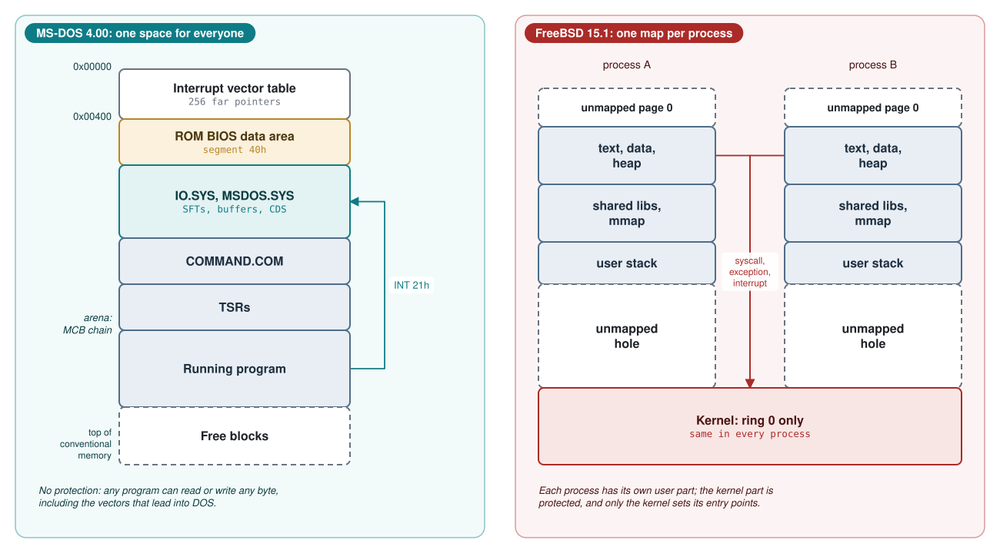
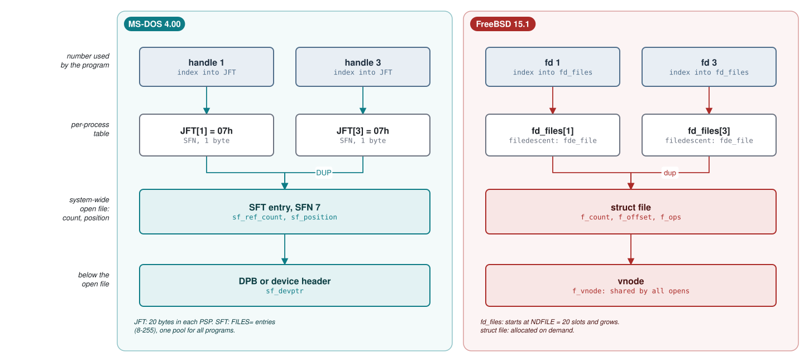
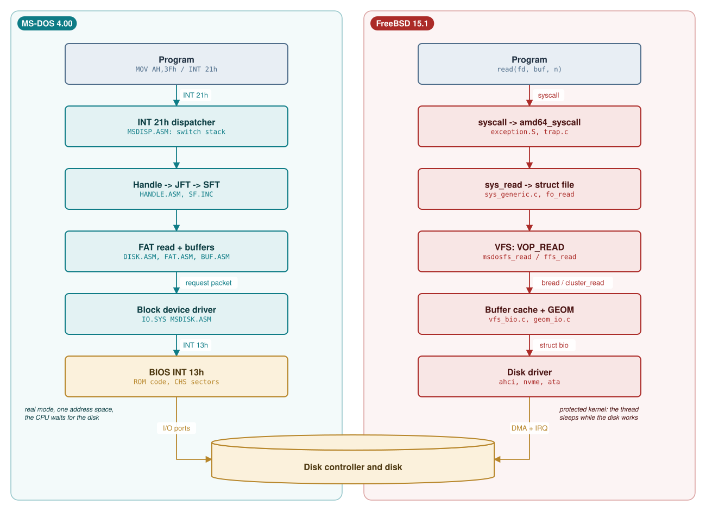
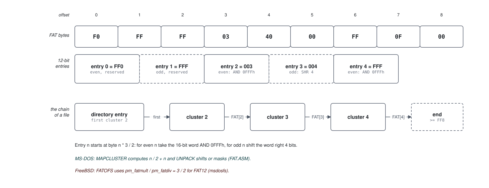

# Module 2: The kernel: system calls, files, memory and programs

Module 1 followed both systems from power-on to the first user program: `COMMAND.COM` on MS-DOS 4.00,
`/sbin/init` on FreeBSD 15.1. This module studies what runs underneath: the kernel. We look at how a
program asks for a service, how open files are represented, how both kernels implement the same FAT
file system, how memory is handed out, how programs are loaded and terminated, how drivers are
called, and what each kernel does about concurrency. Every claim is tied to a line of the MS-DOS 4.00
source or of FreeBSD 15.1 (`release/15.1.0`). Module 3 then looks at the shells on top.

**Learning goals.** After this module you can:

- explain the difference between a set of services in one shared real-mode address space (MS-DOS)
  and a protected, privileged kernel with per-process virtual address spaces (FreeBSD);
- trace a system call from the calling instruction to the handler and back in both systems, naming
  the stack used at each step and the way errors are reported (the carry flag in both);
- draw the data structures behind a file handle in both systems (JFT and SFT; descriptor table,
  `struct file` and vnode) and predict what `dup`, `dup2` and process creation do to them;
- decode a FAT12 entry by hand and match the decoding against `FAT.ASM` and `msdosfs_fat.c`;
- walk the MS-DOS memory arena (MCB chain) and read a FreeBSD process memory map (`procstat -v`);
- compare MS-DOS `EXEC` with FreeBSD `fork` plus `execve`, including what the child inherits;
- describe the MS-DOS installable device driver interface and FreeBSD's `cdevsw`, and explain why
  both use the word "strategy";
- explain why MS-DOS is not re-entrant and how TSR programs live with that, and contrast this with
  the locking discipline of an SMP kernel.

**Prerequisites.**

- Module 1 (boot), in particular SYSINIT and `CONFIG.SYS` on MS-DOS and `mi_startup` on FreeBSD.
- The lab environment from Module 0 (`00-lab.md`): the MS-DOS 4.00 floppy image
  `build/images/dos400.img`, `tools/dos_run.py` to run commands in it, DOSBox-X (or QEMU), and the
  FreeBSD 15.1 VM with `/usr/src`.
- C, and enough x86 assembly to read `MOV`, `PUSH`, `CALL` and `INT`. Real mode is reviewed below.

## 2.1 What "kernel" means in each system

### Real mode in brief

MS-DOS 4.00 runs the processor in *real mode*, the only mode of the 8086/8088. An address is a 16-bit
*segment* and a 16-bit *offset*, written `segment:offset`; the linear address is
`segment * 16 + offset`, so `0000:7C00` and `07C0:0000` both mean linear `0x7C00`. That gives 20 bits,
1 MB. A 16-byte unit starting at a multiple of 16 is a *paragraph*, and a segment value is a
paragraph number; MS-DOS measures memory blocks in paragraphs. The segment registers are `CS`, `DS`,
`SS` (the stack is `SS:SP`) and `ES`. Nothing checks an address: any program can read or write any
byte of the 1 MB.

The first 1024 bytes (linear `0x00000`-`0x003FF`) hold the *interrupt vector table* (IVT): 256
four-byte far pointers. `INT n` pushes `FLAGS`, `CS` and `IP`, clears the interrupt-enable flag `IF`
and jumps through the pointer at `0000:(4*n)`; `IRET` pops the three words. A software interrupt is
thus an indirect far call through a table that every program can rewrite. MS-DOS uses vectors 20h-2Ah
([`VECTOR.INC` lines 6-33](https://github.com/microsoft/MS-DOS/blob/2d04cacc5322951f187bb17e017c12920ac8ebe2/v4.0/src/INC/VECTOR.INC#L6-L33)): 20h terminate, 21h the system call, 22h-24h the terminate,
Ctrl-C and critical-error (hard error) handlers, 25h/26h absolute disk read/write, 27h
terminate-and-stay-resident, 28h the idle call and 2Ah critical sections.

### MS-DOS 4.00: a library behind INT 21h

The resident system is two files: `IO.SYS`, built from `v4.0/src/BIOS` with the built-in device
drivers ([`BIOS/MAKEFILE` lines 3-13](https://github.com/microsoft/MS-DOS/blob/2d04cacc5322951f187bb17e017c12920ac8ebe2/v4.0/src/BIOS/MAKEFILE#L3-L13)), and `MSDOS.SYS`, linked
from the objects in [`DOS/MSDOS.LNK`](https://github.com/microsoft/MS-DOS/blob/2d04cacc5322951f187bb17e017c12920ac8ebe2/v4.0/src/DOS/MSDOS.LNK#L1-L58)
([`DOS/MAKEFILE` lines 208-220](https://github.com/microsoft/MS-DOS/blob/2d04cacc5322951f187bb17e017c12920ac8ebe2/v4.0/src/DOS/MAKEFILE#L208-L220)). This module is about
`MSDOS.SYS`. A note on the tree: `DOS/DISPATCH.ASM` ("Created: MZ 30 March 1983",
[`DISPATCH.ASM` lines 4-8](https://github.com/microsoft/MS-DOS/blob/2d04cacc5322951f187bb17e017c12920ac8ebe2/v4.0/src/DOS/DISPATCH.ASM#L4-L8)) is not part of the build: nothing includes it and the link
list does not name it. The assembled dispatcher is `DISP.ASM`, included by `MSDISP.ASM`
([`MSDISP.ASM` lines 7-15](https://github.com/microsoft/MS-DOS/blob/2d04cacc5322951f187bb17e017c12920ac8ebe2/v4.0/src/DOS/MSDISP.ASM#L7-L15)); likewise `MS_TABLE.ASM` is assembled through
`INC/MSTABLE.ASM` and `MS_CODE.ASM` through `MSCODE.ASM`.

After boot, `MSDOS.SYS` behaves like a library shared by every program: one address space, one copy
of every DOS variable, no privilege levels, no memory protection. DOS does not even own its entry
point. Functions 25h and 35h set and get vectors, but they are plain stores and loads
(Listing 2.1).

**Listing 2.1** -- Setting an interrupt vector is a plain store into the IVT at segment 0 ([`GETSET.ASM` lines 682-744](https://github.com/microsoft/MS-DOS/blob/2d04cacc5322951f187bb17e017c12920ac8ebe2/v4.0/src/DOS/GETSET.ASM#L682-L744))

```asm
        procedure   $SET_INTERRUPT_VECTOR,NEAR
ASSUME  DS:NOTHING,ES:NOTHING

; Inputs:
;       AL = interrupt number
;       DS:DX is desired new interrupt vector
; Function:
;       Set the interrupt vector
; Returns:
;       None

        CALL    RECSET
        CLI                             ; Watch out!!!!! Folks sometimes use
        MOV     ES:[BX],DX              ;   this for hardware ints (like timer).
        MOV     ES:[BX+2],DS
        STI
        return
EndProc $SET_INTERRUPT_VECTOR
⋮
procedure   RECSET,NEAR
⋮
        XOR     BX,BX
        MOV     ES,BX
        MOV     BL,AL
        SHL     BX,1
        SHL     BX,1
        return
EndProc recset
```

`RECSET` points `ES:BX` at IVT entry `AL`. The `CLI`/`STI` pair is the only safeguard, and its
comment says why: programs hook hardware interrupts such as the timer this way. A program may also
write `0000:0084` (the INT 21h vector) directly. Resident utilities (TSRs, Section 2.2.4) and network
redirectors depend on this freedom, a reasonable design for a one-user 8088 with 256-640 KB of RAM and
no memory-management hardware.

### FreeBSD 15.1: a privileged kernel

FreeBSD runs the amd64 processor in 64-bit long mode with paging. The kernel executes at privilege
level 0; user programs execute at level 3 and can neither execute privileged instructions nor reach
memory that their page tables do not map. Every process has its own virtual address space, described
by a `struct vm_map` (Section 2.5). The kernel half of the address space is the same in every process
and is protected from user mode (with the page-table isolation mitigation enabled, most of it is not
even mapped while user code runs; this is why there is a `fast_syscall_pti` entry next to the one in
Listing 2.11). The only ways into the kernel are system calls, processor exceptions
(for example page faults) and hardware interrupts, and the entry points are set by the kernel alone.
Interrupt handlers are registered by kernel code; a user process that wants to react to events uses
signals, which the kernel delivers.

| | MS-DOS 4.00 | FreeBSD 15.1 (amd64) |
|---|---|---|
| CPU mode | real mode, 16-bit | long mode, 64-bit, paging |
| Privilege separation | none | kernel ring 0, user ring 3 |
| Address spaces | one, 1 MB, shared by DOS and all programs | one per process, plus the kernel |
| Who may change interrupt vectors | any program | only the kernel |
| Programs running at once | one (plus TSRs that borrow the CPU) | many processes, many threads, many CPUs |
| Kernel written in | 8086 assembly (MASM) | C, with a little assembly |



The left side is schematic: the ROM BIOS keeps its data at segment 40h (`BIOSEG`,
[`MSHARD.ASM` line 20](https://github.com/microsoft/MS-DOS/blob/2d04cacc5322951f187bb17e017c12920ac8ebe2/v4.0/src/BIOS/MSHARD.ASM#L20)), SYSINIT (Module 1) decides where the DOS tables go, and some
of them end up as blocks inside the arena. The right side is described exactly by the `vm_map` of each
process, which you will print with `procstat -v` in Study case 2.C.

## 2.2 Entering the kernel: INT 21h and the syscall instruction

### 2.2.1 The INT 21h calling convention

An MS-DOS system call puts a function number in `AH`, arguments in other registers, and executes
`INT 21h`. Pointers are segment:offset pairs, usually `DS:DX`. The handle, directory, memory and
process calls (39h and up) return with the carry flag clear on success, or set with an error code in
`AX`. The source documents each call in a comment block, for example read in
[`HANDLE.ASM` lines 328-341](https://github.com/microsoft/MS-DOS/blob/2d04cacc5322951f187bb17e017c12920ac8ebe2/v4.0/src/DOS/HANDLE.ASM#L328-L341).

**Example 2.1** -- Reading 512 bytes from an open handle (illustrative code, not from the tree)

```asm
        mov     ah, 3Fh         ; function 3Fh: read from file or device
        mov     bx, [handle]    ; handle returned by function 3Dh (open)
        mov     cx, 512         ; byte count
        mov     dx, buffer      ; DS:DX -> caller's buffer
        int     21h
        jc      read_failed     ; CF=1: AX = error code (6 = invalid handle)
        ; CF=0: AX = number of bytes actually read
```

### 2.2.2 The dispatcher

The INT 21h vector points at the label `COMMAND` in `DISP.ASM` (Listing 2.2). `INT` has already
pushed `FLAGS`, `CS` and `IP` on the *caller's* stack and cleared `IF`, so interrupts are off.

**Listing 2.2** -- The INT 21h entry point: range check, interrupt-off fast path, register save ([`DISP.ASM` lines 228-271](https://github.com/microsoft/MS-DOS/blob/2d04cacc5322951f187bb17e017c12920ac8ebe2/v4.0/src/DOS/DISP.ASM#L228-L271))

```asm
entry   COMMAND                         ; Interrupt call entry point (INT 21H)
⋮
        CMP     AH,MAXCOM
        JA      BadCall
⋮
SAVREGS:
        CMP     AH,GET_CURRENT_PDB
        JZ      $GET_CURRENT_PDB
        CMP     AH,GetCurrentPSP
        JZ      $GET_CURRENT_PDB
        CMP     AH,SET_CURRENT_PDB
        JZ      $SET_CURRENT_PDB
        CMP     AH,Set_CTRL_C_Trapping
        JNZ     chkprt
        JMP     $Set_CTRL_C_Trapping
chkprt:
        CMP     AH,SET_PRINTER_FLAG
        JZ      $Set_Printer_Flag
⋮
; Preserve all user's registers on his own stack.
;
        CALL    save_world
        MOV     [SaveDS],DS
        MOV     [SaveBX],BX
        MOV     BX,CS
        MOV     DS,BX
        ASSUME  DS:DOSGROUP
        INC     [INDOS]                 ; Flag that we're in the DOS
        XOR     AX,AX
        MOV     [USER_ID],AX
        MOV     AX,CurrentPDB           ; current process
        MOV     [PROC_ID],AX            ; Assume local machine for the moment
```

What to notice:

- A function number above `MAXCOM` (the last table index, 6Ch in MS-DOS 4.00,
  [`MS_TABLE.ASM` lines 234-237](https://github.com/microsoft/MS-DOS/blob/2d04cacc5322951f187bb17e017c12920ac8ebe2/v4.0/src/DOS/MS_TABLE.ASM#L234-L237) and [`MS_TABLE.ASM` lines 405-409](https://github.com/microsoft/MS-DOS/blob/2d04cacc5322951f187bb17e017c12920ac8ebe2/v4.0/src/DOS/MS_TABLE.ASM#L405-L409)) goes to
  `BADCALL`, which returns `AL=0` *without* setting carry, because that "may break some programs"
  ([`DISP.ASM` lines 192-200](https://github.com/microsoft/MS-DOS/blob/2d04cacc5322951f187bb17e017c12920ac8ebe2/v4.0/src/DOS/DISP.ASM#L192-L200)).
- Five calls (get/set current PSP, Ctrl-C state, printer flag) are answered at once, on the caller's
  stack with interrupts off, because a network server issues them "at *arbitrary* times"
  ([`DISP.ASM` lines 240-243](https://github.com/microsoft/MS-DOS/blob/2d04cacc5322951f187bb17e017c12920ac8ebe2/v4.0/src/DOS/DISP.ASM#L240-L243)).
- `save_world` ([`DISP.ASM` lines 444-456](https://github.com/microsoft/MS-DOS/blob/2d04cacc5322951f187bb17e017c12920ac8ebe2/v4.0/src/DOS/DISP.ASM#L444-L456)) pushes `ES DS BP DI SI DX CX BX AX` on the
  caller's stack. With the three words pushed by `INT` this forms the *user register frame*,
  `user_environ` ([`DOSSYM.INC` lines 58-71](https://github.com/microsoft/MS-DOS/blob/2d04cacc5322951f187bb17e017c12920ac8ebe2/v4.0/src/INC/DOSSYM.INC#L58-L71)). The handlers still receive the caller's
  registers directly (the dispatcher restores `BX` and `DS` just before the call), and they write
  results into the frame via `get_user_stack` ([`DISP.ASM` lines 545-548](https://github.com/microsoft/MS-DOS/blob/2d04cacc5322951f187bb17e017c12920ac8ebe2/v4.0/src/DOS/DISP.ASM#L545-L548)).
- `INC [INDOS]` marks "a DOS call is in progress": the *InDOS flag*.

The dispatcher then leaves the caller's stack (Listing 2.3).

**Listing 2.3** -- Saving the caller's SS:SP and switching to a DOS stack ([`DISP.ASM` lines 273-299](https://github.com/microsoft/MS-DOS/blob/2d04cacc5322951f187bb17e017c12920ac8ebe2/v4.0/src/DOS/DISP.ASM#L273-L299))

```asm
; Provide one level of reentrancy for INT 24 recallability.
;
        MOV     AX,[user_SP]
        MOV     [NSP],AX
        MOV     AX,[user_SS]
        MOV     [NSS],AX
        POP     AX
        PUSH    AX
        MOV     [user_SP],SP
        MOV     [user_SS],SS
;
; save user stack in his area for later returns (possibly from EXEC)
;
        MOV     DS,[CurrentPDB]
ASSUME  DS:NOTHING
        MOV     WORD PTR DS:[PDB_User_stack],SP
        MOV     WORD PTR DS:[PDB_User_stack+2],SS

        MOV     fSharing,0              ; allow redirection

        MOV     BX,CS                   ; no holes here.
        MOV     SS,BX
ASSUME  SS:DOSGROUP

entry   REDISP
        MOV     SP,OFFSET DOSGROUP:AUXSTACK ; Enough stack for interrupts
        STI                             ; stack is in our space now...
```

The caller's `SS:SP`, which now points at the register frame, is saved in the globals
`User_SS:User_SP` and in the `PDB_User_stack` field of the current program's *Program Segment
Prefix* (PSP, the 256-byte header in front of every program, Section 2.3). The previous pair goes to
`NSS:NSP`, "one level of reentrancy for INT 24". Then `SS` becomes the DOS segment (`DOSGROUP`), `SP`
the top of `AUXSTACK`, and only then are interrupts enabled.

MS-DOS has three internal stacks of `StackSize` = 180h (384) bytes, `AUXSTACK`, `DSKSTACK` and
`IOSTACK` ([`MS_DATA.ASM` lines 138-157](https://github.com/microsoft/MS-DOS/blob/2d04cacc5322951f187bb17e017c12920ac8ebe2/v4.0/src/INC/MS_DATA.ASM#L138-L157)). The dispatcher picks one per call
(Listing 2.4).

**Listing 2.4** -- Choosing a stack and calling through the dispatch table ([`DISP.ASM` lines 331-399](https://github.com/microsoft/MS-DOS/blob/2d04cacc5322951f187bb17e017c12920ac8ebe2/v4.0/src/DOS/DISP.ASM#L331-L399))

```asm
        OR      AH,AH
        JZ      DSKROUT                 ; ABORT
⋮
        CMP     AH,GetExtendedError
        JZ      DISPCALL
⋮
        CMP     AH,12
        JA      DSKROUT
        CMP     [ERRORMODE],0           ; Are we in an INT 24?
        JNZ     DISPCALL                ; Stay on AUXSTACK if INT 24.
        MOV     SP,OFFSET DOSGROUP:IOSTACK
        JMP     SHORT DISPCALL
⋮
DSKROUT:
        MOV     [USER_IN_AX],AX         ; Remember what user is doing
        MOV     [EXTERR_LOCUS],errLOC_Unk ; Default
        MOV     [ERRORMODE],0           ; Cannot make non 1-12 calls in
        MOV     [WPERR],-1              ; error mode, so good place to make
⋮
        MOV     IdleInt,0
        MOV     SP,OFFSET DOSGROUP:DSKSTACK
        TEST    [CNTCFLAG],-1
        JZ      DISPCALL                ; Extra ^C checking is disabled
        PUSH    AX
        invoke  DSKSTATCHK
        POP     AX
DISPCALL:
        MOV     BX,CS:Dispatch[BX]
        XCHG    BX,SaveBX
        MOV     DS,SaveDS
⋮
        ASSUME  DS:NOTHING
        CALL    SaveBX
```

| Stack | Used for | Why |
|---|---|---|
| `AUXSTACK` | briefly by every call; throughout for 59h and for calls 01h-0Ch made inside an INT 24h handler | must work while a critical-error handler is active |
| `IOSTACK` | calls 01h-0Ch (CP/M-style character I/O) | they may wait for a key and issue INT 28h |
| `DSKSTACK` | everything else, including 00h (terminate) | disk and file calls, which may raise INT 24h |

The dispatch itself is `MOV BX,CS:Dispatch[BX]`, a 16-bit near address from a table indexed by
`AH*2`, and `CALL SaveBX`. Listing 2.5 shows part of the table.

**Listing 2.5** -- Part of the INT 21h dispatch table (AH = 3Ch-4Fh) ([`MS_TABLE.ASM` lines 334-357](https://github.com/microsoft/MS-DOS/blob/2d04cacc5322951f187bb17e017c12920ac8ebe2/v4.0/src/DOS/MS_TABLE.ASM#L334-L357))

```asm
;   File Group
        short_addr  $CREAT                          ; 60     3C
        short_addr  $OPEN                           ; 61     3D
        short_addr  $CLOSE                          ; 62     3E
        short_addr  $READ                           ; 63     3F
        short_addr  $WRITE                          ; 64     40
        short_addr  $UNLINK                         ; 65     41
        short_addr  $LSEEK                          ; 66     42
        short_addr  $CHMOD                          ; 67     43
        short_addr  $IOCTL                          ; 68     44
        short_addr  $DUP                            ; 69     45
        short_addr  $DUP2                           ; 70     46
        short_addr  $CURRENT_DIR                    ; 71     47
;    Memory Group
        short_addr  $ALLOC                          ; 72     48
        short_addr  $DEALLOC                        ; 73     49
        short_addr  $SETBLOCK                       ; 74     4A
;    Process Group
        short_addr  $EXEC                           ; 75     4B
        short_addr  $EXIT                           ; 76     4C
        short_addr  $WAIT                           ; 77     4D
        short_addr  $FIND_FIRST                     ; 78     4E
;   Special Group
        short_addr  $FIND_NEXT                      ; 79     4F
```

The source labels this group `XENIX CALLS` ([`MS_TABLE.ASM` lines 329-336](https://github.com/microsoft/MS-DOS/blob/2d04cacc5322951f187bb17e017c12920ac8ebe2/v4.0/src/DOS/MS_TABLE.ASM#L329-L336)): the handle,
directory, memory and process calls added for MS-DOS 2.x ([`ALLOC.ASM` lines 5-6](https://github.com/microsoft/MS-DOS/blob/2d04cacc5322951f187bb17e017c12920ac8ebe2/v4.0/src/DOS/ALLOC.ASM#L5-L6)) follow
the Unix model (XENIX was Microsoft's Unix). That is why `open`/`read`/`dup`/`exec` can be compared
across the two systems almost name for name.

### 2.2.3 Returning and reporting errors

Handle-style calls end by jumping to `SYS_RET_OK` or `SYS_RET_ERR` (Listing 2.6), which clear or set
the carry bit in the *saved* flags word of the caller's frame and store `AX` there. `IRET` reloads
`FLAGS` from the frame, so the caller sees `CF` as written.

**Listing 2.6** -- Success and error returns: the carry bit is set in the caller's saved flags ([`MS_CODE.ASM` lines 292-310](https://github.com/microsoft/MS-DOS/blob/2d04cacc5322951f187bb17e017c12920ac8ebe2/v4.0/src/DOS/MS_CODE.ASM#L292-L310))

```asm
procedure   SYS_RETURN,NEAR
        ASSUME  DS:NOTHING,ES:NOTHING
entry   SYS_RET_OK
        invoke  FETCHI_CHECK            ; TAG checking for FETCHI
        invoke  get_user_stack
        AND     [SI.user_F],NOT f_Carry ; turn off user's carry flag
        JMP     SHORT DO_RET            ; carry is now clear

entry   SYS_RET_ERR
        XOR     AH,AH                   ; hack to allow for smaller error rets
        invoke  ETAB_LK                 ; Make sure code is OK, EXTERR gets set
        CALL    ErrorMap
entry   From_GetSet
        invoke  get_user_stack
        OR      [SI.user_F],f_Carry     ; signal carry to user
        STC                             ; also, signal internal error
DO_RET:
        MOV     [SI.user_AX],AX         ; Really only sets AH
        return
```

`ETAB_LK` and `ErrorMap` record the real error for function 59h (Get Extended Error) and, if needed,
substitute a code the call was documented to return in older versions, from the per-call list
`I21_MAP_E_TAB` ([`MS_TABLE.ASM` lines 32-62](https://github.com/microsoft/MS-DOS/blob/2d04cacc5322951f187bb17e017c12920ac8ebe2/v4.0/src/DOS/MS_TABLE.ASM#L32-L62)). Read, for instance, may only return 6
(invalid handle) or 5 (access denied) ([`MS_TABLE.ASM` line 78](https://github.com/microsoft/MS-DOS/blob/2d04cacc5322951f187bb17e017c12920ac8ebe2/v4.0/src/DOS/MS_TABLE.ASM#L78)). Finally `LEAVEDOS`
([`DISP.ASM` lines 405-418](https://github.com/microsoft/MS-DOS/blob/2d04cacc5322951f187bb17e017c12920ac8ebe2/v4.0/src/DOS/DISP.ASM#L405-L418)) disables interrupts, decrements InDOS, reloads the caller's
`SS:SP`, stores `AL` into the frame (the CP/M-style calls return only `AL`), restores `NSS:NSP`, pops
the registers and executes `IRET`.

### 2.2.4 InDOS, the critical-error flag, and why MS-DOS is not re-entrant

A routine is *re-entrant* if it can be entered again, for example from an interrupt handler, before
an earlier activation finishes, without corrupting either. MS-DOS is not: the caller's stack pointer
lives in one global pair with one spare for INT 24h; the three stacks are at fixed addresses, so a
second disk call would overwrite the first one's return addresses on `DSKSTACK`; and dozens of
globals (current SFT, current DPB, transfer address, path buffers) describe the call in progress.

A program that may call DOS from an interrupt handler must therefore test two adjacent flags
(Listing 2.7). Function 34h returns the address of `INDOS` in `ES:BX`
([`MISC.ASM` lines 131-138](https://github.com/microsoft/MS-DOS/blob/2d04cacc5322951f187bb17e017c12920ac8ebe2/v4.0/src/DOS/MISC.ASM#L131-L138)). `ErrorMode`, the *critical-error flag*, is non-zero while
the INT 24h handler runs; the source requires it to be the byte before `INDOS`, at `ES:BX-1`.

**Listing 2.7** -- InDOS and the critical-error flag open the "swappable" data area ([`CONST2.ASM` lines 95-106](https://github.com/microsoft/MS-DOS/blob/2d04cacc5322951f187bb17e017c12920ac8ebe2/v4.0/src/INC/CONST2.ASM#L95-L106))

```asm
;
; WARNING!!!  PRINT and PSPRINT *REQUIRE* ErrorMode to precede INDOS.
; Also, IBM server 1.0 requires this also.
;
        EVEN                    ; Force swap area to start on word boundry
PUBLIC  SWAP_START
SWAP_START      LABEL BYTE
        I_am    ErrorMode,BYTE          ; Flag for INT 24 processing
        I_am    INDOS,BYTE,<0>          ; DOS status for interrupt processing
        I_am    WPErr,BYTE,<-1>         ; Write protect error flag
        I_am    EXTERR_LOCUS,BYTE       ; Extended Error Locus
        I_am    EXTERR,WORD,<0>         ; Extended Error code
```

The per-call state lies between `SWAP_START` and `SWAP_END` ([`MS_DATA.ASM` lines 179-180](https://github.com/microsoft/MS-DOS/blob/2d04cacc5322951f187bb17e017c12920ac8ebe2/v4.0/src/INC/MS_DATA.ASM#L179-L180));
function 5D06h returns its address and size ([`SRVCALL.ASM` lines 96-99](https://github.com/microsoft/MS-DOS/blob/2d04cacc5322951f187bb17e017c12920ac8ebe2/v4.0/src/DOS/SRVCALL.ASM#L96-L99)), so a network
server or task switcher can save and restore it and keep several DOS calls in progress with one copy
of DOS: the closest MS-DOS comes to a per-thread kernel context.

A *TSR* (terminate and stay resident program, Section 2.6) that calls DOS from a hotkey or timer
interrupt must wait until both flags are 0. That alone would starve it at the `C>` prompt, where
`COMMAND.COM` sits inside function 0Ah (buffered input,
[`TCODE.ASM` lines 359-361](https://github.com/microsoft/MS-DOS/blob/2d04cacc5322951f187bb17e017c12920ac8ebe2/v4.0/src/CMD/COMMAND/TCODE.ASM#L359-L361)) with InDOS = 1. Hence INT 28h, the *idle
interrupt*: while a console call waits for a key, DOS keeps calling `SPOOLINT`
([`CPMIO.ASM` lines 283-305](https://github.com/microsoft/MS-DOS/blob/2d04cacc5322951f187bb17e017c12920ac8ebe2/v4.0/src/DOS/CPMIO.ASM#L283-L305) shows the polling loop of function 07h).

**Listing 2.8** -- SPOOLINT: INT 28h is issued only for calls 01h-0Ch and never during INT 24h ([`CTRLC.ASM` lines 168-189](https://github.com/microsoft/MS-DOS/blob/2d04cacc5322951f187bb17e017c12920ac8ebe2/v4.0/src/DOS/CTRLC.ASM#L168-L189))

```asm
;
; SpoolInt - signal processes that the DOS is truly idle.  We are allowed to
; do this ONLY if we are working on a 1-12 system call AND if we are not in
; the middle of an INT 24.
;
procedure   SPOOLINT,NEAR
        PUSHF
        test    IdleInt,-1
        jz      POPFRet
        test    ErrorMode,-1
        jnz     POPFRet
;
; Note that we are going to allow an external program to issue system calls
; at this time.  We MUST preserve IdleInt across this.
;
        PUSH    WORD PTR IdleInt
        INT     int_spooler
        POP     WORD PTR IdleInt
POPFRET:
        POPF
        return
EndProc SPOOLINT
```

`IdleInt` is set at entry ([`DISP.ASM` line 317](https://github.com/microsoft/MS-DOS/blob/2d04cacc5322951f187bb17e017c12920ac8ebe2/v4.0/src/DOS/DISP.ASM#L317)) and cleared for every call that runs
on `DSKSTACK` ([`DISP.ASM` lines 372-376](https://github.com/microsoft/MS-DOS/blob/2d04cacc5322951f187bb17e017c12920ac8ebe2/v4.0/src/DOS/DISP.ASM#L372-L376)). So when INT 28h fires, the interrupted call is
on `IOSTACK`, and the handler may issue calls above 0Ch, which use `DSKSTACK`. The dispatcher's own
comments name `PRINT` as a program that calls DOS "at INT 28 ... time"
([`DISP.ASM` lines 334-336](https://github.com/microsoft/MS-DOS/blob/2d04cacc5322951f187bb17e017c12920ac8ebe2/v4.0/src/DOS/DISP.ASM#L334-L336)). Exercise 2.5 applies these rules.

### 2.2.5 FreeBSD: from read() to sys_read()

A C program calls `read(fd, buf, n)`. In FreeBSD 15 the stubs live in `libsys`; `read` is
*interposed* (a threading library may wrap it), so libc's `read` calls through a table
([`read.c` lines 37-42](https://github.com/freebsd/freebsd-src/blob/96841ea08dcfa84b954a32dc5ae1a26c28966cf4/lib/libc/sys/read.c#L37-L42)) whose slot points at `__sys_read`
([`interposing_table.c` line 51](https://github.com/freebsd/freebsd-src/blob/96841ea08dcfa84b954a32dc5ae1a26c28966cf4/lib/libsys/interposing_table.c#L51)). Each stub is a generated one-line assembly file
([`Makefile.sys` lines 151-164](https://github.com/freebsd/freebsd-src/blob/96841ea08dcfa84b954a32dc5ae1a26c28966cf4/lib/libsys/Makefile.sys#L151-L164)) expanding the macros of Listing 2.9.

**Listing 2.9** -- The amd64 system call stub: number in %eax, then syscall, then "jb cerror" ([`SYS.h` lines 38-59](https://github.com/freebsd/freebsd-src/blob/96841ea08dcfa84b954a32dc5ae1a26c28966cf4/lib/libsys/amd64/SYS.h#L38-L59))

```c
#define _SYSCALL(name)                                                  \
                        mov $SYS_##name, %eax;                          \
                        movq %rcx, %r10;                                \
                        syscall

#ifndef _SYSCALL_BODY
#define _SYSCALL_BODY(name)                                             \
                        _SYSCALL(name);                                 \
                        jb HIDENAME(cerror);                            \
                        ret
#endif

#define RSYSCALL(name)  ENTRY(__sys_##name);                            \
                        WEAK_REFERENCE(__sys_##name, name);             \
                        WEAK_REFERENCE(__sys_##name, _##name);          \
                        _SYSCALL_BODY(name);                            \
                        END(__sys_##name)

#define PSEUDO(name)    ENTRY(__sys_##name);                            \
                        WEAK_REFERENCE(__sys_##name, _##name);          \
                        _SYSCALL_BODY(name);                            \
                        END(__sys_##name)
```

`_SYSCALL` puts the call number in `%eax`, copies the fourth argument from `%rcx` to `%r10` (the
`syscall` instruction overwrites `%rcx` with the return address and `%r11` with `RFLAGS`) and
executes `syscall`. Arguments travel in `%rdi, %rsi, %rdx, %r10, %r8, %r9`. Afterwards `jb` ("jump if
below") jumps if the **carry flag** is set, to `cerror` (Listing 2.10), which stores the error number
in `errno` and returns -1: the same user-side convention as MS-DOS, hidden behind `errno`.

**Listing 2.10** -- cerror: error code from %rax into errno, return -1 ([`cerror.S` lines 46-53](https://github.com/freebsd/freebsd-src/blob/96841ea08dcfa84b954a32dc5ae1a26c28966cf4/lib/libsys/amd64/cerror.S#L46-L53))

```asm
HIDENAME(cerror):
        pushq   %rax
        call    PIC_PLT(CNAME(__error))
        popq    %rcx
        movl    %ecx,(%rax)
        movq    $-1,%rax
        movq    $-1,%rdx
        ret
```

`syscall` switches to ring 0 and jumps to the address the kernel wrote into the `MSR_LSTAR` register
([`machdep.c` lines 1189-1190](https://github.com/freebsd/freebsd-src/blob/96841ea08dcfa84b954a32dc5ae1a26c28966cf4/sys/amd64/amd64/machdep.c#L1189-L1190)): `fast_syscall` (Listing 2.11). The instruction
does not switch stacks, so the first job is to find the current thread's kernel stack.

**Listing 2.11** -- fast_syscall: switch to the kernel stack, build a trap frame, call amd64_syscall ([`exception.S` lines 525-570](https://github.com/freebsd/freebsd-src/blob/96841ea08dcfa84b954a32dc5ae1a26c28966cf4/sys/amd64/amd64/exception.S#L525-L570))

```asm
IDTVEC(fast_syscall)
        swapgs
fast_syscall_common:
        movq    %rsp,PCPU(SCRATCH_RSP)
        movq    PCPU(RSP0),%rsp
        /* Now emulate a trapframe. Make the 8 byte alignment odd for call. */
        subq    $TF_SIZE,%rsp
        /* defer TF_RSP till we have a spare register */
        movq    %r11,TF_RFLAGS(%rsp)
        movq    %rcx,TF_RIP(%rsp)       /* %rcx original value is in %r10 */
        movq    PCPU(SCRATCH_RSP),%r11  /* %r11 already saved */
        movq    %r11,TF_RSP(%rsp)       /* user stack pointer */
⋮
        movq    %rax,TF_RAX(%rsp)       /* syscall number */
        movq    %rdx,TF_RDX(%rsp)       /* arg 3 */
        movq    %r10,TF_RCX(%rsp)       /* arg 4 */
⋮
        sti
⋮
        movq    %rdi,TF_RDI(%rsp)       /* arg 1 */
        movq    %rsi,TF_RSI(%rsp)       /* arg 2 */
        movq    %r8,TF_R8(%rsp)         /* arg 5 */
        movq    %r9,TF_R9(%rsp)         /* arg 6 */
⋮
        movq    PCPU(CURTHREAD),%rdi
        movq    %rsp,TD_FRAME(%rdi)
        movl    TF_RFLAGS(%rsp),%esi
        andl    $PSL_T,%esi
        call    amd64_syscall
```

`swapgs` makes `%gs` point at this CPU's private data (`PCPU`). The user `%rsp` is parked in a per-CPU
slot, `%rsp` is loaded with `PCPU(RSP0)`, the top of the current thread's kernel stack, and a
`struct trapframe` is filled with the user registers; `sti` follows once the frame is safe. This is
Listing 2.3 again, with one decisive difference: the kernel stack is per thread, so thousands of
system calls can be in progress at once, while MS-DOS has one set of stacks for the whole machine.

`amd64_syscall` ([`trap.c` lines 1257-1307](https://github.com/freebsd/freebsd-src/blob/96841ea08dcfa84b954a32dc5ae1a26c28966cf4/sys/amd64/amd64/trap.c#L1257-L1307)) calls the machine-independent
`syscallenter()` ([`subr_syscall.c` lines 52-214](https://github.com/freebsd/freebsd-src/blob/96841ea08dcfa84b954a32dc5ae1a26c28966cf4/sys/kern/subr_syscall.c#L52-L214)), which fetches the arguments, calls `(se->sy_call)(td, sa->args)` ([`subr_syscall.c` lines 192-199](https://github.com/freebsd/freebsd-src/blob/96841ea08dcfa84b954a32dc5ae1a26c28966cf4/sys/kern/subr_syscall.c#L192-L199)) and finally `sv_set_syscall_retval` ([`subr_syscall.c` line 211](https://github.com/freebsd/freebsd-src/blob/96841ea08dcfa84b954a32dc5ae1a26c28966cf4/sys/kern/subr_syscall.c#L211)). `cpu_fetch_syscall_args` takes the number from `tf_rax`, looks
it up in `p_sysent->sv_table` and copies the six register arguments from the trap frame
([`trap.c` lines 1132-1164](https://github.com/freebsd/freebsd-src/blob/96841ea08dcfa84b954a32dc5ae1a26c28966cf4/sys/amd64/amd64/trap.c#L1132-L1164)).

`sv_table` is the *sysent* table, an array of `struct sysent` ([`sysent.h` lines 65-75](https://github.com/freebsd/freebsd-src/blob/96841ea08dcfa84b954a32dc5ae1a26c28966cf4/sys/sys/sysent.h#L65-L75)) with the
handler and argument count of each call. It is generated from `syscalls.master`; Listing 2.12
is the entry for `read`, number 3, and [`init_sysent.c` line 72](https://github.com/freebsd/freebsd-src/blob/96841ea08dcfa84b954a32dc5ae1a26c28966cf4/sys/kern/init_sysent.c#L72) is the generated line
pointing at `sys_read`.

**Listing 2.12** -- The read entry in syscalls.master ([`syscalls.master` lines 136-142](https://github.com/freebsd/freebsd-src/blob/96841ea08dcfa84b954a32dc5ae1a26c28966cf4/sys/kern/syscalls.master#L136-L142))

```text
3       AUE_READ        STD|CAPENABLED {
                ssize_t read(
                    int fd,
                    _Out_writes_bytes_(nbyte) void *buf,
                    size_t nbyte
                );
        }
```

A note on *copyin*. The pointer `buf` is a *user* address, and the kernel never dereferences it
directly. `sys_read` describes it in a `struct uio` marked `UIO_USERSPACE`
([`sys_generic.c` lines 191-208](https://github.com/freebsd/freebsd-src/blob/96841ea08dcfa84b954a32dc5ae1a26c28966cf4/sys/kern/sys_generic.c#L191-L208)); the data is moved at the end of the chain by `uiomove`,
which uses `copyout` (Study case 2.A). String arguments, as in `execve`, are fetched with
`copyinstr` ([`kern_exec.c` lines 1569-1583](https://github.com/freebsd/freebsd-src/blob/96841ea08dcfa84b954a32dc5ae1a26c28966cf4/sys/kern/kern_exec.c#L1569-L1583)). These routines turn a bad user address into
`EFAULT` instead of a crash. MS-DOS just uses the caller's `DS:DX`, normalised into the global
transfer address `DMAADD` (`Align_Buffer`, [`HANDLE.ASM` lines 431-445](https://github.com/microsoft/MS-DOS/blob/2d04cacc5322951f187bb17e017c12920ac8ebe2/v4.0/src/DOS/HANDLE.ASM#L431-L445)): there is nothing
to check, because no address is forbidden.

The result is written back by `cpu_set_syscall_retval` (Listing 2.13).

**Listing 2.13** -- Writing the result: clear PSL_C on success, set it and put the errno value in %rax on failure ([`vm_machdep.c` lines 544-584](https://github.com/freebsd/freebsd-src/blob/96841ea08dcfa84b954a32dc5ae1a26c28966cf4/sys/amd64/amd64/vm_machdep.c#L544-L584))

```c
void
cpu_set_syscall_retval(struct thread *td, int error)
{
        struct trapframe *frame;

        frame = td->td_frame;
        if (__predict_true(error == 0)) {
                frame->tf_rax = td->td_retval[0];
                frame->tf_rdx = td->td_retval[1];
                frame->tf_rflags &= ~PSL_C;
                return;
        }
⋮
        switch (error) {
        case ERESTART:
⋮
                frame->tf_rip -= frame->tf_err;
                frame->tf_r10 = frame->tf_rcx;
                set_pcb_flags(td->td_pcb, PCB_FULL_IRET);
                break;
⋮
        default:
                frame->tf_rax = error;
                frame->tf_rflags |= PSL_C;
                break;
        }
}
```

`PSL_C` is the carry bit of `RFLAGS`. This is `SYS_RET_OK`/`SYS_RET_ERR` from Listing 2.6 again,
implemented the same way: by editing the caller's saved flags. `ERESTART` rewinds `%rip` by `tf_err`,
which `fast_syscall` set to 2, the length of `syscall` ([`exception.S` line 554](https://github.com/freebsd/freebsd-src/blob/96841ea08dcfa84b954a32dc5ae1a26c28966cf4/sys/amd64/amd64/exception.S#L554)),
so an interrupted call is transparently re-executed. The exit path restores the user registers and
executes `sysretq` ([`exception.S` lines 582-600](https://github.com/freebsd/freebsd-src/blob/96841ea08dcfa84b954a32dc5ae1a26c28966cf4/sys/amd64/amd64/exception.S#L582-L600)).


| Step | MS-DOS 4.00 | FreeBSD 15.1 amd64 |
|---|---|---|
| Instruction | `INT 21h` | `syscall` |
| Function number | `AH` | `%eax` (`SYS_read` = 3) |
| Arguments | registers; pointers as `DS:DX` etc. | `%rdi %rsi %rdx %r10 %r8 %r9` |
| Entry point set by | IVT entry 21h (writable by anyone) | MSR written by the kernel |
| Caller state saved | on the caller's stack (`save_world`) | `struct trapframe` on the thread's kernel stack |
| Kernel stack | one of 3 global 384-byte stacks | per-thread kernel stack |
| Table | `DISPATCH`, 16-bit near pointers | `sysent[]`, generated from `syscalls.master` |
| Success | `CF=0`, result in `AX` | `CF=0`, result in `%rax` (and `%rdx`) |
| Failure | `CF=1`, `AX` = DOS error code | `CF=1`, `%rax` = errno value; libc sets `errno`, returns -1 |
| Concurrent calls | one at a time (InDOS) | many, one per thread |

## 2.3 Files and handles

### MS-DOS: PSP, Job File Table and System File Table

Every MS-DOS program starts with a *Program Segment Prefix* (PSP), the *process data block* (PDB) of
the source (Listing 2.14). `PDB_JFN_Table` is the *Job File Table* (JFT): 20 bytes (`FilPerProc`), one
per handle, each holding `0FFh` (unused) or a *System File Number* (SFN), an index into the global
*System File Table* (SFT). A handle is just an index into the JFT. By the field sizes, the JFT is at
PSP offset 18h, the environment segment at 2Ch, and `PDB_JFN_Length`/`PDB_JFN_Pointer` at 32h/34h;
these let a program move and enlarge its JFT (function 67h, [`HANDLE.ASM` lines 205-326](https://github.com/microsoft/MS-DOS/blob/2d04cacc5322951f187bb17e017c12920ac8ebe2/v4.0/src/DOS/HANDLE.ASM#L205-L326)).

**Listing 2.14** -- The PSP ("process data block"): JFT, environment, saved user stack ([`PDB.INC` lines 8-34](https://github.com/microsoft/MS-DOS/blob/2d04cacc5322951f187bb17e017c12920ac8ebe2/v4.0/src/INC/PDB.INC#L8-L34))

```asm
FilPerProc          EQU     20
⋮
Process_data_block  STRUC
PDB_Exit_Call       DW      ?           ; INT int_abort system terminate
PDB_block_len       DW      ?           ; size of execution block
                    DB      ?
PDB_CPM_Call        DB  5 DUP (?)       ; ancient call to system
PDB_Exit            DD      ?           ; pointer to exit routine
PDB_Ctrl_C          DD      ?           ; pointer to ^C routine
PDB_Fatal_abort     DD      ?           ; pointer to fatal error
⋮
PDB_Parent_PID      DW      ?           ; PID of parent (terminate PID)
PDB_JFN_Table       DB  FilPerProc DUP (?)
⋮
PDB_environ         DW      ?           ; seg addr of environment
⋮
PDB_User_stack      DD      ?           ; stack of self during system calls
PDB_JFN_Length      DW      ?           ; number of handles allowed
PDB_JFN_Pointer     DD      ?           ; pointer to JFN table
PDB_Next_PDB        DD      ?           ; pointer to nested PDB's
```

An SFT entry describes one *open file*: mode, reference count, device or drive, first cluster, size
and current position (Listing 2.15); the fields add up to 3Bh (59) bytes. `MSDOS.SYS` has a built-in
table of `sf_default_number` = 5 entries ([`CONST2.ASM` lines 51-56](https://github.com/microsoft/MS-DOS/blob/2d04cacc5322951f187bb17e017c12920ac8ebe2/v4.0/src/INC/CONST2.ASM#L51-L56)). `FILES=` (8 to 255,
[`SYSCONF.ASM` lines 395-399](https://github.com/microsoft/MS-DOS/blob/2d04cacc5322951f187bb17e017c12920ac8ebe2/v4.0/src/BIOS/SYSCONF.ASM#L395-L399); default 8, [`SYSINIT1.ASM` line 272](https://github.com/microsoft/MS-DOS/blob/2d04cacc5322951f187bb17e017c12920ac8ebe2/v4.0/src/BIOS/SYSINIT1.ASM#L272))
makes SYSINIT chain a second table of `FILES - 5` entries behind it
([`SYSINIT1.ASM` lines 982-1001](https://github.com/microsoft/MS-DOS/blob/2d04cacc5322951f187bb17e017c12920ac8ebe2/v4.0/src/BIOS/SYSINIT1.ASM#L982-L1001)). When all are in use, every program's open fails with
error 4, "too many open files".

**Listing 2.15** -- The System File Table entry (abridged) ([`SF.INC` lines 25-84](https://github.com/microsoft/MS-DOS/blob/2d04cacc5322951f187bb17e017c12920ac8ebe2/v4.0/src/INC/SF.INC#L25-L84))

```asm
sf_entry        STRUC
sf_ref_count    DW      ?               ; number of processes sharing entry
                                        ;   if FCB then ref count
sf_mode         DW      ?               ; mode of access or high bit on if FCB
sf_attr         DB      ?               ; attribute of file
sf_flags        DW      ?               ;Bits 8-15
⋮
sf_devptr       DD      ?               ; Points to DPB if local file, points
⋮
sf_firclus      DW      ?               ; First cluster of file (bit 15 = 0)
sf_time         DW      ?               ; Time associated with file
sf_date         DW      ?               ; Date associated with file
sf_size         DD      ?               ; Size associated with file
sf_position     DD      ?               ; Read/Write pointer or LRU count for FCBs
⋮
sf_cluspos      DW      ?               ; Position of last cluster accessed
sf_dirsec       DD      ?               ; Sector number of directory sector for
                                        ; for this file
sf_dirpos       DB      ?               ; Offset of this entry in the above
⋮
sf_name         DB      11 DUP (?)      ; 11 character name that is in the
⋮
sf_chain        DD      ?               ; link to next SF
sf_UID          DW      ?
sf_PID          DW      ?
sf_MFT          DW      ?
sf_lstclus      DW      ?               ;AN009; Last cluster accessed
sf_IFS_HDR      DD      ?
sf_entry        ENDS
```

`pJFNFromHandle` checks the handle against `PDB_JFN_Length` and returns a pointer to the JFT byte
([`UTIL.ASM` lines 59-74](https://github.com/microsoft/MS-DOS/blob/2d04cacc5322951f187bb17e017c12920ac8ebe2/v4.0/src/DOS/UTIL.ASM#L59-L74)); Listing 2.16 does the rest. The diagram after it shows
example values.

**Listing 2.16** -- JFT byte -> SFN -> SFT entry, walking the chain of SFT tables ([`UTIL.ASM` lines 90-137](https://github.com/microsoft/MS-DOS/blob/2d04cacc5322951f187bb17e017c12920ac8ebe2/v4.0/src/DOS/UTIL.ASM#L90-L137))

```asm
procedure   SFFromHandle,NEAR
        ASSUME  CS:DOSGROUP,DS:NOTHING,ES:NOTHING,SS:NOTHING
        CALL    pJFNFromHandle          ; get jfn pointer
        retc                            ; return if error
        CMP     BYTE PTR ES:[DI],-1     ; unused handle
⋮
GetSF:
        SaveReg <BX>                    ; save handle
        MOV     BL,BYTE PTR ES:[DI]     ; get SFN
        XOR     BH,BH                   ; ignore upper half
        CALL    SFFromSFN               ; get real sf spot
⋮
procedure   SFFromSFN,NEAR
        ASSUME  CS:DOSGROUP,DS:NOTHING,ES:NOTHING,SS:NOTHING
        LES     DI,[SFT_Addr]           ; get pointer to beginning of table
ScanLoop:
        CMP     BX,ES:[DI].SFCount      ; is handle in this table?
        JB      GetOffset               ; yes, go grab it
        SUB     BX,ES:[DI].SFCount
        LES     DI,ES:[DI].SFLink       ; get next table segment
        CMP     DI,-1                   ; end of tables?
⋮
GetOffset:
        SaveReg <AX>                    ; save AX
        MOV     AX,SIZE SF_Entry        ; put it in a nice place
        MUL     BL                      ; times size
        ADD     DI,AX                   ; offset by size
        RestoreReg  <AX>                ; get world back
        ADD     DI,SFTable              ; offset into structure
```

```text
 PSP (per program)            System File Table (global, FILES= entries)
 +---------------+            +-----------------------------------+
 | JFT[0] = 01h -+--.         | SFN 0: AUX ...                    |
 | JFT[1] = 01h -+--+-------> | SFN 1: CON  ref_count=3 -> device |
 | JFT[2] = 01h -+--'         | ...                               |
 | JFT[5] = 07h -+----------> | SFN 7: A:LETTER.TXT ref_count=1   |
 | JFT[6] = 0FFh |  (free)    |        -> DPB of A:, position     |
 +---------------+            +-----------------------------------+
```

Function 45h (`DUP`, [`HANDLE.ASM` lines 709-727](https://github.com/microsoft/MS-DOS/blob/2d04cacc5322951f187bb17e017c12920ac8ebe2/v4.0/src/DOS/HANDLE.ASM#L709-L727)) finds a free JFT slot with `JFNFree`,
copies the SFN into it, and `DOS_Dup_Direct` increments `sf_ref_count`
([`DUP.ASM` lines 50-63](https://github.com/microsoft/MS-DOS/blob/2d04cacc5322951f187bb17e017c12920ac8ebe2/v4.0/src/DOS/DUP.ASM#L50-L63)). Function 46h (`FORCEDUP`, `$Dup2`) closes the target handle
and then jumps into the same code ([`HANDLE.ASM` lines 739-747](https://github.com/microsoft/MS-DOS/blob/2d04cacc5322951f187bb17e017c12920ac8ebe2/v4.0/src/DOS/HANDLE.ASM#L739-L747)). Both handles now share one
SFT entry, hence one file position.

EXEC gives the child a copy of the parent's JFT and increments the reference count of every inherited
SFT entry, except entries flagged "no inherit" (`sf_no_inherit`,
[`SF.INC` line 110](https://github.com/microsoft/MS-DOS/blob/2d04cacc5322951f187bb17e017c12920ac8ebe2/v4.0/src/INC/SF.INC#L110)); Study case 2.D shows the loop. Module 3 shows how `COMMAND.COM`
builds on this inheritance for redirection.

### FreeBSD: descriptor table, struct file, vnode

FreeBSD has the same three levels. Each process has a `struct filedesc` whose table `fd_files` is an
array of `struct filedescent` indexed by descriptor number (Listing 2.17). Each entry points to a
`struct file` ([`file.h` lines 200-226](https://github.com/freebsd/freebsd-src/blob/96841ea08dcfa84b954a32dc5ae1a26c28966cf4/sys/sys/file.h#L200-L226)), the system-wide open file with reference count
`f_count`, offset `f_offset` and an operations vector `f_ops`. For a regular file, `f_vnode` points
to the *vnode*, the in-memory object for the file itself, shared by all opens of that file.



**Listing 2.17** -- Per-process descriptor table ([`filedesc.h` lines 56-124](https://github.com/freebsd/freebsd-src/blob/96841ea08dcfa84b954a32dc5ae1a26c28966cf4/sys/sys/filedesc.h#L56-L124))

```c
struct filedescent {
        struct file     *fde_file;      /* file structure for open file */
        struct filecaps  fde_caps;      /* per-descriptor rights */
        uint8_t          fde_flags;     /* per-process open file flags */
        seqc_t           fde_seqc;      /* keep file and caps in sync */
};
⋮
struct fdescenttbl {
        int     fdt_nfiles;             /* number of open files allocated */
        struct  filedescent fdt_ofiles[0];      /* open files */
};
⋮
struct filedesc {
        struct  fdescenttbl *fd_files;  /* open files table */
        NDSLOTTYPE *fd_map;             /* bitmap of free fds */
        int     fd_freefile;            /* approx. next free file */
        int     fd_refcnt;              /* thread reference count */
        int     fd_holdcnt;             /* hold count on structure + mutex */
        struct  sx fd_sx;               /* protects members of this struct */
        struct  kqlist fd_kqlist;       /* list of kqueues on this filedesc */
        int     fd_holdleaderscount;    /* block fdfree() for shared close() */
        int     fd_holdleaderswakeup;   /* fdfree() needs wakeup */
};
```

A historical detail connects the two systems: the initial FreeBSD table has `NDFILE` = 20 slots,
"selected based the historical limit of 20 open files"
([`kern_descrip.c` lines 132-147](https://github.com/freebsd/freebsd-src/blob/96841ea08dcfa84b954a32dc5ae1a26c28966cf4/sys/kern/kern_descrip.c#L132-L147)), the same 20 as `FilPerProc`. Unlike the MS-DOS JFT, the
FreeBSD table grows on demand up to the `RLIMIT_NOFILE` resource limit, and there is no fixed
`FILES=` pool: `struct file` objects are allocated as needed.

`dup` and `dup2` both end in `kern_dup` ([`kern_descrip.c` lines 374-395](https://github.com/freebsd/freebsd-src/blob/96841ea08dcfa84b954a32dc5ae1a26c28966cf4/sys/kern/kern_descrip.c#L374-L395)). Listing 2.18
shows the core.

**Listing 2.18** -- kern_dup: take a reference, install the copy, then close what was there ([`kern_descrip.c` lines 1086-1166](https://github.com/freebsd/freebsd-src/blob/96841ea08dcfa84b954a32dc5ae1a26c28966cf4/sys/kern/kern_descrip.c#L1086-L1166))

```c
        oldfde = &fdp->fd_ofiles[old];
        oldfp = oldfde->fde_file;
        if (!fhold(oldfp))
                goto unlock;
⋮
        switch (mode) {
        case FDDUP_NORMAL:
        case FDDUP_FCNTL:
                if ((error = fdalloc(td, new, &new)) != 0) {
⋮
        case FDDUP_FIXED:
                if (new >= fdp->fd_nfiles) {
⋮
        newfde = &fdp->fd_ofiles[new];
        delfp = newfde->fde_file;
⋮
        fde_copy(oldfde, newfde);
⋮
        td->td_retval[0] = new;
⋮
        if (delfp != NULL) {
                (void) closefp(fdp, new, delfp, td, true, false);
```

`fhold` is the counterpart of `INC sf_ref_count`. Note the order in `dup2`: FreeBSD installs the new
entry under the descriptor table lock, then drops the lock and closes the file that was previously at
`new` (`delfp`), so another thread can never observe `new` as closed. MS-DOS `$Dup2` closes
first and duplicates second; with one program running at a time there is no observer.

The operations vector is how a `read` reaches the right code: `fo_read` calls
`fp->f_ops->fo_read` ([`file.h` lines 359-365](https://github.com/freebsd/freebsd-src/blob/96841ea08dcfa84b954a32dc5ae1a26c28966cf4/sys/sys/file.h#L359-L365)), and for vnodes that is `vn_io_fault` from the
table `vnops` ([`vfs_vnops.c` lines 107-109](https://github.com/freebsd/freebsd-src/blob/96841ea08dcfa84b954a32dc5ae1a26c28966cf4/sys/kern/vfs_vnops.c#L107-L109)). Study case 2.A follows this path to the disk.

| | MS-DOS 4.00 | FreeBSD 15.1 |
|---|---|---|
| Per-process table | JFT in the PSP, 20 bytes, relocatable (67h) | `filedesc` -> `fdescenttbl`, starts at 20, grows |
| Entry contents | 1-byte SFN or 0FFh | pointer to `struct file`, capability rights, flags |
| System-wide open file | SFT entry (59 bytes), fixed pool `FILES=` | `struct file`, allocated on demand |
| Shared position | `sf_position` in the SFT entry | `f_offset` in `struct file` |
| Reference count | `sf_ref_count` | `f_count` (`fhold`/`fdrop`) |
| Per-file object | none; directory sector and cluster cached in the SFT | vnode, shared by all opens |
| Not inherited by children | `sf_no_inherit` bit, per open file | `UF_FOCLOSE` (close-on-fork) and `UF_EXCLOSE` (close-on-exec), per descriptor |
| `dup2` | close target, then duplicate | duplicate, then close the old target, atomically |

## 2.4 The FAT file system, implemented twice

Both kernels can read and write the same FAT12 and FAT16 volumes. MS-DOS 4.00 implements FAT in
assembly spread over `FAT.ASM`, `ROM.ASM`, `DIR*.ASM`, `DISK*.ASM` and `BUF.ASM`; FreeBSD implements it
in C as one of many file systems behind the vnode interface, in
[`sys/fs/msdosfs`](https://github.com/freebsd/freebsd-src/tree/96841ea08dcfa84b954a32dc5ae1a26c28966cf4/sys/fs/msdosfs). The format is the same; the code shares nothing.

A FAT volume has four regions: reserved sectors (the boot sector with the BIOS Parameter Block, BPB),
one or more copies of the *File Allocation Table*, the root directory, and the data area divided
into *clusters* ([`DOSSYM.INC` lines 79-99](https://github.com/microsoft/MS-DOS/blob/2d04cacc5322951f187bb17e017c12920ac8ebe2/v4.0/src/INC/DOSSYM.INC#L79-L99)). The FAT has one entry per cluster; an entry
holds the number of the next cluster of the same file, 0 for a free cluster, or an end-of-chain
mark. Files are linked lists of clusters, and a directory entry holds the first cluster. The MS-DOS
source states the FAT12 rule in one paragraph (Listing 2.19).

**Listing 2.19** -- The FAT12 packing rule as documented in DOSSYM.INC ([`DOSSYM.INC` lines 105-117](https://github.com/microsoft/MS-DOS/blob/2d04cacc5322951f187bb17e017c12920ac8ebe2/v4.0/src/INC/DOSSYM.INC#L105-L117))

```asm
; The File Allocation Table uses a 12-bit entry for each allocation unit on
; the disk.  These entries are packed, two for every three bytes.  The contents
; of entry number N is found by 1) multiplying N by 1.5; 2) adding the result
; to the base address of the Allocation Table; 3) fetching the 16-bit word
; at this address; 4) If N was odd (so that N*1.5 was not an integer), shift
; the word right four bits; 5) mask to 12 bits (AND with 0FFF hex).  Entry
; number zero is used as an end-of-file trap in the OS and is passed to the
; BIOS to help determine disk format.  Entry 1 is reserved for future use.
; The first available allocation unit is assigned entry number two, and even
; though it is the first, is called cluster 2.  Entries greater than 0FF8H
; (12-bit fats) or 0FFF8H (16-bit fats) are end of file marks; entries of zero
; are unallocated.  Otherwise, the contents of a FAT entry is the number of
; the next cluster in the file.
```

Directory entries are 32 bytes in both implementations, but the reserved bytes 12-21 were later given
meanings. Compare `dir_entry` in [`DIRENT.INC` lines 28-40](https://github.com/microsoft/MS-DOS/blob/2d04cacc5322951f187bb17e017c12920ac8ebe2/v4.0/src/INC/DIRENT.INC#L28-L40) with `struct direntry` in
[`direntry.h` lines 57-82](https://github.com/freebsd/freebsd-src/blob/96841ea08dcfa84b954a32dc5ae1a26c28966cf4/sys/fs/msdosfs/direntry.h#L57-L82):

| Offset | MS-DOS 4.00 `dir_entry` | FreeBSD `struct direntry` |
|---|---|---|
| 0 | `dir_name[11]` | `deName[11]` |
| 11 | `dir_attr` | `deAttributes` |
| 12 | `dir_codepg` (word, "code page DOS 4.00") | `deLowerCase`, `deCHundredth` |
| 14 | `dir_extcluster` (extended attributes) | `deCTime[2]` (creation time) |
| 16 | `dir_attr2`, `dir_pad[5]` | `deCDate`, `deADate`, `deHighClust` (FAT32) |
| 22 | `dir_time` | `deMTime` |
| 24 | `dir_date` | `deMDate` |
| 26 | `dir_first` | `deStartCluster` |
| 28 | `dir_size_l`, `dir_size_h` | `deFileSize[4]` |

Each kernel keeps the geometry of a mounted volume in a structure built from the BPB: the
*Drive Parameter Block* (`dpb`, [`DPB.INC` lines 7-27](https://github.com/microsoft/MS-DOS/blob/2d04cacc5322951f187bb17e017c12920ac8ebe2/v4.0/src/INC/DPB.INC#L7-L27)) and `struct msdosfsmount`
([`msdosfsmount.h` lines 77-122](https://github.com/freebsd/freebsd-src/blob/96841ea08dcfa84b954a32dc5ae1a26c28966cf4/sys/fs/msdosfs/msdosfsmount.h#L77-L122)).

**FAT12 or FAT16?** Neither the MS-DOS 4.00 code nor msdosfs reads a "type" string. Both decide from
the number of clusters, and both use the same threshold. MS-DOS compares `dpb_max_cluster`, defined as
"Number of clusters on drive + 1" ([`DPB.INC` line 17](https://github.com/microsoft/MS-DOS/blob/2d04cacc5322951f187bb17e017c12920ac8ebe2/v4.0/src/INC/DPB.INC#L17)), with `4096-10` = 4086 ([`FAT.ASM` lines 80-81](https://github.com/microsoft/MS-DOS/blob/2d04cacc5322951f187bb17e017c12920ac8ebe2/v4.0/src/DOS/FAT.ASM#L80-L81),
[`FAT.ASM` lines 269-271](https://github.com/microsoft/MS-DOS/blob/2d04cacc5322951f187bb17e017c12920ac8ebe2/v4.0/src/DOS/FAT.ASM#L269-L271)). FreeBSD computes `pm_maxcluster` as the same quantity and
compares it with `CLUST_RSRVD & FAT12_MASK` = `0xff6` = 4086 (Listing 2.20).

**Listing 2.20** -- msdosfs chooses FAT12 or FAT16 from the cluster count ([`msdosfs_vfsops.c` lines 699-721](https://github.com/freebsd/freebsd-src/blob/96841ea08dcfa84b954a32dc5ae1a26c28966cf4/sys/fs/msdosfs/msdosfs_vfsops.c#L699-L721))

```c
        pmp->pm_maxcluster = (pmp->pm_HugeSectors - pmp->pm_firstcluster) /
            SecPerClust + 1;
        pmp->pm_fatsize = pmp->pm_FATsecs * DEV_BSIZE;
⋮
        if (pmp->pm_fatmask == 0) {
⋮
                if (pmp->pm_maxcluster < (CLUST_RSRVD & FAT12_MASK)) {
                        /*
                         * This will usually be a floppy disk. This size makes
                         * sure that one FAT entry will not be split across
                         * multiple blocks.
                         */
                        pmp->pm_fatmask = FAT12_MASK;
                        pmp->pm_fatmult = 3;
                        pmp->pm_fatdiv = 2;
                } else {
                        pmp->pm_fatmask = FAT16_MASK;
                        pmp->pm_fatmult = 2;
                        pmp->pm_fatdiv = 1;
                }
```

`pm_fatmult`/`pm_fatdiv` = 3/2 encode the 1.5 bytes per FAT12 entry for `FATOFS`
([`msdosfsmount.h` line 135](https://github.com/freebsd/freebsd-src/blob/96841ea08dcfa84b954a32dc5ae1a26c28966cf4/sys/fs/msdosfs/msdosfsmount.h#L135)). Cluster to sector is the same formula in both
(subtract 2, multiply by sectors per cluster, add the first data sector): `FIGREC` with shifts
([`ROM.ASM` lines 539-564](https://github.com/microsoft/MS-DOS/blob/2d04cacc5322951f187bb17e017c12920ac8ebe2/v4.0/src/DOS/ROM.ASM#L539-L564)), `cntobn` in C ([`msdosfsmount.h` lines 207-208](https://github.com/freebsd/freebsd-src/blob/96841ea08dcfa84b954a32dc5ae1a26c28966cf4/sys/fs/msdosfs/msdosfsmount.h#L207-L208)).
Both cache blocks: MS-DOS in its `BUFFERS=` sector buffers (header in
[`BUFFER.INC` lines 9-31](https://github.com/microsoft/MS-DOS/blob/2d04cacc5322951f187bb17e017c12920ac8ebe2/v4.0/src/INC/BUFFER.INC#L9-L31), lookup in `GETBUFFR`, [`BUF.ASM` lines 392-408](https://github.com/microsoft/MS-DOS/blob/2d04cacc5322951f187bb17e017c12920ac8ebe2/v4.0/src/DOS/BUF.ASM#L392-L408)),
FreeBSD in the general buffer cache (`bread`/`brelse`). Study case 2.B compares the FAT12 decoding and
the chain walk line by line.

## 2.5 Memory management

### The MS-DOS arena

All memory that programs can obtain is one list of blocks, the *arena*. Each block is preceded by a
16-byte *Memory Control Block* (MCB, `arena` in the source, Listing 2.21) in the paragraph just below
it: a block at segment `S` has its MCB at `S-1`. The signature is `4Dh` ('M'), or `5Ah` ('Z') for the
last block; the owner is the owning program's PSP segment, 0 if free; the size is in paragraphs,
header excluded. MS-DOS 4.00 also stores up to eight characters of the program name, filled in by
EXEC ([`EXEC.ASM` lines 648-667](https://github.com/microsoft/MS-DOS/blob/2d04cacc5322951f187bb17e017c12920ac8ebe2/v4.0/src/DOS/EXEC.ASM#L648-L667)).

**Listing 2.21** -- The memory control block ([`ARENA.INC` lines 10-26](https://github.com/microsoft/MS-DOS/blob/2d04cacc5322951f187bb17e017c12920ac8ebe2/v4.0/src/INC/ARENA.INC#L10-L26))

```asm
arena   STRUC
arena_signature     DB  ?               ; 4D for valid item, 5A for last item
arena_owner         DW  ?               ; owner of arena item
arena_size          DW  ?               ; size in paragraphs of item
arena_reserved      DB  3 DUP(?)        ; reserved
arena_name          DB  8 DUP(?)        ; owner file name
arena   ENDS
⋮
arena_owner_system  EQU 0               ; free block indication

arena_signature_normal  EQU 4Dh         ; valid signature, not end of arena
arena_signature_end     EQU 5Ah         ; valid signature, last block in arena
```

The first MCB's segment, `arena_head`, is the word just before `SYSINITVAR`, whose address function
52h returns in `ES:BX` ([`MSCONST.ASM` lines 63-69](https://github.com/microsoft/MS-DOS/blob/2d04cacc5322951f187bb17e017c12920ac8ebe2/v4.0/src/DOS/MSCONST.ASM#L63-L69), [`MISC.ASM` lines 150-155](https://github.com/microsoft/MS-DOS/blob/2d04cacc5322951f187bb17e017c12920ac8ebe2/v4.0/src/DOS/MISC.ASM#L150-L155)):
the first MCB is at the word `ES:[BX-2]`. `arena_next` computes next = current + size + 1, and
`check_signature` rejects anything but 'M' or 'Z' ([`ALLOC.ASM` lines 86-115](https://github.com/microsoft/MS-DOS/blob/2d04cacc5322951f187bb17e017c12920ac8ebe2/v4.0/src/DOS/ALLOC.ASM#L86-L115)).

`$ALLOC` (48h) scans the whole chain. It merges each free block with the free blocks after it
(`Coalesce`, [`ALLOC.ASM` lines 123-140](https://github.com/microsoft/MS-DOS/blob/2d04cacc5322951f187bb17e017c12920ac8ebe2/v4.0/src/DOS/ALLOC.ASM#L123-L140)) and remembers the first, the best (smallest
sufficient) and the last fitting block (Listing 2.22). `AllocMethod`, set with function 58h
([`ALLOC.ASM` lines 375-389](https://github.com/microsoft/MS-DOS/blob/2d04cacc5322951f187bb17e017c12920ac8ebe2/v4.0/src/DOS/ALLOC.ASM#L375-L389)), picks the candidate: 0 first fit, 1 best fit, larger values
last fit, which returns the *upper* part of the block ([`ALLOC.ASM` lines 242-252](https://github.com/microsoft/MS-DOS/blob/2d04cacc5322951f187bb17e017c12920ac8ebe2/v4.0/src/DOS/ALLOC.ASM#L242-L252)).

**Listing 2.22** -- $ALLOC: coalesce, track first/best/last fit, pick by AllocMethod ([`ALLOC.ASM` lines 207-264](https://github.com/microsoft/MS-DOS/blob/2d04cacc5322951f187bb17e017c12920ac8ebe2/v4.0/src/DOS/ALLOC.ASM#L207-L264))

```asm
alloc_free:
        CALL    coalesce                ; add following free block to current
        JC      alloc_err               ; IF error THEN GOTO err
        MOV     CX,DS:[arena_size]

⋮
        CMP     BX,CX                   ; IF BX > size of current block THEN
        JA      alloc_next              ;   GOTO next

        CMP     [FirstArena],0
        JNZ     alloc_best
        MOV     [FirstArena],DS         ; save first one found
alloc_best:
        CMP     [BestArena],0
        JZ      alloc_make_best         ; initial best
        PUSH    ES
        MOV     ES,[BestArena]
        CMP     ES:[arena_size],CX      ; is size of best larger than found?
        POP     ES
        JBE     alloc_last
alloc_make_best:
        MOV     [BestArena],DS          ; assign best
alloc_last:
        MOV     [LastArena],DS          ; assign last
        JMP     alloc_next
⋮
alloc_do_split:
        CMP     BYTE PTR [AllocMethod], 1
        JA      alloc_do_split_high
        MOV     DS,[FirstArena]
        JB      alloc_get_size
        MOV     DS,[BestArena]
```

Freeing (49h) only sets the owner to 0 ([`ALLOC.ASM` lines 346-361](https://github.com/microsoft/MS-DOS/blob/2d04cacc5322951f187bb17e017c12920ac8ebe2/v4.0/src/DOS/ALLOC.ASM#L346-L361)); merging waits for the
next scan. `SETBLOCK` (4Ah) resizes in place. A request that is too large fails with error 8 and the
largest free size in `BX`, so `BX = FFFFh` means "how much is there?" (EXEC asks exactly that,
[`EXEC.ASM` lines 357-369](https://github.com/microsoft/MS-DOS/blob/2d04cacc5322951f187bb17e017c12920ac8ebe2/v4.0/src/DOS/EXEC.ASM#L357-L369)). A bad signature met while walking the chain makes 48h (and therefore
EXEC) fail with error 7, `error_arena_trashed` ([`ERROR.INC` lines 29-31](https://github.com/microsoft/MS-DOS/blob/2d04cacc5322951f187bb17e017c12920ac8ebe2/v4.0/src/INC/ERROR.INC#L29-L31)); 4Ah checks only its own
MCB and the one after it, and 49h only its own, failing with error 9, `error_invalid_block`. One stray
store into an MCB is enough to stop every later program from loading, a classic MS-DOS failure. At exit,
`arena_free_process` frees every block owned by the dying
PSP ([`ALLOC.ASM` lines 57-78](https://github.com/microsoft/MS-DOS/blob/2d04cacc5322951f187bb17e017c12920ac8ebe2/v4.0/src/DOS/ALLOC.ASM#L57-L78)); blocks SYSINIT keeps get the "impossible owner" 8
([`SYSINIT1.ASM` lines 1688-1693](https://github.com/microsoft/MS-DOS/blob/2d04cacc5322951f187bb17e017c12920ac8ebe2/v4.0/src/BIOS/SYSINIT1.ASM#L1688-L1693)).

### FreeBSD: address spaces, map entries, page faults, kernel malloc

A FreeBSD process never asks for physical memory. Its *virtual* address space is a `struct vmspace`
whose `vm_map` ([`vm_map.h` lines 203-220](https://github.com/freebsd/freebsd-src/blob/96841ea08dcfa84b954a32dc5ae1a26c28966cf4/sys/vm/vm_map.h#L203-L220)) is a sorted set of `vm_map_entry` records. Each maps
`[start, end)` with a protection onto a *VM object* (file, anonymous memory, device) at an offset
(Listing 2.23). Entries live in a splay tree whose `max_free` fields let `mmap` find gaps
quickly.

**Listing 2.23** -- A virtual memory map entry ([`vm_map.h` lines 100-117](https://github.com/freebsd/freebsd-src/blob/96841ea08dcfa84b954a32dc5ae1a26c28966cf4/sys/vm/vm_map.h#L100-L117))

```c
struct vm_map_entry {
        struct vm_map_entry *left;      /* left child or previous entry */
        struct vm_map_entry *right;     /* right child or next entry */
        vm_offset_t start;              /* start address */
        vm_offset_t end;                /* end address */
        vm_offset_t next_read;          /* vaddr of the next sequential read */
        vm_size_t max_free;             /* max free space in subtree */
        union vm_map_object object;     /* object I point to */
        vm_ooffset_t offset;            /* offset into object */
        vm_eflags_t eflags;             /* map entry flags */
        vm_prot_t protection;           /* protection code */
        vm_prot_t max_protection;       /* maximum protection */
        vm_inherit_t inheritance;       /* inheritance */
        uint8_t read_ahead;             /* pages in the read-ahead window */
        int wired_count;                /* can be paged if = 0 */
        struct ucred *cred;             /* tmp storage for creator ref */
        struct thread *wiring_thread;
};
```

An entry allocates no physical memory. Pages arrive on first touch: the page fault goes to
`trap_pfault` ([`trap.c` line 779](https://github.com/freebsd/freebsd-src/blob/96841ea08dcfa84b954a32dc5ae1a26c28966cf4/sys/amd64/amd64/trap.c#L779)), then `vm_fault_trap`
([`trap.c` line 916](https://github.com/freebsd/freebsd-src/blob/96841ea08dcfa84b954a32dc5ae1a26c28966cf4/sys/amd64/amd64/trap.c#L916), [`vm_fault.c` lines 742-760](https://github.com/freebsd/freebsd-src/blob/96841ea08dcfa84b954a32dc5ae1a26c28966cf4/sys/vm/vm_fault.c#L742-L760)), then `vm_fault`, which
finds the entry, gets or creates the page in the object and enters it into the page table. No entry
means `SIGSEGV` ([`vm_fault.c` lines 765-771](https://github.com/freebsd/freebsd-src/blob/96841ea08dcfa84b954a32dc5ae1a26c28966cf4/sys/vm/vm_fault.c#L765-L771)). On MS-DOS a bad pointer just reads or writes
whatever is there. Inside the kernel, `malloc(9)` serves small requests from per-size UMA zones and
large ones from the kernel memory allocator ([`kern_malloc.c` lines 657-691](https://github.com/freebsd/freebsd-src/blob/96841ea08dcfa84b954a32dc5ae1a26c28966cf4/sys/kern/kern_malloc.c#L657-L691)).

| | MS-DOS 4.00 | FreeBSD 15.1 |
|---|---|---|
| Unit | paragraph (16 bytes) | page (4 KB) for mappings; bytes for `malloc(9)` |
| Bookkeeping | MCB in front of each block, linked by size | `vm_map_entry` tree per process, separate from the memory |
| Owner | PSP segment in the MCB | the process whose `vm_map` holds the entry |
| Placement policy | first, best or last fit (58h) | address chosen by `vm_map_find`/ASLR; physical pages chosen at fault time |
| Release | owner = 0; lazy coalescing | unmap; pages freed when objects lose references |
| Corruption | error 7, "arena trashed" | impossible from user mode; kernel bugs panic |
| Protection | none | per entry: read/write/execute |

## 2.6 Programs and processes

### MS-DOS EXEC

Function 4Bh (`$Exec`, [`EXEC.ASM` lines 132-149](https://github.com/microsoft/MS-DOS/blob/2d04cacc5322951f187bb17e017c12920ac8ebe2/v4.0/src/DOS/EXEC.ASM#L132-L149)) loads and starts a program in one
call (`AL=0`; `AL=1` loads without running, for debuggers; `AL=3` loads an overlay). It:

1. opens the file and refuses devices ([`EXEC.ASM` lines 182-219](https://github.com/microsoft/MS-DOS/blob/2d04cacc5322951f187bb17e017c12920ac8ebe2/v4.0/src/DOS/EXEC.ASM#L182-L219));
2. copies the environment (the parent's unless the parameter block names another) into a new block,
   followed by a word 1 and the program name as passed ([`EXEC.ASM` lines 225-278](https://github.com/microsoft/MS-DOS/blob/2d04cacc5322951f187bb17e017c12920ac8ebe2/v4.0/src/DOS/EXEC.ASM#L225-L278));
3. reads the first 1Ah bytes of header ([`EXEC.ASM` lines 104-117](https://github.com/microsoft/MS-DOS/blob/2d04cacc5322951f187bb17e017c12920ac8ebe2/v4.0/src/DOS/EXEC.ASM#L104-L117)): if they start with `MZ`
   (`exe_valid_signature` = 5A4Dh as a little-endian word, [`EXE.INC` lines 70-71](https://github.com/microsoft/MS-DOS/blob/2d04cacc5322951f187bb17e017c12920ac8ebe2/v4.0/src/INC/EXE.INC#L70-L71)), or with
   the older `ZM` (`exe_valid_old_signature` = 4D5Ah), the file is an `.EXE`; otherwise, or if fewer than
   1Ah bytes could be read, it is a `.COM` memory image, whatever its extension
   ([`EXEC.ASM` lines 280-309](https://github.com/microsoft/MS-DOS/blob/2d04cacc5322951f187bb17e017c12920ac8ebe2/v4.0/src/DOS/EXEC.ASM#L280-L309));
4. allocates memory: the largest free block for a `.COM` ([`EXEC.ASM` lines 561-570](https://github.com/microsoft/MS-DOS/blob/2d04cacc5322951f187bb17e017c12920ac8ebe2/v4.0/src/DOS/EXEC.ASM#L561-L570)), the
   image plus `exe_min_BSS` to `exe_max_BSS` paragraphs for an `.EXE`
   ([`EXEC.ASM` lines 357-401](https://github.com/microsoft/MS-DOS/blob/2d04cacc5322951f187bb17e017c12920ac8ebe2/v4.0/src/DOS/EXEC.ASM#L357-L401));
5. reads the image and, for an `.EXE`, adds the load segment to every word listed in the relocation
   table ([`EXEC.ASM` lines 515-529](https://github.com/microsoft/MS-DOS/blob/2d04cacc5322951f187bb17e017c12920ac8ebe2/v4.0/src/DOS/EXEC.ASM#L515-L529)), since the linker produced it for segment 0;
6. builds the PSP with `$Dup_PDB`, which also duplicates the handles, and fills in the environment
   segment, the default FCBs at 5Ch/6Ch and the command tail at 80h
   ([`EXEC.ASM` lines 674-727](https://github.com/microsoft/MS-DOS/blob/2d04cacc5322951f187bb17e017c12920ac8ebe2/v4.0/src/DOS/EXEC.ASM#L674-L727));
7. makes the caller's return address the child's terminate address and jumps to the child
   (Listing 2.24).

A `.COM` program starts with `CS = DS = ES = SS` = PSP, `IP = 100h` and a zero word on top of the
stack, so a final `RET` reaches the `INT 20h` at PSP offset 0 ([`EXEC.ASM` lines 601-612](https://github.com/microsoft/MS-DOS/blob/2d04cacc5322951f187bb17e017c12920ac8ebe2/v4.0/src/DOS/EXEC.ASM#L601-L612)).

**Listing 2.24** -- Starting the child: InDOS = 0, child's stack, far return to the entry point ([`EXEC.ASM` lines 778-806](https://github.com/microsoft/MS-DOS/blob/2d04cacc5322951f187bb17e017c12920ac8ebe2/v4.0/src/DOS/EXEC.ASM#L778-L806))

```asm
exec_go:
        LDS     SI,DWORD PTR exec_init_IP   ; get entry point
        LES     DI,DWORD PTR exec_init_SP   ; new stack
        MOV     AX,ES
;
; DS:SI points to entry point
; AX:DI points to initial stack
; DX has PDB pointer
; BX has initial AX value
;
        CLI
        MOV     BYTE PTR INDOS,0
        ASSUME  SS:NOTHING
        MOV     SS,AX                   ; set up user's stack
        MOV     SP,DI                   ; and SP
        STI
        PUSH    DS                      ; fake long call to entry
        PUSH    SI
        MOV     ES,DX                   ; set up proper seg registers
        MOV     DS,DX
        MOV     AX,BX                   ; set up proper AX
⋮
        RET
EndProc exec_long_ret
```

The parent never leaves its INT 21h call. Its register frame stays on its stack, recorded in its
`PDB_User_stack` (Listing 2.3); EXEC copies its return `CS:IP` into the child's `PDB_Exit` and the
INT 22h vector ([`EXEC.ASM` lines 744-755](https://github.com/microsoft/MS-DOS/blob/2d04cacc5322951f187bb17e017c12920ac8ebe2/v4.0/src/DOS/EXEC.ASM#L744-L755)), clears InDOS and jumps. When the child exits
(4Ch, 00h, INT 20h or 31h), `$EXIT`/`$ABORT` ([`PROC.ASM` lines 129-184](https://github.com/microsoft/MS-DOS/blob/2d04cacc5322951f187bb17e017c12920ac8ebe2/v4.0/src/DOS/PROC.ASM#L129-L184)) store the exit
code and restore the INT 22h-24h vectors, and `reset_environment` frees the child, makes the parent
current, reloads the parent's stack and `IRET`s to the instruction after the parent's `INT 21h`
(Study case 2.D). The parent reads the code with 4Dh ([`PROC.ASM` lines 62-67](https://github.com/microsoft/MS-DOS/blob/2d04cacc5322951f187bb17e017c12920ac8ebe2/v4.0/src/DOS/PROC.ASM#L62-L67)). A TSR
exits with 31h, `$Keep_process` ([`PROC.ASM` lines 81-106](https://github.com/microsoft/MS-DOS/blob/2d04cacc5322951f187bb17e017c12920ac8ebe2/v4.0/src/DOS/PROC.ASM#L81-L106)): its block is shrunk, and exit
type 3 makes `reset_environment` keep its memory and handles
([`CTRLC.ASM` lines 663-673](https://github.com/microsoft/MS-DOS/blob/2d04cacc5322951f187bb17e017c12920ac8ebe2/v4.0/src/DOS/CTRLC.ASM#L663-L673)), so its hooked interrupt handlers stay alive.

### FreeBSD fork, execve, exit and wait

FreeBSD splits "create a process" from "run a program". `fork` (Listing 2.25) asks `fork1` for a
new process with `RFFDG | RFPROC`: a new process (`RFPROC`) with a copy of the descriptor table
(`RFFDG`).

**Listing 2.25** -- fork(2) is fork1 with "new process, copy the fd table" ([`kern_fork.c` lines 99-114](https://github.com/freebsd/freebsd-src/blob/96841ea08dcfa84b954a32dc5ae1a26c28966cf4/sys/kern/kern_fork.c#L99-L114))

```c
int
sys_fork(struct thread *td, struct fork_args *uap)
{
        struct fork_req fr;
        int error, pid;

        bzero(&fr, sizeof(fr));
        fr.fr_flags = RFFDG | RFPROC;
        fr.fr_pidp = &pid;
        error = fork1(td, &fr);
        if (error == 0) {
                td->td_retval[0] = pid;
                td->td_retval[1] = 0;
        }
        return (error);
}
```

`fork1` creates the `struct proc` and the first thread, copies the address space with `vmspace_fork`
([`kern_fork.c` lines 1074-1079](https://github.com/freebsd/freebsd-src/blob/96841ea08dcfa84b954a32dc5ae1a26c28966cf4/sys/kern/kern_fork.c#L1074-L1079)), which clones each inheritable map entry as
copy-on-write instead of copying pages ([`vm_map.c` lines 4546-4566](https://github.com/freebsd/freebsd-src/blob/96841ea08dcfa84b954a32dc5ae1a26c28966cf4/sys/vm/vm_map.c#L4546-L4566)), and `do_fork` copies the descriptor table with `fdcopy`
([`kern_fork.c` lines 469-475](https://github.com/freebsd/freebsd-src/blob/96841ea08dcfa84b954a32dc5ae1a26c28966cf4/sys/kern/kern_fork.c#L469-L475)). The child is a copy of the parent that resumes from the same
system call. The two returns differ only in the trap frame: the child gets `%rax = 0`, carry clear,
and `%rdx = 1` (Listing 2.26).

**Listing 2.26** -- The child's return value from fork ([`vm_machdep.c` lines 303-311](https://github.com/freebsd/freebsd-src/blob/96841ea08dcfa84b954a32dc5ae1a26c28966cf4/sys/amd64/amd64/vm_machdep.c#L303-L311))

```c
void
x86_set_fork_retval(struct thread *td)
{
        struct trapframe *frame = td->td_frame;

        frame->tf_rax = 0;              /* Child returns zero */
        frame->tf_rflags &= ~PSL_C;     /* success */
        frame->tf_rdx = 1;              /* System V emulation */
}
```

`execve` then replaces the program in the current process. `sys_execve` copies the path, arguments
and environment into the kernel ([`kern_exec.c` lines 224-240](https://github.com/freebsd/freebsd-src/blob/96841ea08dcfa84b954a32dc5ae1a26c28966cf4/sys/kern/kern_exec.c#L224-L240)), and `do_execve` opens the
file, maps its first page ([`kern_exec.c` line 566](https://github.com/freebsd/freebsd-src/blob/96841ea08dcfa84b954a32dc5ae1a26c28966cf4/sys/kern/kern_exec.c#L566)) and offers it to each *image
activator* in turn (Listing 2.27). For an ELF
binary the activator in `imgact_elf.c` ([`imgact_elf.c` lines 1102-1121](https://github.com/freebsd/freebsd-src/blob/96841ea08dcfa84b954a32dc5ae1a26c28966cf4/sys/kern/imgact_elf.c#L1102-L1121)) discards the old
address space (`exec_new_vmspace`, [`imgact_elf.c` line 1324](https://github.com/freebsd/freebsd-src/blob/96841ea08dcfa84b954a32dc5ae1a26c28966cf4/sys/kern/imgact_elf.c#L1324)) and maps every `PT_LOAD`
segment ([`imgact_elf.c` lines 743-762](https://github.com/freebsd/freebsd-src/blob/96841ea08dcfa84b954a32dc5ae1a26c28966cf4/sys/kern/imgact_elf.c#L743-L762)). Mapping, not reading: the pages arrive later by page
faults. Then `do_execve` closes close-on-exec descriptors ([`kern_exec.c` lines 759-766](https://github.com/freebsd/freebsd-src/blob/96841ea08dcfa84b954a32dc5ae1a26c28966cf4/sys/kern/kern_exec.c#L759-L766)) and
sets the initial registers ([`kern_exec.c` lines 959-960](https://github.com/freebsd/freebsd-src/blob/96841ea08dcfa84b954a32dc5ae1a26c28966cf4/sys/kern/kern_exec.c#L959-L960)).

**Listing 2.27** -- Trying each image activator ([`kern_exec.c` lines 658-674](https://github.com/freebsd/freebsd-src/blob/96841ea08dcfa84b954a32dc5ae1a26c28966cf4/sys/kern/kern_exec.c#L658-L674))

```c
        /*
         *      Loop through the list of image activators, calling each one.
         *      An activator returns -1 if there is no match, 0 on success,
         *      and an error otherwise.
         */
        error = -1;
        for (i = 0; error == -1 && execsw[i]; ++i) {
                if (execsw[i]->ex_imgact == NULL)
                        continue;
                error = (*execsw[i]->ex_imgact)(imgp);
        }

        if (error) {
                if (error == -1)
                        error = ENOEXEC;
                goto exec_fail_dealloc;
        }
```

`_exit` ends in `exit1` ([`kern_exit.c` line 225](https://github.com/freebsd/freebsd-src/blob/96841ea08dcfa84b954a32dc5ae1a26c28966cf4/sys/kern/kern_exit.c#L225)), which closes the descriptors
(`fdescfree`, [`kern_exit.c` line 403](https://github.com/freebsd/freebsd-src/blob/96841ea08dcfa84b954a32dc5ae1a26c28966cf4/sys/kern/kern_exit.c#L403)), releases the address space
([`kern_exit.c` line 421](https://github.com/freebsd/freebsd-src/blob/96841ea08dcfa84b954a32dc5ae1a26c28966cf4/sys/kern/kern_exit.c#L421)), turns the process into a zombie, signals the parent with
`SIGCHLD` and wakes it ([`kern_exit.c` lines 685-709](https://github.com/freebsd/freebsd-src/blob/96841ea08dcfa84b954a32dc5ae1a26c28966cf4/sys/kern/kern_exit.c#L685-L709)). The parent collects the status with
`wait4`/`waitpid`, implemented by `kern_wait6` ([`kern_exit.c` line 1393](https://github.com/freebsd/freebsd-src/blob/96841ea08dcfa84b954a32dc5ae1a26c28966cf4/sys/kern/kern_exit.c#L1393)).

**Why MS-DOS has no fork.** `fork` duplicates an address space. A running real-mode program holds
absolute segment values in its registers, on its stack and in its data (for an `.EXE` the loader
patched them in), so a byte-for-byte copy at another address would still point into the parent; and
without paging the copy cannot be placed at the same address.
There is also only one CPU context: DOS has no scheduler that could run parent and child alternately.
MS-DOS keeps the parent suspended *inside* the EXEC call and resumes it when the child exits, which
gives the familiar `system()`-like behaviour without any of the machinery.


## 2.7 Device drivers

An MS-DOS device driver is a memory image that begins with a *device header* (Listing 2.28): a far
link to the next driver, an attribute word, the offsets of two entry points called *strategy* and
*interrupt*, and an 8-byte name (character devices such as `CON`, `PRN`, `NUL`) or a unit count (block
devices, which get drive letters). The kernel talks to a driver by building a *request header* (the
"packet") with a length, a unit, a command code and a status word, followed by command-specific
fields. Command codes include 0 init, 1 media check, 2 build BPB, 4 read, 8 write, 13 open and 14
close ([`DEVSYM.INC` lines 113-146](https://github.com/microsoft/MS-DOS/blob/2d04cacc5322951f187bb17e017c12920ac8ebe2/v4.0/src/INC/DEVSYM.INC#L113-L146)).

**Listing 2.28** -- Device header and static request header ([`DEVSYM.INC` lines 6-102](https://github.com/microsoft/MS-DOS/blob/2d04cacc5322951f187bb17e017c12920ac8ebe2/v4.0/src/INC/DEVSYM.INC#L6-L102))

```asm
SYSDEV         STRUC
SDEVNEXT       DD    ?              ;POINTER TO NEXT DEVICE HEADER
SDEVATT        DW    ?              ;ATTRIBUTES OF THE DEVICE
SDEVSTRAT      DW    ?              ;STRATEGY ENTRY POINT
SDEVINT        DW    ?              ;INTERRUPT ENTRY POINT
SDEVNAME       DB    8 DUP (?)      ;NAME OF DEVICE (ONLY FIRST BYTE USED FOR BLOCK)
SYSDEV         ENDS
⋮
SRHEAD         STRUC
REQLEN         DB    ?              ;LENGTH IN BYTES OF REQUEST BLOCK
REQUNIT        DB    ?              ;DEVICE UNIT NUMBER
REQFUNC        DB    ?              ;TYPE OF REQUEST
REQSTAT        DW    ?              ;STATUS WORD
               DB    8 DUP(?)       ;RESERVED FOR QUEUE LINKS
SRHEAD         ENDS
```

`DEVIOCALL` (Listing 2.29) makes every driver call: it far-calls the strategy routine with `ES:BX`
pointing at the packet, then immediately far-calls the interrupt routine, then reads the status. The
two-step interface would let a driver queue requests; MS-DOS 4.00 never takes advantage of that, so in
practice the strategy routine saves the packet address and the interrupt routine does the work. The
packet for a read is built by `SETREAD` ([`DEV.ASM` lines 509-548](https://github.com/microsoft/MS-DOS/blob/2d04cacc5322951f187bb17e017c12920ac8ebe2/v4.0/src/DOS/DEV.ASM#L509-L548)) in the single global
`DEVCALL` buffer.

**Listing 2.29** -- Calling a driver: strategy, then interrupt ([`DEV.ASM` lines 442-493](https://github.com/microsoft/MS-DOS/blob/2d04cacc5322951f187bb17e017c12920ac8ebe2/v4.0/src/DOS/DEV.ASM#L442-L493))

```asm
        procedure   DEVIOCALL,NEAR
ASSUME  DS:NOTHING,ES:NOTHING

        Assert  ISSFT,<DS,SI>,"DevIOCall"
        LDS     SI,[SI.sf_devptr]

        entry   DEVIOCALL2

        EnterCrit   critDevice
⋮
chardev2:                              ;AN000;
; As above only DS:SI points to device header on entry, and DS:SI is preserved
        MOV     AX,[SI.SDEVSTRAT]
        MOV     WORD PTR [CALLDEVAD],AX
        MOV     WORD PTR [CALLDEVAD+2],DS
        CALL    DWORD PTR [CALLDEVAD]
        MOV     AX,[SI.SDEVINT]
        MOV     WORD PTR [CALLDEVAD],AX
        CALL    DWORD PTR [CALLDEVAD]
        CALL    VIRREAD                 ;AN000;LB. move data from SC to buffer
        JC      chardev2                ;AN000;LB. bad sector or exceeds max sec
dev_exit:
        LeaveCrit   critDevice
        return
EndProc DEVIOCALL
```

The simplest MS-DOS driver lives inside the DOS data segment: the header of `NUL`, the first entry of
the device chain, is part of `SYSINITVAR` ([`MSCONST.ASM` lines 79-84](https://github.com/microsoft/MS-DOS/blob/2d04cacc5322951f187bb17e017c12920ac8ebe2/v4.0/src/DOS/MSCONST.ASM#L79-L84)): its
strategy entry just sets the "done" bit and its interrupt entry just returns ([`MS_CODE.ASM` lines 48-53](https://github.com/microsoft/MS-DOS/blob/2d04cacc5322951f187bb17e017c12920ac8ebe2/v4.0/src/DOS/MS_CODE.ASM#L48-L53)). Drivers loaded with
`DEVICE=` (Module 1) are linked into the same chain.

FreeBSD character devices are described by a `struct cdevsw` (Listing 2.30): one function pointer per
operation, no packets. `/dev/null` and `/dev/zero` are in `null.c` (Listing 2.31), which is compiled
into every kernel ([`files` line 2564](https://github.com/freebsd/freebsd-src/blob/96841ea08dcfa84b954a32dc5ae1a26c28966cf4/sys/conf/files#L2564)) and registered as a module
([`null.c` line 250](https://github.com/freebsd/freebsd-src/blob/96841ea08dcfa84b954a32dc5ae1a26c28966cf4/sys/dev/null/null.c#L250)); its load handler creates the devices with `make_dev_credf`
([`null.c` lines 189-202](https://github.com/freebsd/freebsd-src/blob/96841ea08dcfa84b954a32dc5ae1a26c28966cf4/sys/dev/null/null.c#L189-L202)), and devfs makes them visible under `/dev`.

**Listing 2.30** -- The character device switch ([`conf.h` lines 197-214](https://github.com/freebsd/freebsd-src/blob/96841ea08dcfa84b954a32dc5ae1a26c28966cf4/sys/sys/conf.h#L197-L214))

```c
struct cdevsw {
        int                     d_version;
        u_int                   d_flags;
        const char              *d_name;
        d_open_t                *d_open;
        d_fdopen_t              *d_fdopen;
        d_close_t               *d_close;
        d_read_t                *d_read;
        d_write_t               *d_write;
        d_ioctl_t               *d_ioctl;
        d_poll_t                *d_poll;
        d_mmap_t                *d_mmap;
        d_strategy_t            *d_strategy;
        void                    *d_spare0;
        d_kqfilter_t            *d_kqfilter;
        d_purge_t               *d_purge;
        d_mmap_single_t         *d_mmap_single;

```

**Listing 2.31** -- /dev/null: discard writes by consuming the uio ([`null.c` lines 83-117](https://github.com/freebsd/freebsd-src/blob/96841ea08dcfa84b954a32dc5ae1a26c28966cf4/sys/dev/null/null.c#L83-L117))

```c
static struct cdevsw null_cdevsw = {
        .d_version =    D_VERSION,
        .d_read =       (d_read_t *)nullop,
        .d_write =      null_write,
        .d_ioctl =      null_ioctl,
        .d_kqfilter =   kqfilter,
        .d_name =       "null",
};
⋮
/* ARGSUSED */
static int
null_write(struct cdev *dev __unused, struct uio *uio, int flags __unused)
{
        uio->uio_resid = 0;

        return (0);
}
```

File systems do not call disk drivers directly. FreeBSD routes block I/O through GEOM, a stack of
layers (partitions, mirrors, encryption) between file systems and disk drivers: msdosfs hands a
`struct buf` to `g_vfs_strategy`, which turns it into a `struct bio` for `g_io_request`
([`geom_vfs.c` lines 185-229](https://github.com/freebsd/freebsd-src/blob/96841ea08dcfa84b954a32dc5ae1a26c28966cf4/sys/geom/geom_vfs.c#L185-L229)). *Strategy* keeps the same meaning in both systems, "here is an
I/O request, carry it out": the MS-DOS strategy entry, `d_strategy` in `cdevsw`, `VOP_STRATEGY`
(`msdosfs_strategy`, Study case 2.A) and `bop_strategy` for buffer objects.

| | MS-DOS 4.00 | FreeBSD 15.1 |
|---|---|---|
| Driver description | device header in the driver image | `struct cdevsw`; GEOM classes for disks |
| Request | packet (request header) in memory | direct function call with `uio`, or `struct bio` |
| Entry points | strategy + interrupt, far calls | one function per operation |
| Registration | `DEVICE=` at boot; linked list of headers | `make_dev`, kernel modules at any time |
| Naming | 8-character name, valid in every directory | node under `/dev` (devfs) |
| Null device | header inside `MSDOS.SYS` data | `null.c`, compiled in, registered as a module |

## 2.8 Concurrency and interrupts

MS-DOS is single-threaded. Hardware interrupt handlers (BIOS or TSRs) run at any moment on whatever
stack is current; DOS protects its own short sequences with `CLI`/`STI` (the stack switch in
Listing 2.3, the vector store in Listing 2.1) and everything longer with InDOS. The source also
marks *critical sections* with `EnterCrit`/`LeaveCrit` ([`DOSMAC.INC` lines 362-370](https://github.com/microsoft/MS-DOS/blob/2d04cacc5322951f187bb17e017c12920ac8ebe2/v4.0/src/INC/DOSMAC.INC#L362-L370)) for
disk buffers, devices, memory and SFTs. They cost almost nothing, because each handler starts with
`RET` (Listing 2.32); the sharer patches that byte to `PUSH AX` (the patch list `CritPatch`,
[`CONST2.ASM` lines 78-93](https://github.com/microsoft/MS-DOS/blob/2d04cacc5322951f187bb17e017c12920ac8ebe2/v4.0/src/INC/CONST2.ASM#L78-L93)), which turns every critical section into an INT 2Ah request
(`AX` = 8000h or 8100h plus the section number) that a network or multitasking layer can hook.

**Listing 2.32** -- Critical sections that are a single RET until someone patches them ([`CRIT.ASM` lines 38-56](https://github.com/microsoft/MS-DOS/blob/2d04cacc5322951f187bb17e017c12920ac8ebe2/v4.0/src/DOS/CRIT.ASM#L38-L56))

```asm
;
;   Each handler must leave everything untouched; including flags!
;
;   Sleaze for time savings:  first instruction is a return.  This is patched
;   by the sharer to be a PUSH AX to complete the correct routines.
;
Procedure   EcritDisk,NEAR
        public  EcritMem
        public  EcritSFT
ECritMEM    LABEL   NEAR
ECritSFT    LABEL   NEAR
        RET
;       PUSH    AX
        fmt     TypSect,LevReq,<"PDB $x entering $x">,<CurrentPDB,sect>
        MOV     AX,8000h+critDisk
        INT     int_ibm
        POP     AX
        return
EndProc EcritDisk
```

FreeBSD runs system calls, interrupt threads and kernel threads on many CPUs at once, so every shared
structure has a lock. Taking a free `mutex(9)` is one atomic compare-and-swap of the owner field from
`MTX_UNOWNED` to the current thread (Listing 2.33); otherwise the thread spins or sleeps in
`_mtx_lock_sleep`. A *spin* mutex first calls `spinlock_enter`, which disables interrupts on this CPU
([`machdep.c` lines 1702-1716](https://github.com/freebsd/freebsd-src/blob/96841ea08dcfa84b954a32dc5ae1a26c28966cf4/sys/amd64/amd64/machdep.c#L1702-L1716)): the descendant of `CLI`, per CPU and nestable. Locks
seen earlier: the descriptor table lock (`FILEDESC_XLOCK`, Listing 2.18), the vnode lock (`vn_lock`
in `vn_read`, [`vfs_vnops.c` lines 1247-1268](https://github.com/freebsd/freebsd-src/blob/96841ea08dcfa84b954a32dc5ae1a26c28966cf4/sys/kern/vfs_vnops.c#L1247-L1268)) and the map lock (Study case 2.C).

**Listing 2.33** -- Lock fast path: one atomic compare-and-set ([`mutex.h` lines 237-246](https://github.com/freebsd/freebsd-src/blob/96841ea08dcfa84b954a32dc5ae1a26c28966cf4/sys/sys/mutex.h#L237-L246))

```c
/* Lock a normal mutex. */
#define __mtx_lock(mp, tid, opts, file, line) __extension__ ({          \
        uintptr_t _tid = (uintptr_t)(tid);                              \
        uintptr_t _v = MTX_UNOWNED;                                     \
                                                                        \
        if (__predict_false(LOCKSTAT_PROFILE_ENABLED(adaptive__acquire) ||\
            !_mtx_obtain_lock_fetch((mp), &_v, _tid)))                  \
                _mtx_lock_sleep((mp), _v, (opts), (file), (line));      \
        (void)0; /* ensure void type for expression */                  \
})
```

| | MS-DOS 4.00 | FreeBSD 15.1 |
|---|---|---|
| Execution contexts in the kernel | one DOS call at a time; interrupt handlers | many threads on many CPUs; interrupt threads |
| Short critical section | `CLI` ... `STI` | spin mutex (`spinlock_enter` disables interrupts) |
| Long critical section | InDOS (callers must check it) | sleep mutexes, `sx` locks, rangelocks |
| Hooks for multitasking | `EnterCrit` stubs patched to INT 2Ah; INT 28h idle | built in: scheduler, sleep queues |
| Re-entrancy | no (one set of stacks, global state) | yes (per-thread kernel stack, per-thread state) |

## Study cases

### Study case 2.A: One read, end to end

**Goal.** Follow one `read` of a FAT file from the calling instruction to the disk driver and back, in
both kernels, and name the source line of every hop. On MS-DOS the program executes INT 21h `AH=3Fh` on
a file of the lab floppy (drive `A:`); on FreeBSD a program calls `read(2)` on the same file after the
floppy image has been attached with `mdconfig` and mounted with `mount_msdosfs` (Exercise 2.3).



**Walk-through.** Sections 2.2 and 2.3 already took both calls to the point where the kernel holds the
open-file object. From there the paths look like this:

| Hop | MS-DOS 4.00 | FreeBSD 15.1 |
|---|---|---|
| 1. Handler | `$READ`: handle -> SFT into `ThisSFT`, normalise `DS:DX` into `DMAADD`, call `DOS_Read` ([`HANDLE.ASM` lines 343-422](https://github.com/microsoft/MS-DOS/blob/2d04cacc5322951f187bb17e017c12920ac8ebe2/v4.0/src/DOS/HANDLE.ASM#L343-L422)) | `sys_read` builds a `uio`; `kern_readv` gets the `struct file` with `fget_read` ([`sys_generic.c` lines 281-293](https://github.com/freebsd/freebsd-src/blob/96841ea08dcfa84b954a32dc5ae1a26c28966cf4/sys/kern/sys_generic.c#L281-L293)) |
| 2. Generic file layer | `DOS_READ`: refuse write-only opens, `SETUP`, then device or local disk file ([`DISK.ASM` lines 160-218](https://github.com/microsoft/MS-DOS/blob/2d04cacc5322951f187bb17e017c12920ac8ebe2/v4.0/src/DOS/DISK.ASM#L160-L218)) | `dofileread` -> `fo_read` -> `vn_io_fault` -> `vn_read`: lock the vnode, `VOP_READ` ([`sys_generic.c` lines 344-383](https://github.com/freebsd/freebsd-src/blob/96841ea08dcfa84b954a32dc5ae1a26c28966cf4/sys/kern/sys_generic.c#L344-L383), [`vfs_vnops.c` lines 1213-1278](https://github.com/freebsd/freebsd-src/blob/96841ea08dcfa84b954a32dc5ae1a26c28966cf4/sys/kern/vfs_vnops.c#L1213-L1278)) |
| 3. FAT layer | `DISKREAD`: clamp to EOF, split into partial first sector, whole sectors, partial last sector (`BREAKDOWN`), find the cluster (`FNDCLUS`) ([`DISK2.ASM` lines 453-485](https://github.com/microsoft/MS-DOS/blob/2d04cacc5322951f187bb17e017c12920ac8ebe2/v4.0/src/DOS/DISK2.ASM#L453-L485)) | `msdosfs_read`: loop over clusters, `bread` each one (Listing 2.34) |
| 4. Cache | partial sectors through the buffer pool: `BUFRD` -> `BUFSEC` -> `GETBUFFR` ([`ROM.ASM` lines 212-285](https://github.com/microsoft/MS-DOS/blob/2d04cacc5322951f187bb17e017c12920ac8ebe2/v4.0/src/DOS/ROM.ASM#L212-L285)); whole sectors with `DREAD` straight into the user's buffer, then any *dirty* cached copy of those sectors is copied over them ([`DISK2.ASM` lines 654-691](https://github.com/microsoft/MS-DOS/blob/2d04cacc5322951f187bb17e017c12920ac8ebe2/v4.0/src/DOS/DISK2.ASM#L654-L691)) | `breadn_flags` looks the block up and, if absent, starts I/O with `bstrategy` and sleeps in `bufwait` ([`vfs_bio.c` lines 2235-2302](https://github.com/freebsd/freebsd-src/blob/96841ea08dcfa84b954a32dc5ae1a26c28966cf4/sys/kern/vfs_bio.c#L2235-L2302)) |
| 5. Logical to physical | cluster to sector with `FIGREC` (Section 2.4) | `msdosfs_strategy` calls `pcbmap` to turn the file block into a volume block, then `BO_STRATEGY` on the device ([`msdosfs_vnops.c` lines 1881-1920](https://github.com/freebsd/freebsd-src/blob/96841ea08dcfa84b954a32dc5ae1a26c28966cf4/sys/fs/msdosfs/msdosfs_vnops.c#L1881-L1920)) |
| 6. Driver call | `DREAD` -> `DSKREAD`: `SETREAD` packet, `DEVIOCALL2` ([`DISK.ASM` lines 869-884](https://github.com/microsoft/MS-DOS/blob/2d04cacc5322951f187bb17e017c12920ac8ebe2/v4.0/src/DOS/DISK.ASM#L869-L884), [`DISK2.ASM` lines 108-118](https://github.com/microsoft/MS-DOS/blob/2d04cacc5322951f187bb17e017c12920ac8ebe2/v4.0/src/DOS/DISK2.ASM#L108-L118), Listing 2.29); on error INT 24h via `HARDERRRW` | `g_vfs_strategy` -> `g_io_request` -> GEOM -> `md(4)` ([`geom_vfs.c` lines 185-229](https://github.com/freebsd/freebsd-src/blob/96841ea08dcfa84b954a32dc5ae1a26c28966cf4/sys/geom/geom_vfs.c#L185-L229)) |
| 7. Copy to user | `REP MOVSW` from the buffer to `DMAADD` ([`ROM.ASM` lines 258-267](https://github.com/microsoft/MS-DOS/blob/2d04cacc5322951f187bb17e017c12920ac8ebe2/v4.0/src/DOS/ROM.ASM#L258-L267)) | `vn_io_fault_uiomove` -> `copyout` (Listing 2.34) |
| 8. Return | `SYS_RET_OK`, `AX` = bytes ([`HANDLE.ASM` lines 419-421](https://github.com/microsoft/MS-DOS/blob/2d04cacc5322951f187bb17e017c12920ac8ebe2/v4.0/src/DOS/HANDLE.ASM#L419-L421)) | `td_retval[0]` = bytes, `cpu_set_syscall_retval` |

**Listing 2.34** -- msdosfs_read: one cluster-sized buffer per iteration ([`msdosfs_vnops.c` lines 556-603](https://github.com/freebsd/freebsd-src/blob/96841ea08dcfa84b954a32dc5ae1a26c28966cf4/sys/fs/msdosfs/msdosfs_vnops.c#L556-L603))

```c
        do {
                if (uio->uio_offset >= dep->de_FileSize)
                        break;
                lbn = de_cluster(pmp, uio->uio_offset);
                rablock = lbn + 1;
                blsize = pmp->pm_bpcluster;
                on = uio->uio_offset & pmp->pm_crbomask;
⋮
                } else if (de_cn2off(pmp, rablock) >= dep->de_FileSize) {
                        error = bread(vp, lbn, blsize, NOCRED, &bp);
                } else if ((vp->v_mount->mnt_flag & MNT_NOCLUSTERR) == 0) {
                        error = cluster_read(vp, dep->de_FileSize, lbn, blsize,
                            NOCRED, on + uio->uio_resid, seqcount, 0, &bp);
                } else if (seqcount > 1) {
                        rasize = blsize;
                        error = breadn(vp, lbn,
                            blsize, &rablock, &rasize, 1, NOCRED, &bp);
                } else {
                        error = bread(vp, lbn, blsize, NOCRED, &bp);
                }
⋮
                diff = pmp->pm_bpcluster - on;
                n = diff > uio->uio_resid ? uio->uio_resid : diff;
                diff = dep->de_FileSize - uio->uio_offset;
                if (diff < n)
                        n = diff;
                diff = blsize - bp->b_resid;
                if (diff < n)
                        n = diff;
                error = vn_io_fault_uiomove(bp->b_data + on, (int) n, uio);
                brelse(bp);
        } while (error == 0 && uio->uio_resid > 0 && n != 0);
```

**What to notice.**

- MS-DOS performs the whole read synchronously: `DEVIOCALL` returns when the driver is done.
  FreeBSD *starts* the I/O in `bstrategy` and sleeps in `bufwait`; other threads run until the GEOM
  completion wakes it.
- MS-DOS reads whole sectors straight into the caller's memory and patches in newer dirty copies;
  msdosfs reads whole clusters into the shared buffer cache and copies out the requested part. One
  saves buffer space and a copy, the other lets every reader share cached data.
- MS-DOS walks the FAT chain before the transfer (`FNDCLUS`); msdosfs maps lazily at read time
  (`pcbmap`): in `msdosfs_bmap` for clustered reads, the default, or in the strategy routine when the
  block's disk address is still unknown, once per uncached block.

| | MS-DOS 4.00 | FreeBSD 15.1 |
|---|---|---|
| Layers between system call and driver | 4 (handle, DOS_READ, DISKREAD, buffer/driver) | 7 or more (syscall, file, vnode, msdosfs, buffer cache, GEOM, driver) |
| Waiting for the disk | busy, inside the driver | thread sleeps; other threads run |
| Where data lands first | the user's buffer (whole sectors) | the buffer cache |
| Who maps file offset to sector | DOS (`FNDCLUS`, `FIGREC`) before I/O | msdosfs (`pcbmap`, via `msdosfs_bmap` or the strategy routine) at read time |

**Discussion questions.**

1. Why can MS-DOS afford to bypass its cache for whole-sector reads, and what would break if it did
   not patch in the dirty cached sectors afterwards?
2. FreeBSD calls `pcbmap` from `msdosfs_strategy` only when `b_blkno == b_lblkno`. What does that test
   mean, and why does it make repeated reads of the same block cheap?
3. Count the times the data is copied in each system for a 100-byte read at offset 0.

### Study case 2.B: Decoding FAT12 and walking a cluster chain

**Goal.** Decode FAT12 entries by hand and in both implementations, and compare how each kernel
follows a chain of clusters.

**A worked example.** Suppose the first nine bytes of the FAT are `F0 FF FF 03 40 00 FF 0F 00`.
Entries 0 and 1 are reserved (`FF0`, `FFF`). A file starting at cluster 2 occupies clusters 2, 3, 4:

| Cluster *n* | byte offset `n*3/2` | 16-bit little-endian word | *n* odd? | entry |
|---|---|---|---|---|
| 2 | 3 | `4003h` | no: `AND 0FFFh` | `003` (next is 3) |
| 3 | 4 | `0040h` | yes: `SHR 4` | `004` (next is 4) |
| 4 | 6 | `0FFFh` | no: `AND 0FFFh` | `FFF` (end of chain, >= `FF8`) |



**MS-DOS.** `MAPCLUSTER` (Listing 2.35) computes the byte offset `n/2 + n` (FAT16: `n + n`),
reads the FAT sector that holds it into a buffer (`GETBUFFRB`) and returns a pointer to the entry;
the zero flag says whether the entry is in the high 12 bits. An entry that starts in the *last* byte
of a sector spans two sectors, so `MAPCLUSTER` copies its two bytes into `CLUSSAVE` and points there
(`CLUSSPLIT` = 1). `UNPACK` (Listing 2.36) then shifts or masks.

**Listing 2.35** -- MAPCLUSTER: byte offset n*1.5, buffered FAT sector, entry split across two sectors ([`FAT.ASM` lines 261-351](https://github.com/microsoft/MS-DOS/blob/2d04cacc5322951f187bb17e017c12920ac8ebe2/v4.0/src/DOS/FAT.ASM#L261-L351))

```asm
        procedure   MAPCLUSTER,NEAR
⋮
        MOV     AX,BX                   ; AX = BX
        MOV     CX,4096-10
        CMP     ES:[BP.dpb_max_cluster],CX  ; MZ 16 bit fat?
        JAE     Map16                   ; MZ yes, do 16 bit algorithm
        SHR     AX,1                    ; AX = BX/2
Map16:                                  ; MZ skip prev => AX=2*BX
        XOR     DI,DI                   ; >32mb     fat                         ;AN000;
        ADD     AX,BX                   ; AX = 1.5*fat = byte offset in fat
        ADC     DI,0                    ; >32mb     fat                         ;AN000;
⋮
        LDS     SI,[CURBUF]
ASSUME  DS:NOTHING
        LEA     DI,[SI.BufInSiz]
        ADD     DI,AX
        CMP     AX,CX
        JNZ     MAPRET
        MOV     AL,[DI]
        Context DS
        INC     BYTE PTR [CLUSSPLIT]
        MOV     BYTE PTR [CLUSSAVE],AL
⋮
MAPRET:
        RestoreReg  <DX,CX,BX>
        XOR     AX,AX                   ; MZ allow shift to clear carry
        CMP     ES:[BP.dpb_max_cluster],4096-10 ; MZ is this 16-bit fat?
        JAE     MapSet                  ; MZ no, set flags
        MOV     AX,BX
MapSet:
        TEST    AL,1                    ; set zero flag if not on boundary
        RestoreReg  <AX>
        return
```

**Listing 2.36** -- UNPACK: shift odd entries right by 4, mask to 12 bits ([`FAT.ASM` lines 108-136](https://github.com/microsoft/MS-DOS/blob/2d04cacc5322951f187bb17e017c12920ac8ebe2/v4.0/src/DOS/FAT.ASM#L108-L136))

```asm
        procedure   UNPACK,NEAR
⋮
        CMP     BX,ES:[BP.dpb_max_cluster]
        JA      HURTFAT
        CALL    MAPCLUSTER
ASSUME  DS:NOTHING
        jc      DoContext
        MOV     DI,[DI]
        JNZ     High12                  ; MZ if high 12 bits, go get 'em
        MOV     SI,ES:[BP.dpb_max_cluster]  ; MZ is this 16-bit fat?
        CMP     SI,4096-10
        JB      Unpack12                ; MZ No, go 'AND' off bits
        OR      DI,DI                   ; MZ set zero condition code, clears carry
        JMP     SHORT DoContext         ; MZ go do context

High12:
        SHR     DI,1
        SHR     DI,1
        SHR     DI,1
        SHR     DI,1
Unpack12:
        AND     DI,0FFFH                ; Clears carry
DoContext:
        PUSH    SS
        POP     DS
        return
```

**FreeBSD.** `fatentry` (Listing 2.37) does the same with `FATOFS`, `getushort` (a little-endian
16-bit load, [`bpb.h` lines 95-97](https://github.com/freebsd/freebsd-src/blob/96841ea08dcfa84b954a32dc5ae1a26c28966cf4/sys/fs/msdosfs/bpb.h#L95-L97)) and a shift for odd clusters. Note the `&` where
one expects `&&` on line 522: it works because `FAT12()` evaluates to 0 or 1. The split-entry problem
is avoided rather than handled: for FAT12 the FAT is read in blocks of `3 * 512` bytes
([`msdosfs_vfsops.c` lines 735-741](https://github.com/freebsd/freebsd-src/blob/96841ea08dcfa84b954a32dc5ae1a26c28966cf4/sys/fs/msdosfs/msdosfs_vfsops.c#L735-L741)), which hold exactly 1024 entries, so no entry ever
straddles a block (`fatblock`, [`msdosfs_fat.c` lines 87-110](https://github.com/freebsd/freebsd-src/blob/96841ea08dcfa84b954a32dc5ae1a26c28966cf4/sys/fs/msdosfs/msdosfs_fat.c#L87-L110)).

**Listing 2.37** -- fatentry, FAT_GET: the same three steps in C ([`msdosfs_fat.c` lines 510-528](https://github.com/freebsd/freebsd-src/blob/96841ea08dcfa84b954a32dc5ae1a26c28966cf4/sys/fs/msdosfs/msdosfs_fat.c#L510-L528))

```c
        byteoffset = FATOFS(pmp, cn);
        fatblock(pmp, byteoffset, &bn, &bsize, &bo);
        error = bread(pmp->pm_devvp, bn, bsize, NOCRED, &bp);
        if (error) {
                return (error);
        }

        if (function & FAT_GET) {
                if (FAT32(pmp))
                        readcn = getulong(bp->b_data + bo);
                else
                        readcn = getushort(bp->b_data + bo);
                if (FAT12(pmp) & (cn & 1))
                        readcn >>= 4;
                readcn &= pmp->pm_fatmask;
                /* map reserved FAT entries to same values for all FATs */
                if ((readcn | ~pmp->pm_fatmask) >= CLUST_RSRVD)
                        readcn |= ~pmp->pm_fatmask;
                *oldcontents = readcn;
```

**Walking a chain.** `pcbmap` ([`msdosfs_fat.c` lines 190-235](https://github.com/freebsd/freebsd-src/blob/96841ea08dcfa84b954a32dc5ae1a26c28966cf4/sys/fs/msdosfs/msdosfs_fat.c#L190-L235)) maps a file-relative cluster number to a volume
cluster by following the chain from the start, re-reading the FAT block only when the entry is in a
different block. Both kernels cache their position so that sequential reads do not restart from the
first cluster: MS-DOS keeps the last cluster and its position in the SFT (`sf_lstclus`,
`sf_cluspos`, used by `FNDCLUS`, [`ROM.ASM` lines 84-114](https://github.com/microsoft/MS-DOS/blob/2d04cacc5322951f187bb17e017c12920ac8ebe2/v4.0/src/DOS/ROM.ASM#L84-L114)); msdosfs keeps a small per-file
FAT cache consulted by `fc_lookup` ([`msdosfs_fat.c` lines 185-191](https://github.com/freebsd/freebsd-src/blob/96841ea08dcfa84b954a32dc5ae1a26c28966cf4/sys/fs/msdosfs/msdosfs_fat.c#L185-L191)). End of chain is
any value at or above `FF8h` for MS-DOS (`IsEof`, which also accepts `FF0h`,
[`FAT.ASM` lines 77-95](https://github.com/microsoft/MS-DOS/blob/2d04cacc5322951f187bb17e017c12920ac8ebe2/v4.0/src/DOS/FAT.ASM#L77-L95)); msdosfs maps all reserved values to 32-bit constants first so one
test (`MSDOSFSEOF`, [`fat.h` line 82](https://github.com/freebsd/freebsd-src/blob/96841ea08dcfa84b954a32dc5ae1a26c28966cf4/sys/fs/msdosfs/fat.h#L82)) serves FAT12, FAT16 and FAT32.

**What to notice.** The format fixes every number (1.5-byte offset, odd/even rule, threshold 4086),
so both agree on them. MS-DOS optimises cycles (it avoids a `DIV` for 512-byte sectors,
[`FAT.ASM` lines 279-301](https://github.com/microsoft/MS-DOS/blob/2d04cacc5322951f187bb17e017c12920ac8ebe2/v4.0/src/DOS/FAT.ASM#L279-L301)) and handles the rare split entry with special code; FreeBSD
picks a block size that makes the special case impossible and uses portable little-endian loads.

| | MS-DOS 4.00 (`FAT.ASM`) | FreeBSD (`msdosfs_fat.c`) |
|---|---|---|
| Byte offset | `SHR AX,1` / `ADD AX,BX` | `FATOFS`: `cn * 3 / 2` |
| Read the FAT | `GETBUFFRB` into a DOS buffer | `bread` of a FAT block on the device vnode |
| Entry across a boundary | `CLUSSPLIT`/`CLUSSAVE` special case | impossible: block = 3 sectors |
| Odd entry | `SHR DI,1` four times | `cn >>= 4` |
| End of chain | `IsEof`: `>= FF8h` (or `= FF0h`) | `MSDOSFSEOF` after normalising reserved values |
| Position cache | `sf_lstclus`, `sf_cluspos` in the SFT | per-denode FAT cache (`fc_lookup`) |

**Discussion questions.**

1. Which cluster number is the first whose FAT12 entry starts in the last byte of the first FAT
   sector? Show that `MAPCLUSTER` takes the `CLUSSPLIT` path for it.
2. Why would a block size of 2 sectors not work for msdosfs' trick, while 3 does?
3. `IsEof` treats `FF0h` as end of chain. Read the comment and explain the compatibility problem it
   solves.

### Study case 2.C: Walking the memory map

**Goal.** List all memory blocks of a running MS-DOS system and all mappings of a FreeBSD process,
and relate each line to the kernel structure that produced it.

**MS-DOS.** In the lab, boot the MS-DOS 4.00 image and run `DEBUG`. Assemble a call to function 52h,
run it to the breakpoint and read the registers:

```console
-a 100
xxxx:0100 mov ah,52
xxxx:0102 int 21
xxxx:0104 int 3
xxxx:0105
-g=100
```

DEBUG addresses take plain hexadecimal numbers, so read `ES` and `BX` from the register display,
compute `BX-2` with DEBUG's `h` command, which prints the sum and the difference of two numbers (`HEXADD` in the command table, [`DEBUG.ASM` lines 1003-1010](https://github.com/microsoft/MS-DOS/blob/2d04cacc5322951f187bb17e017c12920ac8ebe2/v4.0/src/CMD/DEBUG/DEBUG.ASM#L1003-L1010)), and dump
the word with `d <ES>:<BX-2> l2`. That word is `arena_head`, the first MCB segment. Dump the MCB with
`d <segment>:0 l10`, decode signature, owner, size and name using Listing 2.21, compute the next
segment as `segment + size + 1`, and repeat until the signature is `5Ah`. You are doing by hand what
`arena_free_process` does in a loop ([`ALLOC.ASM` lines 57-78](https://github.com/microsoft/MS-DOS/blob/2d04cacc5322951f187bb17e017c12920ac8ebe2/v4.0/src/DOS/ALLOC.ASM#L57-L78)). Expect blocks owned by 8
(system), by `COMMAND.COM`'s PSP (its program and its environment) and by `DEBUG`'s PSP; note who owns
the last (`'Z'`) block. Exercise 2.1 automates the walk.

**FreeBSD.** Run `procstat -v $$` in a shell of the FreeBSD VM. Each output line is one
`vm_map_entry`: `procstat` asks the kernel through the `kern.proc.vmmap` sysctl, whose handler walks
the map with `VM_MAP_ENTRY_FOREACH` under a read lock (Listing 2.38). The `START`/`END` columns
are `entry->start`/`entry->end`, `PRT` is `entry->protection`, `TP` the type of the backing object
and `PATH` the file for vnode-backed entries (the column list is in procstat(1)).

**Listing 2.38** -- The kernel side of procstat -v: one record per map entry ([`kern_proc.c` lines 2649-2692](https://github.com/freebsd/freebsd-src/blob/96841ea08dcfa84b954a32dc5ae1a26c28966cf4/sys/kern/kern_proc.c#L2649-L2692))

```c
        map = &vm->vm_map;
        vm_map_lock_read(map);
        VM_MAP_ENTRY_FOREACH(entry, map) {
                if (entry->eflags & MAP_ENTRY_IS_SUB_MAP)
                        continue;

                addr = entry->end;
⋮
                kve->kve_start = entry->start;
                kve->kve_end = entry->end;
                kve->kve_offset += entry->offset;

                if (entry->protection & VM_PROT_READ)
                        kve->kve_protection |= KVME_PROT_READ;
                if (entry->protection & VM_PROT_WRITE)
                        kve->kve_protection |= KVME_PROT_WRITE;
                if (entry->protection & VM_PROT_EXECUTE)
```

**What to notice.** The MCB chain lives inside the memory it describes: any program can read or
damage it, and chain order is physical order. The FreeBSD map is per-process metadata in kernel
memory, sorted by virtual address; physical pages are reached through VM objects and page tables, so
adjacent entries may be backed by pages anywhere in RAM.

| | MCB chain | `vm_map` |
|---|---|---|
| Scope | whole machine | one process |
| Ordered by | physical address (chain order) | virtual address (tree) |
| Stored | in front of each block, in ordinary memory | kernel memory, behind a lock |
| Per block | signature, owner, size, name | start, end, protection, object, offset, flags |
| Walk | `segment + size + 1` until `'Z'` | `VM_MAP_ENTRY_FOREACH` |
| Tool | DEBUG and function 52h | `procstat -v`, sysctl `kern.proc.vmmap` |

**Discussion questions.**

1. `COMMAND.COM` owns at least two blocks. Which one holds the environment, and how can you tell
   from the PSP (Listing 2.14)?
2. Why does `procstat -v` show several entries for one shared library?
3. What would a DOS program have to do to "hide" from an MCB walker, and why is the equivalent
   impossible for a FreeBSD process with respect to `procstat -v`?

### Study case 2.D: EXEC versus fork and execve

**Goal.** Compare what a new program inherits from its parent, and how the parent learns that the
child has finished.

**Handles.** `$Dup_PDB`, called by EXEC, copies the parent's PSP and then walks the 20 JFT slots
(Listing 2.39): a handle is inherited unless the SFT entry has `sf_no_inherit` or is a network FCB
handle, in which case the child's slot gets `0FFh`. FreeBSD's `fdcopy` ([`kern_descrip.c` lines 2551-2576](https://github.com/freebsd/freebsd-src/blob/96841ea08dcfa84b954a32dc5ae1a26c28966cf4/sys/kern/kern_descrip.c#L2551-L2576)) copies every
descriptor whose file is passable and not marked close-on-fork, taking a reference with `fhold`;
`execve` later closes those marked close-on-exec ([`kern_descrip.c` lines 2862-2889](https://github.com/freebsd/freebsd-src/blob/96841ea08dcfa84b954a32dc5ae1a26c28966cf4/sys/kern/kern_descrip.c#L2862-L2889)).

**Listing 2.39** -- The child's JFT: duplicate each inheritable handle, 0FFh otherwise ([`MISC.ASM` lines 412-452](https://github.com/microsoft/MS-DOS/blob/2d04cacc5322951f187bb17e017c12920ac8ebe2/v4.0/src/DOS/MISC.ASM#L412-L452))

```asm
        XOR     BX,BX                   ; dup all jfns
        MOV     CX,FilPerProc           ; only 20 of them

Create_dup_jfn:
        PUSH    ES                      ; save new PDB
        invoke  SFFromHandle            ; get sf pointer
        MOV     AL,-1                   ; unassigned JFN
        JC      CreateStash             ; file was not really open
        TEST    ES:[DI].sf_flags,sf_no_inherit
        JNZ     CreateStash             ; if no-inherit bit is set, skip dup.
⋮
        MOV     AH,BYTE PTR ES:[DI].sf_mode
        AND     AH,sharing_mask
        CMP     AH,sharing_net_fcb
        jz      CreateStash
⋮
        MOV     WORD PTR [THISSFT],DI
        MOV     WORD PTR [THISSFT+2],ES
        invoke  DOS_DUP                 ; signal duplication
⋮
        invoke  pJFNFromHandle          ; ES:DI is jfn
        MOV     AL,ES:[DI]              ; get sfn
;
; Take AL (old sfn or -1) and stash it into the new position
;
CreateStash:
        POP     ES
        MOV     ES:[BX].PDB_JFN_Table,AL; copy into new place!
        INC     BX                      ; next jfn...
        LOOP    create_dup_jfn

        MOV     BX,CurrentPDB           ; get current process
        MOV     ES:[PDB_Parent_PID],BX  ; stash in child
        MOV     [CurrentPDB],ES
```

**Return to the parent.** On MS-DOS the parent is frozen inside its INT 21h call. When the child
exits, `reset_environment` (Listing 2.40) frees the child's memory and handles unless it is a TSR,
makes the parent current again, reloads the parent's stack from `PDB_User_stack` and returns through
the INT 22h address, which EXEC had set to the parent's return address. On FreeBSD both processes run
on; the parent calls `wait4`, and `exit1` has left the status in the zombie's `struct proc`
(Section 2.6).

**Listing 2.40** -- reset_environment: free the child (unless TSR), resume the parent on its own saved stack ([`CTRLC.ASM` lines 667-734](https://github.com/microsoft/MS-DOS/blob/2d04cacc5322951f187bb17e017c12920ac8ebe2/v4.0/src/DOS/CTRLC.ASM#L667-L734))

```asm
        CMP     AX,BX
        JZ      reset_return            ; parentPDB = CurrentPDB
        CMP     BX,CX
        JNZ     reset_return            ; CurrentPDB <> ThisPDB
        PUSH    AX                      ; save parent
        CMP     BYTE PTR [exit_type],Exit_keep_process
        JZ      reset_to_parent         ; keeping this process
⋮
        invoke  arena_free_process
⋮
        invoke  DOS_ABORT

reset_to_parent:
        POP     [CurrentPDB]            ; set up process as parent
⋮
        MOV     DS,[CurrentPDB]
        ASSUME  DS:NOTHING
        MOV     SS,WORD PTR DS:[PDB_user_stack+2]
        MOV     SP,WORD PTR DS:[PDB_user_stack]

        ASSUME  SS:NOTHING
        invoke  restore_world
        ASSUME  ES:NOTHING
        MOV     User_SP,AX
        POP     AX                      ; suck off CS:IP of interrupt...
        POP     AX
        POP     AX
        MOV     AX,0F202h               ; STI
        PUSH    AX
        PUSH    WORD PTR [EXITHOLD+2]
        PUSH    WORD PTR [EXITHOLD]
        MOV     AX,User_SP
        IRET                            ; Long return back to user terminate address
```

**What to notice.** The child's view of "inherited state" differs in instructive ways:

| State | MS-DOS 4.00 EXEC | FreeBSD fork + execve |
|---|---|---|
| Memory | new blocks; parent's memory untouched but readable and writable by the child | copy-on-write copy at fork, replaced by the new image at exec |
| Open files | JFT copied, SFT ref counts +1, except `sf_no_inherit` and network handles | descriptor table copied (`fdcopy`), except close-on-fork; close-on-exec closed at exec |
| Environment | copied into a new block, followed by the program name | passed explicitly as `envp`, copied onto the new stack |
| Current directory | per drive, in the global CDS ([`MSCONST.ASM` line 74](https://github.com/microsoft/MS-DOS/blob/2d04cacc5322951f187bb17e017c12920ac8ebe2/v4.0/src/DOS/MSCONST.ASM#L74)), so shared with the parent | per process (`pwd`), copied at fork ([`kern_fork.c` lines 469-475](https://github.com/freebsd/freebsd-src/blob/96841ea08dcfa84b954a32dc5ae1a26c28966cf4/sys/kern/kern_fork.c#L469-L475)) |
| Ctrl-C / error handlers | INT 22h-24h vectors saved in the child's PSP, restored at exit | caught signals reset to default at exec (`execsigs`, [`kern_sig.c` lines 1081-1114](https://github.com/freebsd/freebsd-src/blob/96841ea08dcfa84b954a32dc5ae1a26c28966cf4/sys/kern/kern_sig.c#L1081-L1114)) |
| Exit status | one global word, read once with 4Dh | per child, collected with `wait4` |
| Parent during child | suspended inside INT 21h | runs concurrently |

**Discussion questions.**

1. A child program runs `CD \TEMP` and exits. What is the parent's current directory now, on
   MS-DOS and on FreeBSD? Point to the data structure that decides.
2. Why does `reset_environment` skip freeing memory when `exit_type` is `Exit_keep_process`, and
   what does that imply for the INT 21h vector a TSR has hooked?
3. `posix_spawn` and `vfork` exist on FreeBSD. Which of the costs of `fork` + `execve` do they avoid,
   and does MS-DOS EXEC pay any of them?

## Homework

Hand in sources, transcripts and answers as one archive. Cite the source lines (permalinks) that
support every explanation, as these notes do.

### Exercise 2.1: An MCB walker

Difficulty: intermediate. Estimated time: 3 h.

Write `MCBWALK.COM` (nasm, `org 100h`) for the MS-DOS 4.00 lab image. It calls function 52h, reads
`arena_head` at `ES:[BX-2]`, and prints one line per arena block: MCB segment, signature, owner
(with "free" for 0 and "system" for 8), size in paragraphs and bytes, and the eight name bytes when
the block is a program's PSP block. It stops after `'Z'` and prints `arena trashed` if it meets any
other signature, as `check_signature` would.

- Run it from `COMMAND.COM`, from a second `COMMAND` started inside the first, and after loading a
  resident program of your choice. Explain every block in the three outputs.
- Which block holds `MCBWALK` itself, and which its environment? Why is `MCBWALK`'s own block so large
  (see step 4 of EXEC in Section 2.6), and what must a `.COM` program do before it can EXEC a child?

Hints: Listing 2.21, [`MSCONST.ASM` lines 63-69](https://github.com/microsoft/MS-DOS/blob/2d04cacc5322951f187bb17e017c12920ac8ebe2/v4.0/src/DOS/MSCONST.ASM#L63-L69), [`ALLOC.ASM` lines 86-115](https://github.com/microsoft/MS-DOS/blob/2d04cacc5322951f187bb17e017c12920ac8ebe2/v4.0/src/DOS/ALLOC.ASM#L86-L115). Print
with function 09h (`$`-terminated strings) or 02h. Copy the program into the image as described in
Module 0.

**Template 2.1** -- Skeleton of the walker (fill in the gaps)

```asm
        org     100h
        mov     ah, 52h
        int     21h                     ; ES:BX -> SYSINITVAR
        mov     ax, [es:bx-2]           ; arena_head: first MCB segment
next:   mov     es, ax
        ; print ES, ES:[0] (signature), ES:[1] (owner), ES:[3] (size), ES:[8..15] (name)
        ; if ES:[0] is not 'M' or 'Z': print "arena trashed" and exit
        ; if ES:[0] == 'Z': exit
        mov     ax, es
        add     ax, [es:3]
        inc     ax                      ; next = this + size + 1
        jmp     next
```

### Exercise 2.2: A FAT12 reader in Python

Difficulty: intermediate. Estimated time: 4 h.

Write `fat12.py` that opens the lab floppy image read-only and:

1. parses the BPB at offset 0Bh of sector 0 (layout: [`BOOTFORM.INC` lines 10-36](https://github.com/microsoft/MS-DOS/blob/2d04cacc5322951f187bb17e017c12920ac8ebe2/v4.0/src/INC/BOOTFORM.INC#L10-L36));
2. computes the number of clusters and decides FAT12 or FAT16 with the rule of Section 2.4;
3. lists the root directory ([`DIRENT.INC` lines 28-40](https://github.com/microsoft/MS-DOS/blob/2d04cacc5322951f187bb17e017c12920ac8ebe2/v4.0/src/INC/DIRENT.INC#L28-L40));
4. for a file name given on the command line, prints its cluster chain and writes its contents to
   standard output.

Implement `fat_entry(n)` exactly as `MAPCLUSTER` + `UNPACK` do, and add a comment that cites the
matching lines of `FAT.ASM` and of `fatentry` in `msdosfs_fat.c`. Test it on a cluster whose entry
straddles two FAT sectors (Study case 2.B, question 1). Compare your output with `TYPE` under MS-DOS
and with `cat` on the msdosfs mount of Exercise 2.3 (`cmp` the files).

Hints: use `struct.unpack_from('<H', fat, n * 3 // 2)`. The root directory starts after the reserved
sectors and all FAT copies; the data area after the root directory.

### Exercise 2.3: Tracing a read on msdosfs

Difficulty: basic. Estimated time: 2 h.

In the FreeBSD VM, copy the lab floppy image (Module 0, section 0.6), attach it with
`mdconfig -a -t vnode -f /tmp/dos400.img`, and mount it read-only with `mount_msdosfs -o ro /dev/mdN /mnt`
(use the unit `mdconfig` printed).

1. Run `truss cat /mnt/CONFIG.SYS` (or any text file on the image). For each system call in the
   output, give its number and handler from `syscalls.master`, and say which hops of Study case 2.A
   it exercises.
2. Run `ktrace -t cnf cat /mnt/CONFIG.SYS` and `kdump`. Which `kdump` lines come from the
   `ktrsyscall` call in [`subr_syscall.c` lines 81-84](https://github.com/freebsd/freebsd-src/blob/96841ea08dcfa84b954a32dc5ae1a26c28966cf4/sys/kern/subr_syscall.c#L81-L84), and which record type shows page
   faults (see [`vm_fault.c` lines 749-752](https://github.com/freebsd/freebsd-src/blob/96841ea08dcfa84b954a32dc5ae1a26c28966cf4/sys/vm/vm_fault.c#L749-L752))?
3. Optional: `kldload dtraceall` and count stacks with
   `dtrace -n 'fbt::pcbmap:entry { @[stack()] = count(); }'` while you `cat` a large file twice. Explain
   why the second run calls `pcbmap` less often. If the probe does not exist on your kernel, say so and
   use `fbt::msdosfs_read:entry` instead.

Deliverables: the transcripts, annotated.

### Exercise 2.4: A system call of your own

Difficulty: advanced. Estimated time: 4 h.

Start from the example module in `/usr/src/share/examples/kld/syscall`
([`syscall.c` lines 37-83](https://github.com/freebsd/freebsd-src/blob/96841ea08dcfa84b954a32dc5ae1a26c28966cf4/share/examples/kld/syscall/module/syscall.c#L37-L83)) and its test program
([`call.c` lines 38-51](https://github.com/freebsd/freebsd-src/blob/96841ea08dcfa84b954a32dc5ae1a26c28966cf4/share/examples/kld/syscall/test/call.c#L38-L51)). Build it with `make`, load it with
`kldload ./syscall.ko`, and run the test.

1. Change the system call to take one `int` argument and return twice its value in
   `td->td_retval[0]`; return `EINVAL` for a negative argument.
2. Write a test that calls it with 21 and with -1 using `syscall(2)`, and prints the return value and
   `errno`. Run it under `truss`.
3. Explain, citing Listing 2.13 and Listing 2.10, how `EINVAL` becomes `-1` with `errno` = 22 in
   your program. Which register and which flag carry the error between kernel and libc?
4. Explain `sy_narg` and why the argument structure in `sys/sys/sysproto.h` pads every field
   (`struct read_args`, [`sysproto.h` lines 42-46](https://github.com/freebsd/freebsd-src/blob/96841ea08dcfa84b954a32dc5ae1a26c28966cf4/sys/sys/sysproto.h#L42-L46), and the `PADL_`/`PADR_` macros above it).

### Exercise 2.5: A TSR that counts INT 21h calls

Difficulty: advanced. Estimated time: 5 h.

Write `CNT21.COM`, a TSR that hooks INT 21h, increments a 16-bit counter indexed by `AH` (256 entries),
and chains to the previous handler with a far `JMP` (not `CALL`). It saves the old vector with
function 35h, installs itself with 25h, and stays resident with 31h, keeping only the resident part.
Provide a way for a second program, `SHOW21.COM`, to find the table (for example an otherwise unused
vector that points at it) and print the non-zero counters.

Answer, citing listings:

1. Why must the hook *not* print anything with INT 21h itself? Describe exactly what would be
   overwritten if it did, using Listing 2.3 and Listing 2.4.
2. Why chain with `JMP FAR` rather than `CALL FAR` followed by `IRET`? Consider how `SYS_RET_ERR`
   returns the carry flag (Listing 2.6).
3. Functions 4Bh, 4Ch and 31h do not return to the instruction after `INT 21h` in the usual way.
   Does your counter still count them? Why?
4. Run `SHOW21` after `DIR`. Which functions does `COMMAND.COM` use most?

**Template 2.2** -- Shape of the resident handler (not complete)

```asm
handler:
        push    bx
        mov     bl, ah
        xor     bh, bh
        shl     bx, 1
        inc     word [cs:counts+bx]     ; DS is the caller's; use CS:
        pop     bx
        jmp     far [cs:old21]          ; flags and registers untouched
old21   dd      0
counts  times 256 dw 0
```

### Exercise 2.6: DUP, FORCEDUP and dup2, predicted then verified

Difficulty: basic. Estimated time: 1.5 h.

1. A program opens `A:\T.TXT` and gets handle *h*, calls `DUP` on *h*, then `FORCEDUP` *h* onto 1,
   writes 10 bytes to handle 1, and calls `LSEEK` on *h* with offset 0 from the current position. Draw
   the JFT and the SFT entry (`sf_ref_count`, `sf_position`) after every call, and give *h*, the
   handle returned by `DUP`, and the value returned by `LSEEK`.
2. Repeat in C on FreeBSD: `fd = open(...)`, `dup(fd)`, `dup2(fd, 1)`, `write(1, buf, 10)`,
   `lseek(fd, 0, SEEK_CUR)`, and check the reference count and offset with `procstat -f` (from a second
   shell, while the program sleeps before exiting).
3. Trace `FORCEDUP` with `BX = CX` (a handle onto itself) through [`HANDLE.ASM` lines 739-747](https://github.com/microsoft/MS-DOS/blob/2d04cacc5322951f187bb17e017c12920ac8ebe2/v4.0/src/DOS/HANDLE.ASM#L739-L747),
   [`HANDLE.ASM` lines 709-727](https://github.com/microsoft/MS-DOS/blob/2d04cacc5322951f187bb17e017c12920ac8ebe2/v4.0/src/DOS/HANDLE.ASM#L709-L727) and `CheckOwner` ([`HANDLE.ASM` lines 766-778](https://github.com/microsoft/MS-DOS/blob/2d04cacc5322951f187bb17e017c12920ac8ebe2/v4.0/src/DOS/HANDLE.ASM#L766-L778)).
   What does MS-DOS 4.00 return? What does FreeBSD's `dup2(fd, fd)` return
   ([`kern_descrip.c` lines 1079-1084](https://github.com/freebsd/freebsd-src/blob/96841ea08dcfa84b954a32dc5ae1a26c28966cf4/sys/kern/kern_descrip.c#L1079-L1084))?

### Exercise 2.7: Essay: protection versus compatibility

Difficulty: intermediate. Estimated time: 2 h.

In 1,200-1,500 words, argue for or against this statement: "MS-DOS could not have added memory
protection without breaking the programs that made it successful." Use at least four concrete
mechanisms from this module (for example writable interrupt vectors, the InDOS flag, MCBs in user
memory, `BADCALL` not setting carry, the error mapping table, the swappable data area) and contrast each
with how FreeBSD 15.1 handles the same need. Cite source lines. Discuss what an 8088 with 256-640 KB of
RAM made possible, and what later processors changed.

## Further reading

- Microsoft, *MS-DOS v1.25, v2.0, v4.0 Source Code*, README of the source repository:
  <https://github.com/microsoft/MS-DOS>.
- Ray Duncan (ed.), *The MS-DOS Encyclopedia*, Microsoft Press, 1988: system calls, EXEC, memory
  arena, device drivers and TSRs from the MS-DOS side.
- Ralf Brown's Interrupt List, entries for INT 21h functions 34h, 52h and 5Dh and for INT 28h:
  <https://www.cs.cmu.edu/~ralf/files.html>.
- M. K. McKusick, G. V. Neville-Neil, R. N. M. Watson, *The Design and Implementation of the FreeBSD
  Operating System*, 2nd ed., Addison-Wesley, 2014: chapters on processes, memory management, I/O
  system and devices.
- *FreeBSD Architecture Handbook*: <https://docs.freebsd.org/en/books/arch-handbook/>.
- FreeBSD 15.1 manual pages:
  [dup(2)](https://man.freebsd.org/cgi/man.cgi?query=dup&sektion=2&manpath=FreeBSD+15.1-RELEASE),
  [truss(1)](https://man.freebsd.org/cgi/man.cgi?query=truss&sektion=1&manpath=FreeBSD+15.1-RELEASE),
  [ktrace(1)](https://man.freebsd.org/cgi/man.cgi?query=ktrace&sektion=1&manpath=FreeBSD+15.1-RELEASE),
  [procstat(1)](https://man.freebsd.org/cgi/man.cgi?query=procstat&sektion=1&manpath=FreeBSD+15.1-RELEASE),
  [mdconfig(8)](https://man.freebsd.org/cgi/man.cgi?query=mdconfig&sektion=8&manpath=FreeBSD+15.1-RELEASE),
  [mount_msdosfs(8)](https://man.freebsd.org/cgi/man.cgi?query=mount_msdosfs&sektion=8&manpath=FreeBSD+15.1-RELEASE),
  [vm_map(9)](https://man.freebsd.org/cgi/man.cgi?query=vm_map&sektion=9&manpath=FreeBSD+15.1-RELEASE),
  [malloc(9)](https://man.freebsd.org/cgi/man.cgi?query=malloc&sektion=9&manpath=FreeBSD+15.1-RELEASE),
  [mutex(9)](https://man.freebsd.org/cgi/man.cgi?query=mutex&sektion=9&manpath=FreeBSD+15.1-RELEASE),
  [SYSCALL_MODULE(9)](https://man.freebsd.org/cgi/man.cgi?query=SYSCALL_MODULE&sektion=9&manpath=FreeBSD+15.1-RELEASE).
