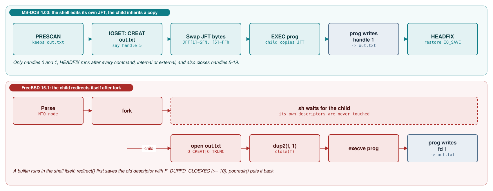
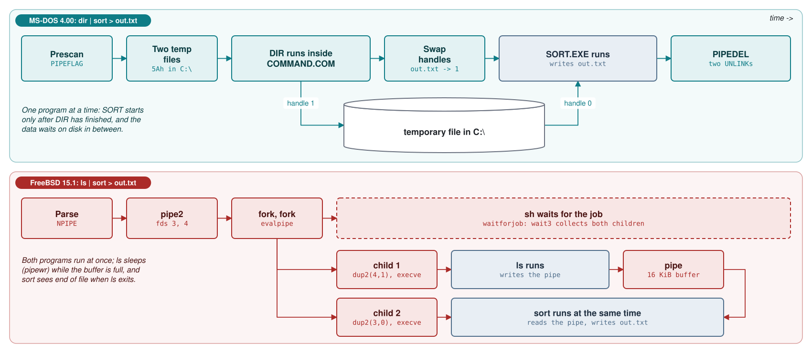

# Module 3: The shell: COMMAND.COM and /bin/sh

A shell is the first program most users meet and the last one most students read. This module reads two of
them: `COMMAND.COM` from MS-DOS 4.00, written in 8086 assembly for machines with a few hundred kilobytes of
RAM and one running program at a time, and `/bin/sh` from FreeBSD 15.1, a C program running as an ordinary
process on a demand-paged, multitasking kernel. Both read a command, find it, run it and wire up its input
and output, but the hardware and kernel underneath push them into very different designs. Module 2 covered
the kernel services (INT 21h, handles, EXEC, `fork`, `execve`); here we study the user program that strings
them together.

**Learning goals.** After this module you can:

- explain how SYSINIT starts `COMMAND.COM` and how `login(1)` starts `sh`, including `/P`, `/E`, `COMSPEC`,
  `AUTOEXEC.BAT`, `-sh` and `.profile`;
- describe COMMAND.COM's resident/transient split, find the checksum that decides whether the transient part
  is reloaded, and explain why `sh` needs no such split;
- trace each shell's main loop from prompt to program exit, naming the routines and system calls involved;
- explain how each shell implements `<`, `>` and `>>`, and why COMMAND.COM edits its own Job File Table while
  `sh` uses `dup2` and `fcntl(F_DUPFD_CLOEXEC)`;
- contrast temporary-file pipes with kernel pipes and concurrent processes, step by step, for
  `dir | sort > out.txt`;
- explain why editing a running batch file changes what runs, and how `sh` parses scripts into trees;
- compare the DOS environment block with `sh` variables and `environ`, and INT 23h with signals, process
  groups and job control;
- argue from the source why `cd` must be a builtin in FreeBSD, and why the reason differs in MS-DOS.

**Prerequisites.**

- Module 0 (`00-lab.md`): the MS-DOS 4.00 floppy image built from this tree (with `DEBUG.COM`), `tools/dos_run.py`, and the FreeBSD
  15.1 VM with `/usr/src`, `truss`, `ktrace` and `dtrace`.
- Module 1 (SYSINIT EXECs the shell; the FreeBSD kernel starts `/sbin/init`; section 3.1 takes it from there to `getty`, `login` and the shell) and Module 2 (INT 21h dispatch, PSP
  and Job File Table, EXEC vs `fork`/`execve`, the memory arena).
- Reading 8086 assembly: segment registers, `segment:offset` addresses, `REP MOVSB`, `INT`.

## 3.1 What a shell is, and how each system starts one

A *shell* (or *command interpreter*) is a user program that reads commands from a keyboard or a file and
causes them to be carried out. *Internal* commands (MS-DOS term) or *builtins* (Unix term) are code inside
the shell itself; *external* commands are program files that the shell finds and asks the kernel to run.
Neither kernel treats its shell specially: each runs whatever program it is told to.

### MS-DOS 4.00: SYSINIT EXECs COMMAND.COM

Module 1 ended where SYSINIT, the last stage of the DOS boot, has processed `CONFIG.SYS`. The default shell
is `COMMND DB "\COMMAND.COM",0` ([`SYSINIT2.ASM` line 1493](https://github.com/microsoft/MS-DOS/blob/2d04cacc5322951f187bb17e017c12920ac8ebe2/v4.0/src/BIOS/SYSINIT2.ASM#L1493)) with the
argument string `COMMAND_LINE DB 2,0,"P"` ([`SYSINIT1.ASM` lines
279-280](https://github.com/microsoft/MS-DOS/blob/2d04cacc5322951f187bb17e017c12920ac8ebe2/v4.0/src/BIOS/SYSINIT1.ASM#L279-L280)), whose zero byte is replaced by the current switch character
([`SYSCONF.ASM` lines 604-606](https://github.com/microsoft/MS-DOS/blob/2d04cacc5322951f187bb17e017c12920ac8ebe2/v4.0/src/BIOS/SYSCONF.ASM#L604-L606)): the default is
`\COMMAND.COM /P`. A `SHELL=` line replaces both parts:

**Listing 3.1** -- SHELL= overwrites the program name and the default arguments (excerpt) ([`SYSCONF.ASM` lines 2296-2329](https://github.com/microsoft/MS-DOS/blob/2d04cacc5322951f187bb17e017c12920ac8ebe2/v4.0/src/BIOS/SYSCONF.ASM#L2296-L2329))

```asm
TRYS:
        CMP     AH,'S'
        JNZ     TRYX
        MOV     [COMMAND_LINE+1],0
        MOV     DI,OFFSET COMMND + 1
        MOV     [DI-1],AL
STORESHELL:
        CALL    GETCHR
        OR      AL,AL
        JZ      GETSHPARMS
        CMP     AL," "
        JB      ENDSH
        MOV     [DI],AL
        INC     DI
        JMP     STORESHELL
⋮
GETSHPARMS:
        MOV     BYTE PTR [DI],0
        MOV     DI,OFFSET COMMAND_LINE+1
PARMLOOP:
        CALL    GETCHR
        CMP     AL," "
        JB      ENDSH
        MOV     [DI],AL
        INC     DI
        JMP     PARMLOOP
```

Line 2299 erases the default `/P`, and only what follows the file name becomes the argument string, so
`SHELL=C:\DOS\COMMAND.COM` without `/P` starts a shell that is not permanent. SYSINIT then EXECs the shell
(INT 21h function 4Bh, Module 2).

COMMAND.COM starts at `CONPROC` in `INIT.ASM` and parses its command tail at offset 80h of its Program
Segment Prefix (PSP, the 256-byte header DOS builds in front of every program), dispatching on each switch
([`INIT.ASM` lines 512-524](https://github.com/microsoft/MS-DOS/blob/2d04cacc5322951f187bb17e017c12920ac8ebe2/v4.0/src/CMD/COMMAND/INIT.ASM#L512-L524)):

| Switch | Handler | Effect in the source |
|---|---|---|
| `/P` | [`SetPSwitch`](https://github.com/microsoft/MS-DOS/blob/2d04cacc5322951f187bb17e017c12920ac8ebe2/v4.0/src/CMD/COMMAND/INIT.ASM#L542-L565) | `PERMCOM`; COMMAND becomes its own parent with `LODCOM` as terminate address, and installs INT 2Eh ([lines 838-865](https://github.com/microsoft/MS-DOS/blob/2d04cacc5322951f187bb17e017c12920ac8ebe2/v4.0/src/CMD/COMMAND/INIT.ASM#L838-L865)); `EXIT` (INT 21h 4Ch, [`TCMD2B.ASM`](https://github.com/microsoft/MS-DOS/blob/2d04cacc5322951f187bb17e017c12920ac8ebe2/v4.0/src/CMD/COMMAND/TCMD2B.ASM#L454-L473)) lands back in the same shell |
| `/C string` | [`SetSSwitch`](https://github.com/microsoft/MS-DOS/blob/2d04cacc5322951f187bb17e017c12920ac8ebe2/v4.0/src/CMD/COMMAND/INIT.ASM#L584-L591) | `SINGLECOM` points at the rest of the line: run one command, then exit |
| `/E:n` | [`SetESwitch`](https://github.com/microsoft/MS-DOS/blob/2d04cacc5322951f187bb17e017c12920ac8ebe2/v4.0/src/CMD/COMMAND/INIT.ASM#L599-L615) | environment size in bytes, rounded up to 16-byte paragraphs |
| `/D` | [`SetDSwitch`](https://github.com/microsoft/MS-DOS/blob/2d04cacc5322951f187bb17e017c12920ac8ebe2/v4.0/src/CMD/COMMAND/INIT.ASM#L570-L582) | skip `AUTOEXEC.BAT` and the date/time prompt |
| `/F` | [`SetFSwitch`](https://github.com/microsoft/MS-DOS/blob/2d04cacc5322951f187bb17e017c12920ac8ebe2/v4.0/src/CMD/COMMAND/INIT.ASM#L532-L540) | answer every critical error with Fail |

A permanent shell (unless `/D` is given) allocates a *batch segment* for `AUTOEXEC.BAT` and checks that the file opens
([lines 1001-1007](https://github.com/microsoft/MS-DOS/blob/2d04cacc5322951f187bb17e017c12920ac8ebe2/v4.0/src/CMD/COMMAND/INIT.ASM#L1001-L1007),
[1157-1173](https://github.com/microsoft/MS-DOS/blob/2d04cacc5322951f187bb17e017c12920ac8ebe2/v4.0/src/CMD/COMMAND/INIT.ASM#L1157-L1173)); if it does not, the segment is freed and the
date and time prompts appear instead ([lines 1221-1234](https://github.com/microsoft/MS-DOS/blob/2d04cacc5322951f187bb17e017c12920ac8ebe2/v4.0/src/CMD/COMMAND/INIT.ASM#L1221-L1234)).
If the parent passed no environment (the PSP field at offset 2Ch is zero,
[`INIT.ASM` lines 358-372](https://github.com/microsoft/MS-DOS/blob/2d04cacc5322951f187bb17e017c12920ac8ebe2/v4.0/src/CMD/COMMAND/INIT.ASM#L358-L372)), the shell uses one assembled into its
own image:

**Listing 3.2** -- the built-in default environment: an empty PATH and COMSPEC ([`ENVDATA.ASM` lines 11-28](https://github.com/microsoft/MS-DOS/blob/2d04cacc5322951f187bb17e017c12920ac8ebe2/v4.0/src/CMD/COMMAND/ENVDATA.ASM#L11-L28))

```asm
ENVIRONMENT SEGMENT PUBLIC PARA        ; Default COMMAND environment

        PUBLIC  ECOMSPEC,ENVIREND,PATHSTRING

        ORG     0
PATHSTRING DB   "PATH="
USERPATH LABEL  BYTE

        DB      0               ; Null path
        DB      "COMSPEC="
ECOMSPEC DB     "\COMMAND.COM"      ;AC062
        DB      134 DUP (0)

ENVIREND        LABEL   BYTE

ENVIRONSIZ EQU  $-PATHSTRING
ENVIRONSIZ2 EQU $-ECOMSPEC
ENVIRONMENT ENDS
```

`COMSPEC` records where COMMAND.COM lives on disk. Section 3.2 shows why the shell needs it.

### FreeBSD 15.1: login(1) execs the user's shell

`init` starts `getty`, `getty` runs `login`, and `login` replaces itself with the shell named in the user's
password entry or in `login.conf` ([`login.c` lines 445-453](https://github.com/freebsd/freebsd-src/blob/96841ea08dcfa84b954a32dc5ae1a26c28966cf4/usr.bin/login/login.c#L445-L453)). It marks
the shell as a *login shell* with a convention as old as Unix:

**Listing 3.3** -- login(1) prefixes argv[0] with a dash and execs the shell ([`login.c` lines 649-662](https://github.com/freebsd/freebsd-src/blob/96841ea08dcfa84b954a32dc5ae1a26c28966cf4/usr.bin/login/login.c#L649-L662))

```c
        /*
         * Login shells have a leading '-' in front of argv[0]
         */
        p = strrchr(pwd->pw_shell, '/');
        if (asprintf(&arg0, "-%s", p ? p + 1 : pwd->pw_shell) >= MAXPATHLEN) {
                syslog(LOG_ERR, "user: %s: shell exceeds maximum pathname size",
                    username);
                errx(1, "shell exceeds maximum pathname size");
        } else if (arg0 == NULL) {
                err(1, "asprintf()");
        }

        execlp(shell, arg0, (char *)0);
        err(1, "%s", shell);
```

`procargs()` treats a leading `-` in `argv[0]`, or `-l`, as "login shell"
([`options.c` lines 86-92](https://github.com/freebsd/freebsd-src/blob/96841ea08dcfa84b954a32dc5ae1a26c28966cf4/bin/sh/options.c#L86-L92)), and `main()` acts on it:

**Listing 3.4** -- a login shell reads /etc/profile and ~/.profile; an interactive one also reads $ENV ([`main.c` lines 138-155](https://github.com/freebsd/freebsd-src/blob/96841ea08dcfa84b954a32dc5ae1a26c28966cf4/bin/sh/main.c#L138-L155))

```c
        if (login) {
                state = 1;
                read_profile("/etc/profile");
state1:
                state = 2;
                if (privileged == 0)
                        read_profile("${HOME-}/.profile");
                else
                        read_profile("/etc/suid_profile");
        }
state2:
        state = 3;
        if (!privileged && iflag) {
                if ((shinit = lookupvar("ENV")) != NULL && *shinit != '\0') {
                        state = 3;
                        read_profile(shinit);
                }
        }
```

Then `cmdloop(1)` runs until end of file or `exit`. A script is run by a new `sh` process: the kernel's
`#!` image activator starts the interpreter with the script's path as an argument
([`imgact_shell.c` lines 60-84](https://github.com/freebsd/freebsd-src/blob/96841ea08dcfa84b954a32dc5ae1a26c28966cf4/sys/kern/imgact_shell.c#L60-L84)), `procargs()` opens it as input
([`options.c` lines 106-110](https://github.com/freebsd/freebsd-src/blob/96841ea08dcfa84b954a32dc5ae1a26c28966cf4/bin/sh/options.c#L106-L110)), and `sh` also runs a file that `execve`
rejects with `ENOEXEC` as a script unless it looks binary ([`exec.c` lines
167-192](https://github.com/freebsd/freebsd-src/blob/96841ea08dcfa84b954a32dc5ae1a26c28966cf4/bin/sh/exec.c#L167-L192)).

| | MS-DOS 4.00 | FreeBSD 15.1 |
|---|---|---|
| Who starts the first shell | SYSINIT, after `CONFIG.SYS` | `login`, after authentication |
| Choice of shell | `SHELL=`, default `\COMMAND.COM` | `pw_shell`, or `login.conf` |
| "Top-level shell" marker | `/P` (permanent) | `argv[0]` starts with `-` |
| Startup script | `AUTOEXEC.BAT` | `/etc/profile`, `~/.profile`, then `$ENV` |
| One command and exit | `COMMAND /C string` | `sh -c string` |
| Scripts run by | the same COMMAND.COM process | a new `sh` process |


## 3.2 COMMAND.COM's resident and transient portions

A PC running MS-DOS 4.00 might have 256-640 KB of RAM, and only one program runs at a time. Memory the shell
keeps while a program runs is memory the program cannot use, so COMMAND.COM is split into pieces with
different lifetimes. The header of `COMMAND1.ASM` states the design:

**Listing 3.5** -- the three-part design of COMMAND.COM ([`COMMAND1.ASM` lines 13-28](https://github.com/microsoft/MS-DOS/blob/2d04cacc5322951f187bb17e017c12920ac8ebe2/v4.0/src/CMD/COMMAND/COMMAND1.ASM#L13-L28))

```asm
; FUNCTION:            This version of COMMAND is divided into three distinct
;                      parts.  First is the resident portion, which includes
;                      handlers for interrupts  23H (Cntrl-C), 24H (fatal
;                      error), and 2EH (command line execute); it also has
;                      code to test and, if necessary, reload the transient
;                      portion. Following the resident is the init code, which
;                      is overwritten after use.  Then comes the transient
;                      portion, which includes all command processing (whether
;                      internal or external).  The transient portion loads at
;                      the end of physical memory, and it may be overlayed by
;                      programs that need as much memory as possible. When the
;                      resident portion of command regains control from a user
;                      program, a check sum is performed on the transient
;                      portion to see if it must be reloaded.  Thus programs
;                      which do not need maximum memory will save the time
;                      required to reload COMMAND when they terminate.
```

The split is made by segment order. `COMSEG.ASM` lists the segments in load order and gathers them into two
*groups* (segments addressed through one segment register):

**Listing 3.6** -- the resident group and the transient group ([`COMSEG.ASM` lines 41-42](https://github.com/microsoft/MS-DOS/blob/2d04cacc5322951f187bb17e017c12920ac8ebe2/v4.0/src/CMD/COMMAND/COMSEG.ASM#L41-L42))

```asm
RESGROUP  GROUP CODERES,DATARES,BATARENA,BATSEG,ENVARENA,ENVIRONMENT,INIT,TAIL
TRANGROUP GROUP TRANCODE,TRANDATA,TRANSPACE,TRANTAIL
```

`RESGROUP` holds resident code and data, a batch segment and a default environment for the first shell, the
init code, and an empty `TAIL` segment whose label `TRANSTART` marks where the transient image begins
([`COMMAND2.ASM` lines 600-608](https://github.com/microsoft/MS-DOS/blob/2d04cacc5322951f187bb17e017c12920ac8ebe2/v4.0/src/CMD/COMMAND/COMMAND2.ASM#L600-L608)). `TRANGROUP` holds the
transient code, its data (`TRANDATA`: messages and tables, mostly constant) and its work variables
(`TRANSPACE`). The link step converts the
result with `exe2bin` into a flat `.COM` image ([`MAKEFILE` lines
132-134](https://github.com/microsoft/MS-DOS/blob/2d04cacc5322951f187bb17e017c12920ac8ebe2/v4.0/src/CMD/COMMAND/MAKEFILE#L132-L134)) that starts at `PROGSTART`, offset 100h, which jumps to the init code
([`COMMAND1.ASM` lines 401-411](https://github.com/microsoft/MS-DOS/blob/2d04cacc5322951f187bb17e017c12920ac8ebe2/v4.0/src/CMD/COMMAND/COMMAND1.ASM#L401-L411)).

INIT places the transient at the *top* of the memory block DOS gave the shell:

**Listing 3.7** -- INIT computes TRNSEG, the transient's segment ([`INIT.ASM` lines 351-357](https://github.com/microsoft/MS-DOS/blob/2d04cacc5322951f187bb17e017c12920ac8ebe2/v4.0/src/CMD/COMMAND/INIT.ASM#L351-L357))

```asm
        MOV     DX,OFFSET TRANGROUP:TRANSPACEEND + 15 ; dx = size of transient
        MOV     CL,4                            ;  in paragraphs.
        SHR     DX,CL
        mov     [trnsize],dx                    ;eg save size of transient in paragraphs

        SUB     AX,DX                           ; max seg addr - # para's needed for transient
        MOV     [TRNSEG],AX                     ;  = seg addr to load the transient at.
```

`AX` holds the PSP's `PDB_block_len` field, used here as the segment just past the end of the shell's block
("max seg addr" in the comment), and `DX` the transient size in paragraphs (16 bytes), so the transient ends
exactly at the end of the block. INIT shrinks its own block to the resident size with SETBLOCK (INT 21h
function 4Ah) and, if the old and new places do not overlap, copies the transient up to `TRNSEG` (backwards);
if they overlap, it reads it from disk with `LOADCOM` instead
([`INIT.ASM` lines 930-996](https://github.com/microsoft/MS-DOS/blob/2d04cacc5322951f187bb17e017c12920ac8ebe2/v4.0/src/CMD/COMMAND/INIT.ASM#L930-L996)). The init code becomes free memory.
While the shell waits for a command, memory looks like this. The segment numbers and sizes are from the lab
image (Module 0) as reported by the MCB walker of Module 2, Exercise 2.1, with the default `CONFIG.SYS`:

```text
 low addresses                                              high addresses
 +-----------+------------------+-------------+---------------------------+
 | DOS, IO,  | COMMAND resident | environment | TPA (free for programs)   |
 | drivers,  | PSP + CODERES +  | block       |            +--------------+
 | buffers   | part of DATARES  | (own arena) |            | transient    |
 |           |                  |             |            | at TRNSEG    |
 +-----------+------------------+-------------+------------+--------------+
  MCB 0BA1    MCB 108B           MCB 11F4     ^ a program loads here and
  owner 8     164h paragraphs    0Ah paras      may grow over the transient
              = 5,696 bytes      = 160 bytes    (28,020 bytes = 6D8h paragraphs)
```

(Exercise 3.1 asks you to read the segment sizes from the linker map and to explain why the resident block is
smaller than the resident code and data in the map.)

### The resident part: handlers, EXEC and reload

`SETVECT` points three interrupt vectors at resident code:

**Listing 3.8** -- SETVECT installs the INT 22h, 23h and 24h handlers ([`COMMAND2.ASM` lines 544-556](https://github.com/microsoft/MS-DOS/blob/2d04cacc5322951f187bb17e017c12920ac8ebe2/v4.0/src/CMD/COMMAND/COMMAND2.ASM#L544-L556))

```asm
SETVECT:                                ; Set useful vectors
        MOV     DX,OFFSET RESGROUP:LODCOM
        MOV     AX,(SET_INTERRUPT_VECTOR SHL 8) OR 22H
        MOV     WORD PTR DS:[PDB_EXIT],DX
        MOV     WORD PTR DS:[PDB_EXIT+2],DS
        INT     int_command
        MOV     DX,OFFSET RESGROUP:CONTC
        INC     AL
        INT     int_command
        MOV     DX,OFFSET RESGROUP:DSKERR
        INC     AL
        INT     int_command
        return
```

INT 22h, the *terminate address* where DOS continues when a program ends, is `LODCOM`. INT 23h, the
*Ctrl-C handler*, is `CONTC` (3.8). INT 24h, the *critical error handler*, is `DSKERR`, which prints the
error and then "Abort", ", Retry", ", Ignore", ", Fail" and "?", but only the choices DOS allows for this
error ([`RUCODE.ASM` lines 357-379](https://github.com/microsoft/MS-DOS/blob/2d04cacc5322951f187bb17e017c12920ac8ebe2/v4.0/src/CMD/COMMAND/RUCODE.ASM#L357-L379),
[`RESMSG.EQU` lines 8-12](https://github.com/microsoft/MS-DOS/blob/2d04cacc5322951f187bb17e017c12920ac8ebe2/v4.0/src/CMD/COMMAND/RESMSG.EQU#L8-L12)). These handlers must be resident
because they run while *any* program is running.

The resident part also performs the EXEC. The transient prepares everything, frees its own memory and jumps
into the resident:

**Listing 3.9** -- EXECUTE frees the transient's memory and jumps to the resident EXEC (excerpt) ([`TMISC1.ASM` lines 318-352](https://github.com/microsoft/MS-DOS/blob/2d04cacc5322951f187bb17e017c12920ac8ebe2/v4.0/src/CMD/COMMAND/TMISC1.ASM#L318-L352))

```asm
EXECUTE:
NeoExecute:
        invoke  IOSET
        invoke  SETSTDINOFF                     ;AN026; turn off critical error on STDIN
        invoke  SETSTDOUTOFF                    ;AN026; turn off critical error on STDOUT
        MOV     ES,[TRAN_TPA]
        MOV     AH,DEALLOC
        INT     int_command                     ; Now running in "free" space
        MOV     ES,[RESSEG]
ASSUME  ES:RESGROUP
        INC     [EXTCOM]                        ; Indicate external command
        MOV     [RESTDIR],0                     ; Since USERDIR1 is in transient, insure
                                                ;  this flag value for re-entry to COMMAND
        MOV     DI,FCB
        MOV     SI,DI
        MOV     CX,052H                         ; moving (100h-5Ch)/2 = 80h-2Eh
        REP     MOVSW                           ; Transfer parameters to resident header
        MOV     DX,OFFSET TRANGROUP:EXECPATH
        MOV     BX,OFFSET RESGROUP:EXEC_BLOCK
        MOV     AX,EXEC SHL 8
⋮
;
; we are now running in free space.  anything we do from here on may get
; trashed.  Move the stack (also in free space) to allocated space because
; since EXEC restores the stack, somebody may trash what is on the stack.
;
        MOV     CX,ES
        MOV     SS,CX
        MOV     SP,OFFSET RESGROUP:RSTACK
        JMP     [EXEC_ADDR]                     ; Jmp to the EXEC in the resident
```

After `DEALLOC` (function 49h) the transient is executing in *free* memory, which is safe only because
nothing allocates memory before the EXEC, and the stack is moved into the resident first. `REP MOVSW`
copies the command tail and two pre-parsed FCBs from the transient's scratch area (offsets 5Ch-FFh) to the
resident's PSP, where the EXEC parameter block points (3.7). Then:

**Listing 3.10** -- the resident issues the EXEC, collects the exit code and goes to LODCOM ([`COMMAND1.ASM` lines 455-474](https://github.com/microsoft/MS-DOS/blob/2d04cacc5322951f187bb17e017c12920ac8ebe2/v4.0/src/CMD/COMMAND/COMMAND1.ASM#L455-L474))

```asm
EXT_EXEC:
        push    dx                              ;AN000; save the command name offset
        INT     int_command                     ; Do the EXEC
        pop     dx                              ;AN000; restore the command name offset
        JC      EXEC_ERR                        ; EXEC failed
;
; The exec has completed.  Retrieve the exit code.
;
EXEC_WAIT:
        push    cs                              ;AC000; get resident segment
        pop     ds                              ;AC000;     into DS
        MOV     AH,WAITPROCESS                  ;AC000; Get errorlevel
        INT     int_command                     ; Get the return code
        MOV     [RETCODE],AX
;
; We need to test to see if we can reload the transient.  THe external command
; may have overwritten part of the transient.
;
NOEXEC:
        JMP     LODCOM
```

When the child ends, DOS returns to the instruction after the `INT`, because EXEC stored the caller's return
address as the child's terminate address ([`EXEC.ASM` lines 746-755](https://github.com/microsoft/MS-DOS/blob/2d04cacc5322951f187bb17e017c12920ac8ebe2/v4.0/src/DOS/EXEC.ASM#L746-L755)).
Function 4Dh fetches the exit code into `RETCODE`, and `LODCOM` checks whether the program overwrote the
transient: it recomputes a checksum of the transient and, if it differs from the value saved at
initialisation, reads the transient back from the file named by `COMSPEC`. Study case 3.B follows this path.


A permanent shell also installs INT 2Eh ([`INIT.ASM` lines
862-864](https://github.com/microsoft/MS-DOS/blob/2d04cacc5322951f187bb17e017c12920ac8ebe2/v4.0/src/CMD/COMMAND/INIT.ASM#L862-L864)), a back door through which a program can make the top-level shell execute a command line without
loading a second COMMAND.COM:

**Listing 3.11** -- INT 2Eh copies a command line into the shell's PSP and runs it ([`COMMAND2.ASM` lines 186-203](https://github.com/microsoft/MS-DOS/blob/2d04cacc5322951f187bb17e017c12920ac8ebe2/v4.0/src/CMD/COMMAND/COMMAND2.ASM#L186-L203))

```asm
INT_2E:                                 ; Magic command executer
ASSUME  DS:NOTHING,ES:NOTHING,SS:NOTHING
        POP     WORD PTR [INT_2E_RET]
        POP     WORD PTR [INT_2E_RET+2] ;Get return address
        POP     AX                      ;Chuck flags
        PUSH    CS
        POP     ES
        MOV     DI,80H
        MOV     CX,64
        REP     MOVSW
        MOV     AH,GET_CURRENT_PDB
        INT     int_command             ; Get user's header
        MOV     [SAVE_PDB],BX
        MOV     AH,SET_CURRENT_PDB
        MOV     BX,CS
        INT     int_command             ; Current process is me
        MOV     [SINGLECOM],81H
        MOV     [EXTCOM],1              ; Make sure this case forced
```

The handler copies 128 bytes from `DS:SI` (a count byte, the text and a carriage return) to its own PSP at
80h, makes itself the current process (function 50h) and sets `SINGLECOM`, so the normal loop runs one
command and returns through `RET_2E`, which reports 0 for internal commands
([lines 167-184](https://github.com/microsoft/MS-DOS/blob/2d04cacc5322951f187bb17e017c12920ac8ebe2/v4.0/src/CMD/COMMAND/COMMAND2.ASM#L167-L184)). There is one `INT_2E_RET` save area, so
the code is not re-entrant. INT 2Eh is usually described as undocumented; Ralf Brown's Interrupt List gives
the calling convention this code implements.

### Why /bin/sh needs none of this

`sh` is an ordinary executable: its code pages are mapped read-only from `/bin/sh` and shared by every `sh`
process, its data is private and copy-on-write after `fork` (Module 2). Running a program creates a *new*
process with its own address space while the shell sleeps in `wait`; under memory pressure the kernel pages
out what is least used and reads it back on demand. The kernel provides, generally and transparently, what
COMMAND.COM implements by hand for one program.

| | MS-DOS 4.00 COMMAND.COM | FreeBSD 15.1 sh |
|---|---|---|
| Memory while a program runs | resident part only; transient may be overwritten | whole shell mapped; pages may be evicted |
| Detecting damage | checksum of transient code and data (`CHKSUM`) | not needed: separate address spaces |
| Recovery | re-read the transient from the `COMSPEC` file | demand paging from `/bin/sh` |
| Who issues the run call | resident code, after the transient frees itself | the shell's child, after `fork`/`vfork` |
| Callbacks from the kernel | INT 22h, 23h, 24h vectors | signals (`SIGCHLD`, `SIGINT`, ...) |
| Command for another program | INT 2Eh, or EXEC `COMMAND /C` | `system(3)`: fork and exec `sh -c` ([`system.c` lines 63-107](https://github.com/freebsd/freebsd-src/blob/96841ea08dcfa84b954a32dc5ae1a26c28966cf4/lib/libc/stdlib/system.c#L63-L107)) |


## 3.3 The main loop: prompt, read, parse, dispatch

### COMMAND.COM: one line at a time

The transient's recycle point is `TCOMMAND` in `TCODE.ASM` ("Nothing is known here",
[lines 111-135](https://github.com/microsoft/MS-DOS/blob/2d04cacc5322951f187bb17e017c12920ac8ebe2/v4.0/src/CMD/COMMAND/TCODE.ASM#L111-L135)); every command and every error ends there.
Each pass resets segments and stack, restores the standard handles, deletes finished pipe files and decides
where the next command comes from, in priority order: a pipeline in progress, a `FOR` loop, a batch file, a
`/C` command, and only then the keyboard ([lines 255-341](https://github.com/microsoft/MS-DOS/blob/2d04cacc5322951f187bb17e017c12920ac8ebe2/v4.0/src/CMD/COMMAND/TCODE.ASM#L255-L341)).


The prompt comes from the `PROMPT` variable; each `$x` code is looked up in `PROMPT_TABLE`, so `$P$G` calls
`build_dir_for_prompt` and `PRINT_G` ([`TDATA.ASM` lines
255-269](https://github.com/microsoft/MS-DOS/blob/2d04cacc5322951f187bb17e017c12920ac8ebe2/v4.0/src/CMD/COMMAND/TDATA.ASM#L255-L269), [`TCMD2A.ASM` lines 105-160](https://github.com/microsoft/MS-DOS/blob/2d04cacc5322951f187bb17e017c12920ac8ebe2/v4.0/src/CMD/COMMAND/TCMD2A.ASM#L105-L160)). The line is read
with one DOS call:

**Listing 3.12** -- reading a command line with INT 21h function 0Ah ([`TCODE.ASM` lines 350-367](https://github.com/microsoft/MS-DOS/blob/2d04cacc5322951f187bb17e017c12920ac8ebe2/v4.0/src/CMD/COMMAND/TCODE.ASM#L350-L367))

```asm
REGCOM:
        MOV     AX,(ServerCall SHL 8) + 9
        INT     21h
        MOV     AX,(ServerCall SHL 8) + 8
        MOV     DL,1
        INT     21h

        PUSH    CS
        POP     DS                              ; Need local segment to point to buffer
        MOV     DX,OFFSET TRANGROUP:UCOMBUF
        MOV     AH,STD_CON_STRING_INPUT
        INT     int_command                     ; Get a command
        MOV     CL,[UCOMBUF]
        XOR     CH,CH
        ADD     CX,3
        MOV     SI,OFFSET TRANGROUP:UCOMBUF
        MOV     DI,OFFSET TRANGROUP:COMBUF
        REP     MOVSB                           ; Transfer it to the cooked buffer
```

Function 0Ah does all the line editing (echo, Backspace, the F1-F3 template keys) and returns on Enter. Byte 0
of the buffer is the maximum length (`COMBUFLEN` = 128, [`COMEQU.ASM`
line 13](https://github.com/microsoft/MS-DOS/blob/2d04cacc5322951f187bb17e017c12920ac8ebe2/v4.0/src/CMD/COMMAND/COMEQU.ASM#L13)), byte 1 receives the count. The raw buffer `UCOMBUF` is copied to `COMBUF` because the next steps
edit the text in place: `PRESCAN` removes redirections and detects pipes (3.4, 3.5), `parseline` splits the
words into an `argv[]`-like array, and the code builds the tail at 80h and FCBs at 5Ch and 6Ch as a program
expects them in its PSP ([`TCODE.ASM` lines 380-508](https://github.com/microsoft/MS-DOS/blob/2d04cacc5322951f187bb17e017c12920ac8ebe2/v4.0/src/CMD/COMMAND/TCODE.ASM#L380-L508)). A
command name without a drive letter is looked up in the internal command table:

**Listing 3.13** -- COMTAB, the internal command table (excerpt) ([`TDATA.ASM` lines 280-351](https://github.com/microsoft/MS-DOS/blob/2d04cacc5322951f187bb17e017c12920ac8ebe2/v4.0/src/CMD/COMMAND/TDATA.ASM#L280-L351))

```asm
; Table for internal command names
COMTAB  DB      3,"DIR",fSwitchAllowed+fCheckDrive
        DW      OFFSET TRANGROUP:CATALOG        ; In TCMD1.ASM
        DB      4,"CALL",fSwitchAllowed
        DW      OFFSET TRANGROUP:$CALL          ; In TBATCH2.ASM
⋮
        DB      2,"CD",fSwitchAllowed+fCheckDrive    ;AC018; P3903
        DW      OFFSET TRANGROUP:$CHDIR         ; In TENV.ASM
        DB      5,"CHDIR",fSwitchAllowed+fCheckDrive ;AC018; P3903
        DW      OFFSET TRANGROUP:$CHDIR         ; In TENV.ASM
⋮
        DB      8,"TRUENAME",fSwitchAllowed+fCheckDrive  ;AN000; P3903 changed
        DW      OFFSET TRANGROUP:TRUENAME       ;AN000;
        DB      0                               ; Terminate command table
```

Each entry is a length byte, the name, a flag byte (`fSwitchAllowed`, `fCheckDrive`) and the handler's
offset; a zero length ends the table. `fndcom` scans it linearly:

**Listing 3.14** -- fndcom scans COMTAB ([`TMISC1.ASM` lines 174-197](https://github.com/microsoft/MS-DOS/blob/2d04cacc5322951f187bb17e017c12920ac8ebe2/v4.0/src/CMD/COMMAND/TMISC1.ASM#L174-L197))

```asm
    mov     DI, OFFSET TRANGROUP:COMTAB
    XOR     CX,CX

findcom:
    mov     SI, offset TRANGROUP:IDLEN+1        ; pointer to command argument
    mov     CL, [DI]                            ; load length of internal command
    inc     di                                  ; advance past length
    jcxz    externalj                           ; if it's zero, we're out of internals
    cmp     CL, IDLEN                           ; that of the command argument
    jnz     abcd                                ; lengths not equal ==> strings not eq
    MOV     PathPos,CX                          ; store length of command
    repz    cmpsb

abcd:
    lahf                                        ; save the good ol' flags
    add     DI, CX                              ; skip over remaining internal, if any
    mov     AL, BYTE PTR [DI]                   ; load drive-check indicator byte (DCIB)
    mov     [CHKDRV], AL                        ; save command flag byte in chkdrv
    inc     DI                                  ; increment DI (OK, OK, I'll stop)
    mov     BX, WORD PTR [DI]                   ; load internal command address
    inc     DI                                  ; skip over the puppy
    inc     DI
    sahf                                        ; remember those flags?
    jnz     findcom                             ; well, if all the cmps worked...
```

On a match the shell applies redirection (`ioset`), checks drives and switches, and `call BX` runs the
handler inside the transient; `Cmd_done` then returns to `TCOMMAND`
([lines 198-251](https://github.com/microsoft/MS-DOS/blob/2d04cacc5322951f187bb17e017c12920ac8ebe2/v4.0/src/CMD/COMMAND/TMISC1.ASM#L198-L251)). Otherwise `path_search` looks for
`name.???` (built by `strip`, [`PATH2.ASM` lines 334-344](https://github.com/microsoft/MS-DOS/blob/2d04cacc5322951f187bb17e017c12920ac8ebe2/v4.0/src/CMD/COMMAND/PATH2.ASM#L334-L344), unless the
user typed an extension) with FIND FIRST/NEXT (functions 4Eh/4Fh) and ranks matches .COM over .EXE over .BAT
([`PATH2.ASM` lines 85-108](https://github.com/microsoft/MS-DOS/blob/2d04cacc5322951f187bb17e017c12920ac8ebe2/v4.0/src/CMD/COMMAND/PATH2.ASM#L85-L108)), first in the current directory,
then in each `;`-separated element of `PATH` ([`PATH1.ASM`
lines 244-261](https://github.com/microsoft/MS-DOS/blob/2d04cacc5322951f187bb17e017c12920ac8ebe2/v4.0/src/CMD/COMMAND/PATH1.ASM#L244-L261)). A .COM or .EXE goes to `EXECUTE` (Listing 3.9), a .BAT to `BatCom` (3.6).
Nothing is cached: every external command costs a directory search per `PATH` element until a match is found.

### sh: parse a whole command into a tree, then evaluate it

`sh` separates reading, parsing and evaluating:

**Listing 3.15** -- cmdloop: parse one command, evaluate it, repeat ([`main.c` lines 197-230](https://github.com/freebsd/freebsd-src/blob/96841ea08dcfa84b954a32dc5ae1a26c28966cf4/bin/sh/main.c#L197-L230))

```c
        for (;;) {
                if (pendingsig)
                        dotrap();
⋮
                n = parsecmd(inter);
                /* showtree(n); DEBUG */
                if (n == NEOF) {
                        if (!top || numeof >= 50)
                                break;
                        if (!stoppedjobs()) {
                                if (!Iflag)
                                        break;
                                out2fmt_flush("\nUse \"exit\" to leave shell.\n");
                        }
                        numeof++;
                } else if (n != NULL && nflag == 0) {
                        job_warning = (job_warning == 2) ? 1 : 0;
                        numeof = 0;
                        evaltree(n, 0);
                }
                popstackmark(&smark);
                setstackmark(&smark);
                if (evalskip != 0) {
                        if (evalskip == SKIPRETURN)
                                evalskip = 0;
                        break;
                }
        }
```

`parsecmd()` is a recursive-descent parser. It returns a tree of *nodes* whose types are declared in a small
description file that `mknodes` turns into C at build time:

**Listing 3.16** -- node types for simple commands and pipelines ([`nodetypes` lines 54-62](https://github.com/freebsd/freebsd-src/blob/96841ea08dcfa84b954a32dc5ae1a26c28966cf4/bin/sh/nodetypes#L54-L62))

```text
NCMD ncmd                       # a simple command
        type      int
        args      nodeptr               # the arguments
        redirect  nodeptr               # list of file redirections

NPIPE npipe                     # a pipeline
        type      int
        backgnd   int                   # set to run pipeline in background
        cmdlist   nodelist              # the commands in the pipeline
```

`list()` handles `;`, `&` and newlines, `andor()` handles `&&` and `||`, and `pipeline()` collects commands
separated by `|`:

**Listing 3.17** -- pipeline() builds an NPIPE node with a list of commands ([`parser.c` lines 374-396](https://github.com/freebsd/freebsd-src/blob/96841ea08dcfa84b954a32dc5ae1a26c28966cf4/bin/sh/parser.c#L374-L396))

```c
        n1 = command();
        if (readtoken() == TPIPE) {
                pipenode = (union node *)stalloc(sizeof (struct npipe));
                pipenode->type = NPIPE;
                pipenode->npipe.backgnd = 0;
                lp = (struct nodelist *)stalloc(sizeof (struct nodelist));
                pipenode->npipe.cmdlist = lp;
                lp->n = n1;
                do {
                        prev = lp;
                        lp = (struct nodelist *)stalloc(sizeof (struct nodelist));
                        checkkwd = CHKNL | CHKKWD | CHKALIAS;
                        t = readtoken();
                        tokpushback++;
                        if (t == TNOT)
                                lp->n = pipeline();
                        else
                                lp->n = command();
                        prev->next = lp;
                } while (readtoken() == TPIPE);
                lp->next = NULL;
                n1 = pipenode;
        }
```

`ls | sort > out.txt` thus becomes an `NPIPE` node listing two `NCMD` nodes, the second carrying an `NTO`
redirection for `out.txt`; nothing has been opened yet. `evaltree()` walks the tree with a `switch` on node
types ([`eval.c` lines 182-301](https://github.com/freebsd/freebsd-src/blob/96841ea08dcfa84b954a32dc5ae1a26c28966cf4/bin/sh/eval.c#L182-L301)). For a simple command, `evalcommand()` expands
the words and calls `find_command()`, which remembers where commands were found in a hash table of 31
buckets ([`exec.c` lines 72-85](https://github.com/freebsd/freebsd-src/blob/96841ea08dcfa84b954a32dc5ae1a26c28966cf4/bin/sh/exec.c#L72-L85)):

**Listing 3.18** -- find_command: hash table first, then builtins, then PATH ([`exec.c` lines 357-386](https://github.com/freebsd/freebsd-src/blob/96841ea08dcfa84b954a32dc5ae1a26c28966cf4/bin/sh/exec.c#L357-L386))

```c
        /* If name contains a slash, don't use the hash table */
        if (strchr(name, '/') != NULL) {
                entry->cmdtype = CMDNORMAL;
                entry->u.index = 0;
                entry->special = 0;
                return;
        }

        cd = 0;

        /* If name is in the table, we're done */
        if ((cmdp = cmdlookup(name, 0)) != NULL) {
                if (cmdp->cmdtype == CMDFUNCTION && act & DO_NOFUNC)
                        cmdp = NULL;
                else
                        goto success;
        }

        /* Check for builtin next */
        if ((i = find_builtin(name, &spec)) >= 0) {
                INTOFF;
                cmdp = cmdlookup(name, 1);
                if (cmdp->cmdtype == CMDFUNCTION)
                        cmdp = &loc_cmd;
                cmdp->cmdtype = CMDBUILTIN;
                cmdp->param.index = i;
                cmdp->special = spec;
                INTON;
                goto success;
        }
```

Builtins come from a table generated from `builtins.def` ([lines 49-91](https://github.com/freebsd/freebsd-src/blob/96841ea08dcfa84b954a32dc5ae1a26c28966cf4/bin/sh/builtins.def#L49-L91)) by
`mkbuiltins` ([lines 57-69](https://github.com/freebsd/freebsd-src/blob/96841ea08dcfa84b954a32dc5ae1a26c28966cf4/bin/sh/mkbuiltins#L57-L69)). It has COMTAB's shape (length byte, then a
flags-and-index byte, then the name), and [`find_builtin()`](https://github.com/freebsd/freebsd-src/blob/96841ea08dcfa84b954a32dc5ae1a26c28966cf4/bin/sh/exec.c#L469-L480) scans it just like
`fndcom`. Otherwise `find_command` `stat()`s each `PATH` candidate and caches the index of the directory
that matched ([lines 388-442](https://github.com/freebsd/freebsd-src/blob/96841ea08dcfa84b954a32dc5ae1a26c28966cf4/bin/sh/exec.c#L388-L442)); `hash -r` or assigning `PATH`
([`changepath()`](https://github.com/freebsd/freebsd-src/blob/96841ea08dcfa84b954a32dc5ae1a26c28966cf4/bin/sh/exec.c#L508-L511)) empties the cache. Then `evalcommand` decides whether to
create a process:

**Listing 3.19** -- evalcommand forks only for external commands (and some special cases) ([`eval.c` lines 973-996](https://github.com/freebsd/freebsd-src/blob/96841ea08dcfa84b954a32dc5ae1a26c28966cf4/bin/sh/eval.c#L973-L996))

```c
        /* Fork off a child process if necessary. */
        if (((cmdentry.cmdtype == CMDNORMAL || cmdentry.cmdtype == CMDUNKNOWN)
            && ((flags & EV_EXIT) == 0 || have_traps()))
         || ((flags & EV_BACKCMD) != 0
            && (cmdentry.cmdtype != CMDBUILTIN ||
                 !safe_builtin(cmdentry.u.index, argc, argv)))) {
                jp = makejob(cmd, 1);
                mode = FORK_FG;
                if (flags & EV_BACKCMD) {
                        mode = FORK_NOJOB;
                        if (pipe(pip) < 0)
                                error("Pipe call failed: %s", strerror(errno));
                }
                if (cmdentry.cmdtype == CMDNORMAL &&
                    cmd->ncmd.redirect == NULL &&
                    varlist.count == 0 &&
                    (mode == FORK_FG || mode == FORK_NOJOB) &&
                    !disvforkset() && !iflag && !mflag) {
                        vforkexecshell(jp, argv, environment(), path,
                            cmdentry.u.index, flags & EV_BACKCMD ? pip : NULL);
                        goto parent;
                }
                if (forkshell(jp, cmd, mode) != 0)
                        goto parent;    /* at end of routine */
```

Builtins and functions run in the shell process. An external command gets a child, created with `vfork()` in
the simple non-interactive case (no redirections, no assignments, no job control) and with `fork()`
otherwise. The child applies redirections, exports prefix assignments and execs:

**Listing 3.20** -- the child applies redirections and execs the program ([`eval.c` lines 1135-1145](https://github.com/freebsd/freebsd-src/blob/96841ea08dcfa84b954a32dc5ae1a26c28966cf4/bin/sh/eval.c#L1135-L1145))

```c
        } else {
#ifdef DEBUG
                trputs("normal command:  ");  trargs(argv);
#endif
                redirect(cmd->ncmd.redirect, 0);
                for (i = 0; i < varlist.count; i++)
                        setvareq(varlist.args[i], VEXPORT|VSTACK);
                envp = environment();
                shellexec(argv, envp, path, cmdentry.u.index);
                /*NOTREACHED*/
        }
```

`shellexec()` tries `execve()` on the `PATH` candidates, starting at the cached index, and maps failures to
exit status 127 ("not found") or 126 ([`exec.c` lines 104-133](https://github.com/freebsd/freebsd-src/blob/96841ea08dcfa84b954a32dc5ae1a26c28966cf4/bin/sh/exec.c#L104-L133)). The parent
calls `waitforjob()`, which blocks in `wait3()` ([`jobs.c` lines
1171-1180](https://github.com/freebsd/freebsd-src/blob/96841ea08dcfa84b954a32dc5ae1a26c28966cf4/bin/sh/jobs.c#L1171-L1180)) and returns the value of `$?`.

| Step | MS-DOS 4.00 COMMAND.COM | FreeBSD 15.1 sh |
|---|---|---|
| Prompt | `PROMPT`, `$` codes | `PS1`, `\` codes (`getprompt()` in `parser.c`) |
| Read | INT 21h 0Ah, one line of at most 128 bytes, editing by DOS | `read(2)` of up to `BUFSIZ` bytes; `libedit` when interactive |
| Parse | `PRESCAN` strips `< > >> |` in place; `parseline` splits words | tokenizer and recursive-descent parser build a tree |
| Internal lookup | linear scan of `COMTAB` | hash table, then `builtincmd[]` |
| External lookup | FIND FIRST/NEXT per `PATH` entry, every time | `stat` along `PATH` once, then cached |
| Run | transient frees itself, resident does EXEC (4Bh) | `fork`/`vfork`, child `execve`s |
| Wait | EXEC returns when the child ends; 4Dh gets the code | `wait3` in `dowait()`; status to `$?` |


## 3.4 Redirection

Both systems give a program three standard handles or descriptors: 0 (input), 1 (output) and 2 (errors).
Redirection means making 0 or 1 refer to a file before the program starts, and putting things back
afterwards. Module 2 described the structures: each DOS PSP has a 20-entry *Job File Table* (JFT,
`PDB_JFN_Table` in [`PDB.INC` lines 8-22](https://github.com/microsoft/MS-DOS/blob/2d04cacc5322951f187bb17e017c12920ac8ebe2/v4.0/src/INC/PDB.INC#L8-L22)) whose bytes index the system-wide
*System File Table* (SFT); each FreeBSD process has a descriptor table pointing to shared `struct file`s.



### COMMAND.COM: editing its own Job File Table

`PRESCAN` finds `<`, `>` and `>>`, stores the file names (`RE_INSTR`, `RE_OUTSTR`, with `RE_OUT_APP` for
`>>`) and deletes them from the line ([`TMISC1.ASM` lines
456-537](https://github.com/microsoft/MS-DOS/blob/2d04cacc5322951f187bb17e017c12920ac8ebe2/v4.0/src/CMD/COMMAND/TMISC1.ASM#L456-L537)). `IOSET` applies them just before an internal handler runs or a program is EXECed, except while a
pipe or an `IF` is active ([`TMISC2.ASM` lines 184-212](https://github.com/microsoft/MS-DOS/blob/2d04cacc5322951f187bb17e017c12920ac8ebe2/v4.0/src/CMD/COMMAND/TMISC2.ASM#L184-L212)):

**Listing 3.21** -- TESTDOREIN: open the file, then move its SFT index into slot 0 ([`TMISC2.ASM` lines 214-238](https://github.com/microsoft/MS-DOS/blob/2d04cacc5322951f187bb17e017c12920ac8ebe2/v4.0/src/CMD/COMMAND/TMISC2.ASM#L214-L238))

```asm
TESTDOREIN:

ASSUME  DS:RESGROUP

        CMP     [RE_INSTR],0
        retz
        PUSH    DS
        PUSH    CS
        POP     DS
        MOV     DX,OFFSET tranGROUP:RE_INSTR
        MOV     AX,(OPEN SHL 8)
        MOV     BX,AX
        INT     int_command
        POP     DS
        JC      REDIRERR
        MOV     BX,AX
        MOV     AL,0FFH
;
; Mega sleaze!! We move the SFN from the new handle spot into the old stdin
; spot.  We invalidate the new JFN we got.
;
        XCHG    AL,[BX.PDB_JFN_Table]
        MOV     DS:[PDB_JFN_Table],AL

        return
```

The comment calls this "mega sleaze". DOS has `dup`-like calls (45h `XDUP`, 46h `XDUP2`), but the shell
instead opens the file (getting, say, handle 5) and exchanges bytes in its own PSP: JFT slot 5 becomes `0FFh`
(unused) and slot 0 receives the file's SFT index. The console's index is not lost, because `IO_SAVE` has held
slots 0 and 1 since initialisation ([`INIT.ASM` lines
871-872](https://github.com/microsoft/MS-DOS/blob/2d04cacc5322951f187bb17e017c12920ac8ebe2/v4.0/src/CMD/COMMAND/INIT.ASM#L871-L872)). Output is the same after `CREAT` (3Ch), or after `OPEN` and a seek to the end for `>>`, where the
code even backs up over a trailing Ctrl-Z ([lines 280-360](https://github.com/microsoft/MS-DOS/blob/2d04cacc5322951f187bb17e017c12920ac8ebe2/v4.0/src/CMD/COMMAND/TMISC2.ASM#L280-L360)).
A child EXECed now receives a copy of this JFT (Module 2), so its handles 0 and 1 are the files. Afterwards,
`HEADFIX` restores the shell's table:

**Listing 3.22** -- HEADFIX restores handles 0 and 1 and closes everything else ([`COMMAND2.ASM` lines 345-369](https://github.com/microsoft/MS-DOS/blob/2d04cacc5322951f187bb17e017c12920ac8ebe2/v4.0/src/CMD/COMMAND/COMMAND2.ASM#L345-L369))

```asm
HEADFIX:
        CALL    SETVECT
        XOR     BX,BX                   ; Clean up header
        MOV     CX,[IO_SAVE]
        MOV     DX,WORD PTR DS:[PDB_JFN_Table]
        CMP     CL,DL
        JZ      CHK1                    ; Stdin matches
        MOV     AH,CLOSE
        INT     int_command
        MOV     DS:[PDB_JFN_Table],CL   ; Restore stdin
CHK1:
        INC     BX
        CMP     CH,DH                   ; Stdout matches
        JZ      CHKOTHERHAND
        MOV     AH,CLOSE
        INT     int_command
        MOV     DS:[PDB_JFN_Table+1],CH ; Restore stdout
CHKOTHERHAND:
        ADD     BX,4                    ; Skip 2,3,4
        MOV     CX,FilPerProc - 5       ; Already done 0,1,2,3,4
CLOSELOOP:
        MOV     AH,CLOSE
        INT     int_command
        INC     BX
        LOOP    CLOSELOOP
```

If a slot differs from `IO_SAVE`, `CLOSE` (3Eh) drops the file and the saved index is written back. Handles 5
to 19 (`FilPerProc` is 20) are closed unconditionally. `HEADFIX` runs through `LODCOM1` and at every
`TCOMMAND` (`CALL [HEADCALL]`), so the restore follows every command, internal or external.

### sh: dup2 and a stack of saved descriptors

In `sh`, redirections are nodes (`NTO`, `NFROM`, `NAPPEND`, ..., [`nodetypes`
lines 112-138](https://github.com/freebsd/freebsd-src/blob/96841ea08dcfa84b954a32dc5ae1a26c28966cf4/bin/sh/nodetypes#L112-L138)). `openredirect()` opens the file and moves it onto the target with `dup2`:

**Listing 3.23** -- openredirect: open, then dup2 onto the target descriptor (excerpt) ([`redir.c` lines 205-243](https://github.com/freebsd/freebsd-src/blob/96841ea08dcfa84b954a32dc5ae1a26c28966cf4/bin/sh/redir.c#L205-L243))

```c
        case NCLOBBER:
                fname = redir->nfile.expfname;
                if ((f = open(fname, O_WRONLY|O_CREAT|O_TRUNC, 0666)) < 0)
                        error("cannot create %s: %s", fname, strerror(errno));
                break;
        case NAPPEND:
                fname = redir->nfile.expfname;
                if ((f = open(fname, O_WRONLY|O_CREAT|O_APPEND, 0666)) < 0)
                        error("cannot create %s: %s", fname, strerror(errno));
                break;
⋮
        if (f != fd) {
                if (dup2(f, fd) == -1) {
                        e = errno;
                        close(f);
                        error("%d: %s", fd, strerror(e));
                }
                close(f);
        }
```

For an external command that is all: `redirect(..., 0)` runs *in the child* after `fork`
(Listing 3.20), so the shell's own descriptors are never touched. A builtin runs in the shell, so
`redirect()` with `REDIR_PUSH` first saves each descriptor it will replace:

**Listing 3.24** -- redirect: save the old descriptor with F_DUPFD_CLOEXEC before replacing it ([`redir.c` lines 128-155](https://github.com/freebsd/freebsd-src/blob/96841ea08dcfa84b954a32dc5ae1a26c28966cf4/bin/sh/redir.c#L128-L155))

```c
        for (n = redir ; n ; n = n->nfile.next) {
                fd = n->nfile.fd;
                if (fd == 0)
                        fd0_redirected = 1;
                if ((n->nfile.type == NTOFD || n->nfile.type == NFROMFD) &&
                    n->ndup.dupfd == fd)
                        continue; /* redirect from/to same file descriptor */

                if ((flags & REDIR_PUSH) && sv->renamed[fd] == EMPTY) {
                        INTOFF;
                        if ((i = fcntl(fd, F_DUPFD_CLOEXEC, 10)) == -1) {
                                switch (errno) {
                                case EBADF:
                                        i = CLOSED;
                                        break;
                                default:
                                        INTON;
                                        error("%d: %s", fd, strerror(errno));
                                        break;
                                }
                        }
                        sv->renamed[fd] = i;
                        INTON;
                }
                openredirect(n, memory);
                INTON;
                INTOFF;
        }
```

`fcntl(fd, F_DUPFD_CLOEXEC, 10)` returns the lowest free descriptor of at least 10, marked close-on-exec so
that later programs do not inherit it. The saved numbers live in a `struct redirtab`, and these form a stack
(`redirlist`), so nested redirections unwind in order; `popredir()` `dup2`s the saved descriptors back and
closes the copies ([`redir.c` lines 303-330](https://github.com/freebsd/freebsd-src/blob/96841ea08dcfa84b954a32dc5ae1a26c28966cf4/bin/sh/redir.c#L303-L330)).

| | MS-DOS 4.00 COMMAND.COM | FreeBSD 15.1 sh |
|---|---|---|
| Parsed by | `PRESCAN`, text deleted from the line | parser, `nfile` nodes on the command |
| Handles | 0 (`<`) and 1 (`>`, `>>`) only | any of 0-9, plus `>&`, `<>`, here-documents |
| Mechanism | swap SFT index bytes in the shell's own JFT | `open` + `dup2` |
| External command | shell's table changed before EXEC; child inherits a copy | done in the child after `fork` |
| Builtin / internal | same JFT swap | old descriptor saved with `F_DUPFD_CLOEXEC` |
| Undo | `HEADFIX` compares with `IO_SAVE`; closes 5-19 | `popredir()` from the `redirtab` stack |
| Append | seek to end, overwrite a trailing Ctrl-Z | `O_APPEND` |


## 3.5 Pipes

A *pipe* connects the standard output of one command to the standard input of the next. Under Unix it is a
kernel object, a bounded buffer with a read end and a write end, and both programs run at once. MS-DOS 4.00
has no such object and runs one program at a time, so COMMAND.COM simulates `a | b` with files: run `a` with
output to a temporary file, then run `b` with input from it.



### COMMAND.COM: two temporary files in the root directory

When `PRESCAN` sees `|` it sets `PIPEFLAG`, pushes the echo state, and finally copies the cooked line into
`PIPESTR` in the resident data, where it survives while programs run
([`TMISC1.ASM` lines 539-615](https://github.com/microsoft/MS-DOS/blob/2d04cacc5322951f187bb17e017c12920ac8ebe2/v4.0/src/CMD/COMMAND/TMISC1.ASM#L539-L615)). The file names are templates:

**Listing 3.25** -- the pipe file name templates and the pipe state ([`RDATA.ASM` lines 523-542](https://github.com/microsoft/MS-DOS/blob/2d04cacc5322951f187bb17e017c12920ac8ebe2/v4.0/src/CMD/COMMAND/RDATA.ASM#L523-L542))

```asm
;--- 2.x data for piping
;
;  All the "_" are substituted later, the one before the : is substituted
; by the current drive, and the others by the CreateTemp call with the
; unique file name. Note that the first 0 is the first char of the pipe
; name. -MU
;
;--- Order dependant, do not change

Pipe1           db      "_:/"
Pipe1T          db      0
                db      "_______.___",0
Pipe2           db      "_:/"
Pipe2T          db      0
                db      "_______.___",0

PIPEPTR         DW      ?
PIPESTR         DB      129 DUP(?)
INPIPEPTR       DW      OFFSET ResGroup:PIPE1
OUTPIPEPTR      DW      OFFSET ResGroup:PIPE2
```

`PIPEPROCSTRT` puts the current drive letter in front of each `:/`, cuts the name after it, and asks DOS to
create a uniquely named file in that directory (INT 21h function 5Ah, `CreateTempFile`):

**Listing 3.26** -- PIPEPROCSTRT creates both pipe files in the root of the current drive ([`TPIPE.ASM` lines 171-200](https://github.com/microsoft/MS-DOS/blob/2d04cacc5322951f187bb17e017c12920ac8ebe2/v4.0/src/CMD/COMMAND/TPIPE.ASM#L171-L200))

```asm
PIPEPROCSTRT:
ASSUME  DS:TRANGROUP,ES:TRANGROUP
        MOV     DS,[RESSEG]
ASSUME  DS:RESGROUP
        INC     [PIPEFILES]                     ; Flag that the pipe files exist
        MOV     AH,Get_Default_Drive            ; Get current drive
        INT     int_command
        ADD     AL,capital_A
        MOV     [PIPE2],AL                      ; Make pipe files in root of def drv
        MOV     BX,OFFSET RESGROUP:PIPE1
        MOV     [BX],AL
        xor     ah,ah                           ; nul terminate path names
        mov     [Pipe1T],ah
        mov     [Pipe2T],ah
        MOV     DX,BX
        XOR     CX,CX
        mov     ah,CreateTempFile               ; the CreateTemp call
        INT     int_command
        JC      PIPEERR                         ; Couldn't create
        MOV     BX,AX
        MOV     AH,CLOSE                        ; Don't proliferate handles
        INT     int_command

        MOV     DX,OFFSET RESGROUP:PIPE2
        mov     ah,createTempFile               ; the CreateTemp call
        INT     int_command
        JC      PIPEERR
        MOV     BX,AX
        MOV     AH,CLOSE
        INT     int_command
```

Two details matter because later DOS versions differ. The files go in the root of the *current drive*;
nothing in the 4.00 `COMMAND` sources consults a `TEMP` variable (a case-insensitive search for `TEMP` finds
only `CreateTempFile` and words like "attempt"). And the files are closed at once and reopened by name in
each stage, so a write-protected disk (or a full root directory) makes the pipe fail with "Intermediate file error during
pipe" ([`COMMAND.SKL` line 187](https://github.com/microsoft/MS-DOS/blob/2d04cacc5322951f187bb17e017c12920ac8ebe2/v4.0/src/CMD/COMMAND/COMMAND.SKL#L187), via `PIPEERR`,
[`TPIPE.ASM` lines 154-169](https://github.com/microsoft/MS-DOS/blob/2d04cacc5322951f187bb17e017c12920ac8ebe2/v4.0/src/CMD/COMMAND/TPIPE.ASM#L154-L169)).

The main loop calls `PIPEPROC` first whenever `PIPEFLAG` is set
([`TCODE.ASM` lines 261-263](https://github.com/microsoft/MS-DOS/blob/2d04cacc5322951f187bb17e017c12920ac8ebe2/v4.0/src/CMD/COMMAND/TCODE.ASM#L261-L263)). Each stage reads handle 0 from
the file the previous stage wrote, writes handle 1 to the other file, and runs through the normal path; at
the end `PIPEDEL` deletes both files with function 41h ([`TPIPE.ASM`
lines 130-146](https://github.com/microsoft/MS-DOS/blob/2d04cacc5322951f187bb17e017c12920ac8ebe2/v4.0/src/CMD/COMMAND/TPIPE.ASM#L130-L146)). Study case 3.A walks through the steps. The consequences are direct: stages run strictly
one after another, the whole intermediate output must fit on the disk, and a producer that never ends hangs
the pipeline with a growing file. In exchange, the mechanism needs nothing from the kernel but files and
works with every program that uses standard input and output.

### sh: pipe(2) and concurrent processes

`sh` turns an `NPIPE` node into processes in `evalpipe()`:

**Listing 3.27** -- evalpipe creates one pipe per '|' and forks every stage ([`eval.c` lines 575-606](https://github.com/freebsd/freebsd-src/blob/96841ea08dcfa84b954a32dc5ae1a26c28966cf4/bin/sh/eval.c#L575-L606))

```c
        for (lp = n->npipe.cmdlist ; lp ; lp = lp->next) {
                prehash(lp->n);
                pip[1] = -1;
                if (lp->next) {
                        if (pipe(pip) < 0) {
                                if (prevfd >= 0)
                                        close(prevfd);
                                error("Pipe call failed: %s", strerror(errno));
                        }
                }
                if (forkshell(jp, lp->n, n->npipe.backgnd) == 0) {
                        INTON;
                        if (prevfd > 0) {
                                dup2(prevfd, 0);
                                close(prevfd);
                        }
                        if (pip[1] >= 0) {
                                if (!(prevfd >= 0 && pip[0] == 0))
                                        close(pip[0]);
                                if (pip[1] != 1) {
                                        dup2(pip[1], 1);
                                        close(pip[1]);
                                }
                        }
                        evaltree(lp->n, EV_EXIT);
                }
                if (prevfd >= 0)
                        close(prevfd);
                prevfd = pip[0];
                if (pip[1] != -1)
                        close(pip[1]);
        }
```

For each command but the last, `pipe()` creates a pipe (`pip[0]` read end, `pip[1]` write end). Each child
`dup2`s the previous read end onto 0 and the new write end onto 1, closes the originals and evaluates its
command with `EV_EXIT`, so a simple command execs directly. The parent closes the ends it no longer needs
and starts the next stage without waiting; only then does it call `waitforjob()`. The closing matters: a
reader sees end-of-file only when *every* write descriptor is closed, including stray copies in the parent.

In FreeBSD 15.1 the C library's `pipe()` simply calls `pipe2(fildes, 0)`
([`pipe.c` lines 39-44](https://github.com/freebsd/freebsd-src/blob/96841ea08dcfa84b954a32dc5ae1a26c28966cf4/lib/libc/sys/pipe.c#L39-L44)), and `kern_pipe()` allocates a `pipepair` and two
descriptors ([`sys_pipe.c` lines 480-528](https://github.com/freebsd/freebsd-src/blob/96841ea08dcfa84b954a32dc5ae1a26c28966cf4/sys/kern/sys_pipe.c#L480-L528)). A new pipe normally gets
`PIPE_SIZE` = 16 KiB of buffer and may grow to `BIG_PIPE_SIZE` = 64 KiB, or get one page when pipe memory is
scarce ([`pipe.h` lines 28-38](https://github.com/freebsd/freebsd-src/blob/96841ea08dcfa84b954a32dc5ae1a26c28966cf4/sys/sys/pipe.h#L28-L38), [`sys_pipe.c`
lines 58-74](https://github.com/freebsd/freebsd-src/blob/96841ea08dcfa84b954a32dc5ae1a26c28966cf4/sys/kern/sys_pipe.c#L58-L74)). When the buffer is full the writer sleeps in `pipe_write()` ("pipewr"); when it is empty the
reader sleeps in `pipe_read()` ("piperd"). This blocking makes a pipeline self-regulating: the producer runs
at the consumer's speed and memory use stays bounded. If the reader is gone, `pipe_write()` returns `EPIPE`
([lines 1157-1165](https://github.com/freebsd/freebsd-src/blob/96841ea08dcfa84b954a32dc5ae1a26c28966cf4/sys/kern/sys_pipe.c#L1157-L1165)) and the generic write path sends `SIGPIPE`
([`sys_generic.c` lines 570-579](https://github.com/freebsd/freebsd-src/blob/96841ea08dcfa84b954a32dc5ae1a26c28966cf4/sys/kern/sys_generic.c#L570-L579)), which is how `yes | head -1` ends.

| | MS-DOS 4.00 COMMAND.COM | FreeBSD 15.1 sh |
|---|---|---|
| Channel | two temporary files `X:\` + unique name (5Ah) | kernel pipe, 16 KiB buffer, up to 64 KiB |
| Execution | sequential | concurrent, one process per stage |
| Flow control | none needed | writer and reader sleep and wake |
| Size limit | free disk space | none (data streams through the buffer) |
| End of data | end of the temporary file | all write ends closed; `SIGPIPE` for a writer without reader |
| Cleanup | `PIPEDEL`; after Ctrl-C at the next `TCOMMAND` ([lines 203-207](https://github.com/microsoft/MS-DOS/blob/2d04cacc5322951f187bb17e017c12920ac8ebe2/v4.0/src/CMD/COMMAND/TCODE.ASM#L203-L207)) | pipe freed at the last `close` |
| Pipeline status | `RETCODE` of the last external program | status of the last command |


## 3.6 Batch files and shell scripts

### How COMMAND.COM runs a batch file

When `path_search` finds a `.BAT` file, `BatCom` allocates a *batch segment* describing the running batch
file and stores its segment in `BATCH` ([`TBATCH.ASM` lines
680-932](https://github.com/microsoft/MS-DOS/blob/2d04cacc5322951f187bb17e017c12920ac8ebe2/v4.0/src/CMD/COMMAND/TBATCH.ASM#L680-L932)):

**Listing 3.28** -- the batch segment structure ([`COMEQU.ASM` lines 176-185](https://github.com/microsoft/MS-DOS/blob/2d04cacc5322951f187bb17e017c12920ac8ebe2/v4.0/src/CMD/COMMAND/COMEQU.ASM#L176-L185))

```asm
BatchSegment    struc
BatType         DB      BatchType       ; signature
Batechoflag     DB      0               ; G state of echo
Batlast         DW      0               ; G segment of last batch file
Batforptr       DW      0               ; G segment for FOR command
Batforflag      DB      0               ; G state of FOR
BatSeek         DD      ?               ; lseek position of next char
BatParm         DW      10 dup (?)      ; pointers to parameters
BatFile         DB      ?               ; beginning of batch file name
BatchSegment    ends
```

The file name and the arguments follow the fixed part; `BatParm` points to the first ten (`%0`-`%9`). The key
field is `BatSeek`, a 32-bit *byte offset* into the file. The file is not kept open: for every line,
`ReadBat` calls `PromptBat`, which calls `BatOpen`:

**Listing 3.29** -- BatOpen reopens the batch file by name and seeks to BatSeek ([`TBATCH2.ASM` lines 712-735](https://github.com/microsoft/MS-DOS/blob/2d04cacc5322951f187bb17e017c12920ac8ebe2/v4.0/src/CMD/COMMAND/TBATCH2.ASM#L712-L735))

```asm
Procedure   BatOpen,NEAR

ASSUME  DS:RESGROUP,ES:TRANGROUP

        PUSH    DS
        MOV     DS,[BATCH]
ASSUME  DS:NOTHING

        MOV     DX,BatFile
        MOV     AX,OPEN SHL 8
        INT     int_command                     ; Open the batch file
        JC      SETERRDL
        MOV     DX,WORD PTR DS:[BatSeek]
        MOV     CX,WORD PTR DS:[BatSeek+2]
        POP     DS
ASSUME  DS:RESGROUP

        MOV     [BATHAND],AX
        MOV     BX,AX
        MOV     AX,LSEEK SHL 8                  ; Go to the right spot
        INT     int_command
        MOV     BatBufPos,-1                    ; nuke batch buffer position

        return
```

`GetBatByt` reads through a 32-byte buffer (`BatLen`, [`COMEQU.ASM`
line 14](https://github.com/microsoft/MS-DOS/blob/2d04cacc5322951f187bb17e017c12920ac8ebe2/v4.0/src/CMD/COMMAND/COMEQU.ASM#L14)) and adds one to `BatSeek` for every byte *consumed* ([
`TBATCH2.ASM` lines 68-131](https://github.com/microsoft/MS-DOS/blob/2d04cacc5322951f187bb17e017c12920ac8ebe2/v4.0/src/CMD/COMMAND/TBATCH2.ASM#L68-L131)); Ctrl-Z or end of file ends batch mode. At the end of each line the file is
closed again:

**Listing 3.30** -- at the end of a line: set the length, eat the LF, BATCLOSE ([`TBATCH.ASM` lines 302-317](https://github.com/microsoft/MS-DOS/blob/2d04cacc5322951f187bb17e017c12920ac8ebe2/v4.0/src/CMD/COMMAND/TBATCH.ASM#L302-L317))

```asm
SAVBATBYT:
        STOSB
        CMP     AL,0DH                          ; End of line found?
        JNZ     RDBAT                           ; no, go for more
;
; We have read in an entire line.  Decide whether we should echo the command
; line or not.
;

Found_EOL:
        SUB     DI,OFFSET TRANGROUP:COMBUF+3
        MOV     AX,DI                           ; remember that we've not counted the CR
        MOV     ES:[COMBUF+1],AL                ; Set length of line
        invoke  GetBatByt                       ; Eat linefeed
        invoke  BATCLOSE
        CMP     SUPPRESS, NO_ECHO               ;G
```

This open-seek-read-close cycle per line explains several behaviours. If the floppy holding the batch file
is removed, `PromptBat` asks "Insert disk with batch file" ([
lines 84-135](https://github.com/microsoft/MS-DOS/blob/2d04cacc5322951f187bb17e017c12920ac8ebe2/v4.0/src/CMD/COMMAND/TBATCH.ASM#L84-L135)). No handle is held while a batch command runs. And if the file is edited while it runs, the
next line is read from the *new* contents at the *old* byte offset, possibly from the middle of a line
(Exercise 3.3).


The rest of the language is built from the same pieces:

- *Parameters.* `RDBAT` replaces `%0`-`%9` by arguments, `%%` by `%`, and `%NAME%` by an environment value
  ([lines 362-533](https://github.com/microsoft/MS-DOS/blob/2d04cacc5322951f187bb17e017c12920ac8ebe2/v4.0/src/CMD/COMMAND/TBATCH.ASM#L362-L533)); `SHIFT` slides the ten pointers down
  ([`TBATCH2.ASM` lines 446-495](https://github.com/microsoft/MS-DOS/blob/2d04cacc5322951f187bb17e017c12920ac8ebe2/v4.0/src/CMD/COMMAND/TBATCH2.ASM#L446-L495)).
- *Echo.* A leading `@` suppresses echo of one line ([lines
  250-253](https://github.com/microsoft/MS-DOS/blob/2d04cacc5322951f187bb17e017c12920ac8ebe2/v4.0/src/CMD/COMMAND/TBATCH.ASM#L250-L253)); `ECHOFLAG` is a bit-stack pushed and popped around pipes and batch files
  ([`RDATA.ASM` lines 462-466](https://github.com/microsoft/MS-DOS/blob/2d04cacc5322951f187bb17e017c12920ac8ebe2/v4.0/src/CMD/COMMAND/RDATA.ASM#L462-L466)).
- *GOTO.* Lines starting with `:` are skipped; `GOTO` rescans the file from byte 0 (Study case 3.C).
- *IF.* `ERRORLEVEL n` (true when the last exit code is *at least* n: `CMP AH,BL` / `JAE`), `EXIST file` and
  `a==b`, optionally with `NOT`; a true condition runs the rest of the line
  ([`TBATCH2.ASM` lines 175-435](https://github.com/microsoft/MS-DOS/blob/2d04cacc5322951f187bb17e017c12920ac8ebe2/v4.0/src/CMD/COMMAND/TBATCH2.ASM#L175-L435)).
- *FOR.* `FOR %v IN (list) DO command` runs the command once per item, expanding wildcards with FIND
  FIRST/NEXT; only one `FOR` may be active ("FOR cannot be nested",
  [`TFOR.ASM` lines 327-332](https://github.com/microsoft/MS-DOS/blob/2d04cacc5322951f187bb17e017c12920ac8ebe2/v4.0/src/CMD/COMMAND/TFOR.ASM#L327-L332)).
- *CALL.* Starting a batch file from a batch file *replaces* the current one (`BatchOff` frees its segment).
  `CALL` exists in 4.00 ([`$CALL`](https://github.com/microsoft/MS-DOS/blob/2d04cacc5322951f187bb17e017c12920ac8ebe2/v4.0/src/CMD/COMMAND/TBATCH2.ASM#L521-L564); the revision log dates it
  to 3.30, [`COMMAND1.ASM` lines 112-119](https://github.com/microsoft/MS-DOS/blob/2d04cacc5322951f187bb17e017c12920ac8ebe2/v4.0/src/CMD/COMMAND/COMMAND1.ASM#L112-L119)); it keeps the old
  segment and links the new one to it through `Batlast`.

There are no shell variables, no structured loops, no functions and no arithmetic.

### How sh runs a script

A script is read by the same code as the terminal: `preadfd()` refills a buffer of `BUFSIZ` bytes with
`read(2)` on a descriptor that stays open for the whole script:

**Listing 3.31** -- preadfd: refill the input buffer with read(2) (interactive editing elided) ([`input.c` lines 124-155](https://github.com/freebsd/freebsd-src/blob/96841ea08dcfa84b954a32dc5ae1a26c28966cf4/bin/sh/input.c#L124-L155))

```c
static int
preadfd(void)
{
        int nr;
        parsenextc = parsefile->buf;

retry:
⋮
                nr = read(parsefile->fd, parsefile->buf, BUFSIZ);
```

`BUFSIZ` is 1024 ([`stdio.h` line 209](https://github.com/freebsd/freebsd-src/blob/96841ea08dcfa84b954a32dc5ae1a26c28966cf4/include/stdio.h#L209)). Parsing is incremental by *complete
commands*, not lines: `cmdloop` parses one list, evaluates it, and parses the next. A `while` loop or a
function definition is parsed completely into a tree (`NWHILE`, `NFOR`, `NIF`, `NCASE`, `NDEFUN`,
[`nodetypes` lines 75-104](https://github.com/freebsd/freebsd-src/blob/96841ea08dcfa84b954a32dc5ae1a26c28966cf4/bin/sh/nodetypes#L75-L104)) and runs from memory, never re-reading the file.
`sh` also has what batch files lack: unexported variables, unlimited positional parameters, arithmetic,
`case`, functions with `local` variables, and *here-documents*, fed to the command through a pipe that the
shell fills itself if the text fits ([`redir.c` lines 253-295](https://github.com/freebsd/freebsd-src/blob/96841ea08dcfa84b954a32dc5ae1a26c28966cf4/bin/sh/redir.c#L253-L295)).

| | MS-DOS 4.00 batch file | FreeBSD 15.1 sh script |
|---|---|---|
| File access | reopen, seek to `BatSeek`, 32-byte reads, close after each line | one open descriptor, 1024-byte reads |
| Unit of parsing | one line | one complete command (may span lines) |
| Loops | `GOTO` rescans from byte 0; one-level `FOR` | `while`/`until`/`for` run from a tree |
| Parameters | `%0`-`%9`, `SHIFT` | `$0`, `$1`, ..., `${10}`, `shift`, `$#`, `$@` |
| Variables | environment only (`%NAME%`) | shell variables; `export` puts them in the environment |
| Conditions | `IF ERRORLEVEL` (>= n), `EXIST`, `==` | any command's status; `test` builtin |
| Subroutines | `CALL` another batch file | functions; `.` to source a file |
| File edited while running | next line read from the new text at the old offset | text already parsed is unaffected; later reads continue at the descriptor's offset; a file replaced by `mv` is not seen |


## 3.7 The environment

In both systems the *environment* is a list of `NAME=value` strings that a program receives from its parent.

### The DOS environment block

An MS-DOS environment is a memory block of its own (with an arena header, Module 2) holding NUL-terminated
`NAME=value` strings, ended by an empty string. Its segment is at offset 2Ch of the PSP (`PDB_environ`,
[`PDB.INC` line 27](https://github.com/microsoft/MS-DOS/blob/2d04cacc5322951f187bb17e017c12920ac8ebe2/v4.0/src/INC/PDB.INC#L27)). COMMAND.COM edits its own block in place. `SET NAME=value`
checks for exactly one `=`, deletes any old entry, upper-cases the name and appends the string; `SET NAME=`
only deletes; `SET` alone prints the block ([`TENV.ASM` lines
102-158](https://github.com/microsoft/MS-DOS/blob/2d04cacc5322951f187bb17e017c12920ac8ebe2/v4.0/src/CMD/COMMAND/TENV.ASM#L102-L158)). `PATH` and `PROMPT` are ordinary entries edited by internal commands of the same names, and setting
`COMSPEC` also updates the resident copy used by `LOADCOM` (lines 143-237). When the block is full,
`STORE_CHAR` frees the transient, tries to grow the environment by one paragraph with SETBLOCK, and
reallocates the transient:

**Listing 3.32** -- STORE_CHAR grows the environment, up to 32 KB, unless it would hit the transient ([`TENV.ASM` lines 549-570](https://github.com/microsoft/MS-DOS/blob/2d04cacc5322951f187bb17e017c12920ac8ebe2/v4.0/src/CMD/COMMAND/TENV.ASM#L549-L570))

```asm
        invoke  FREE_TPA
        POP     BX
        ADD     BX,2                            ; Recover true environment size

        CMP     BX, 8000H                       ; Don't let environment grow > 32K
        JB      ENVSIZ_OK
BAD_ENV_SIZE:                                   ;AN056;
        STC
        JMP     ENVNOSET
ENVSIZ_OK:

        MOV     CL,4
        SHR     BX,CL                           ; Convert back to paragraphs
        INC     BX                              ; Try to grow environment by one para
        MOV     CX,ES                           ;AN056; Get environment segment
        ADD     CX,BX                           ;AN056; Add in size of environment
        ADD     CX,020H                         ;AN056; Add in some TPA
        MOV     AX,CS                           ;AN056; Get the transient segment
        CMP     CX,AX                           ;AN056; Are we hitting the transient?
        JNB     BAD_ENV_SIZE                    ;AN056; Yes - don't do it!!!
        MOV     AH,SETBLOCK
        INT     int_command
```

Growth fails with "Out of environment space" at 32 KB, when it would reach the transient, or when SETBLOCK
fails because the next block belongs to someone else (for example a resident program loaded later). Hence
`/E:n`: without it the size is `ENVSML` = 160 bytes, or more if the inherited strings need it
([`INIT.ASM` lines 19-23](https://github.com/microsoft/MS-DOS/blob/2d04cacc5322951f187bb17e017c12920ac8ebe2/v4.0/src/CMD/COMMAND/INIT.ASM#L19-L23) and lines 1075-1103).

To run a program, COMMAND.COM passes its environment segment in the EXEC parameter block:

**Listing 3.33** -- the EXEC parameter block starts with the environment segment ([`RDATA.ASM` lines 544-554](https://github.com/microsoft/MS-DOS/blob/2d04cacc5322951f187bb17e017c12920ac8ebe2/v4.0/src/CMD/COMMAND/RDATA.ASM#L544-L554))

```asm
EXEC_BLOCK      LABEL   BYTE                    ; The data block for EXEC calls
ENVIRSEG        DW      ?
COM_PTR         LABEL   DWORD
                DW      80H                     ; Point at unformatted parameters
                DW      ?
COM_FCB1        LABEL   DWORD
                DW      5CH
                DW      ?
COM_FCB2        LABEL   DWORD
                DW      6CH
                DW      ?
```

DOS does not give the child that block. EXEC measures it (at most 32 KB), allocates a block just large enough,
copies the strings and appends a word 1 and the program name passed to EXEC
([`EXEC.ASM` lines 241-278](https://github.com/microsoft/MS-DOS/blob/2d04cacc5322951f187bb17e017c12920ac8ebe2/v4.0/src/DOS/EXEC.ASM#L241-L278)). The child's copy has no spare room and is
independent: a program, even a secondary `COMMAND.COM`, can change its own copy, but the change vanishes when
it exits. Only the shell that owns a block can change it for its future children, which is why `SET` must be
internal.

### sh variables and environ

`sh` keeps variables in a hash table of 39 chains ([`var.c` lines 66-67](https://github.com/freebsd/freebsd-src/blob/96841ea08dcfa84b954a32dc5ae1a26c28966cf4/bin/sh/var.c#L66-L67)). At
startup `initvar()` imports every string of `environ` with the `VEXPORT` flag
([lines 179-183](https://github.com/freebsd/freebsd-src/blob/96841ea08dcfa84b954a32dc5ae1a26c28966cf4/bin/sh/var.c#L179-L183)); new variables are exported only after `export`. The environment
for a program is built on demand as an array of pointers for `execve`:

**Listing 3.34** -- environment() builds envp from the exported variables ([`var.c` lines 543-564](https://github.com/freebsd/freebsd-src/blob/96841ea08dcfa84b954a32dc5ae1a26c28966cf4/bin/sh/var.c#L543-L564))

```c
environment(void)
{
        int nenv;
        struct var **vpp;
        struct var *vp;
        char **env, **ep;

        nenv = 0;
        for (vpp = vartab ; vpp < vartab + VTABSIZE ; vpp++) {
                for (vp = *vpp ; vp ; vp = vp->next)
                        if ((vp->flags & (VEXPORT|VUNSET)) == VEXPORT)
                                nenv++;
        }
        ep = env = stalloc((nenv + 1) * sizeof *env);
        for (vpp = vartab ; vpp < vartab + VTABSIZE ; vpp++) {
                for (vp = *vpp ; vp ; vp = vp->next)
                        if ((vp->flags & (VEXPORT|VUNSET)) == VEXPORT)
                                *ep++ = vp->text;
        }
        *ep = NULL;
        return env;
}
```

Assignments before a command name, as in `LANG=C sort file`, are exported only in the child (`setvareq(...,
VEXPORT|VSTACK)` in Listing 3.20). `execve` copies the strings into the new image (Module 2), so, as
in DOS, the child's environment is a copy.

| | MS-DOS 4.00 | FreeBSD 15.1 |
|---|---|---|
| Representation | one block of `NAME=value\0` strings plus a final `\0` | `char **environ`, pointers to strings |
| Kept by the shell as | its own block, edited in place, grown with SETBLOCK | hash table of `struct var`; `envp` built per exec |
| Size limit | at most 32 KB, set by `/E:n`, must not collide with other blocks | `ARG_MAX` for arguments and environment ([`syslimits.h`](https://github.com/freebsd/freebsd-src/blob/96841ea08dcfa84b954a32dc5ae1a26c28966cf4/sys/sys/syslimits.h#L44-L46)) |
| Names | upper-cased by `SET` | case-sensitive |
| Passed to the child | EXEC copies the block and appends the program name | `execve` copies `envp` |
| Unexported variables | none | yes |


## 3.8 Ctrl-C, signals and job control

### Ctrl-C in MS-DOS: INT 23h

MS-DOS checks for Ctrl-C (or Ctrl-Break) during console I/O, and during other calls only when `BREAK=ON`
(`CNTCFLAG`, [`DISP.ASM` lines 377-381](https://github.com/microsoft/MS-DOS/blob/2d04cacc5322951f187bb17e017c12920ac8ebe2/v4.0/src/DOS/DISP.ASM#L377-L381)), and then issues INT 23h. By default the vector points at COMMAND.COM's resident `CONTC` (Listing 3.8):

**Listing 3.35** -- CONTC, the default INT 23h handler (excerpt) ([`COMMAND1.ASM` lines 482-622](https://github.com/microsoft/MS-DOS/blob/2d04cacc5322951f187bb17e017c12920ac8ebe2/v4.0/src/CMD/COMMAND/COMMAND1.ASM#L482-L622))

```asm
CONTC   PROC    FAR
        ASSUME  CS:ResGroup,DS:NOTHING,ES:NOTHING,SS:NOTHING
        test    InitFlag,initINIT               ; in initialization?
        jz      NotAtInit                       ; no
        test    InitFlag,initSpecial            ; doing special stuff?
        jz      CmdIRet                         ; no, ignore ^C
        jmp     resgroup:init_contc_specialcase ; Yes, go handle it
CmdIret:
        iret                                    ; yes, ignore the ^C
⋮
        TEST    Batch,-1
        JZ      CONTCTERM
        OR      AX,AX
        JNZ     Contcterm
        invoke  SavHand
        invoke  ASKEND                          ; See if user wants to terminate batch
;
; If the carry flag is clear, we do NOT free up the batch file
;
        JNC     ContBatch
⋮
; If we are doing an internal command, go through the reload process.  If we
; are doing an external, let DOS abort the process.  In both cases, we are
; now done with the ^C processing.
;
        AND     InitFlag,NOT initCtrlC
        CMP     [EXTCOM],AL
        JNZ     DODAB                           ; Internal ^C
        JMP     LODCOM1
DODAB:
        STC                                     ; Tell DOS to abort
        RET                                     ; Leave flags on stack
```

The handler ignores Ctrl-C during initialisation (except at the date and time prompts), resets the disks
(function 0Dh), and inside a batch file asks "Terminate batch job (Y/N)?" (`ASKEND`,
[`RUCODE.ASM` lines 104-115](https://github.com/microsoft/MS-DOS/blob/2d04cacc5322951f187bb17e017c12920ac8ebe2/v4.0/src/CMD/COMMAND/RUCODE.ASM#L104-L115)), freeing the batch and `FOR`
segments on "Y". It always switches off `IF`, `FOR` and pipe processing. Then, if an external program was
running (`EXTCOM` non-zero), `STC` and `RET` with the flags left on the stack tell DOS to abort it, and DOS
continues at the terminate address EXEC recorded, just after the `INT 21h` in `EXT_EXEC`
([`EXEC.ASM` lines 746-755](https://github.com/microsoft/MS-DOS/blob/2d04cacc5322951f187bb17e017c12920ac8ebe2/v4.0/src/DOS/EXEC.ASM#L746-L755)), from where `EXEC_WAIT` goes on to `LODCOM`; for an internal command the handler jumps straight to `LODCOM1`. There is one
foreground program and no way to suspend it.

### Signals, process groups and job control in sh

In FreeBSD the terminal driver turns `VINTR` (normally Ctrl-C) into `SIGINT`, `VQUIT` into `SIGQUIT` and
`VSUSP` (Ctrl-Z) into `SIGTSTP` ([`tty_ttydisc.c` lines 1115-1133](https://github.com/freebsd/freebsd-src/blob/96841ea08dcfa84b954a32dc5ae1a26c28966cf4/sys/kern/tty_ttydisc.c#L1115-L1133)),
and sends the signal to the terminal's *foreground process group* ([`tty.c`
lines 1531-1552](https://github.com/freebsd/freebsd-src/blob/96841ea08dcfa84b954a32dc5ae1a26c28966cf4/sys/kern/tty.c#L1531-L1552)). A *process group* is a set of processes, usually one pipeline, signalled together.
*Job control* is the shell's management of these groups; it is on by default in an interactive shell
(`mflag = iflag`, [`options.c` lines 100-101](https://github.com/freebsd/freebsd-src/blob/96841ea08dcfa84b954a32dc5ae1a26c28966cf4/bin/sh/options.c#L100-L101)). `forkshell()` puts each job in
its own group and gives a foreground job the terminal:

**Listing 3.36** -- forkshell: a new process group per job, and the terminal for foreground jobs ([`jobs.c` lines 919-936](https://github.com/freebsd/freebsd-src/blob/96841ea08dcfa84b954a32dc5ae1a26c28966cf4/bin/sh/jobs.c#L919-L936))

```c
                if (wasroot && mode != FORK_NOJOB && mflag) {
                        if (jp == NULL || jp->nprocs == 0)
                                pgrp = getpid();
                        else
                                pgrp = jp->ps[0].pid;
                        if (setpgid(0, pgrp) == 0 && mode == FORK_FG &&
                            ttyfd >= 0) {
                                /*
                                 * Each process in a pipeline must have the tty
                                 * pgrp set before running its code.
                                 * Only for pipelines of three or more processes
                                 * could this be reduced to two calls.
                                 */
                                if (tcsetpgrp(ttyfd, pgrp) < 0)
                                        error("tcsetpgrp failed, errno=%d", errno);
                        }
                        setsignal(SIGTSTP);
                        setsignal(SIGTTOU);
```

The parent also calls `setpgid` ([lines 973-979](https://github.com/freebsd/freebsd-src/blob/96841ea08dcfa84b954a32dc5ae1a26c28966cf4/bin/sh/jobs.c#L973-L979)), so the group exists whichever
runs first. Only the foreground group receives Ctrl-C, so the shell is not interrupted. Ctrl-Z stops the job;
`wait3` with `WUNTRACED` reports it and `waitforjob()` takes the terminal back
([lines 1094-1101](https://github.com/freebsd/freebsd-src/blob/96841ea08dcfa84b954a32dc5ae1a26c28966cf4/bin/sh/jobs.c#L1094-L1101)). `fg` gives the terminal to the job's group and sends
`SIGCONT` to the whole group with `kill(-pgid, SIGCONT)`; `bg` sends `SIGCONT` only
([lines 241-300](https://github.com/freebsd/freebsd-src/blob/96841ea08dcfa84b954a32dc5ae1a26c28966cf4/bin/sh/jobs.c#L241-L300)). The shell's own `SIGINT` handler, `onsig()`, aborts the current
command line or, inside an `INTOFF`/`INTON` critical region, only records the signal
([`trap.c` lines 371-392](https://github.com/freebsd/freebsd-src/blob/96841ea08dcfa84b954a32dc5ae1a26c28966cf4/bin/sh/trap.c#L371-L392)); these regions play the role of `InitFlag` in `CONTC`.

| | MS-DOS 4.00 | FreeBSD 15.1 |
|---|---|---|
| Ctrl-C delivered as | INT 23h, in the running program's context | `SIGINT` to the foreground process group |
| Default effect | `CONTC`: ask about the batch file, abort the program | terminate the process unless caught or ignored |
| Shell protects itself by | `InitFlag` bits | own process group; `INTOFF`/`INTON` |
| Suspend and resume | not possible | Ctrl-Z, `fg`, `bg`, `jobs` |
| Background programs | none | `&`, `$!`, `wait` |


## Study cases

### Study case 3.A: `dir | sort > out.txt` end to end

Goal: follow one command line through each shell, naming every routine and system call. On FreeBSD we use
`ls | sort > out.txt`.

**MS-DOS 4.00** (current drive C:, `SORT.EXE` found through `PATH`):

1. *Read and prescan.* Function 0Ah fills the buffer (Listing 3.12). `PRESCAN` stores `out.txt` in
   `RE_OUTSTR` and drops it from the line; at `|` it pushes the echo state and sets `PIPEFLAG`; it copies
   `dir | sort` into `PIPESTR`, and `DOCOM1` jumps to `PIPEPROCSTRT`.
2. *Create the files.* Two calls to function 5Ah create two empty files in `C:\` (Listing 3.26).
3. *Stage 1.* `FIRSTPIPE` copies `dir` into `COMBUF`; the code below creates the output file as handle 1:

**Listing 3.37** -- each stage: CREAT the output pipe file, swap names; the last stage takes the > file instead ([`TPIPE.ASM` lines 272-301](https://github.com/microsoft/MS-DOS/blob/2d04cacc5322951f187bb17e017c12920ac8ebe2/v4.0/src/CMD/COMMAND/TPIPE.ASM#L272-L301))

```asm
IsPipe2:
        MOV     BYTE PTR ES:[DI-1],0DH
        DEC     CX
        MOV     [COMBUF+1],CL
        DEC     SI
        MOV     [PIPEPTR],SI                    ; On to next pipe element
        MOV     DX,[OUTPIPEPTR]
        PUSH    CX
        XOR     CX,CX
        MOV     AX,(CREAT SHL 8)
        INT     int_command
        POP     CX
        JC      PIPEERRJ                        ; Lost the file
        MOV     BX,AX
        MOV     AL,0FFH
        XCHG    AL,[BX.PDB_JFN_Table]
        MOV     DS:[PDB_JFN_Table+1],AL
        XCHG    DX,[INPIPEPTR]                  ; Swap for next element of pipe
        MOV     [OUTPIPEPTR],DX
        JMP     SHORT PIPECOM

LASTPIPE:
        MOV     [COMBUF+1],CL
        DEC     SI
        MOV     [PIPEPTR],SI                    ; Point at the CR (anything not '|' will do)
        CALL    TESTDOREOUT                     ; Set up the redirection if specified
PIPECOM:
        PUSH    CS
        POP     DS
        JMP     NOPIPEPROC                      ; Process the pipe element
```

4. *Run DIR.* `fndcom` finds `DIR` in `COMTAB`; `ioset` does nothing because `PIPEFLAG` is set; `CATALOG`
   writes to handle 1, the second temporary file (`PIPE2`, named by `OUTPIPEPTR`). Back at `TCOMMAND`, `HEADFIX` (Listing 3.22) closes handle 1
   and restores the console. `PIPEFLAG` is still set, so the files stay.
5. *Stage 2.* `GETCOM` enters `PIPEPROC`, which opens the file just written (`INPIPEPTR`) and moves it into
   slot 0. ` sort` ends at the carriage return, so `LASTPIPE` calls `TESTDOREOUT`, which `CREAT`s `out.txt`
   into slot 1.
6. *Run SORT.* `path_search` finds `SORT.EXE`; `EXECUTE` and `EXT_EXEC` run it (Listing 3.9,
   Listing 3.10). SORT reads the whole pipe file, sorts in memory, writes `out.txt` and exits; `LODCOM`
   restores the handles and checks the transient (Study case 3.B).
7. *Clean up.* `PIPEPROC` finds no further `|`; `PIPEEND` calls `PIPEDEL`, which UNLINKs both files (41h)
   and pops the echo state.

**FreeBSD 15.1:**

1. *Parse.* `parsecmd()` returns `NPIPE{ NCMD(ls), NCMD(sort) }`, the second with an `NTO` node
   (Listing 3.17).
2. *Stage 1.* `evalpipe()` (Listing 3.27) calls `pipe()`, getting for example descriptors 3 (read) and 4
   (write), and forks. The child joins the job's process group, does `dup2(4, 1)`, closes 3 and 4, and runs
   `ls` with `EV_EXIT`, so `evalcommand` does not fork again and `shellexec()` calls `execve`. The parent
   closes 4 and keeps 3.
3. *Stage 2.* The second child does `dup2(3, 0)` and closes 3, opens `out.txt` with
   `O_WRONLY|O_CREAT|O_TRUNC` and `dup2`s it onto 1 (Listing 3.23), and execs `sort`. The parent
   closes 3.
4. *Run.* Both programs run at once. If `sort` falls behind and the buffer fills, `ls` sleeps:

**Listing 3.38** -- pipe_write: no space left, so sleep on "pipewr" until the reader drains the buffer ([`sys_pipe.c` lines 1338-1359](https://github.com/freebsd/freebsd-src/blob/96841ea08dcfa84b954a32dc5ae1a26c28966cf4/sys/kern/sys_pipe.c#L1338-L1359))

```c
                        /*
                         * don't block on non-blocking I/O
                         */
                        if (fp->f_flag & FNONBLOCK) {
                                error = EAGAIN;
                                break;
                        }

                        /*
                         * We have no more space and have something to offer,
                         * wake up select/poll.
                         */
                        pipeselwakeup(wpipe);

                        wpipe->pipe_state |= PIPE_WANTW;
                        pipeunlock(wpipe);
                        error = msleep(wpipe, PIPE_MTX(rpipe),
                            PRIBIO | PCATCH, "pipewr", 0);
                        pipelock(wpipe, false);
                        if (error != 0)
                                break;
                        continue;
```

5. *End of data.* When `ls` exits, the last write descriptor closes (the parent closed its copy), `sort`'s
   `read` returns 0, and `sort` writes its output and exits.
6. *Wait.* `waitforjob()` collects both children with `wait3()`; the status is `sort`'s.

To watch it: `truss -f -o trace.txt sh -c 'ls | sort > out.txt'`, then look for `pipe2`, two `fork`s,
`dup2`, the `openat` of `out.txt` and two `execve`s, and note which process makes each call.

What to notice:

- COMMAND.COM does all the plumbing in its *own* JFT, one stage at a time, with the data on disk in between.
  `sh` does the plumbing in each *child*; the data never touches the disk.
- `>` applies only to the last stage because `LASTPIPE` calls `TESTDOREOUT`; in `sh` the parser attached it
  to the second `NCMD`.
- `DIR` runs inside COMMAND.COM yet takes part in the pipe through handle 1; in `sh` every stage of a
  pipeline, even a builtin, runs in a forked child.

| | MS-DOS 4.00 | FreeBSD 15.1 |
|---|---|---|
| Intermediate storage | two files in `C:\` (5Ah) | kernel buffer, 16 KiB |
| Processes | one at a time; `DIR` inside the shell | two children, concurrent |
| Plumbing calls | 5Ah, 3Ch, 3Dh, JFT byte swaps, 3Eh | `pipe2`, `fork`, `dup2`, `close`, `openat` |
| `out.txt` opened by | the shell, before SORT runs | the second child, before `execve` |
| Synchronisation | sequential, none needed | sleep and wakeup in `pipe_write`/`pipe_read` |
| Cleanup | `PIPEDEL`, two UNLINKs | last `close` frees the pipe |

Discussion questions:

1. `SORT` must read all its input before writing anything. Does the temporary-file design cost `SORT` much?
   Which program loses more from it, `SORT` or `MORE`?
2. Why must the parent close its copy of the write end in `evalpipe()`? What happens to `sort` if line 605 is
   removed?
3. Why does COMMAND.COM need two files even for one `|`, and how many does `a | b | c | d` use?

### Study case 3.B: the transient-part reload and its checksum

Goal: find out exactly what COMMAND.COM checks when a program ends, what it reloads, and what can go wrong.

After a program ends, `LODCOM` reallocates the largest free block and needs room for the transient plus 512
bytes (`ADD AX,20H`), otherwise "Memory allocation error" and, for a permanent shell, "Cannot load COMMAND,
system halted" ([lines 123-149](https://github.com/microsoft/MS-DOS/blob/2d04cacc5322951f187bb17e017c12920ac8ebe2/v4.0/src/CMD/COMMAND/COMMAND2.ASM#L123-L149)). It places the transient
at the top again (`TRNSEG`, lines 226-253) and continues:

**Listing 3.39** -- LODCOM1: compare the checksum and reload until it matches ([`COMMAND2.ASM` lines 270-287](https://github.com/microsoft/MS-DOS/blob/2d04cacc5322951f187bb17e017c12920ac8ebe2/v4.0/src/CMD/COMMAND/COMMAND2.ASM#L270-L287))

```asm
        CMP     [SINGLECOM],-1
        JNZ     NOSNG
        JMP     FATALRET2               ; We have finished the single command
NOSNG:
        CALL    CHKSUM                  ; Check the transient
        CMP     DX,[SUM]
        JZ      HAVCOM                  ; Transient OK
BOGUS_COM:
        MOV     [LOADING],1             ; Flag DSKERR routine
        CALL    LOADCOM
CHKSAME:

        CALL    CHKSUM
        CMP     DX,[SUM]
        JZ      HAVCOM                  ; Same COMMAND
ALSO_BOGUS:
        CALL    WRONGCOM
        JMP     SHORT CHKSAME
```

**Listing 3.40** -- CHKSUM: an end-around-carry sum of the transient's code and data ([`COMMAND2.ASM` lines 526-542](https://github.com/microsoft/MS-DOS/blob/2d04cacc5322951f187bb17e017c12920ac8ebe2/v4.0/src/CMD/COMMAND/COMMAND2.ASM#L526-L542))

```asm
CHKSUM:                                 ; Compute transient checksum
        PUSH    DS
        MOV     DS,[TRNSEG]
        MOV     SI,100H
        MOV     CX,OFFSET TRANGROUP:TranDataEnd  - 100H

CHECK_SUM:
        CLD
        SHR     CX,1
        XOR     DX,DX
CHK:
        LODSW
        ADD     DX,AX
        ADC     DX,0
        LOOP    CHK
        POP     DS
        return
```

Three details are worth noticing. The range runs from offset 100h to `TranDataEnd`: code and data that
is mostly constant (a few message-control variables in `TRANDATA` are included), but not the variables in
`TRANSPACE`, which change in normal use; those that matter are copied from the
resident on every entry (`TRANVARS`, lines 298-304). `ADC DX,0` adds each carry back in, making a 16-bit
*ones' complement* sum, the family of the Internet checksum: cheap, and it detects most single-word
changes, but not a word changed from 0000h to FFFFh (both count as zero in ones' complement) and not
swapped words. And `SUM` is computed once, by INIT, right after the transient is moved
into place ([`INIT.ASM` lines 992-996](https://github.com/microsoft/MS-DOS/blob/2d04cacc5322951f187bb17e017c12920ac8ebe2/v4.0/src/CMD/COMMAND/INIT.ASM#L992-L996)).

If the sums differ, `LOADCOM` opens the `COMSPEC` file, seeks to `TRANSTART` and reads the transient (minus
its 100h-byte scratch header) to `TRNSEG:100h`:

**Listing 3.41** -- LOADCOM: open COMSPEC, seek to TRANSTART, read the transient, verify the size (excerpt) ([`COMMAND2.ASM` lines 479-524](https://github.com/microsoft/MS-DOS/blob/2d04cacc5322951f187bb17e017c12920ac8ebe2/v4.0/src/CMD/COMMAND/COMMAND2.ASM#L479-L524))

```asm
LOADCOM:                                ; Load in transient
        INC     BP                      ; Flag command read
        MOV     DX,OFFSET RESGROUP:COMSPEC
        MOV     AX,OPEN SHL 8
        INT     int_command             ; Open COMMAND.COM
        JNC     READCOM
⋮
READCOM:
        MOV     BX,AX                   ; Handle
        MOV     DX,OFFSET RESGROUP:TRANSTART
        XOR     CX,CX                   ; Seek loc
        MOV     AX,LSEEK SHL 8
        INT     int_command
        JC      WRONGCOM1
        MOV     CX,OFFSET TRANGROUP:TRANSPACEEND - 100H

        PUSH    DS
        MOV     DS,[TRNSEG]
ASSUME  DS:NOTHING
        MOV     DX,100H
        MOV     AH,READ
        INT     int_command
        POP     DS
ASSUME  DS:RESGROUP
WRONGCOM1:
        PUSHF
        PUSH    AX
        MOV     AH,CLOSE
        INT     int_command             ; Close COMMAND.COM
        POP     AX
        POPF
        JC      WRONGCOM                ; If error on READ
        CMP     AX,CX
        retz                            ; Size matched
WRONGCOM:
        MOV     DX,COMBAD               ;AC000;
        CALL    GETCOMDSK
        JMP     LOADCOM                 ; Try again
```

If the file cannot be opened on a removable drive, `GETCOMDSK` prints "Insert disk with %1 in drive %2"
(with the `COMSPEC` path and drive) and waits for a key (lines 437-477); on a fixed disk it goes to
`HOPELESS`, which prints "Invalid COMMAND.COM" and halts a permanent shell. A file of the wrong size, or one
whose checksum still differs (`ALSO_BOGUS`), also gives "Invalid COMMAND.COM"; on a removable drive the shell
then asks for the disk again, on a fixed disk it ends in `HOPELESS` as well: this catches
a disk with a different DOS version.

FreeBSD needs none of this: nothing can overwrite a sleeping shell's memory, and evicted pages of `/bin/sh`
are read back on demand. The kernel even prevents the file from changing underneath a running program:
writing to an executable in use fails with `ETXTBSY` ([`vn_writechk()`](https://github.com/freebsd/freebsd-src/blob/96841ea08dcfa84b954a32dc5ae1a26c28966cf4/sys/kern/vfs_vnops.c#L551-L565)),
whereas COMMAND.COM detects the problem after the fact.

What to notice:

- The check costs one pass over the transient each time the resident regains control (after an external
  program, after Ctrl-C, or through INT 2Eh; an internal command returns straight to `TCOMMAND` without
  it), far cheaper on a 4.77 MHz
  8088 than reading the transient from a floppy, which is the cost it avoids.
- Programs that leave the top of memory alone never cause a reload.

| | MS-DOS 4.00 | FreeBSD 15.1 |
|---|---|---|
| What can be lost | transient code and data at the top of the TPA | nothing; pages may be evicted, not overwritten |
| Detection | `CHKSUM` vs `SUM` after every program | not needed |
| Recovery | `LOADCOM` reads the `COMSPEC` file | page faults read `/bin/sh` |
| Protection of the file | none; size and checksum checked after reading | `ETXTBSY` while it is mapped as text |

Discussion questions:

1. Describe a `.COM` program that forces a reload and one that does not. What property decides it?
2. Would an 8-bit sum or an XOR have done? What corruption would they miss, and does it matter here?
3. A program runs `COMMAND /C`, and the secondary shell's `COMSPEC` names a floppy that has been removed. Which
   code path runs, and what does the user see?


### Study case 3.C: batch interpretation vs script parsing

Goal: see how each shell's reading strategy determines the cost of loops and the effect of editing a running
file.

**Example 3.C.1** -- a polling loop as a batch file (`COUNT.BAT`)

```bat
@ECHO OFF
:LOOP
IF EXIST STOP.TXT GOTO END
ECHO tick >> LOG.TXT
GOTO LOOP
:END
```

**Example 3.C.2** -- the same loop as an `sh` script (`count.sh`)

```sh
#!/bin/sh
while [ ! -e stop.txt ]; do
    echo tick >> log.txt
done
```

In COMMAND.COM each pass executes three lines, and each line costs an open and a seek (Listing 3.29), a
32-byte read to look ahead for a `:` label, a seek back to the start of the line and a second read
([`TBATCH.ASM` lines 230-267](https://github.com/microsoft/MS-DOS/blob/2d04cacc5322951f187bb17e017c12920ac8ebe2/v4.0/src/CMD/COMMAND/TBATCH.ASM#L230-L267)), and a close (Listing 3.30). `GOTO` remembers nothing about labels:

**Listing 3.42** -- GOTO rewinds BatSeek to 0 and scans the file for the label (excerpt) ([`TBATCH2.ASM` lines 568-617](https://github.com/microsoft/MS-DOS/blob/2d04cacc5322951f187bb17e017c12920ac8ebe2/v4.0/src/CMD/COMMAND/TBATCH2.ASM#L568-L617))

```asm
GOTO:

assume  ds:trangroup,es:trangroup
        MOV     DS,[RESSEG]
ASSUME  DS:RESGROUP
        TEST    [BATCH],-1
        retz                                    ; If not in batch mode, a nop
        XOR     DX,DX
        PUSH    DS
        MOV     DS,Batch
        MOV     WORD PTR DS:[BatSeek],DX        ; Back to start
        MOV     WORD PTR DS:[BatSeek+2],DX      ; Back to start
        POP     DS

GotoOpen:
        invoke  promptBat
⋮
; At beginning of file.  Skip to first non-delimiter char
;
        CALL    SkipDelim
        JC      BadGoto
        CMP     AL,':'
        JZ      CHKLABEL

LABLKLP:                                        ; Look for the label
        CALL    GETBATBYT
        CMP     AL,0AH
        JNZ     LABLKTST
;
; At beginning of line.  Skip to first non-delimiter char
;
        CALL    SkipDelim
        JC      BadGoto
        CMP     AL,':'
        JZ      CHKLABEL

LABLKTST:
        TEST    [BATCH],-1
        JNZ     LABLKLP
```

Every `GOTO` rereads the file from byte 0 until a line starting with `:` matches, ignoring case
(`CHKLABEL`, lines 630-691), so a jump to a label near the end of a long file reads the whole file on every
iteration. The design keeps no state but `BatSeek`: it costs no memory and tolerates edits, but loops are slow.

`sh` reads the four lines of `while ... done` before executing anything; `parsecmd()` returns one `NWHILE`
node whose children are the test and the body, and `evalloop()` runs that tree repeatedly
([`eval.c` lines 304-339](https://github.com/freebsd/freebsd-src/blob/96841ea08dcfa84b954a32dc5ae1a26c28966cf4/bin/sh/eval.c#L304-L339)). The file is not touched again until the loop ends.
`[` and `echo` are builtins (`builtins.def`), so the loop forks nothing; only `>>` is opened and closed, with
the descriptor save and restore of Listing 3.24.

Now insert a line `REM x` at the top of each file while it runs:

- COMMAND.COM reopens the file and seeks to the old `BatSeek`, which now points 7 bytes (`REM x`, CR, LF)
  earlier in the text, so it may execute the end of a line or a line twice. After the next `GOTO`, which
  restarts at byte 0, it is back in step.
- `sh` keeps running the loop it already parsed. Text after `done` is read later from the descriptor's
  current offset in the modified file.

What to notice:

- A batch file is interpreted *line by line from the file*; an `sh` script is *parsed into trees command by
  command* and executed from memory.
- `GOTO`, the only backward jump in the batch language, costs a scan from the start of the file.

| | MS-DOS 4.00 | FreeBSD 15.1 |
|---|---|---|
| State between lines | `BatSeek` and the batch segment | open descriptor, buffer, parse tree |
| Cost of an iteration | open/seek/read/close per line, plus a scan per `GOTO` | evaluating an in-memory tree |
| Labels | linear search every time | not needed (structured loops) |
| Effect of an edit | next line read at the old offset of the new text | running command unaffected |

Discussion questions:

1. Count the INT 21h calls COMMAND.COM makes for one iteration of `COUNT.BAT`. Which dominate on a floppy?
2. Why might the designers have preferred reopening the file for each line? Consider handles, removable
   disks and `CALL`.
3. What does parsing a whole `while` loop before running it imply for a script piped into `sh` over a slow
   connection?

### Study case 3.D: a builtin vs an external command, and why `cd` must be a builtin

Goal: decide from the kernel's data structures which commands must run inside the shell.

In FreeBSD the current directory is per-process state, kept in a `struct pwd` reached from the process's
`pwddesc`:

**Listing 3.43** -- the per-process directory state ([`filedesc.h` lines 94-108](https://github.com/freebsd/freebsd-src/blob/96841ea08dcfa84b954a32dc5ae1a26c28966cf4/sys/sys/filedesc.h#L94-L108))

```c
struct pwd {
        u_int           pwd_refcount;
        struct  vnode   *pwd_cdir;      /* current directory */
        struct  vnode   *pwd_rdir;      /* root directory */
        struct  vnode   *pwd_jdir;      /* jail root directory */
        struct  vnode   *pwd_adir;      /* abi root directory */
};
typedef SMR_POINTER(struct pwd *) smrpwd_t;

struct pwddesc {
        struct mtx      pd_lock;        /* protects members of this struct */
        smrpwd_t        pd_pwd;         /* directories */
        u_int           pd_refcount;
        u_short         pd_cmask;       /* mask for file creation */
};
```

`chdir(2)` changes only the caller's `pwd` (`kern_chdir()` ends in `pwd_chdir()`,
[`vfs_syscalls.c` lines 946-965](https://github.com/freebsd/freebsd-src/blob/96841ea08dcfa84b954a32dc5ae1a26c28966cf4/sys/kern/vfs_syscalls.c#L946-L965)), and `fork` gives the child a copy
(`pdcopy`, [`kern_fork.c` lines 469-475](https://github.com/freebsd/freebsd-src/blob/96841ea08dcfa84b954a32dc5ae1a26c28966cf4/sys/kern/kern_fork.c#L469-L475)). An external `cd` would change
its own directory and exit, leaving the shell where it was, so `cd` is a builtin whose `cdlogical()` or
`cdphysical()` calls `chdir()` in the shell process ([`cd.c` lines 172-242](https://github.com/freebsd/freebsd-src/blob/96841ea08dcfa84b954a32dc5ae1a26c28966cf4/bin/sh/cd.c#L172-L242)).
FreeBSD still installs a `/usr/bin/cd`: a script, linked under several builtin names
([`Makefile` lines 4-17](https://github.com/freebsd/freebsd-src/blob/96841ea08dcfa84b954a32dc5ae1a26c28966cf4/usr.bin/alias/Makefile#L4-L17)), that runs the builtin in a new shell:

**Listing 3.44** -- /usr/bin/cd and friends: run the builtin of the same name ([`generic.sh` lines 1-3](https://github.com/freebsd/freebsd-src/blob/96841ea08dcfa84b954a32dc5ae1a26c28966cf4/usr.bin/alias/generic.sh#L1-L3))

```sh
#!/bin/sh
# This file is in the public domain.
builtin ${0##*/} ${1+"$@"}
```

`/usr/bin/cd /tmp` succeeds and changes nothing for its caller, which makes the point well.

MS-DOS 4.00 is different. The PSP has no current-directory field:

**Listing 3.45** -- the PSP: handles and environment, but no current directory ([`PDB.INC` lines 10-27](https://github.com/microsoft/MS-DOS/blob/2d04cacc5322951f187bb17e017c12920ac8ebe2/v4.0/src/INC/PDB.INC#L10-L27))

```asm
Process_data_block  STRUC
PDB_Exit_Call       DW      ?           ; INT int_abort system terminate
PDB_block_len       DW      ?           ; size of execution block
                    DB      ?
PDB_CPM_Call        DB  5 DUP (?)       ; ancient call to system
PDB_Exit            DD      ?           ; pointer to exit routine
PDB_Ctrl_C          DD      ?           ; pointer to ^C routine
PDB_Fatal_abort     DD      ?           ; pointer to fatal error
;----+----+----+----+----+----+----+----+----+----+----+----+----+----+----;
;            C  A  V  E  A  T     P  R  O  G  R  A  M  M  E  R             ;
;                                                                          ;
PDB_Parent_PID      DW      ?           ; PID of parent (terminate PID)
PDB_JFN_Table       DB  FilPerProc DUP (?)
                                        ; indices into system table
;                                                                          ;
;            C  A  V  E  A  T     P  R  O  G  R  A  M  M  E  R             ;
;----+----+----+----+----+----+----+----+----+----+----+----+----+----+----;
PDB_environ         DW      ?           ; seg addr of environment
```

Each drive's current directory lives in the system-wide *Current Directory Structure* (CDS). `$CHDIR`, the
handler of INT 21h function 3Bh, validates the path and copies it into the drive's CDS
([`PATH.ASM` lines 214-295](https://github.com/microsoft/MS-DOS/blob/2d04cacc5322951f187bb17e017c12920ac8ebe2/v4.0/src/DOS/PATH.ASM#L214-L295)); nothing is per process. A program that
calls function 3Bh changes the directory *for everyone*, and the change outlives it, so an external `CD.COM`
would work. COMMAND.COM's `CD` ([`TENV2.ASM` lines 98-155](https://github.com/microsoft/MS-DOS/blob/2d04cacc5322951f187bb17e017c12920ac8ebe2/v4.0/src/CMD/COMMAND/TENV2.ASM#L98-L155)) is
internal for speed and convenience. The shell even guards against the global directory: if an internal
command that changed directories is interrupted, it restores the user's directory from `USERDIR1`
([`TCODE.ASM` lines 182-200](https://github.com/microsoft/MS-DOS/blob/2d04cacc5322951f187bb17e017c12920ac8ebe2/v4.0/src/CMD/COMMAND/TCODE.ASM#L182-L200)). In DOS the command that *must* be
internal is `SET`, because the environment is per process (3.7); `GOTO`, `SHIFT`, `IF`, `FOR`, `CALL` and
`EXIT` must be internal because they act on COMMAND.COM's own state.

What to notice:

- "Must be built in" is a statement about where the kernel keeps state: per-process state can only be changed
  by code running in that process.
- DOS keeps the current directory and drive globally, so any program can change them.

| Command | MS-DOS 4.00 | FreeBSD 15.1 |
|---|---|---|
| `cd` | internal by choice; an external one would work | must be builtin: cwd is per process |
| `set` / assignment | must be internal: environment is per process | must be builtin |
| `umask` | not applicable | must be builtin (`pd_cmask` in `pwddesc`) |
| `echo` | internal (no program to load) | builtin, for speed |

Discussion questions:

1. Sketch a DOS program `UP.COM` that does `cd ..`. Why does it work, and what does that say about isolation
   between DOS programs?
2. The current drive is also global. Where does `GETCOM` read it on every command, and why must it?
3. Name a FreeBSD builtin that need not be one, and explain why `sh` implements it anyway.


## Homework

### Exercise 3.1: Exit codes, IF ERRORLEVEL and the size of the transient

Difficulty: basic. Estimated time: 2 h.

Tasks:

1. Trace an exit code from INT 21h function 4Ch in a child, through `EXEC_WAIT` (Listing 3.10), to
   `IFERLEV` in `TBATCH2.ASM`. Name every variable the value passes through.
2. Explain from the code why `IF ERRORLEVEL 0` is always true, and why a batch file must test
   `IF ERRORLEVEL 2` before `IF ERRORLEVEL 1`. Give the `sh` equivalent of `IF ERRORLEVEL 2 GOTO X`.
3. Using `COMMAND.MAP` from your Module 0 build tree (`build/dos4/SRC/CMD/COMMAND/COMMAND.MAP`; the link
   step uses `/map`, see `COMMAND.LNK`), find the sizes of the resident and transient parts and compute how
   many bytes a large program gains by overwriting the transient part. Then compare the resident size in
   the map with the size of `COMMAND.COM`'s memory block that the MCB walker of Module 2 (Exercise 2.1)
   or `MEM /DEBUG` reports, and explain the difference from `INIT.ASM`.

Deliverables: a one-page trace with permalinks for every step, the answer to task 2, and the sizes (or the
explanation) for task 3.

Hints: `RETCODE` is a word but `IFERLEV` compares only one byte. `SetSize` is in `COMMAND2.ASM`.

### Exercise 3.2: Watching the pipe files

Difficulty: basic. Estimated time: 1.5 h.

Tasks (MS-DOS lab VM):

1. With C: as the current drive, run `DIR C:\ | SORT`. Find the two temporary files in the output and
   explain, with `PIPEPROCSTRT` and `CreateTempFile`, why they appear and why their sizes are what DIR shows.
2. Run `DIR C:\` again and explain why the files are gone (`PIPEDEL`).
3. Make a write-protected floppy the current drive (or use a full disk image) and run `DIR | SORT`. Record
   every message and match each one to the code that prints it (INT 24h handler and `PIPEERR`).

Deliverables: screen captures or transcripts, and an explanation citing the source lines.

Hints: DOS, not COMMAND.COM, chooses the names.

### Exercise 3.3: Editing a running batch file

Difficulty: intermediate. Estimated time: 2.5 h.

Tasks:

1. In the MS-DOS VM, write `SELF.BAT` that echoes three numbered lines, then runs `COPY NEW.BAT SELF.BAT`, then
   echoes three more lines. Prepare `NEW.BAT` so that its first lines are longer or shorter than those of
   `SELF.BAT`. Predict, from `BatSeek`, `BatOpen` and `GetBatByt`, exactly which text COMMAND.COM reads after
   the `COPY`, then run it.
2. Repeat with `ECHO OFF` and with `@` prefixes, and explain any difference in what is displayed.
3. In FreeBSD, write the equivalent `self.sh` using `cp new.sh self.sh` and, in a second experiment,
   `cp new.sh tmp.sh && mv tmp.sh self.sh`. Explain both results from `preadfd()`, the open descriptor and
   the difference between overwriting a file and replacing a directory entry.

Deliverables: the four scripts, transcripts, and a prediction-versus-result table with explanations.

Hints: count the CR and LF bytes. `cp` truncates and rewrites the existing file; `mv` replaces the name.

### Exercise 3.4: A .COM program that shows its PSP

Difficulty: intermediate. Estimated time: 3 h.

Tasks:

1. Complete the template below with nasm so that `SHOWPSP.COM` prints its command tail (offset 80h) between
   brackets, then every environment string on its own line, then the program path that follows the
   environment. Write all output with INT 21h function 40h to handle 1.
2. Run `SHOWPSP a  b`, `SHOWPSP a > OUT.TXT`, `SHOWPSP < SHOWPSP.COM` and `SHOWPSP a | SORT`, and explain what
   appears in the command tail in each case (`PRESCAN`, the tail copied in `EXECUTE`).
3. Run `SET X=1` before and inside `COMMAND /C SHOWPSP` and explain what the child sees (3.7, `EXEC.ASM`).

**Template 3.4** -- skeleton for SHOWPSP.COM (nasm syntax; build with `nasm -f bin -o SHOWPSP.COM showpsp.asm`)

```asm
        org     100h            ; a .COM program starts at PSP:0100h
start:
        mov     si, 81h         ; command tail text
        mov     cl, [80h]       ; command tail length
        xor     ch, ch
        ; TODO: print "[", the CX bytes at DS:SI, "]", CR LF  (AH=40h, BX=1)
        mov     es, [2Ch]       ; environment segment from the PSP
        xor     di, di
        ; TODO: loop over ASCIZ strings at ES:DI until an empty string
        ; TODO: skip the word after the final NUL and print the path
        mov     ax, 4C00h       ; exit with code 0
        int     21h
```

Deliverables: source, transcripts, explanations.

Hints: function 40h takes `DS:DX`, so set `DS` to the environment segment while printing those strings and
restore it afterwards. `DEBUG.COM` can show the PSP of a program you load with `DEBUG SHOWPSP.COM a b`.

### Exercise 3.5: A new builtin for FreeBSD sh

Difficulty: advanced. Estimated time: 4 h.

Tasks (FreeBSD VM, `/usr/src/bin/sh`):

1. Add a builtin `pids` that prints the shell's process ID, its parent's, its process group and the
   terminal's foreground process group (`getpid`, `getppid`, `getpgrp`, `tcgetpgrp(0)`). Add one line to
   `builtins.def` and a C function `pidscmd(int argc, char **argv)` to an existing source file such as
   `miscbltin.c`; `mkbuiltins` generates the table entry and the prototype.
2. Build with `make` in `/usr/src/bin/sh` (use `make -V .OBJDIR` to find the binary) and run the new `sh`.
   Show that `pids` runs without a fork (`truss -f`), that `pids | cat` runs in a child, and compare the
   process groups printed in both cases with job control on and off (`set +m`).
3. Explain each difference using `evalcommand()`, `evalpipe()` and `forkshell()`.

Deliverables: a diff, transcripts and a half-page explanation.

Hints: use `out1fmt()` for output so that redirection and `$(...)` work; return 0 for success. Do not
install the new shell as `/bin/sh`.

### Exercise 3.6: Concurrency versus temporary files

Difficulty: intermediate. Estimated time: 2 h.

Tasks:

1. In FreeBSD, run `yes | head -n 3` and `truss -f sh -c 'yes | head -n 3'`. Find the `write` that fails in
   `yes`, the error, and the signal that ends it. Point to the kernel lines that produce them.
2. Measure `time sh -c 'yes | head -n 1000000 > /dev/null'` and explain why memory use stays small.
3. In MS-DOS, modify `SHOWPSP` (Exercise 3.4) into `FOREVER.COM` that writes a line in an endless loop, and run
   `FOREVER | MORE`. Describe what happens, why `MORE` never shows anything, and whether anything but Ctrl-C
   can stop the pipeline. Stop it with Ctrl-C and check whether the pipe files were deleted.

Deliverables: transcripts, the kernel citations, and a comparison table of the two behaviours.

Hints: `pipe_write()` returns `EPIPE`; the signal is raised in `sys_generic.c`. In DOS, think about what
`WRITE` returns on a full disk and whether `FOREVER` checks it.

### Exercise 3.7: Essay: how hardware shaped COMMAND.COM

Difficulty: advanced. Estimated time: 3 h.

Write 1,200-1,500 words on which features of COMMAND.COM follow from its hardware and kernel (one task, 640 KB,
floppy disks, no memory protection) and which would have been possible anyway. Cover at least the
resident/transient split, temporary-file pipes, reopening batch files for every line, and the global current
directory; for each, state what FreeBSD 15.1 `sh` does instead and which kernel feature makes it possible.
Support every claim with a permalink.

Deliverables: the essay, with permalinks.

Hints: source comments are good evidence of intent, for example the header of `COMMAND1.ASM` and the long
`FOR` comment in `TFOR.ASM`.

## Further reading

- The FreeBSD `sh(1)` manual page,
  <https://man.freebsd.org/cgi/man.cgi?query=sh&sektion=1&manpath=FreeBSD+15.1-RELEASE>, and the index of
  builtins in `builtin(1)`,
  <https://man.freebsd.org/cgi/man.cgi?query=builtin&sektion=1&manpath=FreeBSD+15.1-RELEASE>.
- `pipe(2)`, <https://man.freebsd.org/cgi/man.cgi?query=pipe&sektion=2&manpath=FreeBSD+15.1-RELEASE>.
- Kenneth Almquist, "A Tour through Ash" (1989), shipped as [`bin/sh/TOUR`](https://github.com/freebsd/freebsd-src/blob/96841ea08dcfa84b954a32dc5ae1a26c28966cf4/bin/sh/TOUR); the file
  itself warns that the shell has changed since, but the structure it describes is still recognisable.
- M. K. McKusick, G. V. Neville-Neil, R. N. M. Watson, *The Design and Implementation of the FreeBSD Operating
  System*, 2nd ed., Addison-Wesley, 2014: the chapters on process management (process groups, sessions, job
  control, signals) and on interprocess communication.
- *The MS-DOS Encyclopedia*, Microsoft Press, 1988: the material on COMMAND.COM, batch files and the
  Program Segment Prefix.
- Ralf Brown's Interrupt List, <https://www.cs.cmu.edu/~ralf/files.html>: INT 21h functions 0Ah, 4Bh, 5Ah and
  INT 2Eh.
- Microsoft's MS-DOS repository and README, <https://github.com/microsoft/MS-DOS>, and the COMMAND sources
  used in this module: [`v4.0/src/CMD/COMMAND`](https://github.com/microsoft/MS-DOS/tree/2d04cacc5322951f187bb17e017c12920ac8ebe2/v4.0/src/CMD/COMMAND).
