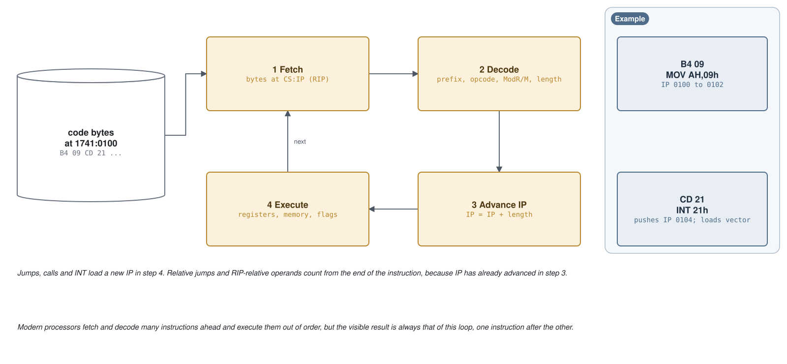
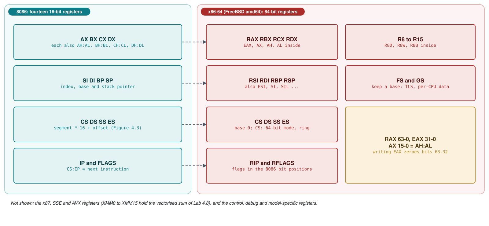
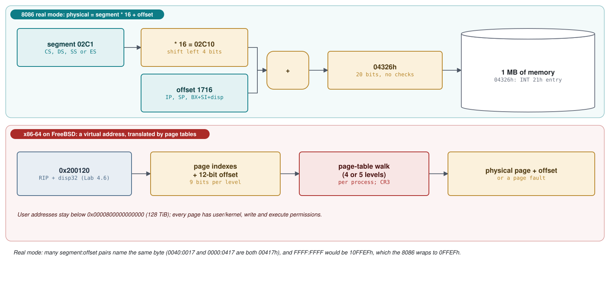
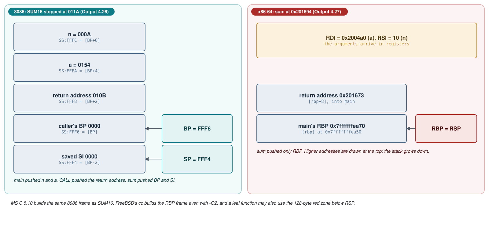
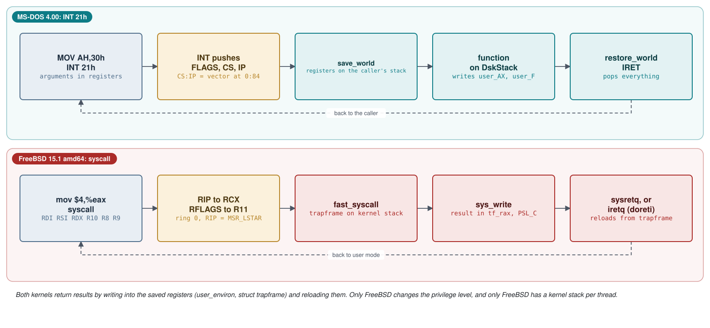

# Module 4: Machine code and assembly language

A processor does not run C, batch files or shell scripts. It runs bytes: it fetches a few bytes from memory,
decodes them as one instruction, executes that instruction and moves on to the next. Earlier modules met such
code many times, in the boot sectors of Module 1 and the INT 21h dispatcher of Module 2, but always through the
source. This module reads the bytes themselves. It covers the two instruction sets of the course: the 16-bit
real-mode code of the 8086, in which MS-DOS 4.00 and its programs are written, and the 64-bit x86-64 (amd64)
code that FreeBSD 15.1 runs. A current PC processor still executes both; after a BIOS boot it starts in real
mode (Module 1, section 1.1). The tools are the ones each system offers: MS-DOS 4.00's own `DEBUG` and the
MASM 5.10 assembler that built MS-DOS, NASM for both systems, and on FreeBSD clang's assembler, `ld`,
`objdump`, `truss` and `gdb`. By the end of the module you can read and write small assembly programs for
both systems, call each operating system without a library, and follow one system call instruction by
instruction. Module 5 builds on this to explain compilers, object files and executables, and Module 6 uses it
for hardware interrupts and port I/O.

**Learning goals.** After this module you can:

- decode short sequences of 8086 and x86-64 machine code by hand (opcode, ModR/M byte, displacement,
  immediate, little-endian order) and check the result with `DEBUG`'s `U` command, `ndisasm` and `objdump -d`;
- name the registers and flags of the 8086 and of x86-64, and compute a real-mode address from a
  `segment:offset` pair;
- read the same code in MASM, NASM and AT&T syntax, and explain what an assembler does with labels,
  directives and macros, using the macros of the MS-DOS kernel source as the example;
- assemble, run, single-step and save a program with MS-DOS 4.00's `DEBUG`, scripted from a file, and do
  the same kind of inspection with `gdb` on FreeBSD;
- explain `PUSH`, `POP`, `CALL`, `RET` and `BP`/`RBP` stack frames, and what `INT n`, `IRET`, `syscall` and
  `sysret` save and restore;
- write programs that call the operating system directly (INT 21h functions 09h, 40h and 4Ch on MS-DOS;
  the `write` and `exit` system calls on FreeBSD), including error handling with the carry flag;
- describe the machine state at program entry for a `.COM` file, an `.EXE` file and a static FreeBSD ELF
  program;
- follow a FreeBSD `write` from the libsys stub into the kernel and back, and compare it with the path of an
  INT 21h call through MS-DOS 4.00.

**Prerequisites.**

- Module 0 (`00-lab.md`): the MS-DOS 4.00 image with `tools/dos_run.py`, the 1988 toolchain with
  `tools/dos_tools.py`, and the FreeBSD 15.1 virtual machine (which has `nasm` and `gdb`). On your own
  computer you need `nasm` (it includes `ndisasm`) and GNU `objdump` from any recent binutils.
- Module 1, section 1.1 (real mode and the BIOS boot contract) and Module 2, sections 2.1 and 2.2 (the INT 21h
  dispatcher and the FreeBSD system call path seen from the kernel). This module looks at the same paths from
  the instruction level and from the programmer's side, and links back instead of repeating them.
- Hexadecimal and two's complement arithmetic; C at the level of pointers and arrays.

## 4.1 From bytes to instructions

### Fetch, decode, execute

The processor keeps the address of the next instruction in a register: `IP` (instruction pointer) together
with the code segment register `CS` on the 8086, and `RIP` on x86-64. Execution is a loop (Figure 4.1):
fetch the bytes at that address; decode them, which tells the processor what the instruction does, which
operands it has and how many bytes it occupies; advance the instruction pointer past it; execute it, which may
read or write registers, memory and flags. A jump, call, return or interrupt changes the instruction pointer
again during the execute step. Because the pointer has already moved, relative jump targets and
`RIP`-relative addresses are measured from the end of the instruction, not from its start. Modern processors
overlap and reorder this work, but the visible result is always as if one instruction ran after the other.



### The parts of an instruction

An x86 instruction is between 1 and 15 bytes long and is built from up to six parts. Only the opcode is always
present.

| Part | Bytes | What it holds |
|---|---|---|
| Prefixes | 0-4 | segment override (`2E` = `CS:`, `36` = `SS:`, `3E` = `DS:`, `26` = `ES:`), `F3` = `REP`, `66` = operand size; on x86-64 also a REX prefix (`40`-`4F`) |
| Opcode | 1-3 | the operation; some opcodes carry a register number in their low 3 bits (`B8`+r is `MOV r16,imm16`, `B0`+r is `MOV r8,imm8`) |
| ModR/M | 0-1 | which register and which register-or-memory operand |
| SIB | 0-1 | scale, index and base (32- and 64-bit addressing only) |
| Displacement | 0, 1, 2 or 4 | a constant added to an address |
| Immediate | 0, 1, 2, 4 (8 for `MOV r64,imm64`) | a constant operand |

Multi-byte numbers are stored *little-endian*, least significant byte first: `BC 00 7C` is `MOV SP,7C00h`.
The ModR/M byte splits into three fields, `mod` (bits 7-6), `reg` (bits 5-3) and `r/m` (bits 2-0). The
`reg` field names a register (or, for some opcodes, extends the opcode); `mod = 11` means `r/m` names a
register too, any other `mod` means `r/m` describes a memory operand with no, an 8-bit or a 16-bit
displacement. The register numbers are:

| Number | 0 | 1 | 2 | 3 | 4 | 5 | 6 | 7 |
|---|---|---|---|---|---|---|---|---|
| 16-bit register | `AX` | `CX` | `DX` | `BX` | `SP` | `BP` | `SI` | `DI` |
| 8-bit register | `AL` | `CL` | `DL` | `BL` | `AH` | `CH` | `DH` | `BH` |
| Segment register | `ES` | `CS` | `SS` | `DS` | | | | |
| 16-bit memory (`r/m`) | `[BX+SI]` | `[BX+DI]` | `[BP+SI]` | `[BP+DI]` | `[SI]` | `[DI]` | `[BP]` (`mod = 00`: a 16-bit address) | `[BX]` |

### Decoding real bytes

Three short sequences from the course's systems show most of the rules. The first is the start of the boot
sector on the lab floppy, written by MSBOOT (Module 1, section 1.3). Its source begins like this:

**Listing 4.1** -- The first instruction of the MS-DOS boot sector is a jump over data ([`MSBOOT.ASM` lines 86-104](https://github.com/microsoft/MS-DOS/blob/2d04cacc5322951f187bb17e017c12920ac8ebe2/v4.0/src/BOOT/MSBOOT.ASM#L86-L104))

```asm
        ORG     ORIGIN

DSKADR  =       1EH*4                   ;POINTER TO DRIVE PARAMETERS

Public $START
$START:
        JMP     START
;----------------------------------------------------------
;
;       THE FOLLOWING DATA CONFIGURES THE BOOT PROGRAM
;       FOR ANY TYPE OF DRIVE OR HARDFILE
;
;J.K. Extened_BPB

if ibmcopyright
          DB      "IBM  "
else
          DB      "MSDOS"
endif
```

On the disk the sector starts `EB 3C 90 4D 53 44 4F 53 34 2E 30`. `EB` is a short jump; the next byte is a
signed 8-bit distance, counted from the end of the jump. The jump ends at `7C02h`, so the target is
`7C02h + 3Ch = 7C3Eh`. `90` is `NOP`, an instruction that does nothing; MASM added it, for a reason section 4.3
explains. The bytes that follow are the text `MSDOS4.0` and the disk parameters, which are data. A disassembler
does not know that. Started at the first byte, it decodes the text as instructions:

**Output 4.1** -- The boot sector of the lab floppy disassembled from its first byte (`ndisasm` on the host)

```text
$ ndisasm -o 0x7c00 msboot.bin | head -7
00007C00  EB3C              jmp 0x7c3e
00007C02  90                nop
00007C03  4D                dec bp
00007C04  53                push bx
00007C05  44                inc sp
00007C06  4F                dec di
00007C07  53                push bx
```

`M`, `S`, `D`, `O` are `4D`, `53`, `44`, `4F`, and those happen to be one-byte instructions. The processor
never executes them, because the jump skips them. Code and data are both just bytes; only the path of
execution decides which bytes are instructions. The jump lands on `START`:

**Listing 4.2** -- MSBOOT sets up its stack ([`MSBOOT.ASM` lines 145-168](https://github.com/microsoft/MS-DOS/blob/2d04cacc5322951f187bb17e017c12920ac8ebe2/v4.0/src/BOOT/MSBOOT.ASM#L145-L168))

```asm
START:

⋮
        CLI                             ;Stop interrupts till stack ok
        XOR     AX,AX
        MOV     SS,AX                   ;Work in stack just below this routine
        ASSUME  SS:CODE
        MOV     SP,ORIGIN
        PUSH    SS
        POP     ES
        ASSUME  ES:CODE
⋮
        MOV     BX,DSKADR
        LDS     SI,DWORD PTR SS:[BX]    ; get address of disk table
```

**Output 4.2** -- The same instructions in the boot sector (`ndisasm` on the host, starting at `START`)

```text
$ ndisasm -o 0x7c3e -e 0x3e msboot.bin | head -8
00007C3E  FA                cli
00007C3F  33C0              xor ax,ax
00007C41  8ED0              mov ss,ax
00007C43  BC007C            mov sp,0x7c00
00007C46  16                push ss
00007C47  07                pop es
00007C48  BB7800            mov bx,0x78
00007C4B  36C537            lds si,word [ss:bx]
```

FreeBSD's `boot0` (Module 1, section 1.2) starts with the same kind of set-up, written in AT&T syntax:

**Listing 4.3** -- The first instructions of FreeBSD's `boot0` ([`boot0.S` lines 172-177](https://github.com/freebsd/freebsd-src/blob/96841ea08dcfa84b954a32dc5ae1a26c28966cf4/stand/i386/boot0/boot0.S#L172-L177))

```asm
start:          cld                             # String ops inc
                xorw %ax,%ax                    # Zero
                movw %ax,%es                    # Address
                movw %ax,%ds                    #  data
                movw %ax,%ss                    # Set up
                movw $LOAD,%sp                  #  stack
```

The installed `/boot/boot0` begins `FC 31 C0 8E C0 8E D8 8E D0 BC 00 7C` (Lab 4.1). Decoded by hand:

| Bytes | Fields | Instruction |
|---|---|---|
| `B4 09` | opcode `B0`+4 (register 4 of the 8-bit set = `AH`), immediate `09` | `MOV AH,9` |
| `CD 21` | opcode `CD`, immediate vector number `21` | `INT 21h` |
| `EB 3C` | opcode `EB`, 8-bit relative distance `3C` | `JMP SHORT` to (end of instruction) + 3Ch |
| `FC` | opcode only | `CLD` (clear the direction flag) |
| `33 C0` | opcode `33` = `XOR r16, r/m16`; ModR/M `C0` = `11 000 000`: `reg` = 0 (`AX`), `mod` = 11, `r/m` = 0 (`AX`) | `XOR AX,AX` |
| `31 C0` | opcode `31` = `XOR r/m16, r16`; same ModR/M | `XOR AX,AX` |
| `8E D8` | opcode `8E` = `MOV Sreg, r/m16`; ModR/M `D8` = `11 011 000`: `reg` = 3 (`DS`), `r/m` = 0 (`AX`) | `MOV DS,AX` |
| `8E D0` | ModR/M `D0` = `11 010 000`: `reg` = 2 (`SS`) | `MOV SS,AX` |
| `BC 00 7C` | opcode `B8`+4 (`SP`), 16-bit immediate `7C00`, little-endian | `MOV SP,7C00h` |
| `36 C5 37` | prefix `36` (`SS:`), opcode `C5` = `LDS`; ModR/M `37` = `00 110 111`: `reg` = 6 (`SI`), `mod` = 00, `r/m` = 7 (`[BX]`) | `LDS SI,SS:[BX]` |

`33 C0` and `31 C0` are two encodings of the same instruction. For two register operands either operand can
sit in the ModR/M `r/m` field, and bit 1 of the opcode says which one is the destination. MASM chose `33`
for MSBOOT, while LLVM (which assembled `boot0`) and NASM choose `31`. Such choices are fingerprints of the
assembler that produced a binary.

The same bytes can also mean different things in different processor modes. In 64-bit mode `31 C0` is
`xor eax,eax`, because the default operand size there is 32 bits, and the byte `48`, which is `DEC AX` on the
8086, becomes a prefix that widens the next instruction to 64 bits. A disassembler therefore has to be told
the mode: `ndisasm -b 16` (the default) or `-b 64`, and `objdump -m i8086` for 16-bit code. `DEBUG` only
knows real mode.

Three tools turn bytes back into text: `DEBUG`'s `U` (unassemble) command on MS-DOS, which reads memory;
`ndisasm`, which reads a raw file of bytes and needs a starting address (`-o`) to compute jump targets; and
`objdump -d`, which reads object and executable files (ELF on FreeBSD) and uses their symbol tables to label
the code. GNU `objdump` on the host and LLVM `objdump` in the FreeBSD VM both print AT&T syntax by default.
Lab 4.1 uses all three.

## 4.2 Registers and addresses

### The 8086 register file

The 8086 has fourteen 16-bit registers (Figure 4.2). Four general registers can also be used as two 8-bit
halves: `AX` is `AH` (high byte) and `AL` (low byte), and the same for `BX`, `CX` and `DX`. Most instructions
accept any general register, but many give one register a special role, which is where the names come from:

| Register | Name | Special roles |
|---|---|---|
| `AX` (`AH`, `AL`) | accumulator | `MUL`, `DIV`, `IN`, `OUT`; the INT 21h function number goes in `AH` |
| `BX` (`BH`, `BL`) | base | one of the two registers that can be the base of an address |
| `CX` (`CH`, `CL`) | count | `LOOP`, `REP`, `JCXZ`; shift counts in `CL` |
| `DX` (`DH`, `DL`) | data | high word of `MUL` and `DIV`; port number for `IN` and `OUT` |
| `SI`, `DI` | source and destination index | string instructions copy from `DS:SI` to `ES:DI` |
| `BP` | base pointer | the other address base; addresses the stack segment, so it is used for stack frames |
| `SP` | stack pointer | top of the stack, `SS:SP` |
| `CS`, `DS`, `SS`, `ES` | segment registers | code, data, stack and extra segment |
| `IP` | instruction pointer | the next instruction, `CS:IP` |
| `FLAGS` | flags | condition codes and control bits |



The flags record properties of the last result (*status flags*) or control the processor (*control flags*).
`DEBUG` prints them as two-letter names, and its table of names lists them in bit order:

**Listing 4.4** -- `DEBUG`'s names for the flag bits, from bit 15 down to bit 0 ([`DEBCONST.ASM` lines 996-1032](https://github.com/microsoft/MS-DOS/blob/2d04cacc5322951f187bb17e017c12920ac8ebe2/v4.0/src/CMD/DEBUG/DEBCONST.ASM#L996-L1032))

```asm
; Flags are ordered to correspond with the bits of the flag
; register, most significant bit first, zero if bit is not
; a flag. First 16 entries are for bit set, second 16 for
; bit reset.

FLAGTAB    DW   0
           DW   0
           DW   0
           DW   0
           DB   "OV"
           DB   "DN"
           DB   "EI"                    ; "STI"
           DW   0
           DB   "NG"
           DB   "ZR"
           DW   0
           DB   "AC"
           DW   0
           DB   "PE"
           DW   0
           DB   "CY"
           DW   0
           DW   0
           DW   0
           DW   0
           DB   "NV"
           DB   "UP"                    ; "CLD"
           DB   "DI"
           DW   0
           DB   "PL"
           DB   "NZ"
           DW   0
           DB   "NA"
           DW   0
           DB   "PO"
           DW   0
           DB   "NC"
```

| Bit | Flag | Set when | `DEBUG` set / clear | `gdb` name |
|---|---|---|---|---|
| 11 | `OF` overflow | the signed result does not fit | `OV` / `NV` | `OF` |
| 10 | `DF` direction | (control) string instructions count down | `DN` / `UP` | `DF` |
| 9 | `IF` interrupt enable | (control) hardware interrupts are accepted | `EI` / `DI` | `IF` |
| 8 | `TF` trap | (control) interrupt after each instruction | not shown | `TF` |
| 7 | `SF` sign | the top bit of the result is 1 | `NG` / `PL` | `SF` |
| 6 | `ZF` zero | the result is 0 | `ZR` / `NZ` | `ZF` |
| 4 | `AF` auxiliary carry | a carry out of the low 4 bits (for BCD arithmetic) | `AC` / `NA` | `AF` |
| 2 | `PF` parity | the low byte of the result has an even number of 1 bits | `PE` / `PO` | `PF` |
| 0 | `CF` carry | an unsigned result does not fit (carry or borrow) | `CY` / `NC` | `CF` |

Bit 8 has a zero entry in the table: `DEBUG` never shows the trap flag, because it uses that flag itself to
execute your program one instruction at a time (section 4.4). Conditional jumps test these flags: `JZ`/`JE`
tests `ZF`, `JC`/`JB` tests `CF`, `JS` tests `SF`, `JO` tests `OF`, and `JL`, `JG` and their relatives combine
`SF`, `OF` and `ZF` for signed comparisons. `CF` matters beyond arithmetic: both systems in this course report
system call errors in it (section 4.6).

### Segment:offset addresses

Module 2, section 2.1 gives the rule: a real-mode address is a 16-bit segment and a 16-bit offset, and the
processor forms the 20-bit physical address as `segment * 16 + offset` (Figure 4.3). Some consequences matter
when you program:

- Many pairs name the same byte. `0040:0017` and `0000:0417` are both physical `00417h`. The INT 21h entry
  point of our MS-DOS, `02C1:1716` (section 4.5), is physical `02C10h + 1716h = 04326h`.
- A segment is a 64 KB window that starts on a 16-byte *paragraph* boundary. A program that needs more than
  64 KB of code or data must load different values into the segment registers, which is the subject of
  Module 5's memory models.
- `FFFF:FFFF` would be `10FFEFh`, beyond 1 MB; the 8086 wraps such addresses around to the start of memory.



An instruction usually does not name a segment register; the processor picks one by default:

| Access | Default segment |
|---|---|
| instruction fetch | `CS` (with `IP`) |
| `PUSH`, `POP`, `CALL`, `RET`, `INT`, `IRET` | `SS` (with `SP`) |
| memory operand whose address uses `BP` | `SS` |
| any other memory operand | `DS` |
| destination of a string instruction (`STOSB`, `MOVSB`) | `ES` (with `DI`), cannot be overridden |

A segment override prefix replaces the default for one instruction. MSBOOT's `LDS SI,DWORD PTR SS:[BX]`
(Listing 4.2) assembles to `36 C5 37`: without the `36` the processor would read through `DS`. `DEBUG` shows
a prefix on a line of its own, as the `CS:` in the trace of Study case 4.A. The MS-DOS kernel uses `CS:` overrides often,
because on entry to a system call `DS` still belongs to the caller while the kernel's own variables live in
its code group.

The memory operands of 16-bit code are limited to the eight `r/m` forms in the table of the previous section,
plus a displacement: one of `BX` or `BP`, one of `SI` or `DI`, both, or neither. `MOV AX,[CX]` cannot be
encoded at all.

### x86-64

x86-64 extends the same design (Figure 4.2). There are sixteen 64-bit general registers: `RAX`, `RBX`, `RCX`,
`RDX`, `RSI`, `RDI`, `RBP`, `RSP` and the new `R8` to `R15`. Each has smaller views: `EAX` is the low 32 bits
of `RAX`, `AX` the low 16 and `AL` the low 8 (`AH` still exists); `R8D`, `R8W` and `R8B` are the views of
`R8`, and `SIL`, `DIL`, `SPL` and `BPL` are new 8-bit views. One rule surprises 8086 programmers: writing a
32-bit register clears the upper 32 bits of the 64-bit register, while writing an 8- or 16-bit view leaves the
other bits alone. That is why compilers and the programs in this module write `mov eax, 4` and
`xor eax, eax`: the result is the same as with `RAX`, and the instruction is shorter.

A *REX prefix* (`40`-`4F`, binary `0100WRXB`) reaches the new registers and the 64-bit size: `W = 1` selects
a 64-bit operand, and `R`, `X` and `B` add a fourth bit to the ModR/M `reg` field, the SIB index and the
`r/m` or base field. `48 89 E5` is `mov rbp, rsp`, and `49 89 CA` (`W` and `B` set) is `mov r10, rcx`, which
appears in every FreeBSD system call stub (Lab 4.7). The instruction pointer is `RIP`, and `RFLAGS` keeps the
8086 flags in the same bit positions; `gdb` lists the set ones, for example `[ CF PF IF ]`.

Segments are almost gone. In 64-bit mode the processor treats the bases of `CS`, `DS`, `ES` and `SS` as 0 and
checks no limits; `CS` still selects 64-bit mode and the privilege level. Only `FS` and `GS` keep a base
address, and FreeBSD uses `FS` for thread-local storage (`pcb_fsbase` in section 4.7). An address in a
program is a 64-bit *virtual* address, which the page tables translate to a physical one (Module 2,
section 2.5; Module 8). On amd64, user addresses lie below `0x0000800000000000`, 128 TiB (arch(7)). The course
VM's processor has 5-level paging and its kernel uses it (`sysctl vm.pmap.la57` prints 1), which would allow
64 PiB, but arch(7) explains that processes still get the 48-bit layout by default, for compatibility
(`vm.pmap.prefer_uva_la48` is 1). The stacks in this module's FreeBSD outputs sit just below the 128 TiB limit,
at `0x7fffffffxxxx`.

Memory operands are general: `[base + index * scale + displacement]` with any registers, a scale of 1, 2, 4
or 8 and a 32-bit displacement. 64-bit mode adds *RIP-relative* addressing: the ModR/M combination that meant
"32-bit absolute address" in 32-bit code means "`RIP` plus a 32-bit displacement". In Lab 4.6 the instruction
`lea rsi, [rel msg]` becomes `48 8D 35 CF EF FF FF`: REX.W, opcode `8D` (`LEA`), ModR/M `35` = `00 110 101`
(`reg` = 6, `RSI`; `mod` = 00 with `r/m` = 101, `RIP`-relative) and the displacement `FFFFEFCF` = -1031h.
The next instruction starts at `201151h`, and `201151h - 1031h = 200120h`, the address of `msg`. Such code
works wherever it is loaded, without the load-time fixups that the 8086 needs for segment values (Lab 4.3).

| | 8086, real mode | x86-64, 64-bit mode (FreeBSD programs) |
|---|---|---|
| General registers | 8 of 16 bits | 16 of 64 bits |
| Instruction pointer | `CS:IP` | `RIP` |
| Address | `segment * 16 + offset`, 20 bits, physical | 64-bit virtual, translated by page tables |
| Largest object without changing segment registers | 64 KB | the whole user address space (128 TiB) |
| Memory operand | `[BX or BP + SI or DI + disp16]` | `[base + index * 1/2/4/8 + disp32]`, `[RIP + disp32]` |
| Protection | none | privilege levels and page permissions |

## 4.3 Assemblers and their syntaxes

### What an assembler does

An assembler translates one line of text into the bytes of one instruction, and it handles everything around
the instructions that a person should not have to count by hand:

- *Labels.* The assembler keeps a location counter, the offset of the next byte it will emit. A label such as
  `START:` gives the current value of the counter a name, and every use of the name becomes a number: the
  target of `JMP START`, the offset in `MOV DX,OFFSET MSG`.
- *Directives.* Lines that emit no instruction but control the output: data (`DB`, `DW` in MASM; `db`, `dw` in
  NASM; `.byte`, `.ascii` in GNU syntax), constants (`EQU`, `=`), the origin of the location counter (`ORG 100h`
  in a `.COM` program, `ORG 7C00h` in a boot sector), sections or segments, and the entry point (`END START`).
- *Output.* Either an object file with symbols and *relocations*, the places where an address can only be filled
  in later, by the linker or the loader, or a flat binary that is exactly the bytes, which is how boot sectors
  and `.COM` programs can be made with NASM (`nasm -f bin`). MASM writes Microsoft's OMF object format; NASM and
  clang write ELF on FreeBSD. Object formats, linking and relocation are the subject of Module 5.
- *Macros and conditional assembly.* Named pieces of text with parameters, expanded before assembly, and
  `IF`/`ENDIF` blocks such as the `if ibmcopyright` in Listing 4.1. The MS-DOS source uses macros so heavily
  that they form a small language of their own (Study case 4.C).

Labels used before they are defined, *forward references*, are the classic difficulty. MASM 5.10 reads the
source twice. In pass 1 it must decide how many bytes `JMP START` takes before it knows where `START` is, so it
reserves three, enough for a near jump with a 16-bit distance. In pass 2 it knows the distance; if it fits in
8 bits it emits the 2-byte short jump and fills the third byte with `NOP`, because every later label already
has its address from pass 1. That is the `90` after `EB 3C` at the start of the MS-DOS boot sector. The
programmer can say `JMP SHORT` to get two bytes from the start:

**Output 4.3** -- MASM 5.10 listing of `FWD.ASM` (`labs/04-asm/FWD.ASM`), assembled with
`tools/dos_tools.py --dir work/04 "MASM FWD,,FWD;"`

```text
 0000                           CODE    SEGMENT
                                        ASSUME  CS:CODE
 0000  EB 0B 90                         JMP     AHEAD
 0003  000A[                            DB      10 DUP (0)
           00
                         ]

 000D  EB FE                    AHEAD:  JMP     AHEAD
 000F  EB 0A                            JMP     SHORT FAR1
 0011  000A[                            DB      10 DUP (0)
           00
                         ]

 001B  90                       FAR1:   NOP
 001C                           CODE    ENDS
                                        END
```

The backward jump `JMP AHEAD` at `000D` needs no padding: its target is known, and `EB FE` (a distance of -2)
is the shortest possible endless loop. NASM, the assembler used for the course's own MS-DOS programs, repeats
its passes until the sizes stop changing and never pads.

### Three syntaxes for one instruction set

The instruction set is defined by Intel and AMD, but the way of writing it is defined by each assembler. This
course meets three syntaxes:

| | MASM (MS-DOS source) | NASM (both systems in this course) | AT&T (FreeBSD source, `cc`, `objdump`, `gdb`) |
|---|---|---|---|
| Operand order | destination, source: `MOV AX,BX` | destination, source: `mov ax, bx` | source, destination: `movw %bx, %ax` |
| Registers | `AX` | `ax` | `%ax` |
| Constants | `7C00h` | `7C00h` or `0x7c00` | `$0x7c00` |
| Memory operand | `WORD PTR [BX+SI+4]`, `ES:[DI]` | `word [bx+si+4]`, `[es:di]` | `4(%bx,%si)`, `%es:(%di)` |
| x86-64 memory operand | (none) | `[rdi + rcx*8 + 16]`, `[rel msg]` | `16(%rdi,%rcx,8)`, `msg(%rip)` |
| Operand size | from a register operand, or `BYTE PTR`, `WORD PTR` | from a register operand, or `byte`, `word`, `qword` | suffix `b`, `w`, `l` or `q` on the mnemonic |
| Address of a label | `OFFSET MSG` (a plain `MSG` means the memory at `MSG`) | `msg` (the memory is `[msg]`) | `$msg` (a plain `msg` means the memory) |
| Comment | `;` | `;` | `#`, or `/* */` in `.S` files, which pass through the C preprocessor |

The MASM rule in the second-last row causes many beginners' bugs: MASM remembers that `MSG` was defined with
`DB` and treats the name as a variable, so the address must be asked for with `OFFSET`. NASM has no such
memory; a name is always an address, and square brackets always mean memory.

The boot-sector set-up code of Listings 4.2 and 4.3 is a good test. The course provides it in all three
syntaxes, `labs/04-asm/SETUPM.ASM`, `labs/04-asm/setup.asm` and `labs/04-asm/freebsd/setup.S`. The last one is
written like `boot0.S`:

**Example 4.1** -- The set-up code in AT&T syntax (`labs/04-asm/freebsd/setup.S`)

```asm
/* setup.S - section 4.3: boot-sector set-up code in AT&T syntax (as in boot0.S) */
        .code16
        .text
start:  cld
        xorw    %ax, %ax
        movw    %ax, %es
        movw    %ax, %ds
        movw    %ax, %ss
        movw    $0x7c00, %sp
```

Assembled with the three assemblers, it gives the same twelve bytes except for the `XOR`:

**Output 4.4** -- The listing written by MASM 5.10 (`MASM SETUPM,,SETUPM;` with `tools/dos_tools.py`)

```text
 0000                           CODE    SEGMENT
                                        ASSUME  CS:CODE
 0000  FC                       START:  CLD
 0001  33 C0                            XOR     AX,AX
 0003  8E C0                            MOV     ES,AX
 0005  8E D8                            MOV     DS,AX
 0007  8E D0                            MOV     SS,AX
 0009  BC 7C00                          MOV     SP,7C00h
 000C                           CODE    ENDS
                                        END     START
```

**Output 4.5** -- The listing written by NASM on the host (`nasm -f bin -l setup.lst -o setup.bin setup.asm`)

```text
     3                                          bits    16
     4 00000000 FC                      start:  cld
     5 00000001 31C0                            xor     ax, ax
     6 00000003 8EC0                            mov     es, ax
     7 00000005 8ED8                            mov     ds, ax
     8 00000007 8ED0                            mov     ss, ax
     9 00000009 BC007C                          mov     sp, 7C00h
```

**Output 4.6** -- clang's assembler and LLVM `objdump` in the FreeBSD VM (captured in the course VM)

```text
$ cc -c setup.S && objdump -d --triple=i386-unknown-unknown-code16 setup.o

setup.o:        file format elf64-x86-64

Disassembly of section .text:

0000000000000000 <start>:
       0: fc                            cld
       1: 31 c0                         xorw    %ax, %ax
       3: 8e c0                         movw    %ax, %es
       5: 8e d8                         movw    %ax, %ds
       7: 8e d0                         movw    %ax, %ss
       9: bc 00 7c                      movw    $0x7c00, %sp            # imm = 0x7C00
```

Note how each tool prints the immediate of the last instruction: MASM's listing shows the 16-bit value
`7C00`, while NASM and `objdump` show the bytes in memory order, `00 7C`. The ELF object file is a 64-bit
object even though the code is 16-bit; `objdump` must be told the mode with `--triple`, or it decodes the
bytes as 64-bit code (Exercise 4.1 asks you to try). The bytes of Output 4.6 are the first twelve bytes of
the installed `/boot/boot0`, which Lab 4.1 dumps.

## 4.4 DEBUG: an assembler and debugger in one program

### A monitor in 21 KB

`DEBUG.COM` is the oldest kind of debugger, a *monitor*: a small program that shows and changes memory and
registers, and runs another program under control. The MS-DOS 4.00 version (`v4.0/src/CMD/DEBUG`, 21,574 bytes as built for the course) also contains
a one-line-at-a-time assembler (`A`) and a disassembler (`U`), so with nothing but `DEBUG` you can write,
run, inspect and save machine code. Every command is one letter, and the dispatcher is itself a lesson in
assembly language: the letter, minus `A`, times two, is an index into a table of addresses.

**Listing 4.5** -- `DEBUG` turns the command letter into an index and calls through a table ([`DEBUG.ASM` lines 587-600](https://github.com/microsoft/MS-DOS/blob/2d04cacc5322951f187bb17e017c12920ac8ebe2/v4.0/src/CMD/DEBUG/DEBUG.ASM#L587-L600))

```asm
        LODSB                           ; AL=first non-blank character
; Prepare command letter for table lookup
; converts the first non-blank (assumed to be the command letter)
; to in index in the "comtab" array.
        SUB     AL,UPPER_A              ; Low end range check
        JB      ERR1

        CMP     AL,UPPER_Z - UPPER_A    ; Upper end range check
        JA      ERR1

        SHL     AL,1                    ; Times two
        CBW                             ; Now a 16-bit quantity
        XCHG    BX,AX                   ; In BX we can address with it
        CALL    CS:[BX+COMTAB]          ; Execute command
```

`SUB` sets the carry flag when the character is below `A`, so `JB` (jump if below, the same instruction as
`JC`) rejects it; `CBW` widens `AL` to `AX`; and `XCHG` moves the index into `BX`, because `BX` can be used as
an address base and `AX` cannot (section 4.2). The `CALL` is indirect: it reads its target from the word at
`CS:COMTAB + BX`.

**Listing 4.6** -- `DEBUG`'s command table ([`DEBUG.ASM` lines 1000-1032](https://github.com/microsoft/MS-DOS/blob/2d04cacc5322951f187bb17e017c12920ac8ebe2/v4.0/src/CMD/DEBUG/DEBUG.ASM#L1000-L1032))

```asm
; Command Table. Command letter indexes into table to get
; address of command. PERR prints error for no such command.

COMTAB  DW      ASSEM                   ; A
        DW      PERR                    ; B
        DW      COMPARE                 ; C
        DW      DUMP                    ; D
        DW      ENTERDATA               ; E
        DW      FILL                    ; F
        DW      GO                      ; G
        DW      HEXADD                  ; H
        DW      INPUT                   ; I
        DW      PERR                    ; J
        DW      PERR                    ; K
        DW      LOAD                    ; L
        DW      MOVE                    ; M
        DW      NAMED                   ; N
        DW      OUTPUT                  ; O
        DW      ZTRACE                  ; P
        DW      QUIT                    ; Q (QUIT)
        DW      REG                     ; R
        DW      SEARCH                  ; S
        DW      TRACE                   ; T
        DW      UNASSEM                 ; U
        DW      PERR                    ; V
        DW      DWRITE                  ; W
        IF      SYSVER
            DW      SETUDEV             ; X
        ELSE
            DW      DEBEMS
        ENDIF
        DW      PERR                    ; Y
        DW      PERR                    ; Z
```

The commands this module uses:

| Command | Meaning |
|---|---|
| `A 100` | assemble the lines that follow into memory from offset 100h, until an empty line |
| `U 100 L C` | unassemble (disassemble) 0Ch bytes from offset 100h |
| `D SS:FFE8 L 6` | dump 6 bytes, as hexadecimal and as characters |
| `E 200 B4 09` | enter bytes into memory |
| `R`, `R CX` | show all registers; show and change one register |
| `T`, `T 5` | trace: execute one (or five) instructions, showing the registers after each |
| `P` | proceed: like `T`, but runs a `CALL`, `INT`, `LOOP` or `REP` instruction to its end |
| `G 11A` | go: run until the instruction at offset 11Ah |
| `N NAME.COM`, `L`, `W` | name a file, load it, write `BX:CX` bytes from offset 100h to it |
| `Q` | quit |

All numbers are hexadecimal, without an `h`. An address is an offset (in `DS` for `D` and `E`, in `CS` for `A`,
`U` and `G`), or a `segment:offset` pair in which the segment may be a register name. Started as
`DEBUG HELLO.COM`, `DEBUG` loads the program as `EXEC` would and stops before its first instruction; the `R`
command then shows the registers a program receives (Lab 4.3):

**Output 4.7** -- The registers of a `.COM` program before its first instruction (MS-DOS 4.00, Lab 4.3)

```text
-R

AX=0000  BX=0000  CX=0025  DX=0000  SP=FFFE  BP=0000  SI=0000  DI=0000
DS=1756  ES=1756  SS=1756  CS=1756  IP=0100   NV UP EI PL NZ NA PO NC
1756:0100 B409          MOV     AH,09
```

The first two lines are the register file of Figure 4.2 with the flags of Listing 4.4; the third is the next
instruction, at `CS:IP`, with its bytes and its disassembly.

### Scripting DEBUG

On the lab machine nobody types at the keyboard, and you would not want to anyway: a script can be repeated
and corrected. `DEBUG` reads its commands from standard input, so `COMMAND.COM`'s input redirection (Module 3,
section 3.4) turns a text file into a session: `DEBUG <HELLO.SCR`, or `DEBUG HELLO.COM <RCOM.SCR` to load a
program first. Three rules make scripts work:

1. The last command must be `Q`. At the end of the file `DEBUG` does not stop, it waits for more input, and
   `dos_run.py` ends the run only when its `--timeout` expires.
2. An empty line ends the input of an `A` command.
3. `DEBUG` echoes every command it reads, followed by an empty line, so the output can be read as a session.

### How T, G and P work

To execute one instruction of your program and then get control back, `DEBUG` uses the trap flag. It loads the
program's registers, pushes the program's flags with `TF` set, its `CS` and its `IP` onto the program's
stack, and executes `IRET`:

**Listing 4.7** -- `T` sets the trap flag in the saved flags and returns into the program with `IRET` ([`DEBCOM3.ASM` lines 268-324](https://github.com/microsoft/MS-DOS/blob/2d04cacc5322951f187bb17e017c12920ac8ebe2/v4.0/src/CMD/DEBUG/DEBCOM3.ASM#L268-L324))

```asm
CHECKOP:
        MOV     RSETFLAG,AL             ; no bits to turn off
SETTRACE:
        OR      FLSAVE,F_TRACE           ; Turn on trace bit
⋮
        PUSH    DS
        XOR     AX,AX
        MOV     DS,AX
        MOV     WORD PTR DS:[12],OFFSET DG:BREAKFIX ; Set vector 3--breakpoint instruction
        MOV     WORD PTR DS:[14],CS
        MOV     WORD PTR DS:[4],OFFSET DG:REENTER ; Set vector 1--Single step
        MOV     WORD PTR DS:[6],CS
⋮
        POP     SS
        MOV     SP,[SPSAVE]
        PUSH    [FLSAVE]
        PUSH    [CSSAVE]
        PUSH    [IPSAVE]
        MOV     DS,[DSSAVE]
        IRET
```

`IRET` pops `IP`, `CS` and the flags in one instruction, so the processor continues in the program with `TF`
set. After one instruction it raises interrupt 1, whose vector (at `0000:0004`, four bytes per vector) now
points to `DEBUG`'s `REENTER`, which saves the registers and prints them. That is why `DEBUG` never shows `TF`:
it is always set while the program runs and always clear when you look. The `INT` instruction needs special
care: according to the comment in Listing 4.8, the 286 treats a software interrupt in trace mode as one atomic
operation, so a traced `INT` would not stop at the first instruction of the handler. `DEBUG` therefore does
what the processor would do itself, in software:

**Listing 4.8** -- `T` simulates an `INT` instruction: read the vector, push flags, `CS` and `IP`, clear `IF` and `TF` ([`DEBCOM3.ASM` lines 180-256](https://github.com/microsoft/MS-DOS/blob/2d04cacc5322951f187bb17e017c12920ac8ebe2/v4.0/src/CMD/DEBUG/DEBCOM3.ASM#L180-L256))

```asm
STEP:
        MOV     [BRKCNT],0
; The 286 has a problem with trace mode and software interrupt instructions;
; it treats them as atomic operations.  We simulate the operation in software.
        MOV     ES,[CSSAVE]             ; Get next instruction pointer
        MOV     DI,[IPSAVE]
        MOV     AL,ES:[DI]              ; get next opcode
⋮
not_mask_op:
        CMP     AL,0CDH                 ; trace over an interrupt?
        JZ      DOINT                   ; no, check for other special cases
⋮
DOINT:
; We have a software interrupt.  Get destination vector
        MOV     BL,BYTE PTR ES:[DI+1]   ; get vector number
        XOR     BH,BH                   ; clear out upper
DOVAL:
        SHL     BX,1                    ; word index
        SHL     BX,1                    ; dword index
        XOR     DI,DI                   ; interrupt table
        MOV     ES,DI
        MOV     AX,ES:[BX]              ; point to vector
        MOV     BX,ES:[BX+2]            ; point to vector
; AX:BX is the vector.  Swap it with currect CS:IP
        XCHG    AX,IPSAVE               ; new CS:IP
        XCHG    BX,CSSAVE
; AX:BX is old CS:IP.  We 'PUSH' flags, oldCS and oldIP, reset flags (ifl) and
; set CS:IP to point to interrupt instruction.
        MOV     ES,SSSAVE               ; point to user stack
        MOV     DI,SPSAVE
; Take old flags and PUSH the flags.
        MOV     CX,FLSAVE                ; get flags
        SUB     DI,2                    ; PUSHF
        MOV     ES:[DI],CX              ; rest of push
; Push the old CS
        SUB     DI,2                    ; PUSH CS
        MOV     ES:[DI],BX              ; rest of push
; Push the old IP
        SUB     DI,2                    ; PUSH IP
        ADD     AX,2                    ; increment IP
        MOV     ES:[DI],AX              ; rest of push
; Update stack
        MOV     SPSAVE,DI               ; store
; Take flags and turn interrupts off and trace mode off
        AND     CX,NOT F_INTERRUPT      ; CLI
        AND     CX,NOT F_TRACE          ; no trace
        MOV     FLSAVE,CX                ; rest of CLI
```

The block is a precise description of `INT n` on the 8086: the vector is the doubleword at `0000:n*4`; the
flags, `CS` and the address of the next instruction (`IP + 2`, because `INT n` is two bytes long) are pushed
in that order; `IF` and `TF` are cleared; `CS:IP` is loaded from the vector. After `T` on an `INT 21h` you are
therefore at the first instruction of the MS-DOS dispatcher, with the return address on the stack, which
Study case 4.A uses.

`G` uses a different mechanism. For each breakpoint address it saves the original byte and writes `CC` there
([`DEBCOM3.ASM` lines 600-604](https://github.com/microsoft/MS-DOS/blob/2d04cacc5322951f187bb17e017c12920ac8ebe2/v4.0/src/CMD/DEBUG/DEBCOM3.ASM#L600-L604)).
`CC` is `INT 3`, the only one-byte `INT` instruction, so it fits over the first byte of any instruction.
When the program reaches it, interrupt 3 enters `DEBUG`, which puts the original bytes back. `P` combines the
two: if the next instruction is a `CALL`, `INT`, `LOOP` or `REP` string instruction, `DEBUG` computes its
length from the opcode and the ModR/M byte, puts a single `CC` right after it and lets the program run:

**Listing 4.9** -- `P` decodes the instruction length and plants one `INT 3` after the instruction ([`DEBCOM3.ASM` lines 92-156](https://github.com/microsoft/MS-DOS/blob/2d04cacc5322951f187bb17e017c12920ac8ebe2/v4.0/src/CMD/DEBUG/DEBCOM3.ASM#L92-L156))

```asm
        CMP     AL,11101000B            ; direct intra call
        JZ      ZTRACE3                 ; yes, 3 bytes
        CMP     AL,10011010B            ; direct inter call
        JZ      ZTRACE5                 ; yes, 5 bytes
        CMP     AL,11111111B            ; indirect?
        JZ      ZTRACEMODRM             ; yes, go figure length
        CMP     AL,11001100B            ; short interrupt?
        JZ      ZTRACE1                 ; yes, 1 byte
        CMP     AL,11001101B            ; long interrupt?
        JZ      ZTRACE2                 ; yes, 2 bytes
⋮
ZTRACE5:
        INC     DX
ZTRACE4:
        INC     DX
ZTRACE3:
        INC     DX
ZTRACE2:
        INC     DX
ZTRACE1:
        INC     DX
        ADD     DI,DX                   ; offset to breakpoint instruction
        MOV     WORD PTR [BPTAB],DI     ; save offset
        MOV     WORD PTR [BPTAB+2],ES   ; save segment
        MOV     AL,ES:[DI]              ; get next opcode byte
        MOV     BYTE PTR [BPTAB+4],AL   ; save it
        MOV     BYTE PTR ES:[DI],0CCH   ; break point it
```

The labels `ZTRACE5` to `ZTRACE1` fall through into each other, so jumping to `ZTRACE3` adds 1 to `DX` three
times: a compact way to turn "this instruction is three bytes long" into a number.

### The same mechanisms on FreeBSD

`gdb` on FreeBSD (Labs 4.7 and 4.8) offers the same services with different words: `x/5i` for `U`, `x/8xb`
for `D`, `info registers` for `R`, `stepi` for `T`, `nexti` for `P`, `break` and `continue` for `G`. Underneath,
the hardware mechanisms are the same: a breakpoint is an `int3` byte (`CC`), written into the traced
program's memory, and a single step is the trap flag. The difference is who does it. A FreeBSD process
cannot touch another process's memory or registers; the debugger asks the kernel with the `ptrace(2)` system
call, and the kernel sets the flag in the registers it saved for the traced thread:

**Listing 4.10** -- FreeBSD single-steps a traced thread by setting `PSL_T`, the trap flag, in its saved flags ([`ptrace_machdep.c` lines 409-419](https://github.com/freebsd/freebsd-src/blob/96841ea08dcfa84b954a32dc5ae1a26c28966cf4/sys/amd64/amd64/ptrace_machdep.c#L409-L419))

```c
int
ptrace_single_step(struct thread *td)
{

	PROC_LOCK_ASSERT(td->td_proc, MA_OWNED);
	if ((td->td_frame->tf_rflags & PSL_T) == 0) {
		td->td_frame->tf_rflags |= PSL_T;
		td->td_dbgflags |= TDB_STEP;
	}
	return (0);
}
```

`td_frame->tf_rflags` plays the role of `DEBUG`'s `FLSAVE`: the flags that will be loaded when the thread
returns to user mode. `DEBUG` can patch the interrupt vector table and other programs' memory because MS-DOS
lets every program do so; on FreeBSD only the kernel can, and only for a debugger that is allowed to trace the
target.

## 4.5 The stack, calls and interrupts

### The stack

The stack is an area of ordinary memory that the processor manages with one register. On the 8086 it is the
pair `SS:SP`, and `SP` points at the last word stored. `PUSH AX` first subtracts 2 from `SP` and then stores
`AX` at `SS:SP`; `POP AX` loads the word at `SS:SP` and then adds 2. The stack therefore grows towards lower
addresses. On x86-64 the register is `RSP`, `SS` plays no part, and `PUSH` and `POP` move 8 bytes. Nothing
checks the limits: a program that pushes too much overwrites whatever lies below its stack, which on MS-DOS
is usually its own code or data.

### CALL and RET

`CALL target` pushes the address of the next instruction, the *return address*, and jumps; `RET` pops that
address into the instruction pointer. That is all the processor does. A *far* `CALL` on the 8086 pushes `CS`
and then `IP` and loads both, and the matching far `RET` (`RETF`) pops both; `RET n` also adds `n` to `SP`
after popping, which removes `n` bytes of arguments. Everything else, where the arguments go, which register
holds the result, which registers a function may destroy, is a *calling convention*, an agreement between
the programmer, the compiler and the libraries:

| | MS-DOS, Microsoft C 5.10 (`cdecl`, small model) | FreeBSD amd64 (System V ABI) |
|---|---|---|
| Arguments | pushed on the stack, last argument first | `RDI`, `RSI`, `RDX`, `RCX`, `R8`, `R9`, then the stack |
| Who removes stack arguments | the caller (`ADD SP,4`) | the caller |
| Result | `AX`, or `DX:AX` for 32 bits | `RAX`, or `RDX:RAX` for 128 bits |
| Registers the function must preserve | `SI`, `DI`, `BP` (and the segment registers `DS`, `SS`) | `RBX`, `RBP`, `R12`-`R15` (and `RSP`) |
| Stack alignment | 2 bytes | `RSP` is a multiple of 16 at every `CALL` |
| Below the stack pointer | nothing may be stored | a 128-byte *red zone* that a function may use without moving `RSP` |

Module 5 compares the conventions with the compilers' own output. What matters here is the *stack frame*
that a function builds with them (Figure 4.4). The classic 8086 prologue is `PUSH BP` and `MOV BP,SP`. After
it, `[BP]` holds the caller's `BP`, `[BP+2]` the return address, `[BP+4]` the first argument and `[BP+6]`
the second; local variables are reserved below with `SUB SP,n` and addressed as `[BP-2]`, `[BP-4]`. `BP`
stays fixed while `SP` moves, and because `BP` addresses the stack segment by default (section 4.2) no
segment prefix is needed. The epilogue `MOV SP,BP`, `POP BP`, `RET` undoes it. The x86-64 version is the same
with `RBP`, except that the arguments arrive in registers. Many compilers omit the frame pointer when they
optimise and address everything relative to `RSP`; FreeBSD's `cc` keeps it on amd64 even with `-O2`, so that
debuggers and profilers can walk the stack (Lab 4.8 shows `pushq %rbp` in compiled code). Lab 4.8 writes the same function, `sum`,
for both machines and looks at the frames with `DEBUG` and `gdb`.



### INT and IRET

`INT n` is a call through a table. The 8086 keeps 256 *interrupt vectors*, each a `segment:offset` pair of 4
bytes, in the first kilobyte of memory: the vector for `INT n` is at physical address `n * 4`. `INT n` pushes
the flags, `CS` and `IP` (of the next instruction), clears `IF` and `TF`, and loads `CS:IP` from the vector;
`IRET` pops `IP`, `CS` and the flags. Listing 4.8 shows the same steps done in software by `DEBUG`. Because the
flags are saved and restored, the handler can enable interrupts or change flags without affecting the caller,
except where it deliberately writes into the saved flags on the stack, which is how MS-DOS returns the carry
flag from INT 21h (Module 2, section 2.2.3). Hardware interrupts and exceptions use the same table and the same
frame (Module 6).

The vectors of our MS-DOS can be read with `DEBUG`. Vector 20h is at `0000:0080`:

**Output 4.8** -- The vectors of INT 20h to INT 23h, read with `DEBUG` (MS-DOS 4.00, `labs/04-asm/INTSTEP.SCR`)

```text
-D 0:80 L 10

0000:0080  F5 16 C1 02 16 17 C1 02-FA 02 15 12 35 03 15 12   ............5...
```

Read as little-endian offset and segment, INT 20h ("terminate") points to `02C1:16F5` and INT 21h to
`02C1:1716`. The MS-DOS link map, `MSDOS.MAP` in the course's build, puts `QUIT` at `16F5` and `COMMAND`, the
entry of the INT 21h dispatcher of Module 2, at `1716` in the kernel's code group, which was loaded at segment
`02C1`. INT 22h and INT 23h, the terminate address and the Ctrl-C handler, point into `DEBUG` itself
(segment `1215`), which installs both
([`DEBUG.ASM` lines 393-397](https://github.com/microsoft/MS-DOS/blob/2d04cacc5322951f187bb17e017c12920ac8ebe2/v4.0/src/CMD/DEBUG/DEBUG.ASM#L393-L397)
and [lines 606-612](https://github.com/microsoft/MS-DOS/blob/2d04cacc5322951f187bb17e017c12920ac8ebe2/v4.0/src/CMD/DEBUG/DEBUG.ASM#L606-L612)).
Tracing an `INT 21h` with `T` then shows the frame that `INT` builds:

**Output 4.9** -- One `T` over `INT 21h` and the three words it pushed (MS-DOS 4.00, `labs/04-asm/INTSTEP.SCR`)

```text
-T


AX=3000  BX=0000  CX=0000  DX=0000  SP=FFEE  BP=0000  SI=0000  DI=0000
DS=1741  ES=1741  SS=1741  CS=1741  IP=0102   NV UP EI PL NZ NA PO NC
1741:0102 CD21          INT     21
-T


AX=3000  BX=0000  CX=0000  DX=0000  SP=FFE8  BP=0000  SI=0000  DI=0000
DS=1741  ES=1741  SS=1741  CS=02C1  IP=1716   NV UP DI PL NZ NA PO NC
02C1:1716 2E            CS:
02C1:1717 3A26BC0E      CMP     AH,[0EBC]                          CS:0EBC=6C
-D SS:FFE8 L 6

1741:FFE0                          04 01 41 17 02 72                 ..A..r
```

`SP` dropped by 6, from `FFEE` to `FFE8`. The three words are `IP = 0104` (the instruction after the 2-byte
`INT 21`), `CS = 1741` and the flags `7202`: `IF` (bit 9) set, as it was before the `INT`. In the new state
`IF` is clear (`DI`), and `CS:IP` is the vector. The upper bits `7000` are left over from `DEBUG`'s initial
flags word, `F202h`
([`DEBCONST.ASM` line 1054](https://github.com/microsoft/MS-DOS/blob/2d04cacc5322951f187bb17e017c12920ac8ebe2/v4.0/src/CMD/DEBUG/DEBCONST.ASM#L1054)):
the emulated Pentium-class processor kept bits 12 to 14 (`IOPL` and `NT`) when the first `T` loaded that
word, and cleared bit 15. They have no meaning in real mode. The first instruction of MS-DOS uses a `CS:`
prefix, because `DS`
still belongs to the caller; it compares the function number in `AH` with `MAXCOM`, the highest valid one,
`6Ch` (Module 2, section 2.2.2).

### SYSCALL and SYSRET

In 64-bit mode interrupts and exceptions still go through a table, now of 16-byte gates, and push a fixed
frame of five 8-byte words (`SS`, `RSP`, `RFLAGS`, `CS`, `RIP`, plus an error code for some exceptions)
on a kernel stack (Module 6). System calls use
a faster pair of instructions instead. `syscall` does not touch memory at all: it copies `RIP` into `RCX` and
`RFLAGS` into `R11`, masks some flags, switches to privilege level 0 and jumps to an address that the kernel
stored in a model-specific register at boot. `sysret` copies `RCX` back into `RIP` and `R11` into `RFLAGS` and
returns to user mode. Because nothing was pushed, the kernel's first instructions must find a stack
themselves. Module 2, Listing 2.11 shows them (`fast_syscall` in
[`exception.S` lines 525-536](https://github.com/freebsd/freebsd-src/blob/96841ea08dcfa84b954a32dc5ae1a26c28966cf4/sys/amd64/amd64/exception.S#L525-L536));
read now at the instruction level, they do this:

1. `swapgs` exchanges the user's `GS` base with the kernel's, which points at this processor's private data
   (`PCPU`). Without it the kernel could not find anything, because every general register still holds a user
   value.
2. `movq %rsp,PCPU(SCRATCH_RSP)` parks the user's stack pointer there, and `movq PCPU(RSP0),%rsp` loads the
   kernel stack of the current thread.
3. `subq $TF_SIZE,%rsp` reserves a *trapframe*, the same structure an interrupt would have filled, and the
   following `movq` instructions fill it by hand: the saved flags from `R11`, the return address from `RCX`,
   the user's `RSP` from the scratch slot, then the argument registers.

Two consequences reach every assembly programmer on FreeBSD: a system call destroys `RCX` and `R11`, and the
fourth argument of a system call, which the C convention passes in `RCX`, must travel in `R10` instead (the
comment "`%rcx original value is in %r10`" on line 534). Figure 4.5 sets the two entry mechanisms side by side;
section 4.6 and Study case 4.B follow them through.

## 4.6 System calls from assembly language

### MS-DOS: INT 21h

Module 2, sections 2.2.1 to 2.2.3 describe the INT 21h convention from the kernel's side. For the programmer
it comes down to a few rules: the function number goes in `AH`; the arguments go in the other registers, a
buffer or file name usually in `DS:DX`; the dispatcher saves all registers on the caller's stack and restores
them, except `AL`, which it takes from the function (Study case 4.A), so only `AL` and the documented result
registers change; and the handle-based functions introduced with MS-DOS 2.0 report failure by setting the
carry flag and putting an error code in `AX`. The older functions inherited from CP/M do not use the carry
flag: the FCB file functions return 0 or `FFh` in `AL`
([`MS_CODE.ASM` lines 312-322](https://github.com/microsoft/MS-DOS/blob/2d04cacc5322951f187bb17e017c12920ac8ebe2/v4.0/src/DOS/MS_CODE.ASM#L312-L322)),
and the character functions report nothing. This module uses:

| `AH` | Function | Arguments | Results |
|---|---|---|---|
| 02h | write the character in `DL` to standard output | `DL` | none |
| 09h | write a string ending in `$` to standard output | `DS:DX` | none |
| 30h | get the MS-DOS version | none | `AL` = major, `AH` = minor version |
| 3Fh | read from a handle | `BX` = handle, `CX` = count, `DS:DX` = buffer | `AX` = bytes read (0 at end of file); `CF` and `AX` on error |
| 40h | write to a handle | `BX` = handle, `CX` = count, `DS:DX` = buffer | `AX` = bytes written; `CF` and `AX` on error |
| 4Ch | end the program | `AL` = exit code | does not return |

Function 09h shows what a "system call" of MS-DOS is like inside: a loop of ordinary instructions.

**Listing 4.11** -- Function 09h: load a byte, stop at `$`, output it, repeat ([`CPMIO.ASM` lines 209-227](https://github.com/microsoft/MS-DOS/blob/2d04cacc5322951f187bb17e017c12920ac8ebe2/v4.0/src/DOS/CPMIO.ASM#L209-L227))

```asm
        procedure   $STD_CON_STRING_OUTPUT,NEAR   ;System call 9
ASSUME  DS:NOTHING,ES:NOTHING

        MOV     SI,DX
STRING_OUT1:
        LODSB
⋮
        CMP     AL,'$'
        retz
NEXT_STR1:
        invoke  OUTT
        JMP     STRING_OUT1
```

`ASSUME DS:NOTHING` tells MASM that `DS` holds no known segment here: it is still the caller's `DS`, so
`LODSB` (load the byte at `DS:SI` into `AL` and increment `SI`) reads the caller's string. `retz` and `invoke`
are macros of the MS-DOS source, a conditional return and a call (Study case 4.C). `OUTT` handles tabs and
control characters and finally calls `RAWOUT`, which writes the character to handle 1
([`CPMIO.ASM` lines 339-345](https://github.com/microsoft/MS-DOS/blob/2d04cacc5322951f187bb17e017c12920ac8ebe2/v4.0/src/DOS/CPMIO.ASM#L339-L345)),
so even function 09h follows a redirection of standard output (Lab 4.2). What 09h cannot do is write a `$`,
write to standard error, or write a string whose length is known but whose end is not marked. Function 40h
can, which is why the course's MS-DOS programs use it:

**Example 4.2** -- Writing to handles 1 and 2 and returning an exit code on MS-DOS (`labs/04-asm/hello4.asm`)

```asm
; hello4.asm - Lab 4.4: NASM, handles and an exit code (MS-DOS .COM)
; nasm -f bin -o HELLO4.COM hello4.asm
        cpu     8086
        org     100h                    ; .COM: loaded at offset 100h

        mov     ah, 40h                 ; INT 21h 40h: write to a handle
        mov     bx, 1                   ; handle 1: standard output
        mov     cx, msglen              ; byte count, so '$' is allowed
        mov     dx, msg                 ; DS:DX -> the bytes
        int     21h
        jc      fail                    ; CF=1: AX holds an error code
        mov     ah, 40h
        mov     bx, 2                   ; handle 2: standard error
        mov     cx, errlen
        mov     dx, err
        int     21h
        mov     ax, 4C03h               ; 4Ch: exit, AL = exit code 3
        int     21h
fail:   mov     ah, 4Ch                 ; exit code = DOS error code
        int     21h

msg     db      'Price: $5, on handle 1', 13, 10
msglen  equ     $ - msg
err     db      'A note on handle 2', 13, 10
errlen  equ     $ - err
```

`cpu 8086` makes NASM reject any instruction the 8086 does not have. `msglen equ $ - msg` lets the assembler
count the bytes: `$` is NASM's location counter, so the difference is the length of the text. On the error
path `AH` is overwritten with 4Ch, but `AL` still holds the low byte of the error code, which becomes the exit
code. Lab 4.4 runs the program and tests the code with `IF ERRORLEVEL`.

### FreeBSD: the syscall instruction

On FreeBSD a program asks the kernel for service with the `syscall` instruction, and the registers are:

| | MS-DOS 4.00, `INT 21h` | FreeBSD 15.1 amd64, `syscall` |
|---|---|---|
| Function number | `AH` (sometimes `AL` too: `4400h`) | `RAX` |
| Arguments | `BX`, `CX`, `DX`, `DS`, `SI`, `DI`, `ES`, depending on the function | `RDI`, `RSI`, `RDX`, `R10`, `R8`, `R9`, in that order |
| Result | registers listed for each function | `RAX` (and `RDX`) |
| Failure | `CF` = 1, error code in `AX` | `CF` = 1, `errno` value in `RAX` |
| Registers changed | only the result registers and `AL` | `RAX`, `RDX`, `RCX`, `R11`; `R8`-`R10` may be cleared |

The numbers come from the kernel's table, `syscalls.master` (Module 2, section 2.2.5), from which the build
generates a header:

**Listing 4.12** -- The first system call numbers ([`syscall.h` lines 1-16](https://github.com/freebsd/freebsd-src/blob/96841ea08dcfa84b954a32dc5ae1a26c28966cf4/sys/sys/syscall.h#L1-L16))

```c
/*
 * System call numbers.
 *
 * DO NOT EDIT-- this file is automatically @generated.
 */

#define 	SYS_exit	SYS__exit

#define	SYS_syscall	0
#define	SYS__exit	1
#define	SYS_fork	2
#define	SYS_read	3
#define	SYS_write	4
#define	SYS_open	5
#define	SYS_close	6
#define	SYS_wait4	7
```

The argument order is not arbitrary. The kernel saves the user registers in a `struct trapframe` whose first
six fields are exactly the six argument registers:

**Listing 4.13** -- The saved user registers, arranged so that the system call arguments come first ([`frame.h` lines 113-155](https://github.com/freebsd/freebsd-src/blob/96841ea08dcfa84b954a32dc5ae1a26c28966cf4/sys/x86/include/frame.h#L113-L155))

```c
/*
 * Exception/Trap Stack Frame
 *
 * The ordering of this is specifically so that we can take first 6
 * the syscall arguments directly from the beginning of the frame.
 */

struct trapframe {
	register_t	tf_rdi;
	register_t	tf_rsi;
	register_t	tf_rdx;
	register_t	tf_rcx;
	register_t	tf_r8;
	register_t	tf_r9;
	register_t	tf_rax;
⋮
	/* below portion defined in hardware */
	register_t	tf_err;
	register_t	tf_rip;
	uint16_t	tf_cs;
	uint16_t	tf_fred_evinfo3;
	uint32_t	tf_fred_zero2;
	register_t	tf_rflags;
	/* the amd64 frame always has the stack registers */
	register_t	tf_rsp;
	uint16_t	tf_ss;
	uint16_t	tf_fred_evinfo1;
	uint32_t	tf_fred_evinfo2;
};
```

The entry code stores the user's `R10` into `tf_rcx` (section 4.5), so the six arguments lie in order at the
start of the frame and `cpu_fetch_syscall_args` copies them with one `memcpy`
([`trap.c` lines 1132-1164](https://github.com/freebsd/freebsd-src/blob/96841ea08dcfa84b954a32dc5ae1a26c28966cf4/sys/amd64/amd64/trap.c#L1132-L1164),
Module 2). The fields "defined in hardware" are the five words an interrupt pushes, plus the error code that
some exceptions push, in the order in which they lie on the stack: `tf_ss`, pushed first, is at the highest
address. On the way out, `cpu_set_syscall_retval` puts the result in `tf_rax` and clears the carry bit
in `tf_rflags`, or puts the error number in `tf_rax` and sets the carry bit (Module 2, Listing 2.13): the same
idea as MS-DOS, which sets the carry bit in the flags word that `INT 21h` pushed. A program written in
assembly language does the same as `hello4.asm`:

**Example 4.3** -- Writing to standard output and exiting on FreeBSD (`labs/04-asm/freebsd/hello.asm`)

```asm
; hello.asm - Lab 4.6: hello on FreeBSD/amd64 with two system calls, NASM syntax
; nasm -f elf64 hello.asm && ld -o hello hello.o
        section .rodata
msg:    db      "Hello from x86-64 assembly", 10
len     equ     $ - msg

        section .text
        global  _start
_start: mov     eax, 4                  ; SYS_write
        mov     edi, 1                  ; fd 1: standard output
        lea     rsi, [rel msg]          ; buffer, RIP-relative
        mov     edx, len                ; byte count
        syscall                         ; RCX and R11 are overwritten
        jc      fail                    ; CF=1: RAX holds an errno value
        mov     eax, 1                  ; SYS_exit
        xor     edi, edi                ; status 0
        syscall                         ; does not return
fail:   mov     edi, eax                ; exit status = errno
        mov     eax, 1                  ; SYS_exit
        syscall
```

Line by line it is the MS-DOS program translated: the function number into the accumulator, the handle and
the buffer into the argument registers, the system call instruction, a `jc` to the error path, and an exit
with a status. The C library does the same in its system call stubs, plus one step: on failure it copies
`RAX` into `errno` and returns -1 (Module 2, Listings 2.9 and 2.10). Lab 4.7 disassembles the real stub for
`write`.



## 4.7 Where a program starts

Every program begins with a machine state that someone else prepared: the registers, the stack and the
memory layout at its first instruction. A program written in assembly language without a run-time library
sees that state directly, so it must know it. Module 2, section 2.6 follows `EXEC` and `execve` through the
kernel, Module 5 explains the file formats and the start-up code of C programs, and Module 9 reads the
arguments. This section only collects the register-level facts.

### .COM programs

A `.COM` file is a memory image without a header. `EXEC` builds a 256-byte Program Segment Prefix (PSP),
copies the file right after it, at offset 100h, and starts the program with all four segment registers equal
to the PSP segment, `IP = 100h` and `SP` at the top of the 64 KB segment, below a word of zero pushed for
it (Module 5, Listing 5.6, and Module 9, Listing 9.14, show the code). Output 4.7 is that state as `DEBUG` shows it. The zero
word has a purpose. If the program ends with a plain `RET`, `RET` pops 0 into `IP`, and at `PSP:0000` `EXEC`
placed the bytes `CD 20`, `INT 20h`, the old CP/M-style "terminate" call (Lab 4.3 dumps both). The general
registers are not part of the contract: `AX` reports whether the drive letters of the first two
command-line arguments are valid (`FF` in `AL` or `AH` if not;
[`EXEC.ASM` lines 729-743](https://github.com/microsoft/MS-DOS/blob/2d04cacc5322951f187bb17e017c12920ac8ebe2/v4.0/src/DOS/EXEC.ASM#L729-L743)), and the values of `BX` and `CX` that `DEBUG` shows (the file size) are set
by `DEBUG`, so that `W` can write the program back, not by `EXEC`.

`EXEC` enters the program in an unusual way. It switches to the new stack, pushes the entry point's segment
and offset, and executes `RET` inside a procedure declared `FAR`
([`EXEC.ASM` lines 778-806](https://github.com/microsoft/MS-DOS/blob/2d04cacc5322951f187bb17e017c12920ac8ebe2/v4.0/src/DOS/EXEC.ASM#L778-L806)).
MASM assembles a `RET` in a `FAR` procedure as a far return, `CB`, which pops `IP` and `CS`: a "return" to an
address that was never called, and the simplest way on the 8086 to jump to a `segment:offset` held in
registers.

### .EXE programs

An `.EXE` file starts with a header that gives the initial `CS:IP` and `SS:SP` relative to the start of the
program, plus a list of places that contain segment values (Module 5). `EXEC` loads the program after the
PSP, adds the load segment to the initial `CS` and `SS` and to every listed place, and starts it with `DS`
and `ES` still pointing at the PSP. Lab 4.3 builds the same program both ways and shows the difference:

**Output 4.10** -- The registers of the `.EXE` version before its first instruction (MS-DOS 4.00, Lab 4.3)

```text
-R

AX=0000  BX=0000  CX=0039  DX=0000  SP=0100  BP=0000  SI=0000  DI=0000
DS=1756  ES=1756  SS=176A  CS=1766  IP=0000   NV UP EI PL NZ NA PO NC
1766:0000 B86817        MOV     AX,1768
```

The PSP is at `1756`, and the program image starts 10h paragraphs (256 bytes) later, at `1766`. The `CODE`
segment is first, so `CS = 1766`; `DATA` starts 20h bytes into the image, so its segment is `1768`; `STACK`
starts at 40h, so `SS = 176A`, with `SP = 0100` at the top of its 256 bytes. The first instruction,
`MOV AX,DATA` in the source, has become `MOV AX,1768`: in the file it holds the segment value relative to the
image, and `EXEC` added `1766` at load time. The program must still set `DS` itself, which is why every
`.EXE` program written in assembly language begins with `MOV AX,DATA` and `MOV DS,AX`.

### FreeBSD ELF programs

On FreeBSD, `execve` maps the program's segments at the virtual addresses in its ELF header (Module 5), builds
the new stack (Module 9, section 9.1) and then resets the thread's saved registers:

**Listing 4.14** -- The registers of a new amd64 program ([`exec_machdep.c` lines 425-443](https://github.com/freebsd/freebsd-src/blob/96841ea08dcfa84b954a32dc5ae1a26c28966cf4/sys/amd64/amd64/exec_machdep.c#L425-L443))

```c
	update_pcb_bases(pcb);
	pcb->pcb_fsbase = pcb->pcb_tlsbase = 0;
	pcb->pcb_gsbase = 0;
	clear_pcb_flags(pcb, PCB_32BIT | PCB_TLSBASE);
	pcb->pcb_initial_fpucw = __INITIAL_FPUCW__;

	saved_rflags = regs->tf_rflags & PSL_T;
	bzero((char *)regs, sizeof(struct trapframe));
	regs->tf_rip = imgp->entry_addr;
	regs->tf_rsp = ((stack - 8) & ~0xFul) + 8;
	regs->tf_rdi = stack;		/* argv */
	regs->tf_rflags = PSL_USER | saved_rflags;
	regs->tf_ss = _udatasel;
	regs->tf_cs = _ucodesel;
	regs->tf_ds = _udatasel;
	regs->tf_es = _udatasel;
	regs->tf_fs = _ufssel;
	regs->tf_gs = _ugssel;
	regs->tf_flags = TF_HASSEGS;
```

`bzero` clears the whole trapframe of Listing 4.13, so every general register starts at zero except the two
that are set: `RDI` points at the argument count on the stack, and `RSP` is the same address, moved down by 8
if necessary so that the program starts with the stack alignment that a function would see after a `CALL`
(section 4.5). Only the trap flag survives, so that a debugger can step from the very first instruction. The
`FS` and `GS` bases are cleared; the C library or the run-time linker sets `FS` up for thread-local storage
later. `gdb` shows
the result for `hello` from Example 4.3, stopped before its first instruction:

**Output 4.11** -- The registers and the top of the stack at `_start` (captured in the course VM)

```text
$ timeout 60 gdb -batch -ex "unset environment" -ex "set environment GREETING=hi" -ex "break *_start" -ex "run one two" -ex "info registers rip rsp rdi rsi rax rbx eflags" -ex "x/7gx \$rsp" -ex "x/s *(char **)(\$rsp+8)" -ex "x/s *(char **)(\$rsp+16)" -ex "x/s *(char **)(\$rsp+24)" -ex "x/s *(char **)(\$rsp+40)" -ex "info auxv" ./hello 2>&1 | grep -v warning
Breakpoint 1 at 0x201140

Breakpoint 1, 0x0000000000201140 in _start ()
rip            0x201140            0x201140 <_start>
rsp            0x7fffffffec78      0x7fffffffec78
rdi            0x7fffffffec78      140737488350328
rsi            0x0                 0
rax            0x0                 0
rbx            0x0                 0
eflags         0x202               [ IF ]
0x7fffffffec78: 0x0000000000000003      0x00007fffffffef38
0x7fffffffec88: 0x00007fffffffef4b      0x00007fffffffef4f
0x7fffffffec98: 0x0000000000000000      0x00007fffffffef53
0x7fffffffeca8: 0x00007fffffffef5f
0x7fffffffef38: "/root/lab/04/hello"
0x7fffffffef4b: "one"
0x7fffffffef4f: "two"
0x7fffffffef53: "GREETING=hi"
3    AT_PHDR              Program headers for program    0x200040
4    AT_PHENT             Size of program header entry   56
5    AT_PHNUM             Number of program headers      4
6    AT_PAGESZ            System page size               4096
⋮
28   AT_ARGC              Argument count                 3
29   AT_ARGV              Argument vector                0x7fffffffec80
30   AT_ENVC              Environment count              2
31   AT_ENVV              Environment vector             0x7fffffffeca0
⋮
35   AT_USRSTACKBASE      Top of user stack              0x7ffffffff000
36   AT_USRSTACKLIM       Grow limit of user stack       0x20000000
0    AT_NULL              End of vector                  0x0
```

At `RSP` lie `argc` (3), the three `argv` pointers, a zero, the environment pointers (the second variable,
`PWD`, was added by the shell through which `gdb` starts the program) and, after another zero, the *auxiliary
vector*, a list of number-value pairs in which
the kernel tells the program about itself and the system. Here `RSP` and `RDI` are equal because the address
was already aligned. `EFLAGS` holds only `IF` and the always-set bit 1. The two systems agree on the essentials:
the kernel decides the entry point and the stack, and almost every other register starts with a value the
program must not rely on, zero on FreeBSD, whatever `EXEC` and the previous program left on MS-DOS.

## Labs

The MS-DOS labs use a working copy of `labs/04-asm`, for example `work/04`, and the course tools from the
repository root: `dos_tools.py` runs MASM 5.10 and LINK in DOSBox-X's own DOS with your directory as drive
`D:`, and `dos_run.py` runs programs and `DEBUG` scripts on the MS-DOS 4.00 we built (always give it a
`--timeout`). `.COM` programs written for NASM are assembled on the host with `nasm -f bin`. Script files for
`DEBUG` (`.SCR`) and all MS-DOS sources keep CR LF line ends; do not let an editor convert them. The FreeBSD
labs run in the course VM in `~/lab/04`. Copy the lab files there once:

```console
$ tar -cf work/04/fbsd.tar -C labs/04-asm/freebsd .
$ python tools/bsd_run.py --put work/04/fbsd.tar:/root/lab/fbsd.tar "mkdir -p 04 && tar -xf fbsd.tar -C 04 && rm fbsd.tar"
```

FreeBSD commands are shown as `$ command`, run in `~/lab/04`: type them in an SSH session
(`python tools/bsd_run.py --shell`) or pass each one as `"cd 04 && command"` to `bsd_run.py`, which is how the
outputs below were captured.

### Lab 4.1: Decode bytes by hand, then check

**Goal.** Decode real machine code by hand, then compare your result with three disassemblers.

**What you need.** `labs/04-asm/DECODE.SCR`, the lab floppy image `build/images/dos400.img` (Module 0),
`ndisasm` on the host, the FreeBSD VM.

**Steps.**

1. On paper, decode `EB 3C 90`, `B4 09 CD 21` and `FC 31 C0 8E C0 8E D8 8E D0 BC 00 7C` with the tables of
   section 4.1. Write the instruction, its length and, for each ModR/M byte, the three fields in binary.
2. Check with `DEBUG` on MS-DOS 4.00. The script loads sector 0 of drive A (`L 100 0 0 1`: to offset 100h,
   drive 0, sector 0, one sector), dumps and unassembles it, then enters your byte sequences with `E` and
   unassembles them:

   ```console
   $ python tools/dos_run.py --timeout 60 --file A:\DECODE.SCR=work/04/DECODE.SCR "DEBUG <DECODE.SCR"
   ```

3. On the host, cut the boot sector out of the image and disassemble it twice, from its first byte and from
   `START` (Outputs 4.1 and 4.2):

   ```console
   $ python -c "open('work/04/msboot.bin','wb').write(open('build/images/dos400.img','rb').read(512))"
   $ ndisasm -o 0x7c00 work/04/msboot.bin | head -7
   $ ndisasm -o 0x7c3e -e 0x3e work/04/msboot.bin | head -8
   ```

4. In the VM, dump and disassemble FreeBSD's `boot0`:

   ```console
   $ python tools/bsd_run.py "ls -l /boot/boot0" "od -A x -t x1 -N 16 /boot/boot0" "ndisasm -o 0x7c00 /boot/boot0 | head -6"
   ```

**What you should see.**

**Output 4.12** -- Lab 4.1, step 2: the boot sector and the hand-entered bytes in `DEBUG` (MS-DOS 4.00)

```text
---- DEBUG  (from) DECODE.SCR
-L 100 0 0 1

-D 100 L 10

1741:0100  EB 3C 90 4D 53 44 4F 53-34 2E 30 00 02 01 01 00   .<.MSDOS4.0.....
-U 100 L 3

1741:0100 EB3C          JMP     013E
1741:0102 90            NOP
-U 13E L 0C

1741:013E FA            CLI
1741:013F 33C0          XOR     AX,AX
1741:0141 8ED0          MOV     SS,AX
1741:0143 BC007C        MOV     SP,7C00
1741:0146 16            PUSH    SS
1741:0147 07            POP     ES
1741:0148 BB7800        MOV     BX,0078
-E 200 B4 09 CD 21

-U 200 L 4

1741:0200 B409          MOV     AH,09
1741:0202 CD21          INT     21
-E 210 FC 31 C0 8E C0 8E D8 8E D0 BC 00 7C

-U 210 L C

1741:0210 FC            CLD
1741:0211 31C0          XOR     AX,AX
1741:0213 8EC0          MOV     ES,AX
1741:0215 8ED8          MOV     DS,AX
1741:0217 8ED0          MOV     SS,AX
1741:0219 BC007C        MOV     SP,7C00
-Q
```

**Output 4.13** -- Lab 4.1, step 4: `boot0` in the FreeBSD VM (captured in the course VM)

```text
$ ls -l /boot/boot0
-r--r--r--  1 root wheel 512 Jun 12 10:29 /boot/boot0
$ od -A x -t x1 -N 16 /boot/boot0
0000000    fc  31  c0  8e  c0  8e  d8  8e  d0  bc  00  7c  89  e6  bf  00
0000010
$ ndisasm -o 0x7c00 /boot/boot0 | head -6
00007C00  FC                cld
00007C01  31C0              xor ax,ax
00007C03  8EC0              mov es,ax
00007C05  8ED8              mov ds,ax
00007C07  8ED0              mov ss,ax
00007C09  BC007C            mov sp,0x7c00
```

**What is going on.** The same two bytes `EB 3C` are `JMP 013E` in `DEBUG` and `jmp 0x7c3e` in `ndisasm`. A short
jump stores only the distance, +3Ch from the end of the instruction; `DEBUG` loaded the sector at offset 100h,
`ndisasm` was told it lives at 7C00h, and each adds the distance to its own address. Code built from relative
jumps runs wherever it is loaded. `DEBUG`'s `U 100 L 3` was told to stop after the `NOP`; if you unassemble
further you get Output 4.1's nonsense, because `U` cannot tell code from data either. The two `XOR AX,AX`
encodings, `33 C0` in the MASM-built MS-DOS sector and `31 C0` in the LLVM-built `boot0` and in your
hand-entered copy, are decoded to the same instruction by every tool.

**Questions.**

1. `BB 78 00` loads 78h into `BX`, and the next instruction is `36 C5 37`. What lies at physical address 78h,
   and why does MSBOOT need the `SS:` prefix there (Listing 4.1 gives a hint)?
2. Disassemble `/boot/boot0` from offset 1 instead of 0 (`ndisasm -o 0x7c01 -e 1`). How many instructions
   does it take until the output agrees with Output 4.13 again?
3. Which bytes would encode `MOV DS,BX`, `MOV ES,AX` and `XOR SI,SI`? Enter them with `E` and check with `U`.

### Lab 4.2: Hello, world typed into DEBUG

**Goal.** Write, run and save a program with nothing but MS-DOS 4.00's own `DEBUG`.

**What you need.** `labs/04-asm/HELLO.SCR`, `tools/dos_run.py`.

**Steps.**

1. Read the script. `N` names the file, `A 100` assembles at offset 100h (where a `.COM` program starts), the
   empty line ends the assembly, `U` and `D` show the result, `RCX` sets the length to write, `W` writes it:

   **Example 4.4** -- A `DEBUG` script that assembles and saves `HELLO.COM` (`labs/04-asm/HELLO.SCR`)

   ```text
   N HELLO.COM
   A 100
   MOV AH,9
   MOV DX,10C
   INT 21
   MOV AX,4C00
   INT 21
   DB "Hello from DEBUG",D,A,"$"

   U 100 L C
   D 100 L 20
   RCX
   1F
   W
   Q
   ```

2. Run it, then run the new program, once on the screen and once redirected:

   ```console
   $ python tools/dos_run.py --timeout 60 --file A:\HELLO.SCR=work/04/HELLO.SCR "DEBUG <HELLO.SCR" "DIR HELLO.COM" "HELLO" "HELLO >H.TXT" "DIR H.TXT"
   ```

**What you should see.**

**Output 4.14** -- Lab 4.2: assembling, saving and running `HELLO.COM` (MS-DOS 4.00)

```text
---- DEBUG  (from) HELLO.SCR
-N HELLO.COM

-A 100

1741:0100 MOV AH,9

1741:0102 MOV DX,10C

1741:0105 INT 21

1741:0107 MOV AX,4C00

1741:010A INT 21

1741:010C DB "Hello from DEBUG",D,A,"$"

1741:011F

-U 100 L C

1741:0100 B409          MOV     AH,09
1741:0102 BA0C01        MOV     DX,010C
1741:0105 CD21          INT     21
1741:0107 B8004C        MOV     AX,4C00
1741:010A CD21          INT     21
-D 100 L 20

1741:0100  B4 09 BA 0C 01 CD 21 B8-00 4C CD 21 48 65 6C 6C   ......!..L.!Hell
1741:0110  6F 20 66 72 6F 6D 20 44-45 42 55 47 0D 0A 24 8B   o from DEBUG..$.
-RCX

CX 0000
:1F

-W

Writing 001F bytes
-Q

---- DIR HELLO.COM

 Volume in drive A is DOS400LAB
 Volume Serial Number is 1988-0400
 Directory of  A:\

HELLO    COM        31 11-09-26  11:18a
        1 File(s)     275968 bytes free
---- HELLO
Hello from DEBUG
---- HELLO  (to) H.TXT
---- DIR H.TXT

 Volume in drive A is DOS400LAB
 Volume Serial Number is 1988-0400
 Directory of  A:\

H        TXT        18 11-09-26  11:18a
        1 File(s)     275456 bytes free
```

**What is going on.** `DEBUG`'s assembler has no labels: it translates one line at a time, so the address of
the message, `10C`, had to be worked out before typing `MOV DX,10C` (2 + 3 + 2 + 3 + 2 = 12 bytes of code).
The prompt before each line shows the location counter, which confirms the count: the `DB` line starts at
`010C`. `W` writes `BX:CX` bytes, starting at offset 100h, so `RCX` with `1F` (31) makes the file exactly as
long as code and text; the byte `8B` after the `$` in the dump is left over in memory and is not saved. The
bytes match the decode table of section 4.1, `B4 09` and `CD 21` included. The redirected run writes 18 bytes,
16 characters plus CR and LF, into `H.TXT`: function 09h writes through handle 1
(section 4.6), and `COMMAND.COM` pointed handle 1 at the file.

**Questions.**

1. You want to add `MOV BX,1` before `MOV DX,10C`. Which other line of the script must change, and why would an
   assembler with labels not need that change?
2. What would `HELLO.COM` contain if you had typed `RCX` `20` instead of `1F`? Would the program still work?
3. `INT 20h` also ends a `.COM` program. Rewrite the script to use it; how long is the file now, and where is
   the message?

### Lab 4.3: The same program with MASM 5.10, as .COM and as .EXE

**Goal.** Build one program as a `.COM` and as an `.EXE` with the 1988 assembler and linker, and compare the
registers each one starts with (section 4.7).

**What you need.** `labs/04-asm/HELLOC.ASM`, `HELLOE.ASM`, `RCOM.SCR`, `REXE.SCR`, `tools/dos_tools.py`,
`tools/dos_run.py`. Module 5 explains object files, `LINK` and the `.EXE` header in depth; here we only need
the result.

**Steps.**

1. Read the two sources. The `.COM` version has one segment and starts at `ORG 100h`; the `.EXE` version has
   separate code, data and stack segments and must load `DS` itself:

   **Example 4.5** -- `labs/04-asm/HELLOC.ASM`

   ```text
           PAGE    ,132
   ; HELLOC.ASM - Lab 4.3: "hello" as a .COM program, MASM 5.10 syntax
   ; Build: MASM HELLOC;  LINK HELLOC;  EXE2BIN HELLOC HELLOC.COM
   CODE    SEGMENT
           ASSUME  CS:CODE,DS:CODE
           ORG     100h            ; the first 256 bytes are the PSP
   START:  MOV     AH,9            ; INT 21h function 09h: print string
           MOV     DX,OFFSET MSG   ; DS:DX -> text ending in '$'
           INT     21h
           MOV     AX,4C00h        ; function 4Ch: exit with code 0
           INT     21h
   MSG     DB      'Hello from MASM (.COM)',13,10,'$'
   CODE    ENDS
           END     START           ; entry point
   ```

   **Example 4.6** -- `labs/04-asm/HELLOE.ASM`

   ```text
           PAGE    ,132
   ; HELLOE.ASM - Lab 4.3: the same program as an .EXE, MASM 5.10 syntax
   ; Build: MASM HELLOE;  LINK HELLOE;
   CODE    SEGMENT PARA PUBLIC 'CODE'
           ASSUME  CS:CODE,DS:DATA,SS:STACK
   MAIN    PROC    FAR
           MOV     AX,DATA         ; paragraph of DATA: a relocation,
           MOV     DS,AX           ;   fixed up by EXEC at load time
           MOV     AH,9            ; INT 21h function 09h: print string
           MOV     DX,OFFSET MSG   ; DS:DX -> text ending in '$'
           INT     21h
           MOV     AX,4C00h        ; function 4Ch: exit with code 0
           INT     21h
   MAIN    ENDP
   CODE    ENDS

   DATA    SEGMENT PARA PUBLIC 'DATA'
   MSG     DB      'Hello from MASM (.EXE)',13,10,'$'
   DATA    ENDS

   STACK   SEGMENT PARA STACK 'STACK'
           DW      128 DUP (?)     ; 256 bytes of stack
   STACK   ENDS
           END     MAIN            ; entry point
   ```

2. Assemble and link both (the `,,` asks `MASM` for a listing file, `LINK HELLOE,,HELLOE;` for a map file):

   ```console
   $ python tools/dos_tools.py --timeout 120 --dir work/04 "MASM HELLOC,,;" "LINK HELLOC;" "EXE2BIN HELLOC HELLOC.COM" "MASM HELLOE,,;" "LINK HELLOE,,HELLOE;" "DIR HELLO*.*"
   ```

3. Run both programs on MS-DOS 4.00, then load each into `DEBUG` and look at the registers, at the word on top
   of the `.COM` program's stack and at the first bytes of its PSP. `RCOM.SCR` contains `R`,
   `D SS:FFFE L 2`, `U CS:0 L 2`, `Q`; `REXE.SCR` contains `R`, `U CS:0 L 11`, `D CS:20 L 19`, `Q`:

   ```console
   $ python tools/dos_run.py --timeout 60 --file A:\HELLOC.COM=work/04/HELLOC.COM --file A:\HELLOE.EXE=work/04/HELLOE.EXE --file A:\RCOM.SCR=work/04/RCOM.SCR --file A:\REXE.SCR=work/04/REXE.SCR "HELLOC" "HELLOE" "DEBUG HELLOC.COM <RCOM.SCR" "DEBUG HELLOE.EXE <REXE.SCR"
   ```

**What you should see.**

**Output 4.15** -- Lab 4.3, step 2: `MASM`, `LINK` and `EXE2BIN` (run with `tools/dos_tools.py`)

```text
---- MASM HELLOC,,;
Microsoft (R) Macro Assembler Version 5.10
Copyright (C) Microsoft Corp 1981, 1988.  All rights reserved.


  47886 + 436797 Bytes symbol space free

      0 Warning Errors
      0 Severe  Errors
---- LINK HELLOC;

Microsoft (R) Overlay Linker  Version 3.65
Copyright (C) Microsoft Corp 1983-1988.  All rights reserved.

LINK : warning L4021: no stack segment
---- EXE2BIN HELLOC HELLOC.COM
---- MASM HELLOE,,;
Microsoft (R) Macro Assembler Version 5.10
Copyright (C) Microsoft Corp 1981, 1988.  All rights reserved.


  47886 + 436797 Bytes symbol space free

      0 Warning Errors
      0 Severe  Errors
---- LINK HELLOE,,HELLOE;

Microsoft (R) Overlay Linker  Version 3.65
Copyright (C) Microsoft Corp 1983-1988.  All rights reserved.

---- DIR HELLO*.*

 Volume in drive D is D_DRIVE
 Volume Serial Number is 527F-7656
 Directory of D:\

HELLOC   ASM                626 11/09/2026 11:58a
HELLOC   COM                 37 11/09/2026 11:19a
HELLOC   EXE                805 11/09/2026 11:19a
HELLOC   LST              1,828 11/09/2026 11:19a
HELLOC   OBJ                107 11/09/2026 11:19a
HELLOE   ASM                890 11/09/2026 11:58a
HELLOE   EXE                569 11/09/2026 11:19a
HELLOE   LST              2,360 11/09/2026 11:19a
HELLOE   MAP                244 11/09/2026 11:19a
HELLOE   OBJ                153 11/09/2026 11:19a
   10 File(s)             7,619 Bytes
    0 Dir(s)           272.74 G Bytes free
```

**Output 4.16** -- Lab 4.3, step 3: both programs, and their first instructions in `DEBUG` (MS-DOS 4.00)

```text
---- HELLOC
Hello from MASM (.COM)
---- HELLOE
Hello from MASM (.EXE)
---- DEBUG HELLOC.COM  (from) RCOM.SCR
-R

AX=0000  BX=0000  CX=0025  DX=0000  SP=FFFE  BP=0000  SI=0000  DI=0000
DS=1756  ES=1756  SS=1756  CS=1756  IP=0100   NV UP EI PL NZ NA PO NC
1756:0100 B409          MOV     AH,09
-D SS:FFFE L 2

1756:FFF0                                            00 00                 ..
-U CS:0 L 2

1756:0000 CD20          INT     20
-Q

---- DEBUG HELLOE.EXE  (from) REXE.SCR
-R

AX=0000  BX=0000  CX=0039  DX=0000  SP=0100  BP=0000  SI=0000  DI=0000
DS=1756  ES=1756  SS=176A  CS=1766  IP=0000   NV UP EI PL NZ NA PO NC
1766:0000 B86817        MOV     AX,1768
-U CS:0 L 11

1766:0000 B86817        MOV     AX,1768
1766:0003 8ED8          MOV     DS,AX
1766:0005 B409          MOV     AH,09
1766:0007 BA0000        MOV     DX,0000
1766:000A CD21          INT     21
1766:000C B8004C        MOV     AX,4C00
1766:000F CD21          INT     21
-D CS:20 L 19

1766:0020  48 65 6C 6C 6F 20 66 72-6F 6D 20 4D 41 53 4D 20   Hello from MASM
1766:0030  28 2E 45 58 45 29 0D 0A-24                        (.EXE)..$
-Q
```

**What is going on.** `LINK` always writes an `.EXE`. For `HELLOC` that file is 805 bytes: a 512-byte header,
the 256 bytes that `ORG 100h` skipped, and the 37 bytes of program; `EXE2BIN` keeps only the last 37. The
warning about the missing stack segment is expected for a `.COM` program, which uses the top of its 64 KB
segment. In `DEBUG`, `BX:CX` holds the length of the file, minus 512 for an `.EXE`, so that `W` could write it
back ([`DEBCOM2.ASM` lines 792-808](https://github.com/microsoft/MS-DOS/blob/2d04cacc5322951f187bb17e017c12920ac8ebe2/v4.0/src/CMD/DEBUG/DEBCOM2.ASM#L792-L808)):
25h = 37 bytes for the `.COM` file and 39h = 57 bytes for the 569-byte `.EXE`. The `.COM` program's
`SP = FFFE` points at a zero word, and offset 0 of its segment holds `INT 20`: a near `RET` from the main
program would land there and end it. The `.EXE` program's code, data and stack are two paragraphs (20h bytes)
apart, exactly as section 4.7 computed, and `MOV DX,0000` is right because `MSG` is at offset 0 of `DATA`, which is
now `DS`. Code (17 bytes, padded to 32), text (25 bytes) and stack (256 bytes) need 320 bytes, but the file
holds only 57: the stack contains only `DUP (?)`, so `LINK` does not store it and `EXEC` just reserves
the room.

**Questions.**

1. In the file `HELLOE.EXE`, which bytes hold the first instruction, and where does the header record that two
   of them must be changed at load time? (Use the tools of Module 5, or `DEBUG`'s `D` on a renamed copy.)
2. Change `HELLOE.ASM` so that `ES` also points at `DATA`. Which instruction did you add, and why is there no
   `MOV ES,DATA`?
3. `HELLOC` starts with `SP = FFFE` although the program is 37 bytes long. Read how `EXEC` sets `SP` for a
   `.COM` file (Module 5, Listing 5.6). What would `SP` be if only 32 KB were free for the program and its
   PSP?

### Lab 4.4: NASM, standard output and exit codes

**Goal.** Write the same kind of program in NASM syntax, write to a handle instead of using function 09h,
return an exit code, and see which output a redirection captures.

**What you need.** `labs/04-asm/hello9.asm`, `hello4.asm` (Example 4.2), `nasm` on the host, Module 6's
`tools/screen.asm` (`SCREEN.COM` copies the text screen to the output of `dos_run.py`).

**Steps.**

1. Read `hello9.asm`, the `DEBUG` program of Lab 4.2 in NASM syntax:

   **Example 4.7** -- `labs/04-asm/hello9.asm`

   ```nasm
   ; hello9.asm - Lab 4.4: the DEBUG program again, written for NASM
   ; nasm -f bin -o HELLO9.COM hello9.asm
           cpu     8086
           org     100h

           mov     ah, 9                   ; print a '$'-terminated string
           mov     dx, msg
           int     21h
           mov     ax, 4C00h               ; exit with code 0
           int     21h

   msg     db      'Hello from NASM', 13, 10, '$'
   ```

2. Assemble the three programs on the host:

   ```console
   $ nasm -f bin -o work/04/HELLO9.COM work/04/hello9.asm
   $ nasm -f bin -o work/04/HELLO4.COM work/04/hello4.asm
   $ nasm -f bin -o work/04/SCREEN.COM tools/screen.asm
   ```

   `HELLO9.COM` is 30 bytes, and its first 12 bytes are exactly those of `HELLO.COM` from Lab 4.2: NASM
   computed the `10C` that you counted by hand. `HELLO4.COM` is 81 bytes.

3. Run them, test the exit code with `IF ERRORLEVEL`, redirect both, and finally copy the screen:

   ```console
   $ python tools/dos_run.py --timeout 60 --file A:\HELLO9.COM=work/04/HELLO9.COM --file A:\HELLO4.COM=work/04/HELLO4.COM --file A:\SCREEN.COM=work/04/SCREEN.COM "CLS >CON" "HELLO9" "HELLO9 >OUT9.TXT" "HELLO4" "IF ERRORLEVEL 3 ECHO exit code 3 or higher" "IF ERRORLEVEL 4 ECHO exit code 4 or higher" "HELLO4 >OUT4.TXT" "DIR OUT?.TXT" "TYPE OUT4.TXT" "SCREEN"
   ```

**What you should see.**

**Output 4.17** -- Lab 4.4: handles 1 and 2, and an exit code (MS-DOS 4.00)

```text
---- CLS  (to) CON
---- HELLO9
Hello from NASM
---- HELLO9  (to) OUT9.TXT
---- HELLO4
Price: $5, on handle 1
---- IF ERRORLEVEL 3 ECHO exit code 3 or higher
exit code 3 or higher
---- IF ERRORLEVEL 4 ECHO exit code 4 or higher
---- HELLO4  (to) OUT4.TXT
---- DIR OUT?.TXT

 Volume in drive A is DOS400LAB
 Volume Serial Number is 1988-0400
 Directory of  A:\

OUT9     TXT        17 11-09-26  11:20a
OUT4     TXT        24 11-09-26  11:20a
        2 File(s)     273920 bytes free
---- TYPE OUT4.TXT
Price: $5, on handle 1
---- SCREEN
A note on handle 2
A note on handle 2
```

**What is going on.** `dos_run.py` sends the standard output of each command to its own log (Module 6), so
only what a program writes elsewhere stays on the screen. Function 40h takes a byte count, so `hello4` can
print a `$`, which function 09h cannot. Both `>` redirections caught handle 1 only: `OUT9.TXT` has 15 + 2 bytes
and `OUT4.TXT` 22 + 2. The line written to handle 2 appears twice on the screen, once from each run of
`HELLO4`, because `COMMAND.COM` in MS-DOS 4.00 has no syntax to redirect handle 2. The exit code 3 passed in
`AL` to function 4Ch is what `IF ERRORLEVEL` tests; `IF ERRORLEVEL n` is true when the code is *n or higher*,
which is why the second test printed nothing. On FreeBSD (Lab 4.6) the same three ideas appear as file
descriptors 1 and 2, `2>` in the shell, and `$?`.

**Questions.**

1. `hello4` ends with the DOS error code when the first write fails. Which error would a write to a closed
   handle return, and how could you make that happen from inside the program to test the `jc fail` path?
2. Write the shortest `IF ERRORLEVEL` sequence that prints the exact exit code of a program that returns 0, 1,
   2 or 3.
3. `HELLO9.COM` and `HELLO.COM` share their first 12 bytes but not their length. Where do they differ, and why
   does that not change the code?

### Lab 4.5: Single-stepping a loop and watching the flags

**Goal.** Watch the arithmetic flags change, instruction by instruction, and see which instructions leave them
alone.

**What you need.** `labs/04-asm/FLAGS.SCR`, `tools/dos_run.py`, the flag table of section 4.2.

**Steps.**

1. Read the script. It assembles a loop that adds 1 to `AL` three times, starting from `FE`, then a
   subtraction and a signed overflow, and traces all of it with `T`:

   **Example 4.8** -- `labs/04-asm/FLAGS.SCR`

   ```text
   A 100
   MOV CX,3
   MOV AL,FE
   ADD AL,1
   DEC CX
   JNZ 105
   SUB AL,4
   MOV AL,7F
   ADD AL,1
   INT 20

   U 100 L 12
   T 2
   T 3
   T 3
   T 3
   T 3
   Q
   ```

2. Before running it, write down for each `T` line the value of `AL` and the eight flags you expect.
3. Run it and compare:

   ```console
   $ python tools/dos_run.py --timeout 60 --file A:\FLAGS.SCR=work/04/FLAGS.SCR "DEBUG <FLAGS.SCR"
   ```

**What you should see.** (The echo of the `A` command is left out.)

**Output 4.18** -- Lab 4.5: tracing the loop (MS-DOS 4.00)

```text
---- DEBUG  (from) FLAGS.SCR
-A 100
⋮
-U 100 L 12

1741:0100 B90300        MOV     CX,0003
1741:0103 B0FE          MOV     AL,FE
1741:0105 0401          ADD     AL,01
1741:0107 49            DEC     CX
1741:0108 75FB          JNZ     0105
1741:010A 2C04          SUB     AL,04
1741:010C B07F          MOV     AL,7F
1741:010E 0401          ADD     AL,01
1741:0110 CD20          INT     20
-T 2


AX=0000  BX=0000  CX=0003  DX=0000  SP=FFEE  BP=0000  SI=0000  DI=0000
DS=1741  ES=1741  SS=1741  CS=1741  IP=0103   NV UP EI PL NZ NA PO NC
1741:0103 B0FE          MOV     AL,FE

AX=00FE  BX=0000  CX=0003  DX=0000  SP=FFEE  BP=0000  SI=0000  DI=0000
DS=1741  ES=1741  SS=1741  CS=1741  IP=0105   NV UP EI PL NZ NA PO NC
1741:0105 0401          ADD     AL,01
-T 3


AX=00FF  BX=0000  CX=0003  DX=0000  SP=FFEE  BP=0000  SI=0000  DI=0000
DS=1741  ES=1741  SS=1741  CS=1741  IP=0107   NV UP EI NG NZ NA PE NC
1741:0107 49            DEC     CX

AX=00FF  BX=0000  CX=0002  DX=0000  SP=FFEE  BP=0000  SI=0000  DI=0000
DS=1741  ES=1741  SS=1741  CS=1741  IP=0108   NV UP EI PL NZ NA PO NC
1741:0108 75FB          JNZ     0105

AX=00FF  BX=0000  CX=0002  DX=0000  SP=FFEE  BP=0000  SI=0000  DI=0000
DS=1741  ES=1741  SS=1741  CS=1741  IP=0105   NV UP EI PL NZ NA PO NC
1741:0105 0401          ADD     AL,01
-T 3


AX=0000  BX=0000  CX=0002  DX=0000  SP=FFEE  BP=0000  SI=0000  DI=0000
DS=1741  ES=1741  SS=1741  CS=1741  IP=0107   NV UP EI PL ZR AC PE CY
1741:0107 49            DEC     CX

AX=0000  BX=0000  CX=0001  DX=0000  SP=FFEE  BP=0000  SI=0000  DI=0000
DS=1741  ES=1741  SS=1741  CS=1741  IP=0108   NV UP EI PL NZ NA PO CY
1741:0108 75FB          JNZ     0105

AX=0000  BX=0000  CX=0001  DX=0000  SP=FFEE  BP=0000  SI=0000  DI=0000
DS=1741  ES=1741  SS=1741  CS=1741  IP=0105   NV UP EI PL NZ NA PO CY
1741:0105 0401          ADD     AL,01
-T 3


AX=0001  BX=0000  CX=0001  DX=0000  SP=FFEE  BP=0000  SI=0000  DI=0000
DS=1741  ES=1741  SS=1741  CS=1741  IP=0107   NV UP EI PL NZ NA PO NC
1741:0107 49            DEC     CX

AX=0001  BX=0000  CX=0000  DX=0000  SP=FFEE  BP=0000  SI=0000  DI=0000
DS=1741  ES=1741  SS=1741  CS=1741  IP=0108   NV UP EI PL ZR NA PE NC
1741:0108 75FB          JNZ     0105

AX=0001  BX=0000  CX=0000  DX=0000  SP=FFEE  BP=0000  SI=0000  DI=0000
DS=1741  ES=1741  SS=1741  CS=1741  IP=010A   NV UP EI PL ZR NA PE NC
1741:010A 2C04          SUB     AL,04
-T 3


AX=00FD  BX=0000  CX=0000  DX=0000  SP=FFEE  BP=0000  SI=0000  DI=0000
DS=1741  ES=1741  SS=1741  CS=1741  IP=010C   NV UP EI NG NZ AC PO CY
1741:010C B07F          MOV     AL,7F

AX=007F  BX=0000  CX=0000  DX=0000  SP=FFEE  BP=0000  SI=0000  DI=0000
DS=1741  ES=1741  SS=1741  CS=1741  IP=010E   NV UP EI NG NZ AC PO CY
1741:010E 0401          ADD     AL,01

AX=0080  BX=0000  CX=0000  DX=0000  SP=FFEE  BP=0000  SI=0000  DI=0000
DS=1741  ES=1741  SS=1741  CS=1741  IP=0110   OV UP EI NG NZ AC PO NC
1741:0110 CD20          INT     20
-Q
```

**What is going on.** Each `R` display shows the flags *after* the instruction just executed and the
instruction about to run. `FE + 1 = FF`: negative (`NG`), eight one bits (`PE`), no carry. `FF + 1 = 00` in
eight bits: zero (`ZR`), a carry out of bit 7 (`CY`) and out of bit 3 (`AC`). The following `DEC CX` clears
`ZR` and `AC` but leaves `CY` set: `INC` and `DEC` never touch the carry flag, so that a loop counter can run
between the steps of a multi-word addition. When `CX` reaches 0, `ZR` is set and `JNZ` (`75 FB`, -5 from
`010A`) falls through. `1 - 4 = FD` needs a borrow, which is `CY` again. `MOV` changes no flags at all: after
`MOV AL,7F` the flags still describe the subtraction. Finally `7F + 1 = 80` is no unsigned carry (`NC`), but
in signed terms 127 + 1 gave -128, so the overflow flag is set (`OV`). The processor does not know whether
`AL` holds a signed or an unsigned number; it computes both sets of flags, and the next conditional jump
chooses which to look at (`JC`/`JA` for unsigned, `JO`/`JG` for signed).

**Questions.**

1. Replace `ADD AL,1` by `INC AL`. Which flag would be different after the second pass through the loop?
2. Read `AL = FD` with `CY` and `NG` set as an unsigned and as a signed result. Which conditional jump would
   you use after `SUB AL,4` to test "AL was below 4" in each reading?
3. Rewrite the loop with `LOOP 105` instead of `DEC CX` and `JNZ 105`. How many bytes do you save, and how
   would the flags in Output 4.18 change?

### Lab 4.6: Hello, world on FreeBSD in x86-64 assembly

**Goal.** Build a program with no C library at all, look at the ELF file it becomes, and make its system call
fail on purpose.

**What you need.** The VM with the lab files in `~/lab/04`: `hello.asm` (Example 4.3) and `hello.S`.

**Steps.**

1. Assemble, link and run the NASM program:

   ```console
   $ nasm -v && nasm -f elf64 hello.asm && ld -o hello hello.o && ls -l hello.o hello && ./hello; echo "exit status $?"
   ```

2. Build the same program written in AT&T syntax for `cc`, which runs the C preprocessor first, so that it can
   use `SYS_write` from `<sys/syscall.h>` (Listing 4.12):

   **Example 4.9** -- `labs/04-asm/freebsd/hello.S`

   ```text
   /* hello.S - Lab 4.6: the same program in AT&T syntax, for cc (clang's assembler) */
   /* cc -nostdlib -static -o hello-att hello.S */
   #include <sys/syscall.h>

           .section .rodata
   msg:    .ascii  "Hello from AT&T syntax\n"
           .set    len, . - msg

           .text
           .globl  _start
   _start: movl    $SYS_write, %eax        /* source first, destination last */
           movl    $1, %edi
           leaq    msg(%rip), %rsi
           movl    $len, %edx
           syscall
           jc      fail
           movl    $SYS_exit, %eax
           xorl    %edi, %edi
           syscall
   fail:   movl    %eax, %edi
           movl    $SYS_exit, %eax
           syscall
   ```

   ```console
   $ cc -nostdlib -static -o hello-att hello.S && ./hello-att
   ```

3. Look at the files: the ELF header, the object file with its relocations, the linked program, and the end of
   the AT&T version:

   ```console
   $ file hello && readelf -h hello | grep -E "OS/ABI|Type:|Entry"
   $ objdump -dr hello.o
   $ objdump -d hello
   $ objdump -d --no-show-raw-insn hello-att | tail -12
   ```

4. Close standard output (`>&-`) and run the program again, alone and under `truss`:

   ```console
   $ ./hello >&-; echo "exit status $?"
   $ truss -o truss.out ./hello >&-; cat truss.out
   ```

**What you should see.**

**Output 4.19** -- Lab 4.6, steps 1 and 2 (captured in the course VM)

```text
$ nasm -v && nasm -f elf64 hello.asm && ld -o hello hello.o && ls -l hello.o hello && ./hello; echo "exit status $?"
NASM version 2.16.03 compiled on Oct 24 2026
-rwxr-xr-x  1 root wheel 1192 Nov  9 11:21 hello
-rw-r--r--  1 root wheel  912 Nov  9 11:21 hello.o
Hello from x86-64 assembly
exit status 0
$ cc -nostdlib -static -o hello-att hello.S && ./hello-att
Hello from AT&T syntax
```

**Output 4.20** -- Lab 4.6, step 3 (captured in the course VM)

```text
$ file hello && readelf -h hello | grep -E "OS/ABI|Type:|Entry"
hello: ELF 64-bit LSB executable, x86-64, version 1 (FreeBSD), statically linked, not stripped
  OS/ABI:                            UNIX - FreeBSD
  Type:                              EXEC (Executable file)
  Entry point address:               0x201140
$ objdump -dr hello.o

hello.o:        file format elf64-x86-64

Disassembly of section .text:

0000000000000000 <_start>:
       0: b8 04 00 00 00                movl    $0x4, %eax
       5: bf 01 00 00 00                movl    $0x1, %edi
       a: 48 8d 35 00 00 00 00          leaq    (%rip), %rsi            # 0x11 <_start+0x11>
                000000000000000d:  R_X86_64_PC32        .rodata-0x4
      11: ba 1b 00 00 00                movl    $0x1b, %edx
      16: 0f 05                         syscall
      18: 72 09                         jb      0x23 <fail>
      1a: b8 01 00 00 00                movl    $0x1, %eax
      1f: 31 ff                         xorl    %edi, %edi
      21: 0f 05                         syscall

0000000000000023 <fail>:
      23: 89 c7                         movl    %eax, %edi
      25: b8 01 00 00 00                movl    $0x1, %eax
      2a: 0f 05                         syscall
$ objdump -d hello

hello:  file format elf64-x86-64

Disassembly of section .text:

0000000000201140 <_start>:
  201140: b8 04 00 00 00                movl    $0x4, %eax
  201145: bf 01 00 00 00                movl    $0x1, %edi
  20114a: 48 8d 35 cf ef ff ff          leaq    -0x1031(%rip), %rsi     # 0x200120 <msg>
  201151: ba 1b 00 00 00                movl    $0x1b, %edx
  201156: 0f 05                         syscall
  201158: 72 09                         jb      0x201163 <fail>
  20115a: b8 01 00 00 00                movl    $0x1, %eax
  20115f: 31 ff                         xorl    %edi, %edi
  201161: 0f 05                         syscall

0000000000201163 <fail>:
  201163: 89 c7                         movl    %eax, %edi
  201165: b8 01 00 00 00                movl    $0x1, %eax
  20116a: 0f 05                         syscall
$ objdump -d --no-show-raw-insn hello-att | tail -12
  201142:       leaq    -0x1029(%rip), %rsi     # 0x200120 <msg>
  201149:       movl    $0x17, %edx
  20114e:       syscall
  201150:       jb      0x20115b <fail>
  201152:       movl    $0x1, %eax
  201157:       xorl    %edi, %edi
  201159:       syscall

000000000020115b <fail>:
  20115b:       movl    %eax, %edi
  20115d:       movl    $0x1, %eax
  201162:       syscall
```

**Output 4.21** -- Lab 4.6, step 4: a write to a closed descriptor (captured in the course VM)

```text
$ ./hello >&-; echo "exit status $?"
exit status 9
$ truss -o truss.out ./hello >&-; cat truss.out
write(1,"Hello from x86-64 assembly\n",27)       ERR#9 'Bad file descriptor'
_exit(0x9)
process exit, rval = 9
```

**What is going on.** The whole program is 1,192 bytes: no start-up code, no C library, just `_start` and
three system calls. In the object file the `lea` has a displacement of 0 and a relocation: "put here the
distance to `.rodata`, minus 4". The minus 4 is there because a RIP-relative displacement counts from the end
of the instruction, and the 4-byte field ends 4 bytes after it starts (at `0x11`). `ld` placed `.rodata` at
`0x200120` and the instruction's end at `0x201151`, so it wrote `0x200120 - 0x201151 = -0x1031`, the bytes
`cf ef ff ff`. The source says `jc` and the disassembler says `jb`: they are two names for the same opcode,
`72` (in unsigned comparisons, "carry" means "below"). The AT&T version disassembles to the same instructions, at other addresses and with a shorter message
(`0x17` bytes); in its source the operands are the other way round, with `$` before constants and `%` before
registers. With descriptor 1 closed, the kernel returns `EBADF` (9) in `RAX` with the carry flag set; the
program passes it to `exit`, and `truss` shows the failed `write` exactly as in section 4.6.

**Questions.**

1. The kernel takes the system call number from the saved `RAX`, but the program only sets `EAX`. Why is that
   enough? Assemble `mov rax, 4` with NASM and look at the bytes: what did NASM do, and why is it allowed to?
2. Compute the displacement in the `leaq` of `hello-att` from the two addresses in Output 4.20, and check it
   against the instruction.
3. Which line of `hello.asm` would you change so that a failed `write` ends the program with exit status 1
   instead of the error number? Why might a shell script prefer one or the other?

### Lab 4.7: A real system call stub from libsys

**Goal.** Read, instruction by instruction, the code that every C program on FreeBSD 15.1 runs to make the
`write` system call, and watch the registers on both sides of the `syscall` instruction.

**What you need.** The VM, `callwrite.c` and `wstep.gdb` in `~/lab/04`. Module 2 (Listings 2.9 and 2.10)
shows the `SYS.h` macros that generate the stub and the `cerror` code it jumps to on failure; Module 5
explains shared libraries and the dynamic linker.

**Steps.**

1. Disassemble the stub in `libsys`, the library that holds the system call stubs in FreeBSD 15, and see which
   names point to it in `libsys` and in `libc`:

   ```console
   $ objdump -d --disassemble-symbols=__sys_write /lib/libsys.so.7
   $ nm -D --defined-only /lib/libsys.so.7 | grep -w -e write -e _write -e __sys_write
   $ nm -D --defined-only /lib/libc.so.7 | grep -w -e write -e _write -e __sys_write
   ```

2. Disassemble `write` itself, the function a C program calls:

   ```console
   $ objdump -d --no-show-raw-insn --disassemble-symbols=write /lib/libc.so.7
   ```

3. Build and run a small program that calls `write` twice, once successfully and once on a descriptor that is
   not open:

   **Example 4.10** -- `labs/04-asm/freebsd/callwrite.c`

   ```c
   /* callwrite.c - Lab 4.7: two write(2) calls to follow in gdb */
   #include <errno.h>
   #include <stdio.h>
   #include <unistd.h>

   int
   main(void)
   {
   	ssize_t n;

   	n = write(1, "hi\n", 3);
   	printf("write(1) returned %zd\n", n);
   	n = write(99, "hi\n", 3);
   	printf("write(99) returned %zd, errno %d\n", n, errno);
   	return (0);
   }
   ```

   ```console
   $ cc -g -O0 -o callwrite callwrite.c && ./callwrite && ldd callwrite
   ```

4. Follow both calls with `gdb`. The script stops at the stub, steps to the `syscall` instruction, prints the
   registers, lets the kernel run, and prints them again; for the second call it also steps into `cerror`:

   **Example 4.11** -- `labs/04-asm/freebsd/wstep.gdb`

   ```text
   # wstep.gdb - Lab 4.7: follow write(2) through the libsys stub
   # gdb -batch -x wstep.gdb ./callwrite
   set pagination off
   set breakpoint pending on
   break __sys_write
   run
   backtrace
   info symbol $pc
   x/5i $pc
   stepi 2
   info registers rax rdi rsi rdx r10 rcx r11 rip
   tbreak *($pc + 2)
   continue
   info registers rax rdx rcx r8 r9 r10 r11 eflags rip
   continue
   tbreak *($pc + 10)
   continue
   info registers rax rdx rcx r8 r9 r10 r11 eflags rip
   stepi
   x/3i $pc
   finish
   continue
   ```

   ```console
   $ gdb -batch -x wstep.gdb ./callwrite 2>&1
   ```

**What you should see.** (Runs of `int3` padding are shortened to one line.)

**Output 4.22** -- Lab 4.7, steps 1 and 2: the stub and the `write` wrapper (captured in the course VM)

```text
$ objdump -d --disassemble-symbols=__sys_write /lib/libsys.so.7

/lib/libsys.so.7:       file format elf64-x86-64

Disassembly of section .text:

000000000001b4a0 <__sys_write>:
   1b4a0: b8 04 00 00 00                movl    $0x4, %eax
   1b4a5: 49 89 ca                      movq    %rcx, %r10
   1b4a8: 0f 05                         syscall
   1b4aa: 0f 82 58 c9 ff ff             jb      0x17e08 <vfork+0x18>
   1b4b0: c3                            retq
   1b4b1: cc                            int3
⋮
$ nm -D --defined-only /lib/libsys.so.7 | grep -w -e write -e _write -e __sys_write
000000000001b4a0 T __sys_write@@FBSDprivate_1.0
000000000001b4a0 W _write@@FBSDprivate_1.0
$ nm -D --defined-only /lib/libc.so.7 | grep -w -e write -e _write -e __sys_write
00000000001443c0 T __sys_write@@FBSDprivate_1.0
00000000001443c0 W _write@@FBSDprivate_1.0
0000000000144f00 W write@@FBSD_1.0
$ objdump -d --no-show-raw-insn --disassemble-symbols=write /lib/libc.so.7

/lib/libc.so.7: file format elf64-x86-64

Disassembly of section .text:

0000000000144f00 <write>:
  144f00:       pushq   %rbp
  144f01:       movq    %rsp, %rbp
  144f04:       pushq   %r15
  144f06:       pushq   %r14
  144f08:       pushq   %rbx
  144f09:       pushq   %rax
  144f0a:       movq    %rdx, %rbx
  144f0d:       movq    %rsi, %r14
  144f10:       movl    %edi, %r15d
  144f13:       movl    $0x1f, %edi
  144f18:       callq   0x1e8610 <__libc_interposing_slot@plt>
  144f1d:       movq    (%rax), %rax
  144f20:       movl    %r15d, %edi
  144f23:       movq    %r14, %rsi
  144f26:       movq    %rbx, %rdx
  144f29:       addq    $0x8, %rsp
  144f2d:       popq    %rbx
  144f2e:       popq    %r14
  144f30:       popq    %r15
  144f32:       popq    %rbp
  144f33:       jmpq    *%rax
  144f35:       int3
⋮
```

**Output 4.23** -- Lab 4.7, step 3 (captured in the course VM)

```text
$ cc -g -O0 -o callwrite callwrite.c && ./callwrite && ldd callwrite
hi
write(1) returned 3
write(99) returned -1, errno 9
callwrite:
        libc.so.7 => /lib/libc.so.7 (0x2037dcb8000)
        libsys.so.7 => /lib/libsys.so.7 (0x2037e7d0000)
        [vdso] (0x2037c540000)
```

**Output 4.24** -- Lab 4.7, step 4: one `write` that works and one that fails, seen from `gdb` (captured in the
course VM)

```text
$ gdb -batch -x wstep.gdb ./callwrite 2>&1
Function "__sys_write" not defined.
Breakpoint 1 (__sys_write) pending.

Breakpoint 1.3, _write () at _write.S:4
warning: 4      _write.S: No such file or directory
#0  _write () at _write.S:4
#1  0x00000000002016d8 in main () at callwrite.c:11
_write in section .text of /lib/libsys.so.7
=> 0x80057a4a0 <_write>:        mov    $0x4,%eax
   0x80057a4a5 <_write+5>:      mov    %rcx,%r10
   0x80057a4a8 <_write+8>:      syscall
   0x80057a4aa <_write+10>:     jb     0x800576e08 <.cerror>
   0x80057a4b0 <_write+16>:     ret
4       in _write.S
rax            0x4                 4
rdi            0x1                 1
rsi            0x200509            2098441
rdx            0x3                 3
r10            0x80057c7d0         34365491152
rcx            0x80057c7d0         34365491152
r11            0x206               518
rip            0x80057a4a8         0x80057a4a8 <_write+8>
Temporary breakpoint 2 at 0x80057a4aa: file _write.S, line 4.
hi

Temporary breakpoint 2, _write () at _write.S:4
4       in _write.S
rax            0x3                 3
rdx            0x3                 3
rcx            0x80057a4aa         34365482154
r8             0x0                 0
r9             0x0                 0
r10            0x0                 0
r11            0x206               518
eflags         0x206               [ PF IF ]
rip            0x80057a4aa         0x80057a4aa <_write+10>

Breakpoint 1.3, _write () at _write.S:4
4       in _write.S
Temporary breakpoint 3 at 0x80057a4aa: file _write.S, line 4.

Temporary breakpoint 3, _write () at _write.S:4
4       in _write.S
rax            0x9                 9
rdx            0x3                 3
rcx            0x80057a4aa         34365482154
r8             0x0                 0
r9             0x0                 0
r10            0x0                 0
r11            0x207               519
eflags         0x207               [ CF PF IF ]
rip            0x80057a4aa         0x80057a4aa <_write+10>
cerror () at /usr/src/lib/libsys/amd64/cerror.S:47
warning: Source file is more recent than executable.
47              pushq   %rax
=> 0x800576e08 <.cerror>:       push   %rax
   0x800576e09 <.cerror+1>:     call   0x800576b90 <__error>
   0x800576e0e <.cerror+6>:     pop    %rcx
0x000000000020170a in main () at callwrite.c:13
13              n = write(99, "hi\n", 3);

Breakpoint 1.3, _write () at _write.S:4
warning: 4      _write.S: No such file or directory
```

**What is going on.** The stub is five instructions and 17 bytes:

| Address | Bytes | Instruction | Why |
|---|---|---|---|
| `1b4a0` | `b8 04 00 00 00` | `mov $4,%eax` | system call number `SYS_write` (Listing 4.12); writing `EAX` clears the top of `RAX` |
| `1b4a5` | `49 89 ca` | `mov %rcx,%r10` | `syscall` overwrites `RCX`, so the fourth argument travels in `R10` |
| `1b4a8` | `0f 05` | `syscall` | enter the kernel (section 4.5) |
| `1b4aa` | `0f 82 58 c9 ff ff` | `jb` (= `jc`) | carry set: the call failed, go to `cerror` |
| `1b4b0` | `c3` | `ret` | success: `RAX` already holds the result |

The arguments are not touched: the C caller already put them in `RDI`, `RSI` and `RDX`, the same registers the
kernel reads. `libsys` exports the stub as `__sys_write` and, weakly, as `_write`, which is why `gdb` calls it
`_write`. In the shared `libc` the same two names are only placeholders of size 0: its build empties the
stub bodies
([`Makefile.inc` lines 8-9](https://github.com/freebsd/freebsd-src/blob/96841ea08dcfa84b954a32dc5ae1a26c28966cf4/lib/libc/sys/Makefile.inc#L8-L9);
only the static `libc.a` keeps working stubs). Its `write` is a different, longer function, one line of C
([`write.c` lines 37-42](https://github.com/freebsd/freebsd-src/blob/96841ea08dcfa84b954a32dc5ae1a26c28966cf4/lib/libc/sys/write.c#L37-L42)): it asks `__libc_interposing_slot` for slot 0x1f, `INTERPOS_write`, of a
table of function pointers, and jumps through it
([`libc_private.h` lines 260-262](https://github.com/freebsd/freebsd-src/blob/96841ea08dcfa84b954a32dc5ae1a26c28966cf4/lib/libc/include/libc_private.h#L260-L262)).
Another library, such as the threads library, can replace the pointer with its own version of `write`;
without it the pointer leads to `__sys_write` in `libsys`. Because `write` ends with a jump, not a call, the backtrace goes straight from the stub to `main`.

The registers tell the rest. Before `syscall`: `RAX = 4`, `RDI = 1`, `RSI` the address of `"hi\n"`, `RDX = 3`,
and `R10` equal to `RCX`. After the successful call: `RAX = 3` (bytes written), carry clear (`eflags 0x206`),
`RCX` holds the address of the instruction after `syscall` and `R11` holds the flags (the processor put them
there to return), and the kernel zeroed `R8`, `R9` and `R10` so as not to leak kernel values (Study case 4.B).
After the failed call: `RAX = 9`, which is `EBADF`, and the carry flag set (`eflags 0x207`); `jb` goes to
`cerror` (`objdump` names the target after the nearest exported symbol, `vfork+0x18`, `gdb` has the full symbol
table and says `.cerror`), which stores the 9 in `errno` and returns -1. The third stop is a `write` that
`callwrite.c` does not contain: `printf` buffered its two lines (standard output is a pipe here, not a
terminal) and the C library flushes them with `write` when `main` returns. The script ends there, so those
two lines never appear.

Run the script a few times and you may get a different picture after the first `syscall`. In this run,
captured with an earlier version of the script, `RCX`, `R8` and `R10` came back with their old values:

**Output 4.25** -- The same stop in another run: the kernel returned by the other path (captured in the course
VM)

```text
Temporary breakpoint 2, _write () at _write.S:4
4       in _write.S
rax            0x3                 3
rdx            0x3                 3
rcx            0x80057c7d0         34365491152
r8             0x2016b0            2102960
r9             0x0                 0
r10            0x80057c7d0         34365491152
r11            0x206               518
eflags         0x206               [ PF IF ]
rip            0x80057a4aa         0x80057a4aa <_write+10>
```

Both are correct. The kernel has two ways back to user mode, `sysretq` and `iretq`, and it chose the second
in that run; Study case 4.B shows the code and the reason.

**Questions.**

1. Why does the stub copy `RCX` to `R10` but leave `RDI`, `RSI` and `RDX` alone? Which `libsys` stubs would
   need no `mov %rcx,%r10` at all? (Look at the number of arguments.)
2. After the successful call, list every register that changed besides `RAX`, and say who changed it: the
   processor or the kernel.
3. The `jb` is encoded with 6 bytes (`0f 82` and a 32-bit distance), the one in `hello` (Lab 4.6) with 2.
   Why could the linker not use the short form here?

### Lab 4.8: One function, two machines

**Goal.** Write the same function, the sum of an array, for the 8086 under MS-DOS and for x86-64 under
FreeBSD, call it, and look at its stack frame on both.

**What you need.** `labs/04-asm/sum16.asm` and `SUM.SCR`; in the VM `sum64.asm`, `sumtest.c`, `csum.c` and
`sum.gdb`. The calling conventions are those of section 4.5 (Figure 4.4).

**Steps.**

1. Read `sum16.asm`. `main` pushes the two arguments right to left, calls `sum`, and removes them; `sum`
   builds a frame with `BP`, saves `SI`, and returns the result in `AX`:

   **Example 4.12** -- `labs/04-asm/sum16.asm` (the function and its call; `printdec` is left out)

   ```nasm
   main:   mov     ax, count
           push    ax                      ; second argument: n
           mov     ax, table
           push    ax                      ; first argument: the address
           call    sum                     ; AX = sum
           add     sp, 4                   ; the caller removes the arguments
           call    printdec                ; print AX in decimal
           mov     ax, 4C00h               ; exit with code 0
           int     21h

   ; int sum(int *a, int n): arguments on the stack, result in AX
   sum:    push    bp                      ; save the caller's BP
           mov     bp, sp                  ; [bp+2] = return address
           push    si                      ; SI belongs to the caller
           mov     si, [bp+4]              ; a
           mov     cx, [bp+6]              ; n
           xor     ax, ax                  ; sum = 0
           jcxz    .done                   ; n = 0: nothing to add
   .next:  add     ax, [si]
           add     si, 2                   ; next word
           loop    .next                   ; CX = CX - 1, repeat while CX != 0
   .done:  pop     si
           pop     bp
           ret
   ```

2. Assemble it on the host, run it, and run it again under `DEBUG` with a breakpoint after the frame is built
   (`G 11A`) and one at the `RET` (`G 12D`); `SUM.SCR` also dumps the 12 bytes at the top of the stack:

   ```console
   $ nasm -f bin -o work/04/SUM16.COM work/04/sum16.asm
   $ python tools/dos_run.py --timeout 60 --file A:\SUM16.COM=work/04/SUM16.COM --file A:\SUM.SCR=work/04/SUM.SCR "SUM16" "DEBUG SUM16.COM <SUM.SCR"
   ```

3. In the VM, read `sum64.asm`, the same function for the System V ABI, and `sumtest.c`, which calls it from
   C:

   **Example 4.13** -- `labs/04-asm/freebsd/sum64.asm`

   ```nasm
   ; sum64.asm - Lab 4.8: the same function for x86-64 (System V ABI), NASM syntax
   ; nasm -f elf64 sum64.asm
           section .text
           global  sum
   ; long sum(const long *a, long n): a in RDI, n in RSI, result in RAX
   sum:    push    rbp                     ; a frame like the 8086 version
           mov     rbp, rsp                ; (a leaf function does not need it)
           xor     eax, eax                ; sum = 0 (writing EAX clears all of RAX)
           test    rsi, rsi
           jz      .done                   ; n = 0: nothing to add
   .next:  add     rax, [rdi]
           add     rdi, 8                  ; next long
           dec     rsi
           jnz     .next
   .done:  pop     rbp
           ret

           section .note.GNU-stack noalloc noexec nowrite progbits
   ```

   **Example 4.14** -- `labs/04-asm/freebsd/sumtest.c`

   ```c
   /* sumtest.c - Lab 4.8: call the assembly function sum() from C */
   #include <stdio.h>

   long sum(const long *a, long n);

   static const long table[] = { 1000, 2000, 3000, 4000, 5000, 6000, 7000,
       8000, 9000, 10000 };

   int
   main(void)
   {
   	printf("%ld\n", sum(table, sizeof(table) / sizeof(table[0])));
   	return (0);
   }
   ```

4. Build, run, disassemble, and stop in `sum` after its frame is built (`sum.gdb` sets a breakpoint at
   `sum+4`, prints the argument registers and the top of the stack, then `finish`es). Finally compare with the
   code the compiler writes for the same loop in C (`csum.c`):

   ```console
   $ nasm -f elf64 sum64.asm && cc -g -o sumtest sumtest.c sum64.o && ./sumtest
   $ objdump -d sum64.o
   $ gdb -batch -x sum.gdb ./sumtest 2>&1
   $ cc -O1 -S -o - csum.c | sed -n "/^csum:/,/cfi_endproc/p" | grep -v cfi
   $ cc -O2 -S -o - csum.c | sed -n "/^csum:/,/cfi_endproc/p" | grep -c "^[[:space:]][a-z]"
   $ cc -O2 -S -o - csum.c | sed -n "/^csum:/,/cfi_endproc/p" | grep -E "paddq|movdqu" | head -4
   ```

**What you should see.**

**Output 4.26** -- Lab 4.8, step 2: the 8086 frame in `DEBUG` (MS-DOS 4.00)

```text
---- SUM16
55000
---- DEBUG SUM16.COM  (from) SUM.SCR
-G 11A


AX=0154  BX=0000  CX=0068  DX=0000  SP=FFF4  BP=FFF6  SI=0000  DI=0000
DS=1756  ES=1756  SS=1756  CS=1756  IP=011A   NV UP EI PL NZ NA PO NC
1756:011A 8B7604        MOV     SI,[BP+04]                         SS:FFFA=0154
-D SS:FFF4 L C

1756:FFF0              00 00 00 00-0B 01 54 01 0A 00 00 00       ......T.....
-G 12D


AX=D6D8  BX=0000  CX=0000  DX=0000  SP=FFF8  BP=0000  SI=0000  DI=0000
DS=1756  ES=1756  SS=1756  CS=1756  IP=012D   NV UP EI PL NZ NA PO NC
1756:012D C3            RET
-G

55000

Program terminated normally
-Q
```

**Output 4.27** -- Lab 4.8, step 4: the x86-64 version (captured in the course VM)

```text
$ nasm -f elf64 sum64.asm && cc -g -o sumtest sumtest.c sum64.o && ./sumtest
55000
$ objdump -d sum64.o

sum64.o:        file format elf64-x86-64

Disassembly of section .text:

0000000000000000 <sum>:
       0: 55                            pushq   %rbp
       1: 48 89 e5                      movq    %rsp, %rbp
       4: 31 c0                         xorl    %eax, %eax
       6: 48 85 f6                      testq   %rsi, %rsi
       9: 74 0c                         je      0x17 <sum.done>

000000000000000b <sum.next>:
       b: 48 03 07                      addq    (%rdi), %rax
       e: 48 83 c7 08                   addq    $0x8, %rdi
      12: 48 ff ce                      decq    %rsi
      15: 75 f4                         jne     0xb <sum.next>

0000000000000017 <sum.done>:
      17: 5d                            popq    %rbp
      18: c3                            retq
$ gdb -batch -x sum.gdb ./sumtest 2>&1
Breakpoint 1 at 0x201694

Breakpoint 1, 0x0000000000201694 in sum ()
rdi            0x2004a0            2098336
rsi            0xa                 10
rbp            0x7fffffffea50      0x7fffffffea50
rsp            0x7fffffffea50      0x7fffffffea50
0x7fffffffea50: 0x00007fffffffea70      0x0000000000201673
main + 35 in section .text of /root/lab/04/sumtest
0x2004a0 <table>:       1000    2000
0x2004b0 <table+16>:    3000    4000
0x2004c0 <table+32>:    5000    6000
0x2004d0 <table+48>:    7000    8000
0x2004e0 <table+64>:    9000    10000
0x0000000000201673 in main () at sumtest.c:12
12              printf("%ld\n", sum(table, sizeof(table) / sizeof(table[0])));
$ cc -O1 -S -o - csum.c | sed -n "/^csum:/,/cfi_endproc/p" | grep -v cfi
csum:                                   # @csum
# %bb.0:
        testq   %rsi, %rsi
        jle     .LBB0_1
# %bb.3:
        pushq   %rbp
        movq    %rsp, %rbp
        incq    %rsi
        xorl    %eax, %eax
        .p2align        4, 0x90
.LBB0_4:                                # =>This Inner Loop Header: Depth=1
        addq    (%rdi), %rax
        addq    $8, %rdi
        decq    %rsi
        cmpq    $1, %rsi
        jg      .LBB0_4
# %bb.5:
        popq    %rbp
        retq
.LBB0_1:
        xorl    %eax, %eax
        retq
.Lfunc_end0:
        .size   csum, .Lfunc_end0-csum
$ cc -O2 -S -o - csum.c | sed -n "/^csum:/,/cfi_endproc/p" | grep -c "^[[:space:]][a-z]"
44
$ cc -O2 -S -o - csum.c | sed -n "/^csum:/,/cfi_endproc/p" | grep -E "paddq|movdqu" | head -4
        movdqu  (%rdi,%rax,8), %xmm2
        paddq   %xmm2, %xmm0
        movdqu  16(%rdi,%rax,8), %xmm2
        paddq   %xmm2, %xmm1
```

**What is going on.** At `G 11A` the 8086 stack holds, from `SP = FFF4` upwards: the saved `SI` (`0000`), the
saved `BP` (`0000`, where `BP` now points), the return address `010B` (the `add sp,4` after the call), the
first argument `0154` (the address of `table`), the second argument `000A`, and at `FFFE` the zero word that
`EXEC` put there for every `.COM` program. `DEBUG` even computes `[BP+04]` for you: `SS:FFFA=0154`. At the
`RET`, `AX = D6D8`, which is 55000. On x86-64 nothing is on the stack but the return address (`0x201673`,
`main+35`) and the saved `RBP`: the two arguments arrived in `RDI` (the address of `table`) and `RSI` (10), and
the result leaves in `RAX`. `sum64` saves no other register because `RDI`, `RSI` and `RAX` are scratch
registers in the System V convention, whereas `SI` must survive a call in the MS-DOS C convention. NASM's local
labels `.next` and `.done` became the symbols `sum.next` and `sum.done` in the object file. The compiler's
`-O1` loop has the same four instructions plus a compare (it counts `n + 1` down to 1, a consequence of
`n-- > 0` on a signed number), and its `-O2` version, 44 instructions long, adds two `long`s at a time in the
128-bit `XMM` registers (`movdqu`, `paddq`): hand-written assembly is not automatically faster.

**Questions.**

1. Draw the 8086 stack at `G 11A` and the x86-64 stack at `sum+4` side by side, with addresses. Which entries
   exist on only one of them?
2. `sum16` would add up to 32,767 correctly only as signed numbers; 55000 printed correctly anyway. Why?
   What would `sum16` print for ten copies of 10000?
3. Remove `push rbp`, `mov rbp, rsp` and `pop rbp` from `sum64.asm`. Does `sumtest` still work? Which tools
   (debuggers, profilers) lose something, and what?

## Study cases

### Study case 4.A: $GET_VERSION, instruction by instruction

The simplest MS-DOS function is "get version": `MOV AH,30h`, `INT 21h`, and the version comes back in `AX`.
Following it instruction by instruction shows how an MS-DOS function reads its arguments and how it returns
results, which is not by setting registers.

**Listing 4.15** -- The whole of function 30h ([`GETSET.ASM` lines 80-114](https://github.com/microsoft/MS-DOS/blob/2d04cacc5322951f187bb17e017c12920ac8ebe2/v4.0/src/DOS/GETSET.ASM#L80-L114))

```text
BREAK <$Get_Version -- Return DOS version number>
        procedure   $GET_VERSION,NEAR
ASSUME  DS:NOTHING,ES:NOTHING

; Inputs:
;       None
; Function:
;       Return DOS version number
; Outputs:
;       OEM number in BH
;       User number in BL:CX (24 bits)
;       Version number as AL.AH in binary
;       NOTE: On pre 1.28 DOSs AL will be zero

        context DS
        MOV     BX,[USERNUM + 2]
        MOV     CX,[USERNUM]
        MOV     AX,[MSVERS]
        invoke  get_user_stack
ASSUME  DS:NOTHING
        MOV     [SI.user_BX],BX
        MOV     [SI.user_CX],CX
        CMP     CS:[Fake_Count],0FFH               ;AN008;
        JZ      reg                                ;AN008;
        CMP     CS:[Fake_Count],0                  ;AN008;
        JZ      usual                              ;AN008;
        DEC     CS:[Fake_Count]                    ;AN008;
reg:                                               ;AN008;
        CMP     CS:[Special_version],0             ;AN006;
        JZ      usual                              ;AN006;
        MOV     AX,CS:[Special_version]            ;AN006;
usual:                                             ;AN006;
        MOV     [SI.user_AX],AX         ; Really only sets AH
        return
EndProc $GET_VERSION
```

We enter the program of Output 4.9 again and let `DEBUG` run it into MS-DOS. `INTSTEP.SCR` traces the
`INT 21` (Outputs 4.8 and 4.9), then sets a breakpoint at `$GET_VERSION` with `G 2C1:1D6F`, unassembles it and
traces two more instructions. `INTOVER.SCR` executes the same `INT 21` with `P` instead, which runs the whole
call and stops after it, then dumps the variables that the function read:

```console
$ python tools/dos_run.py --timeout 60 --file A:\INTSTEP.SCR=work/04/INTSTEP.SCR --file A:\INTOVER.SCR=work/04/INTOVER.SCR "DEBUG <INTSTEP.SCR" "DEBUG <INTOVER.SCR"
```

**Output 4.28** -- Inside function 30h with `DEBUG` (MS-DOS 4.00; the part shown in Outputs 4.8 and 4.9 is left
out)

```text
---- DEBUG  (from) INTSTEP.SCR
⋮
-G 2C1:1D6F


AX=3000  BX=0000  CX=0000  DX=0000  SP=091E  BP=0000  SI=0000  DI=0000
DS=1741  ES=1741  SS=02C1  CS=02C1  IP=1D6F   NV UP EI PL ZR NA PE NC
02C1:1D6F 16            PUSH    SS
-U 2C1:1D6F L 1E

02C1:1D6F 16            PUSH    SS
02C1:1D70 1F            POP     DS
02C1:1D71 8B1EB403      MOV     BX,[03B4]
02C1:1D75 8B0EB203      MOV     CX,[03B2]
02C1:1D79 A1120D        MOV     AX,[0D12]
02C1:1D7C E856FB        CALL    18D5
02C1:1D7F 895C02        MOV     [SI+02],BX
02C1:1D82 894C04        MOV     [SI+04],CX
02C1:1D85 2E            CS:
02C1:1D86 803E1D11FF    CMP     BYTE PTR [111D],FF
02C1:1D8B 740D          JZ      1D9A
-T


AX=3000  BX=0000  CX=0000  DX=0000  SP=091C  BP=0000  SI=0000  DI=0000
DS=1741  ES=1741  SS=02C1  CS=02C1  IP=1D70   NV UP EI PL ZR NA PE NC
02C1:1D70 1F            POP     DS
-T


AX=3000  BX=0000  CX=0000  DX=0000  SP=091E  BP=0000  SI=0000  DI=0000
DS=7C4D  ES=1741  SS=02C1  CS=02C1  IP=1D71   NV UP EI PL ZR NA PE NC
02C1:1D71 8B1EB403      MOV     BX,[03B4]                          DS:03B4=0000
-Q
```

**Output 4.29** -- The same call executed with `P`, and the variables it read (MS-DOS 4.00)

```text
---- DEBUG  (from) INTOVER.SCR
-A 100

1741:0100 MOV AH,30

1741:0102 INT 21

1741:0104 INT 20

1741:0106

-T


AX=3000  BX=0000  CX=0000  DX=0000  SP=FFEE  BP=0000  SI=0000  DI=0000
DS=1741  ES=1741  SS=1741  CS=1741  IP=0102   NV UP EI PL NZ NA PO NC
1741:0102 CD21          INT     21
-P


AX=0004  BX=FF00  CX=0000  DX=0000  SP=FFEE  BP=0000  SI=0000  DI=0000
DS=1741  ES=1741  SS=1741  CS=1741  IP=0104   NV UP EI PL NZ NA PO NC
1741:0104 CD20          INT     20
-D 2C1:3B2 L 4

02C1:03B0        00 00 00 FF                                   ....
-D 2C1:D12 L 2

02C1:0D10        04 00                                         ..
-U 2C1:18D5 L 6

02C1:18D5 2E            CS:
02C1:18D6 C5368405      LDS     SI,[0584]
02C1:18DA C3            RET
-Q
```

The address `1D6F` and the names below come from `MSDOS.MAP`, the map file that `LINK` wrote when we built
MS-DOS; `DEBUG` knows no names. Read with the listing at hand, the call goes like this:

| Step | Instruction(s) | Effect |
|---|---|---|
| 1 | `INT 21` | pushes flags, `CS` and `IP` on the caller's stack; `CS:IP = 02C1:1716`, `COMMAND` in the map (Output 4.9) |
| 2 | dispatcher (Module 2, Listings 2.2 to 2.4) | pushes the caller's registers on the caller's stack in the order of `user_environ`, stores that `SS:SP` in `user_SP` (`0584` in the map), switches to `SS = 02C1`, `SP = DskStack` (`0920`), and calls the function through the table |
| 3 | `context DS` = `PUSH SS`, `POP DS` | `DS = DOSGROUP`; at the breakpoint `SP = 091E`, one return address below `DskStack` |
| 4 | `MOV BX,[03B4]`, `MOV CX,[03B2]`, `MOV AX,[0D12]` | `USERNUM + 2`, `USERNUM`, `MSVERS`: `FF00`, `0000`, `0004` (Output 4.29) |
| 5 | `CALL 18D5`, `Get_User_Stack` | is `CS: LDS SI,[0584]`, `RET`: `DS:SI` now points at the caller's saved registers |
| 6 | `MOV [SI+02],BX`, `MOV [SI+04],CX` | overwrite the saved `BX` and `CX` (offsets 2 and 4 of `user_environ`) |
| 7 | `Fake_Count`, `Special_version` checks | a version number that MS-DOS can be told to report instead of its own ([`MS_TABLE.ASM` lines 703-704](https://github.com/microsoft/MS-DOS/blob/2d04cacc5322951f187bb17e017c12920ac8ebe2/v4.0/src/DOS/MS_TABLE.ASM#L703-L704)); inactive here |
| 8 | `MOV [SI.user_AX],AX`, `RET` | overwrite the saved `AX`; the dispatcher then pops all saved registers and executes `IRET` |

`user_environ` is the layout of the registers that the dispatcher pushed
([`DOSSYM.INC` lines 58-71](https://github.com/microsoft/MS-DOS/blob/2d04cacc5322951f187bb17e017c12920ac8ebe2/v4.0/src/INC/DOSSYM.INC#L58-L71)):
`user_AX` at offset 0, `user_BX` at 2, `user_CX` at 4, up to the `IP`, `CS` and flags pushed by `INT` itself.
A function returns its results by writing into the saved image, and the registers are reloaded from it.
The one exception is `AL`: on the way out the dispatcher copies the function's `AL` into the saved `user_AX`
([`DISP.ASM` line 412](https://github.com/microsoft/MS-DOS/blob/2d04cacc5322951f187bb17e017c12920ac8ebe2/v4.0/src/DOS/DISP.ASM#L412)),
which is why the comment in Listing 4.15 says that the store into `user_AX` "really only sets AH". Errors work the same way: the carry flag the caller sees is a bit that the error path sets in
`user_F` (Module 2, section 2.2.3). FreeBSD does exactly the same with its trapframe: `cpu_set_syscall_retval`
stores the result in `tf_rax` and the error flag in `tf_rflags` (Module 2, Listing 2.13), and the return path
reloads the registers from there (Study case 4.B). Output 4.29 confirms the result: `AX = 0004` (version 4.00,
`AL` major, `AH` minor), `BX = FF00` (OEM number `FF`), `CX = 0000`, exactly the bytes at `02C1:03B2` and
`02C1:0D12`.

Now look at the two `T` commands at the end of Output 4.28. `PUSH SS` stores `02C1` at `SS:091C`, and the very
next `POP DS` loads `7C4D` from the same place. Between the two instructions, `DEBUG` printed the register
display, and it prints with function 40h, "write to a handle"
([`MSGSERV.ASM` lines 1490-1495](https://github.com/microsoft/MS-DOS/blob/2d04cacc5322951f187bb17e017c12920ac8ebe2/v4.0/src/INC/MSGSERV.ASM#L1490-L1495)).
MS-DOS was still inside our function 30h, and it is not reentrant (Module 2, section 2.2.4): the dispatcher put `DEBUG`'s call on the
same `DskStack` (`DISP.ASM` line 376, in Module 2's Listing 2.4), and that call's words overwrote ours. The
dispatcher does keep one earlier `user_SP` aside, in `NSP`, as a provision for INT 24h handlers
([`DISP.ASM` lines 273-282](https://github.com/microsoft/MS-DOS/blob/2d04cacc5322951f187bb17e017c12920ac8ebe2/v4.0/src/DOS/DISP.ASM#L273-L282)), so the way back to our program survives; but the function now
continues with `DS = 7C4D` and would read `USERNUM` and `MSVERS` from the wrong segment. Tracing into MS-DOS
with `T` changes what it traces; to see results, step over the call with `P`. On FreeBSD a user debugger cannot
step into the kernel at all (in Lab 4.7, `stepi` over `syscall` lands on the next user instruction), and every
thread that enters the kernel has its own kernel stack, so one thread's system call cannot overwrite another's.

**Questions.** (1) Which instruction of the dispatcher stores `user_SP`, and which one later reloads the
caller's `SS:SP`? (2) Why does `Get_User_Stack` need a `CS:` prefix? (3) How would `$GET_VERSION` have to
change to return the version in `DX` as well?

### Study case 4.B: Anatomy of one write system call

Lab 4.7 showed the user side of `write(1, "hi\n", 3)`. Here is the complete path, with each step at the level
of instructions:

1. **The stub** (Output 4.22): `mov $4,%eax`, `mov %rcx,%r10`, `syscall`. The three arguments are already in
   `RDI`, `RSI`, `RDX`.
2. **The processor**: `syscall` saves `RIP` in `RCX` and `RFLAGS` in `R11`, clears the flags named in a
   model-specific register (among them `IF` and `TF`), loads the kernel's `CS` and `SS`, and jumps to
   `fast_syscall` (section 4.5).
3. **Entry** (Module 2, Listing 2.11): `swapgs`, switch to the thread's kernel stack, build a `struct trapframe`
   (Listing 4.13) on it. Note what is saved where: `RCX` (the return address) goes into `tf_rip`, `R11` into
   `tf_rflags`, and `R10`, the fourth argument, into `tf_rcx`
   ([`exception.S` lines 544-546](https://github.com/freebsd/freebsd-src/blob/96841ea08dcfa84b954a32dc5ae1a26c28966cf4/sys/amd64/amd64/exception.S#L544-L546)).
   Then `call amd64_syscall`.
4. **C code**: `amd64_syscall` and `syscallenter` look up entry 4 of the system call table, copy the
   arguments out of the trapframe and call `sys_write` (Module 2, section 2.2.5); the file system code
   writes the 3 bytes. `cpu_set_syscall_retval` stores 3 in `tf_rax` and clears `PSL_C` in `tf_rflags`, or on
   an error stores the error number and sets `PSL_C` (Module 2, Listing 2.13).
5. **Return**, in assembly again:

**Listing 4.16** -- The two ways back to user mode ([`exception.S` lines 571-600](https://github.com/freebsd/freebsd-src/blob/96841ea08dcfa84b954a32dc5ae1a26c28966cf4/sys/amd64/amd64/exception.S#L571-L600))

```text
1:      movq    PCPU(CURPCB),%rax
        /* Disable interrupts before testing PCB_FULL_IRET. */
        cli
        testl   $PCB_FULL_IRET,PCB_FLAGS(%rax)
        jnz     4f
        /* Check for and handle AST's on return to userland. */
        movq    PCPU(CURTHREAD),%rax
        cmpl    $0,TD_AST(%rax)
        jne     3f
        call    handle_ibrs_exit
        callq   *mds_handler
        /* Restore preserved registers. */
        movq    TF_RDI(%rsp),%rdi       /* bonus; preserve arg 1 */
        movq    TF_RSI(%rsp),%rsi       /* bonus: preserve arg 2 */
        movq    TF_RDX(%rsp),%rdx       /* return value 2 */
        movq    TF_RAX(%rsp),%rax       /* return value 1 */
        movq    TF_RFLAGS(%rsp),%r11    /* original %rflags */
        movq    TF_RIP(%rsp),%rcx       /* original %rip */
        movq    TF_RSP(%rsp),%rsp       /* user stack pointer */
        xorl    %r8d,%r8d               /* zero the rest of GPRs */
        xorl    %r10d,%r10d
        cmpq    $~0,PCPU(UCR3)
        je      2f
        movq    PCPU(UCR3),%r9
        andq    PCPU(UCR3_LOAD_MASK),%r9
        movq    %r9,%cr3
2:      xorl    %r9d,%r9d
        movq    $PMAP_UCR3_NOMASK,PCPU(UCR3_LOAD_MASK)
        swapgs
        sysretq
```

With interrupts disabled, the code checks two things. If the thread's PCB has the flag `PCB_FULL_IRET`, it
jumps to `doreti`, the general return path of interrupts and traps, which reloads *every* register from the
trapframe and ends with `iretq`. If an AST is pending (a signal to deliver, a reschedule), it handles it with
interrupts enabled and checks again. Otherwise it takes the fast path: it reloads only `RDI`, `RSI`, `RDX` and
`RAX` from the trapframe, puts the saved flags in `R11` and the saved `RIP` in `RCX` for `sysretq`, restores the
user's stack pointer, and zeroes `R8`, `R9` and `R10` rather than leave kernel values in them; the other
registers are callee-saved in C, so the kernel's C code has preserved the user's values. `sysretq` copies `RCX`
to `RIP` and `R11` to `RFLAGS` and drops to user mode.

That is exactly what the two runs of Lab 4.7 showed:

| Register after `syscall` | `sysretq` path (Output 4.24) | `iretq` path (Output 4.25) | Why |
|---|---|---|---|
| `RAX` | `3` | `3` | `tf_rax`, the result |
| `RCX` | `0x80057a4aa` (the next instruction) | `0x80057c7d0` (its old value) | `sysretq` needs `RCX`; `doreti` restores `tf_rcx`, the copy of `R10` |
| `R8`, `R10` | `0` | old values | zeroed on the fast path, restored from the trapframe on the slow one |
| `R11` | `0x206` | `0x206` | `sysretq` takes the flags from `R11`; `doreti` reloads `R11` from the trapframe |
| carry flag | clear | clear | `PSL_C` in `tf_rflags` |

Both paths honour the contract of the stub, which only promises `RAX` and the carry flag; the C caller assumes
that `RCX`, `R8` to `R11` are destroyed by any call anyway. Who sets `PCB_FULL_IRET`? Among others, the
context switch code, every time a thread leaves the processor
([`cpu_switch.S` lines 86-88](https://github.com/freebsd/freebsd-src/blob/96841ea08dcfa84b954a32dc5ae1a26c28966cf4/sys/amd64/amd64/cpu_switch.S#L86-L88)),
because the user's segment registers and bases must then be reloaded, and `ptrace` when a debugger changes the
registers, for example its program counter
([`ptrace_machdep.c` lines 400-407](https://github.com/freebsd/freebsd-src/blob/96841ea08dcfa84b954a32dc5ae1a26c28966cf4/sys/amd64/amd64/ptrace_machdep.c#L400-L407)).
`doreti` clears it again
([`exception.S` lines 1152-1154](https://github.com/freebsd/freebsd-src/blob/96841ea08dcfa84b954a32dc5ae1a26c28966cf4/sys/amd64/amd64/exception.S#L1152-L1154)),
and so does `fast_syscall` itself, just before it enables interrupts
([`exception.S` lines 549-551](https://github.com/freebsd/freebsd-src/blob/96841ea08dcfa84b954a32dc5ae1a26c28966cf4/sys/amd64/amd64/exception.S#L549-L551)).
So in the run of Output 4.25 the flag was set during the call itself, most likely by a context switch: the
thread left the processor while the `write` was in progress, or in `ast` for a reschedule. Which path a call takes depends on timing,
not on the program.

Side by side with Study case 4.A:

| | MS-DOS 4.00, `INT 21h` | FreeBSD 15.1, `syscall` |
|---|---|---|
| Entry instruction | `INT 21h`: pushes flags, `CS`, `IP` | `syscall`: pushes nothing; `RIP` goes to `RCX`, `RFLAGS` to `R11` |
| Privilege change | none | ring 3 to ring 0 |
| Saved registers | on the caller's stack (`user_environ`) | on the thread's kernel stack (`struct trapframe`) |
| Kernel stack | one of three fixed stacks for the whole system | one per thread |
| Result | written into `user_AX` and friends | written into `tf_rax`, `tf_rdx` |
| Error | carry bit in `user_F`, code in `user_AX` | `PSL_C` in `tf_rflags`, code in `tf_rax` |
| Return instruction | `IRET` | `sysretq`, or `iretq` through `doreti` |
| Reentrant | no (Study case 4.A) | yes |

**Questions.** (1) Why must the fast path disable interrupts *before* testing the flags, and when are they
enabled again? (2) Suppose the kernel forgot `xorl %r8d,%r8d`. What could a user program learn, and why does
that matter? (3) The MS-DOS row "Kernel stack" says "three fixed stacks". Which are they, and which functions
use which (Module 2, Listing 2.4)?

### Study case 4.C: Macros as a language

The MS-DOS kernel is written in MASM, but it does not read like plain 8086 code: almost every procedure starts
with `procedure`, calls others with `invoke`, returns with `return` or `retz`, and sets segment registers with
`context`. These are macros from `DOSMAC.INC`, and together they form a small language on top of the
assembler. Counting the lines that begin with each macro name (labels allowed, comments excluded) in the 83
`.ASM` files of `v4.0/src/DOS` gives:

| Macro | Uses | Expands to |
|---|---|---|
| `invoke` | 799 | `CALL name`, plus `EXTRN name:NEAR` in pass 2 if `name` is not defined in this file |
| `procedure` | 395 | `PUBLIC name`, `name PROC`, and a stack-depth check at the end |
| `return` | 391 | `RET`, remembering its address in `ret_l` |
| `SaveReg` / `RestoreReg` | 270 | one `PUSH` or `POP` per register, counting the depth |
| `transfer` | 148 | `JMP name` (through the `jump` macro, short when possible), plus `EXTRN` like `invoke` |
| `retz`, `retnz`, `retc`, `retnc` | 141 | a conditional jump to a nearby `RET`, or a jump around a new one |
| `context` | 136 | `PUSH SS`, `POP reg` |

`invoke` exists because of the linker: a `CALL` to a procedure in another file needs an `EXTRN`
declaration, and `invoke` writes it only when needed
([`DOSMAC.INC` lines 58-67](https://github.com/microsoft/MS-DOS/blob/2d04cacc5322951f187bb17e017c12920ac8ebe2/v4.0/src/INC/DOSMAC.INC#L58-L67)).
`context` encodes a fact about the kernel's run time: while MS-DOS runs, `SS` always holds `DOSGROUP` (the
dispatcher set it), so copying `SS` is the cheapest way to point another segment register at the kernel's data.
The conditional returns are the most interesting:

**Listing 4.17** -- return, condret, retz and context ([`DOSMAC.INC` lines 265-340](https://github.com/microsoft/MS-DOS/blob/2d04cacc5322951f187bb17e017c12920ac8ebe2/v4.0/src/INC/DOSMAC.INC#L265-L340))

```text
return  macro x
    local a
.xcref
a:
        RET
ret_l = a
.cref
endm
.xcref  return
⋮
condret macro   cc,ncc
    local   a
.xcref
.xcref a
.cref
    ifdef   ret_l                       ;; if ret_l is defined
        if (($ - ret_l) le 126) and ($ gt ret_l)
                                        ;;     if ret_l is near enough then
            a:  j&cc    ret_l           ;;         a: j<CC> to ret_l
            ret_&cc = a                 ;;         define ret_<CC> to be a:
            exitm
        endif
    endif
    ifdef   ret_&cc                     ;; if ret_<CC> defined
        if (($ - ret_&cc) le 126) and ($ gt ret_&cc)
                                        ;;     if ret_<CC> is near enough
            a:  j&cc    ret_&cc         ;;         a: j<CC> to ret_<CC>
            ret_&cc = a                 ;;         define ret_<CC> to be a:
            exitm
        endif
    endif
    j&ncc   a                           ;; j<NCC> a:
    return                              ;; return
    a:                                  ;; a:
    ret_&cc = ret_l                     ;; define ret_<CC> to be ret_l
endm
.xcref  condret

BREAK <RETZ - return if zero, links up shortwise if necessary>
⋮
retz    macro
    condret z,nz
endm
.xcref  retz
⋮
context macro   r
        PUSH    SS
        POP     r
        ASSUME  r:DOSGROUP
endm
.xcref  context
```

The 8086 has no "return if zero" instruction, and its conditional jumps reach only 127 bytes forward or
128 back. `return` emits a `RET` and records its address in the assembler variable `ret_l`. `retz` then
emits `JZ ret_l` if that `RET` is behind it and within reach: two bytes instead of three. If no `RET` is
near, it emits the opposite jump over a new `RET`. And because every such jump is itself a place that
"returns if zero", it records its own address as `ret_z`, so that the next `retz` can jump to the jump. This is
a small optimiser written in the macro language, running at assembly time.

`labs/04-asm/MACDEMO.ASM` uses the macros in three tiny procedures. Copy `DOSMAC.INC` next to it (the
include file tests a symbol `DEBUG` at line 376, so `MACDEMO.ASM` defines it) and assemble it with a listing:

```console
$ cp src-ext/MS-DOS/v4.0/src/INC/DOSMAC.INC work/04/
$ python tools/dos_tools.py --timeout 120 --dir work/04 "MASM MACDEMO,,MACDEMO;"
```

**Output 4.30** -- `MASM` messages for `MACDEMO.ASM` (run with `tools/dos_tools.py`)

```text
---- MASM MACDEMO,,MACDEMO;
Microsoft (R) Macro Assembler Version 5.10
Copyright (C) Microsoft Corp 1981, 1988.  All rights reserved.

CountChars... pass 1
IsEmpty... pass 1
Unbalanced... pass 1
CountChars... pass 2
IsEmpty... pass 2
Unbalanced... pass 2
***** Possible stack size error in Unbalanced *****

  47616 + 414534 Bytes symbol space free

      0 Warning Errors
      0 Severe  Errors
```

**Output 4.31** -- Two expansions of `retz` in `MACDEMO.LST`

```text
 000E  0B C9                            OR      CX,CX
                                        retz                            ; nothing to do if the string is empty
                             1      condret z,nz
                             2  .xcref
                             2  .xcref ??0000
                             2  .cref
                             2      ifdef   ret_l                       ;
                             2      endif
                             2      ifdef   ret_z                     ;
⋮
                             2      endif
 0010  75 01                 2      jnz   ??0000                           ;
                             2      return                              ;
                             3  .xcref
 0012                        3  ??0001:
 0012  C3                    3          RET
 = 0012                      3  ret_l = ??0001
                             3  .cref
 0013                        2      ??0000:                                  ;
 = 0012                      2      ret_z = ret_l                     ;
                                        context ES                      ; ES = DOSGROUP, as the kernel does
 0013  16                    1          PUSH    SS
 0014  07                    1          POP     ES
                             1          ASSUME  ES:DOSGROUP
                                        return
                             1  .xcref
 0015                        1  ??0002:
 0015  C3                    1          RET
 = 0015                      1  ret_l = ??0002
⋮
 0016                        1  IsEmpty    PROC    NEAR
 = 0000                      1          ?initstack    = ?stackdepth     ;
 0016  80 3C 24                         CMP     BYTE PTR [SI],'$'
                                        retz                            ; a short jump to an earlier RET
                             1      condret z,nz
                             2  .xcref
                             2  .xcref ??0003
                             2  .cref
                             2      ifdef   ret_l                       ;
                             2          if (($ - ret_l) le 126) and ($ gt ret_l)
                             2                                          ;
 0019  74 FA                 2              ??0003:  jz    ret_l           ;
 = 0019                      2              ret_z = ??0003                 ;
                             2              exitm
 001B  80 3C 00                         CMP     BYTE PTR [SI],0
                                        return
                             1  .xcref
 001E                        1  ??0004:
 001E  C3                    1          RET
```

The first `retz`, in `CountChars`, finds no `RET` before it, so it expands to `JNZ` over a new `RET` (`75 01`,
`C3`) and records that `RET` as `ret_z`. The second, in `IsEmpty`, finds `ret_l = 0015`, the `return` at the end of
`CountChars`, 4 bytes behind it, and emits `JZ` to it: `74 FA`, a displacement of -6 counted from the end of
the jump at `001B`. The procedure has no `RET` of its own for the zero case: it borrows its neighbour's. The `%OUT` lines show the
`procedure` macro announcing itself in both passes, and `EndProc` comparing the stack depth counted by
`SaveReg` and `RestoreReg`: `Unbalanced` pushes `BX` and never pops it, and the macro catches it. The
macro procedure prologue is:

**Listing 4.18** -- The procedure macro ([`DOSMAC.INC` lines 132-145](https://github.com/microsoft/MS-DOS/blob/2d04cacc5322951f187bb17e017c12920ac8ebe2/v4.0/src/INC/DOSMAC.INC#L132-L145))

```text
procedure   MACRO   name,distance
        ?frame =    0
        ?aframe =   2                   ;; remember the pushed BP
        PUBLIC  name
        IF1
        %OUT name... pass 1
        ENDIF
        IF2
        %OUT name... pass 2
        ENDIF
name    PROC    distance
        ?initstack    = ?stackdepth     ;; beginning of procedure
ENDM
.xcref  procedure
```

`EndProc` (Module 0 shows it) compares `?stackdepth` with the `?initstack` remembered here. NASM has the same
power (`%macro`, `%if`, `%assign`, context-local labels); on FreeBSD the C preprocessor plays this role for
assembly files written for `cc`, as the `SYS.h` macros that generate every `libsys` stub show (Module 2,
Listing 2.9).

**Questions.** (1) Why is `retz` 2 bytes in `IsEmpty` but 3 in `CountChars`? (2) What would happen to
`IsEmpty` if someone inserted 130 bytes of code between the two procedures? (3) Write a NASM macro
`context` that does the same as MASM's.

## Homework

### Exercise 4.1: Decoding by hand, three times

Difficulty: basic. Estimated time: 2 h.

Tasks:

1. Output 4.13 shows the first bytes of FreeBSD's `/boot/boot0`. Decode by hand the 19 bytes that follow the
   ones of Lab 4.1, at `7C0C` to `7C1E`: `89 E6 BF 00 06 B9 00 01 F3 A5 89 FD B1 08 F3 AB FE 45 F2`. For each
   instruction give its length, and for each ModR/M byte its three fields in binary. Then say in one sentence
   what the sequence does, and compute the address that the last instruction changes.
2. The 64-bit start-up code of every C program begins with these bytes (the first 21 bytes of `_start` in
   `/usr/lib/crt1.o`): `55 48 89 E5 48 89 F1 48 63 07 48 8D 77 08 48 8D 54 C7 10 89 C7`. Decode them by hand,
   marking every REX prefix (which of W, R, X, B is set?) and every SIB byte. Check with
   `objdump -d --disassemble-symbols=_start /usr/lib/crt1.o` in the VM.
3. In the VM, run `objdump -d setup.o` without `--triple` on the object file of Output 4.6. Explain every
   line that differs from Output 4.6, including the ones `objdump` cannot decode at all.

Deliverables: your decoding sheets (scanned handwriting is fine), the `objdump` output of task 3 and a
half-page explanation.

Hints: section 4.1 has the tables you need; `F3` is a prefix. For task 1, `DI` has a known value after the
copy loop; the comments in `stand/i386/boot0/boot0.S` (lines 179-197) tell you what the code means, but decode
first and read afterwards. For task 2, remember that `mod = 01` with `r/m = 100` means "SIB byte, then an
8-bit displacement". In 64-bit mode the operand size of `BC` is 32 bits.

### Exercise 4.2: A ROT13 filter on both systems

Difficulty: intermediate. Estimated time: 4 h.

ROT13 replaces each letter by the one 13 places further on in the alphabet, wrapping around (`A` becomes `N`,
`n` becomes `a`) and leaves every other byte alone; applying it twice gives the input back.

Tasks:

1. Write `rot13d.asm`, a `.COM` program for NASM (`nasm -f bin`) that reads standard input with function 3Fh
   into a buffer, converts the buffer, and writes it to standard output with function 40h, until 3Fh returns
   0 bytes. Exit with function 4Ch and exit code 0, or with the MS-DOS error code if a call fails.
2. Write `rot13.asm` for FreeBSD/amd64 (`nasm -f elf64`, then `ld`, no C library) that does the same with the
   system calls `read`, `write` and `_exit` and the `syscall` instruction. On an error, exit with `errno` as
   the status.
3. Test both with a file larger than your buffer, through redirection, and show that applying the filter twice
   gives back the original file byte for byte (`FC /B` on MS-DOS, `cmp` on FreeBSD). On FreeBSD also test it in
   a pipeline and with standard input closed (`./rot13 <&-`), and explain the exit status you get.
4. Report the size of both executables and of the same filter written in C and linked statically
   (`cc -O2 -static`) in the VM.

Deliverables: both sources, the transcripts of task 3, the sizes of task 4, and a short note on how each
version detects end of file and errors.

Hints: `read` may return fewer bytes than you asked for (a pipe usually does); convert and write exactly the
number of bytes it returned. A `.COM` program can use the memory after its last byte as the buffer, because
MS-DOS gives it the whole segment. `syscall` destroys `RCX` and `R11`, so do not keep a count there across a
call. The trick `AND AL,0DFh` folds lower case onto upper case for the test, but you must convert the original
byte. Do not write an `upcase` filter: Module 5's Exercise 5.3 already has one.

### Exercise 4.3: Patch a copy of a program

Difficulty: basic. Estimated time: 2 h.

Tasks:

1. On MS-DOS, copy `HELLO4.COM` (Lab 4.4) to `PATCHED.COM`. Without reassembling, change two bytes of the
   copy with a `DEBUG` script (`E` and `W`) so that it exits with code 7 instead of 3 and prints `Price: $9`
   instead of `Price: $5`. Find the two offsets yourself from the source and Lab 4.4, run the patched copy
   from a batch file that tests `ERRORLEVEL`, and compare the files with `FC /B`.
2. In the VM, copy `hello` (Lab 4.6) to `hello.patched` and change it with `dd conv=notrunc` so that it prints
   only `Jello`, without a newline: one byte of the message and one byte of an immediate operand. Compute the file
   offsets from the virtual addresses with `nm`, `objdump -d` and `readelf -l`, in a shell script, not by hand.
   Compare the two files with `cmp -l`.
3. Explain why the MS-DOS patch needs no address arithmetic beyond subtracting 100h, while the FreeBSD one
   needs the program headers.

Deliverables: your `DEBUG` script and batch file, your shell script, both transcripts and the explanation.

Hints: `DEBUG` loads a `.COM` file at offset 100h and `W` writes back `BX:CX` bytes, which it sets to the file
size when loading (Lab 4.3). For an ELF file, a `PT_LOAD` header maps `filesz` bytes from file offset
`offset` to address `vaddr`, so `offset_in_file = address - vaddr + offset`.

### Exercise 4.4: Counting bits, by hand and by compiler

Difficulty: intermediate. Estimated time: 4 h.

Tasks:

1. Write `popcount` (the number of 1 bits in a word) in 8086 assembly for NASM, as a near procedure with the
   MS C calling convention (argument on the stack, result in `AX`), and a `.COM` test program that prints the
   result for a table of test values, including 0, 1, `8000h`, `FFFFh` and `1234h`.
2. Write `popcount64` for FreeBSD in NASM (System V convention: argument in `RDI`, result in `EAX`) and a C
   test program that compares it with `__builtin_popcountl` on at least 8 values, including `~0UL`.
3. Write the same function in C with the obvious loop (`n += x & 1; x >>= 1;`), and a second version with
   Kernighan's loop (`x &= x - 1; n++;`). Compile them with MS C 5.10 (`CL /c /Ox /Fc`) and with `cc -O2 -S`
   in the VM.
4. Count the instructions in the loop body of each version, yours and the compilers', and make a table. Explain
   any instruction a compiler used that you did not, and anything a compiler did that looks wasteful.

Deliverables: the sources, the test outputs, the listings of task 3 and the table with explanations.

Hints: on the 8086, `SHR reg,1` puts the bit shifted out into `CF`, and `ADC AX,0` adds it. Use `[BP+4]` for
the argument after `PUSH BP; MOV BP,SP` (section 4.5). The `POPCNT` instruction exists on the VM's processor,
but `cc` uses it only when told the processor has it (`-mpopcnt`); look at what it does without that option.

### Exercise 4.5: System calls without a library

Difficulty: advanced. Estimated time: 4 h.

Tasks:

1. On MS-DOS, write `RAWCALL.C` for MS C 5.10 that uses `intdos()` from `<dos.h>` to call function 30h and
   function 40h, once on handle 1 and once on handle 99, and prints `AX` and the carry flag after each call.
2. In the VM, write `rawcall.c` with a function `raw_syscall3(number, a1, a2, a3, &carry)` that executes the
   `syscall` instruction through GCC-style inline assembly, and use it to call `getpid`, `write` on fd 1 and
   `write` on fd 99. Print `RAX` and the carry flag, and compare with what `syscall(2)` returns and leaves in
   `errno` for the same bad call.
3. Write a shell script that, for `read`, `write`, `close`, `getpid` and `openat`, extracts the number loaded
   into `EAX` by the `__sys_` stub in `/lib/libsys.so.7` (as in Lab 4.7) and compares it with the
   `SYS_` constant in `<sys/syscall.h>`.

Deliverables: the two programs, the script and their outputs, and a paragraph on how the two systems report
an error to the caller, at the instruction level and at the C level.

Hints: in inline assembly every register that the instruction or the kernel may change must be an output or in
the clobber list: Study case 4.B tells you which ones. Use the `"+a"`, `"+D"`, `"+S"` and `"+d"` constraints for
`RAX`, `RDI`, `RSI` and `RDX`, and `setc` to get the carry flag into a byte. `intdos` returns the flags in
`out.x.cflag`.

### Exercise 4.6: Essay: what does a segment cost?

Difficulty: intermediate. Estimated time: 3 h.

Write 1,200 to 1,500 words on the question: what does the 16-bit segmented model of the 8086 cost a
programmer, compared with the flat 64-bit model of x86-64 under FreeBSD? Use at least four concrete examples
from this module and from Modules 2 and 5, with references: for example `context` and `CS:` prefixes in the
MS-DOS kernel (Study cases 4.A and 4.C), the 64 KB limit of a `.COM` file, near and far calls, the `EXE`
relocation table (Lab 4.3), `ASSUME`, and on the other side RIP-relative addressing, position-independent code
and the cost of a 4- or 5-level page table walk. Say also what segmentation gave MS-DOS that a flat model would not
have given it on an 8086.

Deliverables: the essay, with a reference list.

Hints: separate the costs that the 8086 imposed (16-bit registers, 1 MB) from those that segmentation itself
imposed (two-part addresses, overlapping segments, `ASSUME`). Module 5's discussion of memory models is the
best place to start.

## Further reading

- Intel Corporation, *Intel 64 and IA-32 Architectures Software Developer's Manual*, volume 2 (instruction set
  reference, including the opcode maps and the ModR/M and SIB tables of appendix A and chapter 2) and volume 3
  (`SYSCALL`, `SYSRET`, interrupts and exceptions).
- Intel Corporation, *iAPX 86/88, 186/188 User's Manual*: the 8086 as the authors of MS-DOS knew it.
- *System V Application Binary Interface, AMD64 Architecture Processor Supplement* (the x86-64 psABI): the
  calling convention of section 4.5, the stack alignment rule and the red zone.
- The NASM manual, <https://www.nasm.us/doc/>: chapters on the `bin` and `elf64` output formats, local labels and
  the macro language.
- Microsoft Corporation, *Microsoft Macro Assembler 5.1 Programmer's Guide*: `ASSUME`, segments, groups
  and the macro language used by `DOSMAC.INC`.
- Ray Duncan, *Advanced MS-DOS Programming*, 2nd edition, Microsoft Press, 1988: `INT 21h` from assembly,
  `.COM` and `.EXE` programs, and `DEBUG`.
- FreeBSD manual pages syscall(2), intro(2), write(2), _exit(2), ptrace(2), truss(1), elf(5) and arch(7),
  <https://man.freebsd.org/cgi/man.cgi?query=syscall&sektion=2&manpath=FreeBSD+15.1-RELEASE> and neighbours, and
  the GDB manual, chapters "Machine Code" and "Registers".
- The sources read in this module: [`v4.0/src/CMD/DEBUG`](https://github.com/microsoft/MS-DOS/tree/2d04cacc5322951f187bb17e017c12920ac8ebe2/v4.0/src/CMD/DEBUG),
  [`v4.0/src/INC/DOSMAC.INC`](https://github.com/microsoft/MS-DOS/blob/2d04cacc5322951f187bb17e017c12920ac8ebe2/v4.0/src/INC/DOSMAC.INC),
  [`v4.0/src/DOS/GETSET.ASM`](https://github.com/microsoft/MS-DOS/blob/2d04cacc5322951f187bb17e017c12920ac8ebe2/v4.0/src/DOS/GETSET.ASM),
  [`sys/amd64/amd64/exception.S`](https://github.com/freebsd/freebsd-src/blob/96841ea08dcfa84b954a32dc5ae1a26c28966cf4/sys/amd64/amd64/exception.S),
  [`sys/x86/include/frame.h`](https://github.com/freebsd/freebsd-src/blob/96841ea08dcfa84b954a32dc5ae1a26c28966cf4/sys/x86/include/frame.h)
  and [`stand/i386/boot0/boot0.S`](https://github.com/freebsd/freebsd-src/blob/96841ea08dcfa84b954a32dc5ae1a26c28966cf4/stand/i386/boot0/boot0.S).
