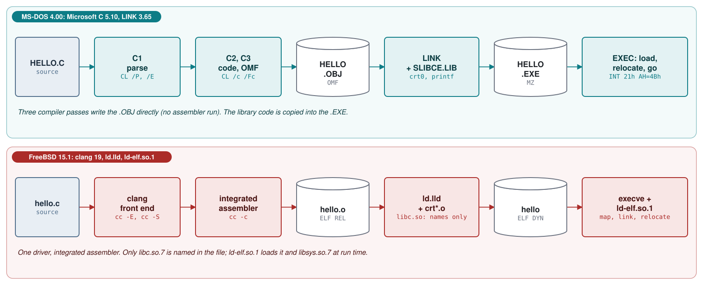
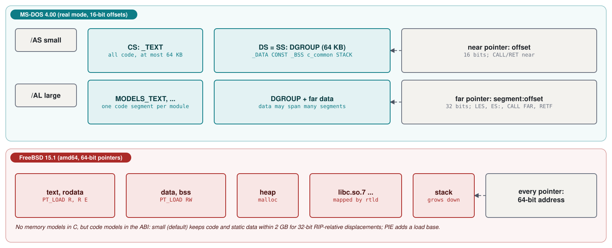
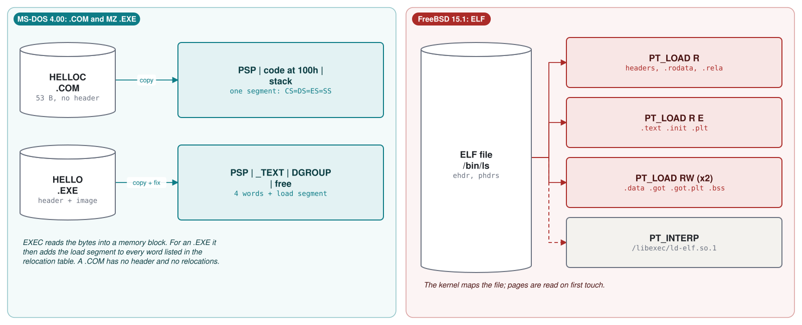
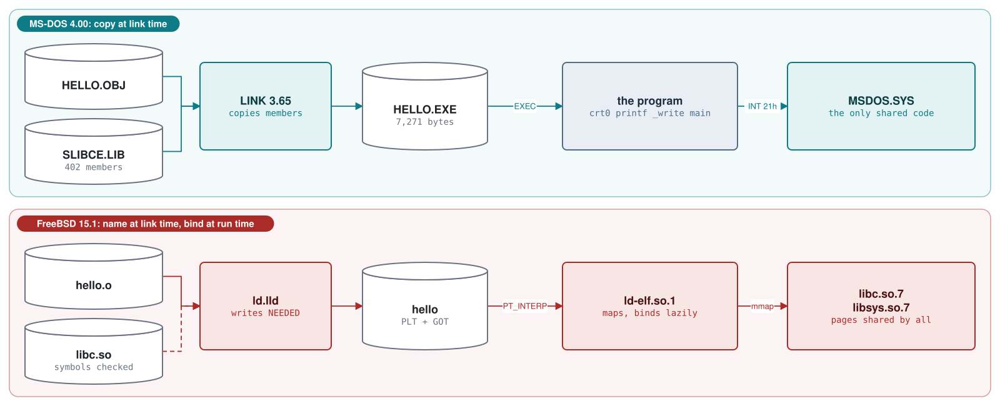
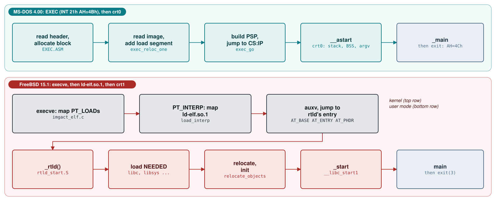
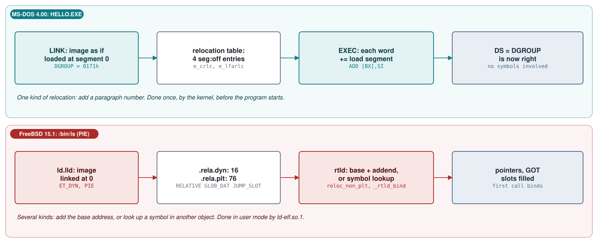

# Module 5: From C to a running program: compilers, linkers, executables and libraries

Modules 1 to 3 followed the two systems from power-on to a shell prompt. This module follows a program
instead: a few lines of C, from the text file you type to the bytes a process executes. On MS-DOS 4.00 we use
the toolchain that built MS-DOS itself, Microsoft C 5.10, MASM 5.10, LINK 3.65 and LIB 3.10, which ships in
`v4.0/src/TOOLS`. On FreeBSD 15.1 we read the files produced by its own toolchain, clang and `ld.lld`, and the
run-time linker `/libexec/ld-elf.so.1`. Each step (preprocess, compile, assemble, link, load) leaves a file
or a memory image you can open, and the module opens every one of them: listings, object files, maps,
executable headers, relocation tables and shared-library dependencies. Module 4 explains individual
instructions; this module is about how instructions and data are packaged, combined and placed in memory.

**Learning goals.** After this module you can:

- name the stages from C source to a running process on both systems, the program that performs each stage
  and the file each stage produces;
- run Microsoft C 5.10 pass by pass, read its `.COD` listing, and compare the code with x86-64 code for the
  same function;
- explain the MS C memory models, near and far pointers and the segments `_TEXT`, `_DATA`, `CONST`, `_BSS`,
  `DGROUP` and `STACK`, and why 64-bit FreeBSD has code models but no memory models;
- decode an OMF object file and an ELF relocatable object, and point to the symbol definitions, the external
  references and the relocations in each;
- read a LINK map and an ELF symbol table, and trace the C start-up code from the entry point to `main` on both
  systems;
- dump the header and relocation table of an MZ `.EXE`, state the rules that make a `.COM` file, and read the
  ELF header and program headers of an executable;
- build and use a static library on both systems, and explain how FreeBSD's shared libraries are found,
  loaded and bound at run time (NEEDED, SONAME, PLT, GOT, `ld-elf.so.1`);
- compare how MS-DOS `EXEC` and FreeBSD `execve` plus the run-time linker turn a file into a running program,
  including where relocation happens in each.

**Prerequisites.**

- Module 0 (`00-lab.md`): the MS-DOS 4.00 image, `tools/dos_run.py` to run programs on it, and the
  FreeBSD 15.1 virtual machine. This module also uses `tools/dos_tools.py`, which runs the 1988 toolchain
  (read its docstring), `nasm`, and GNU `readelf`, `objdump` and `nm` on your own computer (any recent
  binutils that supports `elf64-x86-64`).
- Module 2, section 2.6 (MS-DOS `EXEC`, FreeBSD `execve` and the image activator).
- Module 4 (machine code and assembly language): registers, `segment:offset` addresses, the stack, `CALL`
  and `RET`.
- C at the level of pointers, global variables and separate compilation.

## 5.1 The pipeline: from source text to a process

A C program reaches the processor in five steps. Each step reads files and writes files, and the formats of
those files are the subject of most of this module:

1. **Preprocessing** expands `#include` and `#define` and removes comments. The result is still C text,
   called a *translation unit*.
2. **Compiling** translates the translation unit into machine instructions for one processor and one calling
   convention.
3. **Assembling** encodes the instructions as bytes and writes an *object file*: the bytes of code and data,
   the names the file defines, the names it needs from elsewhere, and a list of the places that cannot be
   completed until those names have addresses (*relocations*, called *fixups* in Microsoft's documentation).
4. **Linking** combines object files and the needed parts of libraries into an *executable* file, deciding
   where every piece goes and patching the places the relocations point to.
5. **Loading** copies or maps the executable into memory, finishes whatever the linker could not know (where
   the program actually landed), and jumps to the entry point. On FreeBSD a second linker, the *run-time
   linker*, runs at this point to attach shared libraries.



| Stage | MS-DOS 4.00 (Microsoft C 5.10) | FreeBSD 15.1 (clang 19, LLD 19) |
|---|---|---|
| Driver | `CL.EXE` | `cc` (clang) |
| Preprocess | pass 1 `C1.EXE`; `CL /P` writes `.I`, `CL /E` writes to standard output | `cc -E` |
| Compile | passes 1-3 `C1`, `C2`, `C3`; `CL /Fa` writes `.ASM`, `/Fc` a `.COD` listing | `cc -S` writes `.s` |
| Assemble | inside pass 3 `C3.EXE`: it writes the object file directly | integrated assembler: `cc -c` |
| Object file | `.OBJ`, Intel/Microsoft OMF | `.o`, ELF relocatable (`ET_REL`) |
| Static library | `.LIB`, made by `LIB.EXE` | `.a`, made by `ar` |
| Link | `LINK.EXE` 3.65, `/MAP` writes a map | `ld.lld`, normally run by `cc` |
| Executable | `.COM` (memory image) or `.EXE` (MZ header) | ELF executable (`ET_EXEC`) or PIE (`ET_DYN`) |
| Shared library | none | `.so`, ELF `ET_DYN` with a `SONAME` |
| Load | `EXEC`, INT 21h function 4Bh, in `MSDOS.SYS` | `execve(2)` in the kernel, then `ld-elf.so.1` in user mode |

These are not just example tools: they are the tools each system was built with. The MS-DOS 4.00 tree
compiles its C programs with the rule in Listing 5.1. The small memory model (`-AS`), optimization for size
(`-Os`) and packed structures (`-Zp`) tell you that the authors counted bytes. `FDISK`, `MEM`, `ATTRIB`,
`REPLACE`, `FC`, `JOIN`, `SUBST` and parts of `BACKUP` and `RESTORE` are C programs; the kernel, the BIOS
and `COMMAND.COM` are assembly language.

**Listing 5.1** -- How the MS-DOS 4.00 build compiles C ([`TOOLS.INI` lines 35-55](https://github.com/microsoft/MS-DOS/blob/2d04cacc5322951f187bb17e017c12920ac8ebe2/v4.0/src/TOOLS/TOOLS.INI#L35-L55))

```make
cc      =cl
cflags  =-AS -Os -Zp $(extcsw)
cinc    =-I. -I$(hinc)
⋮
.c.obj:
        $(cc) -c $(cflags) $(cinc) -Fo$*.obj $*.c
```

FreeBSD records its toolchain inside every binary, in the `.comment` section. The real `/lib/libc.so.7` and
`/bin/ls` from the 15.1 release say:

**Output 5.1** -- `readelf -p .comment` on FreeBSD 15.1's `/bin/ls` (real file from `base.txz`)

```text
String dump of section '.comment':
  [     1]  Linker: LLD 19.1.7 (FreeBSD llvmorg-19.1.7-0-gcd708029e0b2-1500001) (https://github.com/llvm/llvm-project.git llvmorg-19.1.7-0-gcd708029e0b2)
  [    8f]  FreeBSD clang version 19.1.7 (https://github.com/llvm/llvm-project.git llvmorg-19.1.7-0-gcd708029e0b2)
```

The rest of this module uses one small program on both systems, `HELLO.C` (Example 5.1). It has a function,
a call to a library function, an initialized global variable (data) and an uninitialized one (BSS), which is
enough to exercise every part of the pipeline.

**Example 5.1** -- The program used throughout the module (`labs/05-toolchain/HELLO.C`; the FreeBSD copy
`labs/05-toolchain/freebsd/hello.c` differs only in layout)

```c
/* HELLO.C -- Module 5: one small C program for both toolchains */
#include <stdio.h>

int counter = 7;                /* initialized data */
int table[100];                 /* uninitialized data (BSS) */

int square(int x)
{
    return x * x;
}

int main(void)
{
    table[3] = square(counter);
    printf("hello, world: %d\n", table[3]);
    return 0;
}
```

## 5.2 Compiling: Microsoft C 5.10 and clang

### The CL driver and its three passes

`CL.EXE` is a *driver*: it compiles nothing itself, it runs other programs. The `TOOLS` directory holds
`C1.EXE` (114,521 bytes), `C1L.EXE` (149,303), `C2.EXE` (202,919) and `C3.EXE` (125,221) next to `CL.EXE`
(31,329). The strings inside `CL.EXE` name `c1.exe`, `c2.exe`, `c3.exe`, `link.exe`, and options `-B1`, `-B2`,
`-B3` and `-Bd`. `CL.HLP` in the same directory, the text of `CL /HELP`, documents none of these. Trying them
shows that `/Bd` makes `CL` print each pass's command line before running it, much like `cc -v` on FreeBSD:

**Output 5.2** -- `CL /Bd /c HELLO.C`, run with `tools/dos_tools.py`

```text
---- CL /Bd /c HELLO.C
HELLO.C
P1 : ` T:\c1.exe -il 014595 -f HELLO.C -pc \:/ -ef T:\c1.err -Q 24242 -A snd -Ze -DM_I86 -DMSDOS -DM_I86SM -DM_I8086 -I T:/BLD/INC -W 1  '
P2 : ` T:\c2.exe -il 014595 -ef T:\c23.err -Oc -Ot -G0 -A snd -W 1  '
P3 : ` T:\c3.exe -il 014595 -ef T:\c23.err -T 0 -NM HELLO -FPi -Ot -c HELLO.OBJ -A snd -CC 0sO  '
```

Pass 1 (`C1`) is the front end: it preprocesses and parses, and it receives the predefined macros (`M_I86`,
`MSDOS`, `M_I86SM` for the small model, `M_I8086`), the include path from `INCLUDE`, and a memory-model
code, `-A snd`. With `/AL` (Lab 5.2) the code becomes `-A lfd` and the macro `M_I86LM`: the first letter is
the code size (small or large), the second the default data pointer (near or far). `-il 014595` is the base
name of the intermediate files the passes hand to one another.
Pass 2 (`C2`) optimizes and generates code (`-Ot`: optimize for time, the default; `-G0`: 8086 instructions).
Pass 3 (`C3`) writes the object file `HELLO.OBJ` and, on request, the listings. There is no assembler pass:
`MASM` is not involved when you compile C. `/B1 T:\C1L.EXE` replaces pass 1 by `C1L.EXE`, a larger build of
the front end; with that option the same three lines appear with `C1L.EXE` in the first, and the object file
is byte-for-byte identical.

Without `/c`, `CL` also writes a response file for the linker and runs it:

**Output 5.3** -- the link step that `CL /Bd HELLO.C` adds (excerpt)

```text
HELLO.OBJ
HELLO.EXE /noi
NUL

;
LINK : ` link.exe @014628lk  '

Microsoft (R) Overlay Linker  Version 3.65
Copyright (C) Microsoft Corp 1983-1988.  All rights reserved.

Object Modules [.OBJ]: HELLO.OBJ
Run File [HELLO.EXE]: HELLO.EXE /NOI
List File [NUL.MAP]: NUL
Libraries [.LIB]:
```

The four lines of the response file answer LINK's four prompts: object files, run file, list (map) file,
libraries. The library line is empty, yet the program links against the C library. Section 5.4 shows where
the library name is hidden.

### Preprocessing

`CL /P HELLO.C` writes the translation unit to `HELLO.I` (182 lines: the comments are gone, `stdio.h` is
expanded). `CL /E` writes the same text to standard output with `#line` directives, so that the compiler
can still report errors against the original file and line:

**Output 5.4** -- `CL /E HELLO.C` (beginning and end; blank lines in the middle removed)

```text
#line 1 "HELLO.C"

#line 1 "T:/BLD/INC/stdio.h"
typedef unsigned int size_t;
#line 18 "T:/BLD/INC/stdio.h"
typedef char *va_list;
...
int cdecl printf(const char *, ...);
...
#line 3 "HELLO.C"

int counter = 7;
int table[100];
...
```

The prototypes carry the keyword `cdecl`, one of Microsoft's extensions (with `near`, `far`, `huge` and
`pascal`) for 16-bit code: the C calling convention, in which the caller pushes the arguments from right to
left and removes them afterwards. clang's equivalent is `cc -E hello.c`; it writes `# 1 "hello.c"` line
markers instead of `#line`.

### Reading the compiler's output: the .COD listing

`CL /c /Fc HELLO.C` writes `HELLO.COD`: the source lines as comments, the assembly code the compiler
generated, and the bytes and offsets of each instruction. It is the best way to see what a 1988 compiler
did with your C.

**Output 5.5** -- `HELLO.COD`, the code part (real output of `CL /c /Fc HELLO.C`)

```text
_TEXT      SEGMENT
        ASSUME  CS: _TEXT
;|*** int square(int x)
;|*** {
; Line 8
        PUBLIC  _square
_square PROC NEAR
        *** 000000      55                      push    bp
        *** 000001      8b ec                   mov     bp,sp
        *** 000003      33 c0                   xor     ax,ax
        *** 000005      e8 00 00                call    __chkstk
;       x = 4
;|***     return x * x;
; Line 9
        *** 000008      8b 46 04                mov     ax,WORD PTR [bp+4]      ;x
        *** 00000b      f7 e8                   imul    ax
        *** 00000d      5d                      pop     bp
        *** 00000e      c3                      ret
        *** 00000f      90                      nop

_square ENDP
;|*** int main(void)
;|*** {
; Line 13
        PUBLIC  _main
_main   PROC NEAR
        *** 000010      33 c0                   xor     ax,ax
        *** 000012      e8 00 00                call    __chkstk
;|***     table[3] = square(counter);
; Line 14
        *** 000015      ff 36 00 00             push    WORD PTR _counter
        *** 000019      e8 e4 ff                call    _square
        *** 00001c      83 c4 02                add     sp,2
        *** 00001f      a3 06 00                mov     WORD PTR _table+6,ax
;|***     printf("hello, world: %d\n", table[3]);
; Line 15
        *** 000022      50                      push    ax
        *** 000023      b8 02 00                mov     ax,OFFSET DGROUP:$SG163
        *** 000026      50                      push    ax
        *** 000027      e8 00 00                call    _printf
        *** 00002a      83 c4 04                add     sp,4
;|***     return 0;
; Line 16
        *** 00002d      2b c0                   sub     ax,ax
        *** 00002f      c3                      ret
```

Read it with Module 4 at hand:

- **Names get an underscore.** `square` becomes `_square`, `printf` becomes `_printf`. This kept C names
  apart from assembly-language names in the same program.
- **Arguments are on the stack.** `main` pushes `counter`, calls `_square`, and removes the argument with
  `add sp,2`; `_square` finds `x` at `[bp+4]`, above the saved `BP` (2 bytes) and the near return address
  (2 bytes). The result comes back in `AX`. `printf`'s two arguments are pushed right to left and removed
  with `add sp,4`.
- **Every function calls `__chkstk`** with the size of its local variables in `AX` (here 0). It is the C
  library's stack-overflow check, and the reason why even `main` touches the library. `/Gs` (or `/Ox`)
  turns it off.
- **Unresolved bytes are zero.** `e8 00 00` (the call to `_printf`) and `ff 36 00 00` (the address of
  `counter`) are incomplete; the object file will say how to complete them (section 5.4). The call to
  `_square` (`e8 e4 ff`) is already complete: it is relative to the next instruction, inside the same
  segment, so its displacement (-1Ch) does not depend on where the code is loaded.
- **`table[3]` is `_table+6`**: the index is scaled by `sizeof(int)` = 2 at compile time.

The top of the same file declares the segments and the names:

**Output 5.6** -- `HELLO.COD`, the declarations (real output, abridged)

```text
_TEXT   SEGMENT  WORD PUBLIC 'CODE'
_TEXT   ENDS
_DATA   SEGMENT  WORD PUBLIC 'DATA'
_DATA   ENDS
CONST   SEGMENT  WORD PUBLIC 'CONST'
CONST   ENDS
_BSS    SEGMENT  WORD PUBLIC 'BSS'
_BSS    ENDS
DGROUP  GROUP   CONST, _BSS, _DATA
        ASSUME  CS: _TEXT, DS: DGROUP, SS: DGROUP
PUBLIC  _counter
EXTRN   __acrtused:ABS
EXTRN   _printf:NEAR
EXTRN   __chkstk:NEAR
_BSS      SEGMENT
COMM NEAR       _table: BYTE:    200
_BSS      ENDS
_DATA      SEGMENT
        ORG     $+2
$SG163  DB      'hello, world: %d',  0aH,  00H
        ORG     $-20
_counter        DW      07H
_DATA      ENDS
```

`counter` is initialized, so it is in `_DATA` with its value 7. `table` is not: it is declared `COMM`, a
*communal* variable of 200 bytes that the linker allocates (several modules may declare the same communal
variable; the linker makes one). The string literal is in `_DATA` too, after `counter`: the `ORG` lines
place it at offset 2. `EXTRN __acrtused:ABS` is a reference to a name that no code uses. Section 5.5
explains why it is there.

### The same function from three compilers

How much of this is the 8086 and how much is the 1988 compiler? FreeBSD's `libc.so.7` contains `abs()`,
whose source is one line ([`abs.c` lines 34-38](https://github.com/freebsd/freebsd-src/blob/96841ea08dcfa84b954a32dc5ae1a26c28966cf4/lib/libc/stdlib/abs.c#L34-L38)):
`return(j < 0 ? -j : j);`. Here is the machine code clang 19 generated for it, disassembled from the real
library, and what MS C 5.10 makes of the same line (in `labs/05-toolchain`, a function `myabs` with that
body):

**Output 5.7** -- `abs` in FreeBSD 15.1's `/lib/libc.so.7` (`objdump -d --start-address=0x171970`)

```text
0000000000171970 <abs@@FBSD_1.0>:
  171970:       55                      push   %rbp
  171971:       48 89 e5                mov    %rsp,%rbp
  171974:       89 f8                   mov    %edi,%eax
  171976:       f7 d8                   neg    %eax
  171978:       0f 48 c7                cmovs  %edi,%eax
  17197b:       5d                      pop    %rbp
  17197c:       c3                      ret
```

**Output 5.8** -- `myabs` compiled by MS C 5.10 with `CL /c /Ox /Fc` (code part of the `.COD`)

```text
        *** 000000      55                      push    bp
        *** 000001      8b ec                   mov     bp,sp
;|***     return(j < 0 ? -j : j);
        *** 000003      83 7e 04 00             cmp     WORD PTR [bp+4],0       ;j
        *** 000007      7d 07                   jge     $L20000
        *** 000009      8b 46 04                mov     ax,WORD PTR [bp+4]      ;j
        *** 00000c      f7 d8                   neg     ax
        *** 00000e      5d                      pop     bp
        *** 00000f      c3                      ret
        *** 000010      8b 46 04                mov     ax,WORD PTR [bp+4]      ;j
        *** 000013      5d                      pop     bp
        *** 000014      c3                      ret
```

Three differences stand out. The argument arrives in a register (`%edi`) on FreeBSD and on the stack
(`[bp+4]`) on MS-DOS. clang avoids the branch with `cmovs` (conditional move if the sign flag is set); the
8086 has no conditional move (it appeared with the Pentium Pro), so MS C must branch. And `/Ox` removed the
`__chkstk` call that the default options produce. Both functions still build a frame (`push bp; mov bp,sp`
and `push %rbp; mov %rsp,%rbp`), although neither needs one.

Before Lab 5.8 gives you clang's output for `HELLO.C` itself (Output 5.41), any GCC can show x86-64 code for
its functions.
The output below comes from GCC 16 for Windows (MinGW-w64) on the course author's computer, run with
`-mabi=sysv` so that it uses FreeBSD's calling convention (arguments in `%rdi`, `%rsi`, ...). It is GCC, not
FreeBSD's clang, so details differ.

**Output 5.9** -- `gcc -S -O2 -mabi=sysv` on `square` and the `sum` loop of Example 5.2 (directives removed)

```text
square:
        imull   %edi, %edi
        movl    %edi, %eax
        ret
sum:
        testl   %esi, %esi
        jle     .L6
        movl    %esi, %esi
        xorl    %eax, %eax
        leaq    (%rdi,%rsi,4), %rdx
.L5:
        addl    (%rdi), %eax
        addq    $4, %rdi
        cmpq    %rdx, %rdi
        jne     .L5
        ret
.L6:
        xorl    %eax, %eax
        ret
```

At `-O0` the same compiler stores `x` to the stack and reloads it, exactly like MS C's `[bp+4]` code;
optimization is what moves values into registers.

| | MS C 5.10, small model | FreeBSD amd64 (System V ABI) |
|---|---|---|
| `int` / pointer size | 16 / 16 bits (32 for far pointers) | 32 / 64 bits |
| Arguments | on the stack, pushed right to left | first six integer arguments in `%rdi %rsi %rdx %rcx %r8 %r9` |
| Return value | `AX` (`DX:AX` for `long` and far pointers) | `%rax` (`%rdx:%rax` for 128 bits) |
| Who removes arguments | the caller (`add sp,n`) | nothing to remove for register arguments |
| External names | `_square` | `square` |
| Stack check | `__chkstk` on entry (off with `/Gs`) | no call; an unmapped guard page below the stack ([`vm_map.c` line 4637](https://github.com/freebsd/freebsd-src/blob/96841ea08dcfa84b954a32dc5ae1a26c28966cf4/sys/vm/vm_map.c#L4637)) and stack-protector canaries (`__stack_chk_guard`, section 5.7) |

## 5.3 Memory models: segments versus a flat address space

### Why a C compiler for the 8086 needs memory models

On the 8086 an address is a segment and a 16-bit offset (Module 4, section 4.2), so one segment register
reaches at most 64 KB. A C pointer can therefore be a *near* pointer, 16 bits, an offset into a segment the
compiler assumes is already in a register (`DS` for data, `CS` for code), or a *far* pointer, 32 bits,
segment and offset, which must be loaded into a segment register before every use. Near pointers are small
and fast but limit the program to 64 KB of data (or code); far pointers remove the limit and cost space and
time. Microsoft C lets you choose per program with a *memory model*:

| Option | Model | Code pointers, calls | Data pointers | Default library |
|---|---|---|---|---|
| `/AS` | small (default) | near: one `_TEXT` segment, at most 64 KB | near: one `DGROUP`, at most 64 KB | `SLIBCE.LIB` |
| `/AM` | medium | far: one segment per module | near | `MLIBCE.LIB` |
| `/AC` | compact | near | far: data may exceed 64 KB | `CLIBCE.LIB` |
| `/AL` | large | far | far | `LLIBCE.LIB` |
| `/AH` | huge | far | far, and single arrays may exceed 64 KB | |

The four libraries are in `v4.0/src/TOOLS/BLD/LIB`; the `E` in the name stands for the floating-point
emulator selected by the default `/FPi` (Output 5.2's `-FPi`). `CL.HLP` lists the five options. Whatever
the model, `DS` and `SS` both point at `DGROUP`, the group of the segments `_DATA` (initialized data),
`CONST` (constants), `_BSS` (uninitialized data) and `STACK`: that is what `ASSUME CS: _TEXT, DS: DGROUP,
SS: DGROUP` in Output 5.6 says, and it is why a near pointer can point at a global variable or at a local
variable on the stack without the compiler knowing which.



### The same code in two models

**Example 5.2** -- A function with a pointer argument, compiled in two models (`labs/05-toolchain/MODELS.C`)

```c
/* MODELS.C -- Module 5: the same C code in two memory models */
#include <stdio.h>

int data[4] = { 1, 2, 3, 4 };

int sum(int *a, int n)
{
    int s = 0, i;

    for (i = 0; i < n; i++)
        s += a[i];
    return s;
}

int main(void)
{
    printf("sum = %d\n", sum(data, 4));
    return 0;
}
```

Compiled with `/AS` and `/AL` (Lab 5.2), the loop body and the call differ like this:

**Output 5.10** -- `MODS.COD` (`/AS`) and `MODL.COD` (`/AL`), the lines that differ (real output)

```text
small model (/AS)                                large model (/AL)
_sum    PROC NEAR                                _sum    PROC FAR
  call  __chkstk          e8 00 00                 call  FAR PTR __chkstk  9a 00 00 00 00
;       a = 4                                    ;       a = 6
;       n = 6                                    ;       n = 10
  mov   si,WORD PTR [bp+4]  8b 76 04               les   si,DWORD PTR [bp+6]  c4 76 06
  mov   ax,[bx][si]         8b 00                  mov   ax,es:[bx][si]       26 8b 00
  ret                       c3                     ret                        cb
_main   PROC NEAR                                _main   PROC FAR
  mov   ax,OFFSET DGROUP:_data                     mov   ax,OFFSET DGROUP:_data
  push  ax                                         push  ds
                                                   push  ax
  call  _sum                e8 ba ff               push  cs
                                                   call  _sum                 e8 00 00
  add   sp,4                                       add   sp,6
  call  _printf             e8 00 00               call  FAR PTR _printf      9a 00 00 00 00
```

In the large model every function is `FAR`: it is called with a 5-byte `CALL FAR` (opcode `9A`, offset and
segment) and returns with `RETF` (`CB`), which pops a 4-byte return address, so the arguments move from
`[bp+4]` to `[bp+6]`. The pointer `a` is 4 bytes, loaded with `LES SI` (offset into `SI`, segment into
`ES`), and the access needs the `ES:` override prefix (`26`). The caller pushes `DS` to make `data`'s
address a far pointer. And one trick: `_sum` is in the same segment as `_main`, so the compiler fakes a far
call with `push cs` followed by a 3-byte near `call`; `RETF` in `_sum` pops both. The code segment is named
after the module, `MODELS_TEXT`, so that each module of a large program can have its own 64 KB.

The program grows from 7,301 to 10,033 bytes, and the number of segment relocations in the `.EXE` from 4 to
70 (Lab 5.2): every far call and every far address in the library holds a segment value that must be
adjusted when the program is loaded.

### FreeBSD: one flat address space, but code models

A 64-bit FreeBSD process has one address space with 64-bit pointers (Module 2, section 2.1); there is no
near or far, and `long` and pointers are both 64 bits wide. There are still *code models* in the x86-64 ABI,
because most instructions carry at most a 32-bit displacement or immediate value. In the default *small*
code model the compiler assumes that all code and static data of a program lie within 2 GB of each other,
so it can address a global variable with a 32-bit displacement relative to the instruction pointer
(`%rip`-relative addressing, as in `mov 0x0(%rip),%eax`). The *large* model drops that assumption and loads
full 64-bit addresses with `movabsq`. FreeBSD's start-up code shows both forms:

**Listing 5.2** -- Two ways to load the address of `main` ([`crt1_s.S` lines 58-67](https://github.com/freebsd/freebsd-src/blob/96841ea08dcfa84b954a32dc5ae1a26c28966cf4/lib/csu/amd64/crt1_s.S#L58-L67))

```c
#ifdef PIC
        /*
         * XXX. %rip relative addressing is not intended for use in the
         * large memory model due to the offset from %rip being limited
         * to 32 bits.
         */
        leaq    main@plt(%rip), %r8
#else
        movabsq $main, %r8
#endif
```

The non-PIC branch is assembled into `/usr/lib/crt1.o` (Output 5.18 shows the `movabs` and its 64-bit
relocation). The PIC branch is used for *position-independent executables* (PIE): programs linked as if
loaded at address 0 and placed at a base address the kernel chooses at `exec` time, randomly if address
space layout randomization is enabled
([`imgact_elf.c` lines 1272-1293](https://github.com/freebsd/freebsd-src/blob/96841ea08dcfa84b954a32dc5ae1a26c28966cf4/sys/kern/imgact_elf.c#L1272-L1293)).
Nearly everything in FreeBSD 15.1's `/bin` and `/sbin` is a PIE (Lab 5.7), because the base system's
makefiles ask for it: they add `-fPIE` to the compiler flags and `-pie` to the linker flags
([`bsd.prog.mk` lines 34-39](https://github.com/freebsd/freebsd-src/blob/96841ea08dcfa84b954a32dc5ae1a26c28966cf4/share/mk/bsd.prog.mk#L34-L39)),
with the build option `PIE` on by default on 64-bit architectures
([`bsd.opts.mk` lines 96-106](https://github.com/freebsd/freebsd-src/blob/96841ea08dcfa84b954a32dc5ae1a26c28966cf4/share/mk/bsd.opts.mk#L96-L106)).
A plain `cc hello.c` does not: in the course VM it compiles with the static relocation model, links the
non-PIC `crt1.o` and writes an `ET_EXEC` file linked at 0x200000 (Lab 5.8, Output 5.40). A PIE is the
64-bit cousin of an MZ `.EXE`: both are linked for address 0 and moved at load time; Study case 5.B compares
how.

## 5.4 Object files: OMF and ELF

An object file is the compiler's message to the linker. Whatever its format, it must say:

1. the module's name and the translator that made it;
2. the pieces of the module (segments or sections), with their sizes, alignment and how pieces of the same
   name from other modules are to be combined;
3. the bytes of each piece;
4. the names the module defines (*public* or *global* symbols) and where;
5. the names it uses but does not define (*external* or *undefined* symbols);
6. every place in the bytes that holds an address not yet known, and how to compute it (*relocations*).

### Microsoft/Intel OMF

MS-DOS object files use the *Object Module Format* (OMF) defined by Intel for the 8086 and extended by
Microsoft. An OMF file is a sequence of records, each with a type byte, a 2-byte length, the contents and a
checksum byte. `labs/05-toolchain/omfdump.py` decodes them; this is `HELLO.OBJ`, all 410 bytes:

**Output 5.11** -- `python omfdump.py HELLO.OBJ` (real output)

```text
000000  80 THEADR  module 'HELLO.C'
00000C  88 COMENT  class 00 (translator) 'MS C'
000016  88 COMENT  class 9F (default library) 'SLIBCE'
000022  88 COMENT  class 9D (memory model) '0sO'
00002B  88 COMENT  class A1 (debug info style) 01 43 56
000034  96 LNAMES  1='', 2='DGROUP', 3='_TEXT', 4='CODE', 5='_DATA', 6='DATA', 7='CONST', 8='_BSS', 9='BSS'
000065  98 SEGDEF  seg 1=_TEXT class CODE length 0x0030 align=word combine=public
00006F  98 SEGDEF  seg 2=_DATA class DATA length 0x0014 align=word combine=public
000079  98 SEGDEF  seg 3=CONST class CONST length 0x0000 align=word combine=public
000083  98 SEGDEF  seg 4=_BSS class BSS length 0x0000 align=word combine=public
00008D  9A GRPDEF  group 1=DGROUP: CONST, _BSS, _DATA
000098  9C FIXUPP  (thread definitions only)
                    THREAD T0 = SEG CONST
                    THREAD T1 = SEG _DATA
                    THREAD T2 = SEG _TEXT
                    THREAD T3 = SEG _BSS
                    THREAD F0 = SEG _TEXT
                    THREAD F1 = GRP DGROUP
0000A8  8C EXTDEF  1=__acrtused, 2=_printf
0000C1  B0 COMDEF  _table near 200 bytes
0000D1  8C EXTDEF  4=_square, 5=__chkstk, 6=_main
0000EF  90 PUBDEF  _counter=_DATA:0000
000101  90 PUBDEF  _square=_TEXT:0000, _main=_TEXT:0010
00011B  88 COMENT  class A2 (link pass separator) 01
000122  A0 LEDATA  _DATA:0002, 18 bytes
00013B  A0 LEDATA  _DATA:0000, 2 bytes
000144  A0 LEDATA  _TEXT:0000, 48 bytes
00017B  9C FIXUPP  for the LEDATA of _TEXT
                    +028 offset16, self-relative: target EXT _printf; frame TARGET
                    +024 offset16, seg-relative: target from thread T1 (SEG _DATA); frame from thread F1 (GRP DGROUP)
                    +020 offset16, seg-relative: target EXT _table; frame TARGET
                    +017 offset16, seg-relative: target from thread T1 (SEG _DATA); frame from thread F1 (GRP DGROUP)
                    +013 offset16, self-relative: target EXT __chkstk; frame TARGET
                    +006 offset16, self-relative: target EXT __chkstk; frame TARGET
000195  8A MODEND  (no start address)
```

| Record | Says |
|---|---|
| `THEADR` (80h) | module name |
| `COMENT` (88h) | a comment with a class byte; several classes are instructions to the linker |
| `LNAMES` (96h) | a list of names (segment, class and group names), numbered from 1 |
| `SEGDEF` (98h) | one segment: name and class (as `LNAMES` indexes), length, alignment, combine type |
| `GRPDEF` (9Ah) | a group: segments that must fit in one 64 KB frame and are addressed from one segment value |
| `EXTDEF` (8Ch) | names used here and defined elsewhere, numbered from 1 |
| `COMDEF` (B0h) | communal variables: uninitialized globals the linker allocates (numbered with the externals) |
| `PUBDEF` (90h) | names defined here: segment and offset |
| `LEDATA` (A0h) | bytes for a segment, starting at an offset |
| `FIXUPP` (9Ch) | relocations for the preceding `LEDATA`, and *threads* (abbreviations used by later fixups) |
| `MODEND` (8Ah) | end of module, with the program's start address if this is the main module |

Three things in Output 5.11 deserve a closer look.

**The library is named in the object file.** `COMENT` class 9Fh says `SLIBCE`: "search this library by
default". That is why `CL` left the library line of LINK's response file empty (Output 5.3) and why the
`/Zl` option, "remove default library info" in `CL.HLP`, exists. Class 9Dh records the memory model.

**Every fixup has a target and a frame.** On the 8086 an address is relative to a segment value, so a
fixup must say both *what* is addressed (the target: a segment, a group or an external name, plus a
displacement) and *relative to which segment base* the 16-bit result is computed (the frame). Take
`push WORD PTR _counter` at offset 15h, whose address field is at 17h. The target is segment `_DATA` (via
thread T1) with displacement 0, the two bytes already in `LEDATA`, but the frame is the group `DGROUP` (thread
F1). The linker must therefore store the distance from the start of `DGROUP` to `_counter`, not from the start
of `_DATA`: at run time `DS` holds `DGROUP`'s segment. In `HELLO.MAP` (Output 5.13) that distance is 42h. A
*self-relative* fixup, like the one at 28h for `call _printf`, stores the distance from the end of the
instruction to the target instead: that is what the `E8` near call needs.

**Not everything you see is needed.** `EXTDEF` 4-6 declare `_square` and `_main` as externals although the
same module defines them in `PUBDEF`; C1 declares every function it sees, and LINK accepts a definition in
the same module. `_square`'s call needs no fixup at all (Output 5.5). And `__acrtused` is external but no
fixup refers to it: it exists only to make the linker pull in a library member (section 5.5).

### ELF relocatable objects

On FreeBSD the object file is an ELF file of type `ET_REL`. Instead of a stream of records it has a header
and a table of *sections*, each a contiguous block: `.text`, `.data`, `.bss`, `.rodata`, the symbol table
`.symtab` with its string table `.strtab`, and one relocation section per section that needs relocating
(`.rela.text` for `.text`). Example 5.3 is a small x86-64 function in NASM syntax; Module 4 explains the
instructions.

**Example 5.3** -- `bump`, which uses one variable and one function from other files
(`labs/05-toolchain/freebsd/bump.asm`)

```nasm
; bump.asm -- Module 5, Lab 5.6: a small x86-64 function as an ELF relocatable object
; Build:  nasm -f elf64 -o bump.o bump.asm
; C view: extern int counter; int step = 3;
;         void bump(void) { counter += step; report(counter); }
        default rel                     ; [name] means [rip + name]

        extern  counter                 ; an int defined in another object (main.c)
        extern  report                  ; a function defined in another object
        global  bump                    ; this object defines bump ...
        global  step                    ; ... and step for the others

        section .data
step:   dd      3

        section .text
bump:
        mov     eax, [counter]          ; counter is not in this file: relocation
        add     eax, [step]             ; step is, but .data has no address yet: relocation
        mov     [counter], eax
        mov     edi, eax                ; first integer argument in %edi (System V AMD64 ABI)
        jmp     report wrt ..plt        ; tail call through the PLT if report is in a library
```

**Output 5.12** -- `readelf -s -r bump.o` and `objdump -d -r bump.o` (real output, `nasm -f elf64`)

```text
Symbol table '.symtab' contains 8 entries:
   Num:    Value          Size Type    Bind   Vis      Ndx Name
     0: 0000000000000000     0 NOTYPE  LOCAL  DEFAULT  UND
     1: 0000000000000000     0 FILE    LOCAL  DEFAULT  ABS bump.asm
     2: 0000000000000000     0 SECTION LOCAL  DEFAULT    1 .data
     3: 0000000000000000     0 SECTION LOCAL  DEFAULT    2 .text
     4: 0000000000000000     0 NOTYPE  GLOBAL DEFAULT  UND counter
     5: 0000000000000000     0 NOTYPE  GLOBAL DEFAULT  UND report
     6: 0000000000000000     0 NOTYPE  GLOBAL DEFAULT    1 step
     7: 0000000000000000     0 NOTYPE  GLOBAL DEFAULT    2 bump

Relocation section '.rela.text' at offset 0x380 contains 4 entries:
    Offset             Info             Type               Symbol's Value  Symbol's Name + Addend
0000000000000002  0000000400000002 R_X86_64_PC32          0000000000000000 counter - 4
0000000000000008  0000000200000002 R_X86_64_PC32          0000000000000000 .data - 4
000000000000000e  0000000400000002 R_X86_64_PC32          0000000000000000 counter - 4
0000000000000015  0000000500000004 R_X86_64_PLT32         0000000000000000 report - 4

0000000000000000 <bump>:
   0:   8b 05 00 00 00 00       mov    0x0(%rip),%eax        # 6 <bump+0x6>
                        2: R_X86_64_PC32        counter-0x4
   6:   03 05 00 00 00 00       add    0x0(%rip),%eax        # c <bump+0xc>
                        8: R_X86_64_PC32        .data-0x4
   c:   89 05 00 00 00 00       mov    %eax,0x0(%rip)        # 12 <bump+0x12>
                        e: R_X86_64_PC32        counter-0x4
  12:   89 c7                   mov    %eax,%edi
  14:   e9 00 00 00 00          jmp    19 <bump+0x19>
                        15: R_X86_64_PLT32      report-0x4
```

Each relocation is an `Elf64_Rela`:

**Listing 5.3** -- An ELF relocation entry ([`elf64.h` lines 148-153](https://github.com/freebsd/freebsd-src/blob/96841ea08dcfa84b954a32dc5ae1a26c28966cf4/sys/sys/elf64.h#L148-L153))

```c
/* Relocations that need an addend field. */
typedef struct {
        Elf64_Addr      r_offset;       /* Location to be relocated. */
        Elf64_Xword     r_info;         /* Relocation type and symbol index. */
        Elf64_Sxword    r_addend;       /* Addend. */
} Elf64_Rela;
```

`r_info` packs a symbol index (high 32 bits) and a type (low 32 bits): `0000000400000002` is symbol 4,
`counter`, type 2, `R_X86_64_PC32`
([`elf_common.h` lines 1675-1682](https://github.com/freebsd/freebsd-src/blob/96841ea08dcfa84b954a32dc5ae1a26c28966cf4/sys/sys/elf_common.h#L1675-L1682)).
`PC32` means "store symbol + addend - address of this field, as 32 bits". The addend is -4 because the
processor adds the displacement to the address of the *next* instruction, which starts 4 bytes after the
field. This is the same calculation as OMF's self-relative fixup; on x86-64 even data is addressed this way.
The reference to `step` goes through the section symbol `.data`: the assembler knows `step` is at offset 0
of `.data`, but not where `.data` will be. `R_X86_64_PLT32` asks the linker to reach `report` directly if it
ends up in the same executable, or through a PLT entry if it is in a shared library (section 5.7).

| | OMF (`.OBJ`) | ELF relocatable (`.o`) |
|---|---|---|
| Structure | sequence of typed records | header, section table, sections |
| Pieces | segments (`SEGDEF`), groups (`GRPDEF`), classes | sections, with flags (alloc, write, exec) |
| Defined names | `PUBDEF` | `.symtab` entries with a section index |
| Undefined names | `EXTDEF`; uninitialized globals as `COMDEF` | `.symtab` entries with `UND`; commons as `SHN_COMMON` |
| Relocations | `FIXUPP`: location type, target, *frame* | `.rela.*`: offset, symbol, type, addend |
| Address arithmetic | 16-bit offsets relative to a frame, or segment values | 32- or 64-bit, absolute or relative to `%rip` |
| Linker instructions | `COMENT` records (default library, DOSSEG) | `.note` and special sections; libraries named on the command line |

## 5.5 Linking and the C run-time start-up

### What LINK does

A linker reads all object files, then:

1. **collects segments**: pieces with the same name and a `public` combine type are concatenated (all
   `_TEXT` pieces become one `_TEXT`), `stack` pieces are combined into one stack, and segments are ordered,
   normally by class;
2. **resolves names**: every `EXTDEF` must meet a `PUBDEF`. Names still undefined after the object files are
   looked up in the libraries' dictionaries, and the library members that define them are added, which may
   bring new undefined names, until nothing changes. A name that no object file and no library defines is an
   error (Lab 5.5 shows `L2029: Unresolved externals`);
3. **assigns addresses** to every segment and group and therefore to every public name;
4. **applies the fixups**, writing final offsets into the bytes; and for every fixup that needs a *segment
   value*, which depends on where DOS will load the program, it adds an entry to the relocation table of the
   `.EXE` (section 5.6);
5. **writes the executable** and, with `/MAP`, a map.

**Output 5.13** -- `HELLO.MAP` from `LINK /MAP HELLO;` (real output, abridged)

```text
 Start  Stop   Length Name                   Class
 00000H 01700H 01701H _TEXT                  CODE
 01702H 01702H 00000H C_ETEXT                ENDCODE
 01710H 01751H 00042H NULL                   BEGDATA
 01752H 0197DH 0022CH _DATA                  DATA
 0197EH 0198BH 0000EH CDATA                  DATA
 ...
 0198EH 0198EH 00000H CONST                  CONST
 0198EH 01995H 00008H HDR                    MSG
 01996H 01A63H 000CEH MSG                    MSG
 ...
 01A68H 01A8DH 00026H _BSS                   BSS
 ...
 01A90H 02157H 006C8H c_common               BSS
 02160H 0295FH 00800H STACK                  STACK

 Origin   Group
 0171:0   DGROUP

  Address         Publics by Value

 0000:0010       _square
 0000:0020       _main
 0000:0040       __astart
 0000:00D4       __cintDIV
 ...
 0000:05D8       _printf
 ...
 0000:12A0       _write
 ...
 0171:0042       _counter
 ...
 0171:0780       _table
 ...
 0000:9876  Abs  __acrtmsg
 0000:9876  Abs  __acrtused

Program entry point at 0000:0040
```

The 48 bytes of `HELLO.OBJ`'s code became a 5,889-byte (1701h) `_TEXT`: the rest is the C library. `_counter`
is at `0171:0042`, 42h bytes into `DGROUP` (which starts at paragraph 171h, linear 1710h), because the
library's `NULL` segment comes first. That segment holds 8 zero bytes and the text
`MS Run-Time Library - Copyright (c) 1988, Microsoft Corp`; when the program exits, the library routine
`__nullcheck` XORs those 42h bytes and prints `R6001 - null pointer assignment` if the result has changed,
which catches writes through near pointers that are 0. Likewise the first 16 bytes of `_TEXT` are zeros and
`_square` starts at 0010h, so no C function has the address 0. `table`, the communal variable, landed in
`c_common`. The stack is 800h = 2,048 bytes. And the program does not start at `_main`: the entry point is
`0000:0040`, `__astart`.

### The start-up code: `__astart` and `__acrtused`

Who defines `__astart`, and why is it linked at all? The library member that defines it also defines
`__acrtused`, as an absolute symbol with the value 9876h. Every object file MS C writes contains an
`EXTDEF` for `__acrtused` (Output 5.11): the reference makes LINK pull that member, the C run-time start-up,
out of `SLIBCE.LIB`, and the value is irrelevant. `omfdump.py --member` shows the member:

**Output 5.14** -- `python omfdump.py SLIBCE.LIB --member "dos\crt0.asm"` (real output, abridged)

```text
000010  80 THEADR  module 'dos\\crt0.asm'
00002C  88 COMENT  class 9E (DOSSEG) ''
000032  96 LNAMES  1='', 2='DGROUP', 3='ENDCODE', 4='C_ETEXT', 5='DATA', 6='CODE', 7='STACK', 8='_DATA', 9='_TEXT'
00006A  98 SEGDEF  seg 1=_TEXT class CODE length 0x00b2 align=word combine=public
000074  98 SEGDEF  seg 2=C_ETEXT class ENDCODE length 0x0000 align=word combine=public
00007E  98 SEGDEF  seg 3=_DATA class DATA length 0x0058 align=word combine=public
000088  98 SEGDEF  seg 4=STACK class STACK length 0x0800 align=para combine=stack
000092  9A GRPDEF  group 1=DGROUP: _DATA, STACK
00009B  8C EXTDEF  1=__exit, 2=__NMSG_WRITE, 3=__cinit, 4=___argc, 5=___argv, 6=_environ, 7=__FF_MSGBANNER, 8=__acrtmsg, 9=__setargv, 10=__setenvp, 11=_end, 12=_main, 13=__nullcheck, 14=_exit, 15=__psp, 16=_edata
000173  90 PUBDEF  __astart=_TEXT:0000
0001B7  90 PUBDEF  __acrtused=absolute:9876
...
0002D5  9C FIXUPP  for the LEDATA of _TEXT
                    +00B segment, seg-relative: target GRP DGROUP; frame GRP DGROUP
                    ...
                    +075 offset16, self-relative: target EXT __cinit; frame EXT __cinit
                    +07A offset16, self-relative: target EXT __setenvp; frame EXT __setenvp
                    +07D offset16, self-relative: target EXT __setargv; frame EXT __setargv
                    +083 offset16, seg-relative: target EXT _environ; frame GRP DGROUP
                    +087 offset16, seg-relative: target EXT ___argv; frame GRP DGROUP
                    +08B offset16, seg-relative: target EXT ___argc; frame GRP DGROUP
                    +08E offset16, self-relative: target EXT _main; frame EXT _main
                    +092 offset16, self-relative: target EXT _exit; frame EXT _exit
                    ...
00035B  8A MODEND  main module, start address: target SEG _TEXT + 0x0; frame SEG _TEXT
```

This one member explains most of the map. It defines the `STACK` segment (800h bytes), its `COMENT` class
9Eh asks LINK for the *DOSSEG* segment order (code first, then `DGROUP` with initialized data before BSS and
stack), and its `MODEND` carries the program's start address, `_TEXT:0000`, which is `__astart`. It is the
only module with a start address, so it decides the entry point. And it is the one that calls `_main`
(fixup at 8Eh). Disassembling its 178 bytes of code with `ndisasm` (the zeros are the places the fixups
fill in) shows what happens between `EXEC` and `main`:

**Output 5.15** -- `ndisasm -b16` of the start-up code in `dos\crt0.asm` (real output, abridged)

```text
00000000  B430              mov ah,0x30
00000002  CD21              int byte 0x21
00000004  3C02              cmp al,0x2
00000006  7302              jnc 0xa
00000008  CD20              int byte 0x20
0000000A  BF0000            mov di,0x0
...
0000001C  FA                cli
0000001D  8ED7              mov ss,di
0000001F  81C40000          add sp,0x0
00000023  FB                sti
...
00000054  8CC3              mov bx,es
00000056  2BDE              sub bx,si
00000058  F7DB              neg bx
0000005A  B44A              mov ah,0x4a
0000005C  CD21              int byte 0x21
...
00000066  BF0000            mov di,0x0
00000069  B90000            mov cx,0x0
0000006C  2BCF              sub cx,di
0000006E  33C0              xor ax,ax
00000070  F3AA              rep stosb
00000072  16                push ss
00000073  1F                pop ds
00000074  E80000            call 0x77
00000077  16                push ss
00000078  1F                pop ds
00000079  E80000            call 0x7c
0000007C  E80000            call 0x7f
0000007F  33ED              xor bp,bp
00000081  FF360000          push word [0x0]
00000085  FF360000          push word [0x0]
00000089  FF360000          push word [0x0]
0000008D  E80000            call 0x90
00000090  50                push ax
00000091  E80000            call 0x94
```

Matched against the fixups of Output 5.14, the start-up code:

1. asks DOS for its version (`AH=30h`) and exits with `INT 20h` on DOS 1.x, which has no handle calls;
2. loads `DGROUP`'s segment (the fixup at 0Bh) and switches `SS` to it, so that `SS = DS = DGROUP`;
3. gives back the memory it does not need with `AH=4Ah` (*set block*): `EXEC` gave the program as much as
   `e_maxalloc` asked for, often all free memory (Module 2, section 2.6);
4. clears the BSS from `_edata` to `_end` with `REP STOSB` (fixups at 67h and 6Ah);
5. calls `__cinit` (initializers), `__setenvp` and `__setargv` (build `environ` and `argv` from the PSP and
   the environment block);
6. pushes `environ`, `__argv` and `__argc` and calls `_main`;
7. pushes `main`'s return value and calls `_exit` (C's `exit`). It runs the registered termination routines
   (one of them flushes the `stdio` buffers, or `printf`'s output would be lost) and continues into
   `__exit` (C's `_exit`), which calls `__nullcheck` (and changes an exit code of 0 into 255 if the check
   failed), closes the handles 5-19 the program left open (function 3Eh) and ends with INT 21h function 4Ch.

**Output 5.16** -- `HELLO.EXE` running on MS-DOS 4.00 (`dos_run.py --file A:\HELLO.EXE=...`)

```text
---- HELLO
hello, world: 49
---- DIR HELLO.EXE

 Volume in drive A is DOS400LAB
 Volume Serial Number is 1988-0400
 Directory of  A:\

HELLO    EXE      7271 04-25-24  12:00p
        1 File(s)     269312 bytes free
```

### FreeBSD: crt1.o, crti.o, crtbegin.o and __libc_start1

FreeBSD's start-up code is split over several object files in `/usr/lib`, which `cc` adds to every link
around your own objects and libraries: `crt1.o`, `crti.o` and `crtbegin.o` before them, `crtend.o` and
`crtn.o` after them. These are the files a plain `cc` uses (Output 5.40 shows the exact command line,
captured with `cc -###` in the course VM); `cc -pie` uses the PIC variants `Scrt1.o`, `crtbeginS.o` and
`crtendS.o`, and `cc -static` uses `crtbeginT.o`. Their sources are in `lib/csu` ("C start-up").

**Output 5.17** -- `nm` on the start-up objects in FreeBSD 15.1's `/usr/lib` (real files)

```text
-- crt1.o
0000000000000000 n .freebsd.noteG
                 U __libc_start1
0000000000000000 D __progname
0000000000000000 T _start
0000000000000000 B environ
                 U main
-- crti.o
0000000000000000 n .freebsd.noteG
0000000000000000 T _fini
0000000000000000 T _init
-- crtbegin.o
                 w .sizeof..dtors
                 w .startof..dtors
0000000000000000 d __CTOR_LIST__
0000000000000000 t __do_global_dtors_aux
0000000000000000 B __dso_handle
0000000000000000 d __DTOR_LIST__
-- crtend.o
                 w .startof..ctors
0000000000000000 d __CTOR_END__
0000000000000000 t __do_global_ctors_aux
0000000000000000 d __DTOR_END__
-- crtn.o
```

`crt1.o` plays the role of `crt0`: it defines the entry point `_start` and the variables `environ` and
`__progname`, and it needs `main` and `__libc_start1`, exactly as `crt0` defines `__astart` and needs
`_main`. `crti.o` and `crtn.o` contribute the beginning and the end of the functions `_init` and `_fini`
(`crti.o` has only `push %rbp; mov %rsp,%rbp`), and `crtbegin.o`/`crtend.o` bracket the lists of C++
constructors and destructors. `_start` itself is short:

**Listing 5.4** -- The FreeBSD amd64 entry point ([`crt1_s.S` lines 41-80](https://github.com/freebsd/freebsd-src/blob/96841ea08dcfa84b954a32dc5ae1a26c28966cf4/lib/csu/amd64/crt1_s.S#L41-L80))

```c
_start:
⋮
        pushq   %rbp                    /* Align stack, terminate call chain. */
⋮
        movq    %rsp, %rbp
⋮
        movq    %rsi, %rcx              /* cleanup */
        movslq  (%rdi), %rax            /* long *ap; tmpargc = *ap */
        leaq    0x8(%rdi), %rsi         /* argv = ap + 1 */
        leaq    0x10(%rdi, %rax, 8), %rdx /* env = ap + 2 + tmpargc */
        movl    %eax, %edi              /* argc = tmpargc */
⋮
        /* __libc_start1(argc, argv, env, cleanup, main) */
        callq   __libc_start1
```

The kernel (or the run-time linker) passes `_start` a pointer to the initial stack, where `argc` is followed
by the `argv` pointers, a NULL, the environment pointers and another NULL; `_start` computes `argv` and `env`
from it and hands everything, plus the address of `main` and a clean-up function from the run-time linker,
to `__libc_start1` in libc:

**Listing 5.5** -- `__libc_start1` calls `main` and passes its result to `exit` ([`libc_start1.c` lines 159-181](https://github.com/freebsd/freebsd-src/blob/96841ea08dcfa84b954a32dc5ae1a26c28966cf4/lib/libc/csu/libc_start1.c#L159-L181))

```c
void
__libc_start1(int argc, char *argv[], char *env[], void (*cleanup)(void),
    int (*mainX)(int, char *[], char *[]))
{
        handle_argv(argc, argv, env);

        if (&_DYNAMIC != NULL) {
                atexit(cleanup);
        } else {
                handle_irelocs(env);
                _init_tls();
        }

        handle_static_init(argc, argv, env);

        /*
         * C17 4.3 paragraph 3:
         * The value of errno in the initial thread is zero at program
         * startup.
         */
        errno = 0;
        exit(mainX(argc, argv, env));
}
```

`&_DYNAMIC != NULL` is how libc asks "am I in a dynamically linked program?": `_DYNAMIC` is a weak symbol
that only the linker of a dynamic executable defines
([`libc_start1.c` lines 44-45](https://github.com/freebsd/freebsd-src/blob/96841ea08dcfa84b954a32dc5ae1a26c28966cf4/lib/libc/csu/libc_start1.c#L44-L45)).
In a dynamic program the run-time linker has already run the initializers, so libc only registers its
clean-up function; in a static program libc must apply some relocations itself and run the initializers
(`handle_static_init`, [lines 97-123](https://github.com/freebsd/freebsd-src/blob/96841ea08dcfa84b954a32dc5ae1a26c28966cf4/lib/libc/csu/libc_start1.c#L97-L123)).
`handle_argv` sets `environ` and `__progname`
([lines 125-139](https://github.com/freebsd/freebsd-src/blob/96841ea08dcfa84b954a32dc5ae1a26c28966cf4/lib/libc/csu/libc_start1.c#L125-L139)).
The two start-up paths do the same job: MS C's `crt0` also sets up `environ` and `argv` and calls `exit` with
`main`'s value. What `crt0` must do and `crt1` need not: switch stacks, free memory, clear the BSS. On
FreeBSD the kernel builds the stack and zero-fills BSS pages, and a process's memory is whatever its
mappings say.

**Output 5.18** -- `objdump -d -r /usr/lib/crt1.o` (real file)

```text
0000000000000000 <_start>:
   0:   55                      push   %rbp
   1:   48 89 e5                mov    %rsp,%rbp
   4:   48 89 f1                mov    %rsi,%rcx
   7:   48 63 07                movslq (%rdi),%rax
   a:   48 8d 77 08             lea    0x8(%rdi),%rsi
   e:   48 8d 54 c7 10          lea    0x10(%rdi,%rax,8),%rdx
  13:   89 c7                   mov    %eax,%edi
  15:   49 b8 00 00 00 00 00    movabs $0x0,%r8
  1c:   00 00 00
                        17: R_X86_64_64 main
  1f:   e8 00 00 00 00          call   24 <_start+0x24>
                        20: R_X86_64_PLT32      __libc_start1-0x4
  24:   cc                      int3
```

The 8-byte field at 17h gets the absolute address of `main` (`R_X86_64_64`), the call to `__libc_start1`
gets a `PLT32` relocation like `report` in `bump.o`. In the FreeBSD 15.1 file set you can also see that `cc`
does not link against `libc.so.7` directly. `/usr/lib/libc.so`, the file the linker opens for `-lc`, is a
51-byte text file:

**Output 5.19** -- the contents of `/usr/lib/libc.so` in FreeBSD 15.1

```text
GROUP ( /lib/libc.so.7 /usr/lib/libc_nonshared.a )
```

It is a *linker script*: link against the shared `libc.so.7` and, for whatever that does not provide, the
static `libc_nonshared.a`.

## 5.6 Executable files: .COM, MZ .EXE and ELF



### .COM: a memory image

A `.COM` file has no header at all. `EXEC` decides that a file is a `.COM` when its first two bytes are not
`MZ` (or `ZM`), whatever its name (Module 2, section 2.6). It allocates the largest free memory block,
builds the 256-byte Program Segment Prefix (PSP) at its start, copies the whole file to offset 100h, sets
`CS = DS = ES = SS` to the PSP's segment, and puts the stack at the top of the 64 KB segment:

**Listing 5.6** -- Starting a .COM file ([`EXEC.ASM` lines 593-612](https://github.com/microsoft/MS-DOS/blob/2d04cacc5322951f187bb17e017c12920ac8ebe2/v4.0/src/DOS/EXEC.ASM#L593-L612))

```asm
        POP     SI                      ; get number of bytes to read
        jnc     OkRead
        jmp     exec_bad_file
OkRead:
        CMP     AX,SI                   ; did we read them all?
        JZ      exec_no_memj            ; exactly the wrong number... no memory
        TEST    BYTE PTR exec_func,exec_func_overlay
        JNZ     exec_set_PDB            ; no starto, chumo!
        MOV     AX,exec_DMA
        SUB     AX,10h
        MOV     exec_init_CS,AX
        MOV     exec_init_IP,100h       ; initial IP is 100
;
; SI is at most FF00h.  Add FE to account for PSP - word of 0 on stack.
;
        ADD     SI,0FEh                 ; make room for stack
        MOV     exec_init_SP,SI         ; max value for read is also SP!
        MOV     exec_init_SS,AX
        MOV     DS,AX
        MOV     WORD PTR [SI],0         ; 0 for return
```

`SI` is the number of bytes `EXEC` asked to read: FF00h when the block is at least 64 KB, which leaves room
for the PSP ([lines 573-580](https://github.com/microsoft/MS-DOS/blob/2d04cacc5322951f187bb17e017c12920ac8ebe2/v4.0/src/DOS/EXEC.ASM#L573-L580)).
If the read returns *exactly* that many bytes, `EXEC` cannot tell whether the file was longer, and it gives
up with "not enough memory". So the largest `.COM` file MS-DOS 4.00 runs is FEFFh = 65,279 bytes, not 64 KB;
Lab 5.4 checks this on the real system. The zero word pushed at the top of the stack lets a `.COM` program end
with a plain `RET`, which jumps to offset 0 of the PSP, where an `INT 20h` instruction waits.

A `.COM` program has no relocations: it must work at whatever segment `EXEC` chooses, so it may contain
offsets (all relative to the one segment) but never a segment value. MASM and LINK cannot write a `.COM`
file directly. You write a program with `ORG 100h` in a single segment, link it into an `.EXE`, and convert
it with `EXE2BIN`, whose rules (in MS-DOS 4.00's own `EXE2BIN.EXE`) are:

**Listing 5.7** -- What EXE2BIN accepts ([`E2BINIT.ASM` lines 746-789](https://github.com/microsoft/MS-DOS/blob/2d04cacc5322951f187bb17e017c12920ac8ebe2/v4.0/src/CMD/EXE2BIN/E2BINIT.ASM#L746-L789))

```asm
        MOV     AX,[INITSS]
        OR      AX,[INITSP]
        OR      AX,[INITCS]
        JMP     ERRORNZ
⋮
xj:     MOV     AX,[INITIP]
        OR      AX,AX                   ;If IP=0, do binary fix
        JZ      BINFIX
        CMP     AX,100H                 ;COM file must be set up for CS:100
        JNZ     ERRORNZ
⋮
        SUB     [SIZ],AX                ;And count decreased size
        CMP     [RELCNT],0              ;Must have no fixups
        JNZ     ERRORNZ
```

The `.EXE` must have no stack segment and start at segment 0 (`SS`, `SP` and `CS` all zero). If `IP` is
100h the result is a `.COM` file: the first 100h bytes of the image (the space `ORG 100h` skipped) are
dropped and there must be no relocations at all. If `IP` is 0 the result is a raw binary such as a device
driver or a boot sector, and `EXE2BIN` asks "Fix-ups needed - base segment (hex):" if there are relocations.
Anything else is "File cannot be converted". A C program fails the first test: `crt0` brings a `STACK`
segment, so `SS:SP` is not zero (Lab 5.4). The shell itself is built this way: `COMMAND.COM` is linked as
`COMMAND.EXE` and converted by `EXE2BIN`
([`MAKEFILE` lines 127-134](https://github.com/microsoft/MS-DOS/blob/2d04cacc5322951f187bb17e017c12920ac8ebe2/v4.0/src/CMD/COMMAND/MAKEFILE#L127-L134)),
so its 32 object modules contain not a single segment fixup.

### MZ .EXE: a header, a relocation table and an image

The `.EXE` format starts with the two bytes `MZ`. The MS-DOS source declares the header as a structure, with
a comment that names the author of the format:

**Listing 5.8** -- The .EXE header ([`EXE.INC` lines 52-71](https://github.com/microsoft/MS-DOS/blob/2d04cacc5322951f187bb17e017c12920ac8ebe2/v4.0/src/INC/EXE.INC#L52-L71))

```asm
EXE_file    STRUC
exe_signature   DW  ?                   ; must contain 4D5A  (yay zibo!)
exe_len_mod_512 DW  ?                   ; low 9 bits of length
exe_pages       DW  ?                   ; number of 512b pages in file
exe_rle_count   DW  ?                   ; count of reloc entries
exe_par_dir     DW  ?                   ; number of paragraphs before image
exe_min_BSS     DW  ?                   ; minimum number of para of BSS
exe_max_BSS     DW  ?                   ; max number of para of BSS
exe_SS          DW  ?                   ; stack of image
exe_SP          DW  ?                   ; SP of image
exe_chksum      DW  ?                   ; checksum  of file (ignored)
exe_IP          DW  ?                   ; IP of entry
exe_CS          DW  ?                   ; CS of entry
exe_rle_table   DW  ?                   ; byte offset of reloc table
exe_iov         DW  ?                   ; overlay number (0 for root)
exe_sym_tab     DD  ?                   ; offset of symbol table in file
EXE_file    ENDS

exe_valid_signature     EQU 5A4Dh
exe_valid_old_signature EQU 4D5Ah
```

"Zibo" is Mark Zbikowski, whose initials are the signature. `labs/05-toolchain/mzdump.py` prints these fields
with both their `EXE.INC` names and the `e_` names used in later documentation:

**Output 5.20** -- `python mzdump.py HELLO.EXE` (real output)

```text
HELLO.EXE: 7271 bytes
  e_magic     exe_signature    0x5a4d  23117   signature 'MZ' (4D5Ah)
  e_cblp      exe_len_mod_512  0x0067    103   bytes used in the last 512-byte page
  e_cp        exe_pages        0x000f     15   number of 512-byte pages in the file
  e_crlc      exe_rle_count    0x0004      4   number of relocation entries
  e_cparhdr   exe_par_dir      0x0020     32   header size in 16-byte paragraphs
  e_minalloc  exe_min_BSS      0x00f0    240   extra paragraphs needed after the image
  e_maxalloc  exe_max_BSS      0xffff  65535   extra paragraphs wanted after the image
  e_ss        exe_SS           0x0216    534   initial SS, relative to the load segment
  e_sp        exe_SP           0x0800   2048   initial SP
  e_csum      exe_chksum       0x6b70  27504   checksum (ignored by MS-DOS)
  e_ip        exe_IP           0x0040     64   initial IP
  e_cs        exe_CS           0x0000      0   initial CS, relative to the load segment
  e_lfarlc    exe_rle_table    0x001e     30   file offset of the relocation table
  e_ovno      exe_iov          0x0000      0   overlay number (0 = main program)

  header + relocation table : 512 bytes
  load image                : 6759 bytes (423 paragraphs), file offsets 0x200-0x1c66
  memory needed             : image + 240 paragraphs = 663 paragraphs (10608 bytes), plus 16 paragraphs for the PSP
  entry point CS:IP         : 0000:0040 + load segment
  initial stack SS:SP       : 0216:0800 + load segment

  relocation table: 4 entries at file offset 0x1e
    entry  seg:off    image offset  word before loading
        0  0175:001E  0x00176e      0x0171
        1  0000:004B  0x00004b      0x0171
        2  0000:00D5  0x0000d5      0x0171
        3  0175:00B2  0x001802      0x0171
```

Everything here can be checked against the map (Output 5.13). The file is 14 full pages plus 103 bytes:
14 x 512 + 103 = 7,271. `CS:IP = 0000:0040` is `__astart`. `SS:SP = 0216:0800` is the end of the `STACK`
segment, which starts at 2160h. The image is shorter than the program: `_BSS`, `c_common` and `STACK` hold
no initialized bytes, so LINK leaves them out of the file and asks for them through `e_minalloc` (240
paragraphs). `e_maxalloc = FFFFh` asks for all the memory there is, which is why `crt0` gives memory back
with function 4Ah. And all four relocations point at words that contain 0171h, `DGROUP`'s paragraph number in
the image as linked. Two are operands in `crt0`'s code (which starts at 40h): the `mov di,0171h` at 4Ah in
`__astart` and the `mov ax,0171h` at D4h in `__cintDIV`, `crt0`'s fixups at 0Bh and 95h in Output 5.14.
The other two are words in the library's data. These are the only places in the program that hold a segment
value. `EXEC` fixes them like this:

**Listing 5.9** -- Relocating an .EXE: add the load segment to every listed word ([`EXEC.ASM` lines 515-529](https://github.com/microsoft/MS-DOS/blob/2d04cacc5322951f187bb17e017c12920ac8ebe2/v4.0/src/DOS/EXEC.ASM#L515-L529))

```asm
        MOV     SI,exec_rel_fac

exec_reloc_one:
        OR      DX,DX                   ; Any more entries?
        JE      exec_set_PDBJ

exec_get_addr:
        LDS     BX,DWORD PTR ES:[DI]    ; Get ra/sa of entry
        MOV     AX,DS                   ; Relocate address of item
        ADD     AX,SI
        MOV     DS,AX
        ADD     [BX],SI
        ADD     DI,4
        DEC     DX
        LOOP    exec_reloc_one          ; End of internal buffer?
```

`exec_rel_fac` is the segment where the image was loaded (PSP segment + 10h). Each table entry is a far
pointer `seg:off` relative to the image; `EXEC` adds the load segment to the entry's segment to find the
word, then adds the load segment to the word itself. After this, `mov di,0171h` has become `mov di,` *the
real paragraph of `DGROUP`*. Two more details of `EXEC` are visible in real files:

- **The size in the header is trusted only roughly.** `EXEC` computes the image size from `e_cp` alone, in
  whole pages ([lines 314-319](https://github.com/microsoft/MS-DOS/blob/2d04cacc5322951f187bb17e017c12920ac8ebe2/v4.0/src/DOS/EXEC.ASM#L314-L319)),
  and accepts a last read that comes up short by less than 512 bytes
  ([lines 453-458](https://github.com/microsoft/MS-DOS/blob/2d04cacc5322951f187bb17e017c12920ac8ebe2/v4.0/src/DOS/EXEC.ASM#L453-L458)).
  MS-DOS 4.00's own `SORT.EXE` depends on that: `mzdump.py` reports that the file ends 11 bytes before the
  end its header describes.
- **`e_maxalloc = 0` means "load me high"** (`EXEC` tests only this field, `e_minalloc` is then ignored):
  `EXEC` gives the program the largest free block and puts the image at the top of it instead of the
  bottom ([lines 298-300](https://github.com/microsoft/MS-DOS/blob/2d04cacc5322951f187bb17e017c12920ac8ebe2/v4.0/src/DOS/EXEC.ASM#L298-L300),
  [370-371](https://github.com/microsoft/MS-DOS/blob/2d04cacc5322951f187bb17e017c12920ac8ebe2/v4.0/src/DOS/EXEC.ASM#L370-L371)
  and [394-398](https://github.com/microsoft/MS-DOS/blob/2d04cacc5322951f187bb17e017c12920ac8ebe2/v4.0/src/DOS/EXEC.ASM#L394-L398)).

Several MS-DOS 4.00 programs, among them `FIND.EXE`, `FDISK.EXE` and `EXE2BIN.EXE`, have *no* relocations
and an entry point at offset 10h of their last segment. They were linked with `/EXEPACK` (`/E+` in
[`FDISK.LNK` line 1](https://github.com/microsoft/MS-DOS/blob/2d04cacc5322951f187bb17e017c12920ac8ebe2/v4.0/src/CMD/FDISK/FDISK.LNK#L1),
`/ex` in [`FIND`'s `MAKEFILE` line 34](https://github.com/microsoft/MS-DOS/blob/2d04cacc5322951f187bb17e017c12920ac8ebe2/v4.0/src/CMD/FIND/MAKEFILE#L34)):
LINK compressed runs of repeated bytes and appended a small unpacker, marked by the bytes `RB` just before
its entry point and by the message `Packed file is corrupt`. The unpacker expands the image in place,
applies the relocations, which it keeps in its own packed table, with `add [es:di],bx` (the same addition
as `EXEC`'s `ADD [BX],SI`), and jumps to the real entry point. `mzdump.py` recognizes such files.

The `.COM` files of MS-DOS 4.00 hold a surprise of the same kind. Eight of them, among them `FORMAT.COM`,
`DEBUG.COM`, `CHKDSK.COM` and `BACKUP.COM`, are built as `.EXE` files and then processed not by `EXE2BIN`
but by a tool called `CONVERT` (for example
[`FORMAT`'s `MAKEFILE` line 54](https://github.com/microsoft/MS-DOS/blob/2d04cacc5322951f187bb17e017c12920ac8ebe2/v4.0/src/CMD/FORMAT/MAKEFILE#L54)
and [`BACKUP`'s line 44](https://github.com/microsoft/MS-DOS/blob/2d04cacc5322951f187bb17e017c12920ac8ebe2/v4.0/src/CMD/BACKUP/MAKEFILE#L44);
only `CONVERT.EXE` itself is in `TOOLS`, without source). `BACKUP` is a C program with a stack segment and
relocations, which `EXE2BIN` would refuse, yet the file is a `.COM`:

**Output 5.21** -- The start of `BACKUP.COM` from our build, and the code it jumps to (real bytes; `ndisasm -o 0x100`)

```text
00000000: e9 9a 8f 43 6f 6e 76 65 72 74 65 64 00 00 00 00  ...Converted....
00000010: 4d 5a 85 01 48 00 3a 00 20 00 39 01 ff ff 91 09  MZ..H.:. .9.....

0000909D  E80000            call 0x90a0
000090A0  5B                pop bx
000090A1  50                push ax
000090A2  8CC0              mov ax,es
000090A4  051000            add ax,0x10
...
000090D9  26C5B51001        lds si,word [es:di+0x110]
...
000090EF  0104              add [si],ax
000090F1  E2E6              loop 0x90d9
...
00009102  F3A4              rep movsb
...
0000910D  FF6FF5            jmp word far [bx-0xb]
```

The file is a `JMP` to a stub at its end, the word `Converted`, and then the complete `.EXE`, MZ header
included (58 relocations, `e_crlc` = 3Ah). `EXEC` loads it as a `.COM`. The stub computes the load segment
(PSP + 10h), reads `SS`, `SP`, `CS`, `IP` and the relocation table from the embedded header, adds the load
segment to every listed word with `add [si],ax` (the third copy of `EXEC`'s relocation loop in this section),
moves the image down to offset 100h with `rep movsb`, and jumps to the entry point. The program keeps the
name and the loading rules of a `.COM` file and the structure of an `.EXE`.

### ELF executables

An ELF executable starts with the same 64-byte ELF header as an object file, but its type is `ET_EXEC` or
`ET_DYN`, its entry point `e_entry` is filled in, and it has a *program header table*: the list of
*segments* (an unfortunate name clash with x86 segments) that the kernel must map.

**Listing 5.10** -- A program header entry ([`elf64.h` lines 115-124](https://github.com/freebsd/freebsd-src/blob/96841ea08dcfa84b954a32dc5ae1a26c28966cf4/sys/sys/elf64.h#L115-L124))

```c
typedef struct {
        Elf64_Word      p_type;         /* Entry type. */
        Elf64_Word      p_flags;        /* Access permission flags. */
        Elf64_Off       p_offset;       /* File offset of contents. */
        Elf64_Addr      p_vaddr;        /* Virtual address in memory image. */
        Elf64_Addr      p_paddr;        /* Physical address (not used). */
        Elf64_Xword     p_filesz;       /* Size of contents in file. */
        Elf64_Xword     p_memsz;        /* Size of contents in memory. */
        Elf64_Xword     p_align;        /* Alignment in memory and file. */
} Elf64_Phdr;
```

**Output 5.22** -- `readelf -h -l bin/ls` on FreeBSD 15.1's `/bin/ls` (real file, abridged)

```text
ELF Header:
  Magic:   7f 45 4c 46 02 01 01 09 00 00 00 00 00 00 00 00
  Class:                             ELF64
  OS/ABI:                            UNIX - FreeBSD
  Type:                              DYN (Position-Independent Executable file)
  Machine:                           Advanced Micro Devices X86-64
  Entry point address:               0x3ae0
  Start of program headers:          64 (bytes into file)
  Number of program headers:         11
  Number of section headers:         30

Program Headers:
  Type           Offset             VirtAddr           PhysAddr
                 FileSiz            MemSiz              Flags  Align
  PHDR           0x0000000000000040 0x0000000000000040 0x0000000000000040
                 0x0000000000000268 0x0000000000000268  R      0x8
  INTERP         0x00000000000002a8 0x00000000000002a8 0x0000000000000000
                 0x0000000000000015 0x0000000000000015  R      0x1
      [Requesting program interpreter: /libexec/ld-elf.so.1]
  LOAD           0x0000000000000000 0x0000000000000000 0x0000000000000000
                 0x0000000000002adc 0x0000000000002adc  R      0x1000
  LOAD           0x0000000000002ae0 0x0000000000003ae0 0x0000000000003ae0
                 0x0000000000004ee0 0x0000000000004ee0  R E    0x1000
  LOAD           0x00000000000079c0 0x00000000000099c0 0x00000000000099c0
                 0x0000000000000298 0x0000000000000640  RW     0x1000
  LOAD           0x0000000000007c60 0x000000000000ac60 0x000000000000ac60
                 0x00000000000002c0 0x00000000000004d1  RW     0x1000
  DYNAMIC        0x0000000000007a60 0x0000000000009a60 0x0000000000009a60
                 0x0000000000000190 0x0000000000000190  RW     0x8
  GNU_RELRO      0x00000000000079c0 0x00000000000099c0 0x00000000000099c0
                 0x0000000000000298 0x0000000000000640  R      0x1
  GNU_EH_FRAME   0x00000000000022a4 0x00000000000022a4 0x00000000000022a4
                 0x000000000000014c 0x000000000000014c  R      0x4
  GNU_STACK      0x0000000000000000 0x0000000000000000 0x0000000000000000
                 0x0000000000000000 0x0000000000000000  RW     0x0
  NOTE           0x00000000000002c0 0x00000000000002c0 0x00000000000002c0
                 0x0000000000000048 0x0000000000000048  R      0x4

 Section to Segment mapping:
  Segment Sections...
   01     .interp
   02     .interp .note.tag .dynsym .gnu.version .gnu.version_r .gnu.hash .hash .dynstr .rela.dyn .rela.plt .rodata .eh_frame_hdr .eh_frame
   03     .text .init .fini .plt
   04     .ctors .dtors .data.rel.ro .dynamic .got .relro_padding
   05     .data .got.plt .bss
```

Read it as the kernel does:

- **The byte 09 in the magic** (`e_ident[EI_OSABI]`) is `ELFOSABI_FREEBSD`
  ([`elf_common.h` line 171](https://github.com/freebsd/freebsd-src/blob/96841ea08dcfa84b954a32dc5ae1a26c28966cf4/sys/sys/elf_common.h#L171)):
  the file is branded for FreeBSD.
- **`DYN` with an `INTERP` entry is a PIE.** All addresses start near 0; the kernel adds a base address it
  chooses. The entry point 0x3ae0 is the start of `.text`, the PIC version of `_start`.
- **Four `LOAD` segments**, each with its own permissions: read-only headers and constants, read-execute
  code, and two read-write parts. Where `MemSiz` exceeds `FileSiz` the kernel maps zero-filled memory for the
  rest: in the last one (0x4d1 versus 0x2c0) that is BSS, the ELF analogue of `e_minalloc`; in the third it
  is `.relro_padding`, which rounds the `GNU_RELRO` area up to a page boundary.
- **`INTERP` names the run-time linker**, `/libexec/ld-elf.so.1`. **`DYNAMIC`** points at the table the
  run-time linker reads (section 5.7). **`GNU_RELRO`** marks data the run-time linker will make read-only
  after relocating it, and **`GNU_STACK`** with flags `RW` says the stack need not be executable.
- **Sections are for linkers and debuggers, segments for loaders.** The mapping at the end shows which
  sections each segment contains. A loader never needs the section table; `ls` has 30 sections but the
  kernel looks only at the 11 program headers.

Only one ELF file in FreeBSD 15.1's `/bin`, `/sbin` and `/libexec` has no `INTERP` header (apart from
the run-time linkers `ld-elf.so.1` and `ld-elf32.so.1` themselves): `/sbin/init`, 1,256,544 bytes, a static
`EXEC` file linked at 0x200000. (A second static program is reachable from `/sbin`: `/sbin/nologin` is a
symbolic link to `/usr/sbin/nologin`, which is linked statically too, so that `LD_LIBRARY_PATH` cannot make
a disabled account's login shell load another libc
([`usr.sbin/nologin/Makefile` lines 6-11](https://github.com/freebsd/freebsd-src/blob/96841ea08dcfa84b954a32dc5ae1a26c28966cf4/usr.sbin/nologin/Makefile#L6-L11));
Exercise 5.6 finds it.) The makefile of `init` asks for
static linking with `NO_SHARED?= YES`
([`Makefile` line 13](https://github.com/freebsd/freebsd-src/blob/96841ea08dcfa84b954a32dc5ae1a26c28966cf4/sbin/init/Makefile#L13)),
so the first process (Module 1, section 1.4) runs even if a shared library is missing or damaged:

**Output 5.23** -- `readelf -h -l sbin/init` (real file, abridged)

```text
  Type:                              EXEC (Executable file)
  Entry point address:               0x241410
...
  PHDR           0x0000000000000040 0x0000000000200040 0x0000000000200040
  LOAD           0x0000000000000000 0x0000000000200000 0x0000000000200000
  LOAD           0x0000000000040410 0x0000000000241410 0x0000000000241410
  LOAD           0x000000000012d820 0x000000000032f820 0x000000000032f820
  LOAD           0x000000000012e2b0 0x00000000003312b0 0x00000000003312b0
  TLS            0x000000000012d820 0x000000000032f820 0x000000000032f820
```

| | `.COM` | MZ `.EXE` | ELF executable |
|---|---|---|---|
| Header | none | 28 bytes + relocation table, padded to paragraphs | 64-byte ELF header + program headers (+ section headers) |
| Recognized by | absence of `MZ` | `MZ` (or `ZM`) | `\x7fELF`, class, OS/ABI brand |
| Maximum size | 65,279 bytes (MS-DOS 4.00) | image must fit in free conventional memory (below 640 KB) | address space |
| Loaded at | any segment, offset 100h | any segment; relocated | fixed address (`EXEC`) or base + offsets (`DYN`) |
| Relocations | none allowed | segment values only, applied by `EXEC` | none (static) or dynamic relocations applied by `ld-elf.so.1` |
| Entry, stack | `PSP:0100`, top of segment | `CS:IP`, `SS:SP` from header | `e_entry`; the kernel builds the stack |
| Memory beyond the file | the whole largest block | `e_minalloc` to `e_maxalloc` paragraphs | `p_memsz - p_filesz` per segment |
| Permissions | none | none | per segment: R, RW, R E |

## 5.7 Libraries: static everywhere, shared only on FreeBSD



### Static libraries on MS-DOS: .LIB

A `.LIB` file is a collection of OMF modules, each starting on a page boundary, followed by a *dictionary*
that maps every public name to the module that defines it. `LIB.EXE` builds and edits libraries (`+` adds a
module, `-` removes one, `-+` replaces, `*` extracts) and writes a listing. `omfdump.py --modules` lists the
members; the C library of the small model has 402 of them:

**Output 5.24** -- `python omfdump.py SLIBCE.LIB --modules` (real output, abridged)

```text
000010  dos\crt0.asm    190 bytes  __aexit_rtn __abrkp __abrktb __asizds __astart __atopsp __abrktbe __cintDIV __acrtused __amsg_exit
000370  dos\crt0dat.asm    429 bytes  __osversion _errno __exit __child __nfile __cinit ___argc __intno ...
000A10  dos\crt0msg.asm    166 bytes  __FF_MSGBANNER __adbgmsg __acrtmsg
000BF0  crt0fp.asm       47 bytes  __fptrap
000D10  chkstk.asm       24 bytes  STKHQQ __chkstk
...
002E00  printf.c         60 bytes  _printf
...
006660  write.asm       296 bytes  _write
...
00B4E0  puts.c          106 bytes  _puts
```

The module names are the original source file names: the library was written partly in C and partly in
assembly, with the MS-DOS-specific parts in a `dos` directory. LINK adds a member only when it defines a
name that is still undefined, and it adds the whole member: that is why library authors put one function
(or a few that are always used together) in each module. `printf.c` is 60 bytes because it only calls the
real formatter: its `EXTDEF` record names `__output`, which lives in another member. `puts.c` needs
`_fwrite` and `_strlen` but not `__output`, so a program that prints with `puts` alone does not carry the
formatter. Lab 5.5 builds a two-member library and shows in the map that an unused member is left out.

### What MS-DOS had instead of shared libraries

MS-DOS 4.00 has no shared libraries. Every C program carries its own copy of the parts of the library it
uses: `HELLO.EXE` is 7,271 bytes for a 48-byte `main`, and MS-DOS's own `MEM.EXE` (20,005 bytes), linked from
`MEM.C` with the same library, has the same `NULL`, `_DATA`, `c_common` and 2 KB `STACK` segments in its map
as `HELLO.EXE`. The only code shared by all programs is the operating system itself, reached through
interrupt vectors: a program calls `printf`'s output routine in its own image, which calls `_write`, which
executes INT 21h function 40h. An interrupt number is a binding by number rather than by name, resolved at
run time through the interrupt vector table, which any program can change (Module 2, section 2.1). Study
case 5.C follows that thought to resident programs and INT 2Fh.

### FreeBSD static libraries: .a

On FreeBSD a static library is an `ar` archive of ELF objects with a symbol index. The base system ships
`/usr/lib/libc.a` (1,432 members) and `/usr/lib/libsys.a` (464 members) for static linking (`cc -static`,
and programs such as `/sbin/init`). The rules are the same as LINK's: members are added whole, only to
satisfy undefined names.

**Output 5.25** -- `ar t libc.a` (selected members) and `nm` of `printf.o` in it (real files)

```text
libc_start1.o
printf.o
vfprintf.o
write.o
abs.o

usr/lib/libc.a:printf.o:                 U __stack_chk_fail
usr/lib/libc.a:printf.o:                 U __stack_chk_guard
usr/lib/libc.a:printf.o:                 U __stdoutp
usr/lib/libc.a:printf.o:0000000000000000 T printf
usr/lib/libc.a:printf.o:00000000000000c0 T printf_l
usr/lib/libc.a:printf.o:                 U vfprintf
usr/lib/libc.a:printf.o:                 U vfprintf_l
```

As in MS C's library, `printf` is a thin wrapper (it needs `vfprintf`); the two `__stack_chk` names are the
stack protector, a canary value checked before a function returns.

### Shared libraries: SONAME and NEEDED

A *shared library* is linked once into an ELF file of type `ET_DYN` and attached to programs when they run,
so that one copy on disk, and in memory, serves every process. The program records only the library's name.
`readelf -d` shows the *dynamic section* (`PT_DYNAMIC`), a table of tag-value pairs that is the run-time
linker's input:

**Output 5.26** -- `readelf -d` on `/bin/ls`, `/lib/libc.so.7` and `/lib/libsys.so.7` (real files, abridged)

```text
/bin/ls: Dynamic section at offset 0x7a60 contains 25 entries:
 0x0000000000000001 (NEEDED)             Shared library: [libutil.so.10]
 0x0000000000000001 (NEEDED)             Shared library: [libtinfow.so.9]
 0x0000000000000001 (NEEDED)             Shared library: [libc.so.7]
 0x000000006ffffffb (FLAGS_1)            Flags: PIE
 0x0000000000000007 (RELA)               0x1350
 0x0000000000000017 (JMPREL)             0x14d0
 0x0000000000000002 (PLTRELSZ)           1824 (bytes)
 0x0000000000000003 (PLTGOT)             0xaca8
 0x0000000000000006 (SYMTAB)             0x308
 0x0000000000000005 (STRTAB)             0xfb4

/lib/libc.so.7: Dynamic section at offset 0x1f33d0 contains 30 entries:
 0x000000007ffffffd (AUXILIARY)          Auxiliary library: [libsys.so.7]
 0x0000000000000001 (NEEDED)             Shared library: [libsys.so.7]
 0x000000000000000e (SONAME)             Library soname: [libc.so.7]

/lib/libsys.so.7: Dynamic section at offset 0x1a640 contains 22 entries:
 0x000000000000000e (SONAME)             Library soname: [libsys.so.7]
 0x000000000000001e (FLAGS)              SYMBOLIC
```

`SONAME` is the name a library gives itself; the linker copies it into the `NEEDED` entries of every program
linked against it. The `7` is the *major version*, set in the library's makefile (`SHLIB_MAJOR= 7`,
[`libc/Makefile` line 32](https://github.com/freebsd/freebsd-src/blob/96841ea08dcfa84b954a32dc5ae1a26c28966cf4/lib/libc/Makefile#L32)):
it changes only when old programs could no longer work with the new library. Within a major version, FreeBSD
keeps old interfaces alive with *symbol versions*: the dynamic symbol table lists `printf@@FBSD_1.0`,
`__libc_start1@@FBSD_1.7`, and a program records which version of each symbol it was linked against.

### FreeBSD 15: system calls in libsys

Before FreeBSD 15, libc contained the system call stubs. In FreeBSD 15 the shared libc keeps only empty
placeholders for them
([`sys/Makefile.inc` lines 8-9](https://github.com/freebsd/freebsd-src/blob/96841ea08dcfa84b954a32dc5ae1a26c28966cf4/lib/libc/sys/Makefile.inc#L8-L9);
the static `libc.a` still has the real ones): they live in a separate library, `libsys.so.7`, which libc
needs (Output 5.26). libc's makefile links it in and declares libc an *auxiliary filter* of libsys:

**Listing 5.11** -- libc needs libsys ([`libc/Makefile` lines 64-73](https://github.com/freebsd/freebsd-src/blob/96841ea08dcfa84b954a32dc5ae1a26c28966cf4/lib/libc/Makefile#L64-L73))

```make
LDFLAGS+= -nodefaultlibs
LIBADD+=        compiler_rt
LIBADD+=        sys
⋮
LDFLAGS+=-Wl,--auxiliary,libsys.so.7
```

An auxiliary filter means: when a symbol is found in libc, the run-time linker also looks for it in libsys
and prefers libsys's definition if there is one; otherwise libc's own definition stands
([`rtld.c` lines 4990-5008](https://github.com/freebsd/freebsd-src/blob/96841ea08dcfa84b954a32dc5ae1a26c28966cf4/libexec/rtld-elf/rtld.c#L4990-L5008)).
rtld(1) adds that filtees are normally opened at the first lookup through the filter. The C function `write`
remains in libc, as a call through a table of *interposing* slots, so that the threading library can replace
system calls that must cooperate with threads
([`Makefile.sys` lines 15-18](https://github.com/freebsd/freebsd-src/blob/96841ea08dcfa84b954a32dc5ae1a26c28966cf4/lib/libsys/Makefile.sys#L15-L18)):

**Listing 5.12** -- libc's `write` ([`write.c` lines 37-42](https://github.com/freebsd/freebsd-src/blob/96841ea08dcfa84b954a32dc5ae1a26c28966cf4/lib/libc/sys/write.c#L37-L42))

```c
#pragma weak write
ssize_t
write(int fd, const void *buf, size_t nbytes)
{
        return (INTERPOS_SYS(write, fd, buf, nbytes));
}
```

libsys's table maps the slot to `__sys_write`
([`interposing_table.c` line 67](https://github.com/freebsd/freebsd-src/blob/96841ea08dcfa84b954a32dc5ae1a26c28966cf4/lib/libsys/interposing_table.c#L67)),
and `__sys_write` is the actual system call stub, generated from the `PSEUDO` macro in `SYS.h`
([`Makefile.sys` lines 158-162](https://github.com/freebsd/freebsd-src/blob/96841ea08dcfa84b954a32dc5ae1a26c28966cf4/lib/libsys/Makefile.sys#L158-L162);
Module 4, Lab 4.7 reads it instruction by instruction). In the real binaries:

**Output 5.27** -- `write` in libc and `__sys_write` in libsys (`readelf --dyn-syms`, `objdump -d`; real files)

```text
libc.so.7:   3097: 0000000000144f00    53 FUNC    WEAK   DEFAULT   14 write@@FBSD_1.0
libc.so.7:   1818: 0000000000128aa0   188 FUNC    GLOBAL DEFAULT   14 printf@@FBSD_1.0
libsys.so.7:  853: 000000000001b4a0    17 FUNC    GLOBAL DEFAULT   13 __sys_write@@FBSDprivate_1.0
libsys.so.7:  751: 000000000001b4a0    17 FUNC    WEAK   DEFAULT   13 _write@@FBSDprivate_1.0

000000000001b4a0 <__sys_write@@FBSDprivate_1.0>:
   1b4a0:       b8 04 00 00 00          mov    $0x4,%eax
   1b4a5:       49 89 ca                mov    %rcx,%r10
   1b4a8:       0f 05                   syscall
   1b4aa:       0f 82 58 c9 ff ff       jb     17e08 <__sys_vfork@@FBSDprivate_1.0+0x18>
   1b4b0:       c3                      ret
```

Seventeen bytes: system call number 4 in `%eax`, the `syscall` instruction, and a jump to the error handler
`cerror` if the carry flag reports an error (Module 2, section 2.2.5). `objdump` names the target after the
nearest symbol it knows, `__sys_vfork`; the jump really goes to the local `cerror` code. The MS-DOS
counterpart, the library's `_write` in `write.asm`, issues `INT 21h` with `AH=40h` (visible with `ndisasm`
in the member's code).

### Lazy binding: PLT and GOT

A call from `ls` to `getenv` in libc cannot be a direct `call` with a fixed displacement: neither `ls`'s nor
libc's address is known until run time, and the code pages must stay read-only so that all processes can
share them. The linker therefore routes each call through two small tables: the *procedure linkage table*
(PLT, code, read-only) and the *global offset table* (GOT, data, writable). The call goes to a PLT entry,
which jumps through a GOT slot:

**Output 5.28** -- PLT entries and the initial GOT of FreeBSD 15.1's `/bin/ls` (`objdump`; real file)

```text
    4067:       e8 f4 44 00 00          call   8560 <getenv@plt>

00000000000084f0 <__libc_start1@plt-0x10>:
    84f0:       ff 35 ba 27 00 00       push   0x27ba(%rip)        # acb0 <__progname@@Base+0x50>
    84f6:       ff 25 bc 27 00 00       jmp    *0x27bc(%rip)        # acb8 <__progname@@Base+0x58>
    84fc:       0f 1f 40 00             nopl   0x0(%rax)

0000000000008500 <__libc_start1@plt>:
    8500:       ff 25 ba 27 00 00       jmp    *0x27ba(%rip)        # acc0 <__libc_start1@FBSD_1.7>
    8506:       68 00 00 00 00          push   $0x0
    850b:       e9 e0 ff ff ff          jmp    84f0 <_fini@@Base+0x18>

Contents of section .got.plt:
 aca8 609a0000 00000000 00000000 00000000  `...............
 acb8 00000000 00000000 06850000 00000000  ................
 acc8 16850000 00000000 26850000 00000000  ........&.......
```

In the file, the GOT slot for `__libc_start1` (at 0xacc0) contains 0x8506: the address of the `push`
instruction in its own PLT entry. The first call therefore jumps through the slot right back into the PLT,
pushes the index of the relocation (0), and jumps to the common entry PLT0, which pushes GOT[1] and jumps
through GOT[2]. Those two slots are 0 in the file (GOT[0], 0x9a60, is the address of `_DYNAMIC`); the
run-time linker fills them before the program runs:

**Listing 5.13** -- The two GOT slots the PLT needs ([`reloc.c` lines 120-128](https://github.com/freebsd/freebsd-src/blob/96841ea08dcfa84b954a32dc5ae1a26c28966cf4/libexec/rtld-elf/amd64/reloc.c#L120-L128))

```c
/* Initialize the special GOT entries. */
void
init_pltgot(Obj_Entry *obj)
{
        if (obj->pltgot != NULL) {
                obj->pltgot[1] = (Elf_Addr)obj;
                obj->pltgot[2] = (Elf_Addr)&_rtld_bind_start;
        }
}
```

`_rtld_bind_start` saves the registers and calls `_rtld_bind`, which finds the relocation by its index, looks
the symbol up in the loaded objects and writes the address into the GOT slot:

**Listing 5.14** -- Binding one PLT slot on first use ([`rtld.c` lines 1056-1104](https://github.com/freebsd/freebsd-src/blob/96841ea08dcfa84b954a32dc5ae1a26c28966cf4/libexec/rtld-elf/rtld.c#L1056-L1104))

```c
Elf_Addr
_rtld_bind(Obj_Entry *obj, Elf_Size reloff)
{
⋮
        where = (Elf_Addr *)(obj->relocbase + rel->r_offset);
        def = find_symdef(ELF_R_SYM(rel->r_info), obj, &defobj, SYMLOOK_IN_PLT,
            NULL, &lockstate);
        if (def == NULL)
                rtld_die();
⋮
        target = reloc_jmpslot(where, target, defobj, obj, rel);
        lock_release(rtld_bind_lock, &lockstate);
        return (target);
}
```

`reloc_jmpslot` simply stores the target in the slot
([`reloc.c` lines 414-423](https://github.com/freebsd/freebsd-src/blob/96841ea08dcfa84b954a32dc5ae1a26c28966cf4/libexec/rtld-elf/amd64/reloc.c#L414-L423)),
and `_rtld_bind_start` jumps to the function. From the second call on, the PLT's first `jmp` goes straight
to libc. This is *lazy binding*: a program that calls 76 library functions (the 76 `JUMP_SLOT` relocations of
`ls`) pays for the lookup of only those it actually calls. Setting `LD_BIND_NOW` makes the run-time linker
bind every slot before the program starts, which, in rtld(1)'s words, "avoids run-time surprises caused by
unexpectedly undefined functions". Data references cannot be lazy: the 16 entries of `ls`'s `.rela.dyn`
(six `R_X86_64_RELATIVE`, nine `R_X86_64_GLOB_DAT`, for example for `__stdoutp` and `__stack_chk_guard`, and
one thread-local `R_X86_64_TPOFF64`) are all applied at start-up (section 5.8).

Where does the run-time linker look for `libc.so.7`? rtld(1) gives the order: the program's `DT_RPATH`,
`LD_LIBRARY_PATH`, the program's `DT_RUNPATH`, the hints file built by `ldconfig(8)`, then `/lib` and
`/usr/lib`. `LD_LIBRARY_PATH`, `LD_PRELOAD` and the other `LD_` variables that choose what gets loaded are
ignored for set-user-ID programs, so a user cannot make `su` load a library of their choice. And `ldd(1)` is
not a separate parser of ELF files: it sets
`LD_TRACE_LOADED_OBJECTS` ([`ldd.c` lines 198-207](https://github.com/freebsd/freebsd-src/blob/96841ea08dcfa84b954a32dc5ae1a26c28966cf4/usr.bin/ldd/ldd.c#L198-L207))
and runs the program through the run-time linker, which loads the libraries, prints them and exits before
`main` (Lab 5.8).

## 5.8 Loading: EXEC versus execve and the run-time linker



### MS-DOS: everything inside one INT 21h call

Module 2 (section 2.6) traced `EXEC`, INT 21h function 4Bh, step by step. Seen from the file formats of this
module, it does four things, all inside the kernel and before the program's first instruction:

1. it reads the first 1Ah bytes and decides between `.COM` and `.EXE` by the signature;
2. it allocates a memory block (the largest one for a `.COM`, image plus `e_minalloc` to `e_maxalloc`
   paragraphs for an `.EXE`) and builds the PSP at its start;
3. it reads the image, in chunks of at most FE00h bytes, and for an `.EXE` adds the load segment to every
   word in the relocation table (Listing 5.9) and to `CS` and `SS`
   ([`EXEC.ASM` lines 470-483](https://github.com/microsoft/MS-DOS/blob/2d04cacc5322951f187bb17e017c12920ac8ebe2/v4.0/src/DOS/EXEC.ASM#L470-L483));
4. it loads `SS:SP`, sets `DS = ES =` PSP and jumps to `CS:IP` (Module 2, Listing 2.24).

There is no name lookup anywhere: by the time `EXEC` runs, LINK has resolved every name, and the file contains
only numbers. The program's own start-up code (`__astart`, Output 5.15) then does the rest.

### FreeBSD: execve, then the run-time linker

`execve` (Module 2, section 2.6) offers the file to each image activator in turn; the ELF activator,
`exec_elf64_imgact` in `imgact_elf.c`, accepts `ET_EXEC` and `ET_DYN` files. It walks the program headers,
records the `PT_LOAD` segments and reads the `PT_INTERP` path
([lines 1174-1215](https://github.com/freebsd/freebsd-src/blob/96841ea08dcfa84b954a32dc5ae1a26c28966cf4/sys/kern/imgact_elf.c#L1174-L1215)),
chooses a base address for a PIE ([lines 1272-1293](https://github.com/freebsd/freebsd-src/blob/96841ea08dcfa84b954a32dc5ae1a26c28966cf4/sys/kern/imgact_elf.c#L1272-L1293)),
replaces the address space and maps every `PT_LOAD` segment
([lines 743-762](https://github.com/freebsd/freebsd-src/blob/96841ea08dcfa84b954a32dc5ae1a26c28966cf4/sys/kern/imgact_elf.c#L743-L762)).
Then comes the step that has no MS-DOS counterpart:

**Listing 5.15** -- The entry point becomes the run-time linker's ([`imgact_elf.c` lines 1384-1406](https://github.com/freebsd/freebsd-src/blob/96841ea08dcfa84b954a32dc5ae1a26c28966cf4/sys/kern/imgact_elf.c#L1384-L1406))

```c
        entry = (u_long)hdr->e_entry + imgp->et_dyn_addr;
        imgp->entry_addr = entry;

        if (sv->sv_protect != NULL)
                sv->sv_protect(imgp, SVP_IMAGE);

        if (interp != NULL) {
                VOP_UNLOCK(imgp->vp);
                if ((map->flags & MAP_ASLR) != 0) {
                        /* Assume that interpreter fits into 1/4 of AS */
                        maxv1 = maxv / 2 + addr / 2;
                        error = __CONCAT(rnd_, __elfN(base))(map, addr,
                            maxv1, PAGE_SIZE, &addr);
                }
                if (error == 0) {
                        error = __elfN(load_interp)(imgp, brand_info, interp,
                            &addr, &imgp->entry_addr);
                }
                vn_lock(imgp->vp, LK_SHARED | LK_RETRY);
                if (error != 0)
                        goto ret;
        } else
                addr = imgp->et_dyn_addr;
```

The program's entry point (`e_entry` plus the PIE base) is computed and kept in `entry`. If there is an
interpreter, `load_interp` maps `/libexec/ld-elf.so.1` too, itself an `ET_DYN` file with its own `LOAD`
segments and no `INTERP`, and overwrites `imgp->entry_addr` with *its* entry point. The kernel will start the
process in the run-time linker. It tells the run-time linker where things are through the *auxiliary
vector*, an array of type-value pairs placed on the new stack after the environment:
`AT_PHDR` (where the program's headers are mapped), `AT_ENTRY` (the program's own entry point, `entry`
above) and `AT_BASE` (where the interpreter was loaded)
([lines 1464-1470](https://github.com/freebsd/freebsd-src/blob/96841ea08dcfa84b954a32dc5ae1a26c28966cf4/sys/kern/imgact_elf.c#L1464-L1470)).
For a static program like `/sbin/init` there is no interpreter and the process starts at the program's own
`_start`.

The run-time linker's entry point is a few lines of assembly that call the C function `_rtld` and jump to
whatever address it returns:

**Listing 5.16** -- `ld-elf.so.1` starts here ([`rtld_start.S` lines 30-51](https://github.com/freebsd/freebsd-src/blob/96841ea08dcfa84b954a32dc5ae1a26c28966cf4/libexec/rtld-elf/amd64/rtld_start.S#L30-L51))

```c
.rtld_start:
        .cfi_startproc
        .cfi_undefined %rip
        xorq    %rbp,%rbp               # Clear frame pointer for good form
        subq    $24,%rsp                # A place to store exit procedure addr
        .cfi_def_cfa_offset 32
        movq    %rdi,%r12
        movq    %rsp,%rsi               # save address of exit proc
        movq    %rsp,%rdx               # construct address of obj_main
        addq    $8,%rdx
        call    _rtld                   # Call rtld(sp); returns entry point
        popq    %rsi                    # Get exit procedure address
        .cfi_def_cfa_offset 24
        movq    %r12,%rdi               # *ap
/*
 * At this point, %rax contains the entry point of the main program, and
 * %rdx contains a pointer to a termination function that should be
 * registered with atexit().  (crt1.o registers it.)
 */
.globl .rtld_goto_main
.rtld_goto_main:        # This symbol exists just to make debugging easier.
        jmp     *%rax                   # Enter main program
```

`_rtld` (`rtld.c` lines 532-1043) is the run-time linker's `main`. In order, it:

1. finds `argc`, `argv`, the environment and the auxiliary vector on the stack, and *relocates itself*,
   since it is a PIE-like shared object loaded at `AT_BASE` and "has not been relocated yet"
   ([lines 551-579](https://github.com/freebsd/freebsd-src/blob/96841ea08dcfa84b954a32dc5ae1a26c28966cf4/libexec/rtld-elf/rtld.c#L551-L579));
2. reads the `LD_` environment variables, dropping the unsafe ones (`LD_LIBRARY_PATH`, `LD_PRELOAD`, ...)
   if the program is set-user-ID or set-group-ID
   ([lines 732-767](https://github.com/freebsd/freebsd-src/blob/96841ea08dcfa84b954a32dc5ae1a26c28966cf4/libexec/rtld-elf/rtld.c#L732-L767));
3. builds a descriptor for the program from `AT_PHDR` and `AT_ENTRY` and reads its dynamic section
   ([lines 791-842](https://github.com/freebsd/freebsd-src/blob/96841ea08dcfa84b954a32dc5ae1a26c28966cf4/libexec/rtld-elf/rtld.c#L791-L842));
4. maps the kernel's vDSO and any `LD_PRELOAD` libraries, then every `NEEDED` library, recursively, in
   breadth-first order (`load_needed_objects`), and exits right there if `LD_TRACE_LOADED_OBJECTS` is set:

**Listing 5.17** -- Loading the needed libraries, or only listing them for ldd ([`rtld.c` lines 884-913](https://github.com/freebsd/freebsd-src/blob/96841ea08dcfa84b954a32dc5ae1a26c28966cf4/libexec/rtld-elf/rtld.c#L884-L913))

```c
        dbg("loading needed objects");
        if (load_needed_objects(obj_main,
                ld_tracing != NULL ? RTLD_LO_TRACE : 0) == -1)
                rtld_die();
⋮
        if (ld_tracing) { /* We're done */
                trace_loaded_objects(obj_main, true);
                exit(0);
        }
```

5. applies the relocations of every object (`relocate_objects`, [lines 947-950](https://github.com/freebsd/freebsd-src/blob/96841ea08dcfa84b954a32dc5ae1a26c28966cf4/libexec/rtld-elf/rtld.c#L947-L950)):
   `R_X86_64_RELATIVE` adds the object's base address, `*where = relocbase + addend`
   ([`reloc.c` lines 310-312](https://github.com/freebsd/freebsd-src/blob/96841ea08dcfa84b954a32dc5ae1a26c28966cf4/libexec/rtld-elf/amd64/reloc.c#L310-L312)),
   `R_X86_64_GLOB_DAT` looks a symbol up, and the PLT slots are prepared for lazy binding, or bound now if
   `LD_BIND_NOW` is set;
6. runs the initialization functions of the libraries and of the program itself, which FreeBSD's `crt1.o`
   leaves to the run-time linker (`objlist_call_init`,
   [line 1019](https://github.com/freebsd/freebsd-src/blob/96841ea08dcfa84b954a32dc5ae1a26c28966cf4/libexec/rtld-elf/rtld.c#L1019)),
   makes the `GNU_RELRO` area read-only ([lines 1030-1032](https://github.com/freebsd/freebsd-src/blob/96841ea08dcfa84b954a32dc5ae1a26c28966cf4/libexec/rtld-elf/rtld.c#L1030-L1032))
   and returns the program's entry point
   ([lines 1036-1042](https://github.com/freebsd/freebsd-src/blob/96841ea08dcfa84b954a32dc5ae1a26c28966cf4/libexec/rtld-elf/rtld.c#L1036-L1042)).

`.rtld_goto_main` then jumps to the program's `_start` (Listing 5.4). The address of the run-time linker's
exit procedure, which `_rtld` stored on the stack, is popped into `%rsi`: that is `_start`'s second
argument, `cleanup`, which `__libc_start1` registers with `atexit`. (The comment in Listing 5.16 says
`%rdx`; the code and `crt1_s.S` agree on `%rsi`. Read the code, not only the comments.)

| | MS-DOS 4.00 `EXEC` | FreeBSD 15.1 `execve` + `ld-elf.so.1` |
|---|---|---|
| Who loads | the kernel, entirely | the kernel maps the program and the interpreter; the interpreter maps the libraries |
| How | `read` into a memory block | `mmap` of file pages, read on demand |
| What is relocated | segment values listed in the header | addresses in data and GOT, per relocation type |
| Names at load time | none | dynamic symbol tables, looked up by hash |
| When code is bound | at link time | at start-up (data) and at first call (functions) |
| Where relocation runs | in the kernel (`MSDOS.SYS`) | in user mode, in the new process |
| Failure modes | "Program too big to fit in memory", "Error in EXE file" ([`COMMAND1.ASM` lines 423-431](https://github.com/microsoft/MS-DOS/blob/2d04cacc5322951f187bb17e017c12920ac8ebe2/v4.0/src/CMD/COMMAND/COMMAND1.ASM#L423-L431)) | `ENOEXEC`, "ELF interpreter ... not found", or `Shared object "..." not found, required by "..."` ([`rtld.c` line 1998](https://github.com/freebsd/freebsd-src/blob/96841ea08dcfa84b954a32dc5ae1a26c28966cf4/libexec/rtld-elf/rtld.c#L1998)) |

## Labs

All MS-DOS labs use a working copy of `labs/05-toolchain`, for example `work\05`, and the course tools from
the repository root. `dos_tools.py` runs the 1988 toolchain in DOSBox-X's own DOS with your directory as
drive `D:`; `dos_run.py` runs the result on the MS-DOS 4.00 we built. The ELF labs need GNU `readelf`,
`objdump` and `nm`, and the FreeBSD 15.1 files from `base.txz` (the course keeps them in
`build/freebsd/root`; in the FreeBSD VM use `/` instead, and expect LLVM's versions of the three tools,
which print the same facts in a slightly different layout: Lab 5.7, Output 5.39).

### Lab 5.1: HELLO.C with Microsoft C 5.10, one pass at a time

**Goal.** Produce and read every intermediate file of the MS-DOS pipeline, and run the result.

**What you need.** `HELLO.C` (Example 5.1), `tools/dos_tools.py`, `tools/dos_run.py`.

**Steps.**

1. Preprocess, compile with a listing, and link with a map:

   ```console
   $ python tools/dos_tools.py --dir work/05 "CL /P HELLO.C" "CL /c /Fc HELLO.C" "LINK /MAP HELLO;" "DIR"
   ```

2. Open `HELLO.I`, `HELLO.COD` and `HELLO.MAP` in an editor.
3. Repeat the compile step with `CL /Bd /c HELLO.C` to see the three passes (Output 5.2).
4. Run the program on MS-DOS 4.00:

   ```console
   $ python tools/dos_run.py --file A:\HELLO.EXE=work/05/HELLO.EXE "HELLO" "DIR HELLO.EXE"
   ```

**What you should see.**

**Output 5.29** -- Lab 5.1, step 1 (real output; the dates are DOSBox-X's)

```text
---- CL /P HELLO.C
---- CL /c /Fc HELLO.C
HELLO.C
---- LINK /MAP HELLO;

Microsoft (R) Overlay Linker  Version 3.65
Copyright (C) Microsoft Corp 1983-1988.  All rights reserved.

---- DIR
...
HELLO    C                  371 11/09/2026  9:40a
HELLO    COD              2,050 11/09/2026  8:40a
HELLO    EXE              7,271 11/09/2026  8:40a
HELLO    I                2,646 11/09/2026  8:40a
HELLO    MAP              7,566 11/09/2026  8:40a
HELLO    OBJ                410 11/09/2026  8:40a
```

The listing is Output 5.5 and 5.6, the map Output 5.13, the run Output 5.16 (`hello, world: 49`).

**What is going on.** `CL /P` stops after pass 1; `CL /c` runs the three passes and writes the object file
directly (section 5.2); `LINK` finds `SLIBCE.LIB` through the `COMENT` record in `HELLO.OBJ` and starts the
program at `__astart` from `crt0` (section 5.5). `HELLO.I` has 182 lines for a 17-line program because
`stdio.h` is expanded in place; the comments and the directives are gone, leaving blank lines.

**Questions.**

1. List the bytes in `HELLO.COD` that are still `00` and say, for each, what will fill them in and when.
2. `HELLO.OBJ` holds 48 bytes of code and 20 of data, `HELLO.EXE` is 7,271 bytes. Use the map to find which
   library routines account for most of the difference.
3. Change `int counter = 7;` to `int counter;`. Predict how `counter` appears in the `.COD`, in the object
   file and in the map, then check.

### Lab 5.2: Memory models in the generated code

**Goal.** See near and far pointers and calls in real compiler output, and measure their cost.

**What you need.** `MODELS.C` (Example 5.2).

**Steps.**

1. Compile and link the same file in the small and the large model, keeping both listings:

   ```console
   $ python tools/dos_tools.py --dir work/05 "CL /AS /FcMODS.COD /FoMODS.OBJ /FeMODS.EXE MODELS.C" "CL /Bd /AL /FcMODL.COD /FoMODL.OBJ /FeMODL.EXE MODELS.C"
   ```

2. Compare the listings (`fc MODS.COD MODL.COD` on Windows, `diff` elsewhere) and the pass command lines
   of the `/AL` compile with Output 5.2.
3. Run both programs and compare their sizes:

   ```console
   $ python tools/dos_run.py --file A:\MODS.EXE=work/05/MODS.EXE --file A:\MODL.EXE=work/05/MODL.EXE "MODS" "MODL" "DIR MOD?.EXE"
   ```

4. Count the relocations: `python labs/05-toolchain/mzdump.py work/05/MODS.EXE --quiet` and the same for
   `MODL.EXE`.

**What you should see.** The differences are those of Output 5.10. The `/AL` passes are called with
`-A lfd` and `-DM_I86LM` instead of `-A snd` and `-DM_I86SM`. Both programs print the same result:

**Output 5.30** -- Lab 5.2, step 3 (real output)

```text
---- MODS
sum = 10
---- MODL
sum = 10
---- DIR MOD?.EXE

 Volume in drive A is DOS400LAB
 Volume Serial Number is 1988-0400
 Directory of  A:\

MODS     EXE      7301 04-25-24  12:00p
MODL     EXE     10033 04-25-24  12:00p
        2 File(s)     259072 bytes free
```

`mzdump.py` reports `e_crlc` = 4 for `MODS.EXE` and 70 for `MODL.EXE`, and the large model's entry point is
`0006:0012` instead of `0000:0068`: the code no longer starts with the library's `_TEXT` but with
`MODELS_TEXT`.

**What is going on.** A far call names a segment, and a segment value depends on where `EXEC` loads the
program; every `CALL FAR` with a known target therefore produces one relocation entry. `LLIBCE.LIB` is
compiled in the large model, so its internal calls are far too. Section 5.3 explains the instructions.

**Questions.**

1. `main` calls `_sum` with `push cs` followed by a near `call`. Why is that correct here, and when would the
   compiler have to emit a real `CALL FAR`?
2. Where do the 66 extra relocations of `MODL.EXE` come from? Use `mzdump.py --all` and a map made with
   `LINK /MAP`.
3. Before compiling, predict what `/AM` (medium) and `/AC` (compact) change in `_sum` and `main`. Then check.

### Lab 5.3: Inside an OMF object file

**Goal.** Find the definitions, references and fixups of `HELLO.OBJ`, and see the library through the same
tool.

**What you need.** `HELLO.OBJ` and `HELLO.MAP` from Lab 5.1, `labs/05-toolchain/omfdump.py`.

**Steps.**

1. `python labs/05-toolchain/omfdump.py work/05/HELLO.OBJ --bytes`
2. Find the `PUBDEF` for `_main`, the `EXTDEF` for `_printf`, and the fixup for the `call _printf` in
   `main`. Match each fixup offset with an instruction in `HELLO.COD`.
3. Dump the start-up module of the C library:
   `python labs/05-toolchain/omfdump.py build/dos4/SRC/TOOLS/BLD/LIB/SLIBCE.LIB --member "dos\crt0.asm"`.
4. Compile once more with `CL /c /Zl /FoHELLOZ.OBJ HELLO.C`, dump `HELLOZ.OBJ`, and try `LINK HELLOZ;`.

**What you should see.** Step 1 prints Output 5.11 with the bytes of each `LEDATA` record:

**Output 5.31** -- Lab 5.3, the code of `HELLO.OBJ` (real output; the fixups follow as in Output 5.11)

```text
000144  A0 LEDATA  _TEXT:0000, 48 bytes
                    0000: 55 8b ec 33 c0 e8 00 00 8b 46 04 f7 e8 5d c3 90
                    0010: 33 c0 e8 00 00 ff 36 00 00 e8 e4 ff 83 c4 02 a3
                    0020: 06 00 50 b8 02 00 50 e8 00 00 83 c4 04 2b c0 c3
```

Step 3 prints Output 5.14. Step 4 shows that `/Zl` removed the `COMENT` records for the translator and the
default library, and LINK, which no longer knows about `SLIBCE.LIB`, fails:

**Output 5.32** -- Lab 5.3, step 4 (real output)

```text
---- LINK HELLOZ;

Microsoft (R) Overlay Linker  Version 3.65
Copyright (C) Microsoft Corp 1983-1988.  All rights reserved.

LINK : warning L4021: no stack segment

LINK : error L2029: Unresolved externals:

__chkstk in file(s):
 HELLOZ.OBJ(HELLO.C)
__acrtused in file(s):
 HELLOZ.OBJ(HELLO.C)
_printf in file(s):
 HELLOZ.OBJ(HELLO.C)

There were 3 errors detected
```

**What is going on.** Every zero in the `LEDATA` bytes that is not a real zero is covered by a fixup, and
every fixup offset falls inside an instruction of the `.COD` listing (the `.COD` offsets and the `LEDATA`
offsets are the same). Without the default-library comment no library is searched, so the three external
names stay undefined, and without `crt0` there is not even a stack segment.

**Questions.**

1. The fixup at `+024` has target `_DATA` and frame `DGROUP`. Using `HELLO.MAP`, compute the 16-bit value
   LINK writes there, and confirm it in `HELLO.EXE` (the `_TEXT` bytes start at file offset 200h + 10h).
2. Why does the call to `_square` at offset 19h need no fixup while the call to `_printf` at 27h does?
3. Why does LINK warn "no stack segment" only in step 4?

### Lab 5.4: MZ headers, relocations and EXE2BIN

**Goal.** Read real `.EXE` headers, make a `.COM` file, and test the rules of `EXE2BIN` and `EXEC` on the real
MS-DOS 4.00.

**What you need.** `HELLO.EXE` from Lab 5.1, `HELLOC.ASM`, `SEGREF.ASM`, `BIGCOM.ASM` and `mkbig.py` from
`labs/05-toolchain`, `mzdump.py`, `nasm`.

**Steps.**

1. Dump three headers: `python labs/05-toolchain/mzdump.py work/05/HELLO.EXE`, then the same for
   `build/dos4/SRC/CMD/SORT/SORT.EXE` and `build/dos4/SRC/CMD/FIND/FIND.EXE`.
2. Assemble and link the two small programs with MASM 5.10:

   ```console
   $ python tools/dos_tools.py --dir work/05 "MASM HELLOC;" "LINK HELLOC;" "MASM SEGREF;" "LINK SEGREF;"
   ```

3. Convert with MS-DOS 4.00's own `EXE2BIN`, on MS-DOS 4.00:

   ```console
   $ python tools/dos_run.py --file A:\HELLOC.EXE=work/05/HELLOC.EXE --file A:\SEGREF.EXE=work/05/SEGREF.EXE --file A:\HELLO.EXE=work/05/HELLO.EXE "EXE2BIN HELLOC.EXE HELLOC.COM" "HELLOC" "EXE2BIN SEGREF.EXE SEGREF.COM" "EXE2BIN HELLO.EXE HELLO.COM" "DIR HELLO*.*"
   ```

4. Test the size limit of a `.COM` file (Listing 5.6):

   ```console
   $ nasm -f bin -o work/05/BIGCOM.BIN labs/05-toolchain/BIGCOM.ASM
   $ python labs/05-toolchain/mkbig.py work/05/BIGCOM.BIN work/05/BIG1.COM 65279
   $ python labs/05-toolchain/mkbig.py work/05/BIGCOM.BIN work/05/BIG2.COM 65280
   $ python tools/dos_run.py --file A:\BIG1.COM=work/05/BIG1.COM --file A:\BIG2.COM=work/05/BIG2.COM "DIR BIG?.COM" "BIG1" "BIG2"
   ```

**What you should see.** Step 1: Output 5.20 for `HELLO.EXE`; for `SORT.EXE` the note "the file ends 11
bytes before the end the header describes"; for `FIND.EXE` no relocations and the `EXEPACK` note. Step 2:
MASM reports 0 errors and LINK warns `L4021: no stack segment` for both programs, as it does in the MS-DOS
build for every future `.COM` (Module 0, section 0.3). Steps 3 and 4:

**Output 5.33** -- Lab 5.4, step 3, on MS-DOS 4.00 (real output)

```text
---- EXE2BIN HELLOC.EXE HELLOC.COM
---- HELLOC
Hello from a .COM file made by EXE2BIN
---- EXE2BIN SEGREF.EXE SEGREF.COM
File cannot be converted
---- EXE2BIN HELLO.EXE HELLO.COM
File cannot be converted
---- DIR HELLO*.*

 Volume in drive A is DOS400LAB
 Volume Serial Number is 1988-0400
 Directory of  A:\

HELLOC   EXE       821 04-25-24  12:00p
HELLO    EXE      7271 04-25-24  12:00p
HELLOC   COM        53 11-09-26   8:49a
        3 File(s)     266752 bytes free
```

**Output 5.34** -- Lab 5.4, step 4, on MS-DOS 4.00 (real output)

```text
---- DIR BIG?.COM

 Volume in drive A is DOS400LAB
 Volume Serial Number is 1988-0400
 Directory of  A:\

BIG1     COM     65279 04-25-24  12:00p
BIG2     COM     65280 04-25-24  12:00p
        2 File(s)     145920 bytes free
---- BIG1
loaded and running
---- BIG2
Program too big to fit in memory
```

**What is going on.** `HELLOC.EXE` satisfies every rule of Listing 5.7: no stack, `CS:IP = 0000:0100`, no
relocations. `SEGREF.EXE` has `IP = 100h` too, but `MOV AX,SEG MSG` needs the segment of `MSG`, a
relocation, so the "Must have no fixups" test rejects it. `HELLO.EXE` fails the first test, because `crt0`
brings a stack segment. `BIG2.COM` is rejected by `EXEC` itself, before a single instruction runs: the read
of FF00h bytes returned FF00h bytes (Listing 5.6), `EXEC` returned error 8, and `COMMAND.COM` turned error 8
into message 227 ([`COMMAND1.ASM` lines 426-428](https://github.com/microsoft/MS-DOS/blob/2d04cacc5322951f187bb17e017c12920ac8ebe2/v4.0/src/CMD/COMMAND/COMMAND1.ASM#L426-L428)),
although more than 500 KB of memory was free.

**Questions.**

1. `HELLOC.EXE` is 821 bytes and `HELLOC.COM` 53. Account for each of the 768 bytes of difference.
2. Which instruction of `E2BINIT.ASM` rejects `SEGREF.EXE`, and which one rejects `HELLO.EXE`?
3. Why is the limit 65,279 bytes and not 65,536 or 65,280? What in `EXEC.ASM` would have to change to allow
   65,280?

### Lab 5.5: A static library with LIB

**Goal.** Build a library, link with it, and see that the linker takes only what is needed.

**What you need.** `ADDUP.C`, `TIMES.C`, `USELIB.C` from `labs/05-toolchain`.

**Steps.**

1. Compile the three files, try to link the program alone, build `MYLIB.LIB`, list it, and link again with
   the library and a map:

   ```console
   $ python tools/dos_tools.py --dir work/05 "CL /c ADDUP.C TIMES.C USELIB.C" "LINK USELIB;" "LIB MYLIB +ADDUP +TIMES;" "LIB MYLIB,MYLIB.LST;" "TYPE MYLIB.LST" "LINK /MAP USELIB,,,MYLIB;"
   ```

2. Look for `_addup` and `_times` in `USELIB.MAP`, and run `python labs/05-toolchain/omfdump.py
   work/05/MYLIB.LIB --modules`.
3. Run `USELIB.EXE` on MS-DOS 4.00 with `dos_run.py`.

**What you should see.**

**Output 5.35** -- Lab 5.5, step 1 (real output, abridged)

```text
---- LINK USELIB;
...
LINK : error L2029: Unresolved externals:

_addup in file(s):
 USELIB.OBJ(USELIB.C)

There was 1 error detected
---- LIB MYLIB +ADDUP +TIMES;

Microsoft (R) Library Manager  Version 3.10
Copyright (C) Microsoft Corp 1983-1988.  All rights reserved.

---- TYPE MYLIB.LST
_addup............ADDUP             _times............TIMES


ADDUP             Offset: 00000010H  Code and data size: 10H
  _addup

TIMES             Offset: 00000130H  Code and data size: 10H
  _times
---- LINK /MAP USELIB,,,MYLIB;
...
```

`USELIB.MAP` contains `0000:0032 _addup` and no `_times`; `omfdump.py --modules` lists the two members at
the offsets `LIB` reports (10h and 130h, with a page size of 16 bytes); the program prints `2 + 3 = 5` on
MS-DOS 4.00.

**What is going on.** The first `LINK` has no library that defines `_addup`; `SLIBCE.LIB` is searched (the
`printf` call links) but does not define it. With `MYLIB.LIB` named on the command line, LINK looks
`_addup` up in the library's dictionary and adds the member `ADDUP`. Nothing refers to `_times`, so `TIMES`
stays in the library.

**Questions.**

1. Add a call to `times(2, 3)` to `USELIB.C`. Predict the new map entries, then check.
2. Link `USELIB.OBJ` with `ADDUP.OBJ` and with a second object that also defines `addup`. What does LINK
   say, and why is there no such error when one definition is in an object file and the other in a library?
3. Build the same library on FreeBSD. Copy `ADDUP.C`, `TIMES.C` and `USELIB.C` to the VM under lower-case
   names (`addup.c`, ...): clang compiles a file ending in `.C` as C++. Then run
   `cc -c addup.c times.c && ar rcs libmylib.a addup.o times.o` and link with
   `cc -o uselib uselib.c -L. -lmylib`. Use `nm` on the result to show that `times` is absent.

### Lab 5.6: ELF relocatable objects

**Goal.** Read sections, symbols and relocations of an ELF object, yours and FreeBSD's.

**What you need.** `labs/05-toolchain/freebsd/bump.asm` (Example 5.3), `nasm`, GNU binutils,
`build/freebsd/root/usr/lib/crt1.o`.

**Steps.**

1. `nasm -f elf64 -o bump.o bump.asm` (in a copy of the `freebsd` directory).
2. `readelf -h -S bump.o`, then `readelf -s -r bump.o` and `objdump -d -r bump.o` (Output 5.12).
3. `readelf -s -r build/freebsd/root/usr/lib/crt1.o` and `objdump -d -r` on the same file (Output 5.18).
4. Put the symbol tables next to the `PUBDEF` and `EXTDEF` records of `HELLO.OBJ` (Output 5.11).

**What you should see.**

**Output 5.36** -- Lab 5.6, step 2: header and sections of `bump.o` (real output, abridged)

```text
  OS/ABI:                            UNIX - System V
  Type:                              REL (Relocatable file)
  Machine:                           Advanced Micro Devices X86-64
There are 7 section headers, starting at offset 0x40:

Section Headers:
  [Nr] Name              Type            Address          Off    Size   ES Flg Lk Inf Al
  [ 0]                   NULL            0000000000000000 000000 000000 00      0   0  0
  [ 1] .data             PROGBITS        0000000000000000 000200 000004 00  WA  0   0  4
  [ 2] .text             PROGBITS        0000000000000000 000210 000019 00  AX  0   0 16
  [ 3] .shstrtab         STRTAB          0000000000000000 000230 000032 00      0   0  1
  [ 4] .symtab           SYMTAB          0000000000000000 000270 0000c0 18      5   4  8
  [ 5] .strtab           STRTAB          0000000000000000 000330 000043 00      0   0  1
  [ 6] .rela.text        RELA            0000000000000000 000380 000060 18      4   2  8
```

**Output 5.37** -- Lab 5.6, step 3: the symbols and code relocations of FreeBSD's `crt1.o` (real file, abridged)

```text
    18: 0000000000000000    37 FUNC    GLOBAL DEFAULT    1 _start
    19: 0000000000000000     0 NOTYPE  GLOBAL DEFAULT  UND main
    20: 0000000000000000     0 NOTYPE  GLOBAL DEFAULT  UND __libc_start1
    21: 0000000000000000     8 OBJECT  GLOBAL DEFAULT   16 __progname
    22: 0000000000000000     8 OBJECT  GLOBAL DEFAULT   18 environ

Relocation section '.rela.text' at offset 0xf8 contains 2 entries:
    Offset             Info             Type               Symbol's Value  Symbol's Name + Addend
0000000000000017  0000001300000001 R_X86_64_64            0000000000000000 main + 0
0000000000000020  0000001400000004 R_X86_64_PLT32         0000000000000000 __libc_start1 - 4
```

**What is going on.** `.rela.text` applies to section 2 (`Inf` = 2) and uses symbol table 4 (`Lk` = 4).
NASM gives its object the OS/ABI "System V" (0); FreeBSD's objects carry the FreeBSD brand. `crt1.o` was
made by clang, which records types and sizes (`FUNC`, 37 bytes); NASM records them only if asked. Both files
have the same structure as `HELLO.OBJ`: definitions (`PUBDEF` / defined symbols), references (`EXTDEF` /
`UND`) and patches (`FIXUPP` / `.rela`).

**Questions.**

1. If the linker places `bump` at 0x401000 and `counter` at 0x403010, what 4 bytes does it write at offset 2
   of `bump`? Show the calculation `S + A - P`.
2. Change `global bump` to `global bump:function` and reassemble. What changes in `readelf -s`?
3. `crt1.o` needs an absolute 64-bit address of `main`. Why is that a problem in a PIE, and how does the PIC
   branch of Listing 5.2 avoid it?

### Lab 5.7: ELF executables and shared libraries

**Goal.** Read FreeBSD 15.1's program headers and dynamic sections, and follow a call into a shared library.

**What you need.** `build/freebsd/root` (or `/` in the FreeBSD VM), GNU binutils.

**Steps.**

1. `readelf -h -l bin/ls` (Output 5.22) and `readelf -h -l sbin/init` (Output 5.23).
2. `readelf -d bin/ls`, `readelf -d lib/libc.so.7`, `readelf -d lib/libsys.so.7` (Output 5.26).
3. `readelf -h -l libexec/ld-elf.so.1` and `readelf -d libexec/ld-elf.so.1 | grep -E 'NEEDED|SONAME'`.
4. `readelf --dyn-syms -W lib/libc.so.7 | grep -w -E 'printf|write|getenv'`, and the same on
   `lib/libsys.so.7` with `__sys_write`.
5. `objdump -d bin/ls | grep '@plt>' | head`, `objdump -d -j .plt bin/ls | head -20` and
   `objdump -s -j .got.plt bin/ls` (Output 5.28).
6. `readelf -r bin/ls | grep -c JUMP_SLOT`.

**What you should see.**

**Output 5.38** -- Lab 5.7, step 3: the run-time linker itself (real file, abridged)

```text
  Type:                              DYN (Shared object file)
  Entry point address:               0x6b70
  LOAD           0x000000 0x0000000000000000 0x0000000000000000 0x005b64 0x005b64 R   0x1000
  LOAD           0x005b70 0x0000000000006b70 0x0000000000006b70 0x0165f1 0x0165f1 R E 0x1000
  LOAD           0x01c170 0x000000000001e170 0x000000000001e170 0x000918 0x000e90 RW  0x1000
  LOAD           0x01ca90 0x000000000001fa90 0x000000000001fa90 0x0003d0 0x0011f8 RW  0x1000
  DYNAMIC        0x01c998 0x000000000001e998 0x000000000001e998 0x0000f0 0x0000f0 RW  0x8
```

The `grep` in step 3 prints nothing: `ld-elf.so.1` has no `INTERP`, no `NEEDED` and no `SONAME`. Step 4
finds `printf` and `write` in libc and `__sys_write` in libsys (Output 5.27); `getenv` is in libc as well.
Step 6 prints 76.

In the FreeBSD VM the same steps, run in `/`, give the same numbers (76 `JUMP_SLOT` entries, the same
offsets and flags), but the tools are not GNU binutils. FreeBSD 15.1 builds LLVM's binary utilities by
default (the option `LLVM_BINUTILS` is in the list of options that default to yes,
[`src.opts.mk` line 59](https://github.com/freebsd/freebsd-src/blob/96841ea08dcfa84b954a32dc5ae1a26c28966cf4/share/mk/src.opts.mk#L59)
and [line 127](https://github.com/freebsd/freebsd-src/blob/96841ea08dcfa84b954a32dc5ae1a26c28966cf4/share/mk/src.opts.mk#L127)),
so `readelf`, `objdump` and `nm` are `llvm-readelf`, `llvm-objdump` and `llvm-nm` under their usual names.
The layout differs in small ways, which matters when a script parses it (Exercise 5.6):

**Output 5.39** -- Lab 5.7, steps 1 and 5 in the course VM with FreeBSD's own tools (captured, abridged)

```text
$ readelf -h -l bin/ls
[...]
  Type:                              DYN (Shared object file)
  Machine:                           Advanced Micro Devices X86-64
  Version:                           0x1
  Entry point address:               0x3AE0
[...]
Program Headers:
  Type           Offset   VirtAddr           PhysAddr           FileSiz  MemSiz   Flg Align
[...]
  LOAD           0x007c60 0x000000000000ac60 0x000000000000ac60 0x0002c0 0x0004d1 RW  0x1000
[...]
 Section to Segment mapping:
  Segment Sections...
[...]
   None   .comment .gnu_debuglink .shstrtab
$ objdump -d -j .plt bin/ls | head -20
[...]
00000000000084f0 <.plt>:
    84f0: ff 35 ba 27 00 00             pushq   0x27ba(%rip)            # 0xacb0
    84f6: ff 25 bc 27 00 00             jmpq    *0x27bc(%rip)           # 0xacb8
    84fc: 0f 1f 40 00                   nopl    (%rax)

0000000000008500 <__libc_start1@plt>:
    8500: ff 25 ba 27 00 00             jmpq    *0x27ba(%rip)           # 0xacc0
    8506: 68 00 00 00 00                pushq   $0x0
    850b: e9 e0 ff ff ff                jmp     0x84f0 <.plt>
[...]
$ ls -li /usr/bin/objdump /usr/bin/llvm-objdump /usr/bin/readelf /usr/bin/llvm-readelf
2020 -r-xr-xr-x  2 root wheel  860208 Jun 12 10:29 /usr/bin/llvm-objdump
2022 -r-xr-xr-x  3 root wheel 1868928 Jun 12 10:29 /usr/bin/llvm-readelf
2020 -r-xr-xr-x  2 root wheel  860208 Jun 12 10:29 /usr/bin/objdump
2022 -r-xr-xr-x  3 root wheel 1868928 Jun 12 10:29 /usr/bin/readelf
```

The same inode numbers show that `objdump` and `llvm-objdump` are one file with two names (a hard link),
and so are `readelf` and `llvm-readelf`. Compared with GNU `readelf` (Output 5.22), LLVM's calls a PIE a
`DYN (Shared object file)`, prints the entry point in upper case and each program header on one line;
`llvm-objdump` names the first PLT entry `<.plt>` and writes `pushq`/`jmpq` where GNU `objdump` writes
`push`/`jmp`. The bytes and addresses are identical.

**What is going on.** The kernel needs only the program headers: `LOAD` to map, `INTERP` to find the
run-time linker. The run-time linker needs only `DYNAMIC`: from it, it finds the `NEEDED` names, the dynamic
symbol table and the relocations. The run-time linker cannot depend on another shared library, because
nothing would load that library for it. Its own dynamic section has no `NEEDED` and no `SONAME`, but 291
`R_X86_64_RELATIVE` relocations (`RELACOUNT 291`), which it applies to itself first (section 5.8).

**Questions.**

1. The last `LOAD` segment of `ls` has `FileSiz` 0x2c0 and `MemSiz` 0x4d1. What does the kernel do with
   the difference, and what is the MS-DOS equivalent in an MZ header?
2. Which `LOAD` segment contains `.got.plt`, and why must it be writable while `.plt` is not?
3. `/sbin/init` is 1,256,544 bytes, `/bin/ls` 34,992. Explain the difference, and say what `ls` costs at
   run time that `init` does not.

### Lab 5.8: The FreeBSD toolchain at work (FreeBSD VM)

**Goal.** Run every stage of the FreeBSD pipeline, watch the run-time linker, and compare static and dynamic
linking. This lab needs the FreeBSD 15.1 VM. The outputs below were captured in the course VM
(15.1-RELEASE, `/usr/src` at the pinned commit); addresses, inode numbers and dates will differ on yours.

**What you need.** The FreeBSD VM with `nasm` (Module 0), a copy of `labs/05-toolchain/freebsd`.

**Steps.**

1. `cc -v` and `cc -### -c hello.c`, then `cc -### hello.o -o hello`.
2. `make hello.i hello.s hello.o` and look at each file; `make` builds the rest (see the `Makefile`).
3. `./hello`, `ls -l hello hello-static`, `readelf -l hello | grep -A1 INTERP`,
   `readelf -l hello-static | grep INTERP`.
4. `ldd hello`, then `LD_TRACE_LOADED_OBJECTS=1 ./hello`.
5. `LD_BIND_NOW=1 ./hello`, then `truss ./hello` and `truss ./hello-static` (`truss` writes to standard
   error; the program's own output appears among its lines).
6. `./bumper`, and `readelf -r bumper | grep -E 'report|counter'`.

**What you should see.**

**Output 5.40** -- Lab 5.8, step 1 (captured in the course VM; the long command lines are wrapped at
argument boundaries, and the `-cc1` line is abridged)

```text
$ cc -v
FreeBSD clang version 19.1.7 (https://github.com/llvm/llvm-project.git llvmorg-19.1.7-0-gcd708029e0b2)
Target: x86_64-unknown-freebsd15.1
Thread model: posix
InstalledDir: /usr/bin
$ cc -### -c hello.c
[...]
 (in-process)
 "/usr/bin/cc" "-cc1" "-triple" "x86_64-unknown-freebsd15.1" "-emit-obj" [...]
   "-main-file-name" "hello.c" "-mrelocation-model" "static" "-mframe-pointer=all" [...]
   "-internal-externc-isystem" "/usr/include" [...] "-o" "hello.o" "-x" "c" "hello.c"
$ cc -### hello.o -o hello
[...]
 "/usr/bin/ld" "--eh-frame-hdr" "-dynamic-linker" "/libexec/ld-elf.so.1" "--hash-style=both"
   "--enable-new-dtags" "-o" "hello" "/usr/lib/crt1.o" "/usr/lib/crti.o" "/usr/lib/crtbegin.o"
   "-L/usr/lib" "hello.o" "-lgcc" "--as-needed" "-lgcc_s" "--no-as-needed" "-lc" "-lgcc"
   "--as-needed" "-lgcc_s" "--no-as-needed" "/usr/lib/crtend.o" "/usr/lib/crtn.o"
```

`-###` prints the commands instead of running them. Compiling is one `-cc1` command that `-emit-obj`s
directly: there is no separate assembler, and `(in-process)` says that the driver does not even start a
new process for it, it calls the compiler as a function. Linking is one `ld` command (`/usr/bin/ld` is a
symbolic link to `ld.lld`). It names `/libexec/ld-elf.so.1` as the program interpreter and adds `crt1.o`,
`crtbegin.o` and `crtend.o`, not `Scrt1.o`, `crtbeginS.o` and `crtendS.o`, and the compiler was given
`-mrelocation-model static`: **`cc` does not build a PIE unless asked**. `cc -### -pie hello.o` shows
`-pie`, `Scrt1.o`, `crtbeginS.o` and `crtendS.o`, and `cc -### -fPIE -c hello.c` shows
`-mrelocation-model pic -pic-level 2 -pic-is-pie`. The release's own programs are PIEs only because
the base system's makefiles add both flags (section 5.3).

Step 2 writes `hello.i` (526 lines, starting with `# 1 "hello.c"` line markers where MS C writes
`#line`) and `hello.s`, compiled with `-O2` by the `Makefile`:

**Output 5.41** -- Lab 5.8, step 2: `main` in `hello.s` (captured in the course VM, abridged)

```text
main:                                   # @main
        .cfi_startproc
# %bb.0:
        pushq   %rbp
[...]
        movq    %rsp, %rbp
        .cfi_def_cfa_register %rbp
        movl    counter(%rip), %esi
        imull   %esi, %esi
        movl    %esi, table+12(%rip)
        movl    $.L.str, %edi
        xorl    %eax, %eax
        callq   printf
        xorl    %eax, %eax
        popq    %rbp
[...]
        .type   table,@object                   # @table
        .bss
        .globl  table
        .p2align        4, 0x0
table:
        .zero   400
```

Compare it with MS C's Output 5.5: `square` is inlined (one `imull`), `table[3]` is `table+12` because an
`int` has 4 bytes, the arguments of `printf` travel in `%edi` and `%esi`, and `%al` = 0 (the first
`xorl %eax, %eax`) tells a variadic function that no vector registers carry arguments. `movl $.L.str, %edi` loads the string's address as a
32-bit constant: allowed only because the program is not position-independent and will be linked below
4 GB. `table` is an ordinary symbol in `.bss`, not a communal variable like MS C's `COMM` (Output 5.6).

**Output 5.42** -- Lab 5.8, step 3 (captured in the course VM)

```text
$ ./hello
hello, world: 49
$ ls -l hello hello-static
-rwxr-xr-x  1 root wheel    9832 Nov  9 09:53 hello
-rwxr-xr-x  1 root wheel 4402664 Nov  9 09:53 hello-static
$ readelf -l hello | grep -A1 INTERP
  INTERP         0x0002a8 0x00000000002002a8 0x00000000002002a8 0x000015 0x000015 R   0x1
      [Requesting program interpreter: /libexec/ld-elf.so.1]
$ readelf -l hello-static | grep INTERP
```

`hello` asks for the run-time linker, and its `INTERP` header sits at 0x2002a8, not near 0 as in `ls`
(Output 5.22): an `EXEC` file linked at 0x200000. `hello-static` has no `INTERP` (the last `grep` prints
nothing and exits with status 1) and is about 450 times larger, and three and a half times the size of
`/sbin/init` (Output 5.23), which contains more code. The difference is debugging information: the members
of `/usr/lib/libc.a` carry compressed DWARF sections (`readelf -S` shows them with flag `C`), the linker
writes them out uncompressed, and in `hello-static` the `.debug_*` sections take about 3.5 MB. `strip`
leaves 709,024 bytes (3,992 for `hello`); the release's programs are installed stripped, with a
`.gnu_debuglink` section pointing to a separate debug file (Output 5.39 lists it for `ls`).

**Output 5.43** -- Lab 5.8, step 4 (captured in the course VM; addresses change from run to run)

```text
$ ldd hello
hello:
        libc.so.7 => /lib/libc.so.7 (0x3bbba13ae000)
        libsys.so.7 => /lib/libsys.so.7 (0x3bbba1b28000)
        [vdso] (0x3bbba06cc000)
$ LD_TRACE_LOADED_OBJECTS=1 ./hello
        libc.so.7 => /lib/libc.so.7 (0x821b1a000)
        libsys.so.7 => /lib/libsys.so.7 (0x821fd1000)
        [vdso] (0x820597000)
$ LD_BIND_NOW=1 ./hello
hello, world: 49
```

The lines follow the formats in
[`rtld.c` line 5215](https://github.com/freebsd/freebsd-src/blob/96841ea08dcfa84b954a32dc5ae1a26c28966cf4/libexec/rtld-elf/rtld.c#L5215)
and [line 5317](https://github.com/freebsd/freebsd-src/blob/96841ea08dcfa84b954a32dc5ae1a26c28966cf4/libexec/rtld-elf/rtld.c#L5317).
`LD_TRACE_LOADED_OBJECTS=1 ./hello` prints the same list without the `hello:` line, which `ldd` prints
itself ([`ldd.c` line 210](https://github.com/freebsd/freebsd-src/blob/96841ea08dcfa84b954a32dc5ae1a26c28966cf4/usr.bin/ldd/ldd.c#L210)),
and `hello` does not run. The addresses are in a different range because `ldd` does not `exec` the
program: it runs `/libexec/ld-elf.so.1 -- hello`
([`ldd.c` lines 238-240](https://github.com/freebsd/freebsd-src/blob/96841ea08dcfa84b954a32dc5ae1a26c28966cf4/usr.bin/ldd/ldd.c#L238-L240)),
so the kernel starts the run-time linker, an `ET_DYN` file, as the program and places it at a random high
address, and the run-time linker maps `hello` and the libraries itself. For `./hello`, an `EXEC` file at
0x200000, the libraries land lower; a PIE (`cc -fPIE -pie`) gets high addresses too. `LD_BIND_NOW`
changes nothing visible: `printf` is bound before `main` instead of at its first call.

**Output 5.44** -- Lab 5.8, step 5: `truss ./hello` and `truss ./hello-static` (captured in the course
VM, with standard output redirected to a file; the first listing abridged)

```text
$ truss ./hello
mmap(0x0,135168,PROT_READ|PROT_WRITE,MAP_PRIVATE|MAP_ANON,-1,0x0) = 40071528972288 (0x2471e1400000)
mprotect(0x290382dd1000,4096,PROT_READ)          = 0 (0x0)
issetugid()                                      = 0 (0x0)
sigfastblock(0x1,0x290382dd3920)                 = 0 (0x0)
open("/etc/libmap.conf",O_RDONLY|O_CLOEXEC,034120030030) = 3 (0x3)
[...]
open("/var/run/ld-elf.so.hints",O_RDONLY|O_CLOEXEC,010002075) = 3 (0x3)
[...]
pread(3,"/lib:/usr/lib:/usr/local/lib:/us"...,55,0x80) = 55 (0x37)
close(3)                                         = 0 (0x0)
open("/lib/libc.so.7",O_RDONLY|O_CLOEXEC|O_VERIFY,00) = 3 (0x3)
fstat(3,{ mode=-r--r--r-- ,inode=1645,size=2075224,blksize=32768 }) = 0 (0x0)
mmap(0x0,4096,PROT_READ,MAP_PRIVATE|MAP_PREFAULT_READ,3,0x0) = 34924154880 (0x821a45000)
mmap(0x0,3248128,PROT_NONE,MAP_GUARD,-1,0x0)     = 34925137920 (0x821b35000)
mmap(0x821b35000,606208,PROT_READ,MAP_PRIVATE|MAP_FIXED|MAP_NOCORE|MAP_PREFAULT_READ,3,0x0) = 34925137920 (0x821b35000)
mmap(0x821bc9000,1404928,PROT_READ|PROT_EXEC,MAP_PRIVATE|MAP_FIXED|MAP_NOCORE|MAP_PREFAULT_READ,3,0x93000) = 34925744128 (0x821bc9000)
mmap(0x821d20000,45056,PROT_READ|PROT_WRITE,MAP_PRIVATE|MAP_FIXED|MAP_PREFAULT_READ,3,0x1e9000) = 34927149056 (0x821d20000)
mmap(0x821d2b000,28672,PROT_READ|PROT_WRITE,MAP_PRIVATE|MAP_FIXED|MAP_PREFAULT_READ,3,0x1f3000) = 34927194112 (0x821d2b000)
mmap(0x821d32000,1163264,PROT_READ|PROT_WRITE,MAP_PRIVATE|MAP_FIXED|MAP_ANON,-1,0x0) = 34927222784 (0x821d32000)
munmap(0x821a45000,4096)                         = 0 (0x0)
close(3)                                         = 0 (0x0)
open("/lib/libsys.so.7",O_RDONLY|O_CLOEXEC|O_VERIFY,00) = 3 (0x3)
[...]
mprotect(0x82322b000,4096,PROT_READ)             = 0 (0x0)
mprotect(0x821d20000,45056,PROT_READ)            = 0 (0x0)
mmap(0x0,139264,PROT_READ|PROT_WRITE,MAP_PRIVATE|MAP_ANON,-1,0x0) = 40071529107456 (0x2471e1421000)
sysarch(AMD64_SET_TLSBASE,0x820644040)           = 0 (0x0)
[...]
readlink("/etc/malloc.conf",0x8206436b0,1024)    ERR#2 'No such file or directory'
[...]
mprotect(0x202000,4096,PROT_READ)                = 0 (0x0)
fstat(1,{ mode=-rw-r--r-- ,inode=2092120,size=3804,blksize=32768 }) = 0 (0x0)
hello, world: 49
write(1,"hello, world: 49\n",17)                 = 17 (0x11)
_exit(0x0)
process exit, rval = 0
$ truss ./hello-static
readlink("/etc/malloc.conf",0x8205bf490,1024)    ERR#2 'No such file or directory'
issetugid()                                      = 0 (0x0)
mmap(0x0,2097152,PROT_READ|PROT_WRITE,MAP_PRIVATE|MAP_ANON|MAP_ALIGNED(21),-1,0x0) = 9560580423680 (0x8b1ff000000)
mmap(0x0,2097152,PROT_READ|PROT_WRITE,MAP_PRIVATE|MAP_ANON|MAP_ALIGNED(12),-1,0x0) = 9560582520832 (0x8b1ff200000)
mmap(0x0,6291456,PROT_READ|PROT_WRITE,MAP_PRIVATE|MAP_ANON|MAP_ALIGNED(21),-1,0x0) = 9560584617984 (0x8b1ff400000)
sysarch(AMD64_SET_TLSBASE,0x8205bf960)           = 0 (0x0)
exterrctl(0x1,0x0,0x2abdc8)                      = 0 (0x0)
cpuset_getaffinity(0x3,0x9,0xffffffffffffffff,0x80,0x8205bf888) = 0 (0x0)
fstat(1,{ mode=-rw-r--r-- ,inode=2092120,size=4627,blksize=32768 }) = 0 (0x0)
hello, world: 49
write(1,"hello, world: 49\n",17)                 = 17 (0x11)
_exit(0x0)
process exit, rval = 0
```

Everything before `fstat(1, ...)` in the first listing happens before `main`: the run-time linker at
work, in the order of section 5.8.
`issetugid` decides whether the `LD_` variables may be trusted
([`rtld.c` line 593](https://github.com/freebsd/freebsd-src/blob/96841ea08dcfa84b954a32dc5ae1a26c28966cf4/libexec/rtld-elf/rtld.c#L593)).
`/etc/libmap.conf` and the hints file `ld-elf.so.hints`, with its search path `/lib:/usr/lib:...`, come from
the search rules of section 5.7. Each library is then mapped in four moves: one page to read the ELF and
program headers
([`map_object.c` line 404](https://github.com/freebsd/freebsd-src/blob/96841ea08dcfa84b954a32dc5ae1a26c28966cf4/libexec/rtld-elf/map_object.c#L404)),
a `MAP_GUARD` reservation of the whole address range, one `MAP_FIXED` mapping per `PT_LOAD` segment (read-only, read-execute at file offset 0x93000, read-write) and an anonymous mapping
for the BSS ([`map_object.c` lines 196-285](https://github.com/freebsd/freebsd-src/blob/96841ea08dcfa84b954a32dc5ae1a26c28966cf4/libexec/rtld-elf/map_object.c#L196-L285)).
`libsys.so.7` is opened right after libc, as libc's `NEEDED` entry. The `mprotect(...,PROT_READ)` calls
make each `GNU_RELRO` area read-only after relocation, `sysarch(AMD64_SET_TLSBASE)` installs thread-local
storage, and `readlink("/etc/malloc.conf")` is libc's memory allocator initializing itself. The last
`mprotect`, at 0x202000, is `hello`'s own `GNU_RELRO` page, made read-only just before the jump to
`_start` ([`rtld.c` lines 1030-1032](https://github.com/freebsd/freebsd-src/blob/96841ea08dcfa84b954a32dc5ae1a26c28966cf4/libexec/rtld-elf/rtld.c#L1030-L1032)).
In all, `truss` prints 55 lines for one `write`, against 12 for the static program, which opens and maps
no file: its first system call is the allocator's `readlink`, made by libc code that the linker copied
into `hello-static`.

**Output 5.45** -- Lab 5.8, step 6 (captured in the course VM)

```text
$ ./bumper
counter is now 13
counter is now 16
$ readelf -r bumper | grep -E "report|counter"
$ readelf -r bumper

Relocation section '.rela.plt' at offset 0x460 contains 2 entries:
    Offset             Info             Type               Symbol's Value  Symbol's Name + Addend
00000000002038b8  0000000100000007 R_X86_64_JUMP_SLOT     0000000000000000 __libc_start1@FBSD_1.7 + 0
00000000002038c0  0000000200000007 R_X86_64_JUMP_SLOT     0000000000000000 printf@FBSD_1.0 + 0
$ objdump -d bumper | grep -A6 "<bump>:"
0000000000201690 <bump>:
  201690: 8b 05 02 22 00 00             movl    0x2202(%rip), %eax      # 0x203898 <counter>
  201696: 03 05 00 22 00 00             addl    0x2200(%rip), %eax      # 0x20389c <step>
  20169c: 89 05 f6 21 00 00             movl    %eax, 0x21f6(%rip)      # 0x203898 <counter>
  2016a2: 89 c7                         movl    %eax, %edi
  2016a4: e9 87 ff ff ff                jmp     0x201630 <report>
  2016a9: cc                            int3
```

The `grep` prints nothing: no relocation for `report` or `counter` is left. `ld.lld` placed `bump`,
`report` and `counter` in the same `EXEC` file at fixed addresses, so it applied all four relocations of
Output 5.12 itself. The `PLT32` relocation for `report` became a direct `jmp` (`e9 87 ff ff ff`, back to
0x201630), with no PLT entry, because `report` is not in a shared library. Only the two calls into
`libc.so.7` remain for the run-time linker, as `JUMP_SLOT` entries.

**What is going on.** `cc` is a driver like `CL` (section 5.2): it runs the compiler with an integrated
assembler and then `ld.lld` with the start-up files of section 5.5. `ldd` and `LD_TRACE_LOADED_OBJECTS` use
the run-time linker's own loading code (Listing 5.17), so they show exactly what will be loaded.

**Questions.**

1. Compare the `cc -###` link command with LINK's response file (Output 5.3). Which file plays the role of
   `crt0`, and how does each linker learn the name of the C library?
2. Why does `ldd` list `libsys.so.7` although `hello` does not need it directly?
3. Compare the sizes of `hello`, `hello-static` and `HELLO.EXE`. What does each one contain?

## Study cases

### Study case 5.A: One printf, two systems

`printf("hello, world: %d\n", table[3])` is one line in both `HELLO.C` and `hello.c`. Here is everything that
runs between that line and the bytes leaving the process, with the file each piece lives in.

**MS-DOS 4.00.** Everything up to the INT 21h instruction is inside `HELLO.EXE`; LINK copied it from
`SLIBCE.LIB` (Output 5.13 lists each routine's address):

1. `_main` pushes the two arguments and calls `_printf` (Output 5.5).
2. `_printf` (`printf.c`, 60 bytes) gives `stdout` a temporary buffer with `__stbuf`, formats with
   `__output` (`output.c`, 2,267 bytes, the largest member HELLO uses), and flushes the temporary buffer
   with `__ftbuf`. These names are its `EXTDEF`s.
3. `__ftbuf` (`_sftbuf.c`) calls `_fflush` (`fflush.c`), whose `EXTDEF` list contains `_write`.
4. `_write` (`write.asm`) executes `MOV AH,40h` and `INT 21h` with the handle in `BX`.
5. INT 21h enters `MSDOS.SYS` through the interrupt vector table: the dispatcher, the handle and System File
   Table lookup, and a call to the device driver (Module 2, sections 2.2 and 2.3, and Study case 2.A, which
   follows a read the same way). For the screen the driver is `CON` in `IO.SYS`, whose character output
   ends in the BIOS teletype function, INT 10h with `AH=0Eh`
   ([`MSBIO1.ASM` lines 584-594](https://github.com/microsoft/MS-DOS/blob/2d04cacc5322951f187bb17e017c12920ac8ebe2/v4.0/src/BIOS/MSBIO1.ASM#L584-L594)).
   (Under `dos_run.py` the output is redirected to `COM1`, so the serial driver is used instead.)

**FreeBSD 15.1.** Only `main` is in `hello`; everything else is in shared libraries that the run-time linker
attached:

1. `main` calls `printf` through its PLT entry; on the first call `_rtld_bind` fills the GOT slot
   (Listing 5.14).
2. `printf` (libc) calls `vfprintf`, the formatter; stdio buffers the text and eventually calls `__swrite`,
   which calls `_write(fp->_file, buf, n)`
   ([`stdio.c` lines 57-61](https://github.com/freebsd/freebsd-src/blob/96841ea08dcfa84b954a32dc5ae1a26c28966cf4/lib/libc/stdio/stdio.c#L57-L61)).
3. `_write` is found in libsys through libc's auxiliary filter (section 5.7): it is the 17-byte stub
   `__sys_write` (Output 5.27), which loads system call number 4 and executes `syscall`.
4. The kernel's `sys_write` (Module 2, section 2.2.5) writes to the terminal through the file and the tty
   layer.

| | MS-DOS 4.00 | FreeBSD 15.1 |
|---|---|---|
| Code that formats the number | `__output`, copied into `HELLO.EXE` | `vfprintf`, in `/lib/libc.so.7` |
| How the library is reached | near `CALL` within `_TEXT` | `CALL` to the PLT, `JMP` through the GOT |
| Last instruction in user code | `INT 21h` (`AH=40h`) | `syscall` (`%eax` = 4) |
| Program file | `HELLO.EXE`, 7,271 bytes, self-contained | `hello`, 9,832 bytes (Output 5.42; 3,992 stripped), plus `libc.so.7` (2,075,224 bytes), `libsys.so.7` (111,392) and `ld-elf.so.1` (120,400), shared with every process |
| Kernel | `MSDOS.SYS` 37,376 bytes + `IO.SYS` 33,321 | the FreeBSD kernel (Module 1) |

Nothing in the MS-DOS column is shared at run time except `MSDOS.SYS` and `IO.SYS`. Ten C programs on a
floppy carry ten copies of `__output`; at least they never run at the same time. On FreeBSD a few hundred
programs and their processes share one copy of `vfprintf` on disk and, because the code pages are mapped
from the same file, in memory.

Discussion questions:

1. Which steps of each column run with a different privilege level from `main`, and which could a debugger
   single-step through?
2. A bug in the number formatting is fixed in a new C library. What has to happen on each system before
   `HELLO` prints correctly?

### Study case 5.B: Relocation twice



Both systems link programs for an address that is not where they will run, and both leave a list of the
places to correct. `SEGS.C` (`labs/05-toolchain/SEGS.C`) prints where `EXEC` put its segments:

**Output 5.46** -- `SEGS.EXE` on MS-DOS 4.00 (real output; `SEGS.MAP` gives `DGROUP` = `0173:0` and
`_counter` = `0173:007C`)

```text
---- SEGS
PSP 1204  CS 1214  DS 1387  SS 1387  &counter 1387:007C
```

`EXEC` allocated a block, built the PSP at segment 1204h and loaded the image right after it, at 1214h: that
is `exec_rel_fac`. `mzdump.py SEGS.EXE` lists four relocations, each pointing at a word that holds 0173h.
`EXEC` added 1214h to each (Listing 5.9), so `crt0`'s `mov di,0173h` became `mov di,1387h`, and `DS = SS =
1387h` is `DGROUP`'s real place: 1214h + 173h. `&counter` is `1387:007C`, the map's offset unchanged. Only
segment values are relocated; offsets never change, because the image is moved in whole paragraphs and every
offset is relative to a segment register. The segment numbers depend on what was in memory before the
program was loaded; the offsets do not.

On FreeBSD, `ls` is linked at address 0 and has 16 relocations in `.rela.dyn` and 76 in `.rela.plt`
(Output 5.26, Lab 5.7). Its first relocation reads:

**Output 5.47** -- the first entries of `readelf -r bin/ls` (real file)

```text
Relocation section '.rela.dyn' at offset 0x1350 contains 16 entries:
    Offset             Info             Type               Symbol's Value  Symbol's Name + Addend
00000000000099e0  0000000000000008 R_X86_64_RELATIVE                         1d78
...
0000000000009c20  0000001d00000006 R_X86_64_GLOB_DAT      0000000000000000 __stdoutp@FBSD_1.0 + 0
```

With a base address `B` chosen by the kernel, `ld-elf.so.1` writes `B + 0x1d78` into the 8 bytes at
`B + 0x99e0` ([`reloc.c` lines 310-312](https://github.com/freebsd/freebsd-src/blob/96841ea08dcfa84b954a32dc5ae1a26c28966cf4/libexec/rtld-elf/amd64/reloc.c#L310-L312)):
the same "add the load address" as `EXEC`'s `ADD [BX],SI`, but with byte addresses instead of paragraph
numbers. The `GLOB_DAT` entry is something MS-DOS never needed: the address of `__stdoutp`, a variable in
another file, `libc.so.7`, found by name at run time.

| | MZ `.EXE` on MS-DOS 4.00 | PIE on FreeBSD 15.1 |
|---|---|---|
| Linked for | segment 0 | address 0 |
| What moves | the whole image, in paragraphs | each object, in pages, to a base chosen by the kernel (random with ASLR) |
| Relocation entry | 4 bytes: `seg:off` of a word | 24 bytes: `r_offset`, `r_info` (symbol, type), `r_addend` |
| Kinds | one: add the load segment | `RELATIVE`, `GLOB_DAT`, `JUMP_SLOT`, `TPOFF64`, ... |
| Applied by | the kernel (`EXEC`), before the program starts | the run-time linker, in the process; PLT slots lazily |
| Pages touched | any word in the image | data pages only (GOT, `.data.rel.ro`); code stays shared and read-only |
| Afterwards | the image is ordinary memory | `GNU_RELRO` made read-only |
| HELLO / ls | 4 entries | 16 + 76 entries |

The last two rows explain why ELF goes to the trouble of a GOT. If the dynamic linker patched addresses in
the code, as `EXEC` does, every process would need its own copy of the code pages. By keeping all addresses
in a table in the data segment, the code of `libc.so.7` is identical in every process and can be shared.

Discussion questions:

1. Why may a `.COM` file contain no relocations, and how do `CONVERT`'s stub (section 5.6) and LINK's
   `/EXEPACK` unpacker get around that rule?
2. What would it cost FreeBSD to relocate code the way `EXEC` does, by patching instructions in place?

### Study case 5.C: Why MS-DOS never had shared libraries

Shared libraries need three things that MS-DOS 4.00 did not have or did not need.

1. **A reason.** Sharing saves memory when several programs run at once. MS-DOS runs one program at a time
   (plus resident programs that borrow the CPU, Module 2, section 2.2.4); two copies of `printf` are never in
   memory together unless one program EXECs another.
2. **A loader that knows names.** `EXEC` relocates segment numbers and nothing else; there is no symbol table
   in the `.EXE`, no list of needed files, no search path. FreeBSD's loader for names, `ld-elf.so.1`, is
   120,400 bytes, more than `MSDOS.SYS` and `IO.SYS` together.
3. **Cheap calls into another image.** In the small model a call into a separately loaded library would
   need a `CALL FAR`, and in the small and medium models (whose calls are already far) far data pointers,
   the costs measured in Lab 5.2.

What MS-DOS used instead was the interrupt vector table: a call by number through a pointer that the
provider installs. The operating system itself is the main shared library: every program reaches
`MSDOS.SYS`'s file system, memory manager and `EXEC` through INT 21h. Resident programs and installable
drivers extend it the same way: they stay in memory (INT 21h function 31h, `$Keep_process`, Module 2), hook a
vector, and any program can call them. Since vectors are few, MS-DOS shares one of them, INT 2Fh, the
*multiplex interrupt*: a program puts a channel number in `AH` and each resident handler checks whether the
call is for it. The MS-DOS 4.00 source keeps the registry of channels:

**Listing 5.18** -- The registry of INT 2Fh channels ([`MULT.INC` lines 24-52](https://github.com/microsoft/MS-DOS/blob/2d04cacc5322951f187bb17e017c12920ac8ebe2/v4.0/src/INC/MULT.INC#L24-L52))

```asm
; The current set of defined multiplex channels is (* means documented):
;
;   Channel(h)  Issuer          Receiver    Function
;      00       server          PSPRINT     print job control
;     *01       print/apps      PRINT       Queueing of files
;      02       BIOS            REDIR       signal open/close of printers
;
;      05       command         REDIR       obtain text of net int 24 message
;     *06       server/assign   ASSIGN      Install check
;
;      08       external driver IBMBIO      interface to internal routines
;
;      10       sharer/server   Sharer      install check
;      11       DOS/server      Redir       install check/redirection funcs
;      12       sharer/redir    DOS         dos functions and structure maint
;      13       MSNET           MSNET       movement of NCBs
;      13       external driver IBMBIO      Reset_Int_13, allows installation
;                                           of alternative INT_13 drivers after
;                                           boot_up
;      14 (IBM) DOS             NLSFUNC     down load NLS country info,DOS 3.3
;      14 (MS)  APPS            POPUP       MSDOS 4 popup screen functions
;      15       APPS            MSCDEX      CD-ROM extensions interface
;      16       WIN386          WIN386      Windows communications
;      17       Clipboard       WINDOWS     Clipboard interface
;     *18       Applications    MS-Manger   Toggle interface to manager
;      19       Shell
;      1A       Ansi.sys
;      1B       Fastopen,Vdisk   IBMBIO     EMS INT 67H stub handler
;
```

Read it as a list of shared services: the print spooler, `SHARE`, the network redirector, national language
support, the CD-ROM extensions, Windows. Each channel number is what a `SONAME` is on FreeBSD, a name agreed
in advance; each install check is what `dlopen` does, asking whether the service is present; and the
channel's sub-functions are its exported symbols, numbered instead of named. The MS-DOS kernel itself
answers on channel 12h, for `SHARE` and the redirector. The comment also shows the price of numbers instead
of names: channel 13h has two owners, and 14h means one thing on IBM's version and another on Microsoft's.

The other technique of the time was *overlays*: LINK 3.65 calls itself the "Overlay Linker", and `EXEC`'s
function 3 loads code into memory a program already owns (Module 2, section 2.6). Overlays let a large
program reuse its own memory for code it needs at different times. They save memory within one program, as
shared libraries do across programs, but nothing is shared.

Discussion questions:

1. Compare an INT 2Fh channel number with a `SONAME` and with a symbol version such as `FBSD_1.7`: what
   conflict does each prevent, and what goes wrong when two parties choose the same one?
2. Could MS-DOS 4.00 on an 8088 have supported shared libraries? Sketch what `EXEC` and the `.EXE` format
   would have needed, and what it would have cost a program in the small model.

## Homework

### Exercise 5.1: One function, two compilers

Difficulty: intermediate. Estimated time: 3 h.

Tasks:

1. Write a C function `unsigned checksum(const unsigned char *p, unsigned n)` that returns the 16-bit
   ones' complement sum of `n` bytes (like `CHKSUM` in `COMMAND2.ASM`, Module 3) in a file of its own.
2. Compile it with MS C 5.10 with `/Fc` and each of `/Od`, `/Os`, `/Ot`, `/Ox`, in the small and the large
   model. Record the code size of `_checksum` from each `.COD` listing.
3. In the FreeBSD VM, compile it with `cc -c` at `-O0`, `-O1`, `-O2` and `-Os`, and record the size of
   `checksum` from `nm -S` on each object file; `cc -S` with the same options gives the code to read.
4. Make a table and explain three differences in instruction choice (registers versus stack, loop
   instructions, unrolling or vectorization, far pointers).

Deliverables: the source, the listings, the table and a one-page explanation.

Hints: `nm -S` prints symbol sizes. MS C's `/Ox` includes `/Gs`, so `__chkstk` disappears.

### Exercise 5.2: The entry point as a file offset

Difficulty: basic. Estimated time: 2 h.

Tasks:

1. Extend `labs/05-toolchain/mzdump.py` to print the file offset of the entry point and of the initial
   stack, and the file offset of each relocated word.
2. For `HELLO.EXE`, dump 16 bytes at the entry point with `ndisasm -b16 -e <offset> -k ...` or a few lines of
   Python and show that they are the start of `__astart` (Output 5.15).
3. For `FDISK.EXE`, which is packed, print the file offset of the unpacker's entry and of the real entry
   point recorded in the EXEPACK header, and explain why the second offset is meaningless in the file.

Deliverables: your `mzdump.py`, its output for `HELLO.EXE`, `SORT.EXE` and `FDISK.EXE`, and your answer to
task 3.

Hints: the image starts at `e_cparhdr * 16`; segment values in the header are relative to the image.

### Exercise 5.3: A static library, in C and assembly, on both systems

Difficulty: intermediate. Estimated time: 4 h.

Tasks:

1. Write a library of two modules: `reverse` (reverse a string in place) in C and `upcase` (convert a string to
   upper case) in assembly language. On MS-DOS use MASM 5.10 syntax and the MS C small-model convention
   (`_upcase`, argument at `[bp+4]`, preserve `SI`, `DI`, `BP`); on FreeBSD use NASM and the System V
   convention (argument in `%rdi`).
2. Build `STR.LIB` with `LIB` and `libstr.a` with `ar`, and a test program that uses only `upcase`.
3. Show with the map (`/MAP`) and with `nm` that `reverse` was not linked, then change the test program so
   that it is.
4. Run the MS-DOS version on MS-DOS 4.00 with `dos_run.py` and the FreeBSD version in the VM.

Deliverables: sources, build commands, maps and `nm` output, and the program output on both systems.

Hints: MS C's library already has a function `strrev`, hence the name `reverse`. MASM 5.10 converts public
names to upper case unless you assemble with `/Mx` (the MS-DOS build does, `TOOLS.INI` line 30); LINK on its
own ignores case, but `CL` runs it with `/NOI`, so `_UPCASE` does not satisfy `_upcase`. `.MODEL SMALL`
and `.CODE` give the right segment names. In NASM, `global upcase:function` gives the symbol a type.

### Exercise 5.4: Two link errors, explained from the object files

Difficulty: intermediate. Estimated time: 2.5 h.

Tasks:

1. On MS-DOS, produce `L2029: Unresolved externals` and `L2025: symbol defined more than once` (Lab 5.5,
   question 2). For each, name the OMF records (`EXTDEF`, `PUBDEF`) that cause it and show them with
   `omfdump.py`.
2. In the FreeBSD VM, produce the same two errors with `cc` and record `ld.lld`'s messages. Show the symbol
   table entries (`UND`, `GLOBAL`) responsible, with `readelf -s`.
3. FreeBSD can also fail *at run time*: build a shared library `libx.so` with a function `f`, link a program
   against it, then rebuild `libx.so` without `f`. Run the program with and without `LD_BIND_NOW=1` and
   explain the difference with Listing 5.14 and rtld(1).
4. Explain why MS-DOS has no equivalent of task 3.

Deliverables: transcripts and a one-page explanation.

Hints: `cc -shared -fPIC -o libx.so x.c`, and `LD_LIBRARY_PATH=.` to run the program.

### Exercise 5.5: ldd without running the program

Difficulty: advanced. Estimated time: 4 h.

Tasks:

1. Write `needed.py`, a Python program that reads an ELF64 file, finds `PT_DYNAMIC` through the program
   headers, and prints its `NEEDED`, `SONAME`, `AUXILIARY` and `RUNPATH` entries (strings come from the
   dynamic string table, located through `DT_STRTAB` converted to a file offset with the `PT_LOAD` headers).
2. Make it recursive: look the needed names up in `lib` and `usr/lib` under a root directory you pass, and
   print the tree for `build/freebsd/root/bin/ls`.
3. Compare the result with `ldd /bin/ls` in the FreeBSD VM and explain every difference (the vDSO, the
   order, the filter).
4. Explain why `ldd`'s approach (running the run-time linker) is more reliable, and why it is also more
   dangerous for an untrusted file.

Deliverables: `needed.py`, its output, the comparison and the explanation.

Hints: `struct.unpack_from("<qQ", ...)` reads one `Elf64_Dyn` (Output 5.26 shows the tags). `DT_STRTAB` is a
virtual address, not a file offset.

### Exercise 5.6: Classifying executables with scripts

Difficulty: basic. Estimated time: 2.5 h.

Tasks:

1. FreeBSD: write a `sh` script `elfkind.sh` that, for every file in `/bin` and `/sbin`, prints `static`,
   `PIE` or `exec`, and then a count of how many programs need each shared library, sorted by count. Use
   `readelf -h -l -d` and standard tools (`awk`, `sort`, `uniq`).
2. MS-DOS 4.00: write `COMKIND.BAT` that takes names of `.EXE` files without extension, runs `EXE2BIN`
   on each, and prints `NAME: converted` or `NAME: not convertible` depending on whether `NAME.COM` exists
   afterwards. Run it with `dos_run.py` on `HELLOC`, `SEGREF` and `HELLO` from Lab 5.4.
3. Explain, for the three programs, which rule of Listing 5.7 decided the result.

Deliverables: both scripts and their output.

Hints: `SHIFT` and `IF "%1"==""` loop over arguments; `IF EXIST` tests for a file. `EXE2BIN` prints its
message to standard output, so `>NUL` hides it. In the VM `readelf` is LLVM's (Output 5.39): test your
`awk` and `sed` patterns on its output, and remember that some names in `/sbin` are symbolic links.

### Exercise 5.7: Essay: what executable formats assume

Difficulty: advanced. Estimated time: 3 h.

Write 1,200-1,500 words on how the `.COM`, MZ and ELF formats encode the assumptions of their operating
systems: one program or many, one address space or many, segments or pages, a loader in the kernel or in
user mode, names resolved before or after loading. For each field of the MZ header and for `PT_LOAD`,
`PT_INTERP`, `PT_DYNAMIC` and `PT_GNU_RELRO`, say which assumption it serves. Support every claim with a
permalink or with output from this module's labs.

Deliverables: the essay.

Hints: start from the comparison tables in sections 5.6 and 5.8 and from Study case 5.B.

## Further reading

- *The MS-DOS Encyclopedia*, Microsoft Press, 1988: the chapters on `.COM` and `.EXE` programs, object
  modules (OMF records) and the linker.
- Tool Interface Standard (TIS) Committee, *Relocatable Object Module Format (OMF) Specification*, version
  1.1, 1993: the full record catalogue that `omfdump.py` implements in part.
- Tool Interface Standard (TIS) Committee, *Executable and Linking Format (ELF) Specification*, version 1.2,
  1995, and the *System V Application Binary Interface, AMD64 Architecture Processor Supplement* (the x86-64
  psABI): relocation types, code models, PLT and GOT.
- John R. Levine, *Linkers and Loaders*, Morgan Kaufmann, 2000: object formats (including OMF and ELF),
  relocation, libraries and dynamic linking, explained across systems.
- Ulrich Drepper, *How To Write Shared Libraries*, 2011: what PIC, the PLT and the GOT cost, from the
  library author's side.
- FreeBSD manual pages rtld(1), ldd(1), elf(5), ld.lld(1) and ar(1),
  <https://man.freebsd.org/cgi/man.cgi?query=rtld&sektion=1&manpath=FreeBSD+15.1-RELEASE> and neighbours.
- The sources read in this module: [`v4.0/src/DOS/EXEC.ASM`](https://github.com/microsoft/MS-DOS/blob/2d04cacc5322951f187bb17e017c12920ac8ebe2/v4.0/src/DOS/EXEC.ASM),
  [`v4.0/src/CMD/EXE2BIN`](https://github.com/microsoft/MS-DOS/tree/2d04cacc5322951f187bb17e017c12920ac8ebe2/v4.0/src/CMD/EXE2BIN),
  [`lib/csu`](https://github.com/freebsd/freebsd-src/tree/96841ea08dcfa84b954a32dc5ae1a26c28966cf4/lib/csu),
  [`libexec/rtld-elf`](https://github.com/freebsd/freebsd-src/tree/96841ea08dcfa84b954a32dc5ae1a26c28966cf4/libexec/rtld-elf)
  and [`sys/kern/imgact_elf.c`](https://github.com/freebsd/freebsd-src/blob/96841ea08dcfa84b954a32dc5ae1a26c28966cf4/sys/kern/imgact_elf.c).
