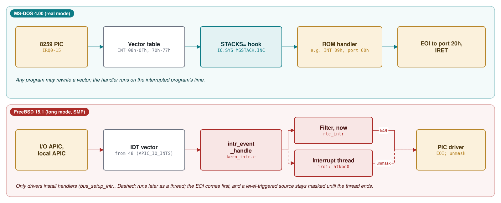
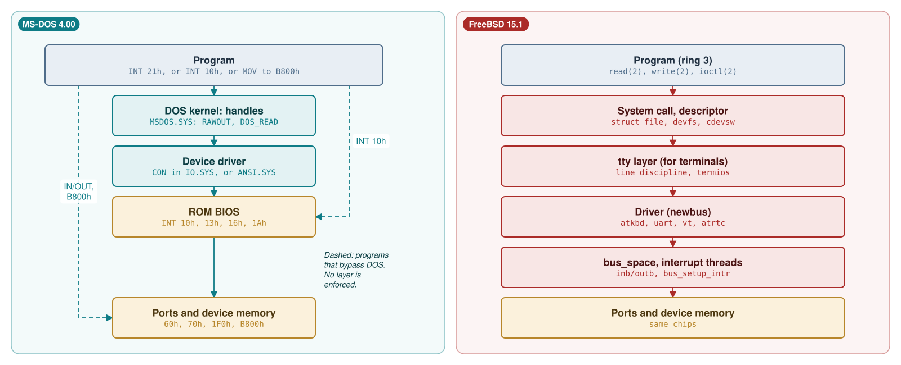
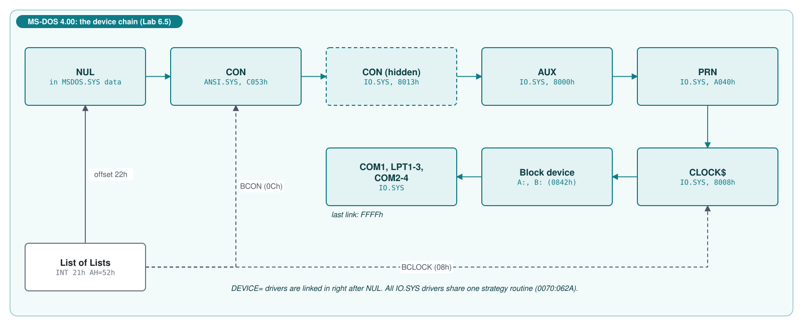
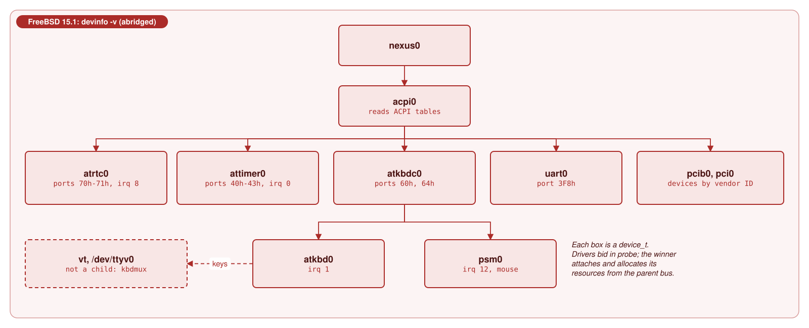
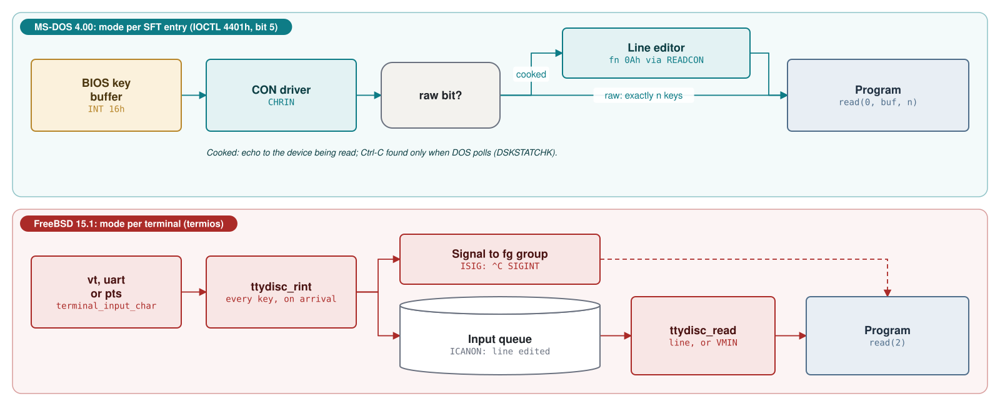
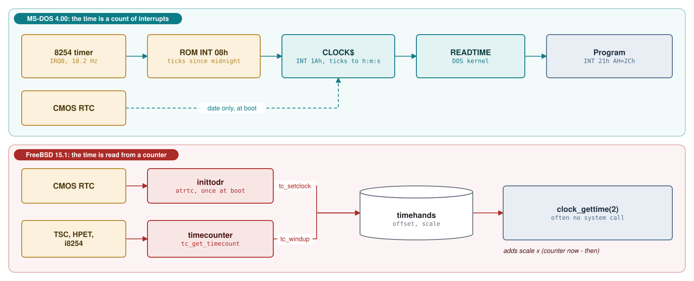
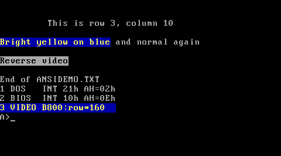
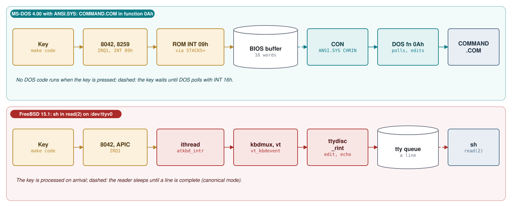

# Module 6: Talking to the hardware: BIOS, ports, interrupts, drivers and consoles

Module 2 (Section 2.7) introduced the interfaces of the device drivers of both systems. This module goes
one level further down: how each system reaches the devices of a PC (keyboard, screen, clock, disk
controller), from the processor instructions that talk to a device up to what a program sees: handles
and the `CON` device on MS-DOS 4.00, file descriptors, `/dev` and terminals on FreeBSD 15.1. The second
half is about the console and about time. Five of the seven labs run on the MS-DOS 4.00 we built from
source, with real captured output; the FreeBSD labs use the real 15.1 binaries and manual pages for
static facts and show output captured in the course's FreeBSD 15.1 virtual machine, whose "hardware"
is itself emulated (Section 6.1).

**Learning goals.** After this module you can:

- name the three ways a PC program reaches a device (I/O ports, device memory in the address space,
  interrupts), and find the port and vector numbers of the classic PC devices in both source trees;
- explain the three layers of device access on MS-DOS (direct hardware, BIOS services, DOS device
  drivers) and trace one character from `INT 21h` through the `CON` driver to `INT 10h`;
- read an MS-DOS device header, request packet and command table, and write a character device driver
  that MS-DOS loads with `DEVICE=`;
- explain how FreeBSD finds devices and binds drivers to them (newbus: buses, `probe`, `attach`,
  `DRIVER_MODULE`), how a driver obtains its ports and its interrupt (`bus_alloc_resource`,
  `bus_space`, `bus_setup_intr`), and how interrupts run as filters and interrupt threads;
- compare the MS-DOS console (`CON`, cooked and raw mode, Ctrl-C polling, `ANSI.SYS`) with the FreeBSD
  terminal (`vt`, the tty line discipline, `termios`, signals);
- predict what output redirection does to a program that writes through DOS, through the BIOS or into
  video memory, and argue what a program gains and loses by bypassing the operating system;
- explain how each system keeps time: the BIOS tick count and the `CLOCK$` driver on MS-DOS, the
  real-time clock read once at boot and the timecounters on FreeBSD;
- inspect the devices of a running system: `DEBUG`, IOCTL calls and a driver-chain walker on MS-DOS;
  `devinfo`, `sysctl`, `stty` and the manual pages on FreeBSD.

**Prerequisites.**

- Module 1: real mode, the BIOS and its data area, the interrupt vector table, `SYSINIT` and
  `CONFIG.SYS`.
- Module 2: `INT 21h`, handles and the System File Table (Section 2.3), the device driver interface
  (Section 2.7) and concurrency (Section 2.8). Module 3, Section 3.8: Ctrl-C, signals and process
  groups.
- The lab of Module 0: `tools/dos_run.py`, NASM, and `tools/dos_tools.py` for Microsoft C 5.10.
  Assembly at the level of Module 4.

## 6.1 The PC as a programmer sees it

### Device memory: the text screen

A device can make its registers or its buffers appear at memory addresses. The best-known case on a
PC is the text screen. In colour text mode the video adapter shows the 4,000 bytes at segment `B800h`
(linear `0xB8000`): 25 rows of 80 cells, two bytes per cell, the character code followed by an
*attribute* byte (bits 0-3 the foreground colour, bits 4-6 the background, bit 7 blinking or a bright
background). The cell for row *r*, column *c* (counting from 0) is at offset `(r * 80 + c) * 2`. The
monochrome adapter uses segment `B000h` instead; `ANSI.SYS` reads the video mode from the BIOS data area
at `40:49h` and picks the segment accordingly ([`ANSI.ASM` lines 790-799](https://github.com/microsoft/MS-DOS/blob/2d04cacc5322951f187bb17e017c12920ac8ebe2/v4.0/src/DEV/ANSI/ANSI.ASM#L790-L799)).

Nothing else is needed: the adapter reads this memory dozens of times per second to draw the picture,
so a single `MOV` into `B800:xxxx` changes the screen. No instruction tells the device that something
happened, and no software sits in between. Lab 6.1 uses this.

### I/O ports

The x86 has a second address space for devices, separate from memory: 65,536 byte-wide *I/O ports*,
reached only with the `IN` and `OUT` instructions (and their string forms `INS` and `OUTS`). A port
number up to 255 can be written in the instruction; larger numbers must be in `DX`. The table lists the
ports this module meets, with the place where each source tree names them.

| Ports | Device | MS-DOS 4.00 | FreeBSD 15.1 |
|---|---|---|---|
| `20h`-`21h`, `A0h`-`A1h` | two 8259A interrupt controllers | `AKPORT`, `EOI` ([`MSBIO1.ASM` lines 135-136](https://github.com/microsoft/MS-DOS/blob/2d04cacc5322951f187bb17e017c12920ac8ebe2/v4.0/src/BIOS/MSBIO1.ASM#L135-L136)) | `IO_ICU1`, `IO_ICU2` ([`isareg.h` lines 47-50](https://github.com/freebsd/freebsd-src/blob/96841ea08dcfa84b954a32dc5ae1a26c28966cf4/sys/isa/isareg.h#L47-L50)) |
| `40h`-`43h` | 8254 programmable interval timer | used by the ROM BIOS | `hint.attimer.0.port` ([`GENERIC.hints` lines 17-19](https://github.com/freebsd/freebsd-src/blob/96841ea08dcfa84b954a32dc5ae1a26c28966cf4/sys/amd64/conf/GENERIC.hints#L17-L19)) |
| `60h`, `64h` | 8042 keyboard controller | used by the ROM BIOS (`INT 09h`) | `IO_KBD` ([`isareg.h` line 48](https://github.com/freebsd/freebsd-src/blob/96841ea08dcfa84b954a32dc5ae1a26c28966cf4/sys/isa/isareg.h#L48)) |
| `70h`-`71h` | MC146818 real-time clock and CMOS memory | `CMOS_PORT`, `CMOS_DATA` ([`CMOSEQU.INC` lines 7-8](https://github.com/microsoft/MS-DOS/blob/2d04cacc5322951f187bb17e017c12920ac8ebe2/v4.0/src/BIOS/CMOSEQU.INC#L7-L8)) | `IO_RTC` ([`isareg.h` line 49](https://github.com/freebsd/freebsd-src/blob/96841ea08dcfa84b954a32dc5ae1a26c28966cf4/sys/isa/isareg.h#L49)) |
| `1F0h`-`1F7h`, `3F6h` | AT hard-disk controller | `HF_PORT`, `HF_REG_PORT` ([`MSHARD.ASM` lines 26-27](https://github.com/microsoft/MS-DOS/blob/2d04cacc5322951f187bb17e017c12920ac8ebe2/v4.0/src/BIOS/MSHARD.ASM#L26-L27)) | ATA drivers, `atapci0` in Output 6.13 (source not in our checkout) |
| `3D8h`, `3DAh` | colour adapter mode and status | `ANSI.SYS` ([`ANSI.ASM` lines 559-575](https://github.com/microsoft/MS-DOS/blob/2d04cacc5322951f187bb17e017c12920ac8ebe2/v4.0/src/DEV/ANSI/ANSI.ASM#L559-L575)) | `IO_CGA` ([`isareg.h` line 54](https://github.com/freebsd/freebsd-src/blob/96841ea08dcfa84b954a32dc5ae1a26c28966cf4/sys/isa/isareg.h#L54)) |
| `3F8h`, `2F8h` | first and second serial port (UART) | used by the ROM BIOS (`INT 14h`) | `hint.uart.0.port`, `hint.uart.1.port` ([`GENERIC.hints` lines 9-13](https://github.com/freebsd/freebsd-src/blob/96841ea08dcfa84b954a32dc5ae1a26c28966cf4/sys/amd64/conf/GENERIC.hints#L9-L13)) |

Many devices use an *index/data* pair: write a register number to one port, then read or write the
register through the next one. The CMOS clock is the classic example, and both systems read it the
same way.

**Listing 6.1** -- IO.SYS reads one CMOS register through ports 70h and 71h ([`MSINIT.ASM` lines 2732-2756](https://github.com/microsoft/MS-DOS/blob/2d04cacc5322951f187bb17e017c12920ac8ebe2/v4.0/src/BIOS/MSINIT.ASM#L2732-L2756))

```asm
CMOS_READ       PROC    NEAR            ;       READ LOCATION (AL) INTO (AL)
        assume  es:nothing,ds:nothing
        PUSHF                           ; SAVE INTERRUPT ENABLE STATUS AND FLAGS
;SB33IN4********************************************************************

        cli
        push    bx
        push    ax                      ;save user NMI state
        or      al,NMI                  ;disable NMI for us
        out     CMOS_PORT,al
        nop                             ;undocumented delay needed
        in      al,CMOS_DATA            ;get data value

         ;set NMI state to user specified
        mov     bx,ax                   ;save data value
        pop     ax                      ;get user NMI
        and     al,NMI
        or      al,CMOS_SHUT_DOWN
        out     CMOS_PORT,al
        nop
        in      al,CMOS_DATA

        mov     ax,bx                   ;data value
        pop     bx

```

**Listing 6.2** -- FreeBSD's atrtc driver does the same, and remembers the selected register ([`atrtc.c` lines 98-109](https://github.com/freebsd/freebsd-src/blob/96841ea08dcfa84b954a32dc5ae1a26c28966cf4/sys/x86/isa/atrtc.c#L98-L109))

```c
static inline u_char
rtcin_locked(int reg)
{

        if (rtc_reg != reg) {
                inb(0x84);
                outb(IO_RTC, reg);
                rtc_reg = reg;
                inb(0x84);
        }
        return (inb(IO_RTC + 1));
}
```

Both write the register number to port `70h` and read the value from port `71h`, and both wait a little
in between because the original chips needed time: MS-DOS with a `NOP` ("undocumented delay needed"),
FreeBSD with a read of the unused port `84h`. Bit 7 of the index disables the non-maskable interrupt,
which is why `CMOS_READ` saves and restores it. To keep other code away during the pair of accesses, a
one-processor, one-program system needs only `CLI`; FreeBSD's `rtcin()` takes the spin mutex
`atrtc_lock` ([`atrtc.c` lines 125-134](https://github.com/freebsd/freebsd-src/blob/96841ea08dcfa84b954a32dc5ae1a26c28966cf4/sys/x86/isa/atrtc.c#L125-L134)), which disables interrupts on this CPU *and* keeps the
other CPUs out (Module 2, Section 2.8). MS-DOS uses `CMOS_READ` only to repair the clock's rate
registers on early IBM ATs (`CMOSCK`, [`MSINIT.ASM` lines 2677-2715](https://github.com/microsoft/MS-DOS/blob/2d04cacc5322951f187bb17e017c12920ac8ebe2/v4.0/src/BIOS/MSINIT.ASM#L2677-L2715)); for date and time it uses the BIOS
(Section 6.6).

### Interrupts and the 8259

A device that needs attention raises an *interrupt request* (IRQ) line. On a PC the lines go to two
8259A programmable interrupt controllers (PICs): IRQ0-7 on the first, IRQ8-15 on the second, which is
cascaded through IRQ2. The PIC turns the request into an interrupt with a vector number, and the
processor calls the handler in the interrupt vector table (Module 1). Which vector each IRQ uses is
fixed by how the BIOS programs the PICs at power-on, and IO.SYS documents the PC/AT assignment in a
comment:

**Listing 6.3** -- IRQ levels and the vectors they use on a PC/AT ([`MSSTACK.INC` lines 3-12](https://github.com/microsoft/MS-DOS/blob/2d04cacc5322951f187bb17e017c12920ac8ebe2/v4.0/src/BIOS/MSSTACK.INC#L3-L12))

```asm
;       Interrupt level 2, 3, 4, 5, 6, 7,(10, 11, 12, 14, 15 - AT level)
;       should follow the standard Interrupt Sharing Scheme which has
;       a standard header structure.
;       Fyi, the following shows the relations between
;       the interrupt vector and interrupt level.
; VEC(Hex)    2  8  9  A  B  C  D  E  70  72  73  74  76  77
; LVL(Deci)   9  0  1  2  3  4  5  6   8  10  11  12  14  15
;       MSSTACK module modifies the following interrupt vectors
;       to meet the standard Interrupt Sharing standard;
;         A, B, C, D, E, 72, 73, 74, 76, 77.
```

So IRQ0, the 8254 timer, arrives as `INT 08h`; IRQ1, the keyboard, as `INT 09h`; IRQ8, the real-time
clock, as `INT 70h`; IRQ14, the hard disk, as `INT 76h`. Vector `2` is the non-maskable interrupt. The
handler must tell the PIC that the interrupt has been served by writing an *end of interrupt* (EOI)
command, `20h`, to port `20h` (for IRQ8-15 also to port `A0h`). IO.SYS does this once, early in its
initialisation, with the comment "TURN ON THE TIMER" ([`MSINIT.ASM` lines 540-542](https://github.com/microsoft/MS-DOS/blob/2d04cacc5322951f187bb17e017c12920ac8ebe2/v4.0/src/BIOS/MSINIT.ASM#L540-L542)): an EOI left
pending by the boot code would block the timer and everything below it. FreeBSD's PIC driver does
exactly the same `OUT`:

**Listing 6.4** -- FreeBSD sends the same end-of-interrupt command to the first 8259 ([`atpic.c` lines 179-188](https://github.com/freebsd/freebsd-src/blob/96841ea08dcfa84b954a32dc5ae1a26c28966cf4/sys/x86/isa/atpic.c#L179-L188))

```c
static __inline void
_atpic_eoi_master(struct intsrc *isrc)
{

        KASSERT(isrc->is_pic == &atpics[MASTER].at_pic,
            ("%s: mismatched pic", __func__));
#ifndef AUTO_EOI_1
        outb(atpics[MASTER].at_ioaddr, OCW2_EOI);
#endif
}
```

The vector numbers hide a difference. Intel reserves vectors 0-31 for processor exceptions, and on the
80286 and later some PC IRQ vectors collide with them: `08h` is the double fault, `0Dh` the
general-protection fault. Real-mode DOS can live with that; a protected-mode kernel cannot. FreeBSD keeps
the first 32 entries of its interrupt descriptor table for exceptions and puts device interrupts after
them, at `IDT_IO_INTS` ([`segments.h` lines 187-213](https://github.com/freebsd/freebsd-src/blob/96841ea08dcfa84b954a32dc5ae1a26c28966cf4/sys/x86/include/segments.h#L187-L213)): it reprograms the 8259s to deliver IRQ0
as vector 32 ([`atpic.c` lines 107-110](https://github.com/freebsd/freebsd-src/blob/96841ea08dcfa84b954a32dc5ae1a26c28966cf4/sys/x86/isa/atpic.c#L107-L110)), or, on machines with an I/O APIC that forwards
interrupts to a local APIC in each CPU, masks them and uses vectors from `APIC_IO_INTS` = 48
([`apicvar.h` line 90](https://github.com/freebsd/freebsd-src/blob/96841ea08dcfa84b954a32dc5ae1a26c28966cf4/sys/x86/include/apicvar.h#L90)). Figure 6.1 puts the two paths side by side.



### Waiting for a device: polling, interrupts and DMA

A program that has started a device operation can wait in three ways. It can *poll*: read a status
port in a loop until the device is ready. It can let the device *interrupt* when it is ready and do
something else meanwhile. And for bulk data it can let a *DMA* controller copy between the device and
memory without the processor. The PC uses all three, and MS-DOS meets all three in IO.SYS. The routine
that reads hard-disk sectors in `MSHARD.ASM` polls and copies:

**Listing 6.5** -- Programmed I/O: wait for the controller, then copy 256 words from port 1F0h ([`MSHARD.ASM` lines 279-298](https://github.com/microsoft/MS-DOS/blob/2d04cacc5322951f187bb17e017c12920ac8ebe2/v4.0/src/BIOS/MSHARD.ASM#L279-L298))

```asm
DOC1:
        PUSH CS
        CALL WAITT              ;Wait for controller to complete read
        JNZ  DOC3
        MOV  CX, 100h           ;256 words per sector
        MOV  DX, HF_PORT
        CLD                     ;String op goes up
        CLI                     ;Disable interrupts (BUG WAS FORGETTING THIS)
  REPZ  INSW                    ;Read in sector
        STI
        TEST CMD_BLOCK[CMD_REG], 02
        JZ   DOC2               ;No ECC bytes to read.
        PUSH CS
        CALL WAIT_DRQ
        JC   DOC3
        MOV  CX, 4              ;4 bytes of ECC
        MOV  DX, HF_PORT
        CLI
  REPZ  INSB                    ;Read in ECC
        STI
```

`WAITT` ("Wait for disk interrupt") jumps into the AT ROM's own routine, which returns when the disk
interrupt has arrived ([`MSHARD.ASM` lines 353-369](https://github.com/microsoft/MS-DOS/blob/2d04cacc5322951f187bb17e017c12920ac8ebe2/v4.0/src/BIOS/MSHARD.ASM#L353-L369)); then `REP INSW` moves the 512-byte sector from the
data port, one word per `IN`. The comment on `CLI` names the bug this file fixes in the 1984 IBM AT ROM
([`MSHARD.ASM` lines 1-15](https://github.com/microsoft/MS-DOS/blob/2d04cacc5322951f187bb17e017c12920ac8ebe2/v4.0/src/BIOS/MSHARD.ASM#L1-L15)); IO.SYS installs it only when the ROM is dated `01/10/84`
([`MSINIT.ASM` lines 1211-1226](https://github.com/microsoft/MS-DOS/blob/2d04cacc5322951f187bb17e017c12920ac8ebe2/v4.0/src/BIOS/MSINIT.ASM#L1211-L1226), [`MSINIT.ASM` line 307](https://github.com/microsoft/MS-DOS/blob/2d04cacc5322951f187bb17e017c12920ac8ebe2/v4.0/src/BIOS/MSINIT.ASM#L307)), and it calls into the ROM at fixed addresses
([`MSHARD.ASM` lines 60-90](https://github.com/microsoft/MS-DOS/blob/2d04cacc5322951f187bb17e017c12920ac8ebe2/v4.0/src/BIOS/MSHARD.ASM#L60-L90)). DOS shipped patches for particular ROMs.

The floppy disk uses DMA. The PC's 8237 DMA controller counts addresses in 16 bits within a 64 KB page,
so a transfer cannot cross a physical 64 KB boundary. IO.SYS therefore hooks `INT 13h` and splits any
request whose buffer crosses one, copying the offending sector through its own buffer; the comment calls
it "THE BIGGEST BOGOSITY OF ALL" ([`MSDISK.ASM` lines 1714-1724](https://github.com/microsoft/MS-DOS/blob/2d04cacc5322951f187bb17e017c12920ac8ebe2/v4.0/src/BIOS/MSDISK.ASM#L1714-L1724)).

In all three cases the processor running MS-DOS waits: there is nothing else for it to do. A FreeBSD
driver programs the transfer, and the thread that asked for the data sleeps until the completion
interrupt wakes it; meanwhile the CPU runs other threads (Module 2, Figure 2.5).

### How FreeBSD code touches ports

In the FreeBSD kernel, `IN` and `OUT` are wrapped in inline functions, `inb()` and `outb()`
([`cpufunc.h` lines 130-137](https://github.com/freebsd/freebsd-src/blob/96841ea08dcfa84b954a32dc5ae1a26c28966cf4/sys/amd64/include/cpufunc.h#L130-L137), [`cpufunc.h` lines 190-194](https://github.com/freebsd/freebsd-src/blob/96841ea08dcfa84b954a32dc5ae1a26c28966cf4/sys/amd64/include/cpufunc.h#L190-L194)). Most drivers do
not call them directly but go through `bus_space`, which hides whether a device's registers are ports
or memory:

**Listing 6.6** -- bus_space on x86: one function for port and memory registers ([`bus.h` lines 213-221](https://github.com/freebsd/freebsd-src/blob/96841ea08dcfa84b954a32dc5ae1a26c28966cf4/sys/x86/include/bus.h#L213-L221))

```c
static __inline u_int8_t
bus_space_read_1(bus_space_tag_t tag, bus_space_handle_t handle,
                 bus_size_t offset)
{

        if (tag == X86_BUS_SPACE_IO)
                return (inb(handle + offset));
        return (*(volatile u_int8_t *)(handle + offset));
}
```

The *tag* says which address space, the *handle* where the device's registers start; the bus code fills
both when the driver allocates the resource (Section 6.4). The keyboard controller driver reads its
data port with `bus_space_read_1` ([`atkbdc.c` lines 73-78](https://github.com/freebsd/freebsd-src/blob/96841ea08dcfa84b954a32dc5ae1a26c28966cf4/sys/dev/atkbdc/atkbdc.c#L73-L78)); `atrtc` is older and uses
`inb()` and `outb()` directly, although it still allocates its ports so that no other driver can claim
them ([`atrtc.c` lines 481-484](https://github.com/freebsd/freebsd-src/blob/96841ea08dcfa84b954a32dc5ae1a26c28966cf4/sys/x86/isa/atrtc.c#L481-L484)).

A user program cannot do either. `IN` and `OUT` are privileged in user mode: they raise a
general-protection fault, which the kernel turns into `SIGBUS` ([`trap.c` lines 441-442](https://github.com/freebsd/freebsd-src/blob/96841ea08dcfa84b954a32dc5ae1a26c28966cf4/sys/amd64/amd64/trap.c#L441-L442)).
The one way around it is `/dev/io`, which its manual page calls "a controlled security hole": a process
running as root that opens it gets I/O privilege (`io(4)`). On MS-DOS every program has that privilege
all the time. We tried both in the course's virtual machine with a short C program that executes
`inb $0x61`: run normally it died with "Bus error" (exit status 138, and `truss` reported
`SIGNAL 10 (SIGBUS) code=BUS_OBJERR trapno=9`, trap 9 being `T_PROTFLT`, the general-protection fault,
[`trap.h` line 46](https://github.com/freebsd/freebsd-src/blob/96841ea08dcfa84b954a32dc5ae1a26c28966cf4/sys/x86/include/trap.h#L46)); after
opening `/dev/io` as root, the same instruction returned the port's value.

### What DOSBox-X emulates

DOSBox-X emulates the devices above: the two 8259s, the 8254, the CMOS clock, the keyboard controller,
the serial ports and a VGA adapter with its text memory at `B800h`. Its BIOS is DOSBox-X's own, not
IBM's, so IBM-specific code paths such as the `MSHARD.ASM` fix never run, and our floppy image is
reached through DOSBox-X's emulated `INT 13h`. Timing is not that of a real PC: with `cycles=max` the
emulated processor runs as fast as the host allows, and delays such as the `NOP` in Listing 6.1 mean
nothing. The emulated clock also has an opinion of its own about the time of day (Lab 6.2). When a
result depends on such details, the labs say so.

### What the course's virtual machine emulates

The FreeBSD side runs in a Hyper-V "generation 1" virtual machine, which is virtual hardware too, of
two kinds (Lab 6.6 lists them). The first kind imitates a 1998 PC: an Intel 440BX/PIIX4 chipset with
its ISA bridge, the 8259s and an I/O APIC, the 8254, the CMOS clock, an 8042 with a PS/2 keyboard and
mouse, two 16550 serial ports, a floppy controller, IDE and a VGA adapter, at the classic ports and
IRQs of the table above. The second kind are *synthetic* devices that exist only in a virtual machine
and talk to the hypervisor through shared memory on a bus called VMBus: disk, network, a keyboard, a
mouse, and a clock. Two consequences show up in the labs. The keys typed on the Hyper-V console reach
FreeBSD through the synthetic keyboard `hvkbd0`, not through IRQ 1 and the 8042, although both drivers
are attached. And every `IN` or `OUT` to an emulated chip is intercepted by the hypervisor, which makes
it far slower than on real hardware: a `clock_gettime` call that reads the 8254 took about 0.1 ms
(Exercise 6.4), so FreeBSD prefers a clock that Hyper-V provides in shared memory (Section 6.6).

## 6.2 Three layers on MS-DOS

A program running on MS-DOS 4.00 can reach a device at three levels, and real programs used all three.
Figure 6.2 shows them next to the FreeBSD path that Section 6.4 builds up.



| Level | How a program uses it | What it gets | What it gives up |
|---|---|---|---|
| DOS (handles, device names) | `INT 21h`: write to handle 1, open `PRN`, read `CON` | redirection, device independence, Ctrl-C handling | speed; DOS does one call at a time |
| ROM BIOS | `INT 10h`, `13h`, `14h`, `16h`, `17h`, `1Ah` | independence from the adapter model | redirection; DOS does not know what happened |
| Hardware | `IN`, `OUT`, stores into `B800h` | full speed and full control | everything else, including compatibility |

### The BIOS: a device layer in ROM

The ROM BIOS of the IBM PC (Module 1) is a set of device drivers reached through software interrupts.
The `BIOS` directory of the MS-DOS source builds `IO.SYS`, whose drivers translate DOS requests into
those calls. Its name is historical: IO.SYS was "the DOS BIOS", the part an OEM rewrote for a machine.
The source still carries the names of particular IBM machines, such as the PC Convertible
([`MSCON.ASM` lines 130-133](https://github.com/microsoft/MS-DOS/blob/2d04cacc5322951f187bb17e017c12920ac8ebe2/v4.0/src/BIOS/MSCON.ASM#L130-L133)) and the AT's ROM by date (Section 6.1).

| BIOS call | Service | Called in IO.SYS by |
|---|---|---|
| `INT 10h`, `AH=0Eh` | write a character at the cursor ("teletype") | `OUTCHR`, the `INT 29h` handler ([`MSBIO1.ASM` lines 584-602](https://github.com/microsoft/MS-DOS/blob/2d04cacc5322951f187bb17e017c12920ac8ebe2/v4.0/src/BIOS/MSBIO1.ASM#L584-L602)) |
| `INT 13h` | read, write, verify and format disk sectors | the block driver `MSDISK.ASM`, which also hooks `INT 13h` ([`MSDISK.ASM` lines 1760-1768](https://github.com/microsoft/MS-DOS/blob/2d04cacc5322951f187bb17e017c12920ac8ebe2/v4.0/src/BIOS/MSDISK.ASM#L1760-L1768)) |
| `INT 14h` | serial port: send, receive, status | `AUXOP` in the `AUX`/`COMn` driver ([`MSAUX.ASM` lines 212-218](https://github.com/microsoft/MS-DOS/blob/2d04cacc5322951f187bb17e017c12920ac8ebe2/v4.0/src/BIOS/MSAUX.ASM#L212-L218)) |
| `INT 16h` | keyboard: read a key, test for a key | `CHRIN` and `CON$RDND` in the `CON` driver (Listing 6.9) |
| `INT 17h` | printer: print a character, status | `PRNOP` in the `PRN`/`LPTn` driver ([`MSLPT.ASM` lines 144-146](https://github.com/microsoft/MS-DOS/blob/2d04cacc5322951f187bb17e017c12920ac8ebe2/v4.0/src/BIOS/MSLPT.ASM#L144-L146)) |
| `INT 1Ah` | tick counter; CMOS date and time on ATs | the `CLOCK$` driver (Section 6.6) |
| `INT 15h` | system services (`AH=C0h`: machine model) | `MSINIT` at boot ([`MSINIT.ASM` lines 524-539](https://github.com/microsoft/MS-DOS/blob/2d04cacc5322951f187bb17e017c12920ac8ebe2/v4.0/src/BIOS/MSINIT.ASM#L524-L539)) |

### The drivers in IO.SYS

Module 2 (Listing 2.28) showed the device header and the request header. IO.SYS contains eleven
character devices and one block device, and their headers are plain data, chained one to the next:

**Listing 6.7** -- The first four driver headers in IO.SYS: CON, AUX, PRN and CLOCK$ ([`MSBDATA.INC` lines 181-215](https://github.com/microsoft/MS-DOS/blob/2d04cacc5322951f187bb17e017c12920ac8ebe2/v4.0/src/BIOS/MSBDATA.INC#L181-L215))

```asm
        EVENB
        PUBLIC  CONHEADER
CONHEADER LABEL   WORD                    ;HEADER FOR DEVICE "CON"
        DD      AUXDEV2
        DW      1000000000010011B ;CON IN AND CON OUT + SPECIAL
        DW      STRATEGY
        DW      CON$IN
        DB      'CON     '

        EVENB
        PUBLIC  AUXDEV2
AUXDEV2  LABEL   WORD                    ;HEADER FOR DEVICE "AUX"
        DD      PRNDEV2
        DW      1000000000000000B
        DW      STRATEGY
        DW      AUX0$IN
        DB      'AUX     '

        EVENB
        PUBLIC  PRNDEV2
PRNDEV2  LABEL   WORD                    ;HEADER FOR DEVICE "PRN"
        DD      TIMDEV
        DW      CHARDEV + OUTTILBUSY + DEV320
        DW      STRATEGY
        DW      PRN0$IN
        DB      'PRN     '

        EVENB
        PUBLIC TIMDEV
TIMDEV  LABEL   WORD
        DD      DSKDEV
        DW      1000000000001000B
        DW      STRATEGY
        DW      TIM$IN
        DB      'CLOCK$  '
```

The attribute word says what kind of device each one is ([`DEVSYM.INC` lines 17-34](https://github.com/microsoft/MS-DOS/blob/2d04cacc5322951f187bb17e017c12920ac8ebe2/v4.0/src/INC/DEVSYM.INC#L17-L34)). `CON` has
`1000000000010011B` = `8013h`: a character device (bit 15) that is the console input (bit 0) and output
(bit 1) and accepts `INT 29h` output (bit 4, the "special" bit). `CLOCK$` has bit 3, the clock device.
`AUX` is a plain character device. `PRN` adds output-until-busy (bit 13) and generic IOCTL (bit 6,
`DEV320` in [`DEVSYM.INC` lines 81-87](https://github.com/microsoft/MS-DOS/blob/2d04cacc5322951f187bb17e017c12920ac8ebe2/v4.0/src/INC/DEVSYM.INC#L81-L87); the older table still calls bit 6 unused for character
devices).
The block device after `CLOCK$` (`DSKDEV`, attribute `0842h`) serves all the drive letters of the
floppy and hard disks; instead of a name its header holds the number of units
([`MSBDATA.INC` lines 217-224](https://github.com/microsoft/MS-DOS/blob/2d04cacc5322951f187bb17e017c12920ac8ebe2/v4.0/src/BIOS/MSBDATA.INC#L217-L224)). Figure 6.3 shows the chain as it is after boot; Lab 6.5 walks it on the
running system.



Every driver has a command table: one byte with the highest command number it accepts, then one near
pointer per command. The table of `CON`:

**Listing 6.8** -- The command table of CON: commands 0 to 10 ([`MSBDATA.INC` lines 66-79](https://github.com/microsoft/MS-DOS/blob/2d04cacc5322951f187bb17e017c12920ac8ebe2/v4.0/src/BIOS/MSBDATA.INC#L66-L79))

```asm
        ODD
CONTBL  LABEL   BYTE
        DB      10
        DW      EXIT
        DW      EXIT
        DW      EXIT
        DW      CMDERR
        DW      CON$READ
        DW      CON$RDND
        DW      EXIT
        DW      CON$FLSH
        DW      CON$WRIT
        DW      CON$WRIT
        DW      EXIT                    ;ARR 2.41
```

Commands 0-2 (initialise, media check, build BPB) do nothing for the console: `MSINIT` has prepared
everything before the first request arrives. Command 3, IOCTL read, is refused (`CMDERR`), consistent
with bit 14 being clear in the attribute. Command 4 reads, 5 is the *non-destructive read* that returns
the next character without consuming it, 7 flushes type-ahead, and 8 and 9 (write, write with verify)
both write. The table of `CLOCK$` has the same shape, with `TIM$READ` and `TIM$WRIT`
([`MSBDATA.INC` lines 106-118](https://github.com/microsoft/MS-DOS/blob/2d04cacc5322951f187bb17e017c12920ac8ebe2/v4.0/src/BIOS/MSBDATA.INC#L106-L118)).

All IO.SYS drivers share one strategy routine and one dispatcher; only the small interrupt entry differs:

**Listing 6.9** -- One strategy routine, small interrupt entries and one dispatcher for all IO.SYS devices ([`MSBIO1.ASM` lines 321-512](https://github.com/microsoft/MS-DOS/blob/2d04cacc5322951f187bb17e017c12920ac8ebe2/v4.0/src/BIOS/MSBIO1.ASM#L321-L512))

```asm
        PUBLIC  STRATEGY
STRATEGY PROC   FAR
        MOV     WORD PTR CS:[PTRSAV],BX
        MOV     WORD PTR CS:[PTRSAV+2],ES
        RET
STRATEGY ENDP

        PUBLIC CON$IN
CON$IN  PROC    FAR
        PUSH    SI
        MOV     SI,OFFSET CONTBL
        JMP     SHORT ENTRY
CON$IN  ENDP
⋮
        PUBLIC  TIM$IN
TIM$IN  PROC    FAR
        PUSH    SI
        MOV     SI,OFFSET TIMTBL
        JMP     SHORT ENTRY
TIM$IN  ENDP

        PUBLIC  DSK$IN
DSK$IN  PROC    FAR
        PUSH    SI
        MOV     SI,OFFSET DSKTBL

ENTRY:
        PUSH    AX
ENTRY1:
        PUSH    CX
        PUSH    DX
        PUSH    DI
        PUSH    BP
        PUSH    DS
        PUSH    ES
⋮
        XCHG    DI,AX
        MOV     AL,BYTE PTR DS:[BX].CMD
        CMP     AL,CS:[SI]              ;ARR 2.41
        JA      CMDERR

        CBW                             ; NOTE THAT AL <= 15 MEANS OK
        SHL     AX,1

        ADD     SI,AX
        XCHG    AX,DI

        LES     DI,DWORD PTR DS:[BX].TRANS

        PUSH    CS
        POP     DS

        ASSUME  DS:CODE

        CLD
        JMP     WORD PTR [SI+1]         ;GO DO COMMAND
```

The strategy routine stores the packet address in `PTRSAV`. Each interrupt entry loads the address of
its command table into `SI` and joins `ENTRY`, which saves the registers, loads `ES:DI` and `CX` from
the packet, checks the command number against the table's first byte, and jumps to the handler. Every
handler ends at `EXIT` or one of its neighbours, which store `AX` as the status word with the high byte
`01h` (done), `81h` (error and done, error code in `AL`) or `03h` (busy and done) when, for example, a
non-destructive read finds no key; without an error the low byte is whatever `AL` held and means nothing
([`MSBIO1.ASM` lines 524-573](https://github.com/microsoft/MS-DOS/blob/2d04cacc5322951f187bb17e017c12920ac8ebe2/v4.0/src/BIOS/MSBIO1.ASM#L524-L573)). `AUX` and `COM1` even share the interrupt entry `AUX0$IN`
([`MSBDATA.INC` lines 192-197](https://github.com/microsoft/MS-DOS/blob/2d04cacc5322951f187bb17e017c12920ac8ebe2/v4.0/src/BIOS/MSBDATA.INC#L192-L197), [`MSBDATA.INC` lines 254-259](https://github.com/microsoft/MS-DOS/blob/2d04cacc5322951f187bb17e017c12920ac8ebe2/v4.0/src/BIOS/MSBDATA.INC#L254-L259)).

### The CON driver: INT 16h in, INT 10h out

The console read handler is a loop around one BIOS call:

**Listing 6.10** -- CON reads: one INT 16h per character ([`MSCON.ASM` lines 37-90](https://github.com/microsoft/MS-DOS/blob/2d04cacc5322951f187bb17e017c12920ac8ebe2/v4.0/src/BIOS/MSCON.ASM#L37-L90))

```asm
;       CONSOLE READ ROUTINE
;
        ASSUME DS:CODE               ; THIS WAS SET BY THE CON DD ENTRY POINT
        PUBLIC  CON$READ
CON$READ PROC   NEAR
        JCXZ    CON$EXIT
CON$LOOP:
        CALL    CHRIN                   ;GET CHAR IN AL
        STOSB                           ;STORE CHAR AT ES:DI
        LOOP    CON$LOOP
CON$EXIT:
        JUMP    EXIT
⋮
CHRIN   PROC    NEAR
;AN000;
;        XOR     AX,AX
        mov     ah,KEYRD_Func           ;AN000; Set by MSINIT. 0 or 10h
        xor     al,al                   ;AN000;
        XCHG    AL,ALTAH                ;GET CHARACTER & ZERO ALTAH

        OR      AL,AL
        JNZ     KEYRET
;SB34CON000**************************************************************
;SB  Keyboard I/O interrupt
;SB     AH already contains the keyboard read function number
;SB             1 LOC

        int     16h
;SB34CON000**************************************************************
ALT10:
        OR      AX,AX                   ;CHECK FOR NON-KEY AFTER BREAK
        JZ      CHRIN
        CMP     AX,7200H                ;CHECK FOR CTRL-PRTSC
        JNZ     ALT_Ext_Chk             ;AN000;
```

`CON$READ` stores `CX` characters at `ES:DI`, each from `CHRIN`. `CHRIN` calls `INT 16h` with function
`00h`, or `10h` when `MSINIT` found an enhanced keyboard (bit 4 of the BIOS byte at `40:96h`,
[`MSINIT.ASM` lines 752-766](https://github.com/microsoft/MS-DOS/blob/2d04cacc5322951f187bb17e017c12920ac8ebe2/v4.0/src/BIOS/MSINIT.ASM#L752-L766)). The BIOS returns the ASCII code in `AL` and the keyboard's scan code in
`AH`. For keys without an ASCII code (function keys, arrows) `AL` is `0`; `CHRIN` returns that `0` and
keeps the scan code in `ALTAH`, to be returned by the next call. That is where the two-byte "extended
key" codes of MS-DOS programs come from. The non-destructive read `CON$RDND` uses `INT 16h` function
`01h` (or `11h`), which reports whether a key is waiting without removing it
([`MSCON.ASM` lines 146-161](https://github.com/microsoft/MS-DOS/blob/2d04cacc5322951f187bb17e017c12920ac8ebe2/v4.0/src/BIOS/MSCON.ASM#L146-L161)).

The write handler does not call the video BIOS itself. It sends each character through `INT 29h`:

**Listing 6.11** -- CON writes go through INT 29h; Ctrl-Break becomes a character ([`MSCON.ASM` lines 250-266](https://github.com/microsoft/MS-DOS/blob/2d04cacc5322951f187bb17e017c12920ac8ebe2/v4.0/src/BIOS/MSCON.ASM#L250-L266))

```asm
        ASSUME DS:CODE               ; THIS WAS SET BY THE CON DD ENTRY POINT
        PUBLIC  CON$WRIT
CON$WRIT:
        JCXZ    EXVEC
CON$LP:
        MOV     AL,ES:[DI]              ;GET CHAR
        INC     DI
        INT     CHROUT                  ;OUTPUT CHAR
        LOOP    CON$LP                  ;REPEAT UNTIL ALL THROUGH
        JUMP    EXIT
;-----------------------------------------------
;
;       BREAK KEY HANDLING
;
        PUBLIC CBREAK
CBREAK:
        MOV     CS:ALTAH,3              ;INDICATE BREAK KEY SET
```

`MSINIT` points vector `29h` at `OUTCHR`, which calls `INT 10h` function `0Eh` with attribute 7
([`MSBIO1.ASM` lines 575-602](https://github.com/microsoft/MS-DOS/blob/2d04cacc5322951f187bb17e017c12920ac8ebe2/v4.0/src/BIOS/MSBIO1.ASM#L575-L602)), and vector `1Bh`, which the ROM BIOS calls when the user presses
Ctrl-Break, at `CBREAK` ([`MSINIT.ASM` lines 590-605](https://github.com/microsoft/MS-DOS/blob/2d04cacc5322951f187bb17e017c12920ac8ebe2/v4.0/src/BIOS/MSINIT.ASM#L590-L605)). `CBREAK` does not interrupt anything: it
stores `3`, the code of Ctrl-C, in `ALTAH`, so the next console read returns a Ctrl-C character and DOS
treats it like a typed one.

Why the indirection through `INT 29h`? Because DOS uses it too, as a fast path that skips the request
packet altogether:

**Listing 6.12** -- DOS writes console characters with INT 29h when standard output is a "special" device ([`CPMIO.ASM` lines 341-382](https://github.com/microsoft/MS-DOS/blob/2d04cacc5322951f187bb17e017c12920ac8ebe2/v4.0/src/DOS/CPMIO.ASM#L341-L382))

```asm
        entry   RAWOUT

        PUSH    BX
        MOV     BX,1

        invoke  GET_IO_SFT
        JC      RAWRET1

        MOV     BX,[SI.sf_flags]

 ;
 ; If we are a network handle OR if we are not a local device then go do the
 ; output the hard way.
 ;

        AND     BX,sf_isNet + devid_device
        CMP     BX,devid_device
        JNZ     RawNorm
⋮
        PUSH    DS
        LDS     BX,[SI.sf_devptr]               ; output to special?
        TEST    BYTE PTR [BX+SDEVATT],ISSPEC
        POP     DS
        JZ      RAWNORM                         ; if not, do normally
        INT     int_fastcon                     ; quickly output the char
RAWRET:
        CLC
RAWRET1:
        POP     BX
        return
RAWNORM:
        CALL    RAWOUT3
        JMP     RAWRET
```

`RAWOUT` writes the character in `AL` to standard output. If handle 1 is a local character device with
the special bit set, it simply executes `INT 29h` (`int_fastcon`); only otherwise does it go through
`RAWOUT3` and `IOFUNC`, which builds a request packet and calls the driver with `DEVIOCALL` (Module 2,
Listing 2.29), or writes to the file when standard output is redirected to one. The console output of functions `01h`-`0Ch`, echo included, and cooked handle writes to
`CON` ([`DISK.ASM` lines 656-676](https://github.com/microsoft/MS-DOS/blob/2d04cacc5322951f187bb17e017c12920ac8ebe2/v4.0/src/DOS/DISK.ASM#L656-L676)) end in `RAWOUT`. A console that wants to see the characters DOS writes must
therefore own vector `29h`, which is exactly what `ANSI.SYS` arranges.

### An installable driver: ANSI.SYS

Our `CONFIG.SYS` contains `DEVICE=\ANSI.SYS`. `ANSI.SYS` replaces the console with one that interprets
the escape sequences of the ANSI X3.64 standard, the same family a VT100 terminal and FreeBSD's
console understand: `ESC [ 2 J` clears the screen, `ESC [ row ; col H` moves the cursor, `ESC [ 1 ; 33 ;
44 m` selects bright yellow on blue. Its header claims the name `CON`:

**Listing 6.13** -- ANSI.SYS is a second device named CON ([`ANSI.ASM` lines 93-98](https://github.com/microsoft/MS-DOS/blob/2d04cacc5322951f187bb17e017c12920ac8ebe2/v4.0/src/DEV/ANSI/ANSI.ASM#L93-L98))

```asm
CONDEV:                                 ;HEADER FOR DEVICE "CON"
        DW      -1,-1
        DW      1100000001010011B       ;WGR changed to match CON                        ;AC000;
        DW      STRATEGY
        DW      ENTRY
        DB      'CON     '
```

The attribute `C053h` is the IO.SYS console's `8013h` plus IOCTL strings (bit 14) and generic IOCTL
(bit 6), which `MODE` uses to change the number of screen lines. The link field is `-1`; `SYSINIT`
fills it when it links the driver into the chain. While processing `DEVICE=`, `SYSINIT` also checks two
attribute bits:

**Listing 6.14** -- SYSINIT makes a new console-input device the DOS console, and a new clock device the DOS clock ([`SYSCONF.ASM` lines 1540-1560](https://github.com/microsoft/MS-DOS/blob/2d04cacc5322951f187bb17e017c12920ac8ebe2/v4.0/src/BIOS/SYSCONF.ASM#L1540-L1560))

```asm
BREAKOK:
        LDS     DX,[ENTRY_POINT]        ;SET DS:DX TO HEADER
        MOV     SI,DX
        ADD     SI,SDEVATT              ;DS:SI POINTS TO ATTRIBUTES
        LES     DI,CS:[DOSINFO]         ;ES:DI POINT TO DOS INFO
        MOV     AX,DS:[SI]              ;GET ATTRIBUTES
        TEST    AX,DEVTYP               ;TEST IF BLOCK DEV
        JZ      ISBLOCK
        or      cs:[SetDevMarkFlag],FOR_DEVMARK ;AN004;
        invoke  Set_Break               ; Go ahead and alloc mem for device
        jc      Erase_Dev_do            ;device driver's Init routien failed.
        TEST    AX,ISCIN                ;IS IT A CONSOLE IN?
        JZ      TRYCLK
        MOV     WORD PTR ES:[DI.SYSI_CON],DX
        MOV     WORD PTR ES:[DI.SYSI_CON+2],DS

TRYCLK: TEST    AX,ISCLOCK              ;IS IT A CLOCK DEVICE?
        JZ      GOLINK
        MOV     WORD PTR ES:[DI+SYSI_CLOCK],DX
        MOV     WORD PTR ES:[DI+SYSI_CLOCK+2],DS
GOLINK: JMP     LINKIT
```

`SYSI_CON` and `SYSI_CLOCK` are the `BCON` and `BCLOCK` pointers in the List of Lists
([`MSCONST.ASM` lines 67-71](https://github.com/microsoft/MS-DOS/blob/2d04cacc5322951f187bb17e017c12920ac8ebe2/v4.0/src/DOS/MSCONST.ASM#L67-L71)); DOS sends its console status checks and its date and time requests
straight to them. `LINKIT` then inserts the new header right after `NUL`, ahead of the drivers in
IO.SYS, so when a program opens `CON` the name search finds `ANSI.SYS` first. The IO.SYS console stays
in the chain, unreachable by name. Its initialisation entry then takes over the two vectors that
matter:

**Listing 6.15** -- ANSI.SYS takes over INT 1Bh and INT 29h, then frees its initialisation code ([`ANSIINIT.ASM` lines 107-121](https://github.com/microsoft/MS-DOS/blob/2d04cacc5322951f187bb17e017c12920ac8ebe2/v4.0/src/DEV/ANSI/ANSIINIT.ASM#L107-L121))

```asm
setbrk:
        XOR     BX,BX
        MOV     DS,BX
        MOV     BX,BRKADR
        MOV     WORD PTR [BX],OFFSET BRKKY
        MOV     WORD PTR [BX+2],CS

        MOV     BX,29H*4
        MOV     WORD PTR [BX],OFFSET COUT
        MOV     WORD PTR [BX+2],CS

        LDS     BX,CS:[PTRSAV]
        MOV     WORD PTR [BX].TRANS,OFFSET CON$INIT     ;SET BREAK ADDRESS
        MOV     [BX].TRANS+2,CS
        JMP     EXIT
```

The last three instructions set the *break address* in the packet to `CON$INIT`, the first byte of the
initialisation code: `SYSINIT` keeps only the memory below it, so the code that ran once is given back.

The escape-sequence parser is a state machine. The variable `STATE` holds the address of the code for
the current state, and every character jumps there:

**Listing 6.16** -- The ANSI.SYS parser: ESC, then '[', parameters, then a command letter ([`ANSI.ASM` lines 831-919](https://github.com/microsoft/MS-DOS/blob/2d04cacc5322951f187bb17e017c12920ac8ebe2/v4.0/src/DEV/ANSI/ANSI.ASM#L831-L919))

```asm
VIDEO:  MOV     SI,OFFSET STATE
        JMP     [SI]

S2:     CMP     AL,'['
        JZ      S22
        JMP     S1
S22:    MOV     WORD PTR [SI],OFFSET S3
        XOR     BX,BX
        MOV     WORD PTR INQ,BX
        JMP     SHORT S3B

⋮
S7:     MOV     BX,OFFSET CMDTABL-3
;
S7A:    ADD     BX,3
        CMP     BYTE PTR [BX],0
        JZ      S1B
        CMP     BYTE PTR [BX],AL
        JNZ     S7A
⋮
S1:     CMP     AL,ESC_CHAR            ;ESCAPE SEQUENCE?
        JNZ     S1B
        MOV     WORD PTR [SI],OFFSET S2
        RET

S1B:    CALL    CHROUT
S1A:    MOV     WORD PTR [STATE],OFFSET S1
        RET
```

In state `S1` an ordinary character goes to `CHROUT`, which writes it with the BIOS or, for scrolling,
moves video memory itself ([`ANSI.ASM` lines 422-545](https://github.com/microsoft/MS-DOS/blob/2d04cacc5322951f187bb17e017c12920ac8ebe2/v4.0/src/DEV/ANSI/ANSI.ASM#L422-L545)); `ESC` moves to `S2`. A `[` in `S2` starts
a sequence: `S3` collects decimal parameters separated by `;` into a buffer, and the first character
that is not part of a parameter is looked up in `CMDTABL` ([`ANSI.ASM` lines 126-160](https://github.com/microsoft/MS-DOS/blob/2d04cacc5322951f187bb17e017c12920ac8ebe2/v4.0/src/DEV/ANSI/ANSI.ASM#L126-L160)): `A`-`D` move
the cursor, `H` and `f` position it, `J` and `K` erase, `m` sets colours, `s` and `u` save and restore
the cursor. Two commands work in the other direction, and Lab 6.4 tries both. `ESC [ 6 n` makes the
driver queue a cursor-position report, `ESC [ row ; col R`, as if it had been typed
([`ANSI.ASM` lines 1045-1060](https://github.com/microsoft/MS-DOS/blob/2d04cacc5322951f187bb17e017c12920ac8ebe2/v4.0/src/DEV/ANSI/ANSI.ASM#L1045-L1060)); and `ESC [ code ; "string" p` *reassigns a key*, so that pressing it
types the string from then on (`KEYASN`, [`ANSI.ASM` lines 1091-1132](https://github.com/microsoft/MS-DOS/blob/2d04cacc5322951f187bb17e017c12920ac8ebe2/v4.0/src/DEV/ANSI/ANSI.ASM#L1091-L1132)).

`COMMAND.COM` knows about `ANSI.SYS`. Its `CLS` asks through `INT 2Fh` whether the driver is installed,
and if it is, clears the screen by writing `ESC [ 2 J` to standard output; otherwise, when standard
output is the console, it scrolls the window with `INT 10h` ([`TCMD2A.ASM` lines 401-433](https://github.com/microsoft/MS-DOS/blob/2d04cacc5322951f187bb17e017c12920ac8ebe2/v4.0/src/CMD/COMMAND/TCMD2A.ASM#L401-L433)).

## 6.3 Programs that bypass DOS

Many MS-DOS programs of the 1980s wrote into video memory, read the keyboard through the BIOS or the
keyboard controller, and reprogrammed the timer. The reason was speed. Through DOS, one character passes
the dispatcher and its stack switch (Module 2), a Ctrl-C check on every 64th character (`OUTT`,
[`CPMIO2.ASM` lines 104-121](https://github.com/microsoft/MS-DOS/blob/2d04cacc5322951f187bb17e017c12920ac8ebe2/v4.0/src/DOS/CPMIO2.ASM#L104-L121)), `RAWOUT`, `INT 29h` and `INT 10h` function `0Eh`, whose ROM code computes the
cell address, stores the character and moves the cursor. A program that owns the screen copies 4,000
bytes into `B800h` with one `REP MOVSW`. On a 4.77 MHz 8088 that decided whether an editor felt instant.
Similar shortcuts existed for every device: `INT 16h` gives scan codes and shift states that DOS does not
pass on; a game that must know when a key is *released* replaces `INT 09h` and reads port `60h`; a
program that needs a faster tick reprograms channel 0 of the 8254 and must then call the old `INT 08h`
only on every *n*th interrupt. Even `ANSI.SYS` scrolls by moving video memory, waiting for the vertical
retrace on the original colour adapter to avoid "snow" ([`ANSI.ASM` lines 547-581](https://github.com/microsoft/MS-DOS/blob/2d04cacc5322951f187bb17e017c12920ac8ebe2/v4.0/src/DEV/ANSI/ANSI.ASM#L547-L581)).

Shared vectors were fragile, as the revision history of IO.SYS records:

**Listing 6.17** -- Why IO.SYS does not hook INT 1Ch: a compiler runtime that did not chain ([`MSBIO1.ASM` lines 79-89](https://github.com/microsoft/MS-DOS/blob/2d04cacc5322951f187bb17e017c12920ac8ebe2/v4.0/src/BIOS/MSBIO1.ASM#L79-L89))

```asm
;   REV 2.1     5/1/83 ARR ADDED TIMER INT HANDLER AND CHANGED ORDER OF AUX
;                   PRN INIT FOR HAL0
;
;   REV 2.15    7/13/83 ARR BECAUSE IBM IS FUNDAMENTALY BRAIN DAMAGED, AND
;                   BASCOM IS RUDE ABOUT THE 1CH TIMER INTERRUPT, THE TIMER
;                   HANDLER HAS TO GO BACK OUT!!!!!  IBM SEEMS UNWILLING TO
;                   BELIEVE THE PROBLEM IS WITH THE BASCOM RUNTIME, NOT THE
;                   DOS.  THEY HAVE EVEN BEEN GIVEN A PATCH FOR BASCOM!!!!!
;                   THE CORRECT CODE IS COMMENTED OUT AND HAS AN ARR 2.15
;                   ANNOTATION.  THIS MEANS THE BIOS WILL GO BACK TO THE
;                   MULTIPLE ROLL OVER BUG.
```

The compiled-BASIC runtime took over `INT 1Ch` without calling the previous handler, so IO.SYS's handler,
which counted midnight crossings, stopped running; IO.SYS gave up and accepted the "multiple roll over
bug" (Section 6.6). With nobody in control of the vectors, the last program to install itself wins.

The consequences of bypassing DOS are visible in the labs:

1. **No redirection.** Output written with `INT 10h` or into `B800h` never passes through a handle, so
   it cannot be redirected, piped or captured (Lab 6.1).
2. **No device independence.** A program that writes to `B800h` shows nothing on a monochrome adapter or
   in a graphics mode, and nobody else knows the screen changed: the cursor stays where it was.
3. **No arbitration.** Nothing stops two programs from driving the same device; the only protocol is to
   chain to the previous vector (Module 2, Exercise 2.5) and hope everyone else does too.
4. **A wall for later systems.** Any system that wanted to run such programs under protection had to
   emulate the hardware. MS-DOS 4.00 contains an example: `EMM386` runs DOS in virtual-8086 mode and
   installs *I/O trap handlers* for the keyboard controller ports, to watch programs switch the A20
   address line ([`A20TRAP.ASM` lines 5-38](https://github.com/microsoft/MS-DOS/blob/2d04cacc5322951f187bb17e017c12920ac8ebe2/v4.0/src/MEMM/MEMM/A20TRAP.ASM#L5-L38)), and for the DMA controller, because a program gives a
   linear address and the chip needs a physical one ([`ELIMTRAP.ASM` lines 40-58](https://github.com/microsoft/MS-DOS/blob/2d04cacc5322951f187bb17e017c12920ac8ebe2/v4.0/src/MEMM/MEMM/ELIMTRAP.ASM#L40-L58)).

On FreeBSD a user program cannot take these shortcuts: `IN` and `OUT` fault, the interrupt table and video
memory are not in its address space, and devices are reached only through files in `/dev`. The kernel
offers controlled exceptions with permission checks: `/dev/io`, `mmap(2)` of the console's video memory
through its terminal ([`subr_terminal.c` lines 491-498](https://github.com/freebsd/freebsd-src/blob/96841ea08dcfa84b954a32dc5ae1a26c28966cf4/sys/kern/subr_terminal.c#L491-L498)), and a raw keyboard mode that delivers scan
codes (Exercise 6.3). The price of protection was paid once, by writing drivers; the price of the MS-DOS
freedom was paid by every later system that had to stay compatible with it.
## 6.4 FreeBSD: buses, drivers and resources

After the loader has handed over (Module 1), the FreeBSD kernel never calls the BIOS again: it runs in
long mode, where real-mode ROM code cannot run, and on many machines there is no BIOS at all. The
kernel must therefore find the devices itself and drive them with its own code. The framework for this
is called *newbus*.

### A tree of devices

Every device the kernel knows is a `device_t`, a node in a tree. The root is `nexus`, which represents
the processor's view of the machine. Under it are *buses*: `acpi`, which reads the ACPI tables the
firmware provides; `pci`, which enumerates the PCI configuration space; `isa`, for the legacy devices
of the PC. A bus driver's job is to find its children and their *resources* (port ranges, memory
ranges, interrupt lines); every other driver attaches to a device found by a bus. Figure 6.4 shows the
part of the tree this module uses.



Modern devices describe themselves: a PCI device has vendor and device identifiers in its configuration
space, an ACPI device has a Plug and Play identifier such as `PNP0B00` for the real-time clock
([`atrtc.c` lines 410-413](https://github.com/freebsd/freebsd-src/blob/96841ea08dcfa84b954a32dc5ae1a26c28966cf4/sys/x86/isa/atrtc.c#L410-L413)). For the old ISA devices that cannot be detected safely, the kernel
reads *hints*, the closest FreeBSD relative of `CONFIG.SYS`'s device lines. The hints of the `GENERIC`
kernel are the numbers of Section 6.1: `hint.atkbdc.0.port="0x060"`, `hint.atkbd.0.irq="1"`,
`hint.atrtc.0.port="0x70"`, `hint.atrtc.0.irq="8"`, `hint.attimer.0.irq="0"`, `hint.uart.0.port="0x3F8"`
([`GENERIC.hints` lines 1-19](https://github.com/freebsd/freebsd-src/blob/96841ea08dcfa84b954a32dc5ae1a26c28966cf4/sys/amd64/conf/GENERIC.hints#L1-L19)).

### Probe and attach

A driver is a table of methods, a name and the size of its private data (its *softc*); one macro
registers it with a bus:

**Listing 6.18** -- The atrtc driver: a method table, a driver_t, and DRIVER_MODULE ([`atrtc.c` lines 638-683](https://github.com/freebsd/freebsd-src/blob/96841ea08dcfa84b954a32dc5ae1a26c28966cf4/sys/x86/isa/atrtc.c#L638-L683))

```c
static device_method_t atrtc_isa_methods[] = {
        /* Device interface */
        DEVMETHOD(device_probe,         atrtc_probe),
        DEVMETHOD(device_attach,        atrtc_isa_attach),
                /* XXX stop statclock? */
        DEVMETHOD(device_resume,        atrtc_resume),

        /* clock interface */
        DEVMETHOD(clock_gettime,        atrtc_gettime),
        DEVMETHOD(clock_settime,        atrtc_settime),
        { 0, 0 }
};

static driver_t atrtc_isa_driver = {
        "atrtc",
        atrtc_isa_methods,
        sizeof(struct atrtc_softc),
};
⋮
DRIVER_MODULE(atrtc, isa, atrtc_isa_driver, 0, 0);
#ifdef DEV_ACPI
DRIVER_MODULE(atrtc, acpi, atrtc_acpi_driver, 0, 0);
#endif
ISA_PNP_INFO(atrtc_ids);
```

`DEVMETHOD` is `KOBJMETHOD` ([`bus.h` lines 868-872](https://github.com/freebsd/freebsd-src/blob/96841ea08dcfa84b954a32dc5ae1a26c28966cf4/sys/sys/bus.h#L868-L872)): newbus is built on *kobj*, a small object
system in C in which an interface (`device_if`, `clock_if`) is a set of named methods.
`DRIVER_MODULE(atrtc, isa, ...)` declares a module whose event handler adds the driver to the `isa` bus
at boot or when the module is loaded ([`bus.h` lines 887-926](https://github.com/freebsd/freebsd-src/blob/96841ea08dcfa84b954a32dc5ae1a26c28966cf4/sys/sys/bus.h#L887-L926)). The MS-DOS equivalents are the device
header and the command table (Listings 6.7 and 6.8). The difference is who decides: MS-DOS loads every
`DEVICE=` driver it is told to and lets the driver find out whether its hardware is there; FreeBSD
offers each device found by a bus to every driver registered for that bus and lets them bid:

**Listing 6.19** -- Each driver's probe method bids for the device; 0 wins at once, otherwise the highest bid wins ([`subr_bus.c` lines 1732-1783](https://github.com/freebsd/freebsd-src/blob/96841ea08dcfa84b954a32dc5ae1a26c28966cf4/sys/kern/subr_bus.c#L1732-L1783))

```c
                        result = DEVICE_PROBE(child);

                        /*
                         * If probe returns 0, this is the driver that wins this
                         * device.
                         */
                        if (result == 0) {
                                best = dl;
                                pri = 0;
                                goto exact_match;       /* C doesn't have break 2 */
                        }
⋮
                        /*
                         * A priority lower than SUCCESS, remember the
                         * best matching driver. Initialise the value
                         * of pri for the first match.
                         */
                        if (best == NULL || result > pri) {
                                best = dl;
                                pri = result;
                                continue;
                        }
```

A probe method returns `0` for "this device is mine", a positive error such as `ENXIO` for "not mine",
or a negative bid: `BUS_PROBE_DEFAULT` (-20) for the normal driver, `BUS_PROBE_LOW_PRIORITY` (-40) for a
fallback, `BUS_PROBE_GENERIC` (-100) for a generic driver that a specific one should beat
([`bus.h` lines 819-825](https://github.com/freebsd/freebsd-src/blob/96841ea08dcfa84b954a32dc5ae1a26c28966cf4/sys/sys/bus.h#L819-L825)). `atrtc_probe` returns `0` when ACPI describes a `PNP0B00` device, and
`BUS_PROBE_LOW_PRIORITY` when the device comes only from a hint ([`atrtc.c` lines 454-471](https://github.com/freebsd/freebsd-src/blob/96841ea08dcfa84b954a32dc5ae1a26c28966cf4/sys/x86/isa/atrtc.c#L454-L471)).
`device_probe_and_attach` then calls the winner's `attach` method ([`subr_bus.c` lines 2566-2580](https://github.com/freebsd/freebsd-src/blob/96841ea08dcfa84b954a32dc5ae1a26c28966cf4/sys/kern/subr_bus.c#L2566-L2580),
[`subr_bus.c` line 2630](https://github.com/freebsd/freebsd-src/blob/96841ea08dcfa84b954a32dc5ae1a26c28966cf4/sys/kern/subr_bus.c#L2630)), which is where the driver takes its resources:

**Listing 6.20** -- atrtc_attach: claim ports 70h-71h, register as a clock, claim IRQ8 and install a filter ([`atrtc.c` lines 473-507](https://github.com/freebsd/freebsd-src/blob/96841ea08dcfa84b954a32dc5ae1a26c28966cf4/sys/x86/isa/atrtc.c#L473-L507))

```c
static int
atrtc_attach(device_t dev)
{
        struct atrtc_softc *sc;
        rman_res_t s;
        int i;

        sc = device_get_softc(dev);
        sc->port_res = bus_alloc_resource(dev, SYS_RES_IOPORT, &sc->port_rid,
            IO_RTC, IO_RTC + 1, 2, RF_ACTIVE);
        if (sc->port_res == NULL)
                device_printf(dev, "Warning: Couldn't map I/O.\n");
        atrtc_start();
        clock_register(dev, 1000000);
        bzero(&sc->et, sizeof(struct eventtimer));
        if (!atrtcclock_disable &&
            (resource_int_value(device_get_name(dev), device_get_unit(dev),
             "clock", &i) != 0 || i != 0)) {
                sc->intr_rid = 0;
                while (bus_get_resource(dev, SYS_RES_IRQ, sc->intr_rid,
                    &s, NULL) == 0 && s != 8)
                        sc->intr_rid++;
                sc->intr_res = bus_alloc_resource(dev, SYS_RES_IRQ,
                    &sc->intr_rid, 8, 8, 1, RF_ACTIVE);
                if (sc->intr_res == NULL) {
                        device_printf(dev, "Can't map interrupt.\n");
                        return (0);
                } else if ((bus_setup_intr(dev, sc->intr_res, INTR_TYPE_CLK,
                    rtc_intr, NULL, sc, &sc->intr_handler))) {
                        device_printf(dev, "Can't setup interrupt.\n");
                        return (0);
                } else {
                        /* Bind IRQ to BSP to avoid live migration. */
                        bus_bind_intr(dev, sc->intr_res, 0);
                }
```

`bus_alloc_resource` asks the parent bus for the two ports; the bus's resource manager (`rman(9)`)
refuses if another driver already holds them, which is how FreeBSD avoids the "two programs drive the
same device" problem of Section 6.3. `clock_register` adds the device to the list of time-of-day
clocks (Section 6.6). Then the driver allocates IRQ8 and installs its interrupt handler with
`bus_setup_intr`.

### Interrupt filters and interrupt threads

`bus_setup_intr` takes two functions, and a driver supplies one or both
([`bus.h` lines 213-251](https://github.com/freebsd/freebsd-src/blob/96841ea08dcfa84b954a32dc5ae1a26c28966cf4/sys/sys/bus.h#L213-L251)). A *filter* runs immediately, in interrupt context on the interrupted CPU,
and may not sleep or take an ordinary mutex; it returns `FILTER_HANDLED`, `FILTER_STRAY` (not my device)
or `FILTER_SCHEDULE_THREAD`. A *handler* runs later in an *interrupt thread* (ithread), a kernel thread
with a high priority that may take ordinary mutexes. `atrtc` passes the filter `rtc_intr`, which only
acknowledges the chip and calls the event-timer callback ([`atrtc.c` lines 252-264](https://github.com/freebsd/freebsd-src/blob/96841ea08dcfa84b954a32dc5ae1a26c28966cf4/sys/x86/isa/atrtc.c#L252-L264)); the AT
keyboard passes no filter and the handler `atkbdintr` ([`atkbd_atkbdc.c` lines 128-138](https://github.com/freebsd/freebsd-src/blob/96841ea08dcfa84b954a32dc5ae1a26c28966cf4/sys/dev/atkbdc/atkbd_atkbdc.c#L128-L138)). When
the interrupt arrives, the machine-dependent code calls `intr_event_handle`:

**Listing 6.21** -- Run the filters now; schedule the interrupt thread for the handlers ([`kern_intr.c` lines 1384-1451](https://github.com/freebsd/freebsd-src/blob/96841ea08dcfa84b954a32dc5ae1a26c28966cf4/sys/kern/kern_intr.c#L1384-L1451))

```c
        CK_SLIST_FOREACH(ih, &ie->ie_handlers, ih_next) {
                if ((ih->ih_flags & IH_SUSP) != 0)
                        continue;
                if ((ie->ie_flags & IE_SOFT) != 0 && ih->ih_need == 0)
                        continue;
                if (ih->ih_filter == NULL) {
                        thread = true;
                        continue;
                }
                CTR4(KTR_INTR, "%s: exec %p(%p) for %s", __func__,
                    ih->ih_filter, ih->ih_argument, ih->ih_name);
                ret = ih->ih_filter(ih->ih_argument);
⋮
        if (thread) {
                if (ie->ie_pre_ithread != NULL)
                        ie->ie_pre_ithread(ie->ie_source);
        } else {
                if (ie->ie_post_filter != NULL)
                        ie->ie_post_filter(ie->ie_source);
        }

        /* Schedule the ithread if needed. */
        if (thread) {
                int error __unused;

                error =  intr_event_schedule_thread(ie, frame);
                KASSERT(error == 0, ("bad stray interrupt"));
        }
```

Filters run in a loop over the handlers sharing the line. A handler without a filter only marks that the
thread is needed; `intr_event_schedule_thread` makes the ithread runnable. On x86 the hooks of the event
send the EOI before the thread is scheduled (`ie_pre_ithread`) and, for a level-triggered source, mask it
first and unmask it after the thread has run; when filters handled everything they only send the EOI
([`intr_machdep.c` lines 229-231](https://github.com/freebsd/freebsd-src/blob/96841ea08dcfa84b954a32dc5ae1a26c28966cf4/sys/x86/x86/intr_machdep.c#L229-L231), [`intr_machdep.c` lines 309-316](https://github.com/freebsd/freebsd-src/blob/96841ea08dcfa84b954a32dc5ae1a26c28966cf4/sys/x86/x86/intr_machdep.c#L309-L316)). The I/O APIC and 8259 drivers
leave an edge-triggered line such as IRQ1 unmasked ([`io_apic.c` lines 283-301](https://github.com/freebsd/freebsd-src/blob/96841ea08dcfa84b954a32dc5ae1a26c28966cf4/sys/x86/x86/io_apic.c#L283-L301), [`atpic.c` lines 259-268](https://github.com/freebsd/freebsd-src/blob/96841ea08dcfa84b954a32dc5ae1a26c28966cf4/sys/x86/isa/atpic.c#L259-L268)). The thread itself, `ithread_loop`, runs all the handlers
while there is work and then switches away until the next interrupt ([`kern_intr.c` lines 1243-1328](https://github.com/freebsd/freebsd-src/blob/96841ea08dcfa84b954a32dc5ae1a26c28966cf4/sys/kern/kern_intr.c#L1243-L1328)).
Figure 6.1 shows the whole path.

| | MS-DOS 4.00 | FreeBSD 15.1 |
|---|---|---|
| Who installs a handler | any program, by writing a vector | a driver, through `bus_setup_intr` |
| Where the handler runs | on the interrupted stack, or one of the `STACKS=` pool ([`MSSTACK.INC` lines 20-31](https://github.com/microsoft/MS-DOS/blob/2d04cacc5322951f187bb17e017c12920ac8ebe2/v4.0/src/BIOS/MSSTACK.INC#L20-L31)) | a filter in interrupt context; a handler in its own thread |
| Sharing a line | chain to the previous vector | a list of handlers per interrupt event |
| End of interrupt | each handler writes port `20h` | the PIC or APIC driver, after the filters and before any thread runs |
| May it block? | no; it must not even call DOS | filter: no; thread: may take mutexes, not sleep |
| Visible to the user | `DEBUG`: the vector table | `vmstat -i`: counts per source; `procstat -t`: the `intr` threads |

### Devices in /dev

Drivers that user programs talk to create *character devices*: a `struct cdevsw` with one function per
operation (Module 2, Listing 2.30), and a call to `make_dev` (or `make_dev_s`) that gives the device a
name. The terminal code, for example, creates `/dev/ttyv0` this way and, for a serial line whose driver
asks for them, the `.init` and `.lock` companions (`/dev/ttyu0.init`, `/dev/ttyu0.lock`) and the call-out
device `/dev/cuau0` ([`tty.c` lines 1372-1471](https://github.com/freebsd/freebsd-src/blob/96841ea08dcfa84b954a32dc5ae1a26c28966cf4/sys/kern/tty.c#L1372-L1471)). The node appears at once in
*devfs*, the file system mounted on `/dev`, and disappears when the driver calls `destroy_dev`; there is
no `mknod` and there are no fixed device numbers (`devfs(4)`). On MS-DOS a device name is valid in every
directory, with or without an extension, so `COPY FILE CON.TXT` writes to the screen; on FreeBSD a
device is an ordinary path, subject to ordinary permissions.

## 6.5 Consoles: CON and the terminal

The console is the device every program uses first and most. Both systems put a layer between the
keyboard and screen drivers and the program: on MS-DOS the console code in the kernel and the `CON`
driver, on FreeBSD the terminal (tty) layer and its *line discipline*. Figure 6.5 sets them side by
side.



### Handles 0, 1 and 2 on MS-DOS

`SYSINIT` creates the standard handles before it starts `COMMAND.COM`: it opens `CON` once and
duplicates that handle to 1 and 2 with `XDUP` ([`SYSINIT1.ASM` lines 1511-1530](https://github.com/microsoft/MS-DOS/blob/2d04cacc5322951f187bb17e017c12920ac8ebe2/v4.0/src/BIOS/SYSINIT1.ASM#L1511-L1530)). So handles 0, 1 and 2 refer to the *same* System File Table entry (Module 2, Section 2.3), and so do
the copies every program inherits. Handles 3 and 4 are `AUX` and `PRN`. The sharing matters because the
console's mode is a property of the SFT entry, not of the handle: Lab 6.3 switches handle 0 to raw mode
and sees handle 2 change with it. `CTTY COM1` works the same way in reverse: `COMMAND.COM` opens the new
device, sets the console-input and console-output bits in its device information, and duplicates it to
handles 0, 1 and 2 ([`TCMD2B.ASM` lines 134-188](https://github.com/microsoft/MS-DOS/blob/2d04cacc5322951f187bb17e017c12920ac8ebe2/v4.0/src/CMD/COMMAND/TCMD2B.ASM#L134-L188)), which gives a remote console over a serial
line.

### Device information, cooked and raw

IOCTL function `4400h` returns the device information word of a handle, and `4401h` sets its low byte.
For a device the bits are:

**Listing 6.22** -- The device information word returned by IOCTL 4400h ([`SF.INC` lines 131-152](https://github.com/microsoft/MS-DOS/blob/2d04cacc5322951f187bb17e017c12920ac8ebe2/v4.0/src/INC/SF.INC#L131-L152))

```asm
; structure of devid field as returned by IOCTL is:
;
;       BIT     7   6   5   4   3   2   1   0
;             |---|---|---|---|---|---|---|---|
;             | I | E | R | S | I | I | I | I |
;             | S | O | A | P | S | S | S | S |
;             | D | F | W | E | C | N | C | C |
;             | E |   |   | C | L | U | O | I |
;             | V |   |   | L | K | L | T | N |
;             |---|---|---|---|---|---|---|---|
;       ISDEV = 1 if this channel is a device
;             = 0 if this channel is a disk file
;
;       If ISDEV = 1
;
;             EOF = 0 if End Of File on input
;             RAW = 1 if this device is in Raw mode
;                 = 0 if this device is cooked
;             ISCLK = 1 if this device is the clock device
;             ISNUL = 1 if this device is the null device
;             ISCOT = 1 if this device is the console output
;             ISCIN = 1 if this device is the console input
```

The low byte lives in `sf_flags` of the SFT entry; for a device, `4400h` puts the high byte of the
driver's attribute word into `DH` ([`IOCTL.ASM` lines 292-304](https://github.com/microsoft/MS-DOS/blob/2d04cacc5322951f187bb17e017c12920ac8ebe2/v4.0/src/DOS/IOCTL.ASM#L292-L304)). `4401h` lets a program change the low byte
of a device's entry (but never clear the "is a device" bit), and does nothing for a file
([`IOCTL.ASM` lines 275-286](https://github.com/microsoft/MS-DOS/blob/2d04cacc5322951f187bb17e017c12920ac8ebe2/v4.0/src/DOS/IOCTL.ASM#L275-L286)). Only one bit is meant to be changed: bit 5, *raw*. Every read from a device
looks at it:

**Listing 6.23** -- DOS_READ on a device: raw goes straight to the driver, cooked console input to the line editor ([`DISK.ASM` lines 239-248](https://github.com/microsoft/MS-DOS/blob/2d04cacc5322951f187bb17e017c12920ac8ebe2/v4.0/src/DOS/DISK.ASM#L239-L248))

```asm
;
; We need to hit the device.  Figure out if we do a raw read or we do the
; bizarre std_con_string_input.
;
TESTRAW:
        TEST    BL,devid_device_raw     ; Raw mode?
        JNZ     DVRDRAW                 ; Yes, let the device do all local editing
        TEST    BL,devid_device_con_in  ; Is it console device?
        JZ      NOTRDCON
        JMP     READCON
```

In raw mode DOS builds one read request for the full count and passes it to the driver
([`DISK.ASM` lines 250-276](https://github.com/microsoft/MS-DOS/blob/2d04cacc5322951f187bb17e017c12920ac8ebe2/v4.0/src/DOS/DISK.ASM#L250-L276)); the `CON` driver then calls `INT 16h` that many times (Listing 6.10). No
echo, no editing, no special characters: Ctrl-C, Ctrl-S and Ctrl-Z arrive as bytes `03h`, `13h` and
`1Ah`. In cooked mode a read from the console calls `READCON`, which uses the line editor of function
`0Ah` ([`DISK.ASM` lines 389-416](https://github.com/microsoft/MS-DOS/blob/2d04cacc5322951f187bb17e017c12920ac8ebe2/v4.0/src/DOS/DISK.ASM#L389-L416)). The editor echoes, handles Backspace, the `F1`-`F5` template keys and
`Esc`, and returns when the user presses Enter; `READCON` appends a line feed to the carriage return and
treats a line that starts with Ctrl-Z as end of file. A cooked read from any other character device
reads one byte at a time and stops after a carriage return or Ctrl-Z ([`DISK.ASM` lines 295-355](https://github.com/microsoft/MS-DOS/blob/2d04cacc5322951f187bb17e017c12920ac8ebe2/v4.0/src/DOS/DISK.ASM#L295-L355)); a cooked
write stops at Ctrl-Z ([`DISK.ASM` lines 601-650](https://github.com/microsoft/MS-DOS/blob/2d04cacc5322951f187bb17e017c12920ac8ebe2/v4.0/src/DOS/DISK.ASM#L601-L650)). This is also why `COPY` reads devices only in
"ASCII" mode, a fact Exercise 6.1 runs into.

One more detail matters for Lab 6.3: during a cooked console read, DOS sends the echo to the device it is
reading from, not to standard output. `READCON` calls `SWAPCON`, which makes handles 0 and 1 refer to the
console's SFT entry for the duration of the read ([`DISK.ASM` lines 105-122](https://github.com/microsoft/MS-DOS/blob/2d04cacc5322951f187bb17e017c12920ac8ebe2/v4.0/src/DOS/DISK.ASM#L105-L122),
[`DISK.ASM` lines 679-708](https://github.com/microsoft/MS-DOS/blob/2d04cacc5322951f187bb17e017c12920ac8ebe2/v4.0/src/DOS/DISK.ASM#L679-L708)). Redirect standard output to a file and the echo still appears on the screen.

### Ctrl-C is polled

MS-DOS has no interrupt-driven way to deliver Ctrl-C. Instead the kernel *looks* for it, at fixed
points, by asking the console driver for the next waiting character without removing it:

**Listing 6.24** -- DSKSTATCHK: peek at the console; if the next key is Ctrl-C, eat it and run the Ctrl-C handler ([`CTRLC.ASM` lines 94-144](https://github.com/microsoft/MS-DOS/blob/2d04cacc5322951f187bb17e017c12920ac8ebe2/v4.0/src/DOS/CTRLC.ASM#L94-L144))

```asm
        procedure   DSKSTATCHK,NEAR     ; Check for ^C if only one level in
        CMP     BYTE PTR [INDOS],1
        retnz                           ; Do NOTHING
⋮
        MOV     BYTE PTR [DSKSTCOM],DEVRDND
        MOV     BYTE PTR [DSKSTCALL],DRDNDHL
        MOV     [DSKSTST],0
 IF  DBCS                               ;AN000;
        MOV     AL, [InterCon]          ;AN000;get type of status read 2/13/KK
        MOV     BYTE PTR [DSKCHRET],AL  ;AN000; load interim flag into packet
 ENDIF                                  ;AN000;
        MOV     BX,OFFSET DOSGROUP:DSKSTCALL
        LDS     SI,[BCON]
ASSUME  DS:NOTHING
        invoke  DEVIOCALL2
        TEST    [DSKSTST],STBUI
        JZ      GotCh                   ; No characters available
⋮
GotCh:
        MOV     AL,BYTE PTR [DSKCHRET]
DSK1:
        CMP     AL,"C"-"@"
        JNZ     RET36
        MOV     BYTE PTR [DSKSTCOM],DEVRD
        MOV     BYTE PTR [DSKSTCALL],DRDWRHL
        MOV     BYTE PTR [DSKCHRET],CL
        MOV     [DSKSTST],0
        MOV     [DSKSTCNT],1
        invoke  DEVIOCALL2              ; Eat the ^C
        POP     SI
        POP     DS
        POP     BX                      ; Clean stack
        POP     ES
        POP     CX
        JMP     CNTCHAND
```

`DSKSTATCHK` sends a non-destructive read (command 5) to `BCON`, the console device, not to standard
input. If the waiting character is Ctrl-C, it reads it and jumps to `CNTCHAND`, which prints `^C` and
issues `INT 23h` (Module 3, Section 3.8). The kernel calls it on every character of cooked I/O to a
character device (the loops in `DOS_READ` and `DOS_WRITE` above), every 64th character of console output
(`OUTT` calls `STATCHK`, which also handles Ctrl-S and Ctrl-P), during the console functions `01h`-`0Ch`,
and before every other system call when `BREAK=ON` (Module 3, Section 3.8). Two consequences follow, and
Lab 6.3 meets both. First, setting standard input to raw does not switch the polling off: a program that
writes to a cooked device still has its console peeked. Second, Ctrl-C is noticed only when the program
calls DOS. A program in a tight loop that never calls DOS cannot be interrupted, except through
Ctrl-Break, whose BIOS hook `CBREAK` (Listing 6.11) only queues a Ctrl-C for the next poll.

### FreeBSD: vt and the terminal layer

FreeBSD's console is `vt(4)`: several virtual terminals (`/dev/ttyv0`, `/dev/ttyv1`...) share screen and
keyboard, switched with Alt-F1, Alt-F2. Keys reach `vt_kbdevent` through the keyboard layer and the
multiplexer `kbdmux(4)` (Study case 6.A). Output goes through `termtty_outwakeup` to *teken*, the
terminal emulator that interprets escape sequences much as `ANSI.SYS` does
([`subr_terminal.c` lines 410-434](https://github.com/freebsd/freebsd-src/blob/96841ea08dcfa84b954a32dc5ae1a26c28966cf4/sys/kern/subr_terminal.c#L410-L434)); unlike `ANSI.SYS` it is always there, and `ESC [ 2 J` clears a
`vt` console, an `xterm` and an MS-DOS screen with `ANSI.SYS` alike.

A `struct tty` may belong to a console window, a serial port (`uart(4)`, `/dev/ttyu0`) or a
pseudo-terminal; the same *line discipline*, `tty_ttydisc.c`, processes the characters of all of them.
`ttydisc_rint` applies the terminal's `termios` settings to each received character: input flags
(`ISTRIP`, `IXON`, `ICRNL`), then signal characters if `ISIG` is set (`VINTR` to `SIGINT`, Module 3),
then line editing if `ICANON` is set:

**Listing 6.25** -- Canonical mode: editing keys change the line; a newline makes it readable ([`tty_ttydisc.c` lines 1175-1251](https://github.com/freebsd/freebsd-src/blob/96841ea08dcfa84b954a32dc5ae1a26c28966cf4/sys/kern/tty_ttydisc.c#L1175-L1251))

```c
        /* Canonical line editing. */
        if (CMP_FLAG(l, ICANON)) {
                if (CMP_CC(VERASE, c) || CMP_CC(VERASE2, c)) {
                        ttydisc_rubchar(tp);
                        return (0);
                } else if (CMP_CC(VKILL, c)) {
                        while (ttydisc_rubchar(tp) == 0);
                        return (0);
                } else if (CMP_FLAG(l, IEXTEN)) {
                        if (CMP_CC(VWERASE, c)) {
                                ttydisc_rubword(tp);
                                return (0);
                        } else if (CMP_CC(VREPRINT, c)) {
                                ttydisc_reprint(tp);
                                return (0);
                        }
                }
        }
⋮
        /*
         * In raw mode, we canonicalize after receiving a single
         * character. Otherwise, we canonicalize when we receive a
         * newline, VEOL or VEOF, but only when it isn't quoted.
         */
        if (!CMP_FLAG(l, ICANON) ||
            (!quote && (c == CNL || CMP_CC(VEOL, c) || CMP_CC(VEOF, c)))) {
                ttyinq_canonicalize(&tp->t_inq);
        }

        ttydisc_echo(tp, c, quote);

        return (0);
```

Characters go into the input queue as they arrive, but in canonical mode `read(2)` can see them only
after `ttyinq_canonicalize` has been called, at a newline, `VEOL` or `VEOF`; in raw mode every character
is canonicalised at once. The read side picks one of four strategies:

**Listing 6.26** -- ttydisc_read: canonical, or raw with the VMIN/VTIME rules ([`tty_ttydisc.c` lines 408-426](https://github.com/freebsd/freebsd-src/blob/96841ea08dcfa84b954a32dc5ae1a26c28966cf4/sys/kern/tty_ttydisc.c#L408-L426))

```c
int
ttydisc_read(struct tty *tp, struct uio *uio, int ioflag)
{
        int error;

        tty_assert_locked(tp);

        if (uio->uio_resid == 0)
                return (0);

        if (CMP_FLAG(l, ICANON))
                error = ttydisc_read_canonical(tp, uio, ioflag);
        else if (tp->t_termios.c_cc[VTIME] == 0)
                error = ttydisc_read_raw_no_timer(tp, uio, ioflag);
        else if (tp->t_termios.c_cc[VMIN] == 0)
                error = ttydisc_read_raw_read_timer(tp, uio, ioflag,
                    uio->uio_resid);
        else
                error = ttydisc_read_raw_interbyte_timer(tp, uio, ioflag);
```

In canonical mode `read` returns at most one line. In non-canonical mode `VMIN` and `VTIME` decide: with
`VTIME` zero, `read` waits until `VMIN` bytes are available; with `VMIN` zero, `VTIME` (in tenths of a
second) is a time-out; with both set, `VTIME` is an inter-byte timer (`termios(4)`). MS-DOS raw mode has
none of this: a raw read of *n* bytes from `CON` waits for exactly *n* keys. A terminal starts with the
defaults of `ttydefaults.h`:

**Listing 6.27** -- Default termios flags: canonical, echo, signals, CR to NL on input, NL to CR NL on output ([`ttydefaults.h` lines 46-53](https://github.com/freebsd/freebsd-src/blob/96841ea08dcfa84b954a32dc5ae1a26c28966cf4/sys/sys/ttydefaults.h#L46-L53))

```c
#define TTYDEF_IFLAG    (BRKINT | ICRNL | IMAXBEL | IXON | IXANY | IUTF8)
#define TTYDEF_OFLAG    (OPOST | ONLCR)
#define TTYDEF_LFLAG_NOECHO (ICANON | ISIG | IEXTEN)
#define TTYDEF_LFLAG_ECHO (TTYDEF_LFLAG_NOECHO \
        | ECHO | ECHOE | ECHOKE | ECHOCTL)
#define TTYDEF_LFLAG TTYDEF_LFLAG_ECHO
#define TTYDEF_CFLAG    (CREAD | CS8 | HUPCL)
#define TTYDEF_SPEED    (B9600)
```

The control characters default to the familiar keys: `VINTR` Ctrl-C, `VQUIT` Ctrl-\\, `VSUSP` Ctrl-Z,
`VEOF` Ctrl-D, `VERASE` Delete and `VERASE2` Backspace, `VKILL` Ctrl-U
([`ttydefaults.h` lines 64-83](https://github.com/freebsd/freebsd-src/blob/96841ea08dcfa84b954a32dc5ae1a26c28966cf4/sys/sys/ttydefaults.h#L64-L83)). Note the two different Ctrl-Zs: end of file on MS-DOS, "stop the
foreground job" on FreeBSD. A program changes the settings with `tcsetattr(3)`, which is nothing more
than an `ioctl` on the terminal:

**Listing 6.28** -- tcsetattr: three ioctls, differing in what happens to pending output and input ([`termios.c` lines 54-75](https://github.com/freebsd/freebsd-src/blob/96841ea08dcfa84b954a32dc5ae1a26c28966cf4/lib/libc/gen/termios.c#L54-L75))

```c
int
tcsetattr(int fd, int opt, const struct termios *t)
{
        struct termios localterm;

        if (opt & TCSASOFT) {
                localterm = *t;
                localterm.c_cflag |= CIGNORE;
                t = &localterm;
        }
        switch (opt & ~TCSASOFT) {
        case TCSANOW:
                return (_ioctl(fd, TIOCSETA, t));
        case TCSADRAIN:
                return (_ioctl(fd, TIOCSETAW, t));
        case TCSAFLUSH:
                return (_ioctl(fd, TIOCSETAF, t));
        default:
                errno = EINVAL;
                return (-1);
        }
}
```

In the real `libc.so.7` of FreeBSD 15.1, `tcsetattr` loads `0x802c7414` into `%esi` before calling
`_ioctl` (Lab 6.7): that is `TIOCSETA`, an `_IOW('t', 20, struct termios)` request for a 44-byte
structure. `cfmakeraw(3)` clears `ICANON`, `ECHO`, `ISIG`, `ICRNL`, `OPOST` and more in one call
([`termios.c` lines 158-174](https://github.com/freebsd/freebsd-src/blob/96841ea08dcfa84b954a32dc5ae1a26c28966cf4/lib/libc/gen/termios.c#L158-L174)). The same idea on MS-DOS is IOCTL `4401h` with bit 5.

| | MS-DOS 4.00 `CON` | FreeBSD 15.1 terminal |
|---|---|---|
| Where the line editor runs | DOS kernel, function `0Ah` | kernel, line discipline (`ICANON`) |
| Editing keys | Backspace, `Esc`, `F1`-`F5` (template) | `VERASE`, `VKILL`, `VWERASE`, `VREPRINT` |
| Echo goes to | the device being read (`SWAPCON`) | the same terminal (`ttydisc_echo`) |
| End of file | Ctrl-Z at the start of a line | `VEOF` (Ctrl-D) at the start of a line |
| Interrupt | Ctrl-C found by polling, then `INT 23h` | `VINTR` at arrival, `SIGINT` to the foreground process group |
| Raw mode | IOCTL `4401h`, bit 5, per SFT entry | `termios` without `ICANON`, per terminal |
| A raw read returns | exactly the count asked for | according to `VMIN` and `VTIME` |
| Pause output | Ctrl-S, polled (`STATCHK`) | `VSTOP`/`VSTART` with `IXON` |
| Escape sequences | `ANSI.SYS`, if installed | teken, always |
| Remote console | `CTTY COM1` | serial `getty`, or `ssh` with a pseudo-terminal |

### Pseudo-terminals

Programs such as `sshd`, `xterm` or `tmux` must *be* a terminal for the programs they run. A
pseudo-terminal (`pts(4)`) gives them one: `posix_openpt(2)` returns the controlling side, and the other
side is `/dev/pts/N`, a real `struct tty` with the same line discipline. What `sshd` receives from the
network it writes to the controlling side, and the line discipline treats it as typed input: Ctrl-C typed
on a laptop becomes `SIGINT` in `ttydisc_rint` on the server. MS-DOS has only `CTTY`, which moves the one
console to a serial port; programs that write to `B800h` keep writing to the local screen.

## 6.6 Time: CLOCK$ and the timecounters



A PC has two clocks. The *real-time clock* (RTC) in the CMOS chip keeps date and time in BCD, to the
second, and runs from a battery while the machine is off. The *8254 timer* runs while the machine is on;
channel 0 divides 1,193,182 Hz by 65,536 and raises IRQ0 about 18.2 times per second. The two systems use
them very differently (Figure 6.6).

### MS-DOS: ticks counted by the BIOS, converted by CLOCK$

On every IRQ0 the ROM BIOS's `INT 08h` handler increments a 32-bit count of ticks since midnight, sets a
"midnight passed" flag when the count reaches one day, calls the user hook `INT 1Ch` and sends the EOI.
`INT 1Ah` function `00h` returns the count and the flag, and clears the flag. That count *is* the time of
day for MS-DOS; the clock driver only converts it:

**Listing 6.29** -- CLOCK$ reads the BIOS tick count and converts ticks to hundredths of a second ([`MSCLOCK.ASM` lines 197-255](https://github.com/microsoft/MS-DOS/blob/2d04cacc5322951f187bb17e017c12920ac8ebe2/v4.0/src/BIOS/MSCLOCK.ASM#L197-L255))

```asm
        PUBLIC TIM$READ
TIM$READ PROC   NEAR
                                ; read the clock
        xor     AH, AH          ; set command to read clock
        int     1Ah             ; call rom-bios to get time

        or      al,al           ; check for a new day
        jz      noroll1         ; if al=0 then don't reset day count
        INC     [DAYCNT]        ; CATCH ROLLOVE
noroll1:
        MOV     SI,[DAYCNT]
⋮
; start with ticks in CX:DX
; multiply by 5
        MOV     AX,CX
        MOV     BX,DX
        SHL     DX,1
        RCL     CX,1            ;TIMES 2
        SHL     DX,1
        RCL     CX,1            ;TIMES 4
        ADD     DX,BX
        ADC     AX,CX           ;TIMES 5
        XCHG    AX,DX


; now have ticks * 5 in DX:AX
; we now need to multiply by 65,536 and divide by 59659 d.

        mov     CX,59659        ; get divisor
        div     CX
                                ; DX now has remainder
                                ; AX has high word of final quotient
        mov     BX,AX           ; put high work if safe place
        xor     AX,AX           ; this is the multiply by 65536
        div     CX              ; BX:AX now has time in 100th of seconds
```

One tick is 65,536 / 1,193,180 seconds, so hundredths = ticks x 5 x 65,536 / 59,659, two 16-bit
divisions on an 8086. The date is kept apart as `DAYCNT`, days since 1 January 1980, incremented when the
BIOS reports midnight. The comment above it names the weakness: "The ROM only returns the day rollover
once so if it is missed the time will be off by a day" ([`MSCLOCK.ASM` lines 32-37](https://github.com/microsoft/MS-DOS/blob/2d04cacc5322951f187bb17e017c12920ac8ebe2/v4.0/src/BIOS/MSCLOCK.ASM#L32-L37)), the "multiple roll
over bug" of Listing 6.17. DOS reduces the risk itself: its console input loop calls `READTIME` every 256
passes "to update the date in the idle loop" ([`CPMIO.ASM` lines 137-173](https://github.com/microsoft/MS-DOS/blob/2d04cacc5322951f187bb17e017c12920ac8ebe2/v4.0/src/DOS/CPMIO.ASM#L137-L173)).

The kernel never touches the clock hardware. Functions `2Ah` and `2Ch` call `READTIME`, which sends a
six-byte read request to `BCLOCK`, whatever device has the clock bit:

**Listing 6.30** -- READTIME: the kernel asks the CLOCK$ device and recomputes the date when the day count changed ([`TIME.ASM` lines 211-238](https://github.com/microsoft/MS-DOS/blob/2d04cacc5322951f187bb17e017c12920ac8ebe2/v4.0/src/DOS/TIME.ASM#L211-L238))

```asm
        procedure   READTIME,NEAR
        DOSAssume   CS,<DS>,"ReadTime"
        ASSUME  ES:NOTHING

        MOV     [DATE_FLAG],0           ; reset date flag for CPMIO
        PUSH    SI
        PUSH    BX
        MOV     BX,OFFSET DOSGROUP:TIMEBUF
        MOV     CX,6
        XOR     DX,DX
        MOV     AX,DX
        invoke  SETREAD
        PUSH    DS
        LDS     SI,[BCLOCK]
ASSUME  DS:NOTHING
        invoke  DEVIOCALL2              ;Get correct date and time
        POP     DS
        DOSAssume   CS,<DS>,"ReadTime/DevIOCall2"
        POP     BX
        POP     SI
        MOV     AX,WORD PTR [TIMEBUF]
        MOV     CX,WORD PTR [TIMEBUF+2]
        MOV     DX,WORD PTR [TIMEBUF+4]
        CMP     AX,[DAYCNT]             ;See if day count is the same
        retz
        CMP     AX,FOURYEARS*30         ;Number of days in 120 years
        JAE     RET22                   ;Ignore if too large
        MOV     [DAYCNT],AX
```

The six bytes are the day count, minutes, hours, hundredths and seconds, the order in which `READTIME`
loads them into `CX` and `DX` for function `2Ch`. The comment of `TIM$WRIT` gives this order
([`MSCLOCK.ASM` lines 67-80](https://github.com/microsoft/MS-DOS/blob/2d04cacc5322951f187bb17e017c12920ac8ebe2/v4.0/src/BIOS/MSCLOCK.ASM#L67-L80)); the comment above `TIM$READ` gives another ([`MSCLOCK.ASM` lines 187-196](https://github.com/microsoft/MS-DOS/blob/2d04cacc5322951f187bb17e017c12920ac8ebe2/v4.0/src/BIOS/MSCLOCK.ASM#L187-L196)),
but its code stores the fields like `TIM$WRIT` (the `XCHG AL,AH` before the stores,
[`MSCLOCK.ASM` lines 279-290](https://github.com/microsoft/MS-DOS/blob/2d04cacc5322951f187bb17e017c12920ac8ebe2/v4.0/src/BIOS/MSCLOCK.ASM#L279-L290)). When a comment and the code disagree, the code is what runs. Since any
device with the clock bit becomes the clock (Listing 6.14), a `DEVICE=` driver for a clock card could
replace `CLOCK$` without a change to the kernel. Setting the time sets the tick count with `INT 1Ah`
function `01h` and, on an AT, the CMOS clock with functions `03h` and `05h` ([`MSCLOCK.ASM` lines 81-129](https://github.com/microsoft/MS-DOS/blob/2d04cacc5322951f187bb17e017c12920ac8ebe2/v4.0/src/BIOS/MSCLOCK.ASM#L81-L129)).

At boot IO.SYS reads only the *date* from the CMOS clock: `CMOS_Clock_Read` checks that `INT 1Ah`
function `02h` answers and sets `DAYCNT` from function `04h` ([`MSINIT.ASM` lines 2598-2651](https://github.com/microsoft/MS-DOS/blob/2d04cacc5322951f187bb17e017c12920ac8ebe2/v4.0/src/BIOS/MSINIT.ASM#L2598-L2651)). The time of
day is the tick count, which an AT BIOS sets from the CMOS clock in its power-on self test (ROM code, not
in this tree); IO.SYS's own `Read_Real_Time` ([`READCLOC.INC` lines 94-128](https://github.com/microsoft/MS-DOS/blob/2d04cacc5322951f187bb17e017c12920ac8ebe2/v4.0/src/BIOS/READCLOC.INC#L94-L128)) is used only when a PC
Convertible resumes (`INT6C`, [`MSINIT.ASM` lines 168-196](https://github.com/microsoft/MS-DOS/blob/2d04cacc5322951f187bb17e017c12920ac8ebe2/v4.0/src/BIOS/MSINIT.ASM#L168-L196)). From then on the two clocks drift apart, and
every lost timer interrupt makes the DOS time late. The formats add limits: years 1980 to 2099
([`TIME.ASM` lines 90-100](https://github.com/microsoft/MS-DOS/blob/2d04cacc5322951f187bb17e017c12920ac8ebe2/v4.0/src/DOS/TIME.ASM#L90-L100)) and file times in two-second steps (`DATE16`, [`TIME.ASM` lines 175-206](https://github.com/microsoft/MS-DOS/blob/2d04cacc5322951f187bb17e017c12920ac8ebe2/v4.0/src/DOS/TIME.ASM#L175-L206)).

### FreeBSD: the RTC once, then a timecounter

FreeBSD reads the RTC once, after mounting the root file system ([`vfs_mountroot.c` lines 1090-1105](https://github.com/freebsd/freebsd-src/blob/96841ea08dcfa84b954a32dc5ae1a26c28966cf4/sys/kern/vfs_mountroot.c#L1090-L1105)):

**Listing 6.31** -- inittodr: ask the registered clocks for the time and set the system clock from it ([`subr_rtc.c` lines 330-366](https://github.com/freebsd/freebsd-src/blob/96841ea08dcfa84b954a32dc5ae1a26c28966cf4/sys/kern/subr_rtc.c#L330-L366))

```c
void
inittodr(time_t base)
{
        struct timespec ts;
        int error;

        error = read_clocks(&ts, false);

⋮
        if (ts.tv_sec >= 0) {
                tc_setclock(&ts);
#ifdef FFCLOCK
                ffclock_reset_clock(&ts);
#endif
        }
}
```

`read_clocks` calls the `clock_gettime` method of each device that called `clock_register`
(Listing 6.20; for `atrtc`, the read of Study case 6.B) and adds `utc_offset()` for an RTC kept in local
time ([`subr_rtc.c` lines 288-316](https://github.com/freebsd/freebsd-src/blob/96841ea08dcfa84b954a32dc5ae1a26c28966cf4/sys/kern/subr_rtc.c#L288-L316)). `resettodr` writes the RTC back when the time is set
([`kern_time.c` lines 165-169](https://github.com/freebsd/freebsd-src/blob/96841ea08dcfa84b954a32dc5ae1a26c28966cf4/sys/kern/kern_time.c#L165-L169)), every 1,800 seconds by default (`machdep.rtc_save_period`) and at
shutdown ([`kern_ntptime.c` lines 985-1010](https://github.com/freebsd/freebsd-src/blob/96841ea08dcfa84b954a32dc5ae1a26c28966cf4/sys/kern/kern_ntptime.c#L985-L1010)).

While the system runs, time comes from a *timecounter*: any free-running counter of known frequency,
described by a `struct timecounter` ([`timetc.h` lines 40-79](https://github.com/freebsd/freebsd-src/blob/96841ea08dcfa84b954a32dc5ae1a26c28966cf4/sys/sys/timetc.h#L40-L79)). The 8254 driver registers channel 0 as
one, 16 bits wide at 1,193,182 Hz with quality 0 ([`clock.c` lines 578-586](https://github.com/freebsd/freebsd-src/blob/96841ea08dcfa84b954a32dc5ae1a26c28966cf4/sys/x86/isa/clock.c#L578-L586)); the kernel picks the
highest quality, on most amd64 machines the processor's time-stamp counter (TSC), read with one
instruction (`sysctl kern.timecounter.choice`; `timecounters(4)`). The course's virtual machine is an
exception worth knowing (Lab 6.6, Output 6.16): it offers `TSC-low(-100) ACPI-fast(900) i8254(0)
Hyper-V-TSC(3000) Hyper-V(2000)` and uses `Hyper-V-TSC`, a 10 MHz reference counter that the
hypervisor keeps in a shared memory page ([`hyperv_machdep.c` lines 63-70](https://github.com/freebsd/freebsd-src/blob/96841ea08dcfa84b954a32dc5ae1a26c28966cf4/sys/dev/hyperv/vmbus/amd64/hyperv_machdep.c#L63-L70)). The TSC gets a negative
quality because "the TSC seems unreliable in virtualized SMP environments"
([`tsc.c` lines 689-702](https://github.com/freebsd/freebsd-src/blob/96841ea08dcfa84b954a32dc5ae1a26c28966cf4/sys/x86/x86/tsc.c#L689-L702)): the virtual CPUs do not report an invariant TSC (`kern.timecounter.invariant_tsc`
is 0), so on this two-CPU machine `test_tsc` returns -100 without even testing
([`tsc.c` lines 581-587](https://github.com/freebsd/freebsd-src/blob/96841ea08dcfa84b954a32dc5ae1a26c28966cf4/sys/x86/x86/tsc.c#L581-L587)). The kernel never counts interrupts to
know the time. It keeps *timehands*, each a time `th_offset` and the counter value at that time,
refreshed by `tc_windup` on clock interrupts, and adds the scaled difference:

**Listing 6.32** -- Reading the time: the timehands' offset plus the scaled counter delta, retried if the timehands changed ([`kern_tc.c` lines 206-259](https://github.com/freebsd/freebsd-src/blob/96841ea08dcfa84b954a32dc5ae1a26c28966cf4/sys/kern/kern_tc.c#L206-L259))

```c
static __inline u_int
tc_delta(struct timehands *th)
{
        struct timecounter *tc;

        tc = th->th_counter;
        return ((tc->tc_get_timecount(tc) - th->th_offset_count) &
            tc->tc_counter_mask);
}
⋮
static __inline void
bintime_off(struct bintime *bt, u_int off)
{
        struct timehands *th;
        struct bintime *btp;
        uint64_t scale;
        u_int delta, gen, large_delta;

        do {
                th = timehands;
                gen = atomic_load_acq_int(&th->th_generation);
                btp = (struct bintime *)((vm_offset_t)th + off);
                *bt = *btp;
                scale = th->th_scale;
                delta = tc_delta(th);
                large_delta = th->th_large_delta;
                atomic_thread_fence_acq();
        } while (gen == 0 || gen != th->th_generation);

        bintime_add_tc_delta(bt, scale, large_delta, delta);
}
```

`th_scale` is one counter tick as a 64-bit binary fraction of a second, so one multiplication converts
the delta. Instead of a lock, the reader compares the generation number before and after and retries if
`tc_windup` changed the timehands. The principle is that of `TIM$READ`, a count and a conversion, but the
count is the hardware counter, not the number of interrupts serviced, so a late interrupt costs nothing.

The same arithmetic runs in user space. The kernel publishes the timehands in a page mapped into every
process, and `clock_gettime(2)` uses it when it can:

**Listing 6.33** -- clock_gettime: compute the time in user space if the counter allows it, otherwise make the system call ([`clock_gettime.c` lines 39-55](https://github.com/freebsd/freebsd-src/blob/96841ea08dcfa84b954a32dc5ae1a26c28966cf4/lib/libsys/clock_gettime.c#L39-L55))

```c
int
__clock_gettime(clockid_t clock_id, struct timespec *ts)
{
        int error;

        if (__vdso_clock_gettime != NULL && __vdso_gettc != NULL)
                error = __vdso_clock_gettime(clock_id, ts);
        else
                error = ENOSYS;
        if (error == ENOSYS) {
                error = __sys_clock_gettime(clock_id, ts);
        } else if (error != 0) {
                errno = error;
                error = -1;
        }
        return (error);
}
```

`__vdso_clock_gettime` repeats Listing 6.32 over the shared timehands
([`__vdso_gettimeofday.c` lines 59-103](https://github.com/freebsd/freebsd-src/blob/96841ea08dcfa84b954a32dc5ae1a26c28966cf4/lib/libsys/__vdso_gettimeofday.c#L59-L103)), reading the TSC with `RDTSC`
([`__vdso_gettc.c` lines 55-63](https://github.com/freebsd/freebsd-src/blob/96841ea08dcfa84b954a32dc5ae1a26c28966cf4/lib/libsys/x86/__vdso_gettc.c#L55-L63)); only for a counter that user space cannot read, such as the
i8254, does it fall back to the system call. With `Hyper-V-TSC`, the counter of the course's virtual
machine, the library opens `/dev/hv_tsc` on the first call and maps the hypervisor's reference page
read-only into the process ([`__vdso_gettc.c` lines 291-311](https://github.com/freebsd/freebsd-src/blob/96841ea08dcfa84b954a32dc5ae1a26c28966cf4/lib/libsys/x86/__vdso_gettc.c#L291-L311), [`__vdso_gettc.c` lines 428-434](https://github.com/freebsd/freebsd-src/blob/96841ea08dcfa84b954a32dc5ae1a26c28966cf4/lib/libsys/x86/__vdso_gettc.c#L428-L434)). In the VM,
`nm -D /lib/libsys.so.7 | grep clock_gettime` lists three symbols: `__sys_clock_gettime` (`T`), the
system-call stub; `_clock_gettime`, a weak alias at the same address; and `clock_gettime` (`W`) at
another address, the wrapper of Listing 6.33. A `truss -c` of a program that calls `clock_gettime` a
million times (Exercise 6.4) counted 58 system calls in all and not one `clock_gettime`: the only trace
of the clock was an `open` of `/dev/hv_tsc` and an `mmap` of one page. Switched to the i8254, the same
program made one system call per `clock_gettime`.

| | MS-DOS 4.00 | FreeBSD 15.1 |
|---|---|---|
| Time while switched off | CMOS RTC (on an AT) | the same RTC, through `atrtc` |
| Read from the RTC at boot | the date only | date and time (`inittodr`) |
| Time while running | ticks counted by the BIOS, 55 ms each | a timecounter, scaled to binary fractions of a second |
| Programs ask through | `INT 21h` `2Ch`, `CLOCK$` | `clock_gettime(2)`, usually without entering the kernel |
| A lost interrupt | makes the clock late | does not matter |
| Written back to the RTC | when the user sets the time | when set, every 30 minutes, at shutdown |
| Epoch, range, zone | 1980-2099, local time | 1970 UTC, 64-bit `time_t`, zones in the C library |
## Labs

The MS-DOS labs run on the MS-DOS 4.00 built from source, through `tools/dos_run.py` (Module 0). Two
details of that tool matter here. First, it redirects the standard output of every command to the
serial port `COM1` and prints what arrives there; a command that contains `>` keeps its own
redirection, so `THREE >CON` sends standard output to the screen. Second, anything a program puts on the
screen without going through standard output can be captured only from video memory, which is what
`SCREEN.COM` (`tools/screen.asm`) does: it copies the 25 text rows to `COM1`. The lab files are in
`labs/06-hardware/`. Assemble the programs once:

```console
$ nasm -f bin -o SCREEN.COM tools/screen.asm
$ cd labs/06-hardware
$ for p in three rtc keys stuff; do nasm -f bin -o $(echo $p | tr a-z A-Z).COM $p.asm; done
```

The FreeBSD labs, 6.6 and 6.7, run as root in the course's FreeBSD 15.1 virtual machine (Module 0).
Steps that need the console `ttyv0` must be typed in the virtual machine's console window, because
`ssh` gives a pseudo-terminal instead.

### Lab 6.1: Three ways to print a character

**Goal.** Write the same text through DOS, through the BIOS and into video memory, and find out which of
the three a redirection can capture.

**What you need.** `three.asm`, `SCREEN.COM`.

**Example 6.1** -- One line through DOS, one through the BIOS, one into video memory (`labs/06-hardware/three.asm`)

```asm
        cpu     8086
        org     100h

; 1. DOS -------------------------------------------------------------------
        mov     si, msg_dos
dos_lp: lodsb
        or      al, al
        jz      bios
        mov     dl, al                  ; DL = character
        mov     ah, 02h                 ; display output
        int     21h
        jmp     dos_lp

; 2. BIOS ------------------------------------------------------------------
bios:   mov     si, msg_bios
bios_lp:
        lodsb
        or      al, al
        jz      video
        mov     ah, 0Eh                 ; teletype output
        mov     bx, 0007h               ; BH = page 0, BL = colour (graphics modes)
        int     10h
        jmp     bios_lp

; 3. Video memory ----------------------------------------------------------
video:  mov     ax, 40h                 ; BIOS data area
        mov     es, ax
        mov     al, [es:51h]            ; cursor row on page 0 (40:50 = column)
        mov     bl, 160                 ; 80 columns * 2 bytes
        mul     bl
        mov     di, ax                  ; offset of the start of that row
        mov     ax, 0B800h              ; colour text-mode video memory
        mov     es, ax
        mov     si, msg_video
        mov     ah, 1Eh                 ; attribute: yellow on blue
vid_lp: lodsb
        or      al, al
        jz      newline
        stosw                           ; ES:[DI] = AL (character), AH (attribute)
        jmp     vid_lp

newline:                                ; the cursor did not move: move it with the BIOS
        mov     ax, 0E0Dh
        int     10h
        mov     ax, 0E0Ah
        int     10h
        mov     ax, 4C00h
        int     21h

msg_dos         db      "1 DOS   INT 21h AH=02h", 13, 10, 0
msg_bios        db      "2 BIOS  INT 10h AH=0Eh", 13, 10, 0
msg_video       db      "3 VIDEO B800:row*160  ", 0
```

**Steps.**

1. Run the program with standard output on the screen, then capture the screen:
   `python tools/dos_run.py --file A:\THREE.COM=THREE.COM --file A:\SCREEN.COM=SCREEN.COM "CLS >CON" "THREE >CON" "SCREEN"`
2. Run it with standard output redirected, once by `dos_run.py` (to `COM1`) and once to a file:
   `python tools/dos_run.py --file A:\THREE.COM=THREE.COM --file A:\SCREEN.COM=SCREEN.COM "CLS >CON" "THREE" "THREE >OUT.TXT" "TYPE OUT.TXT" "DIR OUT.TXT" "SCREEN"`

**What you should see.**

**Output 6.1** -- Step 1: all three lines reach the screen

```text
---- CLS  (to) CON
---- THREE  (to) CON
---- SCREEN
1 DOS   INT 21h AH=02h
2 BIOS  INT 10h AH=0Eh
3 VIDEO B800:row*160
```

**Output 6.2** -- Step 2: only the DOS line is redirected; the other two stay on the screen

```text
---- CLS  (to) CON
---- THREE
1 DOS   INT 21h AH=02h
---- THREE  (to) OUT.TXT
---- TYPE OUT.TXT
1 DOS   INT 21h AH=02h
---- DIR OUT.TXT

 Volume in drive A is DOS400LAB
 Volume Serial Number is 1988-0400
 Directory of  A:\

OUT      TXT        24 11-09-26   9:17a
        1 File(s)     275456 bytes free
---- SCREEN
2 BIOS  INT 10h AH=0Eh
3 VIDEO B800:row*160
2 BIOS  INT 10h AH=0Eh
3 VIDEO B800:row*160
```

The third line is yellow on blue (attribute `1Eh`), which a text capture cannot show; Output 6.8 in
Lab 6.4 is a picture of the same screen.

**What is going on.** Function `02h` writes to handle 1, whatever it refers to: the console, `COM1`
or `OUT.TXT` (24 bytes: 22 characters, CR, LF). `INT 10h` and the stores into `B800h` never pass through a
handle. Notice two details of the program. The video write had to find the cursor row in the BIOS
data area and move the cursor itself afterwards, because the BIOS does not know that the screen
changed. And Output 6.2 shows lines 2 and 3 twice but line 1 never: both runs wrote to the screen, but
neither wrote line 1 there.

**Questions.**

1. Add a fourth line written with `INT 29h` (character in `AL`). Is it redirected? Explain with
   Listing 6.11, `OUTCHR` and Listing 6.12.
2. Run `THREE` after `CTTY COM1` (end the command list with `CTTY CON`). Which lines reach `COM1` now?
3. What does `THREE` write on a monochrome adapter, whose video memory is at `B000h`? How does
   `ANSI.SYS` avoid the problem?

### Lab 6.2: Reading the real-time clock three ways

**Goal.** Read the date and time through DOS, through the BIOS and from the CMOS chip, and relate the
values to each other and to the code of Section 6.6.

**What you need.** `rtc.asm`. The part that talks to the chip:

**Example 6.2** -- Waiting for the end of an update, and reading one CMOS register (excerpt of `labs/06-hardware/rtc.asm`)

```asm
wait_uip:
        mov     al, 0Ah                 ; status register A
        call    cmos
        test    al, 80h                 ; update in progress?
        jnz     wait_uip
; AL = CMOS register -> AL = value
cmos:   cli
        out     70h, al                 ; select the register (bit 7 = 0 keeps NMI enabled)
        jmp     short $+2               ; a short delay for slow I/O devices
        in      al, 71h                 ; read it
        sti
        ret
```

**Steps.**

1. `python tools/dos_run.py --file A:\RTC.COM=RTC.COM --file A:\ENTER.TXT=ENTER.TXT "RTC" "TIME <ENTER.TXT" "DATE <ENTER.TXT"`,
   where `ENTER.TXT` contains only CR LF, so that `TIME` and `DATE` keep the current values.
2. Note your computer's local time and time zone when you run it.

**What you should see.**

**Output 6.3** -- Four readings of the clock (the host's local time was 10:20:35, UTC+1)

```text
---- RTC
DOS   INT 21h 2Ah/2Ch : 2026-11-09 09:20:32.52
BIOS  INT 1Ah 00h     : ticks 000957EDh = 612333
BIOS  INT 1Ah 04h/02h : 2026-11-09 09:20:32
PORTS 70h/71h         : 2026-11-09 09:20:33  A=26 B=03
---- TIME  (from) ENTER.TXT
Current time is  9:20:33.29a
Enter new time:

---- DATE  (from) ENTER.TXT
Current date is Mon 11-09-2026
Enter new date (mm-dd-yy):
```

**What is going on.** Function `2Ch` returns binary values from `CLOCK$`, which converted the tick count
(Listing 6.29). The tick count is the second line: 612,333 ticks at 18.2065 per second is 33,632.7
seconds after midnight, 9:20:32.7. `INT 1Ah` functions `04h` and `02h` and the ports return BCD, which
prints as the same digits in hexadecimal. Status register A is `26h` (32,768 Hz divider, 1,024 Hz
periodic rate, the value `CMOSCK` writes, [`MSINIT.ASM` lines 2691-2697](https://github.com/microsoft/MS-DOS/blob/2d04cacc5322951f187bb17e017c12920ac8ebe2/v4.0/src/BIOS/MSINIT.ASM#L2691-L2697)); register B is `03h`: 24-hour
mode and daylight-saving enabled, BCD format (bit 2 clear, [`rtc.h` lines 71-79](https://github.com/freebsd/freebsd-src/blob/96841ea08dcfa84b954a32dc5ae1a26c28966cf4/sys/isa/rtc.h#L71-L79)). All the readings
agree, and all are one hour behind the host's local time: DOSBox-X's emulated CMOS clock held UTC. On a
real PC the CMOS clock holds what the user set, and MS-DOS assumes local time. Also, in DOSBox-X both the
tick count and the CMOS clock start from the host's clock, so in a short run like this one they agree; on
a real PC they are independent and drift apart (Section 6.6).

**Questions.**

1. Compute by hand, with the formula of Listing 6.29, the hundredths `CLOCK$` returns for 612,333 ticks.
   Does it match the first line?
2. Why does Example 6.2 wait while bit 7 of register A is set? What could go wrong otherwise
   (hint: `atrtc_gettime` in Study case 6.B)?
3. Why does `cmos` use `CLI` and `STI`? What would a FreeBSD driver use instead?

### Lab 6.3: The console device, cooked and raw

**Goal.** Watch DOS edit a line in cooked mode, switch the console to raw mode with IOCTL, and find
where Ctrl-C, Ctrl-S and Ctrl-Z stop being special.

**What you need.** `keys.asm`, which reports the device information of handles 0-2 and then reads from
handle 0, and `stuff.asm`, a helper that puts keystrokes into the BIOS keyboard buffer with `INT 16h`
function `05h` (`^X` stands for Ctrl-X), so that an unattended run can "type". The raw part of `KEYS`:

**Example 6.3** -- Switching handle 0 to raw mode and reading one byte at a time (excerpt of `labs/06-hardware/keys.asm`)

```asm
raw:    mov     ax, 4400h
        xor     bx, bx
        int     21h
        mov     [oldinfo], dl
        xor     dh, dh                  ; DH must be 0
        or      dl, 20h                 ; RAW
        mov     ax, 4401h
        int     21h
        jc      fail
        mov     dx, s_raw
        call    puts
        call    report                  ; device information after
        mov     di, buf
rawlp:  mov     ah, 3Fh                 ; read one byte
        xor     bx, bx
        mov     cx, 1
        mov     dx, di
        int     21h
        jc      fail
        inc     di
        inc     word [count]
        cmp     byte [di-1], 'q'
        je      rawend
        cmp     word [count], 16
        jb      rawlp
rawend: mov     ax, 4401h               ; back to cooked
        xor     bx, bx
        mov     dl, [oldinfo]
        xor     dh, dh
        int     21h
```

**Steps.** Give each command list to `dos_run.py` with `--file` for `KEYS.COM`, `STUFF.COM` and
`SCREEN.COM`; each run boots afresh. `^H` is Backspace, `^M` Enter.

1. Cooked, and end of file: `"CLS >CON" "STUFF ab^Hc^M" "KEYS" "STUFF ^Z^M" "KEYS" "STUFF hi^M" "KEYS" "DIR NOSUCH.FIL" "KEYS" "SCREEN"`
2. Ctrl-C: `"CLS >CON" "STUFF x^C" "COMMAND /C KEYS" "ECHO the batch file goes on" "SCREEN"`
3. Raw: `"STUFF ab^Hc^M^Z^C^Sq" "KEYS R"`

**What you should see.**

**Output 6.4** -- Step 1: line editing, Ctrl-Z as end of file, and an end of file that outlives the program

```text
---- CLS  (to) CON
---- STUFF ab^Hc^M
---- KEYS
handle 0: DX=C0D3 ISDEV NOTEOF SPECL ISCOT ISCIN
handle 1: DX=80C0 ISDEV NOTEOF
handle 2: DX=C0D3 ISDEV NOTEOF SPECL ISCOT ISCIN
cooked read(0, buf, 40)
read returned 0004h bytes: 61 63 0D 0A
---- STUFF ^Z^M
---- KEYS
handle 0: DX=C0D3 ISDEV NOTEOF SPECL ISCOT ISCIN
handle 1: DX=80C0 ISDEV NOTEOF
handle 2: DX=C0D3 ISDEV NOTEOF SPECL ISCOT ISCIN
cooked read(0, buf, 40)
read returned 0000h bytes:
---- STUFF hi^M
---- KEYS
handle 0: DX=C093 ISDEV SPECL ISCOT ISCIN
handle 1: DX=80C0 ISDEV NOTEOF
handle 2: DX=C093 ISDEV SPECL ISCOT ISCIN
cooked read(0, buf, 40)
read returned 0000h bytes:
---- DIR NOSUCH.FIL

 Volume in drive A is DOS400LAB
 Volume Serial Number is 1988-0400
 Directory of  A:\

---- KEYS
handle 0: DX=C0D3 ISDEV NOTEOF SPECL ISCOT ISCIN
handle 1: DX=80C0 ISDEV NOTEOF
handle 2: DX=C0D3 ISDEV NOTEOF SPECL ISCOT ISCIN
cooked read(0, buf, 40)
read returned 0004h bytes: 68 69 0D 0A
---- SCREEN
ac
^Z
File not found
hi
```

**Output 6.5** -- Step 2: Ctrl-C in a cooked read ends the program

```text
---- CLS  (to) CON
---- STUFF x^C
---- COMMAND /C KEYS
handle 0: DX=C0D3 ISDEV NOTEOF SPECL ISCOT ISCIN
handle 1: DX=80C0 ISDEV NOTEOF
handle 2: DX=C0D3 ISDEV NOTEOF SPECL ISCOT ISCIN
cooked read(0, buf, 40)
---- ECHO the batch file goes on
the batch file goes on
---- SCREEN
x^C
```

**Output 6.6** -- Step 3: in raw mode every key is data

```text
---- STUFF ab^Hc^M^Z^C^Sq
---- KEYS R
handle 0: DX=C0D3 ISDEV NOTEOF SPECL ISCOT ISCIN
handle 1: DX=80C0 ISDEV NOTEOF
handle 2: DX=C0D3 ISDEV NOTEOF SPECL ISCOT ISCIN
handle 0 switched to raw
handle 0: DX=C0F3 ISDEV NOTEOF RAW SPECL ISCOT ISCIN
handle 1: DX=80C0 ISDEV NOTEOF
handle 2: DX=C0F3 ISDEV NOTEOF RAW SPECL ISCOT ISCIN
read returned 0009h bytes: 61 62 08 63 0D 1A 03 13 71
```

**What is going on.** `C0D3h` is `ANSI.SYS`'s attribute high byte with the low byte `D3h`: device, not
at end of file, special, console output, console input (Listing 6.22). Handle 1 is `COM1`. Handles 0
and 2 are one SFT entry, so raw mode set on handle 0 shows on handle 2 too (Section 6.5).

In cooked mode `a b Backspace c Enter` gave `a c CR LF`: the line editor removed the `b`, `READCON` added
the LF, and the echo `ac` went to the *screen* although standard output was `COM1` (`SWAPCON`). `^Z` at
the start of a line gave 0 bytes. Then the surprise: the next `KEYS` did not read `hi` at all. Its handle
0 reports `C093h`, bit 6 clear, *end of file*: the previous program's Ctrl-Z cleared the bit in the
shared SFT entry ([`DISK.ASM` lines 376-385](https://github.com/microsoft/MS-DOS/blob/2d04cacc5322951f187bb17e017c12920ac8ebe2/v4.0/src/DOS/DISK.ASM#L376-L385)), and `DOS_READ` returns nothing for a device at end of file
([`DISK.ASM` lines 225-237](https://github.com/microsoft/MS-DOS/blob/2d04cacc5322951f187bb17e017c12920ac8ebe2/v4.0/src/DOS/DISK.ASM#L225-L237)). Only a write through the same entry sets it again
([`DISK.ASM` lines 584-587](https://github.com/microsoft/MS-DOS/blob/2d04cacc5322951f187bb17e017c12920ac8ebe2/v4.0/src/DOS/DISK.ASM#L584-L587)): here `DIR`'s "File not found" on handle 2, after which `KEYS` read `hi`. In
normal use `COMMAND.COM`'s prompt, written through that entry, resets the bit every time.

Step 2 needs `COMMAND /C`: Ctrl-C inside the batch file itself makes `COMMAND.COM` ask "Terminate batch
job (Y/N)?" with function `0Ch`, which first *flushes* the keyboard buffer
([`RUCODE.ASM` lines 104-115](https://github.com/microsoft/MS-DOS/blob/2d04cacc5322951f187bb17e017c12920ac8ebe2/v4.0/src/CMD/COMMAND/RUCODE.ASM#L104-L115)), so no pre-typed answer survives and the run waits forever. In raw
mode (step 3) the nine keys arrived as nine bytes, Backspace, Ctrl-Z, Ctrl-C and Ctrl-S included. `KEYS`
prints nothing while it reads; had it written to `COM1` between reads, `DSKSTATCHK` would have caught the
Ctrl-C first (Listing 6.24). Raw mode belongs to the input handle; Ctrl-C polling belongs to the kernel.

**Questions.**

1. Find the instruction that clears the end-of-file bit after a Ctrl-Z, and the one that sets it again.
   Why is "end of file" a property of the SFT entry and not of the program?
2. Change `KEYS` to print each byte as soon as it is read, rerun step 3 with `COMMAND /C KEYS R` in place
   of `KEYS R` (for the reason given for step 2), and explain the result with Listing 6.24.
3. Lab 6.7 does the same on FreeBSD. Before you run it, predict which of the nine bytes a FreeBSD
   program in raw mode receives.

### Lab 6.4: ANSI.SYS and escape sequences

**Goal.** See what `ANSI.SYS` does to a stream of characters, and meet two features that go from the
screen back to the keyboard.

**What you need.** `mkansi.py`, which writes `ANSIDEMO.TXT` (cursor positioning, colours, reverse video),
`REMAP.TXT` (a key reassignment, `ESC [ 97 ; "hello" p`) and `DSR.TXT` (`ESC [ 6 n`); `KEYS.COM` and
`STUFF.COM` from Lab 6.3; `NOANSI.CFG`, a `CONFIG.SYS` without `ANSI.SYS` (`FILES=20`, `BUFFERS=20`). The
default `CONFIG.SYS` of the lab image loads `ANSI.SYS`.

**Steps.**

1. With `ANSI.SYS`: `"TYPE ANSIDEMO.TXT >CON" "SCREEN"`.
2. Without: add `--file A:\CONFIG.SYS=NOANSI.CFG` and run `"CLS >CON" "TYPE ANSIDEMO.TXT >CON" "SCREEN"`.
3. Keyboard effects: `"TYPE REMAP.TXT >CON" "STUFF xa^M" "KEYS" "TYPE DSR.TXT >CON" "STUFF q" "KEYS R"`.

**What you should see.**

**Output 6.7** -- Steps 1 and 2: the same file with and without ANSI.SYS (the screen shows the escape character 1Bh as ←)

```text
---- TYPE ANSIDEMO.TXT  (to) CON
---- SCREEN


         This is row 3, column 10

Bright yellow on blue and normal again

Reverse video

End of ANSIDEMO.TXT
---- CLS  (to) CON
---- TYPE ANSIDEMO.TXT  (to) CON
---- SCREEN
←[2J
←[3;10HThis is row 3, column 10
←[5;1H←[1;33;44mBright yellow on blue←[0m and normal again
←[7;1H←[7mReverse video←[0m
←[9;1HEnd of ANSIDEMO.TXT
```

**Output 6.8** -- The screen of step 1 followed by `THREE` (Lab 6.1), photographed with `tools/boot_snapshot.ps1`



**Output 6.9** -- Step 3: a text file redefines a key, and the screen answers a question through the keyboard

```text
---- TYPE REMAP.TXT  (to) CON
---- STUFF xa^M
---- KEYS
handle 0: DX=C0D3 ISDEV NOTEOF SPECL ISCOT ISCIN
handle 1: DX=80C0 ISDEV NOTEOF
handle 2: DX=C0D3 ISDEV NOTEOF SPECL ISCOT ISCIN
cooked read(0, buf, 40)
read returned 0008h bytes: 78 68 65 6C 6C 6F 0D 0A
---- TYPE DSR.TXT  (to) CON
---- STUFF q
---- KEYS R
handle 0: DX=C0D3 ISDEV NOTEOF SPECL ISCOT ISCIN
handle 1: DX=80C0 ISDEV NOTEOF
handle 2: DX=C0D3 ISDEV NOTEOF SPECL ISCOT ISCIN
handle 0 switched to raw
handle 0: DX=C0F3 ISDEV NOTEOF RAW SPECL ISCOT ISCIN
handle 1: DX=80C0 ISDEV NOTEOF
handle 2: DX=C0F3 ISDEV NOTEOF RAW SPECL ISCOT ISCIN
read returned 000Ah bytes: 1B 5B 31 30 3B 30 31 52 0D 71
```

**What is going on.** Without `ANSI.SYS` every byte goes through `OUTCHR` and `INT 10h`, which prints
`ESC` as a glyph. With it, `TYPE`'s output reaches `COUT` through `INT 29h` (Listing 6.12) and the state
machine of Listing 6.16 consumes the sequences. In step 3 the key `a` typed `hello`: `TYPE REMAP.TXT`
reached `KEYASN`, and `CHRIN` now replaces the key from its table. Any text file, or a message on a
bulletin-board system displayed with `TYPE`, could redefine keys this way, for example make Enter type a
command. Which party should be allowed to change what a key does is a security question; `ANSI.SYS`
answers it with "anyone who can write to the screen". Finally,
`ESC [ 6 n` made the driver queue `ESC [ 10 ; 01 R` CR, "the cursor is at row 10, column 1", which the
next read received like typed keys ([`ANSI.ASM` lines 1045-1060](https://github.com/microsoft/MS-DOS/blob/2d04cacc5322951f187bb17e017c12920ac8ebe2/v4.0/src/DEV/ANSI/ANSI.ASM#L1045-L1060)). FreeBSD's terminal emulator, teken,
parses the same request: its table of sequences lists `CPR`, "Cursor Position Report", `^[ [ n`
([`sequences` line 41](https://github.com/freebsd/freebsd-src/blob/96841ea08dcfa84b954a32dc5ae1a26c28966cf4/sys/teken/sequences#L41)), and for parameter 6 `teken_subr_cursor_position_report` formats
`ESC [ row ; col R` and hands it to the terminal's `respond` function
([`teken_subr.h` lines 157-166](https://github.com/freebsd/freebsd-src/blob/96841ea08dcfa84b954a32dc5ae1a26c28966cf4/sys/teken/teken_subr.h#L157-L166), [`teken_subr.h` lines 340-350](https://github.com/freebsd/freebsd-src/blob/96841ea08dcfa84b954a32dc5ae1a26c28966cf4/sys/teken/teken_subr.h#L340-L350)). For the console that function
is `termteken_respond`, and its body is disabled with `#if 0`: the comment explains that the tty could
take other locks there, and that echoing a request could loop
([`subr_terminal.c` lines 686-709](https://github.com/freebsd/freebsd-src/blob/96841ea08dcfa84b954a32dc5ae1a26c28966cf4/sys/kern/subr_terminal.c#L686-L709)). On a `vt` console `ESC [ 6 n` is therefore not answered. We checked it on
`ttyv0` of the course's virtual machine: after `printf '\033[6n'; cat -v`, nothing arrived, and `cat`
printed only the line we typed afterwards. A terminal emulator such as `xterm` answers the request
itself, by writing the reply into its pseudo-terminal as if it had been typed.

**Questions.**

1. Write the escape sequences that clear the screen, print `PASS` in white on red at row 12, column 35,
   and leave the cursor below it. Test them in MS-DOS and in an `xterm` or the FreeBSD console.
2. `CLS` behaves differently with and without `ANSI.SYS` (Section 6.2). Run `CLS >C.TXT` in both
   configurations and compare the size of `C.TXT`. Explain with [`TCMD2A.ASM` lines 408-433](https://github.com/microsoft/MS-DOS/blob/2d04cacc5322951f187bb17e017c12920ac8ebe2/v4.0/src/CMD/COMMAND/TCMD2A.ASM#L408-L433).
3. Which ANSI.SYS feature would you remove first if you were worried about hostile text files, and how
   would the driver be smaller?

### Lab 6.5: Walking the device driver chain

**Goal.** List the drivers MS-DOS knows, in the order DOS searches them, with their attributes and entry
points, and see what `DEVICE=` changed. Then look at the interrupt vectors those drivers took.

**What you need.** `devlist.c`, compiled with Microsoft C 5.10; `VECS.SCR`, a `DEBUG` script:
`d 0:20 l 20`, `d 0:40 l 20`, `d 0:68 l 8`, `d 0:a4 l 4`, `q`.

**Example 6.4** -- The loop that walks the chain (excerpt of `labs/06-hardware/devlist.c`)

```c
    printf("  # header     attr strat intr  name      flags\n");
    d = (struct devhdr far *)(lol + 0x22);
    for (;;) {
        printf("%3d %04X:%04X %04X %04X  %04X  ", ++n, FP_SEG(d), FP_OFF(d),
               d->attr, d->strategy, d->intr);
        if (d->attr & 0x8000) {
            for (i = 0; i < 8; i++)
                putchar(d->name[i]);
        } else {
            printf("%u unit%s ", d->name[0], d->name[0] == 1 ? " " : "s");
        }
        printf("  ");
        flags(d->attr);
        putchar('\n');
        next = d->next;                 /* FP_OFF needs a variable: it takes */
        if (FP_OFF(next) == 0xFFFF)     /* the address of its argument       */
            break;
        d = next;
    }
    return 0;
}
```

**Steps.**

1. `python tools/dos_tools.py --dir build/devlist "CL DEVLIST.C"` (copy `devlist.c` there as `DEVLIST.C`).
2. `python tools/dos_run.py --file A:\DEVLIST.EXE=build/devlist/DEVLIST.EXE --file A:\VECS.SCR=VECS.SCR "DEVLIST" "DEBUG <VECS.SCR"`
3. Repeat step 2 with a `CONFIG.SYS` without `ANSI.SYS`.

**What you should see.**

**Output 6.10** -- Step 2: the chain with ANSI.SYS, and the vectors 08h-13h, 1Ah-1Bh and 29h

```text
---- DEVLIST
List of Lists at 02C1:0026
  CLOCK device (offset 08h): 0070:01A4
  CON device   (offset 0Ch): 0BA3:0000

  # header     attr strat intr  name      flags
  1 02C1:0048 8004 18DB  18E1  NUL       char NUL
  2 0BA3:0000 C053 00C1  00CC  CON       char STDIN STDOUT INT29 IOCTL GENIOCTL
  3 0070:016E 8013 062A  0635  CON       char STDIN STDOUT INT29
  4 0070:0180 8000 062A  063B  AUX       char
  5 0070:0192 A040 062A  0658  PRN       char OUTBUSY GENIOCTL
  6 0070:01A4 8008 062A  067E  CLOCK$    char CLOCK
  7 0070:01B6 0842 062A  0684  2 units   block 32BIT OPCL GENIOCTL
  8 0070:01CA 8000 062A  063B  COM1      char
  9 0070:01DC A040 062A  065E  LPT1      char OUTBUSY GENIOCTL
 10 0070:01EE A040 062A  0666  LPT2      char OUTBUSY GENIOCTL
 11 0070:0200 A040 062A  066E  LPT3      char OUTBUSY GENIOCTL
 12 0070:0212 8000 062A  0641  COM2      char
 13 0070:0224 8000 062A  0647  COM3      char
 14 0070:0236 8000 062A  064D  COM4      char
---- DEBUG  (from) VECS.SCR
-d 0:20 l 20

0000:0020  AB 00 BE 0F 25 01 BE 0F-1A 02 BE 0F A2 02 BE 0F   ....%...........
0000:0030  2A 03 BE 0F B2 03 BE 0F-3A 04 BE 0F FB 07 70 00   *.......:.....p.
-d 0:40 l 20

0000:0040  90 0D A3 0B 20 CB 00 F0-40 CB 00 F0 88 22 70 00   .... ...@...."p.
0000:0050  80 CB 00 F0 A0 CB 00 F0-C0 CF 00 F0 C0 CB 00 F0   ................
-d 0:68 l 8

0000:0060                          E0 CB 00 F0 8B 01 A3 0B           ........
-d 0:a4 l 4

0000:00A0              1F 05 A3 0B                               ....
-q
```

**What is going on.** The chain starts at `NUL`, inside the List of Lists (offset `22h` of `SYSINITVAR`,
Module 2), and the order is exactly that of the headers in `MSBDATA.INC` (Listing 6.7), with every
driver loaded by `DEVICE=` inserted after `NUL`. All IO.SYS drivers share the strategy entry `062Ah` and
`AUX` and `COM1` share an interrupt entry (Listing 6.9); the link map `BIOS/MSBIO.MAP` of our build puts
`STRATEGY` at `062A`, `CON$IN` at `0635` and `TIM$IN` at `067E`, and IO.SYS sits at segment `0070h`. The
block driver reports two units, the drives `A:` and `B:` of DOSBox-X. The List of Lists' `CON` pointer
follows `ANSI.SYS` (`0BA3:0000`), the `CLOCK$` pointer stays in IO.SYS. Without `ANSI.SYS` (step 3) the
chain is the same minus the second entry, and the `CON` pointer is `0070:016E`, the IO.SYS console.

Read the `DEBUG` dump as four-byte vectors, offset first. Vectors `08h`-`0Eh` (IRQ0-6) point to
`0FBE:00AB`, `0FBE:0125`, ...: the `STACKS=` handlers of IO.SYS (`Int08` and `Int09` at offsets `00ABh`
and `0125h` in the map), copied high in memory, which switch stacks and call the ROM's handlers
([`MSSTACK.INC` lines 154-187](https://github.com/microsoft/MS-DOS/blob/2d04cacc5322951f187bb17e017c12920ac8ebe2/v4.0/src/BIOS/MSSTACK.INC#L154-L187)). `INT 13h` points into IO.SYS (`0070:2288`, the `INT13` hook of
Section 6.1). `INT 11h`-`17h` and `1Ah` point into the ROM at `F000`. `INT 10h`, `1Bh` and `29h` point
into `ANSI.SYS` at segment `0BA3`; without it, `INT 1Bh` and `INT 29h` are `0070:07F5` (`CBREAK`) and
`0070:070B` (`OUTCHR`), as `MSINIT` set them.

Two traps from writing `DEVLIST` with the 1988 compiler: `interrupt` is a reserved word of Microsoft C
5.10 (it declares interrupt handlers in C), so the field is called `intr`; and its `FP_OFF` macro takes
the *address* of its argument through a near pointer, so `FP_OFF(d->next)` silently reads the wrong
segment. The compiler warns "C4060: conversion of long address to short address"; the fix is to copy
`d->next` into a variable first.

**Questions.**

1. Why must the `NUL` device always be first, and why can a driver loaded with `DEVICE=` not replace it?
   (Look at how `SYSINIT` links new drivers.)
2. Two `CON` devices are in the chain. Which one does `COPY CON X.TXT` use, which one does DOS use for
   Ctrl-C checks, and how could they ever differ?
3. Vector `0Fh` (IRQ7) points to `0070:07FB`. Find `INTRET` in the map and explain why IO.SYS points an
   IRQ vector at a bare `IRET` ([`MSINIT.ASM` lines 717-747](https://github.com/microsoft/MS-DOS/blob/2d04cacc5322951f187bb17e017c12920ac8ebe2/v4.0/src/BIOS/MSINIT.ASM#L717-L747)).

### Lab 6.6: FreeBSD drivers, statically and live

**Goal.** Find the drivers of Section 6.4 in the source, in their manual pages and in a running system,
and match the ports and IRQs with those MS-DOS used.

**What you need.** The FreeBSD source (`/usr/src` in the virtual machine, or `src-ext/freebsd-src` on the
course machine); the FreeBSD 15.1 virtual machine for the second part, as root.

**Steps, static part.**

1. Find the registrations. From the root of the source tree:
   `grep -n DRIVER_MODULE sys/x86/isa/atrtc.c sys/x86/isa/clock.c sys/dev/atkbdc/atkbdc_isa.c sys/dev/atkbdc/atkbd_atkbdc.c sys/dev/uart/uart_bus_isa.c sys/dev/uart/uart_bus_acpi.c sys/dev/uart/uart_bus_pci.c sys/dev/hyperv/input/hv_kbdc.c`
2. For each driver, find its method table and its `probe` function, and note what the probe tests.
3. Read `atrtc(4)`, `atkbd(4)` and `uart(4)` (`man 4 atkbd`; on the course machine the pages are in
   `build/freebsd/root/usr/share/man/man4`, compressed).

**Output 6.11** -- Step 1, run on the pinned source tree

```text
sys/x86/isa/atrtc.c:679:DRIVER_MODULE(atrtc, isa, atrtc_isa_driver, 0, 0);
sys/x86/isa/atrtc.c:681:DRIVER_MODULE(atrtc, acpi, atrtc_acpi_driver, 0, 0);
sys/x86/isa/clock.c:648:DRIVER_MODULE(attimer, isa, attimer_driver, 0, 0);
sys/x86/isa/clock.c:649:DRIVER_MODULE(attimer, acpi, attimer_driver, 0, 0);
sys/dev/atkbdc/atkbdc_isa.c:319:DRIVER_MODULE(atkbdc, isa, atkbdc_isa_driver, 0, 0);
sys/dev/atkbdc/atkbdc_isa.c:320:DRIVER_MODULE(atkbdc, acpi, atkbdc_isa_driver, 0, 0);
sys/dev/atkbdc/atkbd_atkbdc.c:170:DRIVER_MODULE(atkbd, atkbdc, atkbd_driver, 0, 0);
sys/dev/uart/uart_bus_isa.c:170:DRIVER_MODULE(uart, isa, uart_isa_driver, 0, 0);
sys/dev/uart/uart_bus_acpi.c:108:DRIVER_MODULE(uart, acpi, uart_acpi_driver, 0, 0);
sys/dev/uart/uart_bus_pci.c:367:DRIVER_MODULE(uart, pci, uart_pci_driver, NULL, NULL);
sys/dev/hyperv/input/hv_kbdc.c:523:DRIVER_MODULE(hv_kbd, vmbus, kbd_driver, hvkbd_driver_load, NULL);
```

The second argument of each `DRIVER_MODULE` is the bus: the same driver code registers with `isa`, for
devices from hints, and with `acpi` or `pci`, for devices the firmware or the bus describes. `atkbd`
attaches to `atkbdc`, the controller, which is itself a bus with two children (keyboard and PS/2
mouse). `hv_kbd` attaches to `vmbus`, the Hyper-V bus: in the course's Hyper-V virtual machine there is
a synthetic keyboard on it as well as the emulated keyboard controller. The manual page of
`atkbd` states a rule that MS-DOS took for granted: "The irq number must always be 1; there is no
provision of changing the number."

**Steps, in the virtual machine.**

4. `devinfo -v` (the device tree), `devinfo -u` (which device owns which ports, memory and IRQs).
5. `dmesg | grep -E 'atrtc|attimer|atkbd|kbd|uart|vt|hvkbd'`
6. `vmstat -i` (interrupt counts per source) and `procstat -t 12` (the threads of the `intr` process;
   find its process ID with `ps -ax | grep intr` if it is not 12).
7. `sysctl dev.atrtc dev.atkbd kern.timecounter.choice kern.timecounter.hardware`
8. `pciconf -lv | head -40` and `ls -l /dev/console /dev/ttyv0 /dev/ttyu0 /dev/kbd*`

**What you should see.** Outputs 6.12-6.17 were captured in the course's virtual machine (Hyper-V
generation 1, FreeBSD 15.1-RELEASE, `GENERIC` kernel, two virtual CPUs) on 9 November 2026. Your
addresses, counts and identifiers will differ.

**Output 6.12** -- Step 4: `devinfo -v`, excerpt (the full tree also lists 128 ACPI processor objects, of which two are attached as `cpu0` and `cpu1`)

```text
nexus0
  smbios0 <System Management BIOS>
  vtvga0 <VT VGA driver>
[...]
  apic0 <APIC resources>
  acpi0 <VRTUAL MICROSFT>
    pcib0 <ACPI Host-PCI bridge> pnpinfo _HID=PNP0A03 _UID=0 _CID=none at handle=\_SB_.PCI0
      vmbus0 <Hyper-V Vmbus>
        hvet0 <Hyper-V event timer>
        storvsc0 <Hyper-V IDE> pnpinfo classid=32412632-86cb-44a2-9b5c-50d1417354f5 deviceid=00000000-0000-8899-0000-000000000000
[...]
        hvhid0 <Hyper-V HID device> pnpinfo classid=cfa8b69e-5b4a-4cc0-b98b-8ba1a1f3f95a deviceid=58f75a6d-d949-4320-99e1-a2a2576d581c
          hidbus0 <HID bus>
            hms0 <Hyper-V Tablet> pnpinfo page=0x0001 usage=0x0002 bus=0x06 vendor=0x045e product=0x0621 version=0x0001 at index=0
        hvkbd0 <Hyper-V KBD> pnpinfo classid=f912ad6d-2b17-48ea-bd65-f927a61c7684 deviceid=d34b2567-b9b6-42b9-8778-0a4ec0b955bf
[...]
        hn0 <Hyper-V Network Interface> pnpinfo classid=f8615163-df3e-46c5-913f-f2d2f965ed0e deviceid=1977d213-77aa-4209-bbd4-188f953d6cb4
      pci0 <ACPI PCI bus>
        hostb0 <Host to PCI bridge> pnpinfo vendor=0x8086 device=0x7192 subvendor=0x0000 subdevice=0x0000 class=0x060000 at slot=0 function=0 dbsf=pci0:0:0:0
        isab0 <PCI-ISA bridge> pnpinfo vendor=0x8086 device=0x7110 subvendor=0x1414 subdevice=0x0000 class=0x060100 at slot=7 function=0 dbsf=pci0:0:7:0 handle=\_SB_.PCI0.SBRG
          isa0 <ISA bus>
            sc0
            vga0 <Generic ISA VGA> pnpinfo pnpid=PNP0900
            orm0 <ISA Option ROM> pnpinfo pnpid=ORM0000
[...]
    unknown pnpinfo _HID=PNP0000 _UID=0 _CID=none at handle=\_SB_.PCI0.SBRG.PIC_
    atdma0 <AT DMA controller> pnpinfo _HID=PNP0200 _UID=0 _CID=none at handle=\_SB_.PCI0.SBRG.DMAD
    attimer0 <AT timer> pnpinfo _HID=PNP0100 _UID=0 _CID=none at handle=\_SB_.PCI0.SBRG.TMR_
    atrtc0 <AT realtime clock> pnpinfo _HID=PNP0B00 _UID=0 _CID=none at handle=\_SB_.PCI0.SBRG.RTC0
    atkbdc0 <Keyboard controller (i8042)> pnpinfo _HID=PNP0303 _UID=0 _CID=PNP030B at handle=\_SB_.PCI0.SBRG.PS2K
      atkbd0 <AT Keyboard>
      psm0 <PS/2 Mouse>
    psmcpnp0 <PS/2 mouse port> pnpinfo _HID=PNP0F03 _UID=0 _CID=PNP0F13 at handle=\_SB_.PCI0.SBRG.PS2M
    unknown pnpinfo _HID=PNP0800 _UID=0 _CID=none at handle=\_SB_.PCI0.SBRG.SPKR
    fpupnp0 <Legacy ISA coprocessor support> pnpinfo _HID=PNP0C04 _UID=0 _CID=none at handle=\_SB_.PCI0.SBRG.COPR
    uart0 <16550 or compatible> pnpinfo _HID=PNP0501 _UID=1 _CID=none at handle=\_SB_.PCI0.SBRG.UAR1
    uart1 <16550 or compatible> pnpinfo _HID=PNP0501 _UID=2 _CID=none at handle=\_SB_.PCI0.SBRG.UAR2
    fdc0 <Enhanced floppy controller> pnpinfo _HID=PNP0700 _UID=0 _CID=none at handle=\_SB_.PCI0.SBRG.FDC_
      fd0 <1440-KB 3.5" drive>
[...]
    acpi_timer0 <32-bit timer at 3.579545MHz> pnpinfo unknown
```

**Output 6.13** -- Step 4: `devinfo -u`, excerpt

```text
Interrupt request lines:
    0x0 (attimer0)
    0x1 (atkbdc0)
    0x3 (uart1)
    0x4 (uart0)
    0x5 ----
    0x6 (fdc0)
    0x7 ----
    0x8 (atrtc0)
    0x9 (acpi0)
    0xa-0xb ----
    0xc (psm0)
    0xd ----
    0xe (ata0)
    0xf (ata1)
    0x10-0x17 ----
[...]
I/O ports:
    0x0-0xf (atdma0)
    0x10-0x1f (acpi0)
    0x20-0x21 (unknown)
    0x22-0x3f (acpi0)
    0x40-0x43 (attimer0)
    0x44-0x5f (acpi0)
    0x60 (atkbdc0)
    0x61 (unknown)
    0x62-0x63 (acpi0)
    0x64 (atkbdc0)
    0x65-0x6f (acpi0)
    0x70-0x71 (atrtc0)
[...]
    0x1f0-0x1f7 (atapci0)
[...]
    0x2f8-0x2ff (uart1)
[...]
    0x3c0-0x3df (vga0)
    0x3e0-0x3ef ----
    0x3f0-0x3f5 (fdc0)
    0x3f6 (atapci0)
    0x3f7 (fdc0)
    0x3f8-0x3ff (uart0)
[...]
I/O memory addresses:
    0x0-0x9fbff (ram0)
    0x9fc00-0x9ffff ----
    0xa0000-0xaffff (vtvga0)
    0xb0000-0xbffff ----
[...]
```

**Output 6.14** -- Step 5: the drivers of this module in the boot messages

```text
kbd1 at kbdmux0
vtvga0: <VT VGA driver>
attimer0: <AT timer> port 0x40-0x43 irq 0 on acpi0
atrtc0: <AT realtime clock> port 0x70-0x71 irq 8 on acpi0
atrtc0: registered as a time-of-day clock, resolution 1.000000s
atkbdc0: <Keyboard controller (i8042)> port 0x60,0x64 irq 1 on acpi0
atkbd0: <AT Keyboard> irq 1 on atkbdc0
kbd0 at atkbd0
atkbd0: [GIANT-LOCKED]
psm0: <PS/2 Mouse> irq 12 on atkbdc0
uart0: <16550 or compatible> port 0x3f8-0x3ff irq 4 flags 0x10 on acpi0
uart1: <16550 or compatible> port 0x2f8-0x2ff irq 3 on acpi0
hvtimesync0: <Hyper-V Timesync> on vmbus0
hvtimesync0: RTT
hvkbd0: <Hyper-V KBD> on vmbus0
kbd2 at hvkbd0
```

**Output 6.15** -- Step 6: `vmstat -i` and `procstat -t 12`

```text
interrupt                          total       rate
irq1: atkbd0                           2          0
irq6: fdc0                            11          0
irq14: ata0                            1          0
irq15: ata1                         2907          1
cpu0:timer                         65487         15
cpu1:timer                         42144         10
cpu0:hyperv                        34870          8
cpu1:hyperv                         8572          2
Total                             153994         35
  PID    TID COMM                TDNAME              CPU  PRI STATE   WCHAN    
   12 100013 intr                swi6: task queue     -1    2 wait    -         
   12 100014 intr                swi6: Giant taskq    -1    2 wait    -         
   12 100016 intr                swi5: fast taskq     -1    2 wait    -         
   12 100033 intr                swi1: netisr 0       -1    2 wait    -         
   12 100046 intr                irq14: ata0          -1    1 wait    -         
   12 100047 intr                irq15: ata1          -1    1 wait    -         
   12 100048 intr                irq1: atkbd0         -1    1 wait    -         
   12 100049 intr                irq12: psm0          -1    1 wait    -         
   12 100050 intr                swi0: uart uart      -1    2 wait    -         
```

**Output 6.16** -- Step 7: two drivers and the timecounters

```text
dev.atrtc.0.%iommu: 
dev.atrtc.0.%parent: acpi0
dev.atrtc.0.%pnpinfo: _HID=PNP0B00 _UID=0 _CID=none
dev.atrtc.0.%location: handle=\_SB_.PCI0.SBRG.RTC0
dev.atrtc.0.%driver: atrtc
dev.atrtc.0.%desc: AT realtime clock
dev.atrtc.%parent: 
dev.atkbd.0.%iommu: 
dev.atkbd.0.%parent: atkbdc0
dev.atkbd.0.%pnpinfo: 
dev.atkbd.0.%location: 
dev.atkbd.0.%driver: atkbd
dev.atkbd.0.%desc: AT Keyboard
dev.atkbd.%parent: 
kern.timecounter.choice: TSC-low(-100) ACPI-fast(900) i8254(0) Hyper-V-TSC(3000) Hyper-V(2000) dummy(-1000000)
kern.timecounter.hardware: Hyper-V-TSC
```

**Output 6.17** -- Step 8: the PCI devices (all five) and the console and keyboard nodes

```text
hostb0@pci0:0:0:0:	class=0x060000 rev=0x03 hdr=0x00 vendor=0x8086 device=0x7192 subvendor=0x0000 subdevice=0x0000
    vendor     = 'Intel Corporation'
    device     = '440BX/ZX/DX - 82443BX/ZX/DX Host bridge (AGP disabled)'
    class      = bridge
    subclass   = HOST-PCI
isab0@pci0:0:7:0:	class=0x060100 rev=0x01 hdr=0x00 vendor=0x8086 device=0x7110 subvendor=0x1414 subdevice=0x0000
    vendor     = 'Intel Corporation'
    device     = '82371AB/EB/MB PIIX4 ISA'
    class      = bridge
    subclass   = PCI-ISA
atapci0@pci0:0:7:1:	class=0x010180 rev=0x01 hdr=0x00 vendor=0x8086 device=0x7111 subvendor=0x0000 subdevice=0x0000
    vendor     = 'Intel Corporation'
    device     = '82371AB/EB/MB PIIX4 IDE'
    class      = mass storage
    subclass   = ATA
none0@pci0:0:7:3:	class=0x068000 rev=0x02 hdr=0x00 vendor=0x8086 device=0x7113 subvendor=0x0000 subdevice=0x0000
    vendor     = 'Intel Corporation'
    device     = '82371AB/EB/MB PIIX4 ACPI'
    class      = bridge
vgapci0@pci0:0:8:0:	class=0x030000 rev=0x00 hdr=0x00 vendor=0x1414 device=0x5353 subvendor=0x0000 subdevice=0x0000
    vendor     = 'Microsoft Corporation'
    device     = 'Hyper-V virtual VGA'
    class      = display
    subclass   = VGA
crw-------  1 root wheel  0x8 Nov  9 09:05 /dev/console
lrwxr-xr-x  1 root wheel    6 Nov  9 09:05 /dev/kbd0 -> atkbd0
lrwxr-xr-x  1 root wheel    7 Nov  9 09:05 /dev/kbd1 -> kbdmux0
lrwxr-xr-x  1 root wheel    6 Nov  9 09:05 /dev/kbd2 -> hvkbd0
crw-------  1 root wheel  0xf Nov  9 09:05 /dev/kbdmux0
crw-------  1 root wheel 0x33 Nov  9 09:05 /dev/ttyu0
crw-------  1 root wheel 0x4d Nov  9 09:05 /dev/ttyv0
```

**What is going on.** Steps 4-8 show the result of the probe and attach of Listings 6.18-6.20 and of
`bus_alloc_resource`: the kernel, not the user, decided which driver owns which port and IRQ, and
records it. Compare Lab 6.5: MS-DOS records the drivers but nothing records who owns a port or a vector.

The legacy devices sit where Section 6.1 put them: the 8254 at `0x40-0x43` with IRQ 0, the keyboard
controller at `0x60` and `0x64` with IRQ 1, the RTC at `0x70-0x71` with IRQ 8, the serial ports at
`0x3f8` and `0x2f8` with IRQs 4 and 3. All of them came from the ACPI tables (`on acpi0`, with `PNP`
identifiers), not from the hints. IRQ 1 is owned by `atkbdc0`, not `atkbd0`: the controller allocates
the keyboard's interrupt itself and hands the same resource to its child
([`atkbdc_isa.c` lines 295-305](https://github.com/freebsd/freebsd-src/blob/96841ea08dcfa84b954a32dc5ae1a26c28966cf4/sys/dev/atkbdc/atkbdc_isa.c#L295-L305)). Some ports belong to `unknown`, the name `devinfo` gives a device
that no driver has claimed: `0x20-0x21` and `0xa0-0xa1` to the ACPI node of the 8259s (`PNP0000`),
which the kernel programs directly, and port `0x61`, the speaker and timer-gate port that MS-DOS
programs wrote to make sounds, to the node `PNP0800`. No driver claims that node because the
`speaker(4)` driver is a plain character-device module without a probe method
([`spkr.c` line 521](https://github.com/freebsd/freebsd-src/blob/96841ea08dcfa84b954a32dc5ae1a26c28966cf4/sys/dev/speaker/spkr.c#L521)); it reaches the hardware through helper functions of the 8254 driver
([`spkr.c` lines 62-92](https://github.com/freebsd/freebsd-src/blob/96841ea08dcfa84b954a32dc5ae1a26c28966cf4/sys/dev/speaker/spkr.c#L62-L92)) that write port `0x61` with `outb` ([`ppireg.h` lines 33-45](https://github.com/freebsd/freebsd-src/blob/96841ea08dcfa84b954a32dc5ae1a26c28966cf4/sys/x86/include/ppireg.h#L33-L45)).

This is a virtual machine (Section 6.1), and it shows. Next to the emulated PC hangs `vmbus0` with
Hyper-V's synthetic devices, among them a second keyboard, `hvkbd0`, and the PCI bus has only the five
devices of a 440BX board with a Hyper-V VGA adapter. Both keyboards are registered with the keyboard
layer (`kbd0` is `atkbd0`, `kbd2` is `hvkbd0`) and both are fed into `kbdmux0` (`kbd1`), which is the
keyboard `vt` reads. The interrupt counts tell which one is used: after a session of typing on the
Hyper-V console, `irq1: atkbd0` still showed 2 interrupts, while `cpu0:hyperv` and `cpu1:hyperv`, the
VMBus interrupts, kept growing. Hyper-V delivers the keys as scan codes in VMBus messages to `hv_kbd`
([`hv_kbdc.c` lines 276-283](https://github.com/freebsd/freebsd-src/blob/96841ea08dcfa84b954a32dc5ae1a26c28966cf4/sys/dev/hyperv/input/hv_kbdc.c#L276-L283)); the two interrupts that IRQ 1 did count happened before we typed
anything. The glob `/dev/kbd*` also caught `/dev/kbdmux0`, and the `kbdN` links show the keyboard
layer's numbering.

The interrupt threads in Output 6.15 are those of sources with a threaded handler: `irq1: atkbd0`,
`irq12: psm0` and the two ATA channels. `attimer0`, `atrtc0` and `fdc0` install filters only, so they
have no thread; `uart` installs `uart_intr` as a filter and hands the rest to a software-interrupt
thread, `swi0: uart uart`, one handler per port ([`uart_core.c` lines 699-700](https://github.com/freebsd/freebsd-src/blob/96841ea08dcfa84b954a32dc5ae1a26c28966cf4/sys/dev/uart/uart_core.c#L699-L700),
[`uart_tty.c` lines 435-436](https://github.com/freebsd/freebsd-src/blob/96841ea08dcfa84b954a32dc5ae1a26c28966cf4/sys/dev/uart/uart_tty.c#L435-L436)).
`vmstat -i` hides sources that never fired (`vmstat -ia` shows them): IRQs 0 and 8 stay at 0 because the
kernel uses the local APIC timer as its event timer (`cpu0:timer`, `kern.eventtimer.timer: LAPIC`),
so neither the 8254 nor the RTC interrupts. The timecounter is `Hyper-V-TSC` (Section 6.6).

**Questions.**

1. Which `probe` method in Output 6.11 would bid for a serial port found on the ACPI bus, and with what
   value? Compare with the one on the ISA bus.
2. Find in `devinfo -u` a resource that MS-DOS programs routinely touched directly. What would happen if a
   FreeBSD user program tried?
3. Follow a key typed on the Hyper-V console from the VMBus message to `kbdmux`: which functions of
   `hv_kbdc.c` and `hv_kbd.c` run, in which kernel thread (`procstat -t 0` lists `hvevent0` and
   `hvevent1`), and where does `hv_kbd` register with the keyboard layer
   ([`hv_kbd.c` line 821](https://github.com/freebsd/freebsd-src/blob/96841ea08dcfa84b954a32dc5ae1a26c28966cf4/sys/dev/hyperv/input/hv_kbd.c#L821))?

### Lab 6.7: FreeBSD raw terminal input with termios

**Goal.** Repeat Lab 6.3 on FreeBSD: read the terminal in canonical and in raw mode, and see where the
line discipline does the work that the DOS kernel did.

**What you need.** `rawkeys.c`; the virtual machine for the run.

**Example 6.5** -- Raw mode with termios (excerpt of `labs/06-hardware/rawkeys.c`)

```c

	if (argc > 1 && strcmp(argv[1], "-r") == 0) {
		raw = old;
		cfmakeraw(&raw);	/* no ICANON, ECHO, ISIG, ICRNL, OPOST... */
		raw.c_cc[VMIN] = 1;	/* read(2) returns after 1 byte */
		raw.c_cc[VTIME] = 0;	/* and waits for it forever */
		if (tcsetattr(STDIN_FILENO, TCSAFLUSH, &raw) == -1)
			err(1, "tcsetattr");
		report("raw", &raw);
		while (total < 16) {
			n = read(STDIN_FILENO, buf + total, 1);
			if (n <= 0)
				break;
			if (buf[total++] == 'q')
				break;
		}
		tcsetattr(STDIN_FILENO, TCSAFLUSH, &old);
```

**Steps, static part.** These were run on the course machine against the real FreeBSD 15.1 files, with
GNU `nm` and `objdump`; on FreeBSD the commands are the same and the output format differs slightly.
(In the virtual machine, FreeBSD's own `nm`, which is `llvm-nm`, printed exactly the lines of steps 1
and 2; its `objdump`, `llvm-objdump`, prints the same instructions as `andl $-0x11, %esi` and
`movl $0x802c7414, %esi`.)

1. Which terminal functions does `stty` use? `nm -D --undefined-only /bin/stty | grep -E 'tc|cf|ioctl'`
2. Where are they? `nm -D --defined-only /lib/libc.so.7 | grep -E ' (tcsetattr|tcgetattr|cfmakeraw)@'`
3. What does `tcsetattr` do? Disassemble it:
   `objdump -d --no-show-raw-insn --start-address=0xc4a6c --stop-address=0xc4a9e /lib/libc.so.7`

**Output 6.18** -- Steps 1-3 on the real FreeBSD 15.1 binaries

```text
                 U cfgetispeed@FBSD_1.0
                 U cfgetospeed@FBSD_1.0
                 U cfmakeraw@FBSD_1.0
                 U cfmakesane@FBSD_1.2
                 U cfsetispeed@FBSD_1.0
                 U cfsetospeed@FBSD_1.0
                 U ioctl@FBSD_1.0
                 U putchar@FBSD_1.0
                 U tcgetattr@FBSD_1.0
                 U tcsetattr@FBSD_1.0
00000000000c4c50 T cfmakeraw@@FBSD_1.0
00000000000c4a10 T tcgetattr@@FBSD_1.0
00000000000c4a30 T tcsetattr@@FBSD_1.0
00000000000c4a6c <tcsetattr@@FBSD_1.0+0x3c>:
   c4a6c:	and    $0xffffffef,%esi
   c4a6f:	cmp    $0x2,%esi
   c4a72:	je     c4a8e <tcsetattr@@FBSD_1.0+0x5e>
   c4a74:	cmp    $0x1,%esi
   c4a77:	je     c4a84 <tcsetattr@@FBSD_1.0+0x54>
   c4a79:	test   %esi,%esi
   c4a7b:	jne    c4aa0 <tcsetattr@@FBSD_1.0+0x70>
   c4a7d:	mov    $0x802c7414,%esi
   c4a82:	jmp    c4a97 <tcsetattr@@FBSD_1.0+0x67>
   c4a84:	mov    $0x802c7414,%esi
   c4a89:	inc    %rsi
   c4a8c:	jmp    c4a97 <tcsetattr@@FBSD_1.0+0x67>
   c4a8e:	mov    $0x802c7414,%esi
   c4a93:	or     $0x2,%rsi
   c4a97:	xor    %eax,%eax
   c4a99:	call   1e7f40 <_ioctl@plt>
```

The `switch` of Listing 6.28 became three comparisons. `TCSANOW` (0) loads `0x802c7414`, `TIOCSETA`;
`TCSADRAIN` (1) adds one, `TIOCSETAW`; `TCSAFLUSH` (2) ORs in two, `TIOCSETAF`. Decode the number:
`0x80000000` means "the caller passes data in", `0x2c` is the size, 44 bytes, of `struct termios`, `0x74`
is the letter `'t'` and `0x14` is 20, the request number.

**Steps, in the virtual machine.** Log in on the console (`ttyv0`) or with `ssh`.

4. `stty -a`, then compile: `cc -Wall -o rawkeys rawkeys.c`
5. `./rawkeys` and type `a`, `b`, Backspace, `c`, Enter.
6. `./rawkeys -r` and type `a`, `b`, Backspace, `c`, Enter, Ctrl-Z, Ctrl-C, Ctrl-S, `q`.
7. `./rawkeys` and press Ctrl-C; then `echo $?`. Then `./rawkeys < /dev/null`.
8. `truss -o rk.truss ./rawkeys -r` and type `a` and `q`; then `grep -E 'ioctl|read\(0' rk.truss`.

**What you should see.** Outputs 6.19-6.21 were captured on the console `ttyv0` of the course's virtual
machine; the keys were typed through Hyper-V's keyboard interface, and Output 6.20 is the console screen,
transcribed from a screenshot.

**Output 6.19** -- Step 4: `stty -a` on `ttyv0`

```text
speed 9600 baud; 25 rows; 80 columns;
lflags: icanon isig iexten echo echoe -echok echoke -echonl echoctl
        -echoprt -altwerase -noflsh -tostop -flusho -pendin -nokerninfo
        -extproc
iflags: -istrip icrnl -inlcr -igncr ixon -ixoff ixany imaxbel -ignbrk
        brkint -inpck -ignpar -parmrk iutf8
oflags: opost onlcr -ocrnl tab0 -onocr -onlret
cflags: cread cs8 -parenb -parodd hupcl -clocal -cstopb -crtscts -dsrflow
        -dtrflow -mdmbuf rtsdtr
cchars: discard = ^O; dsusp = ^Y; eof = ^D; eol = <undef>;
        eol2 = <undef>; erase = ^?; erase2 = ^H; intr = ^C; kill = ^U;
        lnext = ^V; min = 1; quit = ^\; reprint = ^R; start = ^Q;
        status = ^T; stop = ^S; susp = ^Z; time = 0; werase = ^W;
```

**Output 6.20** -- Steps 5-7 on the console: cooked, raw, Ctrl-C and no terminal

```text
root@freebsd:~/lab/06 # ./rawkeys
before: ICANON=1 ECHO=1 ISIG=1 VMIN=1 VTIME=0
cooked read(0, buf, 40)
ac
read returned 3 bytes: 61 63 0A
root@freebsd:~/lab/06 # ./rawkeys -r
before: ICANON=1 ECHO=1 ISIG=1 VMIN=1 VTIME=0
raw: ICANON=0 ECHO=0 ISIG=0 VMIN=1 VTIME=0
                                          read returned 9 bytes: 61 62 08 63 0D
1A 03 13 71
root@freebsd:~/lab/06 # ./rawkeys
before: ICANON=1 ECHO=1 ISIG=1 VMIN=1 VTIME=0
cooked read(0, buf, 40)
^C
root@freebsd:~/lab/06 # echo $?
130
root@freebsd:~/lab/06 # ./rawkeys < /dev/null
rawkeys: tcgetattr (is standard input a terminal?): Inappropriate ioctl for devi
ce
root@freebsd:~/lab/06 #
```

**Output 6.21** -- Step 8: the terminal calls of `rawkeys -r` under `truss` (typed: `a`, `q`)

```text
ioctl(0,TIOCGETA,0x820a2a594)                    = 0 (0x0)
ioctl(1,TIOCGETA,0x820a29664)                    = 0 (0x0)
ioctl(0,TIOCSETAF,0x820a2a568)                   = 0 (0x0)
read(0,"a",1)                                    = 1 (0x1)
read(0,"q",1)                                    = 1 (0x1)
ioctl(0,TIOCSETAF,0x820a2a594)                   = 0 (0x0)
```

Step 4 shows the defaults of Listing 6.27 (`icanon isig iexten echo`, `icrnl ixon`, `opost onlcr`) and
the control characters of `ttydefaults.h`; `stty` gets them with `tcgetattr` and the window size with
the `TIOCGWINSZ` ioctl ([`stty.c` lines 83-88](https://github.com/freebsd/freebsd-src/blob/96841ea08dcfa84b954a32dc5ae1a26c28966cf4/bin/stty/stty.c#L83-L88)). Over `ssh` (a scripted `ssh -tt`), `/dev/pts/0` showed
the same flags and characters but `0 rows; 0 columns`, because that client sent no window size.

In step 6 the console's Backspace key arrived as `08`, Ctrl-H, not `7F`: the default keymap, which
`kbdmux` copies when it starts ([`kbdmux.c` line 430](https://github.com/freebsd/freebsd-src/blob/96841ea08dcfa84b954a32dc5ae1a26c28966cf4/sys/dev/kbdmux/kbdmux.c#L430)), translates the Backspace scan code `0E` to `08`
and only Ctrl-Backspace to `7F`
([`kbdtables.h` line 59](https://github.com/freebsd/freebsd-src/blob/96841ea08dcfa84b954a32dc5ae1a26c28966cf4/sys/dev/kbd/kbdtables.h#L59)), which is why the terminal has a second erase character, `erase2 = ^H`.
So the nine bytes are exactly those MS-DOS delivered in Lab 6.3 (Output 6.6). A terminal emulator such
as `xterm` usually sends `7F` for Backspace instead. Note also the staircase: `cfmakeraw` turns off
`OPOST`, so the newline at the end of the `raw:` line moved the cursor down without returning it to
column 0, and the `read returned` line, printed after the old settings were back, started where the
`raw:` line had ended and wrapped at the edge of the screen. A raw-mode program that prints must send
`\r\n` itself, as `rawscan.c` does.

In step 8, `TIOCGETA` on descriptor 1 comes from the C library: before the first `printf`, `stdio` asks
`isatty` whether standard output is a terminal, to choose line buffering, and `isatty` is a
`tcgetattr` ([`makebuf.c` lines 77-78](https://github.com/freebsd/freebsd-src/blob/96841ea08dcfa84b954a32dc5ae1a26c28966cf4/lib/libc/stdio/makebuf.c#L77-L78), [`isatty.c` line 41](https://github.com/freebsd/freebsd-src/blob/96841ea08dcfa84b954a32dc5ae1a26c28966cf4/lib/libc/gen/isatty.c#L41)). `truss -o` writes the trace to a file,
because a trace written to the terminal while it is in raw mode suffers the same staircase, and the
pattern `read\(0` leaves out the run-time linker's `read`, `pread` and `readlink` calls that a plain
`read` would match.

**What is going on.** The work that `READCON` and function `0Ah` do inside the MS-DOS kernel is done by
`ttydisc_rint` and `ttydisc_read` inside the FreeBSD kernel (Listings 6.25 and 6.26); the program only
chooses the mode. Two differences from Lab 6.3 stand out. Ctrl-C in cooked mode arrives as a signal at
the moment it is typed, not when the program next calls the kernel. And the mode belongs to the
terminal, not to a file descriptor: every process using the same terminal sees the change, which is why
`rawkeys` restores the old settings and why a program that crashes in raw mode leaves the terminal
unusable until `stty sane`.

**Questions.**

1. Run step 6 again with `raw.c_cc[VMIN] = 3`. What changes? Then also let each `read` ask for up to
   16 bytes (`16 - total` instead of `1`, and count the bytes it returns). Which branch of Listing 6.26
   runs, and why did the first change alone make no visible difference?
2. Output 6.20 and Lab 6.3 (Output 6.6) show the same nine bytes. Why do Ctrl-Z, Ctrl-C and Ctrl-S
   arrive as data on both systems, and which flags cleared by `cfmakeraw` are responsible on FreeBSD?
3. Run `./rawkeys -r` inside `ssh` and type the same keys. Where does the line discipline run now, on
   the laptop or on the server?

## Study cases

### Study case 6.A: One key press, end to end

The user presses the key `a` while a shell waits for a command: `COMMAND.COM` in function `0Ah` on
MS-DOS 4.00 with `ANSI.SYS`, `/bin/sh` in `read(2)` on `/dev/ttyv0` on FreeBSD 15.1 with the `atkbd`
keyboard. Figure 6.7 draws both paths.



**MS-DOS 4.00.**

1. *Hardware.* The keyboard sends the key's make code to the 8042 controller, which raises IRQ1; the
   first 8259 turns it into `INT 09h`.
2. *Vector.* `INT 09h` points to IO.SYS's `STACKS=` handler `Int09` (Lab 6.5), which takes a stack from
   its pool and calls the ROM handler ([`MSSTACK.INC` lines 154-187](https://github.com/microsoft/MS-DOS/blob/2d04cacc5322951f187bb17e017c12920ac8ebe2/v4.0/src/BIOS/MSSTACK.INC#L154-L187)). It starts with a jump, a `NOP` and a
   zero byte "for compatibility reasons" ([`MSSTACK.INC` lines 91-99](https://github.com/microsoft/MS-DOS/blob/2d04cacc5322951f187bb17e017c12920ac8ebe2/v4.0/src/BIOS/MSSTACK.INC#L91-L99)): programs inspected the first bytes
   of the keyboard handler.
3. *ROM BIOS.* The ROM handler reads port `60h`, translates the scan code with the shift state, stores
   the word (scan code, ASCII) in the 16-word buffer in its data area, sends the EOI and returns. (ROM
   code, not in our tree.) No DOS code runs because of the key press.
4. *Polling.* Function `0Ah` gets each character from the loop of `$STD_CON_INPUT_NO_ECHO`, which asks the
   console driver for its status (command 5, `INT 16h` function `01h`) and, while there is no key, issues
   `INT 28h` and `INT 2Ah` for resident programs and networks ([`CPMIO.ASM` lines 118-176](https://github.com/microsoft/MS-DOS/blob/2d04cacc5322951f187bb17e017c12920ac8ebe2/v4.0/src/DOS/CPMIO.ASM#L118-L176)).
5. *Read and echo.* A read request (command 4) reaches `ANSI.SYS`'s `CHRIN`, which removes the word from
   the BIOS buffer with `INT 16h` and checks its key-reassignment table; function `0Ah` stores the
   character and echoes it through `RAWOUT`, `INT 29h`, `ANSI.SYS` and `INT 10h`.

**FreeBSD 15.1.**

1. *Hardware and filter phase.* IRQ1 reaches one CPU through the I/O APIC; `intr_execute_handlers`
   ([`intr_machdep.c` lines 318-347](https://github.com/freebsd/freebsd-src/blob/96841ea08dcfa84b954a32dc5ae1a26c28966cf4/sys/x86/x86/intr_machdep.c#L318-L347)) calls `intr_event_handle`. `atkbd` has no filter
   (Section 6.4), so the EOI is sent and the interrupt thread scheduled (Listing 6.21); IRQ1 is
   edge-triggered, so the source stays unmasked. The interrupted thread continues at once.
2. *Interrupt thread.* `irq1: atkbd0` runs `atkbdintr`, then `atkbd_intr`, which calls the callback of
   the keyboard's owner with `KBDIO_KEYINPUT` ([`atkbd.c` lines 538-574](https://github.com/freebsd/freebsd-src/blob/96841ea08dcfa84b954a32dc5ae1a26c28966cf4/sys/dev/atkbdc/atkbd.c#L538-L574)). The owner is not `vt` but
   the multiplexer `kbdmux`: `vt` allocates `kbdmux` and adds every other keyboard to it
   ([`vt_core.c` lines 1043-1085](https://github.com/freebsd/freebsd-src/blob/96841ea08dcfa84b954a32dc5ae1a26c28966cf4/sys/dev/vt/vt_core.c#L1043-L1085)), and `kbdmux` switches each of them to `K_RAW`
   ([`kbdmux.c` lines 1020-1022](https://github.com/freebsd/freebsd-src/blob/96841ea08dcfa84b954a32dc5ae1a26c28966cf4/sys/dev/kbdmux/kbdmux.c#L1020-L1022)). Its callback `kbdmux_kbd_event` reads the scan codes with
   `kbdd_read_char`, which reaches `atkbd_read_char` and port `60h` through `bus_space`
   ([`atkbdc.c` lines 778-806](https://github.com/freebsd/freebsd-src/blob/96841ea08dcfa84b954a32dc5ae1a26c28966cf4/sys/dev/atkbdc/atkbdc.c#L778-L806)), puts them in its own queue of 512 bytes
   ([`kbdmux.c` line 84](https://github.com/freebsd/freebsd-src/blob/96841ea08dcfa84b954a32dc5ae1a26c28966cf4/sys/dev/kbdmux/kbdmux.c#L84)) and schedules a task on the
   software-interrupt thread `swi6: Giant taskq` ([`kbdmux.c` lines 241-270](https://github.com/freebsd/freebsd-src/blob/96841ea08dcfa84b954a32dc5ae1a26c28966cf4/sys/dev/kbdmux/kbdmux.c#L241-L270)). The task calls the
   callback of `kbdmux`'s owner ([`kbdmux.c` lines 209-214](https://github.com/freebsd/freebsd-src/blob/96841ea08dcfa84b954a32dc5ae1a26c28966cf4/sys/dev/kbdmux/kbdmux.c#L209-L214), [`kbdmux.c` lines 558-575](https://github.com/freebsd/freebsd-src/blob/96841ea08dcfa84b954a32dc5ae1a26c28966cf4/sys/dev/kbdmux/kbdmux.c#L558-L575)), which is
   `vt_kbdevent`:

**Listing 6.34** -- vt_kbdevent: read characters from the keyboard driver and process them ([`vt_core.c` lines 1017-1040](https://github.com/freebsd/freebsd-src/blob/96841ea08dcfa84b954a32dc5ae1a26c28966cf4/sys/dev/vt/vt_core.c#L1017-L1040))

```c
static int
vt_kbdevent(keyboard_t *kbd, int event, void *arg)
{
        struct vt_device *vd = arg;
        int c;

        switch (event) {
        case KBDIO_KEYINPUT:
                break;
        case KBDIO_UNLOADING:
                mtx_lock(&Giant);
                vd->vd_keyboard = NULL;
                kbd_release(kbd, (void *)vd);
                mtx_unlock(&Giant);
                return (0);
        default:
                return (EINVAL);
        }

        while ((c = kbdd_read_char(kbd, 0)) != NOKEY)
                vt_processkey(kbd, vd, c);

        return (0);
}
```

3. *Scan code to character.* Here `kbd` is `kbdmux`: `kbdd_read_char` reaches `kbdmux_read_char`,
   which takes the next scan code from the queue and applies the keymap, unless `kbdmux` itself is in
   `K_RAW` mode ([`kbdmux.c` lines 674-675](https://github.com/freebsd/freebsd-src/blob/96841ea08dcfa84b954a32dc5ae1a26c28966cf4/sys/dev/kbdmux/kbdmux.c#L674-L675), [`kbdmux.c` lines 722-730](https://github.com/freebsd/freebsd-src/blob/96841ea08dcfa84b954a32dc5ae1a26c28966cf4/sys/dev/kbdmux/kbdmux.c#L722-L730)); `vt_processkey`
   passes ordinary characters to `terminal_input_char` ([`vt_core.c` lines 996-1013](https://github.com/freebsd/freebsd-src/blob/96841ea08dcfa84b954a32dc5ae1a26c28966cf4/sys/dev/vt/vt_core.c#L996-L1013)).
4. *Line discipline.* `terminal_input_char` takes the tty lock and calls `ttydisc_rint`
   ([`subr_terminal.c` lines 301-352](https://github.com/freebsd/freebsd-src/blob/96841ea08dcfa84b954a32dc5ae1a26c28966cf4/sys/kern/subr_terminal.c#L301-L352)): in canonical mode the `a` joins the input queue and is echoed
   (Listing 6.25), and the output side draws the echo through teken and `vt`.
5. *Wake-up.* At Enter the line is canonicalised and readers are woken; the shell's thread, asleep in
   `ttydisc_read_canonical`, copies the line to the user's buffer and `read` returns.

In the course's virtual machine the first two steps are different (Lab 6.6). Hyper-V sends the scan
code in a VMBus message; the VMBus interrupt queues the keyboard channel's task on a per-CPU kernel
thread, `hvevent0` or `hvevent1` ([`vmbus_chan.c` line 1575](https://github.com/freebsd/freebsd-src/blob/96841ea08dcfa84b954a32dc5ae1a26c28966cf4/sys/dev/hyperv/vmbus/vmbus_chan.c#L1575)), which runs `hv_kbd_read_channel`
and `hv_kbd_intr`; that calls the same `kbdmux_kbd_event` ([`hv_kbdc.c` lines 276-283](https://github.com/freebsd/freebsd-src/blob/96841ea08dcfa84b954a32dc5ae1a26c28966cf4/sys/dev/hyperv/input/hv_kbdc.c#L276-L283),
[`hv_kbd.c` lines 741-751](https://github.com/freebsd/freebsd-src/blob/96841ea08dcfa84b954a32dc5ae1a26c28966cf4/sys/dev/hyperv/input/hv_kbd.c#L741-L751)). From `kbdmux` on, the path is the one above.

| Step | MS-DOS 4.00 | FreeBSD 15.1 |
|---|---|---|
| Interrupt handled by | ROM BIOS, on a `STACKS=` stack | `atkbd` in an interrupt thread |
| Key stored in | 16-word BIOS buffer | `kbdmux`'s queue, then the tty input queue (after the line discipline) |
| Program learns of it by | polling the driver, which polls the BIOS | being woken from `read(2)` |
| Line editing | DOS function `0Ah`, when the program asks | `ttydisc_rint`, as each key arrives |
| Ctrl-C noticed | at the next poll (`DSKSTATCHK`) | immediately (`ISIG`), as `SIGINT` |
| Echo drawn by | `ANSI.SYS` and `INT 10h` | teken and `vt` |
| Interrupt latency | the ROM handler only | filter phase only; the rest is scheduled |

Questions:

1. In the MS-DOS path, where can a key press be lost, and how many keys can be typed ahead? In FreeBSD?
2. The FreeBSD line discipline runs when the key arrives, the MS-DOS editor when the program reads.
   Give one consequence for typing ahead of a slow program on each system.
3. In step 1 of the FreeBSD path, x86 would mask a level-triggered source until the thread has run, but
   it only sends the EOI for the edge-triggered IRQ1. Why the difference?

### Study case 6.B: Two clock drivers dissected: CLOCK$ and atrtc

Both systems have a driver for the AT real-time clock, and both drivers are small enough to read
completely: `CLOCK$` in `MSCLOCK.ASM` (296 lines) and the IO.SYS tables, `atrtc` in `atrtc.c` (683 lines,
much of it the ACPI interface and the event timer). Their read paths show the two philosophies best.
`CLOCK$` reads the BIOS tick count (Listing 6.29). `atrtc` reads the chip:

**Listing 6.35** -- atrtc_gettime: check the battery, wait for the end of an update, read the BCD registers under two locks ([`atrtc.c` lines 598-636](https://github.com/freebsd/freebsd-src/blob/96841ea08dcfa84b954a32dc5ae1a26c28966cf4/sys/x86/isa/atrtc.c#L598-L636))

```c
static int
atrtc_gettime(device_t dev, struct timespec *ts)
{
        struct bcd_clocktime bct;

        /* Look if we have a RTC present and the time is valid */
        if (!(rtcin(RTC_STATUSD) & RTCSD_PWR)) {
                atrtc_power_lost = true;
                device_printf(dev, "WARNING: Battery failure indication\n");
                return (EINVAL);
        }

        /*
         * wait for time update to complete
         * If RTCSA_TUP is zero, we have at least 244us before next update.
         * This is fast enough on most hardware, but a refinement would be
         * to make sure that no more than 240us pass after we start reading,
         * and try again if so.
         */
        mtx_lock(&atrtc_time_lock);
        while (rtcin(RTC_STATUSA) & RTCSA_TUP)
                continue;
        mtx_lock_spin(&atrtc_lock);
        bct.sec  = rtcin_locked(RTC_SEC);
        bct.min  = rtcin_locked(RTC_MIN);
        bct.hour = rtcin_locked(RTC_HRS);
        bct.day  = rtcin_locked(RTC_DAY);
        bct.mon  = rtcin_locked(RTC_MONTH);
        bct.year = rtcin_locked(RTC_YEAR);
        if (rtc_century)
                bct.year |= rtcin_locked(rtc_century) << 8;
        mtx_unlock_spin(&atrtc_lock);
        mtx_unlock(&atrtc_time_lock);
        /* dow is unused in timespec conversion and we have no nsec info. */
        bct.dow  = 0;
        bct.nsec = 0;
        clock_dbgprint_bcd(dev, CLOCK_DBG_READ, &bct);
        return (clock_bcd_to_ts(&bct, ts, false));
}
```

The driver first checks the "power good" bit of register D, and records a failure in the sysctl
`machdep.atrtc_power_lost`. Then it waits while the chip's "update in progress" bit is set, as `RTC.COM`
does in Lab 6.2: once a second the chip copies its counters into the time registers, and a reader that
crosses the update could combine, for example, the minutes before and the seconds after a minute
boundary. It holds two locks: `atrtc_time_lock`, a sleep mutex, keeps other readers and writers of the
time out for the whole sequence; `atrtc_lock`, a spin mutex, protects each index/data pair, which the
event-timer filter also uses. Finally `clock_bcd_to_ts` turns BCD fields into a `struct timespec`.
`CLOCK$` needs none of this, because it delegates the chip to the BIOS and runs with no other thread to
fear.

| Aspect | `CLOCK$` (MS-DOS 4.00) | `atrtc` (FreeBSD 15.1) |
|---|---|---|
| Found by | always present in IO.SYS; `MSINIT` asks `INT 1Ah` whether a CMOS clock answers ([`MSINIT.ASM` lines 2598-2632](https://github.com/microsoft/MS-DOS/blob/2d04cacc5322951f187bb17e017c12920ac8ebe2/v4.0/src/BIOS/MSINIT.ASM#L2598-L2632)) | ACPI `PNP0B00` or a hint; `probe` bids (Listing 6.19) |
| Registered as | a header in the chain with attribute bit 3; `SYSINIT` sets `BCLOCK` | `DRIVER_MODULE`, then `clock_register` |
| Interface | request packets: command 4 reads, 8 writes, six bytes | kobj methods `clock_gettime`, `clock_settime` with a `struct timespec` |
| Hardware access | `INT 1Ah` only | ports `70h`/`71h`, `rtcin`/`writertc` |
| Concurrency | `CLI` around the BIOS calls that set the time | a sleep mutex and a spin mutex |
| Used | on every DOS date or time request | at boot, when the time is set, every 30 minutes, at shutdown |
| Interrupt | none | IRQ8, as an event timer (filter `rtc_intr`) |
| Failure handling | the error code becomes the date: 2, 3 or 4 January 1980 ([`READCLOC.INC` lines 22-38](https://github.com/microsoft/MS-DOS/blob/2d04cacc5322951f187bb17e017c12920ac8ebe2/v4.0/src/BIOS/READCLOC.INC#L22-L38), [`READCLOC.INC` lines 81-82](https://github.com/microsoft/MS-DOS/blob/2d04cacc5322951f187bb17e017c12920ac8ebe2/v4.0/src/BIOS/READCLOC.INC#L81-L82)) | battery check, `EINVAL`, and `inittodr` warns |

Questions:

1. `TIM$WRIT` sets the BIOS tick count *and* the CMOS clock, `atrtc_settime` only the chip. Where does
   FreeBSD set its running clock when the administrator sets the time?
2. `bcd_verify` in IO.SYS accepts a nibble of `0Ah` ([`CLOCKSUB.INC` lines 51-75](https://github.com/microsoft/MS-DOS/blob/2d04cacc5322951f187bb17e017c12920ac8ebe2/v4.0/src/BIOS/CLOCKSUB.INC#L51-L75)). Find the bug and say
   which of its callers' checks would catch the bad value anyway.
3. Rewrite `TIM$READ` to read the CMOS clock directly instead of the tick count. What precision does
   DOS lose, what does it gain, and why did Microsoft not do it?

## Homework

Hand in sources, transcripts and answers as one archive, and cite the source lines (permalinks) that
support each explanation. FreeBSD parts run in the course's virtual machine.

### Exercise 6.1: ZERO$, a character device driver for MS-DOS

Difficulty: intermediate. Estimated time: 4 h.

Complete `labs/06-hardware/zero.asm`, a driver for a character device named `ZERO$`: reads return zero
bytes, at most 1,000 after each open, then 0 bytes (end of file); writes are accepted and discarded. The
header, the strategy routine and the register saving are given.

1. Implement commands 4 (read), 5 (non-destructive read: report "busy" when nothing is left), 13 (open:
   start again at 1,000) and 0 (initialisation: set the break address and print a message). Decide
   which other commands simply report "done" and which report "unknown command"; justify the choice with
   `CONTBL` (Listing 6.8) and the command list in `DEVSYM.INC` ([`DEVSYM.INC` lines 113-149](https://github.com/microsoft/MS-DOS/blob/2d04cacc5322951f187bb17e017c12920ac8ebe2/v4.0/src/INC/DEVSYM.INC#L113-L149)).
2. Load it with your own `CONFIG.SYS` (`DEVICE=\ZERO.SYS`) and show with `DEVLIST` (Lab 6.5) where it
   was linked.
3. Run `COPY ZERO$ Z.BIN`, `COPY ZERO$ Z2.BIN`, `DIR Z*.BIN`, `COPY /B ZERO$ Z3.BIN`,
   `COPY CONFIG.SYS ZERO$`, and capture the screen as well. Explain every result. The binary copy fails
   with a message that only `SCREEN` shows; find it in `COPY.ASM` ([`COPY.ASM` lines 706-716](https://github.com/microsoft/MS-DOS/blob/2d04cacc5322951f187bb17e017c12920ac8ebe2/v4.0/src/CMD/COMMAND/COPY.ASM#L706-L716))
   and explain from Section 6.5 why `COPY` refuses.
4. What would change if the attribute word did not have bit 11 set?

Deliverables: `zero.asm`, the transcripts, and a half-page explanation of step 3.

Hints: the packet fields are at the offsets of [`MSBIO1.ASM` lines 309-319](https://github.com/microsoft/MS-DOS/blob/2d04cacc5322951f187bb17e017c12920ac8ebe2/v4.0/src/BIOS/MSBIO1.ASM#L309-L319); on a read, report the number
of bytes actually transferred in the count field. Print the message with function `02h`: function `09h`
stops at the first `$`, and this device's name contains one.

### Exercise 6.2: /dev/zeroish, the same device as a FreeBSD kernel module

Difficulty: intermediate. Estimated time: 3 h.

Write `zeroish.ko`, a loadable module that creates `/dev/zeroish` with the behaviour of `ZERO$`. Start
from the example in `/usr/src/share/examples/kld/cdev` ([`cdevmod.c` lines 78-146](https://github.com/freebsd/freebsd-src/blob/96841ea08dcfa84b954a32dc5ae1a26c28966cf4/share/examples/kld/cdev/module/cdevmod.c#L78-L146))
and from `null.c` (Module 2, Listing 2.31).

1. Use `make_dev_s` in the module's load handler and `destroy_dev` on unload. Read and write with
   `uiomove(9)`; keep the 1,000-byte budget per open with `devfs_set_cdevpriv(9)`.
2. Test: `kldload ./zeroish.ko`, `ls -l /dev/zeroish`, `dd if=/dev/zeroish bs=64 | hexdump -C | tail -3`,
   `cp /dev/zeroish /tmp/z && ls -l /tmp/z`, `echo hello > /dev/zeroish`, `kldunload zeroish`.
3. Run `truss dd if=/dev/zeroish of=/dev/null bs=300` and explain the sizes the `read` calls return.
4. Make a table that maps each part of your module to its counterpart in `ZERO.SYS`: registration,
   naming, the request, the count of bytes transferred, end of file, error reporting, unloading.

Hints: a read handler signals how much it transferred through `uio_resid`; returning with nothing
transferred is end of file. `MOD_UNLOAD` has no MS-DOS counterpart: why?

### Exercise 6.3: Keys as the hardware sees them

Difficulty: advanced. Estimated time: 5 h.

1. MS-DOS, assembly: write `SCANS.COM`, which reads keys with `INT 16h` function `10h` and prints the
   scan code and the ASCII code of each, until Esc. Compare with what `KEYS R` (Lab 6.3) receives for an
   arrow key and for F1, and explain the difference with `CHRIN` (Listing 6.10).
2. MS-DOS, assembly, optional: install an `INT 09h` handler that reads port `60h`, records the raw make
   and break codes in a buffer and chains to the old handler; print the buffer on exit and restore the
   vector. Which codes does releasing a key produce?
3. FreeBSD, C, on the console `ttyv0` only: switch the keyboard to raw scan codes with
   `ioctl(0, KDSKBMODE, K_RAW)` ([`kbio.h` lines 11-17](https://github.com/freebsd/freebsd-src/blob/96841ea08dcfa84b954a32dc5ae1a26c28966cf4/sys/sys/kbio.h#L11-L17)), set the terminal to raw with `termios`, print
   the bytes of a few key presses and releases, and restore `K_XLATE` and the terminal settings in every
   case, including a signal. Test the restore path first; in `K_RAW` mode Ctrl-C is only scan codes, so
   send the signal with `kill` from a second login (for example over `ssh`). Follow `KDSKBMODE` from
   `vt` ([`vt_core.c` lines 2766-2783](https://github.com/freebsd/freebsd-src/blob/96841ea08dcfa84b954a32dc5ae1a26c28966cf4/sys/dev/vt/vt_core.c#L2766-L2783)) to the keyboard driver: where is the keymap bypassed, and
   what does `vt_processkey` do with the raw bytes ([`vt_core.c` lines 996-1013](https://github.com/freebsd/freebsd-src/blob/96841ea08dcfa84b954a32dc5ae1a26c28966cf4/sys/dev/vt/vt_core.c#L996-L1013))?

Deliverables: the programs, transcripts and a comparison table: who translates scan codes to characters,
and where, on each system.

Hint: `STUFF` accepts `~XX` for a key with scan code `XX` and no ASCII code, so `STUFF a~48~3B^[` types
`a`, Up arrow, F1 and Esc for an unattended run.

### Exercise 6.4: Measuring time

Difficulty: intermediate. Estimated time: 3 h.

1. MS-DOS: write `TICKS.COM`, which hooks `INT 1Ch`, counts ticks, runs a busy loop of a fixed number of
   iterations, restores the vector and prints the count and the elapsed time from function `2Ch`. Why must
   the hook end with `IRET` or a jump to the old handler? In DOSBox-X the result depends on the
   emulator's `cycles` setting; say what you used.
2. FreeBSD: write `tres.c`, which calls `clock_getres(2)` and then `clock_gettime(CLOCK_MONOTONIC)` a
   million times (or the number of times given as its argument) and prints the smallest non-zero
   difference and the average cost of a call. Run it under `truss -c` and explain the number of
   `clock_gettime` system calls with Listing 6.33. Change `kern.timecounter.hardware` to `i8254` (as
   root, note the old value and set it back afterwards) and run again with 10,000 calls: in the course's
   virtual machine every call then costs about 0.1 ms, and a million calls under `truss` did not finish
   in 15 minutes.
3. Explain in a paragraph why the FreeBSD results are not limited to 55 ms, using Listing 6.32.

### Exercise 6.5: Is the driver installed?

Difficulty: basic. Estimated time: 2 h.

1. MS-DOS, C and batch: extend `devlist.c` so that `DEVLIST name` prints nothing and exits with
   errorlevel 0 if a character device of that name is in the chain, 1 if not. Write `NEEDZERO.BAT`, which
   uses it with `IF ERRORLEVEL` to print "ZERO$ is missing: add DEVICE=\ZERO.SYS to CONFIG.SYS". Why can
   `DEVLIST | FIND "ZERO$"` not be used instead ([`FIND.ASM` lines 37-41](https://github.com/microsoft/MS-DOS/blob/2d04cacc5322951f187bb17e017c12920ac8ebe2/v4.0/src/CMD/FIND/FIND.ASM#L37-L41))?
2. FreeBSD, sh: write `needdev.sh name`, which exits with 0 if `/dev/name` exists and is a character
   device and prints the driver that created it if `devinfo` or `kldstat -v` can tell. Test it with
   `zeroish` loaded and unloaded.

### Exercise 6.6: Essay: what bypassing the operating system costs

Difficulty: intermediate. Estimated time: 2 h.

In 1,000-1,200 words, argue what MS-DOS programs gained and what the whole PC platform lost when programs
wrote to video memory, hooked hardware interrupts and programmed the timer themselves. Use at least four
mechanisms from this module (for example Lab 6.1's redirection result, the `INT 1Ch` story of
Listing 6.17, `EMM386`'s I/O traps, `ANSI.SYS`'s key reassignment, `SIGBUS` on `IN` in FreeBSD,
`/dev/io`) and say for each how FreeBSD handles the same need. Take the hardware of 1983 into account:
what would a protected design have cost on a 4.77 MHz 8088 with 256 KB?

## Further reading

- Microsoft, *MS-DOS 4.0 Device Driver Guide* and Ray Duncan (ed.), *The MS-DOS Encyclopedia*, Microsoft
  Press, 1988: the device driver interface, `IOCTL`, `ANSI.SYS`, and the ROM BIOS services.
- IBM, *Personal Computer AT Technical Reference*, 1984: the 8259, 8254, MC146818 and 8042 as used in
  the AT, with the BIOS listing.
- Ralf Brown's Interrupt List, entries for `INT 10h`, `16h`, `1Ah`, `29h` and `21h` function `44h`:
  <https://www.cs.cmu.edu/~ralf/files.html>.
- M. K. McKusick, G. V. Neville-Neil, R. N. M. Watson, *The Design and Implementation of the FreeBSD
  Operating System*, 2nd ed., Addison-Wesley, 2014: chapters on the I/O system, devices and the terminal
  handling.
- *FreeBSD Architecture Handbook*, chapters "Newbus", "ISA device drivers", "Character devices":
  <https://docs.freebsd.org/en/books/arch-handbook/>.
- FreeBSD 15.1 manual pages: `atrtc(4)`, `atkbd(4)`, `vt(4)`, `uart(4)`, `io(4)`, `termios(4)`,
  `timecounters(4)`, `devfs(4)`, `DRIVER_MODULE(9)`, `DEVICE_PROBE(9)`, `bus_alloc_resource(9)`,
  `bus_space(9)`, `intr_event(9)`, `make_dev(9)`, `tcsetattr(3)`, `stty(1)`, `devinfo(8)`, `pciconf(8)`.
- P. Kamp, "Timecounters: Efficient and precise timekeeping in SMP kernels", *Proceedings of the
  BSDCon Europe*, 2002: the design behind `kern_tc.c`.
