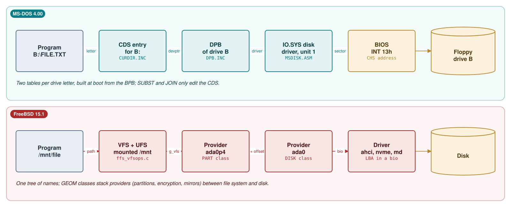
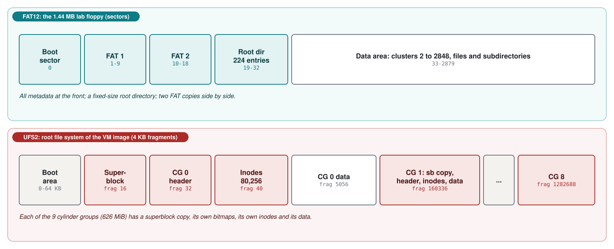
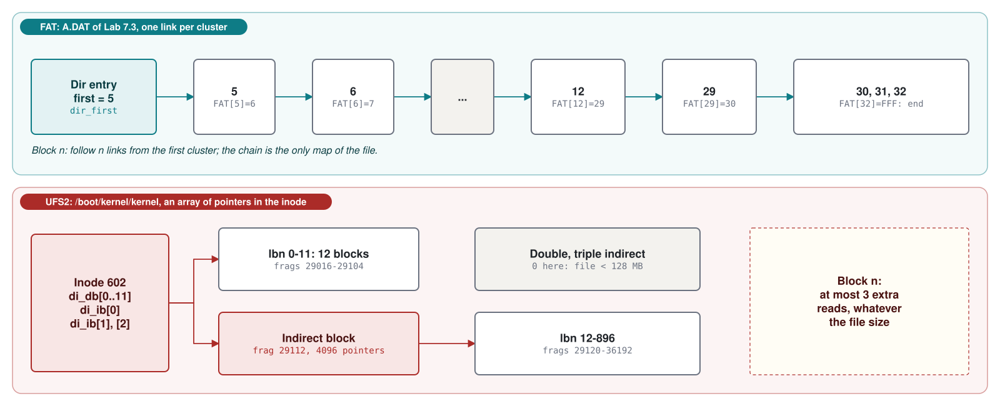
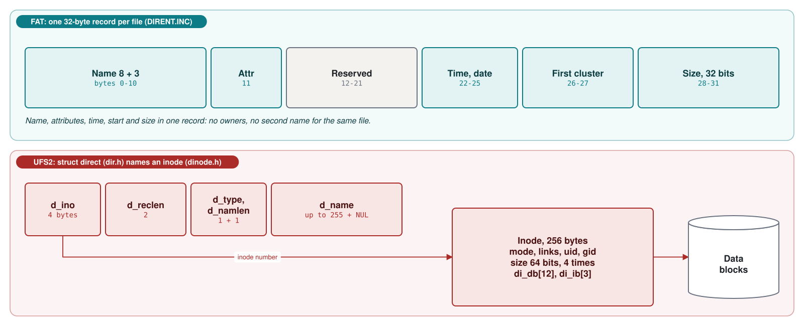
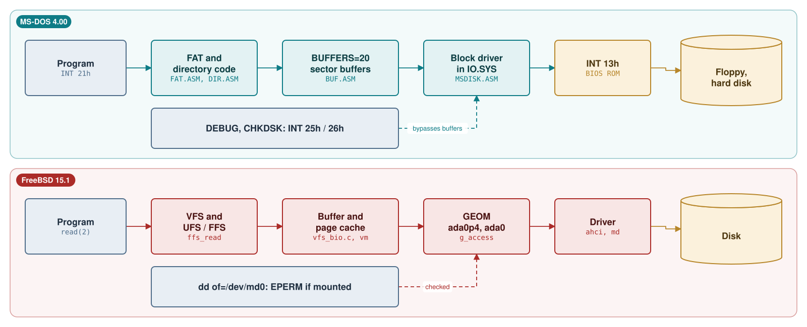
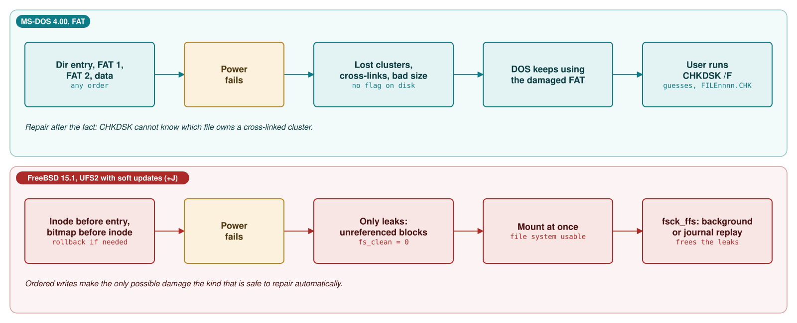

# Module 7: Disks and file systems: FAT against UFS2

A disk is an array of numbered sectors; a file system is the set of conventions that turns that array into
named files and directories. This module looks at two very different sets of conventions on two very
different systems. MS-DOS 4.00 uses the File Allocation Table (FAT) format that Microsoft designed for
floppy disks in the late 1970s and stretched, in 4.00, to hard disk partitions of up to 2 GB. FreeBSD 15.1
uses UFS2, the second version of the Berkeley Fast File System from 1984, as its native format when it is
not using ZFS. Module 2 (section 2.4 and Study case 2.B) showed how both kernels decode a FAT entry; here we
go further in both directions: down to raw sectors and partition tables, and up to the design decisions
that make UFS2 so different from FAT. As in the other modules, every claim is tied to a source line or to
something you can run. You will read sectors with `DEBUG`, explore and damage FAT images with a Python
tool, watch `CHKDSK` find (and sometimes trip over) the damage, and decode the superblock and inodes of the
real UFS2 file system inside the official FreeBSD 15.1 virtual machine image.

**Learning goals.** After this module you can:

- explain how each system names and addresses disks: drive letters, the Drive Parameter Block and the
  BIOS on MS-DOS; GEOM providers such as `ada0p2` and `md0` on FreeBSD;
- draw the on-disk layout of a FAT12 floppy and of a UFS2 file system, with real sector and fragment
  numbers, and say where each kind of metadata lives;
- decode a FAT directory entry (name, attributes, packed time and date, first cluster, size) and a UFS2
  inode (mode, owner, 64-bit times and sizes, direct and indirect block pointers) by hand and with tools;
- predict where MS-DOS 4.00 will put the clusters of a growing file, and explain why the same batch file
  fragments a file on one drive and not on another;
- damage a FAT on purpose, read `CHKDSK`'s diagnosis, and find each message and check in the `CHKDSK`
  source;
- compare FAT and UFS2 on allocation, metadata, names, permissions, links, sparse files, crash
  consistency and large-file performance, with numbers;
- explain the disk access paths of both systems (`INT 25h`/`26h`, `INT 13h` and `BUFFERS=`; raw devices,
  the buffer cache and GEOM) and why writing to the raw device of a mounted file system is dangerous;
- use the native tools: `FORMAT`, `SYS`, `LABEL`, `CHKDSK` and `DEBUG` on MS-DOS; `mdconfig`, `newfs`,
  `dumpfs`, `fsdb`, `fsck_ffs`, `tunefs`, `gpart` and `mount_msdosfs` on FreeBSD.

**Prerequisites.**

- Module 0 (the lab): `tools/dos_run.py`, the floppy image `build/images/dos400.img`, the FreeBSD 15.1
  virtual machine.
- Module 1 for the boot sector, its BIOS Parameter Block (BPB) and the master boot record (MBR).
- Module 2, section 2.4 and Study case 2.B, for FAT12 entry decoding, the FAT12/FAT16 threshold and the
  Drive Parameter Block.
- Python 3.10 or later on your computer. Basic C and enough assembly to read `MOV` and `CMP`.

The lab files for this module are in `labs/07-filesystems/`. Four of them are Python programs you run on
your own computer:

| File | What it does |
|---|---|
| `dosb.py` | `tools/dos_run.py` with a second floppy image in drive `B:`, so that experiments do not touch the boot disk |
| `fatx.py` | A FAT12/FAT16 explorer: BPB, directory listings, cluster chains, a cluster map, a small `CHKDSK`, and `setfat` to damage a FAT on purpose |
| `vhdpart.py` | Copies one GPT partition out of a VHD disk image (also straight from the `.vhd.xz` download) |
| `ufsx.py` | A read-only UFS2 explorer: superblock, cylinder groups, inodes, directories, block maps |

## 7.1 Disks as arrays of sectors

### Sectors, CHS and LBA

A disk drive reads and writes whole *sectors*, 512 bytes on every disk in this module. The original PC BIOS
addresses a sector by its *cylinder*, *head* and *sector* number (CHS): the cylinder selects the position of
the arm, the head selects one surface, and the sector, counted from 1, selects a sector on the track that
passes under that head. `INT 13h` function 02h (read) takes the cylinder in 10 bits of `CX`, the sector in
the low 6 bits of `CL` and the head in `DH` (Module 1, section 1.1), which limits a BIOS disk to 1024
cylinders, 256 heads and 63 sectors per track, about 8 GB. Software prefers to count sectors from 0 across
the whole disk: the *logical block address* (LBA). The two are related by the geometry:

    LBA = (cylinder * heads + head) * sectors_per_track + (sector - 1)

On the lab floppy (2 heads, 18 sectors per track) sector 33, where `IO.SYS` begins, is cylinder 0, head 1,
sector 16. MS-DOS works in logical sectors above the drivers: the DOS kernel computes a sector number and
the block device driver in `IO.SYS` converts it to CHS for `INT 13h`. FreeBSD works in LBA throughout and
leaves geometry to the disk itself; modern disks report a geometry only for compatibility.

### Partitions

A hard disk is usually divided into *partitions*. The MBR scheme of 1983 (Module 1, section 1.2) has four
16-byte entries at offset 1BEh of sector 0, each with a type byte, a CHS start and end, and a 32-bit LBA
start and length. MS-DOS 4.00 understands this scheme only. The GUID Partition Table (GPT), part of the UEFI
specification, keeps a header in LBA 1 and an array of 128-byte entries (128 of them by default), each with
a 16-byte type GUID, 64-bit first and last LBAs and a name; sector 0 holds a "protective" MBR with a single
entry of type EEh covering the disk. FreeBSD reads both (and others) through its partition class, `gpart`.

The official FreeBSD 15.1 virtual machine image is a GPT disk. `vhdpart.py` reads it straight from the
compressed download:

```console
$ python labs/07-filesystems/vhdpart.py build/freebsd/vm/FreeBSD-15.1-RELEASE-amd64-ufs.vhd.xz
```

**Output 7.1** -- The partition table of the official FreeBSD 15.1 VM image (real; read from the `.vhd.xz` file)

```text
build\freebsd\vm\FreeBSD-15.1-RELEASE-amd64-ufs.vhd.xz: dynamic VHD, 6477004800 bytes (12650400 sectors)
  p1  freebsd-boot  LBA        34 -       154       0.1 MiB  bootfs
  p2  efi           LBA       155 -     66738      32.5 MiB  efiboot0
  p3  freebsd-swap  LBA     66739 -   2163890    1024.0 MiB  swapfs
  p4  freebsd-ufs   LBA   2163891 -  12649650    5120.0 MiB  rootfs
```

Partition 1 holds `gptboot`, the GPT counterpart of the boot blocks of Module 1 (section 1.3); partition 2
is the EFI system partition, itself a FAT file system; partition 4 is the root file system, which we decode
in section 7.3. The protective MBR at offset 1BEh of sector 0 reads `00 00 02 00 EE FF FF FF 01 00 00 00
9F 07 C1 00`: type EEh, starting at LBA 1, 0x00C1079F sectors long, that is, the whole disk minus sector 0.

### How MS-DOS names disks: drive letters, the DPB and the CDS

A program running on MS-DOS never sees a disk, only a *drive letter*. At boot, `IO.SYS` finds the floppy
drives and the DOS partitions of the hard disks and gives each a *unit number* in its block device driver;
`SYSINIT` then asks the driver for each unit's BPB and the kernel builds one *Drive Parameter Block* (DPB)
per unit. The DPB is the kernel's digest of the BPB, with everything it needs to turn a cluster number
into a sector number without reading the boot sector again:

**Listing 7.1** -- The Drive Parameter Block, one per drive letter ([`DPB.INC` lines 7-27](https://github.com/microsoft/MS-DOS/blob/2d04cacc5322951f187bb17e017c12920ac8ebe2/v4.0/src/INC/DPB.INC#L7-L27))

```asm
dpb     STRUC
dpb_drive           DB      ?           ; Logical drive # assoc with DPB (A=0,B=1,...)
dpb_UNIT            DB      ?           ; Driver unit number of DPB
dpb_sector_size     DW      ?           ; Size of physical sector in bytes
dpb_cluster_mask    DB      ?           ; Sectors/cluster - 1
dpb_cluster_shift   DB      ?           ; Log2 of sectors/cluster
dpb_first_FAT       DW      ?           ; Starting record of FATs
dpb_FAT_count       DB      ?           ; Number of FATs for this drive
dpb_root_entries    DW      ?           ; Number of directory entries
dpb_first_sector    DW      ?           ; First sector of first cluster
dpb_max_cluster     DW      ?           ; Number of clusters on drive + 1
dpb_FAT_size        DW      ?           ;;Number of records occupied by FAT
dpb_dir_sector      DW      ?           ; Starting record of directory
dpb_driver_addr     DD      ?           ; Pointer to driver
dpb_media           DB      ?           ; Media byte
dpb_first_access    DB      ?           ; This is initialized to -1 to force a media
                                        ; check the first time this DPB is used
dpb_next_dpb        DD      ?           ; Pointer to next Drive parameter block
dpb_next_free       DW      ?           ; Cluster # of last allocated cluster
dpb_free_cnt        DW      ?           ; Count of free clusters, -1 if unknown
dpb     ENDS
```

`dpb_cluster_mask` and `dpb_cluster_shift` exist so that the kernel can divide by the cluster size with a
shift instead of a `DIV`; `dpb_driver_addr` links the drive to its device driver (Module 2, section 2.7);
`dpb_next_free` and `dpb_free_cnt` drive the allocation policy of section 7.2. A second table, the
*Current Directory Structure* (CDS), has one 88-byte entry per drive letter with the text of the current
directory, flags and a pointer to the DPB:

**Listing 7.2** -- The Current Directory Structure: drive letter to DPB ([`CURDIR.INC` lines 17-31](https://github.com/microsoft/MS-DOS/blob/2d04cacc5322951f187bb17e017c12920ac8ebe2/v4.0/src/INC/CURDIR.INC#L17-L31))

```asm

curdir_list     STRUC
curdir_text     DB      DIRSTRLEN DUP (?)   ; text of assignment and curdir
curdir_flags    DW      ?               ; various flags
curdir_devptr   DD      ?               ; local pointer to DPB or net device
curdir_ID       DW      ?               ; cluster of current dir (net ID)
                DW      ?
curdir_user_word DW     ?
curdir_end      DW      ?               ; end of assignment
curdir_type     DB      ?               ; IFS drive (2=ifs, 4=netuse)
curdir_ifs_hdr  DD      ?               ; Ptr to File System Header
curdir_fsda     DB      2 DUP (?)       ; File System Dependent Data Area
curdir_list     ENDS

curdirLen       EQU     Size curdir_list        ; Needed for screwed up
```

Drive letters therefore have two levels: letter to CDS to DPB to driver unit. `SUBST`, `JOIN` and network
redirectors work by editing CDS entries (`curdir_splice`, `curdir_isnet`), not the disk.

### How FreeBSD names disks: GEOM providers

FreeBSD has no drive letters; disks appear as device files in `/dev`, named by driver and unit (`ada0` for
the first SATA disk, `nvd0` for NVMe, `da0` for SCSI and USB disks, `md0` for a memory disk). Between the
drivers and the file systems sits *GEOM*, a framework of stackable transformations. A disk driver offers a
*provider* (a named range of sectors with a size and a sector size); a partition class such as `PART`
*consumes* it and offers one provider per partition (`ada0p1`, `ada0p2`...); other classes add encryption
(`ELI`), mirroring (`MIRROR`) or compression (`UZIP`) on top. File systems are consumers of a provider.

**Listing 7.3** -- A GEOM provider: what a file system sees of a disk ([`geom.h` lines 205-214](https://github.com/freebsd/freebsd-src/blob/96841ea08dcfa84b954a32dc5ae1a26c28966cf4/sys/geom/geom.h#L205-L214))

```c
struct g_provider {
        char                    *name;
        LIST_ENTRY(g_provider)  provider;
        struct g_geom           *geom;
        LIST_HEAD(,g_consumer)  consumers;
        int                     acr, acw, ace;
        int                     error;
        TAILQ_ENTRY(g_provider) orphan;
        off_t                   mediasize;
        u_int                   sectorsize;
```

The partition and disk tools are thin front ends to this framework: `gpart show` prints the PART geoms,
`diskinfo -v ada0` the provider's media size and sector size (diskinfo(8)), which it gets with two
`ioctl` calls ([`diskinfo.c` lines 197-208](https://github.com/freebsd/freebsd-src/blob/96841ea08dcfa84b954a32dc5ae1a26c28966cf4/usr.sbin/diskinfo/diskinfo.c#L197-L208)) that GEOM answers from the `struct g_provider` of
Listing 7.3 ([`geom_dev.c` lines 550-557](https://github.com/freebsd/freebsd-src/blob/96841ea08dcfa84b954a32dc5ae1a26c28966cf4/sys/geom/geom_dev.c#L550-L557)), and `geom disk list` the disk class. The memory disk driver md(4) makes a provider out of RAM (`mdconfig -a -t malloc`) or out of a
file (`mdconfig -a -t vnode -f file`), which is how the labs make scratch disks without touching the
virtual machine's real disk.

In the course VM the disk is not `ada0` but `da0`: Hyper-V's storage driver presents "a SCSI HBA interface
to the Common Access Method (CAM) layer" (hv_storvsc(4)), so the disk gets the name of CAM's SCSI disk
driver, da(4). `gpart show` in Module 0 (Output 0.2) shows the four partitions of Output 7.1 on a 20 GB disk,
with `p4` grown to 19 GB at the first boot, and 2.0 MB left free at the end. `diskinfo` explains the 2 MB:

**Output 7.2** -- `diskinfo -v da0` (captured in the course VM)

```text
da0
        512             # sectorsize
        21474836480     # mediasize in bytes (20G)
        41943040        # mediasize in sectors
        2097152         # stripesize
        0               # stripeoffset
        2610            # Cylinders according to firmware.
        255             # Heads according to firmware.
        63              # Sectors according to firmware.
        Msft Virtual Disk       # Disk descr.
                        # Disk ident.
        blkvsc0         # Attachment
        Yes             # TRIM/UNMAP support
        Unknown         # Rotation rate in RPM
        Not_Zoned       # Zone Mode
```

The virtual disk reports a 2 MiB stripe size. The first-boot script `growfs` runs `gpart resize -i 4 da0`
without an alignment and then `growfs` itself ([`growfs` line 266](https://github.com/freebsd/freebsd-src/blob/96841ea08dcfa84b954a32dc5ae1a26c28966cf4/libexec/rc/rc.d/growfs#L266) and [line 286](https://github.com/freebsd/freebsd-src/blob/96841ea08dcfa84b954a32dc5ae1a26c28966cf4/libexec/rc/rc.d/growfs#L286)), and
`gpart` aligns the end of the partition down to the stripe size when no alignment is given
([`geom_part.c` lines 354-358](https://github.com/freebsd/freebsd-src/blob/96841ea08dcfa84b954a32dc5ae1a26c28966cf4/lib/geom/part/geom_part.c#L354-L358) and [lines 406-408](https://github.com/freebsd/freebsd-src/blob/96841ea08dcfa84b954a32dc5ae1a26c28966cf4/lib/geom/part/geom_part.c#L406-L408)): `p4` ends at sector 41,938,943, just
before the 2 MiB boundary 41,938,944, and the 4,056 sectors after it, up to the backup GPT, stay free. The
"firmware" geometry of 2610 cylinders, 255 heads and 63 sectors is the compatibility geometry of the first
paragraph of this section; FreeBSD addresses the disk by LBA.



| | MS-DOS 4.00 | FreeBSD 15.1 |
|---|---|---|
| Name a program uses | Drive letter `A:` ... `Z:` | Path in one tree; the disk is `/dev/ada0p4` |
| Per-volume kernel state | DPB (built from the BPB) | `struct fs` (superblock) and `struct ufsmount` |
| Partition schemes | MBR only | MBR, GPT and others, as GEOM `PART` classes |
| Addressing below the file system | Logical sector, converted to CHS by `IO.SYS` | LBA (byte offset) in a `struct bio` |
| Raw access for programs | `INT 25h`/`26h` by drive letter | Open `/dev/ada0p4` like a file |

## 7.2 FAT12 and FAT16 in MS-DOS 4.00

### The layout of a FAT volume

A FAT volume has four regions, all computed from the BPB in its first sector: reserved sectors (at least the
boot sector), the FAT copies, the root directory and the data area. On the lab floppy, `fatx.py info`
shows the numbers:

```console
$ python labs/07-filesystems/fatx.py build/images/dos400.img info
```

**Output 7.3** -- The layout of the lab floppy as `fatx.py` computes it from the BPB (real)

```text
OEM name            'MSDOS4.0'
bytes per sector    512
sectors per cluster 1  (512 bytes per cluster)
reserved sectors    1
FAT copies          2 x 9 sectors
root entries        224  (14 sectors)
total sectors       2880
media byte          F0h
sectors per track   18, heads 2, hidden sectors 0
serial number       1988-0400
volume label        'DOS400LAB  '
file system id      'FAT12   '  (informational only: not used to pick FAT12/16)
layout (sectors)    boot 0..0, FATs 1..18, root 19..32, data 33..2879
clusters            2847 (numbered 2..2848), max_cluster = 2848
FAT type            FAT12  (max_cluster < 4086)
free clusters       541  (276992 bytes)
```

The same arithmetic, in assembly, is `$SETDPB`, which fills the DPB from the BPB
([`MISC.ASM` lines 300-347](https://github.com/microsoft/MS-DOS/blob/2d04cacc5322951f187bb17e017c12920ac8ebe2/v4.0/src/DOS/MISC.ASM#L300-L347)): directory sectors are rounded up, the FATs follow the reserved
sectors, the root directory follows the FATs, and `dpb_max_cluster` is the number of data clusters plus 1.
The free space agrees with `CHKDSK` in Module 0 (Output 0.1: "276992 bytes available on disk").



Two things in this layout matter for everything that follows. First, all metadata is concentrated at the
front of the disk: one bad sector in sectors 1-32 damages the FAT or the root directory of every file. The
second FAT copy is the only redundancy, and it sits next to the first. Second, the root directory has a
fixed size, set when the disk is formatted: 224 entries on a 1.44 MB floppy, typically 512 on a hard disk
(the fourth column of `FORMAT`'s `DiskTable`, [`FORMAT.ASM` lines 445-449](https://github.com/microsoft/MS-DOS/blob/2d04cacc5322951f187bb17e017c12920ac8ebe2/v4.0/src/CMD/FORMAT/FORMAT.ASM#L445-L449), and of Listing 7.9). A full
root directory cannot grow even when the disk is empty.

### The extended BPB of MS-DOS 4.00

DOS 4.00 extended the boot sector: after the BPB of earlier versions come a 32-bit total sector count, the
physical drive number, a signature byte 29h, a 32-bit volume serial number, an 11-byte volume label and an
8-byte file system name:

**Listing 7.4** -- The extended BPB of MS-DOS 4.00 ([`BOOTFORM.INC` lines 10-36](https://github.com/microsoft/MS-DOS/blob/2d04cacc5322951f187bb17e017c12920ac8ebe2/v4.0/src/INC/BOOTFORM.INC#L10-L36))

```asm
EXT_BPB_INFO            STRUC
EBPB_BYTESPERSECTOR      DW      ?
EBPB_SECTORSPERCLUSTER   DB      ?
EBPB_RESERVEDSECTORS     DW      ?
EBPB_NUMBEROFFATS        DB      ?
EBPB_ROOTENTRIES         DW      ?
EBPB_TOTALSECTORS        DW      ?
EBPB_MEDIADESCRIPTOR     DB      ?
EBPB_SECTORSPERFAT       DW      ?
EBPB_SECTORSPERTRACK     DW      ?
EBPB_HEADS               DW      ?
EBPB_HIDDENSECTOR        DD      ?
EBPB_BIGTOTALSECTORS     DD      ?
EXT_BPB_INFO            ENDS
;
;AN001; EXT_PHYDRV, EXT_CURHD included in the header for OS2.
EXT_IBMBOOT_HEADER      STRUC
EXT_BOOT_JUMP           DB      3 DUP (?)
EXT_BOOT_OEM            DB      8 DUP (?)
EXT_BOOT_BPB            DB      type EXT_BPB_INFO dup (?)
EXT_PHYDRV              DB      80h
EXT_CURHD               DB      0
EXT_BOOT_SIG            DB      EXT_BOOT_SIGNATURE
EXT_BOOT_SERIAL         DD      ?
EXT_BOOT_VOL_LABEL      DB      11 DUP (?)
EXT_SYSTEM_ID           DB      8  DUP (?)
EXT_IBMBOOT_HEADER      ENDS
```

`EBPB_BIGTOTALSECTORS` is what makes volumes of 32 MB and more possible. The 16-bit `EBPB_TOTALSECTORS`
can count at most 65,535 sectors of 512 bytes, just under 32 MB, the limit of the standard versions of DOS before 4.00 (some OEM versions, such as
Compaq's 3.31, had their own extensions). When a volume is larger, `FORMAT` stores 0 in the 16-bit
field and the real count in the 32-bit one, and `$SETDPB` follows the same rule
([`MISC.ASM` lines 322-339](https://github.com/microsoft/MS-DOS/blob/2d04cacc5322951f187bb17e017c12920ac8ebe2/v4.0/src/DOS/MISC.ASM#L322-L339)): a 16-bit total of 0 means "read `BPB_BigTotalSectors`". The
`FAT12   ` string at the end is informational; neither MS-DOS nor FreeBSD uses it to decide the FAT type
(Module 2, section 2.4).

### Clusters, the FAT and chains

The data area is divided into *clusters* of 2^n sectors, numbered from 2. The FAT has one entry per
cluster: 0 means free, FF7h (FAT12) or FFF7h (FAT16) marks a bad cluster, FF8h-FFFh or FFF8h-FFFFh mark
the end of a chain, and any other value is the number of the next cluster of the same file. A directory
entry holds the first cluster; the FAT holds the rest of the chain. A file is a linked list whose links are
kept in a separate table. Module 2, Study case 2.B, walks through the 12-bit packing in `MAPCLUSTER` and
`UNPACK`; `fatx.py` reimplements it in five lines (`Volume.fat_entry`).

`fatx.py chain` follows a chain and groups it into *runs* of consecutive clusters:

```console
$ python labs/07-filesystems/fatx.py build/tmp/lab72.img chain LAB7\NOTES.TXT
LAB7\NOTES.TXT: first cluster 2311, size 1024, 2 clusters (size needs 2)
chain: 2311 -> 2312 -> FFFh
runs:  2311-2312  (1 fragment)
sectors of the first run: 2342...2343
```

### Directory entries

A directory is a table of 32-byte entries. The root directory is a fixed array in the root region; a
subdirectory is a file with a cluster chain of its own and the directory attribute, whose contents happen to
be 32-byte entries. The format is documented at the top of `DIRENT.INC`:

**Listing 7.5** -- The 32-byte directory entry, with its time and date packing ([`DIRENT.INC` lines 5-40](https://github.com/microsoft/MS-DOS/blob/2d04cacc5322951f187bb17e017c12920ac8ebe2/v4.0/src/INC/DIRENT.INC#L5-L40))

```asm
;
;       +---------------------------+
;       |  (12 BYTE) filename/ext   |       0       0
;       +---------------------------+
;       |     (BYTE) attributes     |       11      B
;       +---------------------------+
;       |    (10 BYTE) reserved     |       12      C
;       +---------------------------+
;       | (WORD) time of last write |       22      16
;       +---------------------------+
;       | (WORD) date of last write |       24      18
;       +---------------------------+
;       |   (WORD) First cluster    |       26      1A
;       +---------------------------+
;       |     (DWORD) file size     |       28      1C
;       +---------------------------+
;
;   First byte of filename  = E5 -> free directory entry
;                           = 00 -> end of allocated directory
;   Time:   Bits 0-4=seconds/2, bits 5-10=minute, 11-15=hour
;   Date:   Bits 0-4=day, bits 5-8=month, bits 9-15=year-1980
;

dir_entry   STRUC
dir_name    DB      11 DUP (?)          ; file name
dir_attr    DB      ?                   ; attribute bits
dir_codepg  dw      ?                   ; code page DOS 4.00
dir_extcluster dw   ?                   ; extended attribute starting cluster
dir_attr2   db      ?                   ; reserved
dir_pad     DB      5  DUP (?)          ; reserved for expansion
dir_time    DW      ?                   ; time of last write
dir_date    DW      ?                   ; date of last write
dir_first   DW      ?                   ; first allocation unit of file
dir_size_l  DW      ?                   ; low 16 bits of file size
dir_size_h  DW      ?                   ; high 16 bits of file size
dir_entry   ENDS
```

The bytes marked reserved in earlier versions gained DOS 4.00 fields (`dir_codepg`, `dir_extcluster` for
extended attributes) that FAT32 and VFAT later redefined for other purposes (Module 2, section 2.4). The
name is stored as 8 + 3 characters padded with spaces, without the dot, in upper case. The first byte has
two special values: E5h marks a deleted entry and 00h marks the end of the used part of the directory
(a name that really starts with E5h, possible in some code pages, is stored as 05h; see `SEARCH`,
[`DIR.ASM` lines 124-128](https://github.com/microsoft/MS-DOS/blob/2d04cacc5322951f187bb17e017c12920ac8ebe2/v4.0/src/DOS/DIR.ASM#L124-L128)). Time and date are packed into 16 bits each: hours, minutes and
seconds divided by 2; year minus 1980, month and day. The year field has 7 bits, so the format runs out
at the end of 2107.

`fatx.py entry` decodes one entry field by field. Here is the directory `LAB7` made with `MD LAB7` on the
lab system (Lab 7.2 makes it):

**Output 7.4** -- A subdirectory's own entry in the root directory (real)

```text
offset 0x2e40 (sector 23)
  4C 41 42 37 20 20 20 20 20 20 20 10 00 00 00 00
  00 00 00 00 00 00 16 49 69 5D 06 09 00 00 00 00
  00 dir_name      b'LAB7       '
  0B dir_attr      10h = ----D-
  0C reserved      00 00 00 00 00 00 00 00 00 00
  16 dir_time      4916h = 09:08:44
  18 dir_date      5D69h = 2026-11-09
  1A dir_first     2310
  1C dir_size      0
```

The time 4916h is 01001 001000 10110: 9 hours, 8 minutes, 22 x 2 = 44 seconds. The date 5D69h is
0101110 1011 01001: 1980 + 46 = 2026, month 11, day 9 (the emulator's clock). A directory's size field is
always 0; its length is the length of its chain. Inside it, `MD` wrote two entries, `.` pointing to the
directory itself (cluster 2310) and `..` pointing to the parent, with cluster 0 standing for the root
directory, which has no cluster number:

```text
name         attr   date       time     first     size  slot@offset
.            ----D- 2026-11-09 09:08:44  2310    <DIR>  0x124a00
..           ----D- 2026-11-09 09:08:44     0    <DIR>  0x124a20
NOTES.TXT    -----A 2024-04-25 12:00:00  2311     1024  0x124a40
```

Names are looked up by comparing all 11 bytes of each entry in turn (`SEARCH` and `MetaCompare`,
[`DIR.ASM` lines 86-140](https://github.com/microsoft/MS-DOS/blob/2d04cacc5322951f187bb17e017c12920ac8ebe2/v4.0/src/DOS/DIR.ASM#L86-L140)); Study case 7.C compares this linear scan with UFS2.

### Free space and the next-fit allocator

When a file grows, the kernel's `ALLOCATE` finds free clusters and links them to the end of the chain. It
does not start at cluster 2 every time:

**Listing 7.6** -- ALLOCATE: scan for free clusters from dpb_next_free ([`ROM.ASM` lines 568-699](https://github.com/microsoft/MS-DOS/blob/2d04cacc5322951f187bb17e017c12920ac8ebe2/v4.0/src/DOS/ROM.ASM#L568-L699))

```asm
;***    ALLOCATE - Allocate Disk Space
;
;   ALLOCATE is called to allocate disk clusters.  The new clusters are
;   FAT-chained onto the end of the existing file.
;
;   The DPB contains the cluster # of the last free cluster allocated
;   (dpb_next_free).  We start at this cluster and scan towards higher
;   numbered clusters, looking for the necessary free blocks.
;
;   Once again, fancy terminology gets in the way of corrct coding.  When
;   using next_free, start scanning AT THAT POINT and not the one following it.
;   This fixes the boundary condition bug when only free = next_free = 2.
;
;       If we get to the end of the disk without satisfaction:
;
;           if (dpb_next_free == 2) then we've scanned the whole disk.
;               return (insufficient_disk_space)
;           ELSE
;               dpb_next_free = 2; start scan over from the beginning.
⋮
        mov     bx,es:[bp.dpb_next_free]
        cmp     bx,2
        ja      findfre

;   couldn't find enough free space beyond dpb_next_free, or dpb_next_free is
;   <2 or >dpb_max_clus.  Reset it and restart the scan

ads1:
        Assert      ISDPB,<ES,BP>,"Alloc/ads1"
        mov     es:[bp.dpb_next_free],2
        mov     bx,1                    ; Counter next instruction so first
                                        ;       cluster examined is 2

;   Scanning both forwards and backwards for a free cluster
;
;       (BX) = forwards scan pointer
;       (CX) = clusters remaining to be allocated
;       (DX) = current last cluster in file
;       (TOS) = last cluster of file

FINDFRE:
        INC     BX
        Assert      ISDPB,<ES,BP>,"Alloc/findfre"
        CMP     BX,ES:[BP.dpb_max_cluster]
        JBE     aupk
        jmp     ads7            ; at end of disk
aupk:
        invoke  UNPACK          ; check out this cluster
        jc      ads4            ; FAT error             [INTERR?]
        jnz     findfre         ; not free, keep on truckin

;   Have found a free cluster.  Chain it to the file
;
;       (BX) = found free cluster #
;       (DX) = current last cluster in file

        mov     es:[bp.dpb_next_free],bx        ; next time start search here
```

This is a *next-fit* policy: the search continues from the last cluster allocated, so consecutive
allocations on a disk tend to be consecutive clusters, and holes left by deleted files are reused only after
the cursor wraps around. Apart from that wrap-around (`ads1` in Listing 7.6 sets the cursor to 2), the
cursor is reset only when the DPB is rebuilt: `$SETDPB` sets `dpb_next_free` to
0 ("Init so first ALLOC starts at begining of FAT", [`MISC.ASM` lines 348-350](https://github.com/microsoft/MS-DOS/blob/2d04cacc5322951f187bb17e017c12920ac8ebe2/v4.0/src/DOS/MISC.ASM#L348-L350)). `$SETDPB` runs
when the drive is first used and whenever the kernel decides that the disk may have been changed: when
the driver's media check answers "changed", or "don't know" while no buffer for the drive is dirty
(`NEWDSK` and the call at [`FAT.ASM` lines 678-679](https://github.com/microsoft/MS-DOS/blob/2d04cacc5322951f187bb17e017c12920ac8ebe2/v4.0/src/DOS/FAT.ASM#L678-L679)). For floppies without a change line, the
driver answers "don't know" whenever more than 2 seconds have passed since the last access, or when the
last access was to another drive:

**Listing 7.7** -- The logical door latch: "it is physically impossible to change a disk in under 2 seconds" ([`MSDISK.ASM` lines 118-131](https://github.com/microsoft/MS-DOS/blob/2d04cacc5322951f187bb17e017c12920ac8ebe2/v4.0/src/BIOS/MSDISK.ASM#L118-L131))

```asm
; SOME FLOPPIES DO NOT HAVE CHANGELINE.  AS A RESULT, MEDIA-CHECK WOULD
; NORMALLY RETURN I-DON'T-KNOW, THE DOS WOULD CONTINUALLY REREAD THE FAT, AND
; DISCARD CACHED DATA.  WE OPTIMIZE THIS BY IMPLEMENTING A LOGICAL DOOR-
; LATCH:  IT IS PHYSICALLY IMPOSSIBLE TO CHANGE A DISK IN UNDER 2 SECONDS.  WE
; RETAIN THE TIME OF THE LAST SUCCESSFUL DISK OPERATION AND COMPARE IT WITH
; THE CURRENT TIME DURING MEDIA-CHECK.  IF < 2 SECONDS AND AT LEAST 1 TIMER
; TICK HAS PASSED, THE WE SAY NO CHANGE.  IF > 2 SECONDS THEN WE SAY I-
; DON'T-KNOW.  FINALLY, SINCE WE CANNOT TRUST THE TIMER TO BE ALWAYS
; AVAILABLE, WE RECORD THE NUMBER OF MEDIA CHECKS THAT HAVE OCCURRED WHEN NO
; APPARENT TIME HAS ELAPSED.  WHILE THIS NUMBER IS < A GIVEN THRESHOLD, WE SAY
; NO CHANGE.  WHEN IT EXCEEDS THAT THRESHOLD, WE SAY I-DON'T-KNOW AND RESET
; THE COUNTER TO 0.  WHEN WE STORE THE TIME OF LAST SUCCESSFUL ACCESS, IF WE
; SEE THAT TIME HAS PASSED TOO, WE RESET THE COUNTER.
;
```

So the layout of a file on a floppy depends on what else the system was doing at the time. Lab 7.3 shows
the effect: the same batch file fragments a file when it runs from drive `B:` and does not when it runs
from drive `A:`.

The DPB also caches the free cluster count in `dpb_free_cnt` (-1 when unknown). `ALLOCATE` and `RELEASE`
keep it up to date; anything that might have changed the FAT behind the kernel's back sets it to -1, which
forces a full count at the next `DIR` or `CHKDSK`. One of those places is `AbsSetup`, the common entry of
the absolute disk calls `INT 25h` and `INT 26h` (section 7.5): "do not trust user at all" ([`MS_CODE.ASM` lines 94-96](https://github.com/microsoft/MS-DOS/blob/2d04cacc5322951f187bb17e017c12920ac8ebe2/v4.0/src/DOS/MS_CODE.ASM#L94-L96)).

### The "big FAT" of MS-DOS 4.00

FAT16 entries existed since DOS 3.0, but a volume was still limited to 65,535 sectors by the 16-bit sector
count in the BPB and the 16-bit sector numbers inside the kernel. DOS 4.00 made sector numbers 32 bits
wide: every path from a cluster number to a sector now carries a high word, `HIGH_SECTOR`, through
`FIGREC` ([`ROM.ASM` lines 539-564](https://github.com/microsoft/MS-DOS/blob/2d04cacc5322951f187bb17e017c12920ac8ebe2/v4.0/src/DOS/ROM.ASM#L539-L564), the lines marked `F.C. >32mb`), the buffer code and the
driver interface. The new partition type 06h ("big DOS") marks such partitions in the MBR (`FORMAT` sets
it, [`MSFOR.ASM` lines 1559-1569](https://github.com/microsoft/MS-DOS/blob/2d04cacc5322951f187bb17e017c12920ac8ebe2/v4.0/src/CMD/FORMAT/MSFOR.ASM#L1559-L1569)). One interface could not grow silently: the absolute
disk calls `INT 25h` and `INT 26h` take the starting sector in the 16-bit register `DX`. DOS 4.00 keeps the
old calling convention for small volumes and adds a new one, with `CX = -1` and `DS:BX` pointing to a
packet holding a 32-bit sector number. An old program that uses the old convention on a big volume gets an
error rather than the wrong sector:

**Listing 7.8** -- RW32_CONVERT: the old INT 25h/26h convention is refused on volumes over 32 MB ([`MS_CODE.ASM` lines 550-580](https://github.com/microsoft/MS-DOS/blob/2d04cacc5322951f187bb17e017c12920ac8ebe2/v4.0/src/DOS/MS_CODE.ASM#L550-L580))

```asm
Procedure   RW32_CONVERT,NEAR
        ASSUME  CS:DOSGROUP,DS:NOTHING,ES:NOTHING,SS:NOTHING
        CMP     CX,-1                        ;>32mb  new format ?               ;AN000;
        JZ      new32format                  ;>32mb  yes                        ;AN000;
        PUSH    AX                           ;>32mb  save ax                    ;AN000;
        PUSH    DX                           ;>32mb  save dx                    ;AN000;
        MOV     AX,ES:[BP.dpb_max_cluster]   ;>32mb  get max cluster #          ;AN000;
        MOV     DL,ES:[BP.dpb_cluster_mask]  ;>32mb                             ;AN000;
        CMP     DL,0FEH                      ;>32mb  removable ?                ;AN000;
        JZ      letold                       ;>32mb  yes                        ;AN000;
        INC     DL                           ;>32mb                             ;AN000;
        XOR     DH,DH                        ;>32mb  dx = sector/cluster        ;AN000;
        MUL     DX                           ;>32mb  dx:ax= max sector #        ;AN000;
        OR      DX,DX                        ;>32mb  > 32mb ?                   ;AN000;
letold:
        POP     DX                           ;>32mb  retore dx                  ;AN000;
        POP     AX                           ;>32mb  restore ax                 ;AN000;
        JZ      old_style                    ;>32mb  no                         ;AN000;
        MOV     [IFS_DRIVER_ERR],0207H       ;>32mb  error                      ;AN000;
        STC                                  ;>32mb                             ;AN000;
        return                               ;>32mb                             ;AN000;
new32format:
        MOV     DX,WORD PTR [BX.SECTOR_RBA+2];>32mb                             ;AN000;
        MOV     [HIGH_SECTOR],DX             ;>32mb                             ;AN000;
        MOV     DX,WORD PTR [BX.SECTOR_RBA]  ;>32mb                             ;AN000;
        MOV     CX,[BX.ABS_RW_COUNT]         ;>32mb                             ;AN000;
        LDS     BX,[BX.BUFFER_ADDR]          ;>32mb                             ;AN000;
old_style:                                   ;>32mb                             ;AN000;
        CLC                                  ;>32mb                             ;AN000;
        return                               ;>32mb                             ;AN000;
EndProc RW32_CONVERT
```

How large can a 4.00 volume be? The format allows cluster numbers 2 to FFF6h, 65,525 clusters. When a hard
disk partition has no valid boot sector, `IO.SYS` picks a cluster size from a table that ends at 128
sectors per cluster:

**Listing 7.9** -- The default cluster sizes for big partitions in IO.SYS ([`MSINIT.ASM` lines 280-288](https://github.com/microsoft/MS-DOS/blob/2d04cacc5322951f187bb17e017c12920ac8ebe2/v4.0/src/BIOS/MSINIT.ASM#L280-L288))

```asm
;AN004 Default DiskTable under the assumption of Total FAT size <= 128 KB, and
;       the maxium size of FAT entry = 16 Bit.
DiskTable2  dw   0, 32680, 0803h, 512, 0        ;For compatibility.
            dw  4h, 0000h, 0402h, 512, FBIG     ;Covers upto 134 MB media.
            dw  8h, 0000h, 0803h, 512, FBIG     ;       upto 268 MB
            dw 10h, 0000h, 1004h, 512, FBIG     ;       upto 536 MB
            dw 20h, 0000h, 2005h, 512, FBIG     ;       upto 1072 MB
            dw 40h, 0000h, 4006h, 512, FBIG     ;       upto 2144 MB
            dw 80h, 0000h, 8007h, 512, FBIG     ;       upto 4288 MB...
```

Each row gives a limit in sectors as two words (high, low), then sectors per cluster and its log2 packed in
one word (`0402h` = 4 sectors, shift 2), the root directory size and the `FBIG` flag. With 64 sectors (32
KB) per cluster, 65,525 clusters make 2,147,123,200 bytes, the familiar 2 GB limit of FAT16. The last row
would allow 64 KB clusters and 4 GB, but a 64 KB cluster does not fit in the 16-bit byte counts that DOS
utilities use: `CHKDSK` computes bytes per cluster with a 16-bit `MUL` and says so in a comment,
"AX=Bytes/cluster (< 64k)" ([`CHKPROC.ASM` lines 1555-1559](https://github.com/microsoft/MS-DOS/blob/2d04cacc5322951f187bb17e017c12920ac8ebe2/v4.0/src/CMD/CHKDSK/CHKPROC.ASM#L1555-L1559)). Exercise 7.2 asks you to
derive all the limits.

### CHKDSK: checking after the fact

FAT has no log and no ordering rules for its writes. A file is created by writing a directory entry, FAT
sectors (in two copies) and data, in whatever order the buffers are flushed; a crash in between leaves the
volume inconsistent, and nothing on the disk says so. Consistency is restored afterwards, by a program that
compares the FAT with the directory tree. `CHKDSK` builds a map with one byte per cluster
(`fatmap`), walks every directory, and marks each cluster of each chain:

**Listing 7.10** -- MARKMAP: a cluster seen twice is a cross-link ([`CHKFAT.ASM` lines 500-519](https://github.com/microsoft/MS-DOS/blob/2d04cacc5322951f187bb17e017c12920ac8ebe2/v4.0/src/CMD/CHKDSK/CHKFAT.ASM#L500-L519))

```asm
markmap: savereg <si,es>                         ;Save registers                 ;AN000;
        xor     si,si                           ;Get addr of map                ;an005;bgb
        mov     es,[FATMAP]                     ;Get addr of map                ;an005;bgb
        mov     ah,es:[di]                         ;Get entry at that spot      ;an005;bgb
        or      ah,ah                           ;Is it zero?                    ;     ;
;       $IF     NZ ;already found - mark crossed;If not, we got crosslink       ;AC000;
        JZ $$IF19
           add     word ptr crosscnt,1          ;Count the crosslink            ;     ;
           adc     word ptr crosscnt+2,0        ;Count the crosslink            ;     ;
           or      byte ptr es:[di],10H         ;Resets zero in map             ;An005;bgb
           stc                                  ;Indicate crosslink on ret      ;     ;
;       $ELSE     ;not found - mark found       ;No crosslink                   ;     ;
        JMP SHORT $$EN19
$$IF19:
           mov  es:[di],al                      ;Set mark in map                ;Ac005;bgb
           clc                                  ;Indicate things okay           ;     ;
;       $ENDIF                                  ;                               ;AN000;
$$EN19:
        restorereg <es,si>                      ;                               ;AN005;bgb
        ret                                     ;                               ;     ;
```

A cluster reached from two chains is *cross-linked*. After the walk, `CHKMAP` compares the map with the FAT:
a cluster that is allocated in the FAT (non-zero, not bad) but was reached from no directory entry is
*lost* (an "orphan", [`CHKFAT.ASM` lines 551-589](https://github.com/microsoft/MS-DOS/blob/2d04cacc5322951f187bb17e017c12920ac8ebe2/v4.0/src/CMD/CHKDSK/CHKFAT.ASM#L551-L589)). Lost chains can be freed or turned
into files named `FILEnnnn.CHK` in the root directory; cross-linked files are reported in a second pass but
not repaired, because `CHKDSK` cannot know which file owns the cluster. A chain that is longer or shorter
than the size in the directory entry is reported as "Allocation error, size adjusted" and the size is
corrected, except for cross-linked files, which are skipped
([`CHKPROC.ASM` lines 1543-1554](https://github.com/microsoft/MS-DOS/blob/2d04cacc5322951f187bb17e017c12920ac8ebe2/v4.0/src/CMD/CHKDSK/CHKPROC.ASM#L1543-L1554)). `CHKDSK` writes nothing unless it is given `/F`.

The messages are not in the `CHKDSK` source itself: the skeleton file `CHKDSK.SKL` lists message numbers,
and the text comes from the country message file at build time (Module 0, section 0.3). In our build,
message 42 reads "   Is cross linked on allocation unit %1" and message 58 "   %1 lost allocation units
found in %2 chains." ([`USA-MS.MSG` line 294](https://github.com/microsoft/MS-DOS/blob/2d04cacc5322951f187bb17e017c12920ac8ebe2/v4.0/src/MESSAGES/USA-MS.MSG#L294), [`USA-MS.MSG` line 308](https://github.com/microsoft/MS-DOS/blob/2d04cacc5322951f187bb17e017c12920ac8ebe2/v4.0/src/MESSAGES/USA-MS.MSG#L308)).
Lab 7.4 produces both, and finds two bugs on the way.

## 7.3 UFS2 in FreeBSD 15.1

### From FFS to UFS2

The Berkeley Fast File System (FFS) of 4.2BSD (1983; the paper describing it appeared in 1984) replaced the original Unix file system, which kept all
inodes at the front of the disk and handed out blocks from a free list, so that a file's blocks ended up
scattered and every file access needed a long seek to its inode. FFS divided the disk into *cylinder
groups*, each with its own inodes, free-block bitmap and data, and placed related things (a directory and
its files, a file's inode and its blocks) in the same group. UFS2, added in FreeBSD 5 (2003), keeps the
design but widens the on-disk inode to 256 bytes with 64-bit block pointers, sizes and times, a creation
time, and room for extended attributes. "UFS" is the name of the layer that implements Unix semantics
(directories, inodes, quotas, ACLs) in `sys/ufs/ufs`; "FFS" is the layer that lays the data out on disk in
`sys/ufs/ffs`. ffs(4) describes it as "the default FreeBSD file system".

### The superblock and cylinder groups

**Listing 7.11** -- fs.h: a file system is a superblock plus cylinder groups ([`fs.h` lines 38-58](https://github.com/freebsd/freebsd-src/blob/96841ea08dcfa84b954a32dc5ae1a26c28966cf4/sys/ufs/ffs/fs.h#L38-L58))

```c
/*
 * Each disk drive contains some number of filesystems.
 * A filesystem consists of a number of cylinder groups.
 * Each cylinder group has inodes and data.
 *
 * A filesystem is described by its super-block, which in turn
 * describes the cylinder groups.  The super-block is critical
 * data and is replicated in each cylinder group to protect against
 * catastrophic loss.  This is done at `newfs' time and the critical
 * super-block data does not change, so the copies need not be
 * referenced further unless disaster strikes.
 *
 * For filesystem fs, the offsets of the various blocks of interest
 * are given in the super block as:
 *      [fs->fs_sblkno]         Super-block
 *      [fs->fs_cblkno]         Cylinder group block
 *      [fs->fs_iblkno]         Inode blocks
 *      [fs->fs_dblkno]         Data blocks
 * The beginning of cylinder group cg in fs, is given by
 * the ``cgbase(fs, cg)'' macro.
 *
```

The superblock is 8 KB (`SBLOCKSIZE`) and lives 64 KB from the start of the partition for UFS2
(`SBLOCK_UFS2`, [`fs.h` lines 70-76](https://github.com/freebsd/freebsd-src/blob/96841ea08dcfa84b954a32dc5ae1a26c28966cf4/sys/ufs/ffs/fs.h#L70-L76)), leaving room in front for boot code. Its first fields
describe the geometry:

**Listing 7.12** -- struct fs: the UFS2 superblock (selected fields) ([`fs.h` lines 340-446](https://github.com/freebsd/freebsd-src/blob/96841ea08dcfa84b954a32dc5ae1a26c28966cf4/sys/ufs/ffs/fs.h#L340-L446))

```c
struct fs {
        int32_t  fs_firstfield;         /* historic filesystem linked list, */
        int32_t  fs_unused_1;           /*     used for incore super blocks */
        int32_t  fs_sblkno;             /* offset of super-block in filesys */
        int32_t  fs_cblkno;             /* offset of cyl-block in filesys */
        int32_t  fs_iblkno;             /* offset of inode-blocks in filesys */
        int32_t  fs_dblkno;             /* offset of first data after cg */
        int32_t  fs_old_cgoffset;       /* cylinder group offset in cylinder */
        int32_t  fs_old_cgmask;         /* used to calc mod fs_ntrak */
        int32_t  fs_old_time;           /* last time written */
        int32_t  fs_old_size;           /* number of blocks in fs */
        int32_t  fs_old_dsize;          /* number of data blocks in fs */
        uint32_t fs_ncg;                /* number of cylinder groups */
        int32_t  fs_bsize;              /* size of basic blocks in fs */
        int32_t  fs_fsize;              /* size of frag blocks in fs */
        int32_t  fs_frag;               /* number of frags in a block in fs */
/* these are configuration parameters */
⋮
        uint32_t fs_ipg;                /* inodes per group */
        int32_t  fs_fpg;                /* blocks per group * fs_frag */
⋮
        int64_t  fs_sblockactualloc;    /* byte offset of this superblock */
        int64_t  fs_sblockloc;          /* byte offset of standard superblock */
        struct  csum_total fs_cstotal;  /* (u) cylinder summary information */
        ufs_time_t fs_time;             /* last time written */
        int64_t  fs_size;               /* number of blocks in fs */
        int64_t  fs_dsize;              /* number of data blocks in fs */
        ufs2_daddr_t fs_csaddr;         /* blk addr of cyl grp summary area */
⋮
        int32_t  fs_flags;              /* see FS_ flags below */
        int32_t  fs_contigsumsize;      /* size of cluster summary array */
        int32_t  fs_maxsymlinklen;      /* max length of an internal symlink */
        int32_t  fs_old_inodefmt;       /* format of on-disk inodes */
        uint64_t fs_maxfilesize;        /* maximum representable file size */
⋮
        int32_t  fs_magic;              /* magic number */
```

Every value in `struct fs` can be read from a real file system. `vhdpart.py` copies the root partition out
of the official VM image (Output 7.1) into a raw file, and `ufsx.py sb` decodes its superblock:

```console
$ python labs/07-filesystems/vhdpart.py build/freebsd/vm/FreeBSD-15.1-RELEASE-amd64-ufs.vhd.xz 4 rootfs.img
p4 (freebsd-ufs) -> rootfs.img: 5368709120 bytes, 2701131776 bytes of data written
$ python labs/07-filesystems/ufsx.py rootfs.img sb
```

**Output 7.5** -- The superblock of the root file system in the official FreeBSD 15.1 VM image (real)

```text
superblock at byte 65536 (fs_sblockloc 65536), magic 0x19540119 = FS_UFS2_MAGIC
fs_volname 'rootfs', fs_fsmnt '', fs_id 6a2bdfa5 33bd6f0a
fs_time 2026-06-12 10:29:57 UTC, fs_mtime 0
fs_bsize 32768  fs_fsize 4096  fs_frag 8  fs_fsbtodb 3  (1 fragment = 8 sectors of 512)
fs_size 1310720 fragments = 5368709120 bytes; fs_dsize 1265407; fs_providersize 1310720
fs_ncg 9  fs_fpg 160336 fragments (626 MiB) per group  fs_ipg 80256 inodes per group
fs_sblkno 24  fs_cblkno 32  fs_iblkno 40  fs_dblkno 5056  (fragment offsets inside each group)
fs_inopb 128 inodes per block  fs_nindir 4096 pointers per indirect block
fs_minfree 8%  fs_optim time  fs_maxbpg 8192  fs_maxcontig 2  fs_metaspace 0
fs_avgfilesize 16384  fs_avgfpdir 64  fs_maxsymlinklen 120  fs_maxfilesize 2252349704110079
fs_cstotal: 2359 directories, 76664 free blocks, 691902 free inodes, 1 free fragments, 0 free clusters
fs_clean 1  fs_flags 0x2: FS_DOSOFTDEP (soft updates)
fs_metackhash 0x0  fs_ckhash 0x00000000  fs_sujfree 0
```

The magic number 19540119h is a date, 19 January 1954 (`FS_UFS2_MAGIC`,
[`fs.h` lines 457-458](https://github.com/freebsd/freebsd-src/blob/96841ea08dcfa84b954a32dc5ae1a26c28966cf4/sys/ufs/ffs/fs.h#L457-L458)). Blocks are 32 KB and fragments 4 KB, the defaults of `newfs`
(`DFL_BLKSIZE`, `DFL_FRAGSIZE`, [`newfs.h` lines 50-51](https://github.com/freebsd/freebsd-src/blob/96841ea08dcfa84b954a32dc5ae1a26c28966cf4/sbin/newfs/newfs.h#L50-L51)). The 5 GiB partition holds 9 cylinder
groups of 160,336 fragments (626 MiB) each, every one with 80,256 inodes. Soft updates are enabled
(`FS_DOSOFTDEP`, [`fs.h` lines 506-516](https://github.com/freebsd/freebsd-src/blob/96841ea08dcfa84b954a32dc5ae1a26c28966cf4/sys/ufs/ffs/fs.h#L506-L516)), journaling is not. `fs_maxfilesize` is not a guess:
it is computed by `mkfs` from the block size and the number of pointers per indirect block
([`mkfs.c` lines 311-315](https://github.com/freebsd/freebsd-src/blob/96841ea08dcfa84b954a32dc5ae1a26c28966cf4/sbin/newfs/mkfs.c#L311-L315)), 12 x 32 KB - 1 + 32 KB x (4096 + 4096^2 + 4096^3), about 2 PiB.

Each cylinder group repeats the same layout at its own base (`cgbase(fs, c) = fs_fpg * c`):

```text
  cg     cgbase superblock   cg block     inodes       data  (fragments)
   0          0         24         32         40       5056
   1     160336     160360     160368     160376     165392
   2     320672     320696     320704     320712     325728
each group: 80256 inodes x 256 bytes = 20545536 bytes of inodes (5016 fragments) at fs_iblkno
```

The macros that compute these addresses, and the ones that find an inode, are short:

**Listing 7.13** -- Locating cylinder group parts and inodes ([`fs.h` lines 653-674](https://github.com/freebsd/freebsd-src/blob/96841ea08dcfa84b954a32dc5ae1a26c28966cf4/sys/ufs/ffs/fs.h#L653-L674))

```c
#define cgbase(fs, c)   (((ufs2_daddr_t)(fs)->fs_fpg) * (c))
#define cgdata(fs, c)   (cgdmin(fs, c) + (fs)->fs_metaspace)    /* data zone */
#define cgmeta(fs, c)   (cgdmin(fs, c))                         /* meta data */
#define cgdmin(fs, c)   (cgstart(fs, c) + (fs)->fs_dblkno)      /* 1st data */
#define cgimin(fs, c)   (cgstart(fs, c) + (fs)->fs_iblkno)      /* inode blk */
#define cgsblock(fs, c) (cgstart(fs, c) + (fs)->fs_sblkno)      /* super blk */
#define cgtod(fs, c)    (cgstart(fs, c) + (fs)->fs_cblkno)      /* cg block */
#define cgstart(fs, c)                                                  \
       ((fs)->fs_magic == FS_UFS2_MAGIC ? cgbase(fs, c) :               \
       (cgbase(fs, c) + (fs)->fs_old_cgoffset * ((c) & ~((fs)->fs_old_cgmask))))

/*
 * Macros for handling inode numbers:
 *     inode number to filesystem block offset.
 *     inode number to cylinder group number.
 *     inode number to filesystem block address.
 */
#define ino_to_cg(fs, x)        (((ino_t)(x)) / (fs)->fs_ipg)
#define ino_to_fsba(fs, x)                                              \
        ((ufs2_daddr_t)(cgimin(fs, ino_to_cg(fs, (ino_t)(x))) +         \
            (blkstofrags((fs), ((((ino_t)(x)) % (fs)->fs_ipg) / INOPB(fs))))))
#define ino_to_fsbo(fs, x)      (((ino_t)(x)) % INOPB(fs))
```

Compare this with the FAT volume of Figure 7.2. Metadata is spread over the disk: each group has a copy of
the superblock (at `fs_sblkno`), a cylinder group header with its own bitmaps of used inodes and free
fragments (`struct cg`, [`fs.h` lines 597-627](https://github.com/freebsd/freebsd-src/blob/96841ea08dcfa84b954a32dc5ae1a26c28966cf4/sys/ufs/ffs/fs.h#L597-L627)), and its own inode table. Losing one group loses
the files in it, not the file system. Free space is a bitmap per group rather than a table of next-pointers:
finding a free block near a given block means looking at a few bits in one group, not scanning a FAT
from a cursor.

### Inodes

An *inode* holds everything about a file except its name: type and permissions, owner and group, link
count, size, times, flags, and the addresses of its data. UFS2's on-disk inode is 256 bytes:

**Listing 7.14** -- struct ufs2_dinode: 256 bytes per file ([`dinode.h` lines 121-163](https://github.com/freebsd/freebsd-src/blob/96841ea08dcfa84b954a32dc5ae1a26c28966cf4/sys/ufs/ufs/dinode.h#L121-L163))

```c
#define UFS_NXADDR      2               /* External addresses in inode. */
#define UFS_NDADDR      12              /* Direct addresses in inode. */
#define UFS_NIADDR      3               /* Indirect addresses in inode. */

struct ufs2_dinode {
        uint16_t        di_mode;        /*   0: IFMT, permissions; see below. */
        uint16_t        di_nlink;       /*   2: File link count. */
        uint32_t        di_uid;         /*   4: File owner. */
        uint32_t        di_gid;         /*   8: File group. */
        uint32_t        di_blksize;     /*  12: Inode blocksize. */
        uint64_t        di_size;        /*  16: File byte count. */
        uint64_t        di_blocks;      /*  24: Blocks actually held. */
        ufs_time_t      di_atime;       /*  32: Last access time. */
        ufs_time_t      di_mtime;       /*  40: Last modified time. */
        ufs_time_t      di_ctime;       /*  48: Last inode change time. */
        ufs_time_t      di_birthtime;   /*  56: Inode creation time. */
        int32_t         di_mtimensec;   /*  64: Last modified time. */
        int32_t         di_atimensec;   /*  68: Last access time. */
        int32_t         di_ctimensec;   /*  72: Last inode change time. */
        int32_t         di_birthnsec;   /*  76: Inode creation time. */
        uint32_t        di_gen;         /*  80: Generation number. */
        uint32_t        di_kernflags;   /*  84: Kernel flags. */
        uint32_t        di_flags;       /*  88: Status flags (chflags). */
        uint32_t        di_extsize;     /*  92: External attributes size. */
        ufs2_daddr_t    di_extb[UFS_NXADDR];/* 96: External attributes block. */
        union {
                struct {
                        ufs2_daddr_t    di_db /* 112: Direct disk blocks. */
                            [UFS_NDADDR];
                        ufs2_daddr_t    di_ib /* 208: Indirect disk blocks. */
                            [UFS_NIADDR];
                };
                char    di_shortlink    /* 112: Embedded symbolic link. */
                    [(UFS_NDADDR + UFS_NIADDR) * sizeof(ufs2_daddr_t)];
        };
        uint64_t        di_modrev;      /* 232: i_modrev for NFSv4 */
        union {
                uint32_t di_freelink;   /* 240: SUJ: Next unlinked inode. */
                uint32_t di_dirdepth;   /* 240: IFDIR: depth from root dir */
        };
        uint32_t        di_ckhash;      /* 244: if CK_INODE, its check-hash */
        uint32_t        di_spare[2];    /* 248: Reserved; currently unused */
};
```

Inode 2 is the root directory (`UFS_ROOTINO`, [`dinode.h` lines 70-76](https://github.com/freebsd/freebsd-src/blob/96841ea08dcfa84b954a32dc5ae1a26c28966cf4/sys/ufs/ufs/dinode.h#L70-L76)). In the official image:

```console
$ python labs/07-filesystems/ufsx.py rootfs.img inode 2
```

**Output 7.6** -- The root directory's inode in the official image (real)

```text
inode 2: cylinder group 0, inode block at fragment 40, slot 2, byte 164352
  di_mode      040755 (dir, rwxr-xr-x)
  di_nlink     18
  di_uid/gid   0 / 0
  di_size      512
  di_blocks    8 (512-byte units = 4096 bytes held)
  di_blksize   0   di_flags 0x0   di_gen 0x400401bc
  di_atime      2026-06-12 10:29:57.000000000 UTC
  di_mtime      2026-06-12 10:29:57.000000000 UTC
  di_ctime      2026-06-12 10:29:57.000000000 UTC
  di_birthtime 2026-06-12 10:29:57.000000000 UTC
  di_db        [5057, 0, 0, 0, 0, 0, 0, 0, 0, 0, 0, 0]
  di_ib        [0, 0, 0]
  di_extsize   0  di_dirdepth 0  di_ckhash 0x00000000
```

Every address in the inode counts fragments of `fs_fsize` bytes: `di_db[0] = 5057` is byte 5057 x 4096 =
20,713,472 of the partition, the first fragment after cylinder group 0's inode table and the summary area
that follows it (`fs_dblkno` = 5056 holds the summary area). The 512-byte root directory occupies one 4 KB fragment, and `di_blocks`
counts 8 sectors of 512 bytes held. The link count 18 is 2 (the entry in itself, `.`, and the directory's
own name, here `..` of the root) plus one `..` in each of the 16 subdirectories of `/`.

### Blocks, fragments and indirect blocks

A file's data is stored in blocks of `fs_bsize` bytes; only the last block of a small file may be a run of
fragments, so that a 6 KB file does not waste a 32 KB block (fs.h, [`fs.h` lines 122-139](https://github.com/freebsd/freebsd-src/blob/96841ea08dcfa84b954a32dc5ae1a26c28966cf4/sys/ufs/ffs/fs.h#L122-L139)).
`/COPYRIGHT` in the image is 6,070 bytes and holds two fragments, 8,192 bytes (`di_blocks` = 16). The
first 12 blocks of a file are addressed directly by `di_db[0..11]`; block 12 onwards goes through
`di_ib[0]`, an *indirect block* holding 4,096 more 64-bit addresses; then `di_ib[1]` (double indirect,
4,096 x 4,096 blocks) and `di_ib[2]` (triple). The kernel computes how many levels a logical block needs in
`ufs_getlbns`:

**Listing 7.15** -- ufs_getlbns: direct, or how many levels of indirection ([`ufs_bmap.c` lines 471-488](https://github.com/freebsd/freebsd-src/blob/96841ea08dcfa84b954a32dc5ae1a26c28966cf4/sys/ufs/ufs/ufs_bmap.c#L471-L488))

```c
        /* The first UFS_NDADDR blocks are direct blocks. */
        if (bn < UFS_NDADDR)
                return (0);

        /*
         * Determine the number of levels of indirection.  After this loop
         * is done, blockcnt indicates the number of data blocks possible
         * at the previous level of indirection, and UFS_NIADDR - i is the
         * number of levels of indirection needed to locate the requested block.
         */
        for (blockcnt = 1, i = UFS_NIADDR, bn -= UFS_NDADDR; ;
            i--, bn -= blockcnt) {
                if (i == 0)
                        return (EFBIG);
                blockcnt *= MNINDIR(ump);
                if (bn < blockcnt)
                        break;
        }
```

The FreeBSD kernel in the image, `/boot/kernel/kernel`, is 29,369,000 bytes, 897 blocks of 32 KB: 12
direct, 885 through the single indirect block.

```console
$ python labs/07-filesystems/ufsx.py rootfs.img blocks /boot/kernel/kernel
```

**Output 7.7** -- The block map of the FreeBSD kernel file (real; the middle is left out by `ufsx.py`)

```text
/boot/kernel/kernel: inode 602, 29369000 bytes, 897 logical blocks of 32768
  lbn      0 -> fragment      29016 (byte    118849536, 32768 bytes)  via di_db[0]
  lbn      1 -> fragment      29024 (byte    118882304, 32768 bytes)  via di_db[1]
  lbn      2 -> fragment      29032 (byte    118915072, 32768 bytes)  via di_db[2]
  lbn      3 -> fragment      29040 (byte    118947840, 32768 bytes)  via di_db[3]
   ...
  lbn     11 -> fragment      29104 (byte    119209984, 32768 bytes)  via di_db[11]
  lbn     12 -> fragment      29120 (byte    119275520, 32768 bytes)  via indirect block at 29112
  lbn    894 -> fragment      36176 (byte    148176896, 32768 bytes)  via indirect block at 29112
  lbn    895 -> fragment      36184 (byte    148209664, 32768 bytes)  via indirect block at 29112
  lbn    896 -> fragment      36192 (byte    148242432, 32768 bytes)  via indirect block at 29112
single indirect di_ib[0] = 29112, double di_ib[1] = 0, triple di_ib[2] = 0
```

The blocks are contiguous (each 8 fragments after the previous one), and the indirect block sits exactly
between `di_db[11]` (29104) and logical block 12 (29120). That is the allocation policy written down in
`ffs_blkpref_ufs2`: "The first indirect is allocated immediately following the last direct block and the
data blocks for the first indirect immediately follow it"
([`ffs_alloc.c` lines 1376-1385](https://github.com/freebsd/freebsd-src/blob/96841ea08dcfa84b954a32dc5ae1a26c28966cf4/sys/ufs/ffs/ffs_alloc.c#L1376-L1385)). Figure 7.3 compares this with a FAT chain.



### Directories

A UFS directory is also a file of entries, but the entries have variable length:

**Listing 7.16** -- struct direct: variable-length directory entries in 512-byte chunks ([`dir.h` lines 49-82](https://github.com/freebsd/freebsd-src/blob/96841ea08dcfa84b954a32dc5ae1a26c28966cf4/sys/ufs/ufs/dir.h#L49-L82))

```c
 * A directory consists of some number of blocks of DIRBLKSIZ
 * bytes, where DIRBLKSIZ is chosen such that it can be transferred
 * to disk in a single atomic operation (e.g. 512 bytes on most machines).
 *
 * Each DIRBLKSIZ byte block contains some number of directory entry
 * structures, which are of variable length.  Each directory entry has
 * a struct direct at the front of it, containing its inode number,
 * the length of the entry, and the length of the name contained in
 * the entry.  These are followed by the name padded to a 4 byte boundary
 * with null bytes.  All names are guaranteed null terminated.
 * The maximum length of a name in a directory is UFS_MAXNAMLEN.
 *
 * The macro DIRSIZ(fmt, dp) gives the amount of space required to represent
 * a directory entry.  Free space in a directory is represented by
 * entries which have dp->d_reclen > DIRSIZ(fmt, dp).  All DIRBLKSIZ bytes
 * in a directory block are claimed by the directory entries.  This
 * usually results in the last entry in a directory having a large
 * dp->d_reclen.  When entries are deleted from a directory, the
 * space is returned to the previous entry in the same directory
 * block by increasing its dp->d_reclen.  If the first entry of
 * a directory block is free, then its dp->d_ino is set to 0.
 * Entries other than the first in a directory do not normally have
 * dp->d_ino set to 0.
 */
#define DIRBLKSIZ       DEV_BSIZE
#define UFS_MAXNAMLEN   255

struct  direct {
        uint32_t d_ino;         /* inode number of entry */
        uint16_t d_reclen;              /* length of this record */
        uint8_t  d_type;                /* file type, see below */
        uint8_t  d_namlen;              /* length of string in d_name */
        char      d_name[UFS_MAXNAMLEN + 1];
                                        /* name with length <= UFS_MAXNAMLEN */
```

Each entry holds an inode number, its own record length, a type and the name with its length; the name can
be up to 255 bytes. Directories are written in chunks of `DIRBLKSIZ` = 512 bytes (one sector, so a chunk is
written atomically), and no entry crosses a chunk. The last entry of a chunk absorbs the free space through
its `d_reclen`; deleting an entry adds its space to the previous entry's `d_reclen`. The root directory of
the image:

**Output 7.8** -- The root directory of the official image, as stored (real; `ufsx.py rootfs.img ls /`)

```text
directory inode 2, 512 bytes
offset    d_ino d_reclen  d_type d_namlen  d_name
     0        2       12     dir        1  .
    12        2       12     dir        2  ..
    24        3       20     reg        9  COPYRIGHT
    44        4       12     dir        3  bin
    56        5       16     dir        4  boot
    72        6       12     dir        3  dev
    84        7       12     dir        3  etc
    96        8       20     reg        9  firstboot
   116        9       12     dir        3  lib
   128       10       16     dir        7  libexec
   144       11       16     dir        5  media
   160       12       12     dir        3  mnt
   172       13       12     dir        3  net
   184       14       16     dir        4  proc
   200       15       16     dir        6  rescue
   216       16       16     dir        4  root
   232       17       16     dir        4  sbin
   248       18       12     dir        3  tmp
   260       19       12     dir        3  usr
   272       20      240     dir        3  var
```

Record lengths are the 8-byte header plus the name and a terminating NUL, rounded up to 4 (`DIRECTSIZ`,
[`dir.h` lines 105-112](https://github.com/freebsd/freebsd-src/blob/96841ea08dcfa84b954a32dc5ae1a26c28966cf4/sys/ufs/ufs/dir.h#L105-L112)): 8 + 9 + 1 = 18, rounded to 20, for `COPYRIGHT`. `var` takes the
remaining 240 bytes of the 512-byte chunk. Note what the directory does not contain: no size, no time, no
attributes. Those belong to the inode, which is why one file can have several names (*hard links*): two
entries holding the same inode number. Note also that the inode numbers are consecutive: this image was not
written file by file by the kernel, but laid out in one pass by makefs(8) when the release was built.

### How UFS2 chooses blocks

`ffs_alloc` takes a preference (a block number near which to allocate) and falls back in a fixed order:

**Listing 7.17** -- ffs_alloc: preferred block, same cylinder group, then rehash ([`ffs_alloc.c` lines 130-148](https://github.com/freebsd/freebsd-src/blob/96841ea08dcfa84b954a32dc5ae1a26c28966cf4/sys/ufs/ffs/ffs_alloc.c#L130-L148))

```c
/*
 * Allocate a block in the filesystem.
 *
 * The size of the requested block is given, which must be some
 * multiple of fs_fsize and <= fs_bsize.
 * A preference may be optionally specified. If a preference is given
 * the following hierarchy is used to allocate a block:
 *   1) allocate the requested block.
 *   2) allocate a rotationally optimal block in the same cylinder.
 *   3) allocate a block in the same cylinder group.
 *   4) quadratically rehash into other cylinder groups, until an
 *      available block is located.
 * If no block preference is given the following hierarchy is used
 * to allocate a block:
 *   1) allocate a block in the cylinder group that contains the
 *      inode for the file.
 *   2) quadratically rehash into other cylinder groups, until an
 *      available block is located.
 */
```

Directories are spread over the cylinder groups and files are kept near their directory (`ffs_dirpref`,
[`ffs_alloc.c` lines 1229-1240](https://github.com/freebsd/freebsd-src/blob/96841ea08dcfa84b954a32dc5ae1a26c28966cf4/sys/ufs/ffs/ffs_alloc.c#L1229-L1240)); a large file is moved to another group every `fs_maxbpg`
blocks so that it does not fill one group (`ffs_blkpref_ufs2`, [`ffs_alloc.c` lines 1376-1395](https://github.com/freebsd/freebsd-src/blob/96841ea08dcfa84b954a32dc5ae1a26c28966cf4/sys/ufs/ffs/ffs_alloc.c#L1376-L1395)).
The 8% of space kept free (`fs_minfree`) exists so that the allocator always finds a good block nearby;
only root can use it. Compare this with FAT's single next-fit cursor for the whole disk.

### Soft updates, journaling and snapshots

A UFS2 file system must also survive a crash. Creating a file changes at least four things: the inode
bitmap in the cylinder group, the inode, the directory block, and the parent directory's inode. Early FFS
wrote the metadata synchronously in a safe order, which was slow. *Soft updates* (`newfs -U`, the default
for UFS2: [`newfs.c` lines 391-393](https://github.com/freebsd/freebsd-src/blob/96841ea08dcfa84b954a32dc5ae1a26c28966cf4/sbin/newfs/newfs.c#L391-L393)) keep the writes asynchronous but track the dependencies
between buffers in memory, and when a buffer must be written before what it depends on, roll the unsafe
change back in the copy being written:

**Listing 7.18** -- Soft updates: dependencies, rollback and roll forward ([`softdep.h` lines 43-62](https://github.com/freebsd/freebsd-src/blob/96841ea08dcfa84b954a32dc5ae1a26c28966cf4/sys/ufs/ffs/softdep.h#L43-L62))

```c
/*
 * Allocation dependencies are handled with undo/redo on the in-memory
 * copy of the data. A particular data dependency is eliminated when
 * it is ALLCOMPLETE: that is ATTACHED, DEPCOMPLETE, and COMPLETE.
 *
 * The ATTACHED flag means that the data is not currently being written
 * to disk.
 *
 * The UNDONE flag means that the data has been rolled back to a safe
 * state for writing to the disk. When the I/O completes, the data is
 * restored to its current form and the state reverts to ATTACHED.
 * The data must be locked throughout the rollback, I/O, and roll
 * forward so that the rolled back information is never visible to
 * user processes.
 *
 * The COMPLETE flag indicates that the item has been written. For example,
 * a dependency that requires that an inode be written will be marked
 * COMPLETE after the inode has been written to disk.
 *
 * The DEPCOMPLETE flag indicates the completion of any other
```

The rules guarantee that the only inconsistencies a crash can leave are *leaks*: blocks and inodes marked in
use that nothing references. A leak wastes space but cannot corrupt a file, so the system can mount the
file system at once and `fsck_ffs` can reclaim the leaks later, in the background. *Soft updates journaling*
(SU+J, `newfs -j`, which runs `tunefs -j enable` after `mkfs`, [`newfs.c` lines 407-410](https://github.com/freebsd/freebsd-src/blob/96841ea08dcfa84b954a32dc5ae1a26c28966cf4/sbin/newfs/newfs.c#L407-L410)) adds a
small circular log of metadata operations in an inode named `.sujournal`; after a crash `fsck_ffs` replays
the log instead of scanning the whole file system, which ffs(4) describes as reducing the time "from several
minutes to a few seconds". Study case 7.B follows a file creation through a power failure on both systems.

*Snapshots* (`mount -u -o snapshot`, [`ffs_snapshot.c`](https://github.com/freebsd/freebsd-src/blob/96841ea08dcfa84b954a32dc5ae1a26c28966cf4/sys/ufs/ffs/ffs_snapshot.c)) freeze an image of a file system
in a file inside it, using copy-on-write for blocks that change afterwards; `dump -L` and background
`fsck` use them.

### ZFS, briefly

FreeBSD's other native file system is OpenZFS. It is not an evolution of UFS: it combines the volume manager
and the file system, pools whole disks, never overwrites live data (every change is written to new blocks
and a new root pointer is committed at the end, so the on-disk state is always consistent), checksums every
block and can repair it from redundant copies, and makes snapshots and clones cheap. The installer offers
ZFS or UFS; the VM images we use come in both flavours. This module stays with UFS2, whose on-disk format is
small enough to decode by hand. The ZFS sources (`sys/contrib/openzfs`) are not part of the course's source
checkout.

## 7.4 FAT and UFS2 compared

The two formats answer the same questions in opposite ways. FAT keeps one global table for allocation and
puts all other metadata in the directory entry; UFS2 keeps the metadata in an inode per file and splits
allocation state into one bitmap per cylinder group.

| Question | FAT12/16 in MS-DOS 4.00 | UFS2 in FreeBSD 15.1 |
|---|---|---|
| Where is the list of a file's blocks? | A linked list threaded through the FAT, one link per cluster ([`DOSSYM.INC` lines 105-117](https://github.com/microsoft/MS-DOS/blob/2d04cacc5322951f187bb17e017c12920ac8ebe2/v4.0/src/INC/DOSSYM.INC#L105-L117)) | An array in the inode: 12 direct, 3 indirect pointers ([`dinode.h` lines 121-163](https://github.com/freebsd/freebsd-src/blob/96841ea08dcfa84b954a32dc5ae1a26c28966cf4/sys/ufs/ufs/dinode.h#L121-L163)) |
| Unit of allocation | Cluster of 2^n sectors, the same for every file | 32 KB block; the last block of a small file can be 4 KB fragments ([`fs.h` lines 122-139](https://github.com/freebsd/freebsd-src/blob/96841ea08dcfa84b954a32dc5ae1a26c28966cf4/sys/ufs/ffs/fs.h#L122-L139)) |
| Free space | FAT entries equal to 0; searched from a next-fit cursor ([`ROM.ASM` lines 568-602](https://github.com/microsoft/MS-DOS/blob/2d04cacc5322951f187bb17e017c12920ac8ebe2/v4.0/src/DOS/ROM.ASM#L568-L602)) | A bitmap of free fragments in each cylinder group (`cg_freeoff`, [`fs.h` line 614](https://github.com/freebsd/freebsd-src/blob/96841ea08dcfa84b954a32dc5ae1a26c28966cf4/sys/ufs/ffs/fs.h#L614)) |
| Where is the metadata? | Boot sector, FATs and root directory at the front; nothing elsewhere | Superblock copy, bitmaps and inodes in every cylinder group |
| Per-file metadata | 32-byte directory entry ([`DIRENT.INC` lines 28-40](https://github.com/microsoft/MS-DOS/blob/2d04cacc5322951f187bb17e017c12920ac8ebe2/v4.0/src/INC/DIRENT.INC#L28-L40)) | 256-byte inode; the directory entry has only name, inode number and type |
| File names | 8 + 3 characters, upper case, padded with spaces | Up to 255 bytes, any byte but `/` and NUL ([`dir.h` lines 73-82](https://github.com/freebsd/freebsd-src/blob/96841ea08dcfa84b954a32dc5ae1a26c28966cf4/sys/ufs/ufs/dir.h#L73-L82)) |
| Owner and permissions | None; attribute bits read-only, hidden, system, archive | `di_mode` (type and 12 permission bits), `di_uid`, `di_gid`, ACLs |
| Times | Last write only, 2-second resolution, 1980-2107 | Access, modify, change and birth time, 64-bit seconds plus nanoseconds |
| File size | 32 bits (`dir_size_l`, `dir_size_h`) | 64 bits (`di_size`); maximum `fs_maxfilesize`, about 2 PiB here |
| Hard links | Impossible: the metadata is in the directory entry | Several entries with one inode number; `di_nlink` counts them |
| Symbolic links | None | A file type; targets shorter than `fs_maxsymlinklen` (120 bytes) stored inside the inode ([`ufs_vnops.c` line 2375](https://github.com/freebsd/freebsd-src/blob/96841ea08dcfa84b954a32dc5ae1a26c28966cf4/sys/ufs/ufs/ufs_vnops.c#L2375)) |
| Sparse files | Impossible: every cluster up to the size is allocated | Address 0 in `di_db`/indirect blocks means a hole that reads as zeros |
| Directory lookup | Linear scan of 32-byte entries ([`DIR.ASM` lines 86-140](https://github.com/microsoft/MS-DOS/blob/2d04cacc5322951f187bb17e017c12920ac8ebe2/v4.0/src/DOS/DIR.ASM#L86-L140)) | Linear scan, or a hash table built in memory for large directories (Study case 7.C) |
| Finding byte *n* of a file | Follow *n* / cluster size links from the first cluster | At most 3 indirect blocks (Study case 7.A) |
| After a crash | Nothing on disk says the volume is inconsistent; run `CHKDSK` by hand | Soft updates allow only leaks; `fsck_ffs` in the background, or a journal replay with SU+J |
| Snapshots, quotas | No | Yes (`ffs_snapshot.c`, `ufs_quota.c`) |

Two rows deserve a comment. *Hard links* are impossible on FAT not because of a missing feature but because
of the design: if the size, first cluster and times are in the directory entry, two entries for one file
would have two copies of each, and nothing could keep them equal. Unix put that metadata in the inode from
the start, which made links, and the separation of "name" from "file", natural. *Sparse files* are a
consequence of the pointer array: a block that was never written has no address, and the read path returns
zeros for it. In a FAT chain every link must lead to the next cluster, so a file whose size says 1 GB has 1 GB
of clusters.



FAT's strengths are real too. The format is tiny: Module 1 showed a boot sector that finds and loads
`IO.SYS` in under 512 bytes, and a FAT12 reader in Python is a page of code. The metadata needs no
interpretation of owners or permissions, so any system can read any FAT disk. It works on a 160 KB floppy.
That is why the EFI system partition of the FreeBSD image (Output 7.1) is a FAT file system: firmware must be
able to read it, and FAT is the format every firmware understands. It is FAT32, the 1996 extension that
MS-DOS 4.00 cannot read: copied out with `vhdpart.py ... 2 efi.img`, its boot sector has the OEM name
`BSD4.4`, the label `EFISYS`, 0 root directory entries and a 32-bit FAT size, and `fatx.py` says so and
stops.

## 7.5 Disk access paths and caches

### MS-DOS: INT 21h, buffers, the driver and INT 13h

A `read` on MS-DOS (Module 2, Study case 2.A) goes from `INT 21h` to the FAT code, which asks for sectors
through the *buffer* pool configured by `BUFFERS=` in `CONFIG.SYS` (the lab image uses `BUFFERS=20`). Each
buffer holds one sector and a header with the drive, the sector number and flags such as dirty and "this
is a FAT sector" ([`BUFFER.INC` lines 9-57](https://github.com/microsoft/MS-DOS/blob/2d04cacc5322951f187bb17e017c12920ac8ebe2/v4.0/src/INC/BUFFER.INC#L9-L57)). A dirty FAT buffer is written as many times as there
are FAT copies (`buf_wrtcnt`, `buf_wrtcntinc`). Below the buffers, the kernel calls the block device driver
in `IO.SYS` with a request header; the driver converts the logical sector to CHS and calls `INT 13h`; the
BIOS programs the controller and waits. Whole-sector transfers of file data can bypass the buffers and go
straight to the program's memory.

Programs can also skip the file system and call the kernel's sector layer directly with `INT 25h`
(absolute read) and `INT 26h` (absolute write): drive number in `AL`, sector count in `CX` (or `CX = -1`
and a packet, section 7.2), buffer in `DS:BX`. `DEBUG`'s `L` and `W` commands are thin wrappers:

**Listing 7.19** -- DEBUG's L command is INT 25h with the 32-bit packet ([`DEBCOM2.ASM` lines 1232-1258](https://github.com/microsoft/MS-DOS/blob/2d04cacc5322951f187bb17e017c12920ac8ebe2/v4.0/src/CMD/DEBUG/DEBCOM2.ASM#L1232-L1258))

```asm
;=========================================================================
; ABSREAD:      This routine performs a primitive logical sector read of
;               the specified drive.  This routine replaces the old
;               INT 25h function which only allowed 16 bit addressibility.
;               The new generic IOCtl logical sector read will permit
;               32 bit addressibility on a disk device.
;
;       Inputs : REL_READ_WRITE_TAB     - Table provides dword sector
;                                         addressibility.
;
;       Outputs: Data located at specified transfer address.
;
;       Error  : Carry is set on error.
;
;       Date      : 6/17/87
;=========================================================================

ABSREAD         proc    near            ;an000;read logical sector(s)

        push    ds                      ;an000;save affected regs
        push    cx                      ;an000;save affected regs
        push    bx                      ;an000;

        mov     cx,-1                   ;an000;extended format
        mov     bx,offset dg:rel_read_write_tab  ;an000;point to read/write table
        int     25h                     ;an000;invoke relative sector read
        pop     bx                      ;an000;discard stack word
```

Two quirks are visible here. `INT 25h` and `INT 26h` return with the caller's flags still on the stack (the
handler ends with `RET`, not `IRET`, [`MS_CODE.ASM` lines 127-193](https://github.com/microsoft/MS-DOS/blob/2d04cacc5322951f187bb17e017c12920ac8ebe2/v4.0/src/DOS/MS_CODE.ASM#L127-L193)), so every caller must pop a
word afterwards, as `DEBUG` does with `pop bx ;discard stack word`. And the write path, `DSKWRITE`, goes
straight to the driver ([`DISK2.ASM` lines 171-197](https://github.com/microsoft/MS-DOS/blob/2d04cacc5322951f187bb17e017c12920ac8ebe2/v4.0/src/DOS/DISK2.ASM#L171-L197)): `INT 26h` invalidates the secondary cache
and `FASTOPEN`'s cache ([`MS_CODE.ASM` lines 221-224](https://github.com/microsoft/MS-DOS/blob/2d04cacc5322951f187bb17e017c12920ac8ebe2/v4.0/src/DOS/MS_CODE.ASM#L221-L224)) and marks the free count unknown, but it
does not update or discard a buffer that already holds the same sector. If the kernel has a dirty copy of a
FAT sector in a buffer and a program rewrites that sector with `INT 26h`, the kernel will later write its
own copy over the program's. Nothing prevents a program from doing this to a disk with open files.

### FreeBSD: the VFS, the buffer cache, GEOM and the driver

On FreeBSD (Module 2, Study case 2.A) a `read(2)` goes through the VFS to `ffs_read`, which turns the file
offset into a logical block number (`lblkno`) and asks the *buffer cache* for that block of the vnode with
`bread` or `cluster_read`; only on a miss does the strategy routine translate the logical block to a disk
address with `ufs_bmaparray` ([`ufs_vnops.c` lines 2572-2573](https://github.com/freebsd/freebsd-src/blob/96841ea08dcfa84b954a32dc5ae1a26c28966cf4/sys/ufs/ufs/ufs_vnops.c#L2572-L2573)). FreeBSD's buffer
cache is integrated with the virtual memory system: file data lives in pages of the vnode's VM object (the
*page cache*), and buffers are mappings of those pages, "a coherent VM object and buffer cache scheme"
([`vfs_bio.c` lines 35-36](https://github.com/freebsd/freebsd-src/blob/96841ea08dcfa84b954a32dc5ae1a26c28966cf4/sys/kern/vfs_bio.c#L35-L36)); metadata such as cylinder group and inode blocks is cached the
same way through the device vnode, while indirect blocks are cached in the file's own vnode under negative
logical block numbers ([`ufs_bmap.c` lines 490-494](https://github.com/freebsd/freebsd-src/blob/96841ea08dcfa84b954a32dc5ae1a26c28966cf4/sys/ufs/ufs/ufs_bmap.c#L490-L494)). A miss becomes a `struct bio` sent to GEOM, which passes it down the
stack of providers (`ada0p4` to `ada0`) to the disk driver; the thread sleeps, the controller transfers by
DMA, and an interrupt completes the request. Dirty buffers are written by the kernel's syncer within about
30 seconds (`syncdelay`, `filedelay`, [`vfs_subr.c` lines 296-297](https://github.com/freebsd/freebsd-src/blob/96841ea08dcfa84b954a32dc5ae1a26c28966cf4/sys/kern/vfs_subr.c#L296-L297)), or at once by `fsync(2)`; `sync(2)` asks every mounted, writable file system to start writing
everything (`kern_sync`, [`vfs_syscalls.c` lines 133-159](https://github.com/freebsd/freebsd-src/blob/96841ea08dcfa84b954a32dc5ae1a26c28966cf4/sys/kern/vfs_syscalls.c#L133-L159)).



### Raw devices, and why writing under a mounted file system is dangerous

On FreeBSD the raw disk is a file: `dd if=/dev/md0 of=sector0 bs=512 count=1` reads its first sector, and
`dd` the other way round writes it. Doing the second while the file system on `md0` is mounted has the same
problem as `INT 26h` on DOS, with more at stake: the kernel holds cached copies of superblock, cylinder
group and inode blocks, and soft updates may be holding rolled-back versions of them; a block written behind
its back will be overwritten later, or worse, mixed with cached state. GEOM therefore refuses it. When UFS
mounts a provider read-write it opens it with read, write and *exclusive* access (`g_access(cp, 1, wr, wr)`,
[`geom_vfs.c` line 297](https://github.com/freebsd/freebsd-src/blob/96841ea08dcfa84b954a32dc5ae1a26c28966cf4/sys/geom/geom_vfs.c#L297)); opening `/dev/md0` for writing later asks for write access
([`geom_dev.c` lines 436-460](https://github.com/freebsd/freebsd-src/blob/96841ea08dcfa84b954a32dc5ae1a26c28966cf4/sys/geom/geom_dev.c#L436-L460)) and `g_access` says no:

**Listing 7.20** -- GEOM refuses a write open while someone holds exclusive access ([`geom_subr.c` lines 1017-1025](https://github.com/freebsd/freebsd-src/blob/96841ea08dcfa84b954a32dc5ae1a26c28966cf4/sys/geom/geom_subr.c#L1017-L1025))

```c
                ;
        /* If we try exclusive but already write: fail */
        else if (dce > 0 && pw > 0)
                return (EPERM);
        /* If we try write but already exclusive: fail */
        else if (dcw > 0 && pe > 0)
                return (EPERM);
        /* If we try to open more but provider is error'ed: fail */
        else if ((dcr > 0 || dcw > 0 || dce > 0) && pp->error != 0) {
```

`dd of=/dev/md0` on a mounted `md0` thus fails with `EPERM` ("Operation not permitted"), and reading stays
allowed. The flag `G_F_FOOTSHOOTING` (0x10 in the sysctl `kern.geom.debugflags`, [`geom.h` line 251](https://github.com/freebsd/freebsd-src/blob/96841ea08dcfa84b954a32dc5ae1a26c28966cf4/sys/geom/geom.h#L251))
disables the check for disks (geoms of rank 1, [`geom_subr.c` lines 1015-1017](https://github.com/freebsd/freebsd-src/blob/96841ea08dcfa84b954a32dc5ae1a26c28966cf4/sys/geom/geom_subr.c#L1015-L1017)), which is how one
rewrites the boot code of a disk that is in use; its name says what the developers think of it. In the
course VM (memory disk `md17`):

**Output 7.9** -- GEOM refuses to write under a mounted file system, unless told to shoot itself in the foot (captured in the course VM)

```text
# mdconfig -a -t malloc -s 32m -u 17
# newfs -U /dev/md17 >/dev/null
# mount /dev/md17 /mnt
# geom md list md17 | grep Mode
   Mode: r1w1e1
# dd if=/dev/zero of=/dev/md17 bs=512 count=1
dd: /dev/md17: Operation not permitted
# dd if=/dev/md17 of=/dev/null bs=512 count=1
1+0 records in
1+0 records out
512 bytes transferred in 0.000246 secs (2078766 bytes/sec)
# sysctl kern.geom.debugflags=16; dd if=/dev/zero of=/dev/md17 bs=512 count=1; sysctl kern.geom.debugflags=0
kern.geom.debugflags: 0 -> 16
1+0 records in
1+0 records out
512 bytes transferred in 0.000218 secs (2350781 bytes/sec)
kern.geom.debugflags: 16 -> 0
# umount /mnt
# fsck_ffs -n /dev/md17
** /dev/md17 (NO WRITE)
** Last Mounted on /mnt
** Phase 1 - Check Blocks and Sizes
** Phase 2 - Check Pathnames
** Phase 3 - Check Connectivity
** Phase 4 - Check Reference Counts
** Phase 5 - Check Cyl groups
2 files, 2 used, 7813 free (21 frags, 974 blocks, 0.3% fragmentation)
```

`Mode: r1w1e1` is the provider's `acr`, `acw` and `ace` of Listing 7.3: the mount holds one read, one write
and one exclusive reference. The forced write did no harm only because it hit sector 0, inside the 64 KB
that UFS2 leaves free in front of the superblock (`SBLOCK_UFS2`); a write at byte 65,536 would have
overwritten the on-disk superblock behind the kernel's back. MS-DOS has no counterpart to any of this: any
program can call `INT 26h` or `INT 13h` at any time.

## 7.6 The tools

| Task | MS-DOS 4.00 | FreeBSD 15.1 |
|---|---|---|
| Create a scratch disk | (a second floppy; `dosb.py` in the lab) | `mdconfig -a -t malloc -s 32m` (mdconfig(8)) |
| Partition | `FDISK` (interactive, MBR only) | `gpart create -s gpt md0`, `gpart add -t freebsd-ufs md0` |
| Make a file system | `FORMAT B: /V:LABEL [/S]` | `newfs -U /dev/md0`, `newfs_msdos /dev/md1` |
| Make a disk bootable | `SYS B:`, `FORMAT /S` | `gpart bootcode -b /boot/pmbr -p /boot/gptboot -i 1 ada0` |
| Volume label | `LABEL B:NAME`, `VOL` | `tunefs -L name`, `glabel` |
| Inspect the metadata | `CHKDSK /V`, `DEBUG` `L` | `dumpfs`, `fsdb` (read-only with `-r`) |
| Check and repair | `CHKDSK [/F]`, `RECOVER` | `fsck_ffs [-y]`, `fsck_msdosfs` |
| Change parameters | (reformat) | `tunefs` on an unmounted file system |
| Read a sector | `DEBUG` `L addr drive sector count` | `dd if=/dev/md0 bs=512 skip=N count=1` |
| Use the other system's disks | No | `mount_msdosfs` (msdosfs(4), Lab 7.7) |

Three DOS tools are worth a closer look, because they show how much the format constrains them.

**FORMAT /S and SYS.** A system disk needs `IO.SYS` in the first root directory entry and in the first data
clusters, at least its first three sectors contiguous (Module 0, section 0.4; Module 1). `FORMAT /S` writes
them to an empty disk. `SYS` must add them to a disk that already has files, and DOS 4.00's `SYS` is much
more willing to do this than earlier versions: it "will free up all required data clusters required by
IBMBIO" and "will move entrys in order for IBMBIO and IBMDOS to be in their proper positions"
([`SYSHDR.INC` lines 36-50](https://github.com/microsoft/MS-DOS/blob/2d04cacc5322951f187bb17e017c12920ac8ebe2/v4.0/src/CMD/SYS/SYSHDR.INC#L36-L50)). We ran `SYS B:` on the fragmented data disk of Lab 7.3, whose
first clusters held `K1.DAT` (clusters 2-3) and `FRAG.BAT` (cluster 4), and whose first directory entry was
the volume label:

```console
$ python labs/07-filesystems/dosb.py sys2.img "CTTY COM1" "SYS B:" "DIR B:"
$ python labs/07-filesystems/fatx.py sys2.img chain IO.SYS
```

**Output 7.10** -- `SYS` on a disk that was not prepared for it (real)

```text
---- SYS B:
System transferred
---- DIR B:

 Volume in drive B is LAB7
 Volume Serial Number is 0C69-10F5
 Directory of  B:\

FRAG     BAT       290 04-25-24  12:00p
A        DAT      6144 11-09-26   9:11a
D        DAT      1024 04-25-24  12:00p
C        DAT      4096 11-09-26   9:11a
K1       DAT      1024 04-25-24  12:00p
        5 File(s)    1373696 bytes free

IO.SYS: first cluster 2, size 33321, 66 clusters (size needs 66)
chain: 2 -> 3 -> 4 -> 16 -> 17 -> 18 -> 19 -> 20 -> ... -> 89 -> 90 -> 91 -> 92 -> FFFh
runs:  2-4, 16-20, 35-92  (3 fragments)
sectors of the first run: 33...35
```

`SYS` moved `K1.DAT` to clusters 13-14 and `FRAG.BAT` to cluster 15, moved the label and `K1.DAT` entries to
the end of the directory, and wrote `IO.SYS` into clusters 2-4 and then wherever there was room. Exactly
three clusters, sectors 33-35, are contiguous, because `Free_Cluster` computes how many clusters
`IBMLOADSIZE` = 3 sectors need ([`SYS2.ASM` lines 741-750](https://github.com/microsoft/MS-DOS/blob/2d04cacc5322951f187bb17e017c12920ac8ebe2/v4.0/src/CMD/SYS/SYS2.ASM#L741-L750)); the loader in those sectors
follows the FAT for the rest (Module 1). `fatx.py check` finds no problem with the result.

**ATTRIB and hidden files.** `ATTRIB A:\IO.SYS` answers "File not found - A:\IO.SYS": `ATTRIB` in 4.00
searches each directory with the attribute `SUBDIR` only (the value that carries the comment "Find all
except volume labels" at [`ATTRIB.C` line 2267](https://github.com/microsoft/MS-DOS/blob/2d04cacc5322951f187bb17e017c12920ac8ebe2/v4.0/src/CMD/ATTRIB/ATTRIB.C#L2267)), and then skips any entry with the hidden or
system bit anyway ([`ATTRIB.C` lines 2295-2304](https://github.com/microsoft/MS-DOS/blob/2d04cacc5322951f187bb17e017c12920ac8ebe2/v4.0/src/CMD/ATTRIB/ATTRIB.C#L2295-L2304)), so hidden and system files are never found, and the files it
would be most interesting to look at are invisible to it. `fatx.py ls` shows them (`RHS`). `CHKDSK` counts them, and Lab 7.2 explains why it
reports one more hidden file than there is.

**DEBUG L and W.** `DEBUG` reads and writes any sector with `L address drive sector count` and
`W address drive sector count` (drive 0 = A:, numbers in hexadecimal). Lab 7.1 uses `L`; Lab 7.4 uses `W` to
remove a volume label. `RECOVER`, which rebuilds a damaged directory by renaming every chain it finds to
`FILEnnnn.REC`, is the most dangerous tool of the set and is not used in the labs.

On FreeBSD, `newfs` (newfs(8)) writes a superblock, its copies and empty cylinder groups; `dumpfs` prints
them; `fsdb` is an interactive editor for inodes and directories (`inode N`, `blocks`, `ls`, fsdb(8));
`fsck_ffs` checks everything `CHKDSK` checks and more (link counts, inode types, bitmaps against the
inodes); `tunefs` changes flags such as soft updates (`-n`) and journaling (`-j`) on an unmounted file system.
Lab 7.5 uses all of them.

## Labs

The MS-DOS labs run on your computer with `tools/dos_run.py` and `labs/07-filesystems/dosb.py`; every
output shown for them was captured on MS-DOS 4.00 built from source. Lab 7.3 and Lab 7.4 work on a second
floppy image in drive `B:` so that the boot disk is never damaged; `dosb.py` writes to that image as a
real drive would write to a diskette. The FreeBSD labs have two parts: steps in the FreeBSD 15.1 virtual
machine, whose outputs were captured in the course VM (FreeBSD 15.1-RELEASE, 9 November 2026), and a static
part on the real root file system of the official VM image, whose output is real too. In the course VM the
memory disks were `md17` and `md18`, because other experiments were using the machine at the same time; on
your own VM the first memory disk is `md0`. All file names below are relative
to the course repository; on Windows, write `\` instead of `/` in paths given to Python if you prefer.
Long command lines are wrapped for the page: type each `$` command on one line. `$L` stands for
`labs/07-filesystems`.

### Lab 7.1: Sector 0 and the FAT with DEBUG

**Goal.** Read the boot sector, a FAT sector and a root directory sector of the running system's own disk
with `DEBUG`, and decode them by hand.

**What you need.** `tools/dos_run.py`; the script `labs/07-filesystems/SECTORS.SCR`.

**Steps.**

1. Look at the script. `L 100 0 0 1` loads (`L`) to offset 100h one sector from drive 0 (`A:`) starting at
   sector 0; `D 100 L 40` dumps 40h bytes. All `DEBUG` numbers are hexadecimal, so sector 13h is sector 19.

   **Example 7.1** -- The `DEBUG` script (`labs/07-filesystems/SECTORS.SCR`)

   ```text
   L 100 0 0 1
   D 100 L 40
   D 2F0 L 10
   L 100 0 1 1
   D 100 L 30
   L 100 0 13 1
   D 100 L 80
   Q
   ```

2. Run it on MS-DOS 4.00:

   ```console
   $ python tools/dos_run.py --file A:\SECTORS.SCR=labs/07-filesystems/SECTORS.SCR "DEBUG <SECTORS.SCR"
   ```

3. In FreeBSD, attach the same floppy image and read the same sectors through the raw device
   (Module 0, section 0.6, shows how to copy the image into the VM):

   ```sh
   mdconfig -a -t vnode -f /tmp/dos400.img -o readonly   # prints md0
   dd if=/dev/md0 bs=512 count=1 2>/dev/null | hexdump -C | head -4
   dd if=/dev/md0 bs=512 skip=19 count=1 2>/dev/null | hexdump -C | head -8
   mdconfig -d -u 0
   ```

**What you should see.**

**Output 7.11** -- `DEBUG` reads sectors 0, 1 and 19 of the boot disk (real)

```text
---- DEBUG  (from) SECTORS.SCR
-L 100 0 0 1

-D 100 L 40

1741:0100  EB 3C 90 4D 53 44 4F 53-34 2E 30 00 02 01 01 00   .<.MSDOS4.0.....
1741:0110  02 E0 00 40 0B F0 09 00-12 00 02 00 00 00 00 00   ...@............
1741:0120  00 00 00 00 00 00 29 00-04 88 19 44 4F 53 34 30   ......)....DOS40
1741:0130  30 4C 41 42 20 20 46 41-54 31 32 20 20 20 FA 33   0LAB  FAT12   .3
-D 2F0 L 10

1741:02F0  53 00 00 00 00 00 00 00-00 00 00 00 00 00 55 AA   S.............U.
-L 100 0 1 1

-D 100 L 30

1741:0100  F0 FF FF 03 40 00 05 60-00 07 80 00 09 A0 00 0B   ....@..`........
1741:0110  C0 00 0D E0 00 0F 00 01-11 20 01 13 40 01 15 60   ......... ..@..`
1741:0120  01 17 80 01 19 A0 01 1B-C0 01 1D E0 01 1F 00 02   ................
-L 100 0 13 1

-D 100 L 80

1741:0100  49 4F 20 20 20 20 20 20-53 59 53 07 00 00 00 00   IO      SYS.....
1741:0110  00 00 00 00 00 00 00 60-99 58 02 00 29 82 00 00   .......`.X..)...
1741:0120  4D 53 44 4F 53 20 20 20-53 59 53 07 00 00 00 00   MSDOS   SYS.....
1741:0130  00 00 00 00 00 00 00 60-99 58 44 00 00 92 00 00   .......`.X......
1741:0140  44 4F 53 34 30 30 4C 41-42 20 20 08 00 00 00 00   DOS400LAB  .....
1741:0150  00 00 00 00 00 00 00 60-99 58 00 00 00 00 00 00   .......`.X......
1741:0160  43 4F 4D 4D 41 4E 44 20-43 4F 4D 20 00 00 00 00   COMMAND COM ....
1741:0170  00 00 00 00 00 00 00 60-99 58 8D 00 B4 92 00 00   .......`.X......
-Q
```

Step 3 reads the same sectors on FreeBSD. In the course VM the memory disk was `md17` (see the
introduction to the labs); the commands were otherwise the ones above.

**Output 7.12** -- Sectors 0 and 19 of the same image through `/dev/md17` (captured in the course VM)

```text
00000000  eb 3c 90 4d 53 44 4f 53  34 2e 30 00 02 01 01 00  |.<.MSDOS4.0.....|
00000010  02 e0 00 40 0b f0 09 00  12 00 02 00 00 00 00 00  |...@............|
00000020  00 00 00 00 00 00 29 00  04 88 19 44 4f 53 34 30  |......)....DOS40|
00000030  30 4c 41 42 20 20 46 41  54 31 32 20 20 20 fa 33  |0LAB  FAT12   .3|
00000000  49 4f 20 20 20 20 20 20  53 59 53 07 00 00 00 00  |IO      SYS.....|
00000010  00 00 00 00 00 00 00 60  99 58 02 00 29 82 00 00  |.......`.X..)...|
00000020  4d 53 44 4f 53 20 20 20  53 59 53 07 00 00 00 00  |MSDOS   SYS.....|
00000030  00 00 00 00 00 00 00 60  99 58 44 00 00 92 00 00  |.......`.XD.....|
00000040  44 4f 53 34 30 30 4c 41  42 20 20 08 00 00 00 00  |DOS400LAB  .....|
00000050  00 00 00 00 00 00 00 60  99 58 00 00 00 00 00 00  |.......`.X......|
00000060  43 4f 4d 4d 41 4e 44 20  43 4f 4d 20 00 00 00 00  |COMMAND COM ....|
00000070  00 00 00 00 00 00 00 60  99 58 8d 00 b4 92 00 00  |.......`.X......|
```

The bytes are those of Output 7.11. Both dumps start at offset 0 because `hexdump` counts from the start of
what it reads, and `dd skip=19` hands it sector 19 alone; on the disk, the root directory starts at byte
2600h (19 x 512). Without `2>/dev/null`, `dd` adds its "1+0 records in" summary to the screen.

**What is going on.** Sector 0 is the boot sector of Module 1: a `JMP` (`EB 3C 90`), the OEM name, and from
offset 0Bh the BPB of Listing 7.4, little-endian. Reading it: `00 02` = 512 bytes per sector, `01` sector per
cluster, `01 00` reserved sector, `02` FATs, `E0 00` = 224 root entries, `40 0B` = 2880 sectors, `F0` media
byte, `09 00` sectors per FAT, `12 00` = 18 sectors per track, `02 00` heads, 0 hidden and 0 big-total
sectors, drive `00`, `29h` extended signature, serial `00 04 88 19` (= 19880400h, which `DIR` prints as
`1988-0400`), label and `FAT12   `. The sector ends with `55 AA`. Sector 1 is the first FAT: entry 0 is
`FF0` (media byte F0h in the low byte), entry 1 is `FFF`, and from entry 2 on, `03 40 00 05 60 00 ...` is
the chain 2 -> 3 -> 4 -> 5 -> 6 ... of `IO.SYS` (unpack it as in Study case 2.B). Sector 19 is the root
directory: `IO.SYS` with attributes 07h (read-only, hidden, system), time 6000h (12:00:00), date 5899h
(2024-04-25), first cluster 0002h and size 00008229h = 33,321 bytes; `MSDOS.SYS` starting at cluster 44h =
68; the volume label with attribute 08h; `COMMAND.COM` at cluster 8Dh = 141, 92B4h = 37,556 bytes.
`DEBUG` reads these with `INT 25h` (Listing 7.19); the kernel's buffers are not involved.

**Questions.**

1. Which BPB fields determine the first sector of the root directory and of the data area? Compute both
   from Output 7.11 alone.
2. FAT entry 1 is `FFF`. Read the comment in `DOSSYM.INC` (Listing 2.19) and say what entries 0 and 1 are
   for. Why is entry 0 `FF0` and not `FF8` on this disk, and why will that matter in Lab 7.4?
3. Change the script to dump the second FAT copy. Which sector do you load, and what do you expect to find?

### Lab 7.2: A FAT12 explorer in Python

**Goal.** Use `fatx.py` to read the lab image the way the kernel does, and check every number it prints
against `DIR` and `CHKDSK` on the real system.

**What you need.** `labs/07-filesystems/fatx.py`, `labs/07-filesystems/K1.DAT` (a 1,024-byte text file).

**Steps.**

1. Run commands on MS-DOS 4.00 that make a subdirectory and a file in it, and keep the disk afterwards:

   ```console
   $ python tools/dos_run.py --file A:\K1.DAT=labs/07-filesystems/K1.DAT --keep build/tmp/lab72.img
         "MD LAB7" "COPY K1.DAT LAB7\NOTES.TXT" "DIR LAB7" "CHKDSK A:"
   ```

2. Explore the kept image:

   ```console
   $ python labs/07-filesystems/fatx.py build/tmp/lab72.img info
   $ python labs/07-filesystems/fatx.py build/tmp/lab72.img ls
   $ python labs/07-filesystems/fatx.py build/tmp/lab72.img ls LAB7
   $ python labs/07-filesystems/fatx.py build/tmp/lab72.img chain COMMAND.COM
   $ python labs/07-filesystems/fatx.py build/tmp/lab72.img entry LAB7
   $ python labs/07-filesystems/fatx.py build/tmp/lab72.img check
   ```

3. Read `fatx.py` from `Volume.read_bpb` to `Volume.entries`. For each method, find the lines of the MS-DOS
   source it imitates; the docstring at the top lists them.

**What you should see.**

**Output 7.13** -- `DIR` and `CHKDSK` after `MD` and `COPY` (real)

```text
---- MD LAB7
---- COPY K1.DAT LAB7\NOTES.TXT
        1 File(s) copied
---- DIR LAB7

 Volume in drive A is DOS400LAB
 Volume Serial Number is 1988-0400
 Directory of  A:\LAB7

.            <DIR>     11-09-26   9:08a
..           <DIR>     11-09-26   9:08a
NOTES    TXT      1024 04-25-24  12:00p
        3 File(s)     274432 bytes free
---- CHKDSK A:

Volume DOS400LAB   created 04-25-2024 12:00p
Volume Serial Number is 1988-0400

   1457664 bytes total disk space
     71168 bytes in 3 hidden files
       512 bytes in 1 directories
   1111552 bytes in 64 user files
    274432 bytes available on disk

       512 bytes in each allocation unit
      2847 total allocation units on disk
       536 available allocation units on disk

    655360 total bytes memory
    581552 bytes free
```

**Output 7.14** -- The same disk through `fatx.py` (real, abridged to the lines discussed)

```text
free clusters       536  (274432 bytes)
name         attr   date       time     first     size  slot@offset
IO.SYS       RHS--- 2024-04-25 12:00:00     2    33321  0x02600
MSDOS.SYS    RHS--- 2024-04-25 12:00:00    68    37376  0x02620
DOS400LAB    ---V-- 2024-04-25 12:00:00     0        0  0x02640
COMMAND.COM  -----A 2024-04-25 12:00:00   141    37556  0x02660
LAB7         ----D- 2026-11-09 09:08:44  2310    <DIR>  0x02e40
COMMAND.COM: first cluster 141, size 37556, 74 clusters (size needs 74)
chain: 141 -> 142 -> 143 -> 144 -> 145 -> 146 -> 147 -> 148 -> ... -> 211 -> 212 -> 213 -> 214 -> FFFh
runs:  141-214  (1 fragment)
sectors of the first run: 172...245
no problems found
```

`ls LAB7` and `entry LAB7` print Output 7.4 and the listing after it in section 7.2.

**What is going on.** `fatx.py` and `CHKDSK` agree on the free space (536 clusters, 274,432 bytes) and on
the one directory of one cluster (512 bytes). The two system files take 66 + 73 = 139 clusters, 71,168
bytes, but `CHKDSK` counts *three* hidden files. The third is the volume label. In `CHKDSK`'s first pass, an
entry with the volume attribute skips the chain walk and jumps straight to the code that counts hidden
files (`TEST [SI.DIRATT],VOLIDA` / `JNZ $$IF29`, and `hidenfile:` right after,
[`CHKPROC.ASM` lines 613-638](https://github.com/microsoft/MS-DOS/blob/2d04cacc5322951f187bb17e017c12920ac8ebe2/v4.0/src/CMD/CHKDSK/CHKPROC.ASM#L613-L638)), with a size of 0. `DIR` shows the dates of `.` and `..`
as the time `MD` ran (the emulator's clock), while `NOTES.TXT` keeps the date of `K1.DAT`: `COPY` copies
the date and time of the source. `fatx.py` decodes the date with the bit layout of `DIRENT.INC` and prints
the year in four digits; `DIR` prints two.

**Questions.**

1. `COMMAND.COM` is 37,556 bytes in 74 clusters. How many bytes of its last cluster are unused? What would
   the waste be with the 8-sector clusters of a 10 MB hard disk partition?
2. Why does `..` in `LAB7` hold cluster 0, and what would go wrong if `MD` wrote the root directory's first
   sector number there instead? (Hint: what is cluster 0 in the FAT?)
3. `fatx.py` decides FAT12 or FAT16 from the cluster count. Make it print a warning when the BPB's file
   system id disagrees. Why is it right that the kernel does not trust that string?

### Lab 7.3: Fragmenting a file on purpose

**Goal.** Make MS-DOS 4.00 fragment a file, see the fragments with `CHKDSK` and `fatx.py`, and explain from
the source why the same batch file gives two different layouts.

**What you need.** `labs/07-filesystems/dosb.py`, `FRAG.BAT`, `K1.DAT` and `FMTANS.TXT` (the answers to
`FORMAT`'s two questions: ENTER, then `N`).

**Example 7.2** -- Three files, delete the middle one, grow the first (`labs/07-filesystems/FRAG.BAT`)

```bat
@ECHO OFF
REM Lab 7.3: three files, delete the middle one, then grow the first
COPY /B K1.DAT+K1.DAT+K1.DAT+K1.DAT A.DAT
COPY /B K1.DAT+K1.DAT+K1.DAT+K1.DAT B.DAT
COPY /B K1.DAT+K1.DAT+K1.DAT+K1.DAT C.DAT
DEL B.DAT
TYPE K1.DAT >>A.DAT
TYPE K1.DAT >>A.DAT
COPY /B K1.DAT D.DAT
DIR
```

`COPY /B` with `+` concatenates in binary mode (without `/B`, `COPY` treats the sources as text and stops at
a Ctrl-Z), so each of `A.DAT`, `B.DAT` and `C.DAT` is 4,096 bytes, 8 clusters. `TYPE ... >>A.DAT` appends
1 KB twice.

**Steps.**

1. Run A: format a blank diskette in `B:`, put `K1.DAT` on it, make `B:` the current drive and run the batch
   file *from drive `A:`*:

   ```console
   $ L=labs/07-filesystems
   $ python $L/dosb.py --new run-a.img --file A:\FMTANS.TXT=$L/FMTANS.TXT --file A:\K1.DAT=$L/K1.DAT
         --file A:\FRAG.BAT=$L/FRAG.BAT "FORMAT B: /V:LAB7 <FMTANS.TXT" "COPY K1.DAT B:\" "B:"
         "COMMAND /C A:\FRAG" "A:" "CHKDSK B:*.*"
   ```

2. Run B: the same, but copy `FRAG.BAT` to `B:` as well and run it from there:

   ```console
   $ python $L/dosb.py --new run-b.img --file A:\FMTANS.TXT=$L/FMTANS.TXT --file A:\K1.DAT=$L/K1.DAT
         --file A:\FRAG.BAT=$L/FRAG.BAT "FORMAT B: /V:LAB7 <FMTANS.TXT" "COPY K1.DAT B:\"
         "COPY FRAG.BAT B:\" "B:" "COMMAND /C FRAG" "A:" "CHKDSK B:*.*"
   ```

   (`COMMAND /C` runs the batch file in a second command interpreter, so that its output goes to the same
   place as the other commands' output.)

3. Look at both disks: `fatx.py run-a.img map`, `fatx.py run-b.img map`, `fatx.py run-b.img chain A.DAT`.

**What you should see.** `FORMAT` (the 101 progress lines "N percent of disk formatted" are left out):

**Output 7.15** -- `FORMAT B:` on a blank image (real, abridged)

```text
---- FORMAT B: /V:LAB7  (from) FMTANS.TXT
Insert new diskette for drive B:

and press ENTER when ready...
Format complete


   1457664 bytes total disk space
   1457664 bytes available on disk

       512 bytes in each allocation unit
      2847 allocation units available on disk

Volume Serial Number is 1009-10F4


Format another (Y/N)?N
```

**Output 7.16** -- Run A, `FRAG.BAT` on `A:`: the end of the batch file and of `CHKDSK B:*.*` (real;
memory lines left out)

```text
 Volume in drive B is LAB7
 Volume Serial Number is 1009-10F4
 Directory of  B:\

K1       DAT      1024 04-25-24  12:00p
A        DAT      6144 11-09-26   9:10a
D        DAT      1024 04-25-24  12:00p
C        DAT      4096 11-09-26   9:10a
        4 File(s)    1445376 bytes free
---- A:
---- CHKDSK B:*.*

Volume LAB7        created 11-09-2026 9:10a
Volume Serial Number is 1009-10F4

   1457664 bytes total disk space
     12288 bytes in 4 user files
   1445376 bytes available on disk

       512 bytes in each allocation unit
      2847 total allocation units on disk
      2823 available allocation units on disk
(...)
All specified file(s) are contiguous
```

**Output 7.17** -- Run B, `FRAG.BAT` on `B:`: the same lines (real; memory lines left out)

```text
 Volume in drive B is LAB7
 Volume Serial Number is 0C69-10F5
 Directory of  B:\

K1       DAT      1024 04-25-24  12:00p
FRAG     BAT       290 04-25-24  12:00p
A        DAT      6144 11-09-26   9:11a
D        DAT      1024 04-25-24  12:00p
C        DAT      4096 11-09-26   9:11a
        5 File(s)    1444864 bytes free
---- A:
---- CHKDSK B:*.*

Volume LAB7        created 11-09-2026 9:11a
Volume Serial Number is 0C69-10F5

   1457664 bytes total disk space
     12800 bytes in 5 user files
   1444864 bytes available on disk

       512 bytes in each allocation unit
      2847 total allocation units on disk
      2822 available allocation units on disk
(...)
B:\A.DAT Contains 2 non-contiguous blocks
```

**Output 7.18** -- The two disks seen by `fatx.py`: `map` of run A, then `map` of run B and `chain A.DAT`
(real; one character per cluster, from cluster 2)

```text
legend: . free  ? allocated in the FAT but in no file (lost)  ! in two files (cross-linked)
  A \K1.DAT
  B \A.DAT
  C \D.DAT
  D \C.DAT
    2 AABBBBBBBBBBBBCC..DDDDDDDD
legend: . free  ? allocated in the FAT but in no file (lost)  ! in two files (cross-linked)
  A \K1.DAT
  B \FRAG.BAT
  C \A.DAT
  D \D.DAT
  E \C.DAT
    2 AABCCCCCCCC........EEEEEEEECCCCDD
A.DAT: first cluster 5, size 6144, 12 clusters (size needs 12)
chain: 5 -> 6 -> 7 -> 8 -> 9 -> 10 -> 11 -> 12 -> 29 -> 30 -> 31 -> 32 -> FFFh
runs:  5-12, 29-32  (2 fragments)
sectors of the first run: 36...43
```

**What is going on.** In run B, every disk access during the batch file is to drive `B:`: the batch file,
`K1.DAT` and the new files are all there, and `COPY`, `DEL` and `TYPE` are built into `COMMAND.COM`. The
floppy driver's door-latch logic (Listing 7.7) answers "not changed" to every media check, the DPB survives,
and `ALLOCATE` continues from `dpb_next_free` (Listing 7.6): `A.DAT` gets 5-12, `B.DAT` 13-20, `C.DAT`
21-28; after `DEL B.DAT`, the appended clusters of `A.DAT` come from 29 onwards, not from the hole, and
`D.DAT` follows at 33. In run A, `COMMAND.COM` reads the next line of `FRAG.BAT` from drive `A:` before every
command (Module 3, section 3.6, describes how it reads a batch file one line at a time). Each access to `B:` then follows
an access to another drive, the driver answers "don't know" (`MEDIA$UNK`,
[`MSDISK.ASM` lines 254-265](https://github.com/microsoft/MS-DOS/blob/2d04cacc5322951f187bb17e017c12920ac8ebe2/v4.0/src/BIOS/MSDISK.ASM#L254-L265) for drives without a change line, 
[`MS96TPI.INC` lines 72-91](https://github.com/microsoft/MS-DOS/blob/2d04cacc5322951f187bb17e017c12920ac8ebe2/v4.0/src/BIOS/MS96TPI.INC#L72-L91) for drives with one), the kernel finds no dirty buffer for `B:`, treats the disk as
new and rebuilds the DPB, which resets `dpb_next_free` to 0 ([`MISC.ASM` lines 348-349](https://github.com/microsoft/MS-DOS/blob/2d04cacc5322951f187bb17e017c12920ac8ebe2/v4.0/src/DOS/MISC.ASM#L348-L349)). Every
allocation therefore starts at cluster 2: `A.DAT` grows into the hole left by `B.DAT`, `D.DAT` fills most
of the rest, and two clusters (18-19) stay free. `CHKDSK B:*.*` reports fragmentation with message 22 of
`CHKDSK.SKL` ("%1 Contains %2 non-contiguous blocks").

Contiguity matters for speed because of `OPTIMIZE`: when a program reads many sectors, the kernel looks ahead
in the FAT and gathers "the number of sequential sectors found so far" into one request to the driver
([`ROM.ASM` lines 411-451](https://github.com/microsoft/MS-DOS/blob/2d04cacc5322951f187bb17e017c12920ac8ebe2/v4.0/src/DOS/ROM.ASM#L411-L451)). A contiguous file is read with one driver call per run (and the
driver splits it per track); each extra fragment costs another request, a FAT lookup and, on a real drive,
a seek of tens of milliseconds. The emulator does not model seek times, so you will not measure the
difference here; on a 1988 floppy drive the run B layout of a large file could easily double its reading time.

**Questions.**

1. Predict the map if run B is repeated with a fourth `COPY` to `E.DAT` (2 KB) added at the end of
   `FRAG.BAT`. Then predict it for a third run that boots again with the run B disk in `B:` and only copies
   `E.DAT`. Check both with `dosb.py` and `fatx.py map`.
2. The comment in Listing 7.6 calls the search "towards higher numbered clusters" and explains a bug fixed
   at the boundary. What was the bug, and which line fixes it?
3. FreeBSD's UFS2 would place `A.DAT`'s new blocks very differently. Using Listing 7.17 and the comment of
   `ffs_blkpref_ufs2`, say where, and why the deleted `B.DAT` hole matters less there.

### Lab 7.4: Breaking the FAT and letting CHKDSK find it

**Goal.** Damage a FAT with Python in two ways, read `CHKDSK`'s diagnosis, find every message and check in
the source, and explain two surprises.

**What you need.** The run B disk of Lab 7.3 (copy it first: `cp run-b.img lab74.img`), `fatx.py`, and
`NO.TXT`, `YES.TXT` and `UNLABEL.SCR` from `labs/07-filesystems`.

**Steps.**

1. Make a lost chain: mark clusters 100 and 101 as a two-cluster chain that no file owns, in both FATs. Let
   `fatx.py check` describe the damage, then run `CHKDSK` without `/F`. `CTTY COM1` sends all three
   standard handles to the captured output, because `CHKDSK` prints many messages to standard error, which
   `dos_run.py` does not capture on its own:

   ```console
   $ python $L/fatx.py lab74.img setfat 100 101
   $ python $L/fatx.py lab74.img setfat 101 0xFFF
   $ python $L/fatx.py lab74.img check
   $ python $L/dosb.py lab74.img --file A:\NO.TXT=$L/NO.TXT "CTTY COM1" "CHKDSK B: <NO.TXT"
   ```

2. Add a cross-link: make the chain of `D.DAT` (33 -> 34) continue into the last clusters of `A.DAT`:

   ```console
   $ python $L/fatx.py lab74.img setfat 34 31
   $ python $L/fatx.py lab74.img check
   $ python $L/dosb.py lab74.img --timeout 60 --file A:\NO.TXT=$L/NO.TXT "CTTY COM1" "CHKDSK B: <NO.TXT"
   ```

3. Delete the volume label with `DEBUG`: load the first root directory sector of `B:` (drive 1, sector
   13h), write E5h over the first byte of the label entry, write the sector back. Then run `CHKDSK` again,
   and once more with `/F`:

   **Example 7.3** -- Remove the volume label by hand (`labs/07-filesystems/UNLABEL.SCR`)

   ```text
   L 100 1 13 1
   D 100 L 20
   E 100 E5
   W 100 1 13 1
   Q
   ```

   ```console
   $ python $L/dosb.py lab74.img --timeout 150 --file A:\NO.TXT=$L/NO.TXT --file A:\YES.TXT=$L/YES.TXT
         --file A:\UNLABEL.SCR=$L/UNLABEL.SCR "DEBUG <UNLABEL.SCR" "CTTY COM1" "CHKDSK B: <NO.TXT"
         "CHKDSK B: /F <YES.TXT" "DIR B:"
   ```

**What you should see.**

**Output 7.19** -- Step 1: a lost chain (real)

```text
FAT entry 100: 0h -> 65h in all FAT copies
FAT entry 101: 0h -> FFFh in all FAT copies
2 lost clusters in 1 chains: 100-101
1 problem(s)
---- CTTY COM1

---- CHKDSK B:  (from) NO.TXT

Volume LAB7        created 11-09-2026 9:11a
Volume Serial Number is 0C69-10F5
Errors found, F parameter not specified
Corrections will not be written to disk


   2 lost allocation units found in 1 chains.
Convert lost chains to files (Y/N)?N

      1024 bytes disk space would be freed

   1457664 bytes total disk space
     12800 bytes in 5 user files
   1443840 bytes available on disk
(...)
```

**Output 7.20** -- Step 2: a cross-link, and `CHKDSK` never finishes (real; stopped after 60 seconds)

```text
FAT entry 34: FFFh -> 1Fh in all FAT copies
\D.DAT: size 1024 needs 2 clusters, chain has 4
cluster 31 is in more than one file: \A.DAT, \D.DAT
cluster 32 is in more than one file: \A.DAT, \D.DAT
2 lost clusters in 1 chains: 100-101
4 problem(s)
(no end marker within 60 s: a command may be waiting for input)
---- CTTY COM1

---- CHKDSK B:  (from) NO.TXT

Volume LAB7        created 11-09-2026 9:11a
Volume Serial Number is 0C69-10F5
Errors found, F parameter not specified
Corrections will not be written to disk


   2 lost allocation units found in 1 chains.
Convert lost chains to files (Y/N)?N

      1024 bytes disk space would be freed
```

**Output 7.21** -- Step 3: without the label, `CHKDSK` reports the cross-link and `/F` recovers the lost
chain (real; memory lines left out)

```text
---- DEBUG  (from) UNLABEL.SCR
-L 100 1 13 1

-D 100 L 20

1741:0100  4C 41 42 37 20 20 20 20-20 20 20 28 00 00 00 00   LAB7       (....
1741:0110  00 00 00 00 00 00 61 49-69 5D 00 00 00 00 00 00   ......aIi]......
-E 100 E5

-W 100 1 13 1

-Q

---- CTTY COM1

---- CHKDSK B:  (from) NO.TXT
Volume Serial Number is 0C69-10F5
Errors found, F parameter not specified
Corrections will not be written to disk


   2 lost allocation units found in 1 chains.
Convert lost chains to files (Y/N)?N

      1024 bytes disk space would be freed

B:\A.DAT
   Is cross linked on allocation unit 31
B:\D.DAT
   Is cross linked on allocation unit 31

   1457664 bytes total disk space
     12800 bytes in 5 user files
   1443840 bytes available on disk
(...)
---- CHKDSK B: /F  (from) YES.TXT
Volume Serial Number is 0C69-10F5

   2 lost allocation units found in 1 chains.
Convert lost chains to files (Y/N)?Y


B:\A.DAT
   Is cross linked on allocation unit 31
B:\D.DAT
   Is cross linked on allocation unit 31

   1457664 bytes total disk space
     12800 bytes in 5 user files
      1024 bytes in 1 recovered files
   1443840 bytes available on disk
(...)
---- DIR B:

 Volume in drive B has no label
 Volume Serial Number is 0C69-10F5
 Directory of  B:\

FILE0000 CHK      1024 11-09-94   9:16a
K1       DAT      1024 04-25-24  12:00p
FRAG     BAT       290 04-25-24  12:00p
A        DAT      6144 11-09-26   9:11a
D        DAT      1024 04-25-24  12:00p
C        DAT      4096 11-09-26   9:11a
        6 File(s)    1443840 bytes free
```

**What is going on.** Step 1 is the textbook case: clusters 100-101 are marked in the FAT but `MARKMAP`
never reached them from a directory, so `CHKMAP` flags them as orphans and `FINDCHAIN` counts one chain
([`CHKFAT.ASM` lines 681-760](https://github.com/microsoft/MS-DOS/blob/2d04cacc5322951f187bb17e017c12920ac8ebe2/v4.0/src/CMD/CHKDSK/CHKFAT.ASM#L681-L760)). In step 3 with `/F`, the chain becomes `FILE0000.CHK` in
the root directory, taking the first free slot (the label's, freed by `DEBUG`).

Step 2 is the first surprise. With a cross-link present, `CHKDSK` makes a second pass over all directories
(`CHKCROSS`, [`CHKPROC2.ASM` lines 231-249](https://github.com/microsoft/MS-DOS/blob/2d04cacc5322951f187bb17e017c12920ac8ebe2/v4.0/src/CMD/CHKDSK/CHKPROC2.ASM#L231-L249)) and, for every entry that is not a directory,
follows its chain again with `CROSSLOOK`. Unlike the first pass, the second pass does not skip volume labels
([`CHKPROC.ASM` lines 596-603](https://github.com/microsoft/MS-DOS/blob/2d04cacc5322951f187bb17e017c12920ac8ebe2/v4.0/src/CMD/CHKDSK/CHKPROC.ASM#L596-L603)):

**Listing 7.21** -- CROSSLOOK: the second pass follows a chain until it reaches EOFVAL ([`CHKPROC.ASM` lines 772-791](https://github.com/microsoft/MS-DOS/blob/2d04cacc5322951f187bb17e017c12920ac8ebe2/v4.0/src/CMD/CHKDSK/CHKPROC.ASM#L772-L791))

```asm
CROSSLOOK:
;Same as MRKFAT only simpler for pass 2
        MOV     [SRFCBPT],BX                               ;an014;bgb
        MOV     BX,SI                                      ;an014;bgb
        MOV     SI,[BX.DIRCLUS]                            ;an014;bgb
        CALL    CROSSCHK                                   ;an014;bgb
        JNZ     CROSSLINK                                  ;an014;bgb
;;;;;;;;mov     XA_Pass,False                              ;an014;bgb                      ;an014;bgb

CHLP:
        PUSH    BX                                         ;an014;bgb
        CALL    UNPACK                                     ;an014;bgb
        POP     BX                                         ;an014;bgb
        XCHG    SI,DI                                      ;an014;bgb
        CMP     SI,[EOFVAL]                                ;an014;bgb
        jae     chaindone                                  ;an014;bgb                      ;an014;bgb
;;;;;;;;JAE     Check_XA_Cross                             ;an014;bgb                      ;an014;bgb
        CALL    CROSSCHK                                   ;an014;bgb
        JZ      CHLP                                       ;an014;bgb
        JMP SHORT CROSSLINK                                ;an014;bgb
```

The label's first cluster is 0. `UNPACK(0)` returns FAT entry 0, which on this disk is `FF0` (Output 7.11:
media byte F0h). `CROSSLOOK` stops only at `EOFVAL`, `FF8`; `FF0` is below it, so the loop treats `FF0` as a
cluster number, reads "FAT entry 4080" from memory past the end of the 2,849-entry FAT table, and keeps
going through whatever it finds there. On our system it never came back. The kernel had exactly this problem
and fixed it in 1986:

**Listing 7.22** -- IsEof in the kernel: "Modified to accept 0FF0h as an eof" ([`FAT.ASM` lines 77-91](https://github.com/microsoft/MS-DOS/blob/2d04cacc5322951f187bb17e017c12920ac8ebe2/v4.0/src/DOS/FAT.ASM#L77-L91))

```asm
Procedure IsEof,NEAR
        ASSUME  SS:DOSGROUP,CS:DOSGROUP,DS:NOTHING,ES:NOTHING
        Assert      ISDPB,<ES,BP>,"IsEOF"
        CMP     ES:[BP.dpb_max_cluster],4096-10 ; is this 16 bit fat?
        JAE     EOF16                   ; yes, check for eof there
;J.K. 8/27/86
;Modified to accept 0FF0h as an eof. This is to handle the diskfull case
;of any media that has "F0"(Other) as a MediaByte.
;Hopely, this does not create any side effect for those who may use any value
;other than "FF8-FFF" as an Eof for their own file.
        cmp     bx,0FF0h
        je      IsEOF_other
        CMP     BX,0FF8h                ; do the 12 bit compare
IsEOF_other:
        return
```

The fix never reached `CHKDSK`'s second pass. The bug needs three things at once: a cross-link (otherwise
there is no second pass), an entry with cluster 0 in some directory (a volume label or an empty file), and
a media byte below F8h, which among standard formats means a 1.44 MB diskette (F0h). On a hard disk (F8h)
`FAT[0]` is `FF8`, an end mark, and the loop stops at once. What happens after the loop leaves the FAT
depends on memory contents past the table, so another machine may print nonsense instead of hanging.
Removing the label (step 3) removes the cluster-0 entry and `CHKDSK` completes.

The second surprise is in the `DIR` listing: `FILE0000.CHK` is dated 11-09-**94**. `CHKDSK` builds the date
of a recovered file itself, in `Systime`:

**Listing 7.23** -- Systime packs the year with an 8-bit shift ([`CHKPROC2.ASM` lines 370-379](https://github.com/microsoft/MS-DOS/blob/2d04cacc5322951f187bb17e017c12920ac8ebe2/v4.0/src/CMD/CHKDSK/CHKPROC2.ASM#L370-L379))

```asm
        DOS_Call Get_Date                       ;                               ;AC000;
        SUB     CX, 1980
        MOV     AX, CX
        MOV     CL, 4
        SHL     AL, CL                          ; Push year to left for month
        OR      AL, DH                          ; move in month
        MOV     CL,4
        SHL     AX,CL                           ;Push month to left to make room for day
        SHL     AX,1
        OR      AL, DL
```

`SHL AL, CL` shifts the year (2026 - 1980 = 46 = 0101110b) left by 4 inside the 8-bit register `AL`, so its
top bits fall off; only 46 AND 0Fh = 14 survives, and 1980 + 14 = 1994. The code is correct only for
1980-1995; the shift should have been on `AX`. When this `CHKDSK` was written, that was seven years away.

Notice also what `/F` did not do. The cross-link is reported but left alone, and `D.DAT` still has a 4-cluster
chain for a 1,024-byte size (`fatx.py check` still reports both): `Check_Chain_Sizes` skips cross-linked
files ([`CHKPROC.ASM` lines 1543-1554](https://github.com/microsoft/MS-DOS/blob/2d04cacc5322951f187bb17e017c12920ac8ebe2/v4.0/src/CMD/CHKDSK/CHKPROC.ASM#L1543-L1554)). The user must copy both files elsewhere, decide
which one is damaged, and delete the bad one.

**Questions.**

1. Find the text of every message in Outputs 7.19-7.21 in `USA-MS.MSG` and the code that prints it.
   Which messages go to standard error, and how can you tell from `CHKMSG.INC`?
2. Instead of removing the label, which other change to the disk would let `CHKDSK` finish while keeping
   the cross-link? Try it.
3. Write the one-line fix for `Systime` and the one for `CROSSLOOK`. For the second, there are two
   reasonable places; which is safer?

### Lab 7.5: Building and reading a UFS2 file system

**Goal.** Create a UFS2 file system on a memory disk, look at it with `dumpfs` and `fsdb`, and decode the
same structures yourself with `ufsx.py`, first on the official VM image and then on your own file system.

**What you need.** The FreeBSD 15.1 VM; `labs/07-filesystems/mkufs.sh`; on your computer, `vhdpart.py`,
`ufsx.py` and the VM image download `FreeBSD-15.1-RELEASE-amd64-ufs.vhd.xz` (Module 0, section 0.6).

**Steps.**

1. In the VM, as root, run the script, which makes a 32 MB memory disk, creates a file system with soft
   updates, adds a few files and prints what the tools see:

   **Example 7.4** -- A UFS2 file system on a memory disk (`labs/07-filesystems/mkufs.sh`)

   ```sh
   #!/bin/sh
   # Lab 7.5: a UFS2 file system on a 32 MB memory disk, and what the tools say about it.
   # Run as root in the FreeBSD 15.1 VM:  sh mkufs.sh 2>&1 | tee mkufs.out
   set -e
   md=$(mdconfig -a -t malloc -s 32m)            # prints the new unit, e.g. md0
   echo "memory disk: /dev/$md"
   diskinfo -v "/dev/$md" | head -4
   newfs -U "/dev/$md"                           # UFS2, soft updates, 32 KB blocks, 4 KB fragments
   dumpfs -m "/dev/$md"                          # the newfs command that would recreate it
   dumpfs "/dev/$md" | head -20                  # superblock fields
   mount "/dev/$md" /mnt
   mkdir /mnt/dir
   echo hello > /mnt/dir/small.txt
   dd if=/dev/random of=/mnt/big.bin bs=1k count=100 2>/dev/null
   ln /mnt/dir/small.txt /mnt/hardlink.txt
   ln -s dir/small.txt /mnt/symlink
   ls -lia /mnt /mnt/dir
   ino=$(stat -f %i /mnt/big.bin)                # fsdb -r refuses "cd" (see the text): use the number
   umount /mnt
   fsdb -r "/dev/$md" <<EOF
   ls
   inode $ino
   blocks
   quit
   EOF
   dd if="/dev/$md" of=/tmp/ufs32.img bs=1m 2>/dev/null   # keep a copy for ufsx.py on your computer
   mdconfig -d -u "${md#md}"
   echo "image saved in /tmp/ufs32.img"
   ```

2. On your computer, copy the root partition out of the VM image (about two minutes) and decode it:

   ```console
   $ python labs/07-filesystems/vhdpart.py FreeBSD-15.1-RELEASE-amd64-ufs.vhd.xz 4 rootfs.img
   $ python labs/07-filesystems/ufsx.py rootfs.img sb
   $ python labs/07-filesystems/ufsx.py rootfs.img cg 0
   $ python labs/07-filesystems/ufsx.py rootfs.img namei /etc/rc.conf
   $ python labs/07-filesystems/ufsx.py rootfs.img inode 1108
   $ python labs/07-filesystems/ufsx.py rootfs.img cat /etc/rc.conf
   ```

3. The script left a copy of the memory disk in `/tmp/ufs32.img`. Copy it to your computer (`scp`, or
   `python tools/bsd_run.py --get /tmp/ufs32.img:ufs32.img`) and run `ufsx.py` on it: `sb`, `cg 0`, `ls /`,
   `inode N` for the numbers `ls -i` printed, and `blocks /big.bin`. Compare every field with `dumpfs` and
   `fsdb`.

**What you should see.** Step 2 gives Outputs 7.5 to 7.8 and these:

**Output 7.22** -- `ufsx.py` commands `cg 0`, `namei /etc/rc.conf` and `cat /etc/rc.conf` on the official image (real; one blank line between the three outputs)

```text
cylinder group 0 header at fragment 32 (byte 131072): cg_magic 0x90255 = CG_MAGIC, cg_cgx 0
cg_time 2026-06-12 10:29:57 UTC  cg_ndblk 160336 fragments  cg_niblk 80256  cg_initediblk 30592
cg_cs: 2359 directories, 0 free blocks, 49854 free inodes, 0 free fragments
cg_rotor 160272  cg_frotor 160128  cg_irotor 0  cg_frsum [0, 0, 0, 0, 0, 0, 0, 0]
inode map at +168: 30402 of 80256 inodes in use; free-fragment map at +10200: 0 of 160336 fragments free
first bytes of the inode map ff ff ff ff  (bit i = inode 0 + i in use)
cg_ckhash 0x00000000

start at the root directory, inode 2 (UFS_ROOTINO)
  in directory inode 2: 'etc' -> inode 7
  in directory inode 7: 'rc.conf' -> inode 1108
/etc/rc.conf is inode 1108: 100644 (reg, rw-r--r--), 82 bytes

hostname="freebsd"
ifconfig_DEFAULT="DHCP inet6 accept_rtadv"
growfs_enable="YES"
```

Step 1 gives Output 7.23. It was captured in the course VM, where the memory disk was `md17` because
other experiments shared the machine; on your VM it will be `md0`, and your times and `GEN` numbers will
differ.

**Output 7.23** -- `sh mkufs.sh` (captured in the course VM; `[...]` marks lines left out)

```text
memory disk: /dev/md17
/dev/md17
        512             # sectorsize
        33554432        # mediasize in bytes (32M)
        65536           # mediasize in sectors
/dev/md17: 32.0MB (65536 sectors) block size 32768, fragment size 4096
        using 4 cylinder groups of 8.03MB, 257 blks, 1152 inodes.
        with soft updates
super-block backups (for fsck_ffs -b #) at:
 192, 16640, 33088, 49536
# newfs command for /dev/md17 (/dev/md17)
newfs -O 2 -U -a 32 -b 32768 -d 32768 -e 4096 -f 4096 -g 16384 -h 64 -i 8192 -k 80 -m 8 -o time -s 65536 /dev/md17
magic   19540119 (UFS2)
[...]
ncg     4       size    8192    blocks  7815
bsize   32768   shift   15      mask    0xffff8000
fsize   4096    shift   12      mask    0xfffff000
[...]
bpg     257     fpg     2056    ipg     1152    unrefs  0
[...]
sblkno  24      cblkno  32      iblkno  40      dblkno  112
cgrotor 0       fmod    0       ronly   0       clean   1
metaspace 80    avgfpdir 64     avgfilesize 16384
flags   soft-updates
check hashes    superblock cylinder-groups inodes
/mnt:
total 120
   2 drwxr-xr-x   4 root wheel       512 Nov  9 10:13 .
   2 drwxr-xr-x  18 root wheel       512 Nov  9 09:05 ..
   3 drwxrwxr-x   2 root operator    512 Nov  9 10:13 .snap
   4 -rw-r--r--   1 root wheel    102400 Nov  9 10:13 big.bin
3456 drwxr-xr-x   2 root wheel       512 Nov  9 10:13 dir
3457 -rw-r--r--   2 root wheel         6 Nov  9 10:13 hardlink.txt
   5 lrwxr-xr-x   1 root wheel        13 Nov  9 10:13 symlink -> dir/small.txt

/mnt/dir:
total 12
3456 drwxr-xr-x  2 root wheel 512 Nov  9 10:13 .
   2 drwxr-xr-x  4 root wheel 512 Nov  9 10:13 ..
3457 -rw-r--r--  2 root wheel   6 Nov  9 10:13 small.txt
** /dev/md17 (NO WRITE)
Examining file system `/dev/md17'
Last Mounted on /mnt
current inode: directory
I=2 MODE=40755 SIZE=512
        BTIME=Nov  9 10:13:41 2026 [0 nsec]
        MTIME=Nov  9 10:13:41 2026 [413998000 nsec]
        CTIME=Nov  9 10:13:41 2026 [413998000 nsec]
        ATIME=Nov  9 10:13:41 2026 [0 nsec]
OWNER=root GRP=wheel LINKCNT=4 FLAGS=0 BLKCNT=8 GEN=f7c08e81
slot 0 off 0 ino 2 reclen 12: directory, `.'
slot 1 off 12 ino 2 reclen 12: directory, `..'
slot 2 off 24 ino 3 reclen 16: directory, `.snap'
slot 3 off 40 ino 3456 reclen 12: directory, `dir'
slot 4 off 52 ino 4 reclen 16: regular, `big.bin'
slot 5 off 68 ino 3457 reclen 24: regular, `hardlink.txt'
slot 6 off 92 ino 5 reclen 420: symlink, `symlink'
current inode: regular file
I=4 MODE=100644 SIZE=102400
[...]
OWNER=root GRP=wheel LINKCNT=1 FLAGS=0 BLKCNT=c8 GEN=64b97d68
regular file, size 102400
        lbn 0-3 blkno 192-216
image saved in /tmp/ufs32.img
```

Step 3, on the copy of that memory disk, gives the same values from the bytes on the disk:

**Output 7.24** -- `ufsx.py ufs32.img sb` and `ufsx.py ufs32.img blocks /big.bin` on the image made in the course VM (real; one blank line between the two outputs)

```text
superblock at byte 65536 (fs_sblockloc 65536), magic 0x19540119 = FS_UFS2_MAGIC
fs_volname '', fs_fsmnt '/mnt', fs_id 6af19cd5 4ed0c074
fs_time 2026-11-09 10:13:41 UTC, fs_mtime 2026-11-09 10:13:41 UTC
fs_bsize 32768  fs_fsize 4096  fs_frag 8  fs_fsbtodb 3  (1 fragment = 8 sectors of 512)
fs_size 8192 fragments = 33554432 bytes; fs_dsize 7815; fs_providersize 8192
fs_ncg 4  fs_fpg 2056 fragments (8 MiB) per group  fs_ipg 1152 inodes per group
fs_sblkno 24  fs_cblkno 32  fs_iblkno 40  fs_dblkno 112  (fragment offsets inside each group)
fs_inopb 128 inodes per block  fs_nindir 4096 pointers per indirect block
fs_minfree 8%  fs_optim time  fs_maxbpg 4096  fs_maxcontig 32  fs_metaspace 80
fs_avgfilesize 16384  fs_avgfpdir 64  fs_maxsymlinklen 120  fs_maxfilesize 2252349704110079
fs_cstotal: 3 directories, 969 free blocks, 4600 free inodes, 34 free fragments, 0 free clusters
fs_clean 1  fs_flags 0x202: FS_DOSOFTDEP (soft updates), FS_METACKHASH
fs_metackhash 0x7  fs_ckhash 0x7a891dd4  fs_sujfree 0

/big.bin: inode 4, 102400 bytes, 4 logical blocks of 32768
  lbn      0 -> fragment        192 (byte       786432, 32768 bytes)  via di_db[0]
  lbn      1 -> fragment        200 (byte       819200, 32768 bytes)  via di_db[1]
  lbn      2 -> fragment        208 (byte       851968, 32768 bytes)  via di_db[2]
  lbn      3 -> fragment        216 (byte       884736,  4096 bytes)  via di_db[3]
single indirect di_ib[0] = 0, double di_ib[1] = 0, triple di_ib[2] = 0
```

Every field agrees with `dumpfs`: the id `6af19cd5 4ed0c074`, 4 groups of 2,056 fragments and 1,152 inodes,
`dblkno` 112, `metaspace` 80, `maxcontig` 32. The free counts differ from the `dumpfs` header only because
`dumpfs` ran before the files were created (4,604 free inodes then, 4,600 after `dir`, `small.txt`,
`big.bin` and `symlink`). `ufsx.py inode 4` prints `di_gen 0x64b97d68` and `di_blocks 200`, `fsdb` prints
`GEN=64b97d68` and `BLKCNT=c8`: the same numbers, `fsdb` printing them in hexadecimal
([`fsdbutil.c` line 188](https://github.com/freebsd/freebsd-src/blob/96841ea08dcfa84b954a32dc5ae1a26c28966cf4/sbin/fsdb/fsdbutil.c#L188)).

**What is going on.** Cylinder group 0 of the official image is full: no free blocks, 49,854 free inodes.
This image was not filled by the kernel, which would have spread directories over the nine groups with
`ffs_dirpref` ([`ffs_alloc.c` lines 1229-1240](https://github.com/freebsd/freebsd-src/blob/96841ea08dcfa84b954a32dc5ae1a26c28966cf4/sys/ufs/ffs/ffs_alloc.c#L1229-L1240)), but laid out in one pass by makefs(8) at release time: all 2,359
directories are in group 0, and the inode map starts with `ff ff ff ff`, every inode in a row in use. Inode
numbers follow the same order: `/etc` is inode 7, right after `/dev`, and its files around 1,033-1,500. The
`firstboot` file in the root directory and `growfs_enable="YES"` in `rc.conf` tell the first boot to grow
the file system to the size of the virtual disk. `dumpfs -m` shows the result. In the course VM we ran it
on the official root partition (the first 32 MB of `rootfs.img`, copied into the VM and extended to 5 GiB
with `truncate`; `dumpfs` reads only the superblock and the summary area) and on the VM's own root file
system after the first boot:

**Output 7.25** -- `dumpfs -m` on the official root partition and on the grown root of the VM (captured in the course VM)

```text
# dumpfs -m rootfs.img
# newfs command for rootfs.img (rootfs.img)
newfs -L rootfs -O 2 -U -a 2 -b 32768 -d 32768 -e 8192 -f 4096 -g 16384 -h 64 -i 8192 -k 0 -m 8 -o time -s 10485760 rootfs.img
# dumpfs -m /dev/gpt/rootfs
# newfs command for /dev/gpt/rootfs (/dev/gpt/rootfs)
newfs -L rootfs -O 2 -U -a 2 -b 32768 -d 32768 -e 8192 -f 4096 -g 16384 -h 64 -i 8192 -k 0 -m 8 -o time -s 39763328 /dev/gpt/rootfs
# dumpfs /dev/gpt/rootfs | grep ^ncg
ncg     31      size    4970416 blocks  4814399
```

`growfs` changed only the size: 10,485,760 sectors (5 GiB) became 39,763,328 (19 GiB) and 9 cylinder groups
became 31; block size, inode density (`-i 8192`, one inode per 8 KB of data) and the other parameters stay
those of the image. `fsdb` and `ufsx.py` compute an inode's address with the same macros
(Listing 7.13): inode 1108 is in group 1108 / 80256 = 0, inode block (1108 mod 80256) / 128 = 8 at fragment
40 + 8 x 8 = 104, slot 1108 mod 128 = 84, byte 104 x 4096 + 84 x 256 = 447,488.

Your own file system differs from the official one in four parameters, because `newfs` and makefs(8) choose
different defaults; `dumpfs -m` turns the superblock back into a command line
([`dumpfs.c` lines 428-470](https://github.com/freebsd/freebsd-src/blob/96841ea08dcfa84b954a32dc5ae1a26c28966cf4/sbin/dumpfs/dumpfs.c#L428-L470)). `newfs` sets `-a 32` (`fs_maxcontig` = `MAXPHYS` / block size,
[`mkfs.c` lines 245-246](https://github.com/freebsd/freebsd-src/blob/96841ea08dcfa84b954a32dc5ae1a26c28966cf4/sbin/newfs/mkfs.c#L245-L246)) where makefs sets `-a 2` (64 KB / block size,
[`ffs.c` lines 359-361](https://github.com/freebsd/freebsd-src/blob/96841ea08dcfa84b954a32dc5ae1a26c28966cf4/usr.sbin/makefs/ffs.c#L359-L361)); it sets `-e 4096` where makefs sets `-e 8192`
(the most blocks a file takes from one group before moving on: `newfs` divides the block size by the 8
bytes of a UFS2 block pointer, [`newfs.h` line 66](https://github.com/freebsd/freebsd-src/blob/96841ea08dcfa84b954a32dc5ae1a26c28966cf4/sbin/newfs/newfs.h#L66), makefs still by 4, under the
comment "XXX ondisk32", [`ffs.c` lines 362-364](https://github.com/freebsd/freebsd-src/blob/96841ea08dcfa84b954a32dc5ae1a26c28966cf4/usr.sbin/makefs/ffs.c#L362-L364)); it reserves 80 fragments per group for metadata (`-k 80`, "reserve half of
minfree for metadata blocks", [`mkfs.c` lines 458-463](https://github.com/freebsd/freebsd-src/blob/96841ea08dcfa84b954a32dc5ae1a26c28966cf4/sbin/newfs/mkfs.c#L458-L463)); and it turns on check hashes for the
superblock, cylinder groups and inodes ([`mkfs.c` lines 503-517](https://github.com/freebsd/freebsd-src/blob/96841ea08dcfa84b954a32dc5ae1a26c28966cf4/sbin/newfs/mkfs.c#L503-L517)), which the official image does not
have (`fs_metackhash 0x0` in Output 7.5). Because of the metadata area, the data of a group starts at
fragment 112 + 80 = 192, which is exactly where `big.bin` begins, while the root directory's fragment, 120,
lies inside the metadata area. `newfs` also made `/.snap`, inode 3, group `operator`, mode 775, the place for
snapshots ([`mkfs.c` lines 968-984](https://github.com/freebsd/freebsd-src/blob/96841ea08dcfa84b954a32dc5ae1a26c28966cf4/sbin/newfs/mkfs.c#L968-L984)). The inode numbers show the kernel's policy at work:
`big.bin` (4) and `symlink` (5) are in group 0 with the root, but `dir` is inode 3456 = 3 x 1152, the first
inode of cylinder group 3, and `small.txt` (3457) was put next to its directory (question 3 asks why).
`hardlink.txt` shares inode 3457 with `dir/small.txt`, link count 2. `big.bin`'s 102,400 bytes are three
32 KB blocks and one 4 KB fragment: `fsdb` prints the run `lbn 0-3 blkno 192-216`, and `BLKCNT=c8`
(200 sectors of 512 bytes = 3 x 32 KB + 4 KB); `ufsx.py` shows the short last block.

The script uses `inode N` and not `cd big.bin`, and for a reason we found the hard way. With `cd`, `fsdb -r`
answers ``fsdb: `cd' requires write access`` and `blocks` then lists the root directory. `cd` and `lookup`
are read-only commands, flagged `FL_RO | FL_ST` in fsdb's command table
([`fsdb.c` lines 188-189](https://github.com/freebsd/freebsd-src/blob/96841ea08dcfa84b954a32dc5ae1a26c28966cf4/sbin/fsdb/fsdb.c#L188-L189)), but `FL_ST` ("resplit final string") is defined as 0x0003, the bits of
`FL_WR` and `FL_CWR` together:

**Listing 7.24** -- fsdb's command flags: `FL_ST` overlaps the two write flags ([`fsdb.h` lines 48-51](https://github.com/freebsd/freebsd-src/blob/96841ea08dcfa84b954a32dc5ae1a26c28966cf4/sbin/fsdb/fsdb.h#L48-L51))

```c
#define FL_RO   0x0000          /* for symmetry */
#define FL_WR   0x0001          /* wants to write */
#define FL_CWR  0x0002          /* wants to write critical data */
#define FL_ST   0x0003          /* resplit final string if argc > maxargc */
```

The command loop refuses every command with one of the write bits when the file system was opened with
`-r` ([`fsdb.c` lines 300-302](https://github.com/freebsd/freebsd-src/blob/96841ea08dcfa84b954a32dc5ae1a26c28966cf4/sbin/fsdb/fsdb.c#L300-L302)). A flag that should have had a bit of its own (0x0004) turns two harmless
commands into "write" commands: a one-character bug that has nothing to do with file systems and everything
to do with bit masks.

**Questions.**

1. From Output 7.5, compute how many bytes of the 5 GiB partition are inode tables, and what fraction of
   the disk that is. What `newfs` option changes it, and what does the man page newfs(8) say about it?
2. Inode 1034, `/etc/aliases`, is a symbolic link of 12 bytes with `di_blocks` = 0. Where is its target
   stored? Run `ufsx.py rootfs.img inode 1034`.
3. All 2,359 directories of the official image are in cylinder group 0. Would the kernel have placed them
   there if the same files had been created one by one on a mounted file system? Re-read the
   `ffs_dirpref` comment ([`ffs_alloc.c` lines 1229-1240](https://github.com/freebsd/freebsd-src/blob/96841ea08dcfa84b954a32dc5ae1a26c28966cf4/sys/ufs/ffs/ffs_alloc.c#L1229-L1240)) and explain.

### Lab 7.6: One file, two file systems

**Goal.** Store the same 1 KB file on FAT and on UFS2 and compare, byte for byte, the metadata each needs.

**What you need.** The run B disk of Lab 7.3; the VM with the file system of Lab 7.5, attached again from
its copy and mounted (`mkufs.sh` detached the memory disk at the end): `mdconfig -a -t vnode -f
/tmp/ufs32.img` (prints `md0`) and `mount /dev/md0 /mnt`; `K1.DAT` copied into the VM.

**Steps.**

1. On your computer: `python labs/07-filesystems/fatx.py run-b.img entry K1.DAT` and
   `python labs/07-filesystems/fatx.py run-b.img fat 0 8`.
2. In the VM: `cp K1.DAT /mnt/k1.dat; touch -t 202404251200 /mnt/k1.dat; ls -li /mnt/k1.dat;
   stat -x /mnt/k1.dat`, then `umount /mnt` and run `fsdb -r /dev/md0` with the commands `ls`, `inode N`
   (N from `ls -i`), `blocks` and `quit`, typed at its prompt or piped in with `printf`. `fsdb` starts at
   the root directory; do not use `cd`, which `fsdb -r` refuses (Lab 7.5).
3. On your computer, run `ufsx.py rootfs.img inode 1108` and `ufsx.py rootfs.img ls /etc` to see the
   same structures for a file of similar size in the official image.

**What you should see.**

**Output 7.26** -- `K1.DAT` on FAT: 32 bytes of directory entry plus two FAT entries (real)

```text
offset 0x2620 (sector 19)
  4B 31 20 20 20 20 20 20 44 41 54 20 00 00 00 00
  00 00 00 00 00 00 00 60 99 58 02 00 00 04 00 00
  00 dir_name      b'K1      DAT'
  0B dir_attr      20h = -----A
  0C reserved      00 00 00 00 00 00 00 00 00 00
  16 dir_time      6000h = 12:00:00
  18 dir_date      5899h = 2024-04-25
  1A dir_first     2
  1C dir_size      1024
    0: FF0 FFF 003 FFF FFF 006 007 008
```

**Output 7.27** -- `/etc/rc.conf` on UFS2: a 256-byte inode plus a 16-byte directory record (real)

```text
inode 1108: cylinder group 0, inode block at fragment 104, slot 84, byte 447488
  di_mode      100644 (reg, rw-r--r--)
  di_nlink     1
  di_uid/gid   0 / 0
  di_size      82
  di_blocks    8 (512-byte units = 4096 bytes held)
  di_blksize   0   di_flags 0x0   di_gen 0x29e4ceb8
  di_atime      2026-06-12 10:29:57.000000000 UTC
  di_mtime      2026-06-12 10:29:57.000000000 UTC
  di_ctime      2026-06-12 10:29:57.000000000 UTC
  di_birthtime 2026-06-12 10:29:57.000000000 UTC
  di_db        [46126, 0, 0, 0, 0, 0, 0, 0, 0, 0, 0, 0]
  di_ib        [0, 0, 0]
  di_extsize   0  di_dirdepth 0  di_ckhash 0x00000000
offset    d_ino d_reclen  d_type d_namlen  d_name
  1452     1108       16     reg        7  rc.conf
```

Step 2 in the course VM (memory disk `md17`, attached from a copy of the Lab 7.5 image):

**Output 7.28** -- `K1.DAT` copied to UFS2, seen by `ls`, `stat` and `fsdb` (captured in the course VM; `[...]` marks lines left out)

```text
# cp K1.DAT /mnt/k1.dat; touch -t 202404251200 /mnt/k1.dat; ls -li /mnt/k1.dat; stat -x /mnt/k1.dat
6 -rw-r--r--  1 root wheel 1024 Apr 25  2024 /mnt/k1.dat
  File: "/mnt/k1.dat"
  Size: 1024         FileType: Regular File
  Mode: (0644/-rw-r--r--)         Uid: (    0/    root)  Gid: (    0/   wheel)
Device: 0,107   Inode: 6    Links: 1
Access: Thu Apr 25 12:00:00 2024
Modify: Thu Apr 25 12:00:00 2024
Change: Mon Nov  9 10:16:10 2026
 Birth: Thu Apr 25 12:00:00 2024
# umount /mnt
# printf 'ls\ninode 6\nblocks\nquit\n' | fsdb -r /dev/md17
** /dev/md17 (NO WRITE)
Examining file system `/dev/md17'
Last Mounted on /mnt
[...]
slot 5 off 68 ino 3457 reclen 24: regular, `hardlink.txt'
slot 6 off 92 ino 5 reclen 16: symlink, `symlink'
slot 7 off 108 ino 6 reclen 404: regular, `k1.dat'
current inode: regular file
I=6 MODE=100644 SIZE=1024
        BTIME=Apr 25 12:00:00 2024 [0 nsec]
        MTIME=Apr 25 12:00:00 2024 [0 nsec]
        CTIME=Nov  9 10:16:10 2026 [873999000 nsec]
        ATIME=Apr 25 12:00:00 2024 [0 nsec]
OWNER=root GRP=wheel LINKCNT=1 FLAGS=0 BLKCNT=8 GEN=62759b82
regular file, size 1024
        lbn 0 blkno 217
```

`k1.dat` got inode 6, the next free inode of group 0, mode 0644 (from the `umask` 022), owner root,
`di_size` 1024 and one 4 KB fragment (`BLKCNT=8`, eight sectors). The fragment is 217, in the same 32 KB
block as the last fragment of `big.bin` (216): before it breaks up a free block, `ffs_alloccg` looks for a
run of free fragments in partly used blocks ([`ffs_alloc.c` lines 1824-1838](https://github.com/freebsd/freebsd-src/blob/96841ea08dcfa84b954a32dc5ae1a26c28966cf4/sys/ufs/ffs/ffs_alloc.c#L1824-L1838)). The new
directory record took the free space at the end of the root directory's chunk: the record of `symlink`
shrank from 420 bytes (Output 7.23) to the 16 it needs, and `k1.dat`'s record holds the other 404
(Listing 7.16). Only one of the four times is the time of the copy. `touch -t` set the access and
modification times, and the kernel moved the birth time back with them: when the new modification time is
earlier than the birth time, `setutimes` sets the birth time too, so that no file is modified before it
was created ([`vfs_syscalls.c` lines 3321-3330](https://github.com/freebsd/freebsd-src/blob/96841ea08dcfa84b954a32dc5ae1a26c28966cf4/sys/kern/vfs_syscalls.c#L3321-L3330)). The change time, set by the kernel on every
inode change, is the only one that shows when the file arrived.

**What is going on.** On FAT the whole description of `K1.DAT` is 32 bytes in the directory and 3 bytes of
FAT (two 12-bit entries, 2 -> 3 -> FFF) in each of two copies. The name and the metadata are one record:
renaming rewrites the record, and there is no way to give the file a second name. On UFS2 the directory record
is 16 bytes and holds only the name and the inode number; the inode holds 256 bytes, most of them for
features FAT lacks (owner, group, mode, four 64-bit times with nanoseconds, generation number, flags, 15
block pointers). Allocation is one bit in the inode map and one bit (one fragment) in the free-fragment
map of the cylinder group. Space is also used differently: the 1,024-byte file takes two 512-byte clusters on
the floppy, and the 82-byte `rc.conf` takes one 4 KB fragment on UFS2.

**Questions.**

1. Make a table of the bytes of metadata each system writes to create the file, counting both FAT copies
   and the inode, bitmap bits and directory record. Which writes must reach the disk before which for the
   file system to stay consistent after a crash (Study case 7.B)?
2. In the VM, `ln /mnt/k1.dat /mnt/k2.dat`. What changes in the inode and in the directory? Why can no FAT
   tool do the same?
3. `touch -t` set the modification time. Which of the four UFS times can a user set, and which only the
   kernel? (utimes(2), and `di_birthtime`.)

### Lab 7.7: The DOS disk on FreeBSD: what msdosfs makes up

**Goal.** Mount the MS-DOS floppy image on FreeBSD and find out where the owner, group, permissions, link
count and inode number that `ls -li` prints come from, since FAT stores none of them.

**What you need.** The VM, the floppy image `build/images/dos400.img` copied to `/tmp`,
`labs/07-filesystems/msdosls.sh`.

**Steps.**

1. Run the script, which mounts the image read-only twice, first with the defaults, then with
   `-u 1001 -g 1001 -m 644`, and lists a few files with `ls -lio` each time:

   **Example 7.5** -- Owners and modes on msdosfs (`labs/07-filesystems/msdosls.sh`)

   ```sh
   #!/bin/sh
   # Lab 7.7: what msdosfs reports for files that have no owner, group, mode or inode number.
   # Run as root in the FreeBSD 15.1 VM, with the lab floppy image copied to /tmp/dos400.img.
   set -e
   md=$(mdconfig -a -t vnode -o readonly -f /tmp/dos400.img)
   ls -ld /mnt                                   # the mount point supplies the defaults
   mount_msdosfs -o ro "/dev/$md" /mnt
   ls -lio /mnt/IO.SYS /mnt/MSDOS.SYS /mnt/COMMAND.COM /mnt/CONFIG.SYS
   umount /mnt
   mount_msdosfs -o ro -u 1001 -g 1001 -m 644 "/dev/$md" /mnt
   ls -lio /mnt/IO.SYS /mnt/MSDOS.SYS /mnt/COMMAND.COM /mnt/CONFIG.SYS
   umount /mnt
   mdconfig -d -u "${md#md}"
   ```

2. Read `msdosfs_getattr` (Listing 7.25) and match every column of the output with a line of it.

**What you should see.** With `/mnt` owned by root:wheel with mode 755, as in a fresh VM:

**Output 7.29** -- `sh msdosls.sh` (captured in the course VM)

```text
drwxr-xr-x  2 root wheel 512 Jun 12 10:29 /mnt
307 -rwxr-xr-x  1 root wheel uarch                37556 Apr 25  2024 /mnt/COMMAND.COM
308 -rwxr-xr-x  1 root wheel uarch                   40 Apr 25  2024 /mnt/CONFIG.SYS
304 -r-xr-xr-x  1 root wheel hidden,rdonly,system 33321 Apr 25  2024 /mnt/IO.SYS
305 -r-xr-xr-x  1 root wheel hidden,rdonly,system 37376 Apr 25  2024 /mnt/MSDOS.SYS
307 -rw-r--r--  1 1001 1001 uarch                37556 Apr 25  2024 /mnt/COMMAND.COM
308 -rw-r--r--  1 1001 1001 uarch                   40 Apr 25  2024 /mnt/CONFIG.SYS
304 -r--r--r--  1 1001 1001 hidden,rdonly,system 33321 Apr 25  2024 /mnt/IO.SYS
305 -r--r--r--  1 1001 1001 hidden,rdonly,system 37376 Apr 25  2024 /mnt/MSDOS.SYS
```

`ls` sorts its operands, so `COMMAND.COM` comes first. User and group 1001 need not exist: the numbers are
printed as they are. Directories get the same mask as files when `-M` is not given
([`mount_msdosfs.c` lines 165-168](https://github.com/freebsd/freebsd-src/blob/96841ea08dcfa84b954a32dc5ae1a26c28966cf4/sbin/mount_msdosfs/mount_msdosfs.c#L165-L168)), so with `-m 644` a directory loses its execute bits. In the course
VM, `ls -ld /mnt` on the second mount printed `drw-r--r--  1 1001 1001 7168 Jan  1  1980 /mnt` (the root
directory has no date of its own), and `cat /mnt/CONFIG.SYS` run as user 1001, the owner, failed with
"Permission denied"; root, whose privilege overrides the mode, could still read the file.

**What is going on.** The owner, group and mask are properties of the *mount*, not of the files:
`mount_msdosfs` fills in the owner, group and mode of the mount point directory when you do not give them
([`mount_msdosfs.c` lines 196-207](https://github.com/freebsd/freebsd-src/blob/96841ea08dcfa84b954a32dc5ae1a26c28966cf4/sbin/mount_msdosfs/mount_msdosfs.c#L196-L207)), and the kernel answers every `stat(2)` with them:

**Listing 7.25** -- msdosfs_getattr: permissions, owner and flags made up from the mount and the DOS attributes ([`msdosfs_vnops.c` lines 283-312](https://github.com/freebsd/freebsd-src/blob/96841ea08dcfa84b954a32dc5ae1a26c28966cf4/sys/fs/msdosfs/msdosfs_vnops.c#L283-L312))

```c
        mode = S_IRWXU|S_IRWXG|S_IRWXO;
        if (dep->de_Attributes & ATTR_READONLY)
                mode &= ~(S_IWUSR|S_IWGRP|S_IWOTH);
        vap->va_mode = mode &
            (ap->a_vp->v_type == VDIR ? pmp->pm_dirmask : pmp->pm_mask);
        vap->va_uid = pmp->pm_uid;
        vap->va_gid = pmp->pm_gid;
        vap->va_nlink = 1;
        vap->va_rdev = NODEV;
        vap->va_size = dep->de_FileSize;
        fattime2timespec(dep->de_MDate, dep->de_MTime, 0, 0, &vap->va_mtime);
        vap->va_ctime = vap->va_mtime;
        if (pmp->pm_flags & MSDOSFSMNT_LONGNAME) {
                fattime2timespec(dep->de_ADate, 0, 0, 0, &vap->va_atime);
                fattime2timespec(dep->de_CDate, dep->de_CTime, dep->de_CHun,
                    0, &vap->va_birthtime);
        } else {
                vap->va_atime = vap->va_mtime;
                vap->va_birthtime.tv_sec = -1;
                vap->va_birthtime.tv_nsec = 0;
        }
        vap->va_flags = 0;
        if (dep->de_Attributes & ATTR_ARCHIVE)
                vap->va_flags |= UF_ARCHIVE;
        if (dep->de_Attributes & ATTR_HIDDEN)
                vap->va_flags |= UF_HIDDEN;
        if (dep->de_Attributes & ATTR_READONLY)
                vap->va_flags |= UF_READONLY;
        if (dep->de_Attributes & ATTR_SYSTEM)
                vap->va_flags |= UF_SYSTEM;
```

The only per-file inputs are the DOS attributes: read-only removes the write bits; read-only, hidden, system
and archive also become the BSD file flags `rdonly`, `hidden`, `system` and `uarch` that `ls -lo` prints
(names from `fflagstostr`, [`strtofflags.c` lines 59-83](https://github.com/freebsd/freebsd-src/blob/96841ea08dcfa84b954a32dc5ae1a26c28966cf4/lib/libc/gen/strtofflags.c#L59-L83)). The link count is always 1. The
"inode number" is made up too: for a file it is the position of its directory entry, counted in 32-byte
entries from the start of the disk ([`msdosfs_vnops.c` lines 264-281](https://github.com/freebsd/freebsd-src/blob/96841ea08dcfa84b954a32dc5ae1a26c28966cf4/sys/fs/msdosfs/msdosfs_vnops.c#L264-L281)). The root directory
starts at sector 19, 16 entries per sector, so `IO.SYS` (entry 0) is 19 x 16 = 304 and `COMMAND.COM`
(entry 3, after the label) is 307. Rename a file to another directory and its "inode number" changes.

None of this is visible to programs as a difference in system calls. `truss cat /mnt/CONFIG.SYS` on the
msdosfs mount and `truss cat config.sys` on a copy of the file on UFS (both with the output sent to
`/dev/null`) printed 72 lines each, identical except for the file name and addresses; the end of the first:

**Output 7.30** -- The last lines of `truss -o truss-msdos.txt cat /mnt/CONFIG.SYS >/dev/null` (captured in the course VM)

```text
openat(AT_FDCWD,"/mnt/CONFIG.SYS",O_RDONLY,00)   = 3 (0x3)
copy_file_range(0x3,0x0,0x1,0x0,0x7fffffffffffffff,0x0) ERR#22 'Invalid argument'
fstat(1,{ mode=crw-rw-rw- ,inode=21,size=0,blksize=4096 }) = 0 (0x0)
read(3,"FILES=20\r\nBUFFERS=20\r\nDEVICE"...,4096) = 40 (0x28)
write(1,"FILES=20\r\nBUFFERS=20\r\nDEVICE"...,40) = 40 (0x28)
read(3,0x4d4bea42f000,4096)                      = 0 (0x0)
close(3)                                         = 0 (0x0)
close(1)                                         = 0 (0x0)
_exit(0x0)
process exit, rval = 0
```

`cat` first tries `copy_file_range(2)`, which refuses a device as output, then falls back to `read` and
`write`, on msdosfs exactly as on UFS. The 40 bytes of the DOS `CONFIG.SYS`, with their
`\r\n` line ends, arrive through the same `read(2)`; FAT, clusters and made-up inode numbers all live below
the VFS.

**Questions.**

1. With the image mounted read-write as user 1001 (`-u 1001 -m 755`), what happens on `chmod 444 f`,
   `chmod 644 f` and `chown 0 f`? Read `msdosfs_setattr` ([`msdosfs_vnops.c` lines 326-516](https://github.com/freebsd/freebsd-src/blob/96841ea08dcfa84b954a32dc5ae1a26c28966cf4/sys/fs/msdosfs/msdosfs_vnops.c#L326-L516)).
2. Why is the made-up inode number based on the directory entry's position and not on the file's first
   cluster? (Hint: what is the first cluster of an empty file?)
3. MS-DOS has no counterpart to `-u` and `-m`. Which DOS 4.00 mechanism comes closest to protecting files
   from other users, and how weak is it?

## Study cases

### Study case 7.A: Finding byte 100,000 of a file

**Goal.** Count the work each file system does to find one byte in the middle of a file, with real files.

**The FAT file.** On a data diskette in `B:` we made a 112,668-byte file with
`COPY /B COMMAND.COM+COMMAND.COM+COMMAND.COM B:\BIG.DAT` on MS-DOS 4.00. `fatx.py chain` shows 221 clusters
in two runs, 13-20 and 35-247 (the first run is the hole left by `B.DAT` in Lab 7.3). With 512-byte
clusters, byte 100,000 is in the cluster with index 100,000 / 512 = 195 of the chain, at offset 160. To
find it, the kernel starts at `dir_first` (13) and follows 195 links: 13 -> 14 -> ... -> 20 -> 35 -> ...
-> 222. Each link is a FAT12 lookup (`UNPACK`, Study case 2.B) costing a few dozen instructions while the
FAT sector is in a buffer; the 1.44 MB FAT is 9 sectors, so with `BUFFERS=20` it can stay in memory, but on
a 32 MB FAT16 hard disk partition with 2 KB clusters the FAT is 64 sectors and a long walk keeps replacing
buffers. Cluster 222 is sector (222 - 2) x 1 + 33 = 253.

MS-DOS avoids most walks with a cache of one position: the SFT remembers the last cluster used and its
index in the file (`sf_lstclus`, `sf_cluspos`), and `FNDCLUS` starts from there when the target is at or
after it ([`ROM.ASM` lines 84-114](https://github.com/microsoft/MS-DOS/blob/2d04cacc5322951f187bb17e017c12920ac8ebe2/v4.0/src/DOS/ROM.ASM#L84-L114)). Sequential reading therefore costs one link per cluster;
a *backward* seek, or the first access after opening, restarts from the first cluster. The fast-seek part of
`FASTOPEN`, new in 4.00, is a resident cache of cluster numbers that the kernel consults before walking the
FAT (`FastSeek_Lookup` in `FNDCLUS` and `OPTIMIZE`, [`ROM.ASM` line 125](https://github.com/microsoft/MS-DOS/blob/2d04cacc5322951f187bb17e017c12920ac8ebe2/v4.0/src/DOS/ROM.ASM#L125),
[`ROM.ASM` line 464](https://github.com/microsoft/MS-DOS/blob/2d04cacc5322951f187bb17e017c12920ac8ebe2/v4.0/src/DOS/ROM.ASM#L464)).

**The UFS2 file.** On the root file system of the official image, `/boot/kernel/kernel` has 32 KB blocks.
Byte 100,000 is in logical block 100,000 / 32,768 = 3, at offset 1,696: `di_db[3]` = fragment 29040
(Output 7.7), read directly from the inode. Byte 29,000,000 is in logical block 885, which is past the 12
direct blocks: `ufs_getlbns` (Listing 7.15) finds one level of indirection, entry 885 - 12 = 873 of the
indirect block at fragment 29112, which holds fragment 36104; the byte is at offset 320 of that block. At
most one extra block read, and usually none, since the indirect block is cached after the first use.

| Byte | FAT12, 512-byte clusters | FAT16, 32 KB clusters | UFS2, 32 KB blocks |
|---|---|---|---|
| 100,000 | 195 links | 3 links | `di_db[3]`, no extra read |
| 29,000,000 | 56,640 links | 885 links | 1 indirect block |
| 1,000,000,000 | (larger than any FAT12 volume) | 30,517 links | 2 indirect blocks (double indirect) |
| 2^40 (1 TiB) | impossible | impossible | 3 indirect blocks (triple indirect) |

**What to notice.** FAT's cost grows linearly with the position, and only caching (the SFT position,
`FASTSEEK`, buffers) hides it; random access to large files on FAT is slow by construction. UFS2's cost
grows with the logarithm of the position, base 4,096, and never exceeds three extra reads. The price is
paid elsewhere: every file has a 256-byte inode, and a file between 384 KB and 128 MB needs one 32 KB
indirect block of metadata.

**Discussion questions.**

1. Compute the FAT16 numbers in the table for a volume with 2 KB clusters. Which cluster size makes FAT16
   walks as short as possible, and what does it cost in wasted space for small files?
2. A program reads a FAT file backwards, one cluster at a time from the end. How many links does MS-DOS
   follow in total for a file of *n* clusters?
3. ext2 on Linux and UFS2 both use 12 direct pointers. What fraction of the files in `/etc` of the official
   image need an indirect block? (Use `ufsx.py ls` and `inode`, or write a loop.)

### Study case 7.B: Power loss while creating a file

**Goal.** Follow the writes that create a small file on each system and see what a power failure at each
point leaves behind.

**FAT.** To create and write `NEW.DAT` (one cluster), MS-DOS changes three kinds of sectors: the root
directory sector that receives the entry, one FAT sector in each of the two copies, and the data sector.
The order in which they reach the disk is the order in which the buffers are flushed (the kernel writes a
dirty buffer when it needs the buffer for something else, when the file is closed, or on `INT 21h`
function 0Dh), not an order chosen for safety. Four cases:

| Written before the power fails | State after reboot | Found by |
|---|---|---|
| Nothing | Old state; the file never existed | nothing to find |
| FAT only | Clusters allocated that no entry references | `CHKDSK`: lost clusters |
| Directory entry only | An entry pointing to a cluster the FAT says is free | `CHKDSK`: "Allocation error, size adjusted" or an invalid cluster |
| Directory and FAT, not the data | A valid file with old contents of the sector | nothing: the data is simply wrong |

The third case is the dangerous one: the next file created on the disk can be given the same cluster, and
then two files share it, the cross-link of Lab 7.4. Nothing on the disk records that the volume was in use
when the power failed, so `CHKDSK` must be run by hand; until then MS-DOS uses the inconsistent FAT.

**UFS2 with soft updates.** Creating `/mnt/new` changes the inode bitmap of a cylinder group, the new inode,
the directory block of `/mnt`, the directory's inode (size and times), and for data the block bitmap and the
data block. Soft updates enforce three rules (McKusick and Ganger's paper, see Further reading): never point
to a structure before it has been initialised (the inode is written before the directory entry that names
it), never reuse a resource before all pointers to it are gone, and never reset the last pointer to a live
resource before a new one is set. When the directory block must be written while the new inode is still only
in memory, the softdep code rolls back the new entry in the copy being written (Listing 7.18) and rolls it
forward after the write. Whatever subset of the writes reaches the disk, the result is either the old state
or the old state plus allocated-but-unreferenced inodes and blocks. Those leaks are harmless: the file
system can be mounted at once, and `fsck_ffs` reclaims them later in the background, on a snapshot of the
running file system. With SU+J, the journal records the pending operations, and `fsck_ffs` replays it
in seconds instead of scanning every cylinder group.



**What to notice.** Both systems write metadata asynchronously for speed. MS-DOS accepts any order and
repairs afterwards, with a tool that cannot always know the right answer (which file owns a cross-linked
cluster?). FreeBSD constrains the order so that the only possible damage is the one that is safe to repair
automatically. Neither protects the *contents* of a file being written: an application that needs that
calls `fsync(2)` on FreeBSD or `INT 21h` function 68h ("commit file") on MS-DOS 4.00
(`$Commit`, entry 68h of the dispatch table, [`MS_TABLE.ASM` line 403](https://github.com/microsoft/MS-DOS/blob/2d04cacc5322951f187bb17e017c12920ac8ebe2/v4.0/src/DOS/MS_TABLE.ASM#L403)).

**Discussion questions.**

1. On FAT, which single change to the order of writes would make the dangerous third case impossible? What
   would it cost?
2. Why can `fsck_ffs` run in the background on a mounted soft-updates file system but `CHKDSK /F` cannot
   safely run while other programs write to the disk? (Think about what `CHKDSK` reads with `INT 25h`.)
3. A UFS2 file system without soft updates or journaling (`newfs -u`) mounted with `-o async` behaves in a
   crash like FAT. Why would anyone choose that?

### Study case 7.C: Looking up a name in a directory

**Goal.** Compare how both systems find `NOTES.TXT` in a directory, and what it costs in a large directory.

**MS-DOS.** `SEARCH` ([`DIR.ASM` lines 86-140](https://github.com/microsoft/MS-DOS/blob/2d04cacc5322951f187bb17e017c12920ac8ebe2/v4.0/src/DOS/DIR.ASM#L86-L140)) reads the directory one sector at a time
through the buffers (16 entries per 512-byte sector), compares the 11 bytes of each entry with the name in
`NAME1` using `MetaCompare` (which also handles `?` wildcards), skips free (E5h) entries, and stops at the
first 00h byte. The root directory of a 1.44 MB disk is at most 14 sectors; a subdirectory can grow, and a
lookup in a directory with 2,000 files reads up to 125 sectors and compares up to 2,000 names. Every path
component repeats this, and the kernel has no name cache: `FASTOPEN`, an optional resident program in
4.00, caches recently found names and their clusters for that reason.

**FreeBSD.** `ufs_lookup` first consults the system-wide name cache (`namecache`, used for every file
system), and only on a miss searches the directory. For a directory of 5 or more 512-byte chunks
(`ufs_mindirhashsize`, [`ufs_dirhash.c` lines 70-73](https://github.com/freebsd/freebsd-src/blob/96841ea08dcfa84b954a32dc5ae1a26c28966cf4/sys/ufs/ufs/ufs_dirhash.c#L70-L73)) the first lookup builds an in-memory hash
table of all its names, *dirhash*, and later lookups use it:

**Listing 7.26** -- ufs_lookup tries the dirhash table before the linear scan ([`ufs_lookup.c` lines 273-310](https://github.com/freebsd/freebsd-src/blob/96841ea08dcfa84b954a32dc5ae1a26c28966cf4/sys/ufs/ufs/ufs_lookup.c#L273-L310))

```c
#ifdef UFS_DIRHASH
        /*
         * Use dirhash for fast operations on large directories. The logic
         * to determine whether to hash the directory is contained within
         * ufsdirhash_build(); a zero return means that it decided to hash
         * this directory and it successfully built up the hash table.
         */
        if (ufsdirhash_build(dp) == 0) {
                /* Look for a free slot if needed. */
                enduseful = dp->i_size;
                if (slotstatus != FOUND) {
                        slotoffset = ufsdirhash_findfree(dp, slotneeded,
                            &slotsize);
                        if (slotoffset >= 0) {
                                slotstatus = COMPACT;
                                enduseful = ufsdirhash_enduseful(dp);
                                if (enduseful < 0)
                                        enduseful = dp->i_size;
                        }
                }
                /* Look up the component. */
                numdirpasses = 1;
                entryoffsetinblock = 0; /* silence compiler warning */
                switch (ufsdirhash_lookup(dp, cnp->cn_nameptr, cnp->cn_namelen,
                    &i_offset, &bp, nameiop == DELETE ? &prevoff : NULL)) {
                case 0:
                        ep = (struct direct *)((char *)bp->b_data +
                            (i_offset & bmask));
                        goto foundentry;
                case ENOENT:
                        i_offset = roundup2(dp->i_size, DIRBLKSIZ);
                        goto notfound;
                default:
                        /* Something failed; just do a linear search. */
                        break;
                }
        }
#endif /* UFS_DIRHASH */
```

`UFS_DIRHASH` is in the `GENERIC` kernel ("Improve performance on big directories",
[`GENERIC` lines 44-48](https://github.com/freebsd/freebsd-src/blob/96841ea08dcfa84b954a32dc5ae1a26c28966cf4/sys/amd64/conf/GENERIC#L44-L48)). The table is not stored on disk: the format stays the simple
variable-length list of Listing 7.16, and the hash is rebuilt after a reboot or when memory is short.

**What to notice.** Both on-disk formats are unsorted lists, and both systems scan them linearly in the
basic case. The difference is in memory: FreeBSD has a general name cache and a per-directory hash, MS-DOS
has 20 sector buffers and an optional add-on. On a 1988 PC with 640 KB, memory for a hash of every large
directory was simply not available; on a modern machine it is cheap.

**Discussion questions.**

1. Estimate the number of sectors MS-DOS reads to open `\DOS\UTIL\SUB\FILE.TXT` when each directory has 300
   entries and none is in a buffer. How many does FreeBSD read the second time?
2. Why does UFS keep `DIRBLKSIZ` at 512 bytes even though blocks are 32 KB?
3. Neither format keeps directories sorted. Name a file system that does, and the cost of doing so.

## Homework

Hand in source code, transcripts and answers as one archive. Cite the source lines (permalinks) that support
every explanation. MS-DOS programs must be run on the MS-DOS 4.00 lab system with `dos_run.py` or
`dosb.py`, with the output included.

### Exercise 7.1: Writing a file into a FAT image

Difficulty: intermediate. Estimated time: 4 h.

Extend `fatx.py` with a `put LOCALFILE [DOSPATH]` command that copies a file from your computer into a FAT12
or FAT16 image, in the root directory or in an existing subdirectory, and an `rm DOSPATH` command.

- Allocate clusters from the FAT, link them, write the chain into *every* FAT copy, write the data, and
  create a directory entry with the archive attribute, the file's modification time packed as in
  `DIRENT.INC`, the first cluster and the size.
- Choose and justify an order for the three kinds of writes (Study case 7.B).
- Verify on MS-DOS 4.00: put the image in `B:` with `dosb.py` and run `CHKDSK B:`, `CHKDSK B:*.*`, `DIR`
  and `FC /B` against the original file (copied to `A:` with `--file`). `CHKDSK` must report no errors.
- Test a file that does not fit in the first hole of the disk (it must be fragmented), an empty file, and a
  full root directory.

Deliverables: the program, the `dosb.py` transcripts, a paragraph on your write order.

Hints: `Volume.set_fat` already packs FAT12 entries in all copies; `Volume.dir_slots` gives you the slots of
a directory. A free slot starts with 00h or E5h. Do not grow a subdirectory in a first version.

### Exercise 7.2: How big can it get?

Difficulty: intermediate. Estimated time: 2 h.

From the structures, compute and justify with permalinks:

1. The maximum number of clusters of a FAT12 and of a FAT16 volume in MS-DOS 4.00 (use the threshold of
   Module 2, section 2.4, and the reserved values of Listing 2.19).
2. The maximum volume size for FAT12 with the cluster sizes of `DISKTABLE`
   ([`MSINIT.ASM` lines 262-268](https://github.com/microsoft/MS-DOS/blob/2d04cacc5322951f187bb17e017c12920ac8ebe2/v4.0/src/BIOS/MSINIT.ASM#L262-L268)) and for FAT16 with each row of
   Listing 7.9, and the maximum file size on FAT16 (two limits: the size field and the volume).
3. The maximum file size of UFS2 with 4 KB, 16 KB and 32 KB blocks, using `mkfs.c` lines 311-315 and
   `NINDIR` = block size / 8. Check the 32 KB value against `fs_maxfilesize` in Output 7.5.
4. The largest UFS2 file system: what limits it, `fs_size` (64 bits, in fragments) or something else?

Deliverables: a table and the arithmetic.

### Exercise 7.3: BOOTINFO in assembly

Difficulty: intermediate. Estimated time: 3 h.

Write `BOOTINFO.COM` (NASM, `org 100h`) that reads sector 0 of a drive given on the command line (default:
the current drive) with `INT 25h` in the DOS 4.00 form (`CX = -1`, packet with a 32-bit sector number,
Listing 7.8 and `ABS_32RW` in [`DEVSYM.INC` lines 171-175](https://github.com/microsoft/MS-DOS/blob/2d04cacc5322951f187bb17e017c12920ac8ebe2/v4.0/src/INC/DEVSYM.INC#L171-L175)), and prints the OEM name, the BPB
fields, the media byte and, if the extended boot signature 29h is present, the 32-bit total, the serial
number, the label and the file system id.

- Remember that `INT 25h` leaves the flags on the stack.
- Run it on `A:` and on a data diskette in `B:` formatted by `FORMAT` (Lab 7.3), and on a drive letter that
  does not exist.
- Compare the serial number with `DIR`'s and explain the byte order.

Deliverables: source, transcript, a one-paragraph explanation of the serial number's byte order.

### Exercise 7.4: Reading a superblock in C on FreeBSD

Difficulty: intermediate. Estimated time: 3 h.

Write `sbinfo.c` for FreeBSD that opens a device or an image, reads the superblock with `pread(2)` at
`SBLOCK_UFS2` into a `struct fs` from `<ufs/ffs/fs.h>`, checks the magic number and prints block and
fragment size, number of cylinder groups, inodes per group, free blocks, fragments and inodes, the flags
(soft updates, journal) and `fs_maxfilesize`. Then locate the root inode with the macros `ino_to_fsba`,
`ino_to_fsbo` and `fsbtodb` of fs.h (Listing 7.13) and print its mode, link count, size and first block.

- Run it on the memory disk of Lab 7.5 (attached again from `/tmp/ufs32.img`), before and after
  `tunefs -j enable`, on the image file `/tmp/ufs32.img` itself, and on the VM's root partition.
- Compare every value with `dumpfs` and with `ufsx.py`.

Deliverables: source, transcripts, the comparison.

Hints: an image file can be read at any offset and in any length, a disk device cannot: GEOM rejects a
transfer that does not start on a sector boundary or is not a whole number of sectors long, with `EINVAL`
([`geom_io.c` lines 443-448](https://github.com/freebsd/freebsd-src/blob/96841ea08dcfa84b954a32dc5ae1a26c28966cf4/sys/geom/geom_io.c#L443-L448)). Read the superblock with `SBLOCKSIZE` bytes and the inode with the whole
block that holds it, as the kernel does. After `tunefs -j enable`, look at the size of the root directory.

### Exercise 7.5: The DPB from C on MS-DOS

Difficulty: intermediate. Estimated time: 3 h.

Write `DPBINFO.C` for Microsoft C 5.10 (build it with `tools/dos_tools.py`, `CL /AS DPBINFO.C`) that calls
`INT 21h` function 32h (`$GET_DPB`, [`MISC.ASM` lines 161-203](https://github.com/microsoft/MS-DOS/blob/2d04cacc5322951f187bb17e017c12920ac8ebe2/v4.0/src/DOS/MISC.ASM#L161-L203)) with `intdosx`, and prints
every field of the DPB of Listing 7.1 with its meaning. Declare the DPB as a packed `struct` (careful:
`dpb_FAT_size` became a word in 4.00).

- Run it for `A:` and `B:` from the command line, and from a batch file on `B:` that runs `DPBINFO`, then
  `COPY K1.DAT NEW.DAT`, then `DPBINFO` again. Explain why `dpb_next_free` is 0 in the first runs and not
  in the second (Lab 7.3).
- Explain why function 32h itself may reset the cursor (read the comment "Force Media Check").

Deliverables: source, transcripts, the explanation.

Hints: in the small model, `FP_SEG` and `FP_OFF` need an lvalue that is a near variable holding a far
pointer; copy a far pointer field into a local variable first.

### Exercise 7.6: Fragmentation on UFS2

Difficulty: basic. Estimated time: 2 h.

Write `frag.sh`, the FreeBSD counterpart of `FRAG.BAT`: on a 32 MB memory disk with a fresh UFS2 file
system, create three 32 KB files, delete the middle one, append 32 KB to the first, create a fourth, and
print the block list of every file with `fsdb -r` (`inode N`, `blocks`; `fsdb -r` refuses `cd`, Lab 7.5).
Explain the layout with `ffs_alloc` and `ffs_blkpref_ufs2` (Listing 7.17 and its neighbours), and compare it
with Lab 7.3. Then add a `sync` right after the `rm` and run the script again: what changes, and why?

Deliverables: the script, its output, a half-page comparison.

### Exercise 7.7: Essay: why FAT survived

Difficulty: basic. Estimated time: 2 h.

FAT was designed for floppies of a few hundred kilobytes, yet in 2026 it is still on every EFI system
partition (Output 7.1), on SD cards in cameras and on USB sticks, while UFS, technically far ahead since 1984,
stayed on BSD systems. In 800-1,000 words, explain why. Use at least four arguments from this module (size and
simplicity of the format, what the metadata does not contain, crash behaviour, the cost of an implementation
in firmware, compatibility across operating systems), and cite at least four source lines from either system.

## Further reading

- Marshall Kirk McKusick, William N. Joy, Samuel J. Leffler, Robert S. Fabry, "A Fast File System for
  UNIX", *ACM Transactions on Computer Systems* 2(3), 1984: the design of FFS and its cylinder groups.
- Marshall Kirk McKusick and Gregory R. Ganger, "Soft Updates: A Technique for Eliminating Most Synchronous
  Writes in the Fast Filesystem", *Proceedings of the FREENIX Track, USENIX Annual Technical Conference*,
  1999; and McKusick and Jeffery Roberson, "Journaled Soft-updates", *BSDCan* 2010.
- Marshall Kirk McKusick, George V. Neville-Neil and Robert N. M. Watson, *The Design and Implementation of
  the FreeBSD Operating System*, 2nd edition, Addison-Wesley, 2014: chapters on the local file store and
  GEOM.
- The FreeBSD manual pages in `build/freebsd/root/usr/share/man`: fs(5), ffs(4), newfs(8), dumpfs(8),
  fsdb(8), fsck_ffs(8), tunefs(8), mdconfig(8), md(4), gpart(8), geom(8), diskinfo(8), mount_msdosfs(8),
  msdosfs(4).
- Ray Duncan (ed.), *The MS-DOS Encyclopedia*, Microsoft Press, 1988: the FAT format, `INT 25h`/`26h` and
  the device driver interface as documented for versions 1.0 through 3.2 (the book predates 4.00).
- Microsoft, *Microsoft Extensible Firmware Initiative FAT32 File System Specification*, version 1.03, 2000:
  the later history of the format (FAT32, long names) that MS-DOS 4.00 predates.
