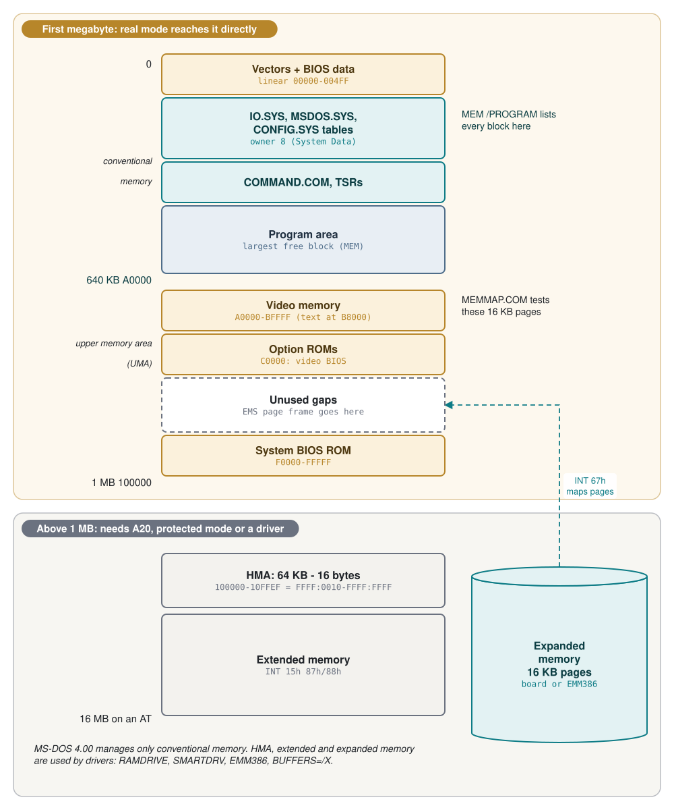
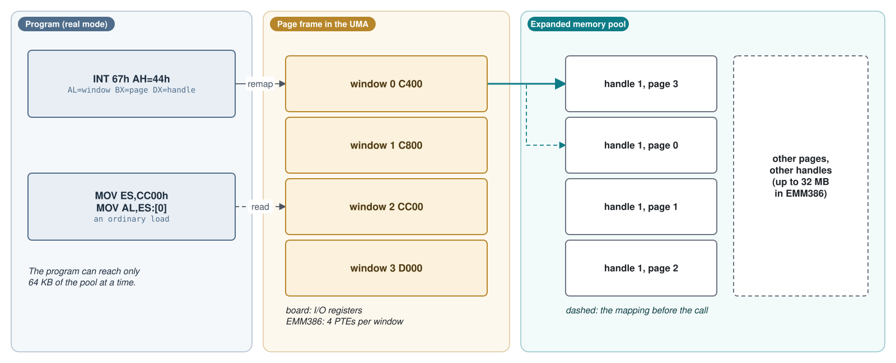
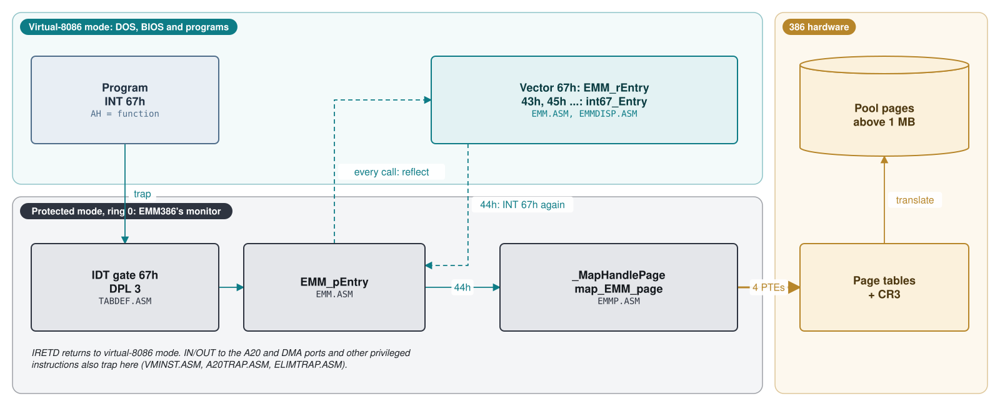
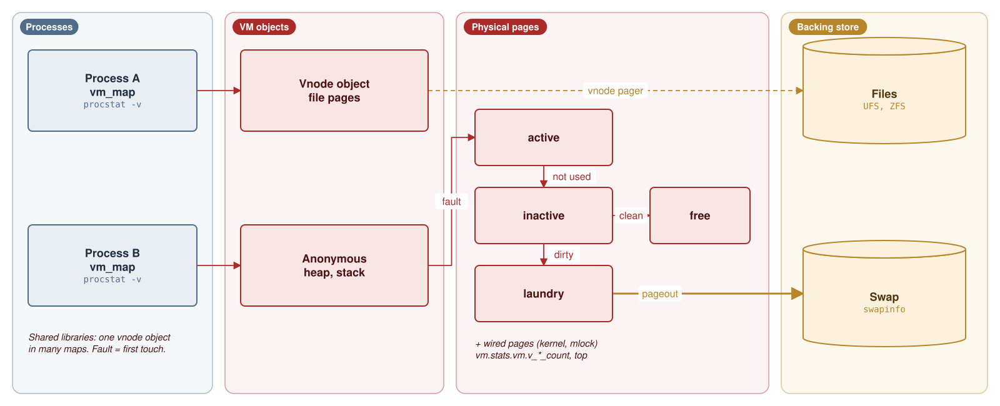
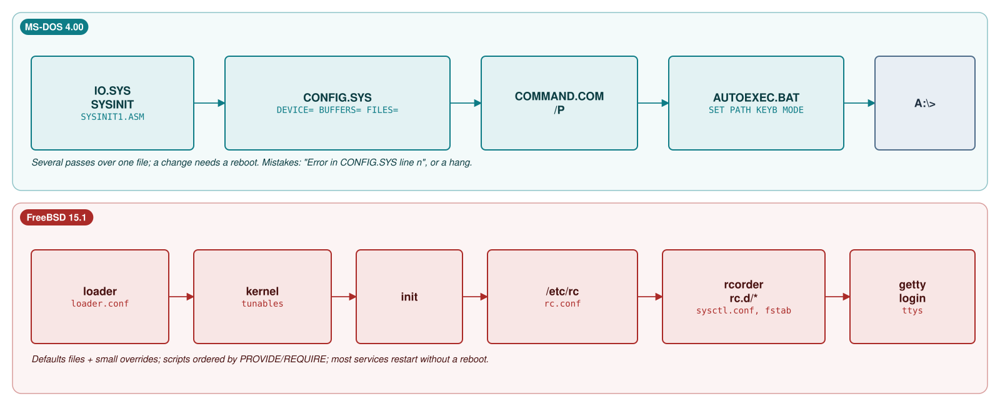
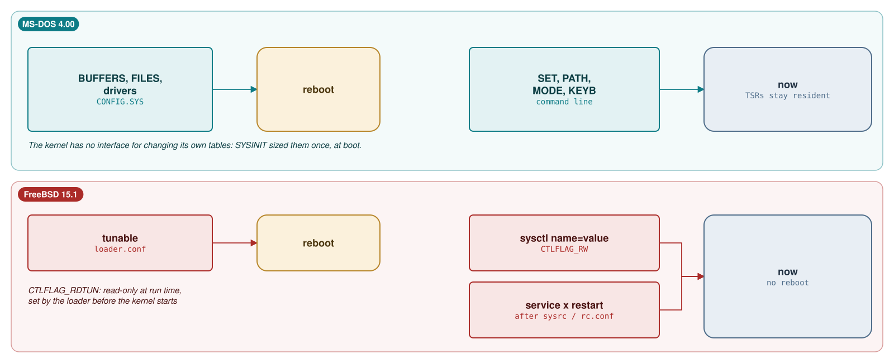

# Module 8: Memory and configuration in practice

Module 2 looked at memory from inside the kernel: the MS-DOS arena of memory control blocks and FreeBSD's
`vm_map`. This module looks at the whole machine, from the administrator's chair. How is the memory of a
running system laid out, who uses it, and how do you find out? What does one line of `CONFIG.SYS` cost, and
what does one line of `rc.conf` do? On MS-DOS 4.00 every answer is measured on the system built from source:
we map the first megabyte, price every `CONFIG.SYS` keyword in bytes, load the 1988 `EMM386.SYS` and talk to
it through `INT 67h`, and watch the Microsoft C 5.10 heap run out. On FreeBSD 15.1 we read the real
configuration files of the release, run the `rcorder` algorithm by hand, write an `rc.d` script, and run
memory experiments in the course's virtual machine. The two systems answer the same questions in opposite
ways: one was designed around memory that was always too small, the other around memory that is never what
it seems.

**Learning goals.** After this module you can:

- Draw the PC memory map as MS-DOS 4.00 sees it (conventional memory, upper memory area, HMA, extended and
  expanded memory) and locate each region on a running system with `MEM`, `DEBUG` and a small program.
- Account for every byte of conventional memory that a `CONFIG.SYS` line costs, from the structure sizes
  in the source (`BUFFINFO`, SFT entries, CDS entries, stacks, device drivers).
- Explain how `EMM386.SYS` emulates an expanded memory board with the 386's paging and virtual-8086 mode,
  and use `INT 67h` from your own program to allocate and map pages.
- Compare the MS-DOS C heap (near and far heaps of Microsoft C 5.10 over `INT 21h` function 48h) with
  FreeBSD's `malloc` (jemalloc over `mmap`), and predict what each reports when memory runs out.
- Read FreeBSD's memory statistics (`sysctl vm.stats.vm`, `vmstat`, `top`, `swapinfo`) and relate each
  number to a page queue in `sys/vm`.
- Trace FreeBSD's boot-time configuration from `loader.conf` through `/etc/rc`, `rc.conf` and `rcorder` to the
  `rc.d` scripts, and write a working `rc.d` script that follows the `rc.subr` conventions.
- Map each MS-DOS configuration mechanism to its FreeBSD counterpart, and say for each setting whether it
  takes effect at boot, at run time, or on the next service start.
- Evaluate the cost of a configuration mistake on each system.

**Prerequisites.**

- Module 0 (the lab, `tools/dos_run.py`, `tools/dos_tools.py`), Module 1 (`SYSINIT` and `CONFIG.SYS`,
  Section 1.5; the FreeBSD loader, Section 1.4), Module 2 (the arena, Section 2.5; Study case 2.C), Module 3
  (`COMMAND.COM`, `AUTOEXEC.BAT` and the environment, Sections 3.6 and 3.7).
- Some 8086 assembly (Module 1) and C. For FreeBSD: a shell, and the virtual machine for the runtime parts.

## 8.1 The PC memory map under MS-DOS 4.00

### Five kinds of memory

Real mode forms 20-bit addresses (Module 1, Section 1.1), so the 8086 can address 1 MB. IBM's PC design
gave the first 640 KB to RAM and reserved the 384 KB above it for the adapters: video memory and the ROMs
of the video card, the disk controller and the system BIOS. Everything that came later had to fit around
that decision. By 1988 a PC could have five kinds of memory:

| Kind | Addresses | Reached by | Who uses it in MS-DOS 4.00 |
|---|---|---|---|
| Conventional | 0 to 640 KB (`00000`-`9FFFF`) | any real-mode program | DOS, drivers, `COMMAND.COM`, programs: everything in the arena |
| Upper memory area (UMA) | 640 KB to 1 MB (`A0000`-`FFFFF`) | any real-mode program | video memory, adapter ROMs, BIOS; free gaps for an EMS page frame |
| High memory area (HMA) | first 64 KB above 1 MB minus 16 bytes (`100000`-`10FFEF`) | real mode, `FFFF:0010`-`FFFF:FFFF`, only with the A20 line enabled | nobody (see below) |
| Extended memory | above 1 MB, up to 16 MB on a 286 | protected mode, or the BIOS block move (`INT 15h` function 87h) | `RAMDRIVE /E`, `SMARTDRV`, `VDISK`, and `EMM386`'s pool |
| Expanded memory (EMS) | not in the address space: pages on a board, or in extended memory | `INT 67h`, through a 64 KB *page frame* in the UMA | `RAMDRIVE /A`, `BUFFERS=/X`, applications |



The first megabyte is the only memory that MS-DOS 4.00 manages. Its arena (Module 2, Section 2.5) starts
just above the kernel and ends at the top of conventional memory, which `SYSINIT` takes from `INT 12h`
(Module 1). Everything else is used by device drivers, each with its own scheme, as this section shows.

### Extended memory and the INT 15h convention

The 80286 and 80386 can address 16 MB and 4 GB, but only in protected mode. The PC/AT BIOS offered two
services for real-mode software: `INT 15h` function 88h returns the number of KB above 1 MB, and function
87h copies a block between any two physical addresses by switching to protected mode and back. MS-DOS 4.00
asks for the size once, during `SYSINIT`, and stores it in the `SYSINITVAR` structure that function 52h
returns (Module 2):

**Listing 8.1** -- SYSINIT records the extended memory size at boot ([`SYSINIT1.ASM` lines 535-539](https://github.com/microsoft/MS-DOS/blob/2d04cacc5322951f187bb17e017c12920ac8ebe2/v4.0/src/BIOS/SYSINIT1.ASM#L535-L539))

```asm
        mov     ah,88h
        int     15h                             ;check extended memory size
        jc      No_Ext_Memory
        mov     es:[di].SYSI_EXT_MEM,ax         ;save extended memory size
No_Ext_Memory:
```

`SYSI_EXT_MEM` is the last field of the structure
([`SYSVAR.INC` line 28](https://github.com/microsoft/MS-DOS/blob/2d04cacc5322951f187bb17e017c12920ac8ebe2/v4.0/src/INC/SYSVAR.INC#L28)).
DOS itself never uses it; `MEM` prints it as "total extended memory" and then calls function 88h again for
"available extended memory"
([`MEM.C` lines 770-790](https://github.com/microsoft/MS-DOS/blob/2d04cacc5322951f187bb17e017c12920ac8ebe2/v4.0/src/CMD/MEM/MEM.C#L770-L790)).
The two numbers differ because of a convention, not an allocator. A driver that wants extended memory hooks
`INT 15h` and makes function 88h report less: the memory above the new, lower limit is now the driver's.
`RAMDRIVE.SYS` does exactly that:

**Listing 8.2** -- RAMDRIVE answers INT 15h function 88h itself ([`RAMDRIVE.ASM` lines 2013-2033](https://github.com/microsoft/MS-DOS/blob/2d04cacc5322951f187bb17e017c12920ac8ebe2/v4.0/src/DEV/RAMDRIVE/RAMDRIVE.ASM#L2013-L2033))

```asm
;
;       This piece of code determines the size of extended memory
;       which was allocated before this driver and then subtracts
;       the amount it has allocated for itself
;
;       inputs: ah = 88h is of interest
;       outputs: ax = size of extended memory allocated by all before and
;                including us
;       regs used: flags
;
        pushf
        cmp     ah,88h
        je      mem_det
        popf
        jmp     [old_15]
mem_det:
        mov     ax,[int15_size]
        popf
        clc
        sti
        iret
```

Each driver takes memory from the top and lowers the limit, so the drivers stack up downwards from 16 MB.
Nothing records who owns what; a driver that ignores the convention (the older `VDISK.SYS` allocated from
the bottom, at 1 MB, and marked its memory with a header there) collides with the others. `EMM386`'s
allocator says it plainly: "We do not care for compatibility with vdisk"
([`ALLOCMEM.ASM` lines 165-171](https://github.com/microsoft/MS-DOS/blob/2d04cacc5322951f187bb17e017c12920ac8ebe2/v4.0/src/MEMM/MEMM/ALLOCMEM.ASM#L165-L171)).
How does a real-mode driver copy data above 1 MB? `RAMDRIVE` has four configurations
([lines 197-221](https://github.com/microsoft/MS-DOS/blob/2d04cacc5322951f187bb17e017c12920ac8ebe2/v4.0/src/DEV/RAMDRIVE/RAMDRIVE.ASM#L197-L221));
for `/E` on a 286 it uses `LOADALL`, an undocumented 286 instruction that loads every register, including the
hidden base of a segment register, from a table at `0080:0000`, so that one segment can point above 1 MB
while the CPU stays in real mode
([lines 896-925](https://github.com/microsoft/MS-DOS/blob/2d04cacc5322951f187bb17e017c12920ac8ebe2/v4.0/src/DEV/RAMDRIVE/RAMDRIVE.ASM#L896-L925);
the instruction is emitted as raw bytes, `DW 050FH`, at
[line 1113](https://github.com/microsoft/MS-DOS/blob/2d04cacc5322951f187bb17e017c12920ac8ebe2/v4.0/src/DEV/RAMDRIVE/RAMDRIVE.ASM#L1113)).
The comment's "WARNING NUMBER ONE" is a fair summary of the era: the trick works only where a non-maskable
interrupt halts the machine anyway.

### The HMA, A20, and what MS-DOS 4.00 does not have

On the 8086, `FFFF:0010` wraps around to linear `00000`. On a 286 or later it addresses `100000`, the first
byte above 1 MB, so real-mode code can reach almost 64 KB above 1 MB: the *high memory area*. For
compatibility with programs that relied on the wrap-around, the AT added a gate on address line 20 (*A20*),
controlled through the keyboard controller; with the gate closed, the wrap-around comes back. MS-DOS 5.0
later shipped `HIMEM.SYS`, an XMS (eXtended Memory Specification) driver that manages A20, the HMA and
extended memory, and the `DOS=HIGH` and `DEVICEHIGH=` keywords that move DOS and drivers out of conventional
memory. None of this exists in 4.00. A search of `v4.0/src` shows:

- no file named `HIMEM*` and no occurrence of `XMS` in any `.ASM`, `.INC`, `.C` or `.H` file;
- no `DOS`, `HIGH` or `DEVICEHIGH` keyword in the `CONFIG.SYS` table (Listing 1.22 in Module 1), and no
  upper-memory link in function 58h, which only sets the allocation strategy (Module 2, Section 2.5);
- the word "himem" only in `MEMM`, where it means two other things: "the himem area (just below 16M)", an
  OEM-specific memory pool that the shipped build disables with `-DNOHIMEM`
  ([`MEMM/MEMM/MAKEFILE` lines 51-54](https://github.com/microsoft/MS-DOS/blob/2d04cacc5322951f187bb17e017c12920ac8ebe2/v4.0/src/MEMM/MEMM/MAKEFILE#L51-L54)),
  and "the EMS 4.1 standard himem at 1M", the 64 KB that `EMM386` leaves free at 1 MB
  ([`ALLOCMEM.ASM` lines 401-425](https://github.com/microsoft/MS-DOS/blob/2d04cacc5322951f187bb17e017c12920ac8ebe2/v4.0/src/MEMM/MEMM/ALLOCMEM.ASM#L401-L425));
  `INDEXMA.ASM` has an unrelated `HIMEM EQU`;
- A20 code only inside drivers that must open the gate for their own use: `RAMDRIVE.ASM`, `SMARTDRV.ASM`,
  IBM's 386 XMA emulator (`DEV/XMAEM/INDEINI.ASM`, through port 92h) and `EMM386` (`MEMM/MEMM/A20TRAP.ASM`
  and several of its neighbours).

So in MS-DOS 4.00 the HMA is unused, A20 is left as the BIOS set it (Lab 8.1 finds it disabled in our
emulator), and every byte of DOS, every driver and every TSR lives below 640 KB.

### Expanded memory: bank switching

Expanded memory solved a different problem: the 8088 PC and XT had no memory above 1 MB at all. The
Lotus/Intel/Microsoft Expanded Memory Specification (LIM EMS) puts memory on an adapter board and makes it
visible through a 64 KB *page frame* in a free part of the UMA, divided into four 16 KB *windows*. A program
asks the expanded memory manager (EMM, a device driver) for *logical pages* of 16 KB, receives a *handle*,
and asks the EMM to map a logical page into a window. The board then routes accesses to that window to the
chosen page of its own memory. This is *bank switching*: the address space stays at 1 MB, and the program
chooses which 64 KB of a much larger memory it can see.



The interface is `INT 67h` with the function in `AH`, much like `INT 21h`. The functions this module uses:

| `AH` | Function | Returns |
|---|---|---|
| 40h | Get status | `AH` = 0 if the manager works |
| 41h | Get page frame address | `BX` = segment of the page frame |
| 42h | Get unallocated page count | `BX` = free pages, `DX` = total pages |
| 43h | Allocate pages (`BX` = count) | `DX` = handle |
| 44h | Map page (`AL` = window, `BX` = logical page, `DX` = handle) | `AH` = status |
| 45h | Deallocate pages (`DX` = handle) | `AH` = status |
| 46h | Get version | `AL` = version in BCD, 40h for 4.0 |
| 53h, 58h | EMS 4.0: handle names; mappable physical address array | |

A program finds out whether a manager is present by looking at the device driver behind the `INT 67h`
vector: its name field, at offset 0Ah of the segment, must read `EMMXXXX0`. `MEM` instead checks that the
vector is not zero and that functions 40h and 46h succeed
([`MEM.C` lines 832-869](https://github.com/microsoft/MS-DOS/blob/2d04cacc5322951f187bb17e017c12920ac8ebe2/v4.0/src/CMD/MEM/MEM.C#L832-L869)).
Section 8.3 shows how `EMM386.SYS` provides the same interface without any board.

## 8.2 Measuring memory on MS-DOS

### What MEM reports, and how

`MEM` is new in 4.00. It is a C program (Microsoft C, with the message services of the 4.00 tree) with three
levels of detail: no switch, `/PROGRAM` and `/DEBUG`, which set `DataLevel` to 0, 1 and 2
([`MEM.C` lines 304-309](https://github.com/microsoft/MS-DOS/blob/2d04cacc5322951f187bb17e017c12920ac8ebe2/v4.0/src/CMD/MEM/MEM.C#L304-L309)).
With the lab image's `CONFIG.SYS` (`FILES=20`, `BUFFERS=20`, `DEVICE=\ANSI.SYS`), `/PROGRAM` prints:

```console
$ python tools/dos_run.py "MEM /PROGRAM"
```

**Output 8.1** -- MEM /PROGRAM on MS-DOS 4.00 built from source, lab image

```text
  Address     Name          Size       Type
  ───────     ────────     ──────     ──────
  000000                   000400     Interrupt Vector
  000400                   000100     ROM Communication Area
  000500                   000200     DOS Communication Area

  000700      IO           002510     System Program

  002C10      MSDOS        008E00     System Program

  00BA10      IO           004E90     System Data
                ANSI       001180      DEVICE=
                           000380      FILES=
                           000100      FCBS=
                           0029A0      BUFFERS=
                           0001C0      LASTDRIVE=
                           000CD0      STACKS=
  0108B0      COMMAND      001640     Program
  011F00      COMMAND      000030     Data
  011F40      COMMAND      0000A0     Environment
  011FF0      MEM          000030     Environment
  012030      MEM          012F00     Program
  024F40      MSDOS        07B0B0     -- Free --


    655360 bytes total memory
    655360 bytes available
    581568 largest executable program size

  15728640 bytes total extended memory
  15728640 bytes available extended memory
```

All numbers are hexadecimal except the totals. The first three lines are not measured at all: `MEM` prints
the constants 0/400h, 400h/100h and 500h/200h
([`MEM.C` lines 382-410](https://github.com/microsoft/MS-DOS/blob/2d04cacc5322951f187bb17e017c12920ac8ebe2/v4.0/src/CMD/MEM/MEM.C#L382-L410)).
`IO` runs from `0700h` to the segment of `SYSINITVAR` (function 52h), and `MSDOS` from there to the first
memory control block (MCB). From `00BA10` on, every line is one block of the arena, walked exactly as in
Study case 2.C: the address column is the MCB's address, the size excludes the 16-byte MCB. `MSDOS ... --
Free --` is the last, free block (owner 0); the name `MSDOS` is just what `MEM` prints for free memory.

The interesting block is the one owned by 8, "System Data": everything `SYSINIT` allocated while it processed
`CONFIG.SYS`. `MEM` can break it down because `SYSINIT` writes a small header, a *DEVMARK*, in front of every
table it builds:

**Listing 8.3** -- A DEVMARK has the layout of an MCB, with a letter instead of 'M' or 'Z' ([`DEVMARK.INC` lines 3-19](https://github.com/microsoft/MS-DOS/blob/2d04cacc5322951f187bb17e017c12920ac8ebe2/v4.0/src/BIOS/DEVMARK.INC#L3-L19))

```asm
DEVMARK struc
DEVMARK_ID        db      0
DEVMARK_SEG       dw      0
DEVMARK_SIZE      dw      0
DEVMARK_DUM       db      3 dup (?)
DEVMARK_FILENAME  db      8 dup (' ')
DEVMARK ends

DEVMARK_STK     equ     'S'
DEVMARK_DEVICE  equ     'D'
DEVMARK_IFS     equ     'I'
DEVMARK_BUF     equ     'B'
DEVMARK_CDS     equ     'L' ;lastdrive
DEVMARK_FILES   equ     'F'
DEVMARK_FCBS    equ     'X'
DEVMARK_INST    equ     'T' ;used for SYSINIT BASE for INSTALL= command.
DEVMARK_EMS_STUB equ    'E'
```

`SetDevMark` writes one at the current allocation point and advances it by one paragraph
([`SYSINIT1.ASM` lines 2577-2601](https://github.com/microsoft/MS-DOS/blob/2d04cacc5322951f187bb17e017c12920ac8ebe2/v4.0/src/BIOS/SYSINIT1.ASM#L2577-L2601)),
and `MEM` walks these sub-blocks inside the owner-8 block with the same `segment + size + 1` rule as the
arena, translating the letters into `DEVICE=`, `FILES=` and so on
([`MEM.C` lines 488-553](https://github.com/microsoft/MS-DOS/blob/2d04cacc5322951f187bb17e017c12920ac8ebe2/v4.0/src/CMD/MEM/MEM.C#L488-L553)).
A second arena inside the first one: the 16-byte header is why each `CONFIG.SYS` table costs 16 bytes more
than its size column. Check it on Output 8.1: the six sub-blocks add up to 4E30h bytes, plus 6 x 10h for the
DEVMARKs, gives exactly the 4E90h of the System Data block.

### "Largest executable program size"

The summary line most people read is computed from `MEM`'s own process:

**Listing 8.4** -- MEM measures the block it was loaded into ([`MEM.C` line 687](https://github.com/microsoft/MS-DOS/blob/2d04cacc5322951f187bb17e017c12920ac8ebe2/v4.0/src/CMD/MEM/MEM.C#L687-L687))

```c
        free_mem = (DOS_TopOfMemory * 16l) - (FP_SEG(PSPptr)*16l);                                                               /* ;an000;ac005; */
```

`DOS_TopOfMemory` is the word at offset 2 of the program segment prefix (PSP), the first segment after the
block DOS gave the program; the PSP segment is where the block starts. `EXEC` loads a program into the
largest free block (Module 2, Section 2.6), so the difference is the largest block that existed when `MEM`
started, the size of the biggest program you could run next. Output 8.1 confirms it: `MEM`'s block
(12F00h) plus its MCB plus the free block (7B0B0h) is 8DFC0h = 581,568 bytes. `MEM` had already given back
most of its block before it printed anything; the C start-up code does that (Section 8.5). `CHKDSK`
computes the same quantity from its own PSP
([`CHKDSK2.ASM` lines 356-362](https://github.com/microsoft/MS-DOS/blob/2d04cacc5322951f187bb17e017c12920ac8ebe2/v4.0/src/CMD/CHKDSK/CHKDSK2.ASM#L356-L362)),
and Output 0.1 in Module 0 shows it 16 bytes lower: 581,552. Why? Lab 8.1 answers it.

### What each CONFIG.SYS line costs

Module 1 measured one data point (`BUFFERS=30`, `FILES=40`). Lab 8.2 boots the system once per variant and
builds the full price list; the result, with the structure sizes that explain it, is the table below. The
baseline is a boot without `CONFIG.SYS` (589,424 bytes), where the defaults apply: `FILES=8`, `FCBS=4`, 15
buffers on a machine with more than 512 KB, `STACKS=9,128` on an AT-class machine, and drives up to `E:`
([`SYSINIT1.ASM` lines 1142-1161](https://github.com/microsoft/MS-DOS/blob/2d04cacc5322951f187bb17e017c12920ac8ebe2/v4.0/src/BIOS/SYSINIT1.ASM#L1142-L1161),
[lines 1434-1446](https://github.com/microsoft/MS-DOS/blob/2d04cacc5322951f187bb17e017c12920ac8ebe2/v4.0/src/BIOS/SYSINIT1.ASM#L1434-L1446)).

| Line | Largest program | Cost | Where the bytes go |
|---|---:|---:|---|
| (none) | 589,424 | 0 | |
| `BUFFERS=1` | 596,864 | -7,440 | 14 fewer buffers of 20 + 512 bytes |
| `BUFFERS=30` | 581,440 | 7,984 | 15 more buffers (7,980) and a second hash bucket (8, rounded) |
| `FILES=40` | 587,536 | 1,888 | 32 more SFT entries of 59 bytes |
| `FCBS=16,8` | 588,720 | 704 | 12 more FCB-SFT entries of 59 bytes, rounded to paragraphs |
| `STACKS=0,0` | 592,720 | -3,296 | no stack code (2,048), no 9 x (8 + 128) stacks, no DEVMARK |
| `STACKS=18,256` | 585,904 | 3,520 | 18 x (8 + 256) = 4,752 instead of 1,232 bytes |
| `LASTDRIVE=Z` | 587,584 | 1,840 | 26 instead of 5 current-directory structures of 88 bytes |
| `DEVICE=\ANSI.SYS` | 584,928 | 4,496 | the driver's resident part, 4,480 bytes |
| `DEVICE=\RAMDRIVE.SYS 64` | 522,112 | 67,312 | the disk itself (64 KB) inside the driver |
| `DEVICE=\RAMDRIVE.SYS 64 /E` | 587,408 | 2,016 | resident code only; 64 KB of extended memory |
| `DEVICE=\SMARTDRV.SYS 256` | 589,424 | 0 | not installed: "No hard drives on system" |
| `INSTALL=\KEYB.COM IT,,\KEYBOARD.SYS` | 583,568 | 5,856 | the TSR (5,776) and a 48-byte hole |
| `DEVICE=\EMM386.SYS` | 551,936 | 37,488 | the 386 monitor's resident part (Section 8.3) |
| EMM386 + `BUFFERS=50 /X` | 559,904 | 29,520 | 60 buffers (two EMS pages of 30) in expanded memory, 32 bytes below 640 KB |

The table is built from paragraph-exact `MEM` output (Lab 8.2 keeps it) and the structure definitions:

- A disk buffer is a 20-byte `BUFFINFO` header plus a sector
  ([`BUFFER.INC` lines 9-31](https://github.com/microsoft/MS-DOS/blob/2d04cacc5322951f187bb17e017c12920ac8ebe2/v4.0/src/INC/BUFFER.INC#L9-L31)).
  4.00 organises buffers in hash buckets of up to 15, each with an 8-byte `BUFFER_HASH_ENTRY`
  ([lines 64-72](https://github.com/microsoft/MS-DOS/blob/2d04cacc5322951f187bb17e017c12920ac8ebe2/v4.0/src/INC/BUFFER.INC#L64-L72)),
  and rounds the hash table and the buffer area separately to paragraphs: 15 buffers take 16 + 7,984 =
  8,000 bytes (1F40h in `MEM`), one buffer 16 + 544 = 560 (230h).
- An SFT entry (the `FILES=` table, Module 2, Section 2.3) is 59 bytes. The first five are inside
  `MSDOS.SYS`; the `FILES=` block holds the rest after a 6-byte link and count, so `FILES=8` costs 6 + 3 x 59,
  rounded to 192 bytes (0C0h). `FCBS=` uses the same entry format.
- `LASTDRIVE=` allocates one current directory structure (CDS, `curdir_list`, 88 bytes:
  [`CURDIR.INC` lines 18-29](https://github.com/microsoft/MS-DOS/blob/2d04cacc5322951f187bb17e017c12920ac8ebe2/v4.0/src/INC/CURDIR.INC#L18-L29)) per drive letter: 5 x 88 = 440,
  rounded to 448 (1C0h); 26 x 88 = 2,288 (8F0h).
- `STACKS=` copies the stack-switching interrupt code (the first 2,048 bytes of `SYSINIT`, up to
  `Endstackcode`) and adds `STACK_COUNT x (EntrySize + STACK_SIZE)`, with `EntrySize` = 8:

**Listing 8.5** -- The STACKS= space formula ([`SYSINIT1.ASM` lines 1478-1484](https://github.com/microsoft/MS-DOS/blob/2d04cacc5322951f187bb17e017c12920ac8ebe2/v4.0/src/BIOS/SYSINIT1.ASM#L1478-L1484))

```asm
;       Space for Internal Stack area = STACK_COUNT(ENTRYSIZE + STACK_SIZE)
        MOV     AX, EntrySize
        ADD     AX, [STACK_SIZE]
        MOV     CX, [STACK_COUNT]
        MUL     CX
        call    ParaRound                       ; Convert size to pargraphs
        ADD     [MEMHI], AX
```

Three entries need more than arithmetic. `SMARTDRV.SYS` caches hard disks only: it asks `INT 13h`
function 08h about drive 80h and gives up with the message we captured when there is none
([`SMARTDRV.ASM` lines 5651-5673](https://github.com/microsoft/MS-DOS/blob/2d04cacc5322951f187bb17e017c12920ac8ebe2/v4.0/src/DEV/SMARTDRV/SMARTDRV.ASM#L5651-L5673)),
and our lab machine has only a floppy. `KEYB` costs more than its own block because it frees its environment
when it goes resident
([`KEYBCPSD.ASM` lines 84-93](https://github.com/microsoft/MS-DOS/blob/2d04cacc5322951f187bb17e017c12920ac8ebe2/v4.0/src/CMD/KEYB/KEYBCPSD.ASM#L84-L93)),
leaving a 48-byte hole below itself that later, smaller blocks fill (Lab 8.7 shows it). And
`BUFFERS=50 /X` is the one 4.00 feature that moves a DOS table out of conventional memory: with an EMS 4.0
manager present, `SYSINIT` puts the buffers into expanded memory pages, two hash buckets of 15 per page, and
rounds the count up to whole pages, so 50 becomes 60
([`SYSINIT1.ASM` lines 2077-2089](https://github.com/microsoft/MS-DOS/blob/2d04cacc5322951f187bb17e017c12920ac8ebe2/v4.0/src/BIOS/SYSINIT1.ASM#L2077-L2089)),
under an EMS handle named `BUFFERS`
([`SYSINIT1.ASM` lines 1069-1076](https://github.com/microsoft/MS-DOS/blob/2d04cacc5322951f187bb17e017c12920ac8ebe2/v4.0/src/BIOS/SYSINIT1.ASM#L1069-L1076),
[line 294](https://github.com/microsoft/MS-DOS/blob/2d04cacc5322951f187bb17e017c12920ac8ebe2/v4.0/src/BIOS/SYSINIT1.ASM#L294)).
Free EMS memory drops by 32 KB, and the `BUFFERS=` line in `MEM` by 7,968 bytes to 20h. Without a manager,
`DoEMS` prints the "Error in CONFIG.SYS line" message for the `BUFFERS=` line, and `SYSINIT` falls back to the
default buffers
([`SYSINIT1.ASM` lines 2126-2132](https://github.com/microsoft/MS-DOS/blob/2d04cacc5322951f187bb17e017c12920ac8ebe2/v4.0/src/BIOS/SYSINIT1.ASM#L2126-L2132),
[`SYSCONF.ASM` lines 2569-2577](https://github.com/microsoft/MS-DOS/blob/2d04cacc5322951f187bb17e017c12920ac8ebe2/v4.0/src/BIOS/SYSCONF.ASM#L2569-L2577)).

## 8.3 Expanded memory without a board: EMM386

### What EMM386.SYS is

The `MEMM` directory builds `EMM386.SYS`, which calls itself "MICROSOFT Expanded Memory Manager 386"
([`EMMMES.ASM` lines 92-95](https://github.com/microsoft/MS-DOS/blob/2d04cacc5322951f187bb17e017c12920ac8ebe2/v4.0/src/MEMM/MEMM/EMMMES.ASM#L92-L95)).
It provides the EMS 4.0 interface of Section 8.1 on any 386 with extended memory, with no board at all. To do
that it does something no other part of MS-DOS 4.00 does: it switches the processor to protected mode, sets
up a GDT, an IDT, a task state segment and page tables, and then runs DOS, the BIOS and every program in
*virtual-8086 (V86) mode*, a 386 mode in which code behaves like real-mode code but runs under paging and
under the control of a protected-mode supervisor. `EMM386` is that supervisor, a small *virtual machine
monitor*; the header of its initialisation module says "This module returns to the calling routine in
Virtual Mode"
([`VDMINIT.ASM` lines 38-45](https://github.com/microsoft/MS-DOS/blob/2d04cacc5322951f187bb17e017c12920ac8ebe2/v4.0/src/MEMM/MEMM/VDMINIT.ASM#L38-L45)).
Once DOS runs under paging, a 16 KB window of the page frame is just four page-table entries, and
"mapping an EMS page" means rewriting them. The design goal is stated at the top of the C part of the
manager:

**Listing 8.6** -- The idea of EMM386 in one sentence ([`EMMFUNCT.C` lines 43-53](https://github.com/microsoft/MS-DOS/blob/2d04cacc5322951f187bb17e017c12920ac8ebe2/v4.0/src/MEMM/EMM/EMMFUNCT.C#L43-L53))

```c
 * Paged EMM Driver for the iAPX 386.
 *
 * The basic concept is to use the 386's page tables to emulate
 * the functions of an EMM board. There are several constraints
 * that are a result of poor planning on the LIM specifiers part.
 *      - maximum of 64K instantaneously mapped. this will
 *        be faithfully emulated in this design
 *      - maximum of 8Mb of extended memory can be used.
 *        The actual reason for this is because each board
 *        can only support 128 16Kb pages and the limit of
 *        4 Aboveboards implies 512 pages maximum. This will
```

### Installation, step by step

`Init_MEMM386` is the device driver's initialisation routine, called by `SYSINIT` for the `DEVICE=` line. It
is a straight sequence of steps, each of which can set a "killer" message and abandon the installation
([`INIT.ASM` lines 271-610](https://github.com/microsoft/MS-DOS/blob/2d04cacc5322951f187bb17e017c12920ac8ebe2/v4.0/src/MEMM/MEMM/INIT.ASM#L271-L610)):

| Step | Routine | What it does |
|---|---|---|
| 1 | `Inst_chk_f`, `Is386`, `VerifyMachine` | refuse to install twice; check the processor and the machine |
| 2 | `parser` | read the `DEVICE=` parameters: pool size in KB (default 256), `Mn` page frame, `X:mmmm-nnnn` exclusions |
| 3 | `find_phys_pages` | decide which 16 KB pages below 1 MB may be mapped, and where the page frame goes |
| 4 | `AllocMem` | take extended memory for the pool, and the conventional memory above 256 KB |
| 5 | `EMM_Init`, `VDM_Init`, `InitTab` | build the EMM tables, the GDT, IDT, TSS and page tables |
| 6 | `IE_chkbase` | insist that at least 64 KB of conventional memory remain |
| 7 | `FarGoVirtual` | enter protected mode and return to DOS in V86 mode |
| 8 | `IE_exit` | print the banner and the messages; hook `INT 15h` and `INT 67h` |

Booting the lab system with `DEVICE=\EMM386.SYS` and capturing the screen (Lab 8.3) shows the result:

**Output 8.2** -- EMM386.SYS installing on MS-DOS 4.00 in DOSBox-X (Pentium-class CPU, 16 MB)

```text
MICROSOFT Expanded Memory Manager 386  Version 4.00
(C) Copyright MICROSOFT Corporation 1988
Size of expanded memory pool adjusted.
Page Frame Base Address adjusted.
EMM386 Installed.
                   Extended memory allocated:      256 KB
                   System memory allocated:        384 KB
                                                 --------
                   Expanded memory available:      640 KB
                   Page frame base address:      C4000 H
```

Every line can be traced to the source. The two "adjusted" messages are not warnings about our machine:
the parser sets the size message whenever no size was given and it falls back to 256 KB
([`INIT.ASM` lines 882-886](https://github.com/microsoft/MS-DOS/blob/2d04cacc5322951f187bb17e017c12920ac8ebe2/v4.0/src/MEMM/MEMM/INIT.ASM#L882-L886)),
and `find_pf_base` sets the page frame message whenever it chose the frame itself
([`PPAGE.ASM` lines 279-290](https://github.com/microsoft/MS-DOS/blob/2d04cacc5322951f187bb17e017c12920ac8ebe2/v4.0/src/MEMM/MEMM/PPAGE.ASM#L279-L290)).
The frame it chose, `C400`, follows from step 3:

**Listing 8.7** -- Choosing mappable pages: conventional RAM, system ROM, video, option ROMs ([`PPAGE.ASM` lines 150-187](https://github.com/microsoft/MS-DOS/blob/2d04cacc5322951f187bb17e017c12920ac8ebe2/v4.0/src/MEMM/MEMM/PPAGE.ASM#L150-L187))

```asm
find_phys_pages proc    near
⋮
        call    exclude_conv_RAM
⋮
        call    exclude_system_ROM
⋮
        call    exclude_video_mem
⋮
        call    rom_srch                ; this searches for option rom's and
⋮
;
⋮
find_phys_pages endp
```

`rom_srch` looks for the `55 AA` signature of option ROMs in 2 KB steps, exactly as the BIOS does at
power-on ([`ROM_SRCH.ASM` lines 38-58](https://github.com/microsoft/MS-DOS/blob/2d04cacc5322951f187bb17e017c12920ac8ebe2/v4.0/src/MEMM/MEMM/ROM_SRCH.ASM#L38-L58)),
and `find_pf_base` takes the first of the candidate frames `C000`, `C400`, ... `E000` whose four pages are
all still mappable ([`PPAGE.ASM` lines 120-136](https://github.com/microsoft/MS-DOS/blob/2d04cacc5322951f187bb17e017c12920ac8ebe2/v4.0/src/MEMM/MEMM/PPAGE.ASM#L120-L136)).
DOSBox-X's video BIOS is 16 KB long (Lab 8.1 reads its size byte), so `C000`-`C3FF` is excluded and `C400`
is the first free 64 KB. On a real PC with a 32 KB VGA BIOS the same code would pick `C800`.

The pool comes from extended memory with the `INT 15h` convention of Section 8.1, top down. `EMM386`'s
`INT 15h` handler answers function 88h with the lowered size:

**Listing 8.8** -- EMM386 shrinks extended memory by lying about its size ([`MOVEB.ASM` lines 436-443](https://github.com/microsoft/MS-DOS/blob/2d04cacc5322951f187bb17e017c12920ac8ebe2/v4.0/src/MEMM/MEMM/MOVEB.ASM#L436-L443))

```asm
        cmp     ah,88h                  ;Q: extended memory size request?
        jne     chk_blk_move            ;  N: go to check for move block call
;
;  Implement int15 allocation scheme by reporting a lowered value of extended
;  memory.
        popf
        mov     ax,cs:[ext_mem_size]    ; report new extended memory size
        iret                            ;
```

`MEM` (Lab 8.3) reports 15,056 KB available instead of 15,360: 304 KB are gone. 256 KB are the pool; the
other 48 KB hold `EMM386`'s own tables. To keep its conventional-memory footprint small, it "ships" the
segments from `PAGESEG` to `LAST` (page tables and other large structures) into extended memory, and
`MEMREQ` computes their size and adds 16 KB "for safety"
([`SHIPHI.ASM` lines 305-321](https://github.com/microsoft/MS-DOS/blob/2d04cacc5322951f187bb17e017c12920ac8ebe2/v4.0/src/MEMM/MEMM/SHIPHI.ASM#L305-L321);
`xbuf_chk` reserves that first,
[`ALLOCMEM.ASM` lines 366-388](https://github.com/microsoft/MS-DOS/blob/2d04cacc5322951f187bb17e017c12920ac8ebe2/v4.0/src/MEMM/MEMM/ALLOCMEM.ASM#L366-L388)).
What stays below 640 KB is still 37,472 bytes (the `DEVICE=` line in Lab 8.2), the price of having expanded
memory at all.

The "system memory allocated: 384 KB" line is an EMS 4.0 feature. `SysAlloc` counts every mappable 16 KB page
of conventional memory below the `INT 12h` limit and adds it to the pool
([`ALLOCMEM.ASM` lines 524-551](https://github.com/microsoft/MS-DOS/blob/2d04cacc5322951f187bb17e017c12920ac8ebe2/v4.0/src/MEMM/MEMM/ALLOCMEM.ASM#L524-L551));
`exclude_conv_RAM` has already removed the first 256 KB, segments `0000`-`4000`
([`PPAGE.ASM` lines 404-429](https://github.com/microsoft/MS-DOS/blob/2d04cacc5322951f187bb17e017c12920ac8ebe2/v4.0/src/MEMM/MEMM/PPAGE.ASM#L404-L429)), so pages `4000` to `9C00` remain, 24 pages = 384 KB.
These pages belong to handle 0, the operating system's handle, and are mapped where they always were; an EMS
4.0 multitasker could map other pages there and swap whole programs in and out of conventional memory. `MEM
/DEBUG` lists the handle (Lab 8.3).

### Mapping a page: four page-table entries and a TLB flush

With DOS in V86 mode, an `INT 67h` instruction does not go to the real-mode vector. In V86 mode every
interrupt goes through the protected-mode IDT, and `EMM386`'s IDT has a gate for vector 67h, with privilege
level 3 so that V86 code may use it:

**Listing 8.9** -- The IDT entry for INT 67h ([`TABDEF.ASM` lines 314-315](https://github.com/microsoft/MS-DOS/blob/2d04cacc5322951f187bb17e017c12920ac8ebe2/v4.0/src/MEMM/MEMM/TABDEF.ASM#L314-L315))

```asm
;;;IDT_ENTRY    0, 0, 0                 ; 67 User Programs
IDT_ENTRY       VDMC_GSEL,<offset _TEXT:EMM_pEntry>,D_386INT3 ; 67 ELIM
```

`EMM_pEntry` runs in ring 0, but it does not choose the functions it handles. A program's call finds
`EMM_Flag` clear and is *reflected*: the monitor builds an interrupt frame on the V86 stack and resumes V86
mode at the real-mode vector, `EMM_rEntry`. There `EMM_rLink` runs allocation and the other bookkeeping
functions (43h and 45h among them) through the dispatcher in V86 mode. For the functions that change
mappings, 44h among them, it sets `EMM_Flag` and executes `INT 67h` again, and this time `EMM_pEntry` calls
the function through its own table, in ring 0
([`EMM.ASM` lines 172-212](https://github.com/microsoft/MS-DOS/blob/2d04cacc5322951f187bb17e017c12920ac8ebe2/v4.0/src/MEMM/MEMM/EMM.ASM#L172-L212),
[lines 213-300](https://github.com/microsoft/MS-DOS/blob/2d04cacc5322951f187bb17e017c12920ac8ebe2/v4.0/src/MEMM/MEMM/EMM.ASM#L213-L300),
[lines 368-429](https://github.com/microsoft/MS-DOS/blob/2d04cacc5322951f187bb17e017c12920ac8ebe2/v4.0/src/MEMM/MEMM/EMM.ASM#L368-L429)).
The header of `EMM.ASM` promises that protected-mode functions "don't suffer the extra time to reflect the
INT 67H"
([lines 42-51](https://github.com/microsoft/MS-DOS/blob/2d04cacc5322951f187bb17e017c12920ac8ebe2/v4.0/src/MEMM/MEMM/EMM.ASM#L42-L51));
in this code every call pays for the reflection, and a mapping call then enters ring 0 a second time.
Function 44h itself:

**Listing 8.10** -- _MapHandlePage flushes the TLB and maps ([`EMMP.ASM` lines 579-592](https://github.com/microsoft/MS-DOS/blob/2d04cacc5322951f187bb17e017c12920ac8ebe2/v4.0/src/MEMM/EMM/EMMP.ASM#L579-L592))

```asm
_MapHandlePage  proc    near

        Validate_Handle <short mhp_inv_handle>

        mov     byte ptr [bp.rAX+1],OK  ; Assume success!
        movzx   eax, al                 ; Physical page
        movzx   ebx, bx                 ; Logical page

        push    eax
        mov     eax, cr3
        mov     cr3, eax                ; Flush old mapping now
        pop     eax

        jmp     map_page                ; Common page mapping code
```

**Listing 8.11** -- map_EMM_page writes four 4 KB page-table entries for one 16 KB window ([`EMMP.ASM` lines 334-401](https://github.com/microsoft/MS-DOS/blob/2d04cacc5322951f187bb17e017c12920ac8ebe2/v4.0/src/MEMM/EMM/EMMP.ASM#L334-L401))

```asm
map_EMM_page    proc    near
        cmp     ax,[_physical_page_count]       ;Q: valid physical page# ?
        jae     short mEp_inv_page              ;  N: invalid page number
⋮
        add     bx,[_pft386]    ; BX  = points into _pft386
        mov     eax,[bx]        ; EAX = physical address of EMM page #
        and     ax,0F000H       ; clear the low 12 bits
        or      ax,P_AVAIL      ; page ctl bits <-- user,present,write
⋮
        shl     bx,2                    ; bx <-- index * 4
        add     bx,offset DGROUP:_page_frame_base ; bx = offset for entry in _page_frame_base
        les     di,[bx]                 ; es:di <-- page frame address
⋮
        stosd                   ; store 1st page table entry
        add     eax,P_SIZE      ; eax <-- next address

        stosd                   ; store 2nd page table entry
        add     eax,P_SIZE      ; eax <-- next address

        stosd                   ; store 3rd page table entry
        add     eax,P_SIZE      ; eax <-- next address

        stosd                   ; store 4th page table entry
```

`_pft386` holds the physical address of every 16 KB EMS page in the pool; a page-table entry is that address
with the low 12 bits replaced by control bits (present, writable, user). Four consecutive entries, 4 KB
apart, make one EMS window. Reloading `CR3` invalidates the processor's translation lookaside buffer (TLB),
so the next access to the window walks the new entries. Notice the order: the flush comes before the
entries are written. That is safe only because nothing touches the window's addresses between the two, a
detail worth a question (Lab 8.3).



The monitor has other duties that a board never needed. In V86 mode, port I/O to selected ports traps to
the monitor, which must emulate it. `EMM386` watches the keyboard controller ports that switch A20 and keeps
the wrap-around at 1 MB alive with page tables (`A20TRAP.ASM`); it intercepts the DMA controller, because
DMA transfers use physical addresses while V86 programs now use paged ones, and a buffer that is contiguous
for the program may not be contiguous in memory. The comment explains it and credits the code to Windows/386
([`ELIMTRAP.ASM` lines 38-67](https://github.com/microsoft/MS-DOS/blob/2d04cacc5322951f187bb17e017c12920ac8ebe2/v4.0/src/MEMM/MEMM/ELIMTRAP.ASM#L38-L67)).
Those are the classic problems of every virtual machine monitor, solved in 1988 inside a DOS device driver.

### A processor check that never fires

Step 1 calls `Is386`, which uses Intel's recommended test on the high bits of the flags register and reports
the result in the carry flag:

**Listing 8.12** -- Is386 returns CF = 0 for a 386 and CF = 1 otherwise ([`I286.ASM` lines 275-301](https://github.com/microsoft/MS-DOS/blob/2d04cacc5322951f187bb17e017c12920ac8ebe2/v4.0/src/MEMM/MEMM/I286.ASM#L275-L301))

```asm
Is386   proc    FAR
        push    ax
        pushf                           ; save entry flags
;
        xor     ax,ax                   ; 0000 into AX
        push    ax
        popf                            ; try to put that in the flags
        pushf
        pop     ax                      ; look at what really went into flags
        test    ax,08000h               ;Q: was high bit set ?
        jnz     IsNot386_exit           ;  Y: 8086/8088
        mov     ax,07000h               ;  N: try to set the NT/IOPL bits
        push    ax
        popf                            ;      ... in the flags
        pushf
        pop     ax                      ; look at actual flags
        test    ax,07000h               ; Q: any high bits set ?
        jz      IsNot386_exit           ;   N: 80286
⋮
Is386_exit:
        popf                            ; restore flags
        clc                             ;  386
        jmp     short I386_exit         ; and leave
⋮
IsNot386_exit:
        popf                            ; restore flags
        stc                             ; not a 386
```

The caller tests a different flag:

**Listing 8.13** -- Init_MEMM386 tests ZF after Is386 ([`INIT.ASM` lines 298-308](https://github.com/microsoft/MS-DOS/blob/2d04cacc5322951f187bb17e017c12920ac8ebe2/v4.0/src/MEMM/MEMM/INIT.ASM#L298-L308))

```asm
        call    Inst_chk_f
        or      ax,ax                   ; q: already installed?
        jz      chk_pt                  ; n: go check processor type
        or      [msg_flag],INS_ERR_MSG  ; y: error
        jmp     IE_exit                 ; quit
;
;  verify processor type
;
chk_pt:
        call    Is386                   ;Q: is this a 386 ?
        jnz     inc_prc                 ;  N: no, set error
```

`Is386` restores the flags it saved on entry (`popf`) and then changes only the carry flag. On entry, the
zero flag was set: `chk_pt` is reached only through `jz chk_pt`. So after the call ZF is still 1 on every
processor, `jnz inc_prc` is never taken, and the processor test has no effect. What remains is
`VerifyMachine`, which on the installation path only checks that the BIOS model byte at `F000:FFFE` is `FCh`
("AT class")
([`OEMPROC.ASM` lines 662-686](https://github.com/microsoft/MS-DOS/blob/2d04cacc5322951f187bb17e017c12920ac8ebe2/v4.0/src/MEMM/MEMM/OEMPROC.ASM#L662-L686)),
and DOSBox-X reports `FC` whatever processor it emulates.

Swapping `jnz` for `jc` is not enough, though. We rebuilt `EMM386.SYS` from a copy of the tree with exactly
that change (the new file differs from the original in two bytes: the jump's opcode and the EXE header
checksum), and on an emulated 286 it still hangs before printing its banner. The binary shows why:

**Output 8.3** -- Conditional jumps in the EMM386.SYS built from source (ndisasm; offsets in the load image, after the 512-byte EXE header)

```text
$ ndisasm -b16 -o 0x70 -e 624 build/dos4/SRC/MEMM/MEMM/EMM386.SYS | head -3
00000070  8A4702            mov al,[bx+0x2]
00000073  3C0D              cmp al,0xd
00000075  0F831F00          jnc 0x98
$ ndisasm -b16 -o 0x4FFD -e 20989 build/dos4/SRC/MEMM/MEMM/EMM386.SYS | head -4
00004FFD  B92500            mov cx,0x25
00005000  FC                cld
00005001  F3A6              repe cmpsb
00005003  0F851000          jnz 0x5017
$ ndisasm -b16 -o 0x14712 -e 84242 build/dos4/SRC/MEMM/MEMM/EMM386.SYS | head -6
00014712  9A6000F804        call word 0x4f8:word 0x60
00014717  0BC0              or ax,ax
00014719  0F840800          jz 0x4725
0001471D  830EC70008        or word [0xc7],0x8
00014722  E94201            jmp 0x4867
00014725  9A60111114        call word 0x1411:word 0x1160
$ ndisasm -b16 -o 0x15278 -e 87160 build/dos4/SRC/MEMM/MEMM/EMM386.SYS | head -2
00015278  A90080            test ax,0x8000
0001527B  0F851200          jnz 0x5291
```

The four excerpts are, in execution order: the device driver's interrupt routine checking the request's
command code (`cmp al,TBL_LENGTH` / `jae Invalid`,
[`MEMM386.ASM` lines 307-309](https://github.com/microsoft/MS-DOS/blob/2d04cacc5322951f187bb17e017c12920ac8ebe2/v4.0/src/MEMM/MEMM/MEMM386.ASM#L307-L309));
`Inst_chk`, which compares a signature to find out whether `EMM386` is already installed
([lines 499-531](https://github.com/microsoft/MS-DOS/blob/2d04cacc5322951f187bb17e017c12920ac8ebe2/v4.0/src/MEMM/MEMM/MEMM386.ASM#L499-L531));
Listing 8.13 (`call Inst_chk_f`, `or ax,ax`, `jz chk_pt`, ..., `call Is386`); and the first test inside
`Is386`. Every conditional jump is encoded as `0F 8x` with a 16-bit displacement: the *near* form of `Jcc`
that the 386 introduced. The 8086 and the 286 have only the 2-byte short form (`7x` and an 8-bit
displacement), which would have been enough, since every target is less than 40 bytes away. The modules are
assembled with `.386p`
([`MEMM386.ASM` line 133](https://github.com/microsoft/MS-DOS/blob/2d04cacc5322951f187bb17e017c12920ac8ebe2/v4.0/src/MEMM/MEMM/MEMM386.ASM#L133),
[`INIT.ASM` line 48](https://github.com/microsoft/MS-DOS/blob/2d04cacc5322951f187bb17e017c12920ac8ebe2/v4.0/src/MEMM/MEMM/INIT.ASM#L48),
[`I286.ASM` line 84](https://github.com/microsoft/MS-DOS/blob/2d04cacc5322951f187bb17e017c12920ac8ebe2/v4.0/src/MEMM/MEMM/I286.ASM#L84)),
and in that mode MASM 5.10 encoded these forward jumps in the long form. On a 286, `0F 83`, `0F 84` and `0F 85`
are not valid instructions, so the very first conditional jump the driver executes, at offset 75h of its
interrupt routine, raises the invalid-opcode exception (interrupt 6), long before `Init_MEMM386` reaches its
processor test; on the emulated 286 the boot gets no further (we did not trace where exactly it loops). On an
8086, `0F` is `POP CS`, with no better outcome. `Is386` is correct 8086 source code and the sequence Intel
recommended; the bytes the assembler produced from it are not 8086 code. Exercise 8.4 asks you to reproduce
both faults and to repair the driver so that a 286 gets the "incorrect machine type" message; it can be done by
changing a handful of jumps, and the repaired driver, rebuilt with the 1988 tools, prints the message on the
emulated 286 and lets the boot continue.
## 8.4 FreeBSD memory in practice

### Physical memory and the page queues

A FreeBSD process never sees physical addresses (Module 2, Section 2.5). Physical memory is a pool of 4 KB
pages that the kernel hands out on demand, and the administrator's question "where did my memory go?" is
answered by counting pages by state. The kernel's view of the machine starts with three sysctl variables:

**Listing 8.14** -- hw.physmem: usable physical memory, in bytes ([`kern_mib.c` lines 200-213](https://github.com/freebsd/freebsd-src/blob/96841ea08dcfa84b954a32dc5ae1a26c28966cf4/sys/kern/kern_mib.c#L200-L213))

```c
sysctl_hw_physmem(SYSCTL_HANDLER_ARGS)
{
        u_long val, p;

        p = SIZE_T_MAX >> PAGE_SHIFT;
        if (physmem < p)
                p = physmem;
        val = ctob(p);
        return (sysctl_handle_long(oidp, &val, 0, req));
}
SYSCTL_PROC(_hw, HW_PHYSMEM, physmem,
    CTLTYPE_ULONG | CTLFLAG_RD | CTLFLAG_MPSAFE, 0, 0,
    sysctl_hw_physmem, "LU",
    "Amount of physical memory (in bytes)");
```

`hw.realmem` is what the firmware reported, `hw.physmem` what the kernel uses, and `hw.usermem` the part
that is not wired ([lines 216-245](https://github.com/freebsd/freebsd-src/blob/96841ea08dcfa84b954a32dc5ae1a26c28966cf4/sys/kern/kern_mib.c#L216-L245)).
`hw.physmem` is also a loader tunable: `hammer_time()` reads it before the VM system exists and lowers
`Maxmem` ([`machdep.c` lines 921-922](https://github.com/freebsd/freebsd-src/blob/96841ea08dcfa84b954a32dc5ae1a26c28966cf4/sys/amd64/amd64/machdep.c#L921-L922)),
so `hw.physmem="1G"` in `loader.conf` makes a large machine behave like a small one, the FreeBSD way to
emulate a smaller `INT 12h`.

Every managed page is in one of a few states. Free pages sit in the physical allocator's free lists. Pages
that belong to a VM object (a file's cached data, or a process's anonymous memory) sit in one of the *page
queues*:

**Listing 8.15** -- The page queues ([`vm_page.h` lines 322-327](https://github.com/freebsd/freebsd-src/blob/96841ea08dcfa84b954a32dc5ae1a26c28966cf4/sys/vm/vm_page.h#L322-L327))

```c
#define PQ_NONE         255
#define PQ_INACTIVE     0
#define PQ_ACTIVE       1
#define PQ_LAUNDRY      2
#define PQ_UNSWAPPABLE  3
#define PQ_COUNT        4
```

*Active* pages were used recently. The page daemon (`vm_pageout.c`) scans the active queue and moves pages
that have not been referenced to *inactive*. A clean inactive page (its contents are also in a file or in
swap) can be freed at once when memory is short; a dirty one must be written first, so it goes to the
*laundry* queue, from which the laundry thread writes anonymous pages to swap. *Wired* pages (kernel
memory, `mlock(2)`, page tables) are in no queue at all and cannot be paged out. There is no separate "file
cache": the cache is simply the vnode-backed pages in these queues, which is why a FreeBSD system that has
been running for a while shows little "Free" memory and that is good, not bad.



The counters are exported read-only under `vm.stats.vm`:

**Listing 8.16** -- Page counts as sysctl variables ([`vm_meter.c` lines 383-395](https://github.com/freebsd/freebsd-src/blob/96841ea08dcfa84b954a32dc5ae1a26c28966cf4/sys/vm/vm_meter.c#L383-L395))

```c
VM_STATS_UINT(v_page_size, "Page size in bytes");
VM_STATS_UINT(v_page_count, "Total number of pages in system");
VM_STATS_UINT(v_free_reserved, "Pages reserved for deadlock");
VM_STATS_UINT(v_free_target, "Pages desired free");
VM_STATS_UINT(v_free_min, "Minimum low-free-pages threshold");
VM_STATS_PROC(v_free_count, "Free pages", vm_free_count);
VM_STATS_PROC(v_wire_count, "Wired pages", vm_wire_count);
VM_STATS_PROC(v_nofree_count, "Permanently allocated pages", vm_nofree_count);
VM_STATS_PROC(v_active_count, "Active pages", vm_active_count);
VM_STATS_UINT(v_inactive_target, "Desired inactive pages");
VM_STATS_PROC(v_inactive_count, "Inactive pages", vm_inactive_count);
VM_STATS_PROC(v_laundry_count, "Pages eligible for laundering",
    vm_laundry_count);
```

The tools are thin layers over these variables. `top`'s memory line, "Active, Inact, Laundry, Wired, Buf,
Free", is these counts converted to KB:

**Listing 8.17** -- top reads the page counts with sysctl ([`machine.c` lines 567-572](https://github.com/freebsd/freebsd-src/blob/96841ea08dcfa84b954a32dc5ae1a26c28966cf4/usr.bin/top/machine.c#L567-L572))

```c
                GETSYSCTL("vfs.bufspace", bufspace);
                GETSYSCTL("vm.stats.vm.v_active_count", memory_stats[0]);
                GETSYSCTL("vm.stats.vm.v_inactive_count", memory_stats[1]);
                GETSYSCTL("vm.stats.vm.v_laundry_count", memory_stats[2]);
                GETSYSCTL("vm.stats.vm.v_wire_count", memory_stats[3]);
                GETSYSCTL("vm.stats.vm.v_free_count", memory_stats[5]);
```

`vmstat` reads the same counters (its `struct` mirrors `vm_cnt`,
[`vmstat.c` lines 125-151](https://github.com/freebsd/freebsd-src/blob/96841ea08dcfa84b954a32dc5ae1a26c28966cf4/usr.bin/vmstat/vmstat.c#L125-L151)),
`swapinfo` (another name for `pstat -s`, swapinfo(8)) lists the swap devices, and `procstat -v` shows
one process's map entries (Module 2, Study case 2.C). Lab 8.6 uses all of them.

| Question | MS-DOS 4.00 | FreeBSD 15.1 |
|---|---|---|
| How much memory is there? | `INT 12h`, `MEM` "total memory" | `sysctl hw.physmem hw.realmem` |
| How much is free? | `MEM` "largest executable program size" | `sysctl vm.stats.vm.v_free_count`, `top` "Free" |
| Who uses it? | `MEM /PROGRAM`: one line per arena block | `top -o res`, `ps -o rss,vsz`, `procstat -v` |
| What is the kernel using? | `MEM` "System Data", `IO`, `MSDOS` | `vm.stats.vm.v_wire_count`, `vmstat -m`, `vmstat -z` |
| Extra memory | `MEM`: extended and EMS lines | swap: `swapinfo`, `vm.swap_total` |

### Swap, overcommit and the OOM killer

A FreeBSD `malloc` of 1 GB usually succeeds on a machine with 512 MB: the kernel only creates a map entry,
and pages arrive on first touch. What it does account for is *swap reservation*: every page of anonymous
memory might one day have to go to swap, so the kernel adds it to `swap_reserved` and compares with
`swap_total`. Whether it refuses is a policy, set by the `vm.overcommit` sysctl ("See tuning(7)",
[`swap_pager.c` lines 178-181](https://github.com/freebsd/freebsd-src/blob/96841ea08dcfa84b954a32dc5ae1a26c28966cf4/sys/vm/swap_pager.c#L178-L181)):

**Listing 8.18** -- Swap reservation and the overcommit bits ([`swap_pager.c` lines 289-304](https://github.com/freebsd/freebsd-src/blob/96841ea08dcfa84b954a32dc5ae1a26c28966cf4/sys/vm/swap_pager.c#L289-L304))

```c
        pincr = atop(incr);
        prev = atomic_fetchadd_long(&swap_reserved, pincr);
        r = prev + pincr;
        s = swap_total;
        oc = atomic_load_int(&vm_overcommit);
        if (r > s && (oc & SWAP_RESERVE_ALLOW_NONWIRED) != 0) {
                s += vm_cnt.v_page_count - vm_cnt.v_free_reserved -
                    vm_wire_count();
        }
        if ((oc & SWAP_RESERVE_FORCE_ON) != 0 && r > s &&
            priv_check(curthread, PRIV_VM_SWAP_NOQUOTA) != 0) {
                prev = atomic_fetchadd_long(&swap_reserved, -pincr);
                KASSERT(prev >= pincr,
                    ("swap_reserved < incr on overcommit fail"));
                goto out_error;
        }
```

The default, `vm.overcommit=0`, never fails here: memory is overcommitted. Even with bit 0
(`SWAP_RESERVE_FORCE_ON`) set, the refusal applies only to threads that fail `priv_check(...,
PRIV_VM_SWAP_NOQUOTA)`; root holds that privilege, so a root process is never refused, and an experiment with
`vm.overcommit=1` must run as an ordinary user (Lab 8.6). The price is paid later, if
programs actually touch more pages than RAM plus swap can hold. Then the page daemon cannot find pages to
free; after `vm.pageout_oom_seq` (12 by default) consecutive failed passes
([`vm_pageout.c` lines 182-185](https://github.com/freebsd/freebsd-src/blob/96841ea08dcfa84b954a32dc5ae1a26c28966cf4/sys/vm/vm_pageout.c#L182-L185))
it calls `vm_pageout_oom()`, which walks all processes, skips system processes, `init` (pid 1) and, while
some swap space is still free (`swap_pager_avail != 0`), every process with a pid below 48
([lines 1975-1984](https://github.com/freebsd/freebsd-src/blob/96841ea08dcfa84b954a32dc5ae1a26c28966cf4/sys/vm/vm_pageout.c#L1975-L1984)),
and kills the largest:

**Listing 8.19** -- The out-of-memory killer picks the biggest process ([`vm_pageout.c` lines 2045-2063](https://github.com/freebsd/freebsd-src/blob/96841ea08dcfa84b954a32dc5ae1a26c28966cf4/sys/vm/vm_pageout.c#L2045-L2063))

```c
        if (bigproc != NULL) {
                switch (shortage) {
                case VM_OOM_MEM:
                        reason = "failed to reclaim memory";
                        break;
                case VM_OOM_MEM_PF:
                        reason = "a thread waited too long to allocate a page";
                        break;
                case VM_OOM_SWAPZ:
                        reason = "out of swap space";
                        break;
                default:
                        panic("unknown OOM reason %d", shortage);
                }
                if (vm_panic_on_oom != 0 && --vm_panic_on_oom == 0)
                        panic("%s", reason);
                PROC_LOCK(bigproc);
                killproc(bigproc, reason);
                sched_nice(bigproc, PRIO_MIN);
```

The contrast with MS-DOS is complete. DOS refuses an allocation at once and exactly (error 8, with the largest
free size in `BX`); nothing is ever taken back from a program that holds memory. FreeBSD says yes almost
always, finds out later that it cannot keep the promise, and then takes memory back by force, from a process
that may not be the one that caused the shortage.

## 8.5 Allocating memory from a program

### MS-DOS: INT 21h function 48h and the Microsoft C heap

A DOS program gets memory in paragraphs from the arena with function 48h (Module 2, Section 2.5). Most
programs were written in C, though, and called `malloc`, so what a program could allocate depended as much on
the C library as on DOS. Microsoft C 5.10, the compiler in the MS-DOS 4.00 tree, has *memory models*: in the
small model, code and data have one 64 KB segment each, pointers are 16 bits, and `malloc` is `_nmalloc`,
which allocates from the *near heap* inside the data segment (DGROUP); `_fmalloc` allocates from the *far
heap*, segments obtained from DOS. In the large model, pointers are 32 bits (segment:offset) and `malloc` is
`_fmalloc`. The library's `malloc.h` shows the names
(`_nmalloc`, `_fmalloc`, `_memavl`, `_memmax`, `halloc`; it is in `TOOLS/BLD/INC`, part of the release but not
a source file of DOS).

Lab 8.4 builds one program in both models and lets it allocate 1 KB blocks until `malloc` returns `NULL`:

**Output 8.4** -- HEAP.EXE in the small and the large model on MS-DOS 4.00 (built with Microsoft C 5.10)

```text
---- HEAPS
model: small, sizeof(char *) = 2, PSP at segment 1204
at start:                    DOS largest free block 509072 bytes
near heap:                   _memavl()  60716 bytes, _memmax() 60716
malloc(1024) succeeded 59 times: 60416 bytes; first block at 13B6:12D2
after malloc:                DOS largest free block 509072 bytes
then _fmalloc(1024) succeeded 493 times: 504832 bytes
after _fmalloc:              DOS largest free block      0 bytes
---- HEAPL
model: large, sizeof(char *) = 4, PSP at segment 1204
at start:                    DOS largest free block 508144 bytes
near heap:                   _memavl()  60230 bytes, _memmax() 60230
malloc(1024) succeeded 550 times: 563200 bytes; first block at 23F1:000C
after malloc:                DOS largest free block      0 bytes
then _fmalloc(1024) succeeded 0 times: 0 bytes
after _fmalloc:              DOS largest free block      0 bytes
```

Three things are visible. First, a small-model program cannot `malloc` more than about 60 KB on a machine
with 580 KB free: the near heap is bounded by the 64 KB segment, and the rest is reachable only with far
pointers. Second, the C start-up code reserves the whole 64 KB data segment at start: DOS's largest free block
does not change while the near heap fills up. The arithmetic proves it: the program's block is 581,568 -
509,072 - 16 = 72,480 bytes, exactly 256 (PSP) + 6,688 (code, from the link map) + 65,536 (DGROUP). By default
every EXE that `LINK` produces asks for the maximum (`e_maxalloc` = `FFFFh` in the header), DOS gives it the largest
block, and the run-time shrinks it to what it wants. Third, the large-model `malloc` takes everything: 563,200
bytes, more than DOS had free, because it used DOS segments and the near heap.

### FreeBSD: jemalloc over mmap

FreeBSD's `malloc` is jemalloc, compiled into `libc`. The release's `libc.so.7` exports it together with its
tuning interface, and depends on `libsys.so.7`, which contains the system call stubs (`readelf -d`, `nm -D`
on the real files):

**Output 8.5** -- Allocation symbols in FreeBSD 15.1's libc.so.7 and libsys.so.7 (GNU nm on the release files)

```text
$ nm -D --defined-only lib/libc.so.7 | grep -E ' (malloc|free|sbrk|brk|malloc_conf|_malloc_options|malloc_stats_print|mallctl)@'
000000000020c680 B _malloc_options@FBSD_1.0
0000000000144f90 T brk@@FBSD_1.0
00000000001872d0 W free@@FBSD_1.0
000000000018b0c0 W mallctl@@FBSD_1.3
00000000001854f0 W malloc@@FBSD_1.0
0000000000214720 V malloc_conf@@FBSD_1.3
000000000018b280 W malloc_stats_print@@FBSD_1.3
00000000001450b0 T sbrk@@FBSD_1.0
$ readelf -d lib/libc.so.7 | grep -E 'NEEDED|SONAME'
 0x0000000000000001 (NEEDED)             Shared library: [libsys.so.7]
 0x000000000000000e (SONAME)             Library soname: [libc.so.7]
$ nm -D --defined-only lib/libsys.so.7 | grep -E ' (mmap|munmap|madvise)@'
00000000000183c0 W madvise@@FBSD_1.0
000000000001a1a0 W mmap@@FBSD_1.0
0000000000018380 W munmap@@FBSD_1.0
```

`brk` and `sbrk` are still exported, but jemalloc does not use them on FreeBSD. The generic configuration
defines `JEMALLOC_DSS` (use the data segment, that is `sbrk`), and FreeBSD's override file undefines it again:

**Listing 8.20** -- FreeBSD's jemalloc build: no sbrk, no background threads ([`jemalloc_FreeBSD.h` lines 1-15](https://github.com/freebsd/freebsd-src/blob/96841ea08dcfa84b954a32dc5ae1a26c28966cf4/lib/libc/stdlib/malloc/jemalloc/include/jemalloc/jemalloc_FreeBSD.h#L1-L15))

```c
/*
 * Override settings that were generated in jemalloc_defs.h as necessary.
 */

#ifndef JEMALLOC_NO_PRIVATE_NAMESPACE

#undef JEMALLOC_OVERRIDE_VALLOC

#ifndef MALLOC_PRODUCTION
#define JEMALLOC_DEBUG
#endif

#undef JEMALLOC_DSS

#undef JEMALLOC_BACKGROUND_THREAD
```

The override wins because `jemalloc_preamble.h` includes the generated definitions first and `jemalloc.h`
(which includes this file) afterwards, and only then computes `have_dss`
([`jemalloc_preamble.h` lines 1-35](https://github.com/freebsd/freebsd-src/blob/96841ea08dcfa84b954a32dc5ae1a26c28966cf4/lib/libc/stdlib/malloc/jemalloc/include/jemalloc/internal/jemalloc_preamble.h#L1-L35),
[lines 72-78](https://github.com/freebsd/freebsd-src/blob/96841ea08dcfa84b954a32dc5ae1a26c28966cf4/lib/libc/stdlib/malloc/jemalloc/include/jemalloc/internal/jemalloc_preamble.h#L72-L78)).
So `malloc` gets all its memory with `mmap(2)`, never with `sbrk` (Lab 8.6's `truss` shows no `break` call).
The same generated file shows `JEMALLOC_STATS` enabled and a hook that reads FreeBSD's `vm.overcommit` sysctl
([`jemalloc_internal_defs.h` lines 147-148](https://github.com/freebsd/freebsd-src/blob/96841ea08dcfa84b954a32dc5ae1a26c28966cf4/lib/libc/stdlib/malloc/jemalloc/include/jemalloc/internal/jemalloc_internal_defs.h#L147-L148),
[lines 269-275](https://github.com/freebsd/freebsd-src/blob/96841ea08dcfa84b954a32dc5ae1a26c28966cf4/lib/libc/stdlib/malloc/jemalloc/include/jemalloc/internal/jemalloc_internal_defs.h#L269-L275)).

Giving memory back is more subtle. FreeBSD's jemalloc runs with `opt.retain` set (Lab 8.6 prints it),
because the override file defines `JEMALLOC_RETAIN` whenever virtual addresses are wider than 32 bits
([`jemalloc_FreeBSD.h` lines 83-85](https://github.com/freebsd/freebsd-src/blob/96841ea08dcfa84b954a32dc5ae1a26c28966cf4/lib/libc/stdlib/malloc/jemalloc/include/jemalloc/jemalloc_FreeBSD.h#L83-L85)).
jemalloc(3) describes the option as "retain unused virtual memory for later reuse rather than discarding it
by calling munmap(2)"
([`jemalloc.3` lines 872-882](https://github.com/freebsd/freebsd-src/blob/96841ea08dcfa84b954a32dc5ae1a26c28966cf4/lib/libc/stdlib/malloc/jemalloc/jemalloc.3#L872-L882)):
the address range stays mapped. Freed pages are *purged* with `madvise(..., MADV_FREE)`, and that does not
unmap them either. `vm_page_advise` only marks each page clean and puts it near the head of the inactive
queue, because "MADV_FREE pages are often quickly reused by malloc(3), so we do not do anything that would
result in a page fault on a later access"
([`vm_page.c` lines 4635-4668](https://github.com/freebsd/freebsd-src/blob/96841ea08dcfa84b954a32dc5ae1a26c28966cf4/sys/vm/vm_page.c#L4635-L4668)).
The pages stay in the process's resident set until the page daemon needs them, and then it can free them
without writing anything to swap.

That `MADV_FREE` is a consequence of the default `vm.overcommit=0`. For a freed extent that it retains,
jemalloc first tries to *decommit* it, then to purge it by force, and only then purges it lazily
([`extent.c` lines 1053-1069](https://github.com/freebsd/freebsd-src/blob/96841ea08dcfa84b954a32dc5ae1a26c28966cf4/contrib/jemalloc/src/extent.c#L1053-L1069)).
On FreeBSD the first two both end in `pages_commit_impl`, which refuses when the system overcommits
([`pages.c` lines 349-356](https://github.com/freebsd/freebsd-src/blob/96841ea08dcfa84b954a32dc5ae1a26c28966cf4/contrib/jemalloc/src/pages.c#L349-L356),
[lines 466-489](https://github.com/freebsd/freebsd-src/blob/96841ea08dcfa84b954a32dc5ae1a26c28966cf4/contrib/jemalloc/src/pages.c#L466-L489)),
so the lazy purge, `madvise(MADV_FREE)`, does the work
([lines 428-464](https://github.com/freebsd/freebsd-src/blob/96841ea08dcfa84b954a32dc5ae1a26c28966cf4/contrib/jemalloc/src/pages.c#L428-L464)).
jemalloc decides this once, at start-up, from a flag that the kernel puts in the ELF auxiliary vector only if
bit 0 or 1 of `vm.overcommit` is set
([`pages.c` lines 591-618](https://github.com/freebsd/freebsd-src/blob/96841ea08dcfa84b954a32dc5ae1a26c28966cf4/contrib/jemalloc/src/pages.c#L591-L618),
[`imgact_elf.c` lines 1500-1505](https://github.com/freebsd/freebsd-src/blob/96841ea08dcfa84b954a32dc5ae1a26c28966cf4/sys/kern/imgact_elf.c#L1500-L1505)).
A program started while one of those bits is set decommits instead: it maps fresh `PROT_NONE` memory over the
range with `MAP_FIXED`
([`pages.c` lines 320-347](https://github.com/freebsd/freebsd-src/blob/96841ea08dcfa84b954a32dc5ae1a26c28966cf4/contrib/jemalloc/src/pages.c#L320-L347)),
which replaces the old pages
([`mmap.2` lines 199-209](https://github.com/freebsd/freebsd-src/blob/96841ea08dcfa84b954a32dc5ae1a26c28966cf4/lib/libsys/mmap.2#L199-L209)).

jemalloc is configured at run time by a string of `option:value` pairs. The malloc(3) page of the release
says where the string comes from: "The string specified via `--with-malloc-conf`, the string pointed to by the
global variable `malloc_conf`, the 'name' of the file referenced by the symbolic link named
`/etc/malloc.conf`, and the value of the environment variable `MALLOC_CONF`, will be interpreted, in that
order, from left to right as options." Two options matter in Lab 8.6: `stats_print:true` prints statistics at
exit, and `dirty_decay_ms` (default 10 seconds) controls how long freed pages stay dirty before jemalloc
purges them; the second stage, `muzzy_decay_ms`, defaults to 0
([`arena_types.h` lines 6-8](https://github.com/freebsd/freebsd-src/blob/96841ea08dcfa84b954a32dc5ae1a26c28966cf4/contrib/jemalloc/include/jemalloc/internal/arena_types.h#L6-L8)).
Because FreeBSD's build has no background threads, that purge happens only when the program calls the
allocator again. Requests of `opt.oversize_threshold` (8 MiB) or more are the exception. jemalloc(3) says
that requests with "greater sizes" are served by a dedicated arena, and that "the decay API guarantees on the
extents greater than the specified threshold may be overridden"
([`jemalloc.3` lines 909-914](https://github.com/freebsd/freebsd-src/blob/96841ea08dcfa84b954a32dc5ae1a26c28966cf4/lib/libc/stdlib/malloc/jemalloc/jemalloc.3#L909-L914)).
The source compares with `>=`, so a `malloc` of exactly 8 MiB goes there too
([`arena_types.h` lines 38-42](https://github.com/freebsd/freebsd-src/blob/96841ea08dcfa84b954a32dc5ae1a26c28966cf4/contrib/jemalloc/include/jemalloc/internal/arena_types.h#L38-L42),
[`arena_inlines_b.h` lines 20-39](https://github.com/freebsd/freebsd-src/blob/96841ea08dcfa84b954a32dc5ae1a26c28966cf4/contrib/jemalloc/include/jemalloc/internal/arena_inlines_b.h#L20-L39),
called with the requested size from
[`arena.c` lines 1190-1206](https://github.com/freebsd/freebsd-src/blob/96841ea08dcfa84b954a32dc5ae1a26c28966cf4/contrib/jemalloc/src/arena.c#L1190-L1206)).
That arena takes the index after the automatic arenas
([`arena.c` lines 1744-1762](https://github.com/freebsd/freebsd-src/blob/96841ea08dcfa84b954a32dc5ae1a26c28966cf4/contrib/jemalloc/src/arena.c#L1744-L1762)).
It is created on first use, and if the default decay times are positive they are set to 0 for it, to "Purge
eagerly for huge allocations"
([lines 1725-1738](https://github.com/freebsd/freebsd-src/blob/96841ea08dcfa84b954a32dc5ae1a26c28966cf4/contrib/jemalloc/src/arena.c#L1725-L1738)).
With a decay time of 0 the purge happens inside `free` itself. The freed extent goes into the dirty cache as
"deferred work", and `arena_handle_deferred_work` purges the whole cache before `free` returns
([`large.c` lines 250-257](https://github.com/freebsd/freebsd-src/blob/96841ea08dcfa84b954a32dc5ae1a26c28966cf4/contrib/jemalloc/src/large.c#L250-L257),
[`pac.c` lines 277-279](https://github.com/freebsd/freebsd-src/blob/96841ea08dcfa84b954a32dc5ae1a26c28966cf4/contrib/jemalloc/src/pac.c#L277-L279),
[`arena.c` lines 213-224](https://github.com/freebsd/freebsd-src/blob/96841ea08dcfa84b954a32dc5ae1a26c28966cf4/contrib/jemalloc/src/arena.c#L213-L224),
[`decay.h` lines 121-125](https://github.com/freebsd/freebsd-src/blob/96841ea08dcfa84b954a32dc5ae1a26c28966cf4/contrib/jemalloc/include/jemalloc/internal/decay.h#L121-L125)).
Lab 8.6's statistics show the result: decay time 0 for that arena, and one `madvise` for the whole block.

| | MS-DOS 4.00 + Microsoft C 5.10 | FreeBSD 15.1 |
|---|---|---|
| Kernel interface | `INT 21h` 48h/49h/4Ah, paragraphs | `mmap` and `madvise` (jemalloc keeps its address ranges), pages |
| Library | near heap in DGROUP (small model), far heap from DOS | jemalloc in `libc`, arenas and thread caches |
| Pointer | 16-bit near or 32-bit segment:offset | 64-bit virtual address |
| Out of memory | `malloc` returns `NULL`, immediately and exactly | `malloc` rarely fails; touching pages may trigger the OOM killer |
| Freed memory | stays in the program's heap until exit | purged with `madvise(MADV_FREE)` after `dirty_decay_ms` (at once from 8 MiB up); resident until the page daemon takes it |
| Tuning | memory model at compile time; `/CP` option of `LINK` sets `e_maxalloc` | `MALLOC_CONF`, `/etc/malloc.conf`, `malloc_conf` |

## 8.6 Configuring MS-DOS

### Two text files, two interpreters

An MS-DOS 4.00 system is configured by two plain text files in the root directory of the boot disk, read by two
different programs at two different moments (Figure 8.5):

- `CONFIG.SYS` is read once by `SYSINIT` before any shell exists (Module 1, Section 1.5). Its keywords are
  reduced to one-letter codes and processed in several passes: `DEVICE=` drivers before `INSTALL=` programs,
  whatever their order in the file. It decides what lives in conventional memory for the whole session: the
  kernel's tables (`BUFFERS=`, `FILES=`, `FCBS=`, `STACKS=`, `LASTDRIVE=`), the drivers (`DEVICE=`, `IFS=`),
  the resident programs (`INSTALL=`), the shell (`SHELL=`) and the national conventions (`COUNTRY=`).
- `AUTOEXEC.BAT` is an ordinary batch file that `COMMAND.COM` runs because it was started with `/P`
  (Module 3, Section 3.6). It sets the environment (`PATH`, `PROMPT`, `SET`), starts resident programs
  (`KEYB`, `PRINT`, `FASTOPEN`, `GRAPHICS`) and runs `MODE` to configure devices.

A 1988 configuration for a 386 with 1 MB of extended memory, Italian keyboard and a RAM disk might read:

```text
COUNTRY=039,437,\COUNTRY.SYS
BUFFERS=20
FILES=30
LASTDRIVE=E
DEVICE=\ANSI.SYS
DEVICE=\EMM386.SYS 512
DEVICE=\RAMDRIVE.SYS 256 /A
SHELL=\COMMAND.COM \ /P /E:512
```

```bat
@ECHO OFF
PROMPT $P$G
PATH A:\;C:\
SET TEMP=C:\
KEYB IT,437,\KEYBOARD.SYS
MODE COM1:9600,N,8,1
```

Every line has a price in conventional memory that Section 8.2 lets you compute, and none can be changed
without a reboot except those in `AUTOEXEC.BAT`, which can simply be typed again.

### National support: COUNTRY=, KEYB and MODE

`COUNTRY=` selects the date, time and number formats that `INT 21h` function 38h returns
([`GETSET.ASM` lines 147-186](https://github.com/microsoft/MS-DOS/blob/2d04cacc5322951f187bb17e017c12920ac8ebe2/v4.0/src/DOS/GETSET.ASM#L147-L186))
and the case-mapping and collating tables that function 65h returns
([`DOSCNTRY.INC` lines 1-10](https://github.com/microsoft/MS-DOS/blob/2d04cacc5322951f187bb17e017c12920ac8ebe2/v4.0/src/INC/DOSCNTRY.INC#L1-L10));
`SYSINIT` reads the data from `COUNTRY.SYS`. `KEYB` replaces the BIOS keyboard handler with one that
translates scan codes according to a layout from `KEYBOARD.SYS`; it is a TSR, so loading it at run time costs
memory that is never given back (Lab 8.7 measures 5,792 bytes), and `KEYB US` later only switches the active
layout. `MODE` configures serial ports, printers, the console and code pages; it changes BIOS or driver state
and exits. Code-page switching (`DEVICE=\DISPLAY.SYS`, `NLSFUNC`, `MODE CON CP PREPARE`) is the most complex
part of 4.00's configuration and is out of scope here.

### Where the configuration lives at run time

Nowhere, as such. There is no file that records "the current configuration", and no system call that changes
it. What `CONFIG.SYS` asked for exists only as tables in the owner-8 block (Section 8.2) and as resident
drivers; the environment lives in `COMMAND.COM`'s environment block (Module 3, Section 3.7); `MODE`'s
settings live in the BIOS data area or in a driver. `MEM /PROGRAM` is the closest thing to a configuration
viewer, and it works by walking memory.

## 8.7 Configuring FreeBSD

FreeBSD's configuration is split by *who* reads it and *when*. The loader reads `/boot/loader.conf` before
the kernel runs; the kernel reads tunables from the loader's environment while it starts; `init` runs
`/etc/rc`, which reads `/etc/rc.conf` and runs the scripts in `/etc/rc.d` in an order computed by `rcorder`;
other daemons and programs read their own files (`/etc/fstab`, `/etc/ttys`, `/etc/login.conf`,
`/etc/sysctl.conf`). Almost every file comes in two layers: a defaults file that the system owns and updates,
and a small local file that contains only the differences. All configuration files quoted below are the files
of the 15.1 release (`base.txz`), which are identical to the source files at the pinned commit.



### loader.conf: variables, tunables, modules

Module 1 (Section 1.4) showed how the Lua loader reads `loader_conf_files`. Its defaults file,
`/boot/defaults/loader.conf`, contains three kinds of lines: settings for the loader itself (`kernel=`,
`autoboot_delay=`), lines that load modules (`name_load="YES"`), and kernel *tunables*, which the loader
passes to the kernel in its environment. The defaults file lists the classic tunables, all commented out:

**Listing 8.21** -- Kernel tunables in the default loader.conf ([`loader.conf` lines 151-160](https://github.com/freebsd/freebsd-src/blob/96841ea08dcfa84b954a32dc5ae1a26c28966cf4/stand/defaults/loader.conf#L151-L160))

```text
###  Kernel tunables  ########################################
#hw.physmem="1G"                # Limit physical memory. See loader(8)
#kern.dfldsiz=""                # Set the initial data size limit
#kern.dflssiz=""                # Set the initial stack size limit
#kern.hz="100"                  # Set the kernel interval timer rate
#kern.maxbcache=""              # Set the max buffer cache KVA storage
#kern.maxdsiz=""                # Set the max data size
#kern.maxfiles=""               # Set the sys. wide open files limit
#kern.maxproc=""                # Set the maximum # of processes
#kern.maxssiz=""                # Set the max stack size
```

`kern.maxfiles` is the FreeBSD counterpart of `FILES=`. It is not a table size chosen by the administrator
but a limit computed from the memory size, which a tunable may override:

**Listing 8.22** -- kern.maxfiles: 32 open files per MB of RAM by default ([`subr_param.c` lines 318-326](https://github.com/freebsd/freebsd-src/blob/96841ea08dcfa84b954a32dc5ae1a26c28966cf4/sys/kern/subr_param.c#L318-L326))

```c
         * 'maxfiles' by default is set to 32 files per MB (overridable by
         * a tunable), and is then clamped at 64 files per MB (which thus never
         * happens by default).  (The default MAXFILES is for all practical
         * purposes not used, as it gives a lower value than 32 files per MB as
         * soon as there is more than ~2.5MB of memory.)
         */
        maxfiles = imax(MAXFILES, pgtok(physpages) / (1024 / 32));
        TUNABLE_INT_FETCH("kern.maxfiles", &maxfiles);
        maxfiles_clamp = pgtok(physpages) / (1024 / 64);
```

In the course's 2 GB virtual machine `sysctl kern.maxfiles` prints 64305: `hw.physmem` is 2,107,146,240 bytes,
that is 514,440 pages or 2,057,760 KB, and 2,057,760 / 32 = 64,305. Since `struct file` objects are allocated
on demand (Module 2, Section 2.3), the limit costs nothing until it is used. The `FILES=` table, in contrast,
is allocated in full at boot whether files are opened or not.

### rc.conf and rc.subr: defaults plus overrides

`/etc/defaults/rc.conf` (795 lines in 15.1) assigns a default to every variable the base system's scripts
use, for example `sshd_enable="NO"`, `cron_enable="YES"`, `syslogd_enable="YES"` and `dumpdev="NO"`. Its
line 75 names the files that override it, `rc_conf_files="/etc/rc.conf /etc/rc.conf.local"`, and the file
ends by defining `source_rc_confs`, which sources them
([`rc.conf` line 75](https://github.com/freebsd/freebsd-src/blob/96841ea08dcfa84b954a32dc5ae1a26c28966cf4/libexec/rc/rc.conf#L75),
[lines 757-789](https://github.com/freebsd/freebsd-src/blob/96841ea08dcfa84b954a32dc5ae1a26c28966cf4/libexec/rc/rc.conf#L757-L789)).
The files are shell scripts; "reading the configuration" means running them with `.` in the current shell,
so a later assignment wins. `load_rc_config` in `rc.subr` does it once per shell:

**Listing 8.23** -- load_rc_config: defaults first, then the local files ([`rc.subr` lines 1988-2000](https://github.com/freebsd/freebsd-src/blob/96841ea08dcfa84b954a32dc5ae1a26c28966cf4/libexec/rc/rc.subr#L1988-L2000))

```sh
        if ${_rc_conf_loaded:-false}; then
                :
        else
                if [ -r /etc/defaults/rc.conf ]; then
                        debug "Sourcing /etc/defaults/rc.conf"
                        $_dot /etc/defaults/rc.conf
                        source_rc_confs
                elif [ -r /etc/rc.conf ]; then
                        debug "Sourcing /etc/rc.conf (/etc/defaults/rc.conf doesn't exist)."
                        $_dot /etc/rc.conf
                fi
                _rc_conf_loaded=true
        fi
```

When a script passes its name, `load_rc_config` also sources `/etc/rc.conf.d/<name>` (or every file in that
directory), so one service's settings can live in a file of their own
([lines 2002-2021](https://github.com/freebsd/freebsd-src/blob/96841ea08dcfa84b954a32dc5ae1a26c28966cf4/libexec/rc/rc.subr#L2002-L2021)).
Boolean values go through `checkyesno`, which accepts `YES`, `TRUE`, `ON` and `1` in any case as yes and `NO`,
`FALSE`, `OFF` and `0` as no; anything else also counts as no, with the warning "is not set properly - see
rc.conf(5)"
([lines 327-347](https://github.com/freebsd/freebsd-src/blob/96841ea08dcfa84b954a32dc5ae1a26c28966cf4/libexec/rc/rc.subr#L327-L347)).
The rc.conf(5) page of the release states the contract: "Options need only be specified in `/etc/rc.conf`
when the system administrator wishes to override these defaults." The `sysrc(8)` utility edits these files
safely from scripts (`sysrc sshd_enable=YES`).

### /etc/rc and rcorder: ordering by declared dependencies

`init` runs `/etc/rc` (Module 3), which loads the configuration and then runs the `rc.d` scripts in two
passes:

**Listing 8.24** -- /etc/rc runs rcorder twice, split at early_late_divider ([`rc` lines 98-124](https://github.com/freebsd/freebsd-src/blob/96841ea08dcfa84b954a32dc5ae1a26c28966cf4/libexec/rc/rc#L98-L124))

```sh
# Do a first pass to get everything up to $early_late_divider so that
# we can do a second pass that includes $local_startup directories
#
unset system_rc
find_system_scripts
files=`rcorder ${skip} ${skip_firstboot} ${system_rc} 2>/dev/null`
run_rc_scripts --break ${early_late_divider} ${rc_early_flags} $files
⋮
find_system_scripts
files=`rcorder ${skip} ${skip_firstboot} ${system_rc} ${local_rc} 2>/dev/null`
run_rc_scripts ${rc_late_flags} $files
```

The first pass runs the base system's scripts up to `early_late_divider`, which defaults to `FILESYSTEMS`
([`rc.conf` line 35](https://github.com/freebsd/freebsd-src/blob/96841ea08dcfa84b954a32dc5ae1a26c28966cf4/libexec/rc/rc.conf#L35)):
until the local file systems are mounted, `/usr/local/etc/rc.d` (where packages put their scripts) may not
even exist. The second pass orders all scripts again, now including the local ones, and runs those not yet
run. `${skip}` contains `-s nostart` and, inside a jail, `-s nojail` (plus `-s nojailvnet` if the jail has no
virtual network stack of its own)
([lines 85-91](https://github.com/freebsd/freebsd-src/blob/96841ea08dcfa84b954a32dc5ae1a26c28966cf4/libexec/rc/rc#L85-L91)).

`rcorder` computes the order from a comment block at the top of every script. The rules are in rcorder(8):
each line must start with `# PROVIDE:`, `# REQUIRE:`, `# BEFORE:` or `# KEYWORD:`, and "once a line that does
not follow the format is reached, parsing stops" (`crunch_file`,
[`rcorder.c` lines 472-541](https://github.com/freebsd/freebsd-src/blob/96841ea08dcfa84b954a32dc5ae1a26c28966cf4/sbin/rcorder/rcorder.c#L472-L541)).
`PROVIDE` names *conditions*; `REQUIRE` names conditions that must be provided first; `BEFORE: X` makes this
script a requirement of every provider of `X`
([`insert_before`, lines 591-627](https://github.com/freebsd/freebsd-src/blob/96841ea08dcfa84b954a32dc5ae1a26c28966cf4/sbin/rcorder/rcorder.c#L591-L627)).
Some scripts exist only to provide a milestone: `FILESYSTEMS`, `NETWORKING`, `SERVERS`, `DAEMON` and `LOGIN`
contain only their header and a comment ("This is a dummy dependency"). Lab 8.5 lists the real headers of eleven scripts (Output 8.13).

The algorithm is a depth-first topological sort. `do_file` first satisfies every requirement of a script
(recursively running `do_file` on the providers), then assigns the script a *sequence number* one higher
than the highest sequence among those providers:

**Listing 8.25** -- rcorder 15.1 numbers scripts by dependency depth ([`rcorder.c` lines 913-924](https://github.com/freebsd/freebsd-src/blob/96841ea08dcfa84b954a32dc5ae1a26c28966cf4/sbin/rcorder/rcorder.c#L913-L924))

```c
        r = fnode->req_list;
        fnode->sequence = 0;
        while (r != NULL) {
                satisfy_req(r, fnode, stack_ptr);
                /* find sequence number where all requirements are satisfied */
                head = Hash_GetValue(r->entry);
                if (head && head->sequence > fnode->sequence)
                        fnode->sequence = head->sequence;
                r = r->next;
        }
        fnode->req_list = NULL;
        fnode->sequence++;
```

`generate_ordering` then sorts the scripts by that number with `qsort` and prints them, one per line, or with
`-p` all scripts of one sequence number on one line: scripts on the same line could run in parallel
([lines 1072-1110](https://github.com/freebsd/freebsd-src/blob/96841ea08dcfa84b954a32dc5ae1a26c28966cf4/sbin/rcorder/rcorder.c#L1072-L1110)).
Lab 8.5 runs this algorithm by hand and with a Python model on the 171 real scripts.

### rc.d scripts and rc.subr

An `rc.d` script is a shell script with a header for `rcorder`, a few variables, and one call. This is the
whole of the base system's `rwho` script:

**Listing 8.26** -- A complete rc.d script ([`rwho` lines 1-20](https://github.com/freebsd/freebsd-src/blob/96841ea08dcfa84b954a32dc5ae1a26c28966cf4/libexec/rc/rc.d/rwho#L1-L20))

```sh
#!/bin/sh
#
#

# PROVIDE: rwho
# REQUIRE: DAEMON
# BEFORE:  LOGIN
# KEYWORD: shutdown

. /etc/rc.subr

name="rwhod"
desc="System status server"
rcvar="rwhod_enable"
command="/usr/sbin/${name}"

: ${rwhod_svcj_options:="net_basic"}

load_rc_config $name
run_rc_command "$1"
```

`run_rc_command` implements `start`, `stop`, `restart`, `status`, `enable`, `disable` and the rest. It starts
`$command $command_args` only if `checkyesno $rcvar` succeeds (`rwhod_enable` is `NO` in the defaults), and it
finds a running instance through `pidfile`, or by matching the process name in `ps` output when there is none
(`check_pidfile`, `check_process`,
[`rc.subr` lines 420-555](https://github.com/freebsd/freebsd-src/blob/96841ea08dcfa84b954a32dc5ae1a26c28966cf4/libexec/rc/rc.subr#L420-L555)).
At boot, `/etc/rc` calls each script with `faststart`, or with `quietstart` when `init` did not pass it
`autoboot`, as after single-user mode
([`rc` lines 49-56](https://github.com/freebsd/freebsd-src/blob/96841ea08dcfa84b954a32dc5ae1a26c28966cf4/libexec/rc/rc#L49-L56),
[`rc.subr` lines 1906-1942](https://github.com/freebsd/freebsd-src/blob/96841ea08dcfa84b954a32dc5ae1a26c28966cf4/libexec/rc/rc.subr#L1906-L1942));
an administrator uses `service(8)`, which "will set the
same restricted environment that is in use at boot time" (service(8)): `service rwho start`,
`service sshd restart`, `service -e` to list the enabled services. Lab 8.5 writes a script for a toy daemon.

### sysctl.conf, fstab, ttys, login.conf

`/etc/rc.d/sysctl` runs early (it requires nothing) and applies `/etc/sysctl.conf` and
`/etc/sysctl.conf.local` with `sysctl -i -f`, which ignores variables that do not exist yet; its `lastload`
command applies them again late in the boot, with plain `-f`, for variables that only exist after a module has
been loaded
([`sysctl` lines 9-34](https://github.com/freebsd/freebsd-src/blob/96841ea08dcfa84b954a32dc5ae1a26c28966cf4/libexec/rc/rc.d/sysctl#L9-L34)).
The release's `/etc/sysctl.conf` contains only comments: by default nothing is changed. `/etc/fstab` is not in
`base.txz` at all; the installer writes it, and fstab(5) describes its fields. `/etc/ttys` tells `init` which
terminals get a `getty`: on 15.1 `ttyv0` to `ttyv7` "onifexists" and the serial line `ttyu0` "onifconsole"
([`ttys` lines 26-40](https://github.com/freebsd/freebsd-src/blob/96841ea08dcfa84b954a32dc5ae1a26c28966cf4/sbin/init/ttys#L26-L40)).
`/etc/login.conf` sets per-class resource limits that `login` applies; the `default` class of the release
sets `datasize`, `stacksize`, `memoryuse`, `openfiles`, `maxproc`, `vmemoryuse` and `swapuse` to
`unlimited`, and contains commented-out examples of tighter classes (lines 24-49 of the real file; its source
is not in the course's sparse checkout).

### Mechanism by mechanism

| Purpose | MS-DOS 4.00 | FreeBSD 15.1 |
|---|---|---|
| Size kernel tables | `BUFFERS=`, `FILES=`, `FCBS=`, `STACKS=`, `LASTDRIVE=` | mostly automatic; tunables in `loader.conf` (`kern.maxfiles`, `kern.maxproc`) |
| Limit memory | none (`INT 12h` from the BIOS) | `hw.physmem` in `loader.conf` |
| Load drivers | `DEVICE=`, `IFS=` in `CONFIG.SYS` | `name_load="YES"` in `loader.conf`, `kld_list` in `rc.conf`, `kldload` |
| Start resident programs | `INSTALL=` in `CONFIG.SYS`, TSRs in `AUTOEXEC.BAT` | `rc.d` scripts enabled with `name_enable="YES"` |
| Order of start-up | position in the file, plus fixed passes | `PROVIDE`/`REQUIRE`/`BEFORE` and `rcorder` |
| Choose the shell | `SHELL=` | `/etc/passwd`, `chsh`; `init_shell` for single-user mode |
| Environment, search path | `SET`, `PATH`, `PROMPT` in `AUTOEXEC.BAT` | shell start-up files, `/etc/login.conf` (`setenv`, `path`) |
| National conventions | `COUNTRY=`, `KEYB`, `MODE CON CP` | locale environment variables, `keymap=` in `rc.conf` |
| Devices | `MODE`, `DRIVPARM=` | `/etc/ttys`, `stty`, `devfs.rules`, `sysctl` |
| File systems | drive letters, `LASTDRIVE=`, `SUBST`, `JOIN` | `/etc/fstab`, `mount` |
| Kernel parameters at run time | none | `sysctl`, `/etc/sysctl.conf` |
| Per-user limits | none | `/etc/login.conf` |

## 8.8 Boot-time and run-time configuration

On MS-DOS the line between the two is simple: everything in `CONFIG.SYS` needs a reboot, because `SYSINIT`
allocates the tables once, in the owner-8 block, and no system call can grow or shrink them. What changes at
run time is what a program can change by itself: the environment (`SET`, `PATH`, `PROMPT`), device state
(`MODE`), and the set of resident programs, which can only grow. A TSR loaded at the prompt stays until the
next reboot unless it implements its own unloading, and even then only if nothing was loaded after it.

FreeBSD distinguishes four cases, and the kernel enforces the first two:

**Listing 8.27** -- Readable, writable, tunable: the sysctl flags ([`sysctl.h` lines 81-93](https://github.com/freebsd/freebsd-src/blob/96841ea08dcfa84b954a32dc5ae1a26c28966cf4/sys/sys/sysctl.h#L81-L93))

```c
#define CTLFLAG_RD      0x80000000      /* Allow reads of variable */
#define CTLFLAG_WR      0x40000000      /* Allow writes to the variable */
#define CTLFLAG_RW      (CTLFLAG_RD|CTLFLAG_WR)
#define CTLFLAG_DORMANT 0x20000000      /* This sysctl is not active yet */
#define CTLFLAG_ANYBODY 0x10000000      /* All users can set this var */
#define CTLFLAG_SECURE  0x08000000      /* Permit set only if securelevel<=0 */
#define CTLFLAG_PRISON  0x04000000      /* Prisoned roots can fiddle */
#define CTLFLAG_DYN     0x02000000      /* Dynamic oid - can be freed */
#define CTLFLAG_SKIP    0x01000000      /* Skip this sysctl when listing */
#define CTLMASK_SECURE  0x00F00000      /* Secure level */
#define CTLFLAG_TUN     0x00080000      /* Default value is loaded from getenv() */
#define CTLFLAG_RDTUN   (CTLFLAG_RD|CTLFLAG_TUN)
#define CTLFLAG_RWTUN   (CTLFLAG_RW|CTLFLAG_TUN)
```

1. **Read-only tunables** (`CTLFLAG_RDTUN`, or plain `TUNABLE_*_FETCH` calls such as `hw.physmem`): set in
   `loader.conf`, read once while the kernel starts; changing them needs a reboot, as on DOS.
2. **Run-time sysctls** (`CTLFLAG_RW`): `sysctl vm.overcommit=1` takes effect immediately; put the same line
   in `/etc/sysctl.conf` to make it permanent. `CTLFLAG_RWTUN` variables such as `kern.maxfiles`
   ([`kern_descrip.c` line 5398](https://github.com/freebsd/freebsd-src/blob/96841ea08dcfa84b954a32dc5ae1a26c28966cf4/sys/kern/kern_descrip.c#L5398))
   and `vm.pageout_oom_seq` can be set either way. sysctl(8) has `-T` to "display only variables that are
   settable via loader (CTLFLAG_TUN)" and `-W` to "display only writable variables that are not
   statistical". Both filter a listing, so they need `-a` or variable names: `sysctl -aT` lists 855 tunables
   in the course VM, while a bare `sysctl -T` only prints the usage message
   ([`sysctl.c` lines 243-248](https://github.com/freebsd/freebsd-src/blob/96841ea08dcfa84b954a32dc5ae1a26c28966cf4/sbin/sysctl/sysctl.c#L243-L248)).
3. **Services**: a change in `rc.conf` takes effect when the service is next started; `service name restart`
   applies it without a reboot.
4. **Modules**: `kldload` and `kldunload` add and remove kernel code at run time; `loader.conf` and `kld_list`
   make the choice permanent.



The cost of a mistake follows from the same design. A misspelled keyword in `CONFIG.SYS` costs one line:
`SYSINIT` prints "Unrecognized command in CONFIG.SYS" and "Error in CONFIG.SYS line n" and goes on (Module 1,
Exercise 1.4). A wrong `SHELL=` stops the machine in `STALL: JMP STALL` (Listing 1.16). A driver that
corrupts memory, or claims the same extended memory as another, fails much later and somewhere else. On
FreeBSD a wrong value in `rc.conf` usually affects one service: `checkyesno` warns and treats the value as
"no", `rcorder` warns about a requirement that has no provider and orders the rest, and the administrator can
fix the file and restart the service. Mistakes that stop the boot (a wrong `fstab` entry for a needed file
system, an unbootable kernel option) are handled by single-user mode and by the loader's ability to boot a
different kernel, which have no counterpart on MS-DOS other than a boot floppy.

## Labs

All MS-DOS outputs below were captured on MS-DOS 4.00 built from source, booted in DOSBox-X with
`tools/dos_run.py` (16 MB of memory, Pentium-class CPU unless stated otherwise). The lab files are in
`labs/08-memconfig/`; `.ASM` and `.C` files and the `CONFIG.SYS` variants have CR LF line endings for DOS, the
FreeBSD files in `labs/08-memconfig/freebsd/` have LF. FreeBSD outputs are either taken from the real release
files in `build/freebsd/root` or were captured on 2026-11-09 in the course's FreeBSD 15.1 virtual machine
(Module 0: 2 GB of memory, 1 GB of swap, two virtual CPUs), and each caption says which. Your counts, times and
process IDs will differ.

### Lab 8.1: Map the first megabyte

**Goal.** Locate every region of Figure 8.1 on a running MS-DOS 4.00 system, with `MEM`, `DEBUG` and a
program that reads the BIOS data area, tests A20 and classifies the upper memory area.

**What you need.** The lab image, `nasm`, `labs/08-memconfig/memmap.asm` and `labs/08-memconfig/BDA.TXT`
(a `DEBUG` script).

**Steps.**

1. List the device drivers too: `python tools/dos_run.py "MEM /DEBUG"`. Compare with Output 8.1.
2. Assemble and run the mapper, and dump the BIOS data area, the start of the text screen, the video BIOS
   header and the top of the system ROM with `DEBUG`, reading commands from a file:

   ```console
   $ nasm -f bin -o MEMMAP.COM labs/08-memconfig/memmap.asm
   $ python tools/dos_run.py --file A:\MEMMAP.COM=MEMMAP.COM --file A:\BDA.TXT=labs/08-memconfig/BDA.TXT "MEMMAP" "DEBUG <BDA.TXT"
   ```

3. Solve the 16-byte puzzle of Section 8.2: run `MEM` under three names of different length.

   ```console
   $ python tools/dos_run.py --file A:\M.EXE=build/dos4/SRC/CMD/MEM/MEM.EXE --file A:\MEMORYXX.EXE=build/dos4/SRC/CMD/MEM/MEM.EXE "SET" "M" "MEM" "MEMORYXX" "CHKDSK"
   ```

**What you should see.** `MEM /DEBUG` adds the names of the resident drivers inside `IO.SYS` (`CON`, `AUX`,
`PRN`, `CLOCK$`, `A: - B:`, `COM1`, `LPT1` to `LPT3`, `COM2` to `COM4`) to Output 8.1. The mapper and `DEBUG`:

**Output 8.6** -- MEMMAP.COM and DEBUG on MS-DOS 4.00 in DOSBox-X

```text
---- MEMMAP
Conventional memory, INT 12h:  640 KB; BDA word 0040:0013 = 640
Memory top in our PSP:         A000
Extended memory, INT 15h 88h:  15360 KB
A20 line:                      disabled (FFFF:0510 wraps to 0000:0500)
Video mode (BDA 0040:0049):    03h, columns 80, CRTC port 03D4h: colour text at B800:0000
Equipment word, INT 11h:       4467
BIOS date at F000:FFF5:        01/01/92, model byte F000:FFFE = FC
Option ROMs (55AA every 2 KB from C000 to EFFF):
  C000 size 16384 bytes, checksum ok
16 KB pages from A000 to FFFF:
  A000 -   A400 -   A800 -   AC00 -   B000 -   B400 -   B800 R   BC00 R
  C000 O   C400 -   C800 -   CC00 -   D000 -   D400 -   D800 -   DC00 -
  E000 -   E400 -   E800 -   EC00 -   F000 O   F400 O   F800 O   FC00 O
  R = RAM (a write reads back), O = ROM or device, - = nothing (reads FFh)
---- DEBUG  (from) BDA.TXT
-d 40:0 l 20

0040:0000  F8 03 F8 02 00 00 00 00-78 03 00 00 00 00 00 00   ........x.......
0040:0010  67 44 00 80 02 00 00 00-00 00 1E 00 1E 00 00 00   gD..............
-d 40:49 l 1e

0040:0040                             03 50 00 00 10 00 00            .P.....
0040:0050  00 07 00 00 00 00 00 00-00 00 00 00 00 00 00 00   ................
0040:0060  07 06 00 D4 03 29 30                              .....)0
-d b800:0 l 20

B800:0000  5A 07 3A 07 5C 07 3E 07-69 07 6D 07 67 07 6D 07   Z.:.\.>.i.m.g.m.
B800:0010  6F 07 75 07 6E 07 74 07-20 07 61 07 20 07 22 07   o.u.n.t. .a. .".
-d c000:0 l 20

C000:0000  55 AA 20 FE 38 26 00 CB-00 00 00 00 00 00 00 00   U. .8&..........
C000:0010  00 00 00 00 00 00 00 00-00 00 00 00 00 00 49 42   ..............IB
-d f000:fff0 l 10

F000:FFF0  EA 5B E0 00 F0 30 31 2F-30 31 2F 39 32 00 FC 55   .[...01/01/92..U
-q
```

**Output 8.7** -- The length of a program's name changes the free memory

```text
---- SET
COMSPEC=A:\COMMAND.COM
PATH=A:\
---- M
    581568 largest executable program size
---- MEM
    581568 largest executable program size
---- MEMORYXX
    581552 largest executable program size
---- CHKDSK
    581552 bytes free
```

**What is going on.** The BIOS data area starts with the I/O addresses of `COM1` (`03F8`), `COM2` (`02F8`) and
`LPT1` (`0378`); the word at `0040:0013` is `0280h` = 640, the value `INT 12h` returns and `SYSINIT` uses as the
top of the arena. The video mode is 3 (80 x 25 colour text) and the CRT controller is at `3D4h`, so text lives
at `B800:0000` as character/attribute pairs: `5A 07` is a grey-on-black `Z`, the first letter of DOSBox-X's own
`Z:\>` prompt still on the screen. The A20 test writes two values at `0000:0500` and reads them back through
`FFFF:0510`, which is linear `100500h` with A20 open and `000500h` with A20 closed (Example 8.1); both values
came back, so A20 is closed, as expected on a system without `HIMEM.SYS`.

**Example 8.1** -- The A20 test of MEMMAP (excerpt of `labs/08-memconfig/memmap.asm`)

```asm
        cli
        xor     ax, ax
        mov     es, ax
        mov     ax, 0FFFFh
        mov     ds, ax                  ; DS = FFFF, ES = 0000
        mov     bx, [es:500h]           ; save the word we will change
        mov     word [es:500h], 0AA55h
        mov     cx, [510h]              ; FFFF:0510 = linear 100500h, or 000500h if A20 is off
        mov     word [es:500h], 055AAh
        mov     dx, [510h]
        mov     [es:500h], bx           ; restore
```

The page map is DOSBox-X's UMA, and it differs from a 1988 PC in instructive ways. In text mode the emulated
VGA decodes only `B8000`-`BFFFF`, so `A000`-`B7FF` read as nothing. The video BIOS at `C000` is 16 KB (size byte
`20h` x 512) and its bytes sum to zero modulo 256, the same test `EMM386`'s `rom_srch` makes. `C400`-`EFFF` is
empty: 176 KB of address space with no memory behind it, which is exactly what an EMS page frame needs. The
system ROM occupies `F000`-`FFFF`; its last 16 bytes hold the reset jump (`EA 5B E0 00 F0` = `JMP F000:E05B`),
the BIOS date and the model byte `FC` (AT class). The equipment word `4467h` comes from DOSBox-X's BIOS; decode
it with Ralf Brown's Interrupt List.

The puzzle: `EXEC` copies the environment for the child and appends the program's full path to it (Module 3,
Section 3.7). The environment here is `COMSPEC=A:\COMMAND.COM`, `PATH=A:\` and the terminating zero, 33 bytes;
then come a word and the path. With `A:\MEM.EXE` the block needs 46 bytes, 3 paragraphs; with
`A:\MEMORYXX.EXE` or `A:\CHKDSK.COM` it needs more than 48 bytes, 4 paragraphs. The environment block is
allocated before the program's own block, so a longer name leaves 16 bytes less for the program.

**Questions.**

1. `MEM` prints the first three lines of Output 8.1 from constants. Which of the three regions did `MEMMAP`
   actually look at, and where in Output 8.6 do you see each?
2. Change `MEMMAP` so that it also reports the first MCB segment (function 52h, Module 2) and the size of the
   largest free block (function 48h with `BX = FFFFh`). Why does the latter report 0 unless the program first
   shrinks its own block?
3. Run `MEMMAP` with `--file A:\CONFIG.SYS=labs/08-memconfig/cfg/C13EMM.SYS` and then after `EMSTEST K`
   (Lab 8.3). Which pages change, and why are the page-frame pages "-" until a program maps something?

### Lab 8.2: The price list of CONFIG.SYS

**Goal.** Measure the conventional memory cost of each `CONFIG.SYS` keyword and explain every delta from the
structure sizes in the source.

**What you need.** `labs/08-memconfig/cfg/*.SYS` (one variant per file; each differs from "no `CONFIG.SYS`" in
one respect) and `labs/08-memconfig/price.py`, which boots the system once per variant with
`tools/dos_run.py --file A:\CONFIG.SYS=...` and runs `MEM /PROGRAM`.

**Steps.**

1. Run all variants (about 15 seconds each): `python labs/08-memconfig/price.py`.
2. Open `build/lab08-price/C02BUF30.txt` and the other raw outputs, and compare the `System Data` sub-blocks
   with `NONE.txt`.
3. For the variants that load drivers, capture the drivers' own messages by running `SCREEN` first
   (Module 0): `nasm -f bin -o SCREEN.COM tools/screen.asm`, then for example
   `python tools/dos_run.py --file A:\CONFIG.SYS=labs/08-memconfig/cfg/C11SMART.SYS --file A:\SCREEN.COM=SCREEN.COM "SCREEN"`.
4. Load three RAM disks at once, one of each kind, and use them:

   ```console
   $ python tools/dos_run.py --file A:\CONFIG.SYS=c3ram.sys --file A:\SCREEN.COM=SCREEN.COM "SCREEN" "MEM /PROGRAM" "COPY A:\MEM.EXE C:" "COPY A:\MEM.EXE D:" "COPY A:\MEM.EXE E:" "DIR C:" "CHKDSK D:"
   ```

   where `c3ram.sys` contains `DEVICE=\EMM386.SYS` and three `DEVICE=\RAMDRIVE.SYS 64` lines with no switch,
   `/E` and `/A`.

**What you should see.**

**Output 8.8** -- price.py: one boot per CONFIG.SYS variant (bytes; "ext" and "ems" are available extended and free expanded memory)

```text
config    lines                                         largest   delta       ext     ems
NONE      (no CONFIG.SYS)                                589424       0  15728640    None
C01BUF1   BUFFERS=1                                      596864   -7440  15728640    None
C02BUF30  BUFFERS=30                                     581440    7984  15728640    None
C03FIL40  FILES=40                                       587536    1888  15728640    None
C04FCB16  FCBS=16,8                                      588720     704  15728640    None
C05STK0   STACKS=0,0                                     592720   -3296  15728640    None
C06STK18  STACKS=18,256                                  585904    3520  15728640    None
C07LASTZ  LASTDRIVE=Z                                    587584    1840  15728640    None
C08ANSI   DEVICE=\ANSI.SYS                               584928    4496  15728640    None
C09RAM    DEVICE=\RAMDRIVE.SYS 64                        522112   67312  15728640    None
C10RAME   DEVICE=\RAMDRIVE.SYS 64 /E                     587408    2016  15663104    None
C11SMART  DEVICE=\SMARTDRV.SYS 256                       589424       0  15728640    None
C12KEYB   INSTALL=\KEYB.COM IT,,\KEYBOARD.SYS            583568    5856  15728640    None
C13EMM    DEVICE=\EMM386.SYS                             551936   37488  15417344  262144
C14RAMA   DEVICE=\EMM386.SYS + DEVICE=\RAMDRIVE.SYS 64 /A   550064   39360  15417344  196608
C15BUFX   DEVICE=\EMM386.SYS + BUFFERS=50 /X             559904   29520  15417344  229376
```

**Output 8.9** -- Three RAMDrives in conventional, extended and expanded memory (excerpt)

```text
Microsoft RAMDrive version 2.12 virtual disk C:
    Disk size: 64k
    Sector size: 512 bytes
    Allocation unit: 1 sectors
    Directory entries: 64
⋮ (the same for D: and E:)
  00BA10      IO           01D870     System Data
                EMM386     009260      DEVICE=
                RAMDRIVE   0106E0      DEVICE=
                RAMDRIVE   0007D0      DEVICE=
                RAMDRIVE   000740      DEVICE=
⋮
    480736 largest executable program size

    655360 bytes total EMS memory
    196608 bytes free EMS memory

  15728640 bytes total extended memory
  15351808 bytes available extended memory
---- CHKDSK D:

Volume MS-RAMDRIVE created 06-09-1985 12:00a

     62464 bytes total disk space
     20480 bytes in 1 user files
     41984 bytes available on disk
```

**What is going on.** Section 8.2 explains each row. Three observations deserve a second look. The
`SMARTDRV` row costs nothing because the driver refused to install: `SCREEN` shows "Microsoft SMARTDrive Disk
Cache v2.10" and "SMARTDrive : No hard drives on system", the message of `NO_HARDFILES`
([`SMARTDRV.ASM` lines 7540](https://github.com/microsoft/MS-DOS/blob/2d04cacc5322951f187bb17e017c12920ac8ebe2/v4.0/src/DEV/SMARTDRV/SMARTDRV.ASM#L7540)),
and an uninstalled driver gets its memory back. The three RAM disks differ only in where the 64 KB live:
inside the driver (`0106E0` = 67,296 bytes of conventional memory), in extended memory (65,536 bytes less
"available extended memory", 15,417,344 - 15,351,808, with `EMM386`'s 304 KB already gone), and in four EMS
pages under a single handle (free EMS drops from 262,144 to 196,608;
[`RAMDRIVE.ASM` lines 4558-4594](https://github.com/microsoft/MS-DOS/blob/2d04cacc5322951f187bb17e017c12920ac8ebe2/v4.0/src/DEV/RAMDRIVE/RAMDRIVE.ASM#L4558-L4594)). The resident code of the `/E` and `/A`
drivers is 2,000 and 1,856 bytes. Every RAMDrive volume claims to have been created on 06-09-1985: the date is
a constant in the driver, where `CHKDSK` finds it in the volume label entry.

**Questions.**

1. Predict, then measure, the cost of `BUFFERS=45` and of `FILES=255`. Show your arithmetic.
2. The `KEYB` row costs 80 bytes more than the `KEYB` block in `MEM`. Where are they? (Look at the blocks
   between `COMMAND` and `KEYB` in `build/lab08-price/C12KEYB.txt`.)
3. A 1989 user with 512 KB of extended memory wants a 384 KB RAM disk and the largest possible conventional
   memory. Which `RAMDRIVE` switch, and why is `/A` with `EMM386` the wrong choice on that machine?

### Lab 8.3: Expanded memory with EMM386 and INT 67h

**Goal.** Load the 1988 `EMM386.SYS` built from source, see the processor in virtual-8086 mode, allocate and
map EMS pages from your own program, and test the installation checks on other processors.

**What you need.** `labs/08-memconfig/emstest.asm`, `labs/08-memconfig/cfg/C13EMM.SYS`
(`DEVICE=\EMM386.SYS`), `SCREEN.COM` from Lab 8.2. `EMM386.SYS` is already on the lab image (it is in
`CPY.BAT`). For the last step, `tools/dos_run.py --conf-extra SECTION.KEY=VALUE` overrides one setting of the
emulated machine; without it the machine is always the same (`dosbox.memsize=16`, `cpu.cputype=pentium`).

**Steps.**

1. Run `EMSTEST` without and with `EMM386`, then once more with the `K` option, which keeps the pages, and
   look at `MEM /DEBUG`:

   ```console
   $ nasm -f bin -o EMSTEST.COM labs/08-memconfig/emstest.asm
   $ python tools/dos_run.py --file A:\EMSTEST.COM=EMSTEST.COM "EMSTEST"
   $ python tools/dos_run.py --file A:\CONFIG.SYS=labs/08-memconfig/cfg/C13EMM.SYS --file A:\EMSTEST.COM=EMSTEST.COM --file A:\SCREEN.COM=SCREEN.COM "SCREEN" "EMSTEST" "EMSTEST K" "MEM /DEBUG"
   ```

2. Boot the same configuration on other machines: `--conf-extra dosbox.memsize=1` (no extended memory),
   `--conf-extra cpu.cputype=286` and `--conf-extra cpu.cputype=8086`, each with `"SCREEN" "MEM"`.

**What you should see.** Without `EMM386`: "CPU mode (SMSW): real mode, PE=0" and "No expanded memory
manager". With it, the banner of Output 8.2 and:

**Output 8.10** -- EMSTEST and MEM /DEBUG with EMM386.SYS loaded (excerpt)

```text
---- EMSTEST
CPU mode (SMSW): protected mode, PE=1: we run in virtual-8086 mode
EMMXXXX0 driver at segment 0BA3
EMS version 4.0
Page frame segment C400
Free pages: 16 of 40 (16 KB each)
Mappable physical pages: 35 at 4000 4400 4800 4C00 5000 5400 5800 5C00 6000 6400 6800 6C00 7000 7400 7800 7C00 8000 8400 8800 8C00 9000 9400 9800 9C00 C400 C800 CC00 D000 D400 D800 DC00 E000 E400 E800 EC00
Allocated 4 pages, handle 0001
Free pages: 12 of 40 (16 KB each)
Physical page 0 (segment C400) holds: logical page 0
Physical page 1 (segment C800) holds: logical page 1
Physical page 2 (segment CC00) holds: logical page 2
Physical page 3 (segment D000) holds: logical page 3
Window 0 after mapping logical page 3 into it: logical page 3
Pages freed
Free pages: 16 of 40 (16 KB each)
---- EMSTEST K
⋮
Pages kept (K): the handle outlives this program
Free pages: 12 of 40 (16 KB each)
---- MEM /DEBUG
⋮
  00BA10      IO           00C250     System Data
                EMM386     009260      DEVICE=
⋮
    551936 largest executable program size

  Handle      EMS Name      Size
  ───────     ────────     ──────
       0                   060000
       1      LAB8         010000

    655360 bytes total EMS memory
    196608 bytes free EMS memory

  15728640 bytes total extended memory
  15417344 bytes available extended memory
```

**Output 8.11** -- EMM386 on machines it cannot use (screen captured with SCREEN.COM, DOSBox-X lines removed)

```text
=== --conf-extra dosbox.memsize=1
MICROSOFT Expanded Memory Manager 386  Version 4.00
(C) Copyright MICROSOFT Corporation 1988
EMM386 not installed - insufficient memory.
---- MEM
    655360 bytes total memory
    655360 bytes available
    589392 largest executable program size
=== --conf-extra cpu.cputype=286   (and cpu.cputype=8086)
(no output: the boot stops after "Booting from drive A..."; dos_run.py reports
 "no end marker within 40 s")
```

**Example 8.2** -- Writing through window 0, then mapping four pages at once (excerpt of `labs/08-memconfig/emstest.asm`)

```asm
.wr:    mov     ax, 4400h               ; map logical page BX into physical page 0
        mov     dx, [handle]
        int     67h
        mov     al, bl
        add     al, '0'
        mov     [tag_n], al
        mov     es, [frame]
        xor     di, di
        mov     si, tag
        mov     cx, tag_len
        rep     movsb
        push    cs
        pop     es
        inc     bx
        cmp     bx, 4
        jb      .wr

        xor     bx, bx                  ; 9. Map logical page i into physical page i, read all four
.map:   mov     al, bl
        mov     ah, 44h
        mov     dx, [handle]
        int     67h
        inc     bx
        cmp     bx, 4
        jb      .map
```

**What is going on.** `SMSW` stores the low 16 bits of `CR0` and, unlike `MOV EAX,CR0`, is not privileged, so
a V86 program can read the PE bit: with `EMM386` loaded, DOS runs in protected mode. The program wrote four
different strings into the same addresses, `C400:0000`, after mapping logical pages 0 to 3 into window 0 in
turn; mapping the pages into windows 0 to 3 shows all four strings at four addresses. That is bank switching,
implemented by `map_EMM_page` (Listing 8.11) as four page-table entries per call. The 35 mappable pages are the
24 conventional pages `4000`-`9C00` (handle 0, `060000` = 384 KB) and 11 pages of the UMA found empty in Lab
8.1; the page frame is `C400`-`D3FF`. With `K`, the handle survives the program: EMS pages are owned by
handles, not by processes, and `EXEC`'s clean-up at exit knows nothing about them (Module 2, Section 2.6).
`MEM /DEBUG` lists the leaked handle by the name the program gave it with function 5301h; every run of
`EMSTEST K` leaks another 64 KB until the next reboot.

With 1 MB of memory there is no extended memory (`MEM` prints no extended line at all, because
`SYSI_EXT_MEM` is 0), `xbuf_chk` finds nothing to allocate and sets the "insufficient memory" message: the
driver does not install and its memory is returned, all but 32 bytes (589,392 instead of 589,424): `MEM
/PROGRAM` still shows an `EMM386` `DEVICE=` entry of 10h bytes, because the driver sets its break address one
paragraph above its start "to reserve the DOS link pointer" even when it refuses to install
([`INIT.ASM` lines 289-293](https://github.com/microsoft/MS-DOS/blob/2d04cacc5322951f187bb17e017c12920ac8ebe2/v4.0/src/MEMM/MEMM/INIT.ASM#L289-L293)),
and `SYSINIT` keeps that paragraph and its DEVMARK. On the emulated 286 and 8086 the
boot hangs before the banner, for the two reasons of Section 8.3: the first conditional jump the driver
executes is already a 386-only instruction, and the jump that acts on the processor test tests the wrong
flag.
DOSBox-X's 286 also reports 14,336 KB of extended memory where the Pentium reports 15,360 KB with the same
16 MB, and its 8086 none; that is the emulator's choice, not DOS's.

**Questions.**

1. `_MapHandlePage` reloads `CR3` *before* `map_page` writes the new entries (Listing 8.10). Why is that
   still correct here? Describe a change to the code after which it would not be.
2. Why must functions 43h and 45h be reflected to V86 mode while 44h is handled in ring 0? (Hint: who runs
   `int67_Entry`, and what does allocation touch?)
3. With `FILES=20`, `BUFFERS=20` and `DEVICE=\EMM386.SYS` (the lab image's `CONFIG.SYS` with `ANSI.SYS`
   replaced by `EMM386.SYS`), `MEM` reports 548,576 bytes. Predict that number from Output 8.1 and Lab 8.2
   before you run it.

### Lab 8.4: The C heap on MS-DOS

**Goal.** See how much a Microsoft C 5.10 program can `malloc` in the small and the large memory model, and
relate every number to DOS's arena.

**What you need.** `labs/08-memconfig/heap.c` and `tools/dos_tools.py`.

**Example 8.3** -- Allocating until malloc fails (excerpt of `labs/08-memconfig/heap.c`; `dos_free` asks DOS for FFFFh paragraphs and prints the largest free block)

```c
    while ((p = malloc(CHUNK)) != NULL) {   /* malloc is _nmalloc in small, _fmalloc in large model */
        p[0] = 1;
        if (first == NULL)
            first = p;
        n++;
    }
    printf("malloc(%d) succeeded %u times: %lu bytes; first block at %Fp\n",
           CHUNK, n, (unsigned long)n * CHUNK, (char far *)first);
    dos_free("after malloc:");

    while ((fp = _fmalloc(CHUNK)) != NULL) {  /* the far heap: more segments from DOS */
        fp[0] = 1;
        nf++;
    }
    printf("then _fmalloc(%d) succeeded %u times: %lu bytes\n", CHUNK, nf, (unsigned long)nf * CHUNK);
```

**Steps.**

1. Copy `heap.c` to a work directory as `HEAP.C`, build both models and the link map of the small one:

   ```console
   $ python tools/dos_tools.py --dir work "CL /AS /FeHEAPS.EXE HEAP.C" "CL /AL /FeHEAPL.EXE HEAP.C" "CL /AS /Fm /FeHEAPS.EXE HEAP.C"
   $ python tools/dos_run.py --file A:\HEAPS.EXE=work/HEAPS.EXE --file A:\HEAPL.EXE=work/HEAPL.EXE "MEM" "HEAPS" "HEAPL"
   ```

2. Read the segment table at the top of `work/HEAPS.MAP` and the EXE header fields `e_minalloc` and
   `e_maxalloc` (offsets 0Ah and 0Ch of the file; a few lines of Python with `struct.unpack` will do).

**What you should see.** `MEM` reports 581,568 bytes, then Output 8.4. The link map and the headers:

**Output 8.12** -- The segments of HEAPS.EXE (LINK map) and the allocation fields of both EXE headers

```text
 Start  Stop   Length Name                   Class
 00000H 01A11H 01A12H _TEXT                  CODE
⋮
 01EC0H 024BFH 00600H c_common               BSS
 024C0H 02CBFH 00800H STACK                  STACK

 Origin   Group
 01A2:0   DGROUP

HEAPS e_minalloc=0x00e3 e_maxalloc=0xffff
HEAPL e_minalloc=0x009b e_maxalloc=0xffff
```

**What is going on.** Section 8.5 explains the three results. DGROUP starts at paragraph `01A2h` of the image
(6,688 bytes of code before it); 256 + 6,688 + 65,536 = 72,480 is exactly the difference between `MEM`'s
581,568 and the 509,072 free at start, minus the 16-byte MCB. The near heap is what is left of DGROUP after
the data, the BSS and the 2 KB stack: `_memavl()` reports 60,716 bytes, and 59 blocks of 1,024 bytes (plus a
2-byte header each) fit. `first block at 13B6:12D2` is a near pointer printed with DGROUP's segment: `1204h`
(PSP) + 10h + 1A2h = `13B6h`. In the large model, the first block is at `23F1:000C`, in a segment that the
library got from DOS above the program, and `malloc` ends when both DOS and the near heap are empty.

**Questions.**

1. Why does the small-model `malloc` fail with 509,072 bytes still free in DOS? What would a programmer of
   1988 do to use them, and what does that cost in the source code?
2. Link `HEAPS.EXE` with `/CP:1` (`LINK`'s `/CPARMAXALLOC`), so that `e_maxalloc` asks for the minimum. Does the
   free memory at start change? Explain with Module 2's description of `EXEC`.
3. `free()` all the far blocks and call `dos_free` again. Does DOS get the memory back? Compare with
   jemalloc's `dirty_decay_ms` in Section 8.5.

### Lab 8.5: The rc system by hand

**Goal.** Read FreeBSD's default configuration, order a set of real `rc.d` scripts with the `rcorder`
algorithm by hand, check the result with a model of `rcorder`, and write an `rc.d` script for a small daemon.

**What you need.** The release files in `build/freebsd/root/etc`, a POSIX shell with `grep` (on Windows: Git
Bash), Python, and `labs/08-memconfig/rcorder.py`, `labs/08-memconfig/freebsd/heartbeat` and
`labs/08-memconfig/freebsd/heartbeat.rc`. The last steps need the FreeBSD virtual machine.

**Steps.**

1. Find some defaults, and the headers of eleven scripts:

   ```sh
   cd build/freebsd/root/etc
   grep -nE '^(rc_conf_files|early_late_divider|syslogd_enable|sshd_enable|cron_enable|dumpdev)=' defaults/rc.conf
   cd rc.d
   grep -E '^# (PROVIDE|REQUIRE|BEFORE|KEYWORD):' dumpon swap fsck root mountcritlocal FILESYSTEMS syslogd DAEMON LOGIN sshd cron
   ```

2. On paper, using only these eleven files: draw one node per script and an arrow from each provider of a
   required condition to the script that requires it (and from a `BEFORE:` script to the providers of the
   condition). List the conditions that nobody provides. Give every script its sequence number as `do_file`
   does (Listing 8.25), and write down the lines that `rcorder -p` would print.
3. Check your answer with the model, then run it on all 171 scripts, skipping `nostart` as `/etc/rc` does,
   and ask it why `sshd` comes so late:

   ```sh
   d=build/freebsd/root/etc/rc.d
   python labs/08-memconfig/rcorder.py $d/dumpon $d/swap $d/fsck $d/root $d/mountcritlocal \
       $d/FILESYSTEMS $d/syslogd $d/DAEMON $d/LOGIN $d/sshd $d/cron
   python labs/08-memconfig/rcorder.py --dir $d -s nostart
   python labs/08-memconfig/rcorder.py --dir $d --why sshd
   ```

4. Read `heartbeat` (the daemon) and `heartbeat.rc` (its `rc.d` script, Example 8.4), and check the shell
   syntax of both, here and again in the VM with FreeBSD's `/bin/sh`:
   `sh -n labs/08-memconfig/freebsd/heartbeat` and `sh -n labs/08-memconfig/freebsd/heartbeat.rc`.
5. In the VM, as root, in the directory where you copied the two files: install and start the service, then
   exercise `rc.subr`:

   ```sh
   install -m 755 heartbeat /usr/local/libexec/heartbeat
   install -m 755 heartbeat.rc /usr/local/etc/rc.d/heartbeat
   service heartbeat start          # refused: heartbeat_enable is NO
   sysrc heartbeat_enable=YES heartbeat_interval=2
   service heartbeat start; sleep 5
   service heartbeat status; service heartbeat last
   procstat -c $(cat /var/run/heartbeat.pid)
   service heartbeat stop; tail -2 /var/log/heartbeat.log
   rcorder /etc/rc.d/* /usr/local/etc/rc.d/* | grep -n -e heartbeat -e '/LOGIN$'
   service -e | grep heartbeat
   ```

6. Still in the VM, check the model of step 3 against the real `rcorder`: the subset, the full set (with line
   numbers, which are the sequence numbers), and the example of rcorder(8):

   ```sh
   cd /etc/rc.d
   rcorder -p dumpon swap fsck root mountcritlocal FILESYSTEMS syslogd DAEMON LOGIN sshd cron 2>&1; echo $?
   rcorder -p -s nostart * | awk '{ print NR ": " $0 }'
   rcorder -k nostart -s firstboot -s nojailvnet * | wc -l
   ```

   When you no longer need the service (Exercise 8.1 uses it again), remove it with
   `sysrc -x heartbeat_enable heartbeat_interval` and
   `rm /usr/local/etc/rc.d/heartbeat /usr/local/libexec/heartbeat /var/log/heartbeat.log`.

**Example 8.4** -- An rc.d script for a toy daemon (`labs/08-memconfig/freebsd/heartbeat.rc`)

```sh
#!/bin/sh
#
# PROVIDE: heartbeat
# REQUIRE: DAEMON
# KEYWORD: shutdown
#
# Lab 8.5: an rc.d script for the toy daemon /usr/local/libexec/heartbeat.
# Install as /usr/local/etc/rc.d/heartbeat (mode 755) and enable it with
#   sysrc heartbeat_enable=YES
# Optional settings in /etc/rc.conf (defaults below):
#   heartbeat_interval="10"                 seconds between two lines
#   heartbeat_log="/var/log/heartbeat.log"  where the lines go

. /etc/rc.subr

name="heartbeat"
desc="Toy daemon that writes a line every few seconds"
rcvar="heartbeat_enable"

load_rc_config $name

: ${heartbeat_enable:="NO"}
: ${heartbeat_interval:="10"}
: ${heartbeat_log:="/var/log/heartbeat.log"}

pidfile="/var/run/${name}.pid"
procname="/usr/local/libexec/heartbeat"
command_interpreter="/bin/sh"
command="/usr/sbin/daemon"
command_args="-f -p ${pidfile} -o ${heartbeat_log} ${procname} ${heartbeat_interval}"

extra_commands="last"
last_cmd="${name}_last"

heartbeat_last()
{
	tail -n 3 "${heartbeat_log}"
}

run_rc_command "$1"
```

**What you should see.** Steps 1 and 3 run on the real files of the release:

**Output 8.13** -- Defaults and rcorder headers from the FreeBSD 15.1 release files (excerpt of the header lines)

```text
35:early_late_divider="FILESYSTEMS"	# Script that separates early/late
75:rc_conf_files="/etc/rc.conf /etc/rc.conf.local"
301:syslogd_enable="YES"		# Run syslog daemon (or NO).
370:sshd_enable="NO"		# Enable sshd
640:cron_enable="YES"	# Run the periodic job daemon.
653:dumpdev="NO"		# Device to crashdump to (device name, AUTO, or NO);
dumpon:# PROVIDE: dumpon
dumpon:# BEFORE: disks
dumpon:# KEYWORD: nojail
swap:# PROVIDE: swap
swap:# REQUIRE: disks
⋮
cron:# BEFORE: securelevel
cron:# KEYWORD: shutdown
```

**Output 8.14** -- The rcorder model on the eleven scripts, on all of /etc/rc.d, and the longest chain to sshd (computed by `labs/08-memconfig/rcorder.py` from the release files)

```text
  1: DAEMON dumpon swap
  2: LOGIN fsck
  3: root
  4: mountcritlocal
  5: FILESYSTEMS
  6: cron sshd syslogd
rcorder model: requirement `disks' in file `swap' has no providers.
⋮ (nine more requirements without providers in this subset)
rcorder model: file `cron' is before unknown provision `securelevel'

  1: dnctl dumpon sysctl
  2: ddb hostid
  3: ccd geli
  4: swap
  5: fsck
  6: growfs
  7: root
  8: growfs_fstab hostid_save mdconfig serial
  9: mountcritlocal
 10: kldxref var_run zfsbe zpool
⋮
 15: FILESYSTEMS
⋮
 26: NETWORKING
⋮
 33: SERVERS auditdistd rpcbind
⋮
 40: DAEMON
⋮
 43: LOGIN nfsd
 44: cron inetd msgs sendmail sshd syscons sysctl_lastload
 45: bgfsck jail
 46: securelevel

sshd(44) <- LOGIN(43) <- bthidd(42) <- hcsecd(41) <- DAEMON(40) <- automount(39) <- automountd(38) <- ypset(37) <- ypbind(36) <- ypserv(35) <- nisdomain(34) <- SERVERS(33) <- savecore(32) <- syslogd(31) <- newsyslog(30) <- mountcritremote(29) <- gssd(28) <- kdc(27) <- NETWORKING(26) <- local_unbound(25) <- netwait(24) <- pf(23) <- routing(22) <- ppp(21) <- netif(20) <- ipfs(19) <- ipnat(18) <- ipfilter(17) <- ippool(16) <- FILESYSTEMS(15) <- cleanvar(14) <- var(13) <- zfs(12) <- zfskeys(11) <- zpool(10) <- mountcritlocal(9) <- hostid_save(8) <- root(7) <- growfs(6) <- fsck(5) <- swap(4) <- ccd(3) <- ddb(2) <- dumpon(1)
```

`sh -n` prints nothing and exits with status 0 for both files, with Git's `sh` (bash 5.3 in POSIX mode) and
with FreeBSD's `/bin/sh` in the VM. Run directly under FreeBSD's `sh` with interval 1 and `kill -TERM` after
3.5 seconds, the daemon wrote "started", three "alive" lines and "SIGTERM, stopping", and exited with status
0. Steps 5 and 6 in the VM:

**Output 8.15** -- Lab 8.5, step 5: the heartbeat service under rc.subr (captured in the course VM)

```text
# service heartbeat start
Cannot 'start' heartbeat. Set heartbeat_enable to YES in /etc/rc.conf or use 'onestart' instead of 'start'.
# sysrc heartbeat_enable=YES heartbeat_interval=2
heartbeat_enable:  -> YES
heartbeat_interval:  -> 2
# service heartbeat start; sleep 5
Starting heartbeat.
# service heartbeat status; service heartbeat last
heartbeat is running as pid 13684.
2026-11-09 10:27:06 heartbeat[13684]: started, interval 2s
2026-11-09 10:27:08 heartbeat[13684]: alive
2026-11-09 10:27:11 heartbeat[13684]: alive
# procstat -c $(cat /var/run/heartbeat.pid)
  PID COMM             ARGS
13684 sh               /bin/sh /usr/local/libexec/heartbeat 2
# service heartbeat stop; tail -2 /var/log/heartbeat.log
Stopping heartbeat.
Waiting for PIDS: 13684.
2026-11-09 10:27:13 heartbeat[13684]: alive
2026-11-09 10:27:13 heartbeat[13684]: SIGTERM, stopping
# rcorder /etc/rc.d/* /usr/local/etc/rc.d/* | grep -n -e heartbeat -e '/LOGIN$'
154:/usr/local/etc/rc.d/heartbeat
163:/etc/rc.d/LOGIN
# service -e | grep heartbeat
/usr/local/etc/rc.d/heartbeat
```

**Output 8.16** -- Lab 8.5, step 6: the real rcorder on the subset, on all of /etc/rc.d, and the rcorder(8) example (captured in the course VM, abridged)

```text
# rcorder -p dumpon swap fsck root mountcritlocal FILESYSTEMS syslogd DAEMON LOGIN sshd cron 2>&1; echo $?
rcorder: file `cron' is before unknown provision `securelevel'
rcorder: requirement `var' in file `FILESYSTEMS' has no providers.
[...] (eight more requirements without providers)
rcorder: requirement `mountcritremote' in file `syslogd' has no providers.
dumpon DAEMON swap
LOGIN fsck
root
mountcritlocal
FILESYSTEMS
cron sshd syslogd
1
# rcorder -p -s nostart * | awk '{ print NR ": " $0 }'
1: dumpon dnctl sysctl
2: hostid ddb
3: ccd geli
[...]
15: FILESYSTEMS
[...]
40: DAEMON
41: rtadvd rwho ubthidhci local lpd mountlate hcsecd nscd ntpd bootparams powerd rarpd apm sdpd msconvd moused utx ftp-proxy
42: bthidd swaplate mountd nuageinit_user_data_script rfcomm_pppd_server
43: LOGIN nfsd
44: syscons sshd cron sendmail inetd sysctl_lastload msgs
45: bgfsck jail
46: securelevel
# rcorder -k nostart -s firstboot -s nojailvnet * | wc -l
       3
```

The first `start` is refused by `run_rc_command`, which tests `heartbeat_enable` with `checkyesno` before it
starts anything
([`rc.subr` lines 1331-1343](https://github.com/freebsd/freebsd-src/blob/96841ea08dcfa84b954a32dc5ae1a26c28966cf4/libexec/rc/rc.subr#L1331-L1343)).
While the service runs, `ps -ax | grep heartbeat` shows the two processes that `daemon(8)` creates: the
supervisor, which renames itself `daemon: /usr/local/libexec/heartbeat[13684] (daemon)`, and its child
13684, the shell running the script, whose pid is the one in the `-p` file. `heartbeat` requires only
`DAEMON` (sequence 40), so it gets sequence 41 and `rcorder` prints it before `LOGIN` (43), among the other
scripts of sequence 41.

**What is going on.** The subset shows how `rcorder` treats conditions without providers: it warns, sets its
exit status to 1, and orders the rest anyway; that is why `/etc/rc` sends `rcorder`'s errors to
`/dev/null` (Listing 8.24). `DAEMON` lands at sequence 1 in the subset because `NETWORKING` and `SERVERS` have
no providers there; on the full set it is at 40. The full ordering also explains the two passes: everything up
to `FILESYSTEMS` (sequence 15) runs in the first pass, before `/usr/local/etc/rc.d` is searched. The chain to
`sshd` is a *longest* path: `sshd` itself requires only `LOGIN` and `FILESYSTEMS`, but `LOGIN` depends,
through `DAEMON`, `SERVERS` and `NETWORKING`, on nearly everything else. The model's per-line sets match what
rcorder 15.1 computes (Listing 8.25): in the course VM the 46 lines of `rcorder -p -s nostart` contain exactly
the 46 sets of Output 8.14, only the order inside a line differs (it is left to `qsort`), and both count the
3 scripts of the rcorder(8) example (`bluetooth`, `power_profile`, `wpa_supplicant`). The subset taught one
more detail: `rcorder` warns about a `BEFORE:` on an unknown condition only when no file mentions that
condition at all. `add_require` enters every required condition in the table even if nobody provides it, and
`insert_before` warns only for a new entry
([`rcorder.c` lines 288-302](https://github.com/freebsd/freebsd-src/blob/96841ea08dcfa84b954a32dc5ae1a26c28966cf4/sbin/rcorder/rcorder.c#L288-L302),
[lines 599-606](https://github.com/freebsd/freebsd-src/blob/96841ea08dcfa84b954a32dc5ae1a26c28966cf4/sbin/rcorder/rcorder.c#L599-L606)),
so `dumpon`'s `BEFORE: disks` is silent because `swap` requires `disks`; only `cron`'s `securelevel` is
reported. In `heartbeat.rc`, `load_rc_config` runs before the `: ${...:=...}` defaults, so values
from `rc.conf` win; `command` is `daemon(8)`, which detaches, writes the child's pid to the `-p` file and the
output to `-o`; `procname` and `command_interpreter` tell `check_pidfile` that the process to look for is
`/bin/sh` running the script (Section 8.7). The daemon starts `sleep` in the background and `wait`s for it,
because `sh` defers a trapped signal until a foreground command finishes, and `wait` is interrupted at once.

**Questions.**

1. Add `# BEFORE: LOGIN` to `heartbeat.rc`. Which sequence number does it get now, and which does `LOGIN` get?
   Check with the model (copy the script into a directory with the release's scripts) and with `rcorder -p`
   in the VM.
2. What happens at boot if a script says `# REQUIRE: nosuchthing`? And if two scripts require each other?
   Answer from `satisfy_req` and `do_file` (Section 8.7), then test with the model and, in the VM, with
   `rcorder`.
3. Why does `heartbeat.rc` use `procname` and `command_interpreter` instead of letting `run_rc_command` look
   for a process named `daemon`?

### Lab 8.6: Watching FreeBSD memory

**Goal.** Read FreeBSD's memory counters, relate them to the page queues, and watch a process's virtual and
resident size while it allocates and touches memory.

**What you need.** The FreeBSD VM (2 GB of memory and 1 GB of swap in Module 0's setup) and
`labs/08-memconfig/freebsd/touchmem.c`. Everything in this lab runs in the VM; the outputs below were captured
in the course VM, and the static facts they rely on (sysctl names, `top`'s sources, jemalloc's configuration)
are in Sections 8.4 and 8.5. No step uses more than 256 MB, so the lab is safe on a shared machine.

**Steps.**

1. The machine:

   ```sh
   sysctl hw.physmem hw.realmem hw.usermem hw.pagesize
   sysctl vm.stats.vm.v_page_count vm.stats.vm.v_free_count vm.stats.vm.v_active_count \
          vm.stats.vm.v_inactive_count vm.stats.vm.v_laundry_count vm.stats.vm.v_wire_count
   swapinfo -h; sysctl vm.swap_total vm.swap_reserved vm.overcommit
   vmstat 1 5
   top -b -o res 10
   ```

2. Build and run the program in one terminal while `vmstat 1` runs in another:

   ```sh
   cc -O0 -o touchmem touchmem.c
   ./touchmem 256
   MALLOC_CONF=dirty_decay_ms:0,muzzy_decay_ms:0 ./touchmem 256
   MALLOC_CONF=stats_print:true ./touchmem 16 2> stats.txt
   grep -E 'Version|opt\.(retain|oversize_threshold|dirty_decay_ms|muzzy_decay_ms):|^Merged|^arenas\[|^decaying|^ +dirty:' stats.txt
   truss -o touchmem.truss ./touchmem 16 > /dev/null
   grep -c '^break' touchmem.truss; grep -E '^(mmap|madvise)' touchmem.truss | tail -3
   ```

**Example 8.5** -- The touching loop (excerpt of `labs/08-memconfig/freebsd/touchmem.c`)

```c
	for (i = 1; i <= 4; i++) {
		for (off = (i - 1) * step; off < i * step; off += page)
			p[off] = 1;		/* first write to a page: a page fault */
		printf("touched %zu MB\n", i * step >> 20);
		show("after touching");
		sleep(2);
	}
```

**What you should see.** Step 1 in the course VM, while the machine was idle:

**Output 8.17** -- Lab 8.6, step 1 (captured in the course VM; `vmstat` on a terminal)

```text
# sysctl hw.physmem hw.realmem hw.usermem hw.pagesize
hw.physmem: 2107146240
hw.realmem: 2147483648
hw.usermem: 1724657664
hw.pagesize: 4096
# sysctl vm.stats.vm.v_page_count vm.stats.vm.v_free_count vm.stats.vm.v_active_count \
       vm.stats.vm.v_inactive_count vm.stats.vm.v_laundry_count vm.stats.vm.v_wire_count
vm.stats.vm.v_page_count: 503093
vm.stats.vm.v_free_count: 348294
vm.stats.vm.v_active_count: 1677
vm.stats.vm.v_inactive_count: 67251
vm.stats.vm.v_laundry_count: 0
vm.stats.vm.v_wire_count: 93381
# swapinfo -h; sysctl vm.swap_total vm.swap_reserved vm.overcommit
Device              Size     Used    Avail Capacity
/dev/gpt/swapfs     1.0G       0B     1.0G     0%
vm.swap_total: 1073741824
vm.swap_reserved: 386174976
vm.overcommit: 0
# vmstat 1 5
 procs    memory    page                      disks       faults       cpu
 r  b  w  avm  fre  flt  re  pi  po   fr   sr  da0  cd0   in   sy   cs us sy id
 1  0  0 4.0T 1.3G 1.1k   0   1   0 1.2k    4    0    0    1 1.6k  573  0  6 93
 0  0  0 4.0T 1.3G   22   0   0   0    0    3    0    0    2  104  103  0  3 96
 0  0  0 4.0T 1.3G    0   0   0   0    0    2    0    0    0   66   82  0  0 100
 0  0  0 4.0T 1.3G    0   0   0   0    0    3    0    0    0   66   84  0  0 100
 0  0  0 4.0T 1.3G    0   0   0   0    0    2    0    0    2   92   98  0  0 100
# top -b -o res 10
last pid: 23643;  load averages:    0.36,    0.31,    0.55  up 0+01:56:46    11:04:18
23 processes:  1 running, 22 sleeping
CPU:  0.4% user,  0.0% nice,  5.9% system,  0.4% interrupt, 93.4% idle
Mem: 6568K Active, 263M Inact, 365M Wired, 71M Buf, 1361M Free
Swap: 1024M Total, 1024M Free

  PID USERNAME    THR PRI NICE   SIZE    RES STATE    C   TIME    WCPU COMMAND
23636 root          1   1    0    25M    11M select   0   0:00   0.00% sshd-session
23634 root          1  21    0    25M    11M select   0   0:00   0.05% sshd-session
 1668 root          1   7    0    25M  9772K select   1   0:02   0.00% sshd
 1170 root          1   0    0    15M  4192K select   0   0:03   0.00% devd
23637 root          1  43    0    15M  3688K CPU0     0   0:00   0.05% top
11830 root          1   0    0    14M  3400K ttyin    1   0:00   0.00% sh
 1690 root          1   0    0    14M  3296K wait     1   0:00   0.00% login
 1449 root          1   0    0    14M  2988K kqread   1   0:02   0.00% syslogd
 1040 _dhcp         1  59    0    14M  2932K select   1   0:00   0.00% dhclient
  979 root          1 -10    0    14M  2908K select   0   0:00   0.00% dhclient
```

`hw.pagesize` and `vm.stats.vm.v_page_size` are both 4096. `hw.realmem` is exactly the 2 GB that Hyper-V
gives the VM, `hw.physmem` is 38 MB less, and `hw.usermem` is `hw.physmem` minus the wired pages, to the byte:
2,107,146,240 - 93,381 x 4,096 = 1,724,657,664. `v_page_count` x 4,096 = 2,060,668,928, another 44 MB below
`hw.physmem`. The five counts, however, add up to 510,603 pages, 7,510 *more* than `v_page_count`: the
counters are not a partition of memory taken at one instant. `vm_page_wire` counts a managed page as wired at
once but only flags it for a deferred dequeue (`PGA_DEQUEUE`), so the page stays in its queue's count until
a batched queue operation or the page daemon processes the flag
([`vm_page.c` lines 4228-4232](https://github.com/freebsd/freebsd-src/blob/96841ea08dcfa84b954a32dc5ae1a26c28966cf4/sys/vm/vm_page.c#L4228-L4232),
[`vm_pageout.c` lines 1485-1492](https://github.com/freebsd/freebsd-src/blob/96841ea08dcfa84b954a32dc5ae1a26c28966cf4/sys/vm/vm_pageout.c#L1485-L1492)).
`top`'s "Mem:" line shows the same counts converted to KB and printed with a K or M suffix (Listing 8.17):
263M Inact is 67,251 x 4 KB, 365M Wired is 93,381 x 4 KB; "Buf" is `vfs.bufspace`, not a page queue.
`vm.overcommit` is 0, and 368 MB of swap are reserved although none is used. In `vmstat`, `fre` is the free
count (1.3G), but `avm` (4.0T) is not user memory: `vmtotal()` adds up the size of every active VM object in
the system
([`vm_meter.c` lines 220-253](https://github.com/freebsd/freebsd-src/blob/96841ea08dcfa84b954a32dc5ae1a26c28966cf4/sys/vm/vm_meter.c#L220-L253)),
and the kernel's own `kernel_object` alone is as large as the kernel's address range
([`vm_object.c` lines 279-280](https://github.com/freebsd/freebsd-src/blob/96841ea08dcfa84b954a32dc5ae1a26c28966cf4/sys/vm/vm_object.c#L279-L280)),
while no process in `top` is larger than 25 MB. `vmstat` prints these short forms only on a terminal; piped or
redirected it prints plain bytes, because it sets `hflag = isatty(1)`
([`vmstat.c` line 216](https://github.com/freebsd/freebsd-src/blob/96841ea08dcfa84b954a32dc5ae1a26c28966cf4/usr.bin/vmstat/vmstat.c#L216)).

Step 2, with `vmstat 1` running in a second session:

**Output 8.18** -- Lab 8.6, step 2: touchmem 256 and vmstat 1 (captured in the course VM; vmstat abridged)

```text
# ./touchmem 256
pid 23937, page size 4096, allocating 256 MB
--- before malloc
14080 2600
--- after malloc, nothing touched
343808 2704
touched 64 MB
--- after touching
343808 68368
touched 128 MB
--- after touching
343808 134032
touched 192 MB
--- after touching
343808 199696
touched 256 MB
--- after touching
343808 265360
--- after free
343808 264848
--- 12 s after free
343808 264848
# vmstat 1
 procs    memory    page                      disks       faults       cpu
 r  b  w  avm  fre  flt  re  pi  po   fr   sr  da0  cd0   in   sy   cs us sy id
[...]
 1  0  0 4.0T 1.3G  298   0   0   0  341    2    0    0    0  285   85  0  0 100
 0  0  0 4.0T 1.3G  17k   0   0   0 1.1k   27    0    0    0  729  117  0  0 98
 0  0  0 4.0T 1.3G    0   0   0   0    0   32    0    0    2   84   84  0  0 99
 0  0  0 4.0T 1.2G  17k   0   0   0  513   47    0    0    0  338   94  0  0 98
 0  0  0 4.0T 1.2G    0   0   0   0    0   56    0    0    0   58   72  0  0 99
 0  0  0 4.0T 1.1G  17k   0   0   0  513   81    0    0    2  338  104  0 11 88
 0  0  0 4.0T 1.1G    0   0   0   0    0   80    0    0    0   84   76  0  1 98
 0  0  0 4.0T 1.1G  17k   0   0   0  515  107    0    0    0  338   95  0  1 98
 0  0  0 4.0T 1.1G    0   0   0   0    0  109    0    0    2   84   82  0  0 100
 0  0  0 4.0T 1.1G  346   0   0   0  934   13    0    0    0  339  101  0  1 98
 0  0  0 4.0T 1.1G    0   0   0   0    0    2    0    0    0   58   69  0  0 100
[...] (ten more quiet rows while touchmem sleeps after free)
 1  0  0 4.0T 1.3G 9.4k   0   0   0  77k    3    0    0    2 6.7k  711  3  5 90
```

**Output 8.19** -- Lab 8.6, step 2: decay times 0, jemalloc's statistics and truss (captured in the course VM, abridged)

```text
# MALLOC_CONF=dirty_decay_ms:0,muzzy_decay_ms:0 ./touchmem 256
pid 24018, page size 4096, allocating 256 MB
[...]
touched 256 MB
--- after touching
343808 265360
--- after free
343808 264848
--- 12 s after free
343808 264848
# MALLOC_CONF=stats_print:true ./touchmem 16 2> stats.txt
pid 24226, page size 4096, allocating 16 MB
--- before malloc
14080 2600
--- after malloc, nothing touched
36608 2700
[...]
--- 12 s after free
36608 19084
# grep -E 'Version|opt\.(retain|oversize_threshold|dirty_decay_ms|muzzy_decay_ms):|^Merged|^arenas\[|^decaying|^ +dirty:' stats.txt
Version: "5.3.0-0-g54eaed1d8b56b1aa528be3bdd1877e59c56fa90c"
  opt.retain: true
  opt.oversize_threshold: 8388608
  opt.dirty_decay_ms: 10000 (arenas.dirty_decay_ms: 10000)
  opt.muzzy_decay_ms: 0 (arenas.muzzy_decay_ms: 0)
Merged arenas stats:
decaying:  time       npages       sweeps     madvises       purged
   dirty:   N/A            0            0            1         4097
arenas[0]:
decaying:  time       npages       sweeps     madvises       purged
   dirty: 10000            0            0            0            0
arenas[8]:
decaying:  time       npages       sweeps     madvises       purged
   dirty:     0            0            0            1         4097
# truss -o touchmem.truss ./touchmem 16 > /dev/null
# grep -c '^break' touchmem.truss; grep -E '^(mmap|madvise)' touchmem.truss | tail -3
0
mmap(0x0,2097152,PROT_READ|PROT_WRITE,MAP_PRIVATE|MAP_ANON|MAP_ALIGNED(21),-1,0x0) = 8140150013952 (0x76746c00000)
mmap(0x0,20971520,PROT_READ|PROT_WRITE,MAP_PRIVATE|MAP_ANON|MAP_ALIGNED(12),-1,0x0) = 8140152111104 (0x76746e00000)
madvise(0x76746e00000,16781312,MADV_FREE)        = 0 (0x0)
```

The allocation behaves as Section 8.5 predicts: after `malloc` RSS grows by 104 KB, while VSZ grows by
329,728 KB (322 MB). That is more than 256 MB, and `truss` shows why on the 16 MB run: jemalloc rounds a
large request plus one page (16 MB + 4 KB) up to its next size class and maps a 20 MB extent, plus a 2 MB
block aligned to 2 MB (`MAP_ALIGNED(21)`) for its metadata; VSZ grows by 22,528 KB = 22 MB. For 256 MB the
same pair is 320 MB + 2 MB. In some runs VSZ grows by 337,920 KB instead; in such runs `truss` shows a third,
8 MB `MAP_ALIGNED(21)` block. Each touching step adds 65,664 KB of RSS: 64 MB of data plus 128 KB for the
32 page-table pages that map it (one per 2 MB), which count as resident memory of the process
([`pmap.c` lines 1599-1609](https://github.com/freebsd/freebsd-src/blob/96841ea08dcfa84b954a32dc5ae1a26c28966cf4/sys/amd64/amd64/pmap.c#L1599-L1609)).
`vmstat` shows 17k page faults (`flt`) in the same second, 16,384 of them for the 64 MB, while `fre` falls
from 1.3G to 1.1G over the four steps. `truss` shows no `break` call at all.

What happens at `free` contradicts a natural expectation. RSS falls by only 512 KB and VSZ not at all, also 12
seconds later, and setting both decay times to 0 changes nothing. The statistics explain it: the 16 MB
block, like the 256 MB one, is above `opt.oversize_threshold` (8 MiB) and was served by the extra arena
`arenas[8]` (nine arenas for `opt.narenas` 8), whose dirty decay time is 0, while `arenas[0]` keeps the
10-second default (Section 8.5). So `free` purged the block at once in both runs: one `madvise` of 4,097 pages, the
`madvise(..., 16781312, MADV_FREE)` at the end of the `truss` output, and no `munmap`. `MADV_FREE` leaves the
pages mapped and resident until the page daemon needs memory (Section 8.5), and `opt.retain` keeps the
address range, so VSZ stays too. Only at exit does everything go: the last `vmstat` row shows 77k pages freed
(`fr`) and `fre` back at 1.3G. Note also `opt.muzzy_decay_ms: 0`: jemalloc 5.3.0's source makes 0 the default
([`arena_types.h` lines 6-8](https://github.com/freebsd/freebsd-src/blob/96841ea08dcfa84b954a32dc5ae1a26c28966cf4/contrib/jemalloc/include/jemalloc/internal/arena_types.h#L6-L8)),
although jemalloc(3) still says "The default decay time is 10 seconds"
([`jemalloc.3` line 959](https://github.com/freebsd/freebsd-src/blob/96841ea08dcfa84b954a32dc5ae1a26c28966cf4/lib/libc/stdlib/malloc/jemalloc/jemalloc.3#L959)).
The version string is the one in
[`jemalloc.h` line 102](https://github.com/freebsd/freebsd-src/blob/96841ea08dcfa84b954a32dc5ae1a26c28966cf4/lib/libc/stdlib/malloc/jemalloc/include/jemalloc/jemalloc.h#L102).

**What is going on.** `malloc(256 MB)` only creates a mapping (Module 2, Section 2.5); the pages exist when a
fault first touches them, which is when RSS and the page counts change. Steps 1 and 2 together are the
FreeBSD version of Lab 8.1: on MS-DOS, `MEM` could account for every byte from the arena; here the
accounting is by page state, and "free" memory is low on a busy system because the page cache keeps file
pages in the active and inactive queues. Two details of `touchmem` itself are worth copying. It runs `ps` with
two `-o` options, because ps(1) takes the text after `=` as the column header, "a string that spans the rest
of the argument": `-o vsz=,rss=` prints a single column headed ",rss=". And it gives `ps` an empty
`MALLOC_CONF`; otherwise `ps` inherits `stats_print:true` and prints its own statistics at every call.

**Questions.**

1. Overcommit and the OOM killer, safely. (a) Run `limits -v 256m ./touchmem 512`. Which call fails, and which
   kernel check refuses it? (b) Copy `touchmem` to a directory that an ordinary user can read (`/tmp/t`), run
   `sysctl vm.overcommit=1; su -m nobody -c '/tmp/t/touchmem 2048'; sysctl vm.overcommit=0`, and read `dmesg`.
   Relate the result to Listing 8.18. Why must you *not* repeat (b) as root? (c) The system-wide experiment,
   `./touchmem 4096` with `vm.overcommit=0`, fills RAM and swap until the OOM killer of Listing 8.19 kills a
   process. Do it only in a VM of your own, from a snapshot, and never on a shared machine: it was not run in
   the course VM. Predict from Listing 8.19 and `vm.pageout_oom_seq` what happens and what `dmesg` would say.
2. In `top -o res`, which processes are largest after boot? Which of them are started by `rc.d` scripts you
   met in Lab 8.5?
3. `ps` reports RSS for `touchmem` but MS-DOS's `MEM` reports block sizes. Which DOS number corresponds to
   VSZ, which to RSS, and why is the distinction meaningless on MS-DOS?

### Lab 8.7: Run-time knobs

**Goal.** Find out what each system lets you change without rebooting, and what that costs.

**What you need.** The lab image; the FreeBSD VM for the second part.

**Steps.**

1. MS-DOS: change the keyboard layout and device settings at run time and measure memory before and after:

   ```console
   $ python tools/dos_run.py "MEM" "KEYB" "KEYB IT,,A:\KEYBOARD.SYS" "KEYB" "MEM /PROGRAM" "KEYB US" "MODE COM1:9600,N,8,1" "MODE CON RATE=32 DELAY=1" "MEM"
   ```

2. FreeBSD (VM): list tunables and writable variables, read descriptions, change one variable at run time,
   and look at the services:

   ```sh
   sysctl -aT | wc -l; sysctl -aW | wc -l
   sysctl -d vm.overcommit kern.maxfiles hw.physmem
   sysctl -aT | grep -E '^(kern.maxfiles|hw.physmem|vm.overcommit|vm.pageout_oom_seq):'
   old=$(sysctl -n kern.maxfiles); sysctl kern.maxfiles=100000; sysctl kern.maxfiles; sysctl kern.maxfiles=$old
   sysctl hw.physmem=1073741824
   service -e; sysrc -a
   sysrc -c sshd_enable=YES; echo $?; sysrc -c sshd_enable=NO; echo $?
   ```

**What you should see.**

**Output 8.20** -- KEYB and MODE at run time on MS-DOS 4.00 (excerpt)

```text
---- MEM
⋮
    581568 largest executable program size
---- KEYB
KEYB has not been installed
Active code page not available from CON device
---- KEYB IT,,A:\KEYBOARD.SYS
---- KEYB
Current keyboard code: IT  code page: 437
Active code page not available from CON device
---- MEM /PROGRAM
⋮
  011F40      COMMAND      0000A0     Environment
  011FF0      MEM          000030     Environment
  012030      KEYB         001690     Program
  0136D0      MEM          012F00     Program
  0265E0      MSDOS        079A10     -- Free --
⋮
    575776 largest executable program size
---- KEYB US
---- MODE COM1:9600,N,8,1

COM1: 9600,n,8,1,-
---- MODE CON RATE=32 DELAY=1
---- MEM
⋮
    575776 largest executable program size
```

**Output 8.21** -- Lab 8.7, step 2 (captured in the course VM after Lab 8.5, with `heartbeat` still enabled; abridged)

```text
# sysctl -aT | wc -l; sysctl -aW | wc -l
     855
    1318
# sysctl -d vm.overcommit kern.maxfiles hw.physmem
vm.overcommit: Configure virtual memory overcommit behavior. See tuning(7) for details.
kern.maxfiles: Maximum number of files
hw.physmem: Amount of physical memory (in bytes)
# sysctl -aT | grep -E '^(kern.maxfiles|hw.physmem|vm.overcommit|vm.pageout_oom_seq):'
kern.maxfiles: 64305
vm.pageout_oom_seq: 12
# old=$(sysctl -n kern.maxfiles); sysctl kern.maxfiles=100000; sysctl kern.maxfiles; sysctl kern.maxfiles=$old
kern.maxfiles: 64305 -> 100000
kern.maxfiles: 100000
kern.maxfiles: 100000 -> 64305
# sysctl hw.physmem=1073741824
sysctl: oid 'hw.physmem' is read only
# service -e; sysrc -a
/etc/rc.d/hostid
/etc/rc.d/growfs
[...] (20 more scripts)
/etc/rc.d/savecore
/etc/rc.d/utx
/usr/local/etc/rc.d/heartbeat
/etc/rc.d/sshd
/etc/rc.d/cron
/etc/rc.d/bgfsck
growfs_enable: YES
heartbeat_enable: YES
heartbeat_interval: 2
hostname: freebsd
ifconfig_DEFAULT: DHCP inet6 accept_rtadv
sshd_enable: YES
# sysrc -c sshd_enable=YES; echo $?; sysrc -c sshd_enable=NO; echo $?
0
1
```

`sysctl -d` prints the descriptions compiled into the kernel; the one for `vm.overcommit` is the string next
to Listing 8.18
([`swap_pager.c` lines 179-181](https://github.com/freebsd/freebsd-src/blob/96841ea08dcfa84b954a32dc5ae1a26c28966cf4/sys/vm/swap_pager.c#L179-L181)).
`sysctl -aT` lists `kern.maxfiles` and `vm.pageout_oom_seq` (both `CTLFLAG_RWTUN`) but neither `vm.overcommit`
(`CTLFLAG_RW`) nor `hw.physmem` (a `TUNABLE_ULONG_FETCH` in `hammer_time()` and a read-only sysctl). The `-a`
matters: a bare `sysctl -T` has nothing to filter and prints only its usage message (Section 8.8). Setting
`kern.maxfiles` works at once; setting `hw.physmem` fails because the OID is read-only. `service -e` lists the
enabled scripts in `rcorder` order, `heartbeat` among them. In the course VM `sshd` is already enabled (the
course tools log in with SSH), so `sysrc -c sshd_enable=YES` returns 0 and `sysrc -c sshd_enable=NO` returns
1: `-c` only checks, and "for assignments, return success if no changes are required, otherwise failure"
(sysrc(8)). On a fresh installation without `sshd` the two results are reversed.

**What is going on.** `KEYB` with a layout went resident: 5,792 bytes (575,776 instead of 581,568), and
`KEYB US` later switched the layout inside the resident copy without giving any memory back. `KEYB`'s
environment block, freed when it went resident, now holds `MEM`'s environment (`011FF0`, just below `KEYB`).
`MODE` changed the serial port and the keyboard repeat rate through the BIOS and exited; it costs nothing.
On FreeBSD, the flags in Listing 8.27 decide which variables can change: a variable that the kernel reads
only once at boot (`hw.physmem`) cannot be changed later, because the decisions made with it (here, the size
of the page arrays) cannot be undone, the same reason that `BUFFERS=` needs a reboot on MS-DOS.

**Questions.**

1. Load `KEYB` twice with different layouts. What does the second call do to memory? Find the answer in
   `KEYBCMD.ASM` (look for the code that detects an installed copy) and confirm it with `MEM`.
2. Which FreeBSD sysctl corresponds most closely to `FILES=`, and why can it be changed at run time when
   `FILES=` cannot?
3. Give one FreeBSD setting from each of the four classes of Section 8.8 that you would change on a server
   with 2 GB of memory and no swap, and say where you would write it.

## Study cases

### Study case 8.A: Getting more than 640 KB

**Goal.** Compare three answers to "the program needs more memory than the address space gives it": bank
switching on a board, `EMM386`'s emulation of that board with paging, and FreeBSD's virtual memory.

**The problem.** In 1985 a spreadsheet on an 8088 had 640 KB minus DOS, and 20-bit addresses. More memory could
only be added *outside* the address space, so the program had to see it through a window. LIM EMS made that
window explicit: four 16 KB windows, a function to change what each shows, and handles that name the pages
(Figure 8.2). The program, not the system, decides which data is visible at each moment; a pointer into a
window is valid only while the right page is mapped; and a data structure larger than 64 KB has to be cut into
pages by hand.

**The 386 answer inside MS-DOS.** The 386 had paging, and `EMM386` uses it to emulate the board (Section 8.3).
The application interface stays exactly the same: the 386 does in four page-table entries what the board did
in a register. `map_EMM_page` (Listing 8.11) and FreeBSD's `pmap_enter`
([`pmap.c` lines 7104-7106](https://github.com/freebsd/freebsd-src/blob/96841ea08dcfa84b954a32dc5ae1a26c28966cf4/sys/amd64/amd64/pmap.c#L7104-L7106))
do the same job, writing page-table entries for a virtual address, but they are called for opposite reasons:
`map_EMM_page` because a program asked for a different window, `pmap_enter` because the kernel decided, during
a page fault (`vm_fault`,
[`vm_fault.c` line 1686](https://github.com/freebsd/freebsd-src/blob/96841ea08dcfa84b954a32dc5ae1a26c28966cf4/sys/vm/vm_fault.c#L1686)),
that a page should now be there. `EMM386` is a virtual machine monitor whose only virtual-memory feature is a
faithful copy of a hardware limitation; the comment in Listing 8.6 even promises to emulate the 64 KB limit
"faithfully".

**The FreeBSD answer.** Each process has its own address space, and the kernel maps any page anywhere on
demand. The program sees one flat memory; *which* physical pages back it, and whether they are in RAM or in
swap, is the kernel's business.

| | EMS board (LIM 3.2/4.0) | EMM386 | FreeBSD 15.1 |
|---|---|---|---|
| Visible at once | 64 KB (4 windows) | 64 KB, plus mappable conventional pages | the whole address space |
| Unit | 16 KB page | 16 KB = 4 x 4 KB 386 pages | 4 KB page (2 MB superpages) |
| Who maps | the program, `INT 67h` 44h | the program; the monitor writes PTEs | the kernel, at fault time |
| Pointers | valid only while mapped | same | always valid |
| Protection | none | none between programs | per page, per process |
| On exit | handles stay allocated (Lab 8.3 leak) | same | address space destroyed |
| Cost of a mapping change | I/O port writes | two traps to ring 0 and a reflection, 4 PTE writes, `CR3` reload | page fault, `pmap_enter`, TLB shootdown |
| Running out | function 43h fails | same | overcommit, then the OOM killer |

**What to notice.** The EMS interface survived for years after hardware that could do better was common,
because the programs were written against it; `EMM386` is the cost of that compatibility (37 KB of
conventional memory, a privileged monitor, DMA and A20 emulation). FreeBSD's VM is the same hardware feature
used for the opposite purpose: to hide the memory layout from the program instead of exposing it.

**Discussion questions.**

1. An EMS 4.0 multitasker (DESQview, for example) used the mappable conventional pages to give every program
   its own copy of the memory above 256 KB. Which FreeBSD mechanism does that resemble, and what is missing?
2. Why does a DMA transfer need special care under `EMM386` but not under FreeBSD's `busdma` framework, which
   also deals with physical addresses? (Hint: who knows that the buffer is paged?)
3. Lab 8.3's handle leak cannot happen to FreeBSD processes. Can a FreeBSD process leak memory that outlives
   it at all? Think of System V shared memory and `tmpfs`.

### Study case 8.B: From CONFIG.SYS to rc.d

**Goal.** Compare what "configuring the system" means on each, using one task: start a resident service at
boot, with a setting, and later change the setting.

**MS-DOS.** Add `INSTALL=\KEYB.COM IT,,\KEYBOARD.SYS` to `CONFIG.SYS` (or a `KEYB` line to
`AUTOEXEC.BAT`) and reboot. The order is the order of `SYSINIT`'s passes and of the lines; the setting is a
command-line argument; the cost is 5,856 bytes of conventional memory (Lab 8.2); to change the layout, edit the
file and reboot, or type `KEYB US` and live with the resident copy. Nothing records that `KEYB` is "a
service"; `MEM` shows a block named `KEYB`.

**FreeBSD.** Install a script in `/usr/local/etc/rc.d` that declares what it needs (`REQUIRE: DAEMON`), set
`heartbeat_enable=YES` and `heartbeat_interval=2` with `sysrc` (two lines in `/etc/rc.conf`), and run `service
heartbeat start`. At boot, `rcorder` computes the position from the declarations of all 171 base scripts and
the local ones (Lab 8.5); the setting lives in `rc.conf` and overrides a default in the script; changing it
means `sysrc` and `service heartbeat restart`, with no reboot. `service -e` lists the service as enabled.

**What to notice.** Three things are separated on FreeBSD that are one on MS-DOS: *data* (defaults files plus
small overrides), *code* (one script per service, sharing `rc.subr`), and *order* (declared dependencies
instead of positions). The separation is what makes mistakes local: a wrong value in `rc.conf` affects one
service and produces a warning (`checkyesno`), a missing dependency produces a warning and an order
(`rcorder`), and the administrator can repair the system while it runs. On MS-DOS a configuration line is
executed by the code that builds the kernel's tables; a mistake can cost one line ("Error in CONFIG.SYS line
n"), the whole boot (`SHELL=`), or, with a misbehaving driver, the stability of everything that follows. On
the other hand, the MS-DOS system is completely described by two short files that a user can read in a
minute; FreeBSD's equivalent is 795 lines of defaults, 171 scripts and a 2,800-line library.

**Discussion questions.**

1. `rcorder` orders by declared dependencies; `SYSINIT` by passes and position. Give a situation in which the
   MS-DOS approach is *safer*.
2. `CONFIG.SYS` cannot be changed while the system runs, and neither can a FreeBSD `RDTUN` tunable. Is the
   reason the same?
3. Where would you put the FreeBSD equivalent of "load ANSI.SYS before anything else that writes to the
   screen", and what would you declare?

## Homework

Hand in source files, transcripts of the runs, and answers as one archive. Cite source lines with permalinks as
these notes do; mark FreeBSD outputs as captured in your VM.

### Exercise 8.1: Configure two machines

Difficulty: intermediate. Estimated time: 3 h.

A small office in 1989 has a 386 with 2 MB (640 KB + 1,408 KB extended) and one hard disk; the same office in
2026 has a FreeBSD server with 2 GB of memory and no swap. Requirements: Italian keyboard and date format,
40 open files, a 512 KB RAM disk for temporary files, a disk cache, an EMS page frame for a spreadsheet, as much
conventional memory as possible; on FreeBSD: `sshd` and `cron` running, a 512 MB memory-backed `/tmp`, the
open-files limit raised to 200,000, overcommit refused when swap reservation fails, and the "heartbeat" service
of Lab 8.5.

Tasks:

1. Write `CONFIG.SYS` and `AUTOEXEC.BAT` for the 1989 machine. Boot them on the lab image with
   `tools/dos_run.py` (the lab machine has no hard disk: explain which lines therefore do nothing, and why) and
   report `MEM /PROGRAM`. Compute the conventional memory cost of each line from Section 8.2 and compare with
   the measurement.
2. Write `/boot/loader.conf`, `/etc/rc.conf` and `/etc/sysctl.conf` for the 2026 server. For each line, say
   whether it takes effect at boot, at run time or at the next service start (Section 8.8), and cite the
   source or man page that supports the claim. Apply them in your VM and show `sysctl` and `service -e`.

Deliverables: the five files, two transcripts, and a two-column table mapping each requirement to the lines
that implement it on each system.

Hints: `EMM386` takes its pool size in KB (Section 8.3); `RAMDRIVE` and `SMARTDRV` take `/E` or `/A`;
`tmpmfs` and `tmpsize` are in `/etc/defaults/rc.conf`; `vm.overcommit` is described in tuning(7).

### Exercise 8.2: MEMINFO, a memory report for MS-DOS

Difficulty: intermediate. Estimated time: 3 h.

Write `MEMINFO.COM` (nasm) that reports: conventional memory (`INT 12h`), the largest free block (function 48h
with `BX = FFFFh`), extended memory (`INT 15h` function 88h, and 0 if the carry flag is set), and free and total
expanded memory (`INT 67h` function 42h, only if an `EMMXXXX0` driver is present). Print sizes in KB or bytes.
Optionally write the same program in Microsoft C 5.10 with `int86` and `intdos` (`dos.h`).

Run it on the lab image without `CONFIG.SYS`, with `cfg/C13EMM.SYS`, and with `--conf-extra
cpu.cputype=286` and `--conf-extra dosbox.memsize=1`. Explain every difference with `MEM`'s output for the
same configurations.

Deliverables: source, the four transcripts, a paragraph per difference.

Hints: a `.COM` program owns the largest block when it starts; what will function 48h find unless you first
shrink your own block with function 4Ah? `MEM.C` (lines 640-870) does all four measurements.

### Exercise 8.3: An rc.d script for a memory watcher

Difficulty: intermediate. Estimated time: 3 h.

Write a FreeBSD service `memwatch`: a shell script daemon that appends a line with the time and
`vm.stats.vm.v_free_count`, `v_inactive_count` and `v_laundry_count` to a log every `memwatch_interval` seconds,
and an `rc.d` script for it that follows the conventions of Lab 8.5. Requirements: `memwatch_enable`,
`memwatch_interval` (default 10), `memwatch_log`; a `start_precmd` that refuses to start when the interval is
not a positive integer; an extra command `report` that prints the minimum free count in the log; settings
read from `/etc/rc.conf.d/memwatch`; `REQUIRE` chosen so that the log directory is mounted.

Deliverables: both scripts; `sh -n` output; a VM transcript of `start`, `status`, `report`, `stop`, a start with
an invalid interval, and `rcorder` output showing the script's position.

Hints: `rc.subr` calls `${name}_precmd`-style functions through `start_precmd`; returning non-zero from it
cancels the start. Use `daemon(8)` as `heartbeat.rc` does, and test the daemon itself in a terminal first.

### Exercise 8.4: The processor check that could not work

Difficulty: advanced. Estimated time: 4 h.

1. Write `CPUTYPE.COM` (nasm, `cpu 8086`) that identifies an 8086/8088, a 286 and a 386 or later with the flag
   test of `Is386` (Listing 8.12), prints the model byte at `F000:FFFE`, and then executes `EMM386`'s own
   sequence (`or ax,ax` / `jz` / `call Is386` / `jnz`) to report which branch it takes. Run it with
   `--conf-extra cpu.cputype=8086`, `286`, `386` and `pentium`.
2. With `ndisasm`, find the bytes of `Is386` and of its caller in `build/dos4/SRC/MEMM/MEMM/EMM386.SYS`
   (Output 8.3 shows how), and explain why the original driver hangs on a 286 *before* it calls `Is386`.
3. Fix the source so that a 286 gets "EMM386 not installed - incorrect machine type." Rebuild `EMM386.SYS` from
   a copy of `build/dos4/SRC/MEMM` with `tools/dos_tools.py` (`"CD MEMM\MEMM" "NMAKE"`), install it with
   `--file A:\EMM386.SYS=...`, and test it on the 286 and the Pentium. List every instruction you had to change
   and why.

Deliverables: `CPUTYPE.ASM`, transcripts, the patch (a `diff` of the changed `.ASM` files), and a one-page
explanation.

Hints: in MASM 5.10, `jz short label` forces the 2-byte form. Follow the path that a 286 takes through
`Init_MEMM386` up to the printing of the message and the return to `SYSINIT`, not just the first jump.

### Exercise 8.5: Overcommit in practice

Difficulty: intermediate. Estimated time: 3 h.

In the FreeBSD VM, write `overcommit.c`, which allocates memory in 64 MB steps with `malloc` (or with
`mmap(MAP_ANON)`, chosen by an option), optionally touches every page, and prints after each step the values of
`vm.swap_reserved`, `vm.swap_total` (read with `sysctlbyname(3)`) and its own RSS. Run it with
`vm.overcommit` set to 0 and to 1, with and without touching, with and without a swap file
(`mdconfig` and `swapon`, see swapinfo(8)). For each run, report where it stopped (which call failed, or which
signal killed it, and the kernel message in `dmesg`), and explain it with Listings 8.18 and 8.19.

Deliverables: source, a table of runs, explanations with permalinks.

Hints: do the runs that touch memory without a limit only on a snapshot of a VM of your own, never on a
shared machine; the OOM killer may choose a process other than yours. `limits -v 512m ./overcommit ...` makes
any run safe and shows a third way to fail. Run the `vm.overcommit=1` cases as an ordinary user (root is never
refused, Listing 8.18) and put the old value back afterwards. Read RSS from `kinfo_proc` (`sysctl(3)` with
`KERN_PROC_PID`): `getrusage(2)`'s `ru_maxrss` is a peak sampled at clock ticks and lags behind.

### Exercise 8.6: Essay: memory scarcity as a design driver

Difficulty: basic. Estimated time: 2 h.

Write 1,200 to 1,500 words on how the scarcity of memory shaped MS-DOS 4.00's configuration and memory
management, and how abundance shaped FreeBSD's. Use at least four concrete examples from this module with
measured numbers (for instance: the paragraph rounding of every `CONFIG.SYS` table, `EMM386` shipping its
tables above 1 MB, `kern.maxfiles` computed from the memory size, jemalloc's decay timers). Discuss one place
where FreeBSD still economises on memory, and one place where MS-DOS spent memory generously.

## Further reading

- Lotus, Intel and Microsoft, *Lotus/Intel/Microsoft Expanded Memory Specification*, version 4.0, 1987: the
  `INT 67h` interface that Section 8.1 and Lab 8.3 use.
- Ray Duncan (ed.), *The MS-DOS Encyclopedia*, Microsoft Press, 1988: chapters on memory management, device
  drivers and `CONFIG.SYS`.
- Ralf Brown's Interrupt List: `INT 12h`, `INT 15h` functions 87h and 88h, `INT 67h`, and the BIOS data area.
- Intel, *80386 Programmer's Reference Manual*, 1986: chapters on paging and virtual-8086 mode.
- Marshall Kirk McKusick, George V. Neville-Neil and Robert N. M. Watson, *The Design and Implementation of the
  FreeBSD Operating System*, 2nd ed., Addison-Wesley, 2014: chapter 6, memory management.
- The FreeBSD Handbook, chapters "The FreeBSD Booting Process" and "Configuration, Services, Logging and Power
  Management": `docs.freebsd.org/en/books/handbook/`.
- Manual pages of the release: rc.conf(5), rc(8), rc.subr(8), rcorder(8), loader.conf(5), sysctl(8),
  tuning(7), malloc(3), daemon(8), service(8), sysrc(8).
- Jason Evans, "A Scalable Concurrent malloc(3) Implementation for FreeBSD", BSDCan 2006: the origin of
  jemalloc.
