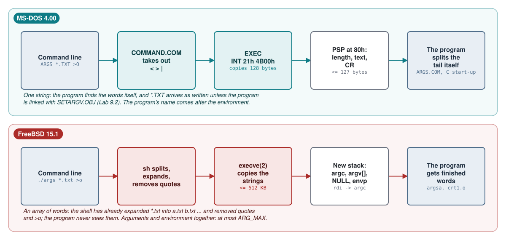
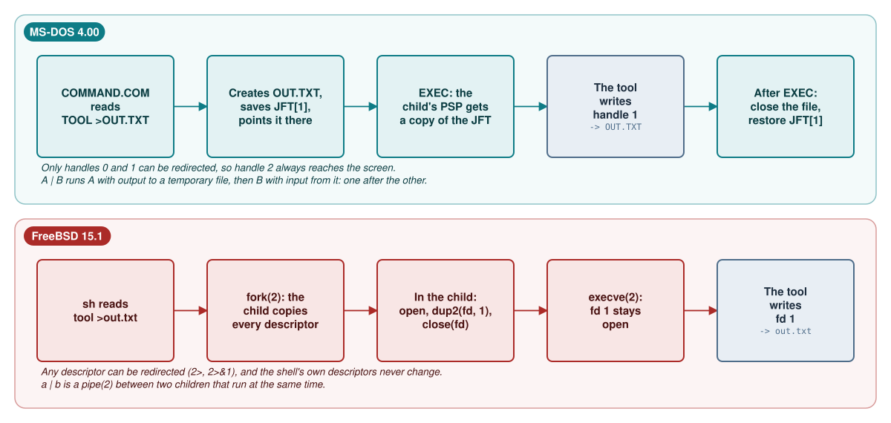
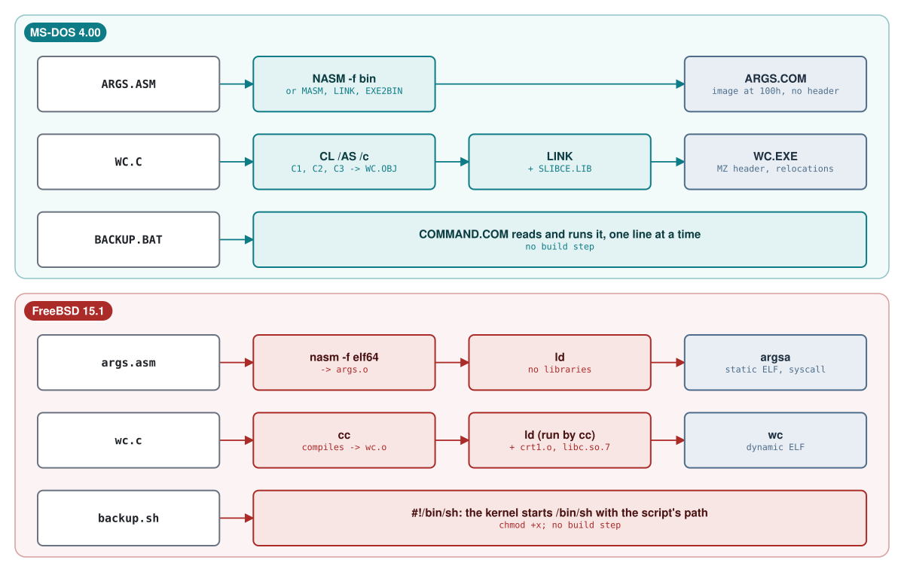
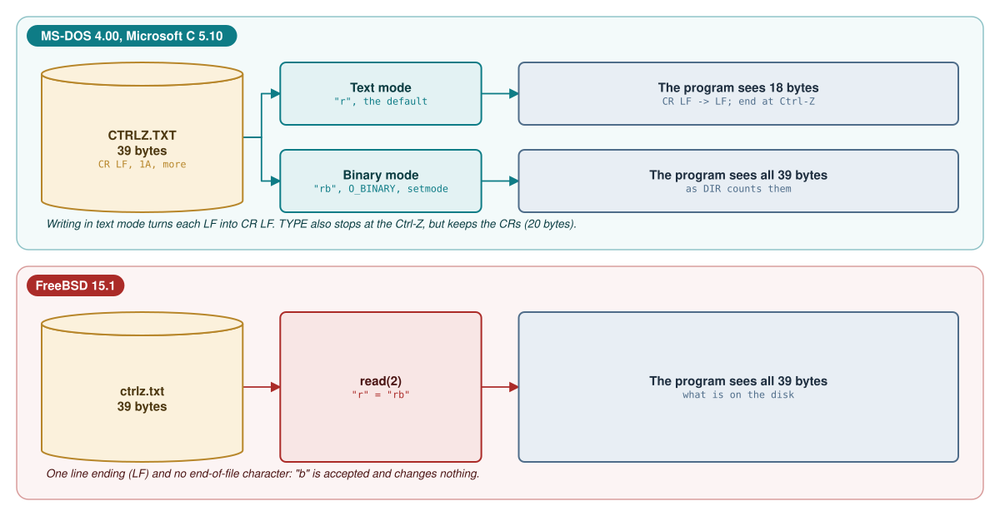
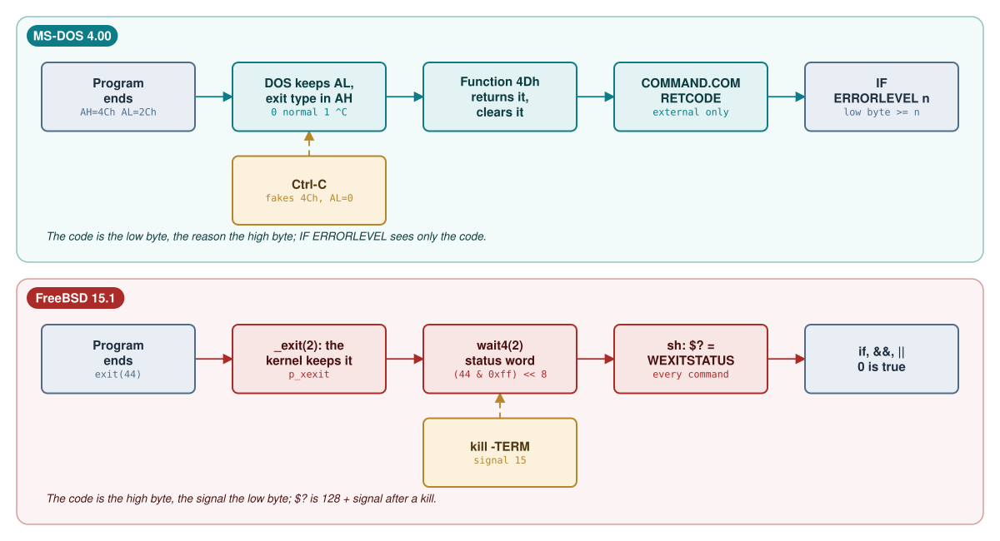

# Module 9: Toolsmith: the same tools on both systems

This is the capstone of the course. Instead of reading one more part of the two systems, you build small,
useful command-line tools on both of them, the way their own utilities are built: in assembly, in C, and in
the shell's script language (`.BAT` files on MS-DOS 4.00, `sh` scripts on FreeBSD 15.1). Six tools, each
written for both systems, exercise every interface a tool depends on: how the arguments arrive, what the
standard handles are and who redirects them, how an exit code travels back to the shell, how text files
differ from binary files, how much memory a program gets, and how each system turns source text into
something it can run.

Every MS-DOS program in this module was built with the 1988 toolchain (`tools/dos_tools.py`, or NASM for
`.COM` files) and run on the real MS-DOS 4.00 (`tools/dos_run.py`); every FreeBSD program was built and run
in the course VM. All outputs are captured, not typed. Where MS-DOS 4.00 did something its own documentation
does not promise, the source code explains why, and the text says so.

**Learning goals.** After this module you can:

- name, for each system, the exact mechanism that delivers arguments, the environment, the standard handles
  and the exit code to a program, and point to the source code that implements it;
- write the same tool in assembly, in C and as a script on both systems, and choose the language that fits;
- parse a DOS command tail and walk a FreeBSD `argc`/`argv`/`envp` stack without any library;
- explain text and binary mode on MS-DOS (CR LF, Ctrl-Z, the C runtime's translation) and why FreeBSD has
  no such distinction;
- follow an exit code from `INT 21h` function 4Ch to `IF ERRORLEVEL`, and from `exit(3)` through `wait(2)`
  to `$?`, including what happens to values above 255 and to programs killed by Ctrl-C or a signal;
- write batch files and `sh` scripts that check every step, report what they did and return a meaningful
  exit code;
- test a tool by redirecting its input from files and comparing its output with a reference, on a system
  where you cannot type at the keyboard;
- discover and document a system's limitations from its source instead of from folklore.

**Prerequisites.** Module 3 (COMMAND.COM and `sh`: parsing, redirection, pipes, batch files, the
environment), Module 4 (8086 and amd64 assembly), Module 5 (the toolchains, memory models, `.COM`, MZ and ELF,
start-up code), Module 6 (the console and `termios`) and Module 8 (the DOS memory arena). You need the MS-DOS
tools from Module 0 and the FreeBSD VM with `nasm`.

## 9.1 What a tool needs from the operating system

A command-line tool has a small contract with the system that starts it. It receives some text that the user
typed (its arguments) and a set of named strings (its environment). It finds three streams already open:
input, output and errors. It may open files by name, it uses some memory, and when it finishes it hands back
one small number. Neither kernel knows anything about options, wildcards or quoting; those are conventions of
the shell and of the C library. Table 9.1 lists the mechanism behind each part of the contract.

**Table 9.1** -- The contract between a tool and the system

| Need | MS-DOS 4.00 | FreeBSD 15.1 |
|---|---|---|
| Arguments | One string in the 128 bytes at PSP offset 80h: a length byte, then at most 127 bytes of text ending in a CR. `EXEC` copies 128 bytes from the caller (Listing 9.1) | An array of separate NUL-terminated strings; `argc` and `argv` on the new stack (Listing 9.2); arguments and environment together up to `ARG_MAX`, 512 KB ([`syslimits.h` line 44](https://github.com/freebsd/freebsd-src/blob/96841ea08dcfa84b954a32dc5ae1a26c28966cf4/sys/sys/syslimits.h#L44)) |
| Splitting and wildcards | The program: C start-up code splits the tail into `argv` (Module 5); wildcards only if the program asks | The shell, before `execve` (Module 3); the program receives finished words |
| Program name | After the environment strings, as a full path (Module 3, section 3.7) | `argv[0]`, whatever the caller chose; the kernel also passes the path as `AT_EXECPATH` in the auxiliary vector ([`imgact_elf.c` line 1473](https://github.com/freebsd/freebsd-src/blob/96841ea08dcfa84b954a32dc5ae1a26c28966cf4/sys/kern/imgact_elf.c#L1473)) |
| Environment | A segment of `NAME=value` strings; its address is the word at PSP offset 2Ch ([`PDB.INC` line 27](https://github.com/microsoft/MS-DOS/blob/2d04cacc5322951f187bb17e017c12920ac8ebe2/v4.0/src/INC/PDB.INC#L27)) | `envp`, right after the NULL that ends `argv` ([`kern_exec.c` lines 1810-1824](https://github.com/freebsd/freebsd-src/blob/96841ea08dcfa84b954a32dc5ae1a26c28966cf4/sys/kern/kern_exec.c#L1810-L1824)) |
| Standard streams | Handles 0-4 (input, output, error, AUX, PRN) in the 20-entry Job File Table at PSP offset 18h ([`PDB.INC` lines 8 and 22](https://github.com/microsoft/MS-DOS/blob/2d04cacc5322951f187bb17e017c12920ac8ebe2/v4.0/src/INC/PDB.INC#L8-L22)) | Descriptors 0, 1 and 2, inherited through `fork` and `execve` (Module 3) |
| First instruction | `.COM`: CS = DS = ES = SS = PSP, IP = 100h, SP near the top of the segment (Listing 9.14) | `rip` = ELF entry point, `rdi` = address of `argc` (Listing 9.3) |
| Exit code | `INT 21h` function 4Ch with the code in AL; DOS keeps AL plus an exit type in AH (Listing 9.9); the parent asks with function 4Dh | `_exit(rval)`; the kernel keeps `rval` ([`kern_exit.c` line 305](https://github.com/freebsd/freebsd-src/blob/96841ea08dcfa84b954a32dc5ae1a26c28966cf4/sys/kern/kern_exit.c#L305)) and hands 8 bits of it to `wait4` (Listing 9.12) |
| Memory | A `.COM` program receives the largest free block; an `.EXE` what its header asks for (Modules 5 and 8) | A private virtual address space, bounded by resource limits (section 9.5) |

On MS-DOS the arguments are a single line of text. `COMMAND.COM` removes the redirections from the line
(Module 3, section 3.4), builds a command tail and calls `EXEC`, which copies it into the new program's PSP
together with two FCBs parsed from the first two words, a convention left over from CP/M:

**Listing 9.1** -- EXEC copies the command tail into the new PSP at 80h ([`EXEC.ASM` lines 719-727](https://github.com/microsoft/MS-DOS/blob/2d04cacc5322951f187bb17e017c12920ac8ebe2/v4.0/src/DOS/EXEC.ASM#L719-L727))

```asm
        POP     SI                      ; get block (last time)
        POP     DS
        LDS     SI,[SI.exec0_com_line]  ; command line
;
; DS points to user space 80 command line
;
        OR      CL,80h
        MOV     DI,CX
        REP     MOVSB                   ; Wham!
```

CX is zero after the previous FCB copy, so `OR CL,80h` makes it 128: the count and the destination offset are
the same number. Whatever follows the command name, up to the CR, is now at `PSP:81h`, with its length at
`PSP:80h`. Splitting it into words is the program's business. A program written in assembly does it by hand
(Lab 9.1); a C program gets `argc` and `argv` from the start-up code, which splits the tail at blanks and
handles double quotes (Module 5, section 5.5). Even the program's own name is not in the tail: `EXEC` writes
it after the environment strings (Module 3, section 3.7).

On FreeBSD the shell has already split the line into words, expanded the wildcards and removed the quotes.
`execve` copies the finished strings to the top of the new stack and builds the vectors below them:

**Listing 9.2** -- `exec_copyout_strings` builds `argv` on the new process's stack ([`kern_exec.c` lines 1795-1808](https://github.com/freebsd/freebsd-src/blob/96841ea08dcfa84b954a32dc5ae1a26c28966cf4/sys/kern/kern_exec.c#L1795-L1808))

```c
        /*
         * Fill in argument portion of vector table.
         */
        for (; argc > 0; --argc) {
                if (suword(vectp++, ustringp) != 0)
                        return (EFAULT);
                while (*stringp++ != 0)
                        ustringp++;
                ustringp++;
        }

        /* a null vector table pointer separates the argp's from the envp's */
        if (suword(vectp++, 0) != 0)
                return (EFAULT);
```

The environment pointers follow the same way, then the auxiliary vector. Finally the ELF image activator
stores `argc` in the word below `argv`
([`imgact_elf.c` lines 1536-1546](https://github.com/freebsd/freebsd-src/blob/96841ea08dcfa84b954a32dc5ae1a26c28966cf4/sys/kern/imgact_elf.c#L1536-L1546)),
and the machine-dependent code sets the first registers:

**Listing 9.3** -- The first registers of a new amd64 process ([`exec_machdep.c` lines 433-436](https://github.com/freebsd/freebsd-src/blob/96841ea08dcfa84b954a32dc5ae1a26c28966cf4/sys/amd64/amd64/exec_machdep.c#L433-L436))

```c
        regs->tf_rip = imgp->entry_addr;
        regs->tf_rsp = ((stack - 8) & ~0xFul) + 8;
        regs->tf_rdi = stack;           /* argv */
        regs->tf_rflags = PSL_USER | saved_rflags;
```

`rdi` points at `argc`, with `argv[0]` at `rdi+8`. `rsp` is the same address rounded so that the stack is
aligned the way the amd64 calling convention expects at a function entry, which means it can be 8 bytes
*below* `argc`. The C start-up code in `crt1.o` uses `rdi` (Module 5, section 5.5), and so must an assembly
program that has no start-up code (Lab 9.1). Figure 9.1 puts the two paths side by side.



The three standard streams are set up the same way on both systems: the shell arranges them *before* the
program starts, and the program inherits them. `COMMAND.COM` edits its own Job File Table, so that handle 0
or 1 refers to the file named after `<` or `>`, calls `EXEC` (the child receives a copy of the table) and
puts the table back afterwards (Module 3, section 3.4). `sh` forks; the child opens the file, moves it to
descriptor 0 or 1 with `dup2`, and calls `execve`. Either way the tool just reads handle 0 and writes handle
1, and does not know where they lead unless it asks: `INT 21h` function 4400h (IOCTL "get device
information") on MS-DOS, `isatty(3)` on FreeBSD. `ASK` (Lab 9.6) needs to ask. Two differences matter for
tools. `COMMAND.COM` can redirect only handles 0 and 1, so an error message written to handle 2 always
reaches the screen; `sh` can redirect any descriptor (`2>`). And a DOS "pipe" is two temporary files and
two programs run one after the other (Module 3, section 3.5), so a tool in the middle of a DOS pipeline
reads a file that has already been completely written.



## 9.2 Three ways to build a tool on each system

Each system offers three ways to turn source text into a tool: assembly without any library, C with its
library, and a script that the shell interprets. Figure 9.3 shows the six pipelines; Table 9.2 summarises
what each produces.



**Table 9.2** -- What each pipeline produces

| | MS-DOS 4.00 | FreeBSD 15.1 |
|---|---|---|
| Assembly, no library | `nasm -f bin` writes a `.COM` file: a memory image loaded at offset 100h, no header, no linker. Or MASM, LINK and EXE2BIN (Module 5) | `nasm -f elf64` writes an object file; `ld` makes a static ELF executable that contains only your code and talks to the kernel with `syscall` |
| C | `CL /AS` compiles to an `.OBJ` and LINK adds `SLIBCE.LIB`, giving an MZ `.EXE` with relocations and the C start-up code | `cc` compiles and links against `crt1.o` and `libc.so.7`; the run-time linker finishes the job at start-up (Module 5) |
| Script | A `.BAT` file, read and interpreted by `COMMAND.COM` one line at a time (Module 3, section 3.6) | A text file with execute permission whose first line is `#!/bin/sh`; the kernel starts `/bin/sh` with the script's path |
| How the shell finds it | Current directory, then each `PATH` directory; in each directory `.COM` before `.EXE` before `.BAT` (Listing 9.4) | Each `PATH` directory in order; the current directory only if it is in `PATH`; the kernel decides by content, not by name |

On MS-DOS the extension decides how a file is run, and the search prefers some extensions to others:

**Listing 9.4** -- COMMAND.COM's search order ([`PATH2.ASM` lines 84-96](https://github.com/microsoft/MS-DOS/blob/2d04cacc5322951f187bb17e017c12920ac8ebe2/v4.0/src/CMD/COMMAND/PATH2.ASM#L84-L96))

```asm
;----------------------------------------------------------------------------
;   SEARCH, when given a pathname, attempts to find a file with
; one of the following extensions:  .com, .exe, .bat (highest to
; lowest priority).  Where conflicts arise, the extension with
; the highest priority is favored.
; ENTRY:
;   DX          --      pointer to null-terminated pathname
;   fbuf        --      dma buffer for findfirst/next
; EXIT:
;   AX          --      8)  file found with .com extension
;                       4)  file found with .exe extension
;                       2)  file found with .bat extension
;                       0)  no such file to be found
```

This matters as soon as two versions of a tool live in one directory. If `ARGS.COM` (assembly) and
`ARGS.EXE` (C) are both there, `ARGS` runs the `.COM`; you must type `ARGS.EXE` for the other one, which the
same routine honours (an explicit extension sets `ext_entered`). The lab disk also holds MS-DOS's own
`BACKUP.COM`, so a batch file called `BACKUP.BAT` in the same directory can only be started as
`BACKUP.BAT` (Lab 9.7). FreeBSD has the same trap in another form: a script called `test` in your
directory loses to the shell's `test` builtin.

On FreeBSD the kernel looks at the first bytes of the file. An ELF header goes to the ELF image activator; the
two characters `#!` go to the shell image activator, which rewrites the argument list:

**Listing 9.5** -- How the kernel runs a script ([`imgact_shell.c` lines 64-82](https://github.com/freebsd/freebsd-src/blob/96841ea08dcfa84b954a32dc5ae1a26c28966cf4/sys/kern/imgact_shell.c#L64-L82))

```c
 * If the given file is a shell-script, then the first line will start
 * with the two characters `#!' (aka SHELLMAGIC), followed by the name
 * of the shell-interpreter to run, followed by zero or more tokens.
 *
 * The interpreter is then started up such that it will see:
 *    arg[0] -> The name of interpreter as specified after `#!' in the
 *              first line of the script.  The interpreter name must
 *              not be longer than MAXSHELLCMDLEN bytes.
 *    arg[1] -> *If* there are any additional tokens on the first line,
 *              then we add a new arg[1], which is a copy of the rest of
 *              that line.  The copy starts at the first token after the
 *              interpreter name.  We leave it to the interpreter to
 *              parse the tokens in that value.
 *    arg[x] -> the full pathname of the script.  This will either be
 *              arg[2] or arg[1], depending on whether or not tokens
 *              were found after the interpreter name.
 *  arg[x+1] -> all the arguments that were specified on the original
 *              command line.
 *
```

A script is therefore a program like any other: it can be started by `execve`, appears in `ps` under its
interpreter's name, and returns an exit status through `wait`. A `.BAT` file is none of these. Only
`COMMAND.COM` can run it, it is not a process, and it has no exit code of its own (section 9.4 and Lab 9.7).

The three pipelines also differ in size, start-up cost and what you can reach. The assembly `ARGS.COM` of
Lab 9.1 is 251 bytes, all of them code and strings; the C `ARGS.EXE` is 7,287 bytes because it carries the
start-up code and `printf`. The FreeBSD assembly version is a static ELF file of 2,176 bytes of which 264
are code: the rest is headers and symbols, and `strip` brings it down to 960. The C version is smaller than
on MS-DOS (9,984 bytes) only because `printf` stays in the shared `libc.so` (Table 9.5 in section 9.6 has
all the measured sizes). C buys portability: the same `WC.C` compiles on both systems with one `#ifdef`
(Lab 9.3). Scripts buy the existing tools: `BACKUP.BAT` copies files with `XCOPY` and compares them with `FC`
instead of reimplementing either.

## 9.3 Text and binary

The MS-DOS kernel, like FreeBSD's, stores and returns bytes: `INT 21h` function 3Fh reads exactly what is in
the file. Text is a convention on top. MS-DOS inherited two conventions from CP/M: lines end with CR LF
(0Dh 0Ah), and Ctrl-Z (1Ah) marks the end of a text file, because CP/M recorded file sizes only in 128-byte
records and padded the last record with Ctrl-Z. FAT records sizes to the byte, so the Ctrl-Z is no longer
needed, but much DOS software still writes it and still stops reading when it sees one. The console device
in cooked mode reports end of file on Ctrl-Z (Module 6, section 6.5), and so does `TYPE`:

**Listing 9.6** -- TYPE stops at the first Ctrl-Z ([`TCMD1B.ASM` lines 417-440](https://github.com/microsoft/MS-DOS/blob/2d04cacc5322951f187bb17e017c12920ac8ebe2/v4.0/src/CMD/COMMAND/TCMD1B.ASM#L417-L440))

```asm
        mov     ah,read
        int     int_command
        jc      typerr                          ;AN022; Exit if error
        mov     cx,ax
        jcxz    typelp_ret                      ;AC000; exit if nothing read
        push    ds
        pop     es                              ; Check to see if a ^Z was read.
assume es:nothing
        xor     di,di
        push    ax
        mov     al,1ah
        repnz   scasb
        pop     ax
        xchg    ax,cx
        cmp     ax,0
        jnz     foundz                          ; Yes, handle it
        cmp     byte ptr [di-1],1ah             ; No, double check
        jnz     typecont2                       ; No ^Z, continue

foundz:
        sub     cx,ax                           ; Otherwise change cx so that only those
        dec     cx                              ;  bytes up to but NOT including the ^Z
        push    cs                              ;  will be typed.
        pop     es
```

`COPY` has both behaviours. With `/A` ("ASCII") it reads a source only up to the first Ctrl-Z
([`COPY.ASM` lines 739-752](https://github.com/microsoft/MS-DOS/blob/2d04cacc5322951f187bb17e017c12920ac8ebe2/v4.0/src/CMD/COMMAND/COPY.ASM#L739-L752))
and appends one Ctrl-Z to an ASCII destination
([`COPY.ASM` line 801](https://github.com/microsoft/MS-DOS/blob/2d04cacc5322951f187bb17e017c12920ac8ebe2/v4.0/src/CMD/COMMAND/COPY.ASM#L801));
with `/B`, the default when one file is copied to another, it copies bytes. Concatenation (`COPY A+B C`)
defaults to ASCII. `CTRLZ.TXT` in `labs/09-toolsmith/dos` has two lines, a Ctrl-Z and a third line:

**Output 9.1** -- TYPE, COPY /A and COPY on a file with an embedded Ctrl-Z (MS-DOS 4.00)

```text
---- TYPE CTRLZ.TXT
line one
line two
---- COPY /A CTRLZ.TXT ZA.TXT
        1 File(s) copied
---- COPY CTRLZ.TXT ZB.TXT
        1 File(s) copied
---- DIR *Z*.TXT

 Volume in drive A is DOS400LAB
 Volume Serial Number is 1988-0400
 Directory of  A:\

CTRLZ    TXT        39 04-25-24  12:00p
ZA       TXT        21 04-25-24  12:00p
ZB       TXT        39 04-25-24  12:00p
        3 File(s)     273920 bytes free
---- FC /B CTRLZ.TXT ZA.TXT
fc: CTRLZ.TXT longer than ZA.TXT
```

The ASCII copy has 20 bytes of text plus the Ctrl-Z that `COPY` added; the third line is gone. A tool that
treats every file as text would lose data in the same way, and that is exactly what the Microsoft C runtime
does by default. Every stream and every `open`ed file is in *text mode* unless the program says otherwise:

**Listing 9.7** -- Text mode in Microsoft C 5.10 ([`FCNTL.H` lines 22-27](https://github.com/microsoft/MS-DOS/blob/2d04cacc5322951f187bb17e017c12920ac8ebe2/v4.0/src/TOOLS/BLD/INC/FCNTL.H#L22-L27))

```c
/* O_TEXT files have <cr><lf> sequences translated to <lf> on read()'s,
** and <lf> sequences translated to <cr><lf> on write()'s
*/

#define O_TEXT      0x4000  /* file mode is text (translated) */
#define O_BINARY    0x8000  /* file mode is binary (untranslated) */
```

The header does not mention Ctrl-Z, and the runtime's source is not part of the MS-DOS tree, so Lab 9.4
measures it: in text mode a read stops at the first Ctrl-Z, as `TYPE` does. A program chooses binary mode in
one of four ways: `"rb"` or `"wb"` in `fopen`; `O_BINARY` in `open`; `setmode(fileno(stdin), O_BINARY)` for a
stream that is already open ([`IO.H` line 38](https://github.com/microsoft/MS-DOS/blob/2d04cacc5322951f187bb17e017c12920ac8ebe2/v4.0/src/TOOLS/BLD/INC/IO.H#L38));
or the global default `_fmode`
([`STDLIB.H` line 87](https://github.com/microsoft/MS-DOS/blob/2d04cacc5322951f187bb17e017c12920ac8ebe2/v4.0/src/TOOLS/BLD/INC/STDLIB.H#L87)),
which linking with `BINMODE.OBJ` sets to binary. A hex dump must see every byte, so `HD` (Lab 9.4) uses
`"rb"` for files and `setmode` for standard input. `WC` is a text tool, but it must also count bytes the
way `DIR` does, so it reads in binary mode too and counts LF characters as lines. Figure 9.4 shows the
translation.



FreeBSD has one line ending, LF, and no end-of-file character; `fopen` accepts `"b"` because ISO C requires
it, and ignores it:

**Listing 9.8** -- FreeBSD's `fopen` ignores the binary flag ([`flags.c` lines 77-82](https://github.com/freebsd/freebsd-src/blob/96841ea08dcfa84b954a32dc5ae1a26c28966cf4/lib/libc/stdio/flags.c#L77-L82))

```c
        do {
                known = 1;
                switch (*mode++) {
                case 'b':
                        /* 'b' (binary) is ignored */
                        break;
```

The difference shows up when files cross between the systems. A DOS text file on FreeBSD has a CR before
every LF: `wc -l` still counts the lines correctly, but `wc -c` counts one byte more per line, a shell
script with CR LF endings fails with confusing errors (`sh` sees `fi\r`, not `fi`), and a stray Ctrl-Z at the
end is just one more byte. Lab 9.3 counts the same test file on both systems.

## 9.4 Exit codes end to end

An exit code is the one number a tool can return to whoever started it. On MS-DOS a program ends with
`INT 21h` function 4Ch and the code in AL. `$EXIT` notes whether the program is ending normally or because of
Ctrl-C ([`PROC.ASM` lines 129-144](https://github.com/microsoft/MS-DOS/blob/2d04cacc5322951f187bb17e017c12920ac8ebe2/v4.0/src/DOS/PROC.ASM#L129-L144)),
and the common termination code stores the type next to the code:

**Listing 9.9** -- DOS keeps the exit code in AL and the exit type in AH ([`PROC.ASM` lines 164-170](https://github.com/microsoft/MS-DOS/blob/2d04cacc5322951f187bb17e017c12920ac8ebe2/v4.0/src/DOS/PROC.ASM#L164-L170))

```asm
; from exit_type.  Also, the PDB at user_CS needs to be correct as the one
; that is terminating.
;
        entry   abort_inner

        MOV     AH,[exit_type]
        MOV     [exit_code],AX
```

The types are 0 for a normal end, 1 for Ctrl-C, 2 for a critical error and 3 for terminate-and-stay-resident
([`EXE.INC` lines 42-46](https://github.com/microsoft/MS-DOS/blob/2d04cacc5322951f187bb17e017c12920ac8ebe2/v4.0/src/INC/EXE.INC#L42-L46)).
When `EXEC` returns, `COMMAND.COM` asks for the code with function 4Dh, which returns the word *and clears
it* ([`PROC.ASM` lines 62-66](https://github.com/microsoft/MS-DOS/blob/2d04cacc5322951f187bb17e017c12920ac8ebe2/v4.0/src/DOS/PROC.ASM#L62-L66)),
and saves it in `RETCODE`:

**Listing 9.10** -- COMMAND.COM saves the exit code of an external command ([`COMMAND1.ASM` lines 455-468](https://github.com/microsoft/MS-DOS/blob/2d04cacc5322951f187bb17e017c12920ac8ebe2/v4.0/src/CMD/COMMAND/COMMAND1.ASM#L455-L468))

```asm
EXT_EXEC:
        push    dx                              ;AN000; save the command name offset
        INT     int_command                     ; Do the EXEC
        pop     dx                              ;AN000; restore the command name offset
        JC      EXEC_ERR                        ; EXEC failed
;
; The exec has completed.  Retrieve the exit code.
;
EXEC_WAIT:
        push    cs                              ;AC000; get resident segment
        pop     ds                              ;AC000;     into DS
        MOV     AH,WAITPROCESS                  ;AC000; Get errorlevel
        INT     int_command                     ; Get the return code
        MOV     [RETCODE],AX
```

This is the only place that sets `RETCODE`. Internal commands (`COPY`, `ECHO`, `DEL`, `IF` ...) never change it,
and a command that is not found leaves it alone too: "Bad command or file name" is printed on standard error
([`TMISC1.ASM` lines 354-360](https://github.com/microsoft/MS-DOS/blob/2d04cacc5322951f187bb17e017c12920ac8ebe2/v4.0/src/CMD/COMMAND/TMISC1.ASM#L354-L360)),
and the old value survives. A batch file reads `RETCODE` with `IF ERRORLEVEL n`:

**Listing 9.11** -- `IF ERRORLEVEL n` means "exit code >= n", with n taken modulo 256 ([`TBATCH2.ASM` lines 407-435](https://github.com/microsoft/MS-DOS/blob/2d04cacc5322951f187bb17e017c12920ac8ebe2/v4.0/src/CMD/COMMAND/TBATCH2.ASM#L407-L435))

```asm
IFERLEV:
        MOV     BH,10
        XOR     BL,BL

GETNUMLP:
        LODSB
        CMP     AL,0DH
        jz      iferrorj3
        invoke  DELIM
        JZ      GOTNUM
        SUB     AL,'0'
        XCHG    AL,BL
        MUL     BH
        ADD     AL,BL
        XCHG    AL,BL
        JMP     SHORT GETNUMLP

GOTNUM:
        PUSH    DS
        MOV     DS,[RESSEG]
ASSUME  DS:RESGROUP
        MOV     AH,BYTE PTR [RETCODE]
        POP     DS
ASSUME  DS:TRANGROUP
        XOR     AL,AL
        CMP     AH,BL
        JAE     IFRET
        DEC     AL
        JMP     SHORT IFRET
```

Three facts follow from this code. The test is `JAE`, "greater than or equal", so a batch file must test the
largest value first. Only the low byte of `RETCODE` is compared, so the exit type in AH is invisible: when
DOS stops a program for Ctrl-C (or a divide overflow) it fakes a function 4Ch call with AL = 0
([`CTRLC.ASM` lines 343-346](https://github.com/microsoft/MS-DOS/blob/2d04cacc5322951f187bb17e017c12920ac8ebe2/v4.0/src/DOS/CTRLC.ASM#L343-L346)),
so an interrupted program looks exactly like one that succeeded. And the number after `ERRORLEVEL` is
accumulated in an 8-bit register without any check, so `IF ERRORLEVEL 300` is `IF ERRORLEVEL 44`
(300 - 256), and a non-digit is silently "converted" too. `labs/09-toolsmith/dos` contains `RC.ASM`, a 36-byte
`.COM` program that exits with the number on its command line, and `EXITDEMO.BAT`, which tries each case:

**Output 9.2** -- `COMMAND /C EXITDEMO` (MS-DOS 4.00; `RC.COM` built with `nasm -f bin`)

```text
after RC 44:  IF ERRORLEVEL 44 is true
after RC 44:  IF NOT ERRORLEVEL 45 is true
after RC 44:  IF ERRORLEVEL 300 is true
an internal command
after ECHO:   ERRORLEVEL is still 44 or more
after RC 300: IF ERRORLEVEL 44 is true
after NOSUCH: ERRORLEVEL is still 44 or more
after RC 0:   IF NOT ERRORLEVEL 1 is true
```

`RC 300` computes 300 in 16 bits but can pass only AL, 2Ch = 44, to DOS. The "Bad command or file name"
message for `NOSUCH` is missing from the output because `dos_run.py` captures only standard output.

On FreeBSD, `exit(3)` flushes the C streams and calls `_exit(2)`; the system call stores the full `int`
(Table 9.1). When the parent's `wait4` collects the child, the kernel packs the low 8 bits of the code and the
number of the signal that killed the child, if any, into one status word:

**Listing 9.12** -- Only 8 bits of the exit code reach the parent ([`wait.h` lines 140-147](https://github.com/freebsd/freebsd-src/blob/96841ea08dcfa84b954a32dc5ae1a26c28966cf4/sys/sys/wait.h#L140-L147))

```c
#if defined(_KERNEL) || defined(_WANT_KW_EXITCODE)

/*
 * Clamp the return code to the low 8 bits from full 32 bit value.
 * Should be used in kernel to construct the wait(2)-compatible process
 * status to usermode.
 */
#define KW_EXITCODE(ret, sig)   W_EXITCODE((ret) & 0xff, (sig))
```

`W_EXITCODE` is `(ret) << 8 | (sig)`, and `WEXITSTATUS` shifts it back
([`wait.h` lines 58-63](https://github.com/freebsd/freebsd-src/blob/96841ea08dcfa84b954a32dc5ae1a26c28966cf4/sys/sys/wait.h#L58-L63)).
The layout is the mirror image of DOS's: DOS puts the code in the low byte and the reason in the high byte;
FreeBSD puts the code in the high byte and the signal in the low byte. `sh` turns the status into `$?`:

**Listing 9.13** -- `sh` converts a wait status to `$?` ([`jobs.c` lines 1102-1113](https://github.com/freebsd/freebsd-src/blob/96841ea08dcfa84b954a32dc5ae1a26c28966cf4/bin/sh/jobs.c#L1102-L1113))

```c
        status = getjobstatus(jp);
        if (signaled != NULL)
                *signaled = WIFSIGNALED(status);
        /* convert to 8 bits */
        if (WIFEXITED(status))
                st = WEXITSTATUS(status);
#if JOBS
        else if (WIFSTOPPED(status))
                st = WSTOPSIG(status) + 128;
#endif
        else
                st = WTERMSIG(status) + 128;
```

Unlike `RETCODE`, `$?` is set by *every* command, builtins included, and a command that cannot be found sets
it to 127. `exitdemo.sh` and `status.c` in `labs/09-toolsmith/freebsd` show both levels:

**Output 9.3** -- `sh exitdemo.sh`, then `./status N` for several N (captured in the course VM)

```text
after exit 44:        $? = 44
after exit 300:       $? = 44
after kill -TERM:     $? = 143
after false:          $? = 1
after echo:           $? = 0
after nosuch:         $? = 127
after [ 1 -gt 2 ]:    $? = 1
else branch, $? = 3
status 0x2c00: exited, WEXITSTATUS = 44
status 0x2c00: exited, WEXITSTATUS = 44
status 0x000f: killed by signal 15
status 0x0000: exited, WEXITSTATUS = 0
Terminated
```

(`Terminated` is `sh`'s report, on standard error, about the child it killed; the capture collects standard
error separately and appends it.) `exit 300` gives 44 on both systems, for the same reason: only 8 bits
travel. Figure 9.5 shows the two paths, and Table 9.3 the conventions that tools and scripts build on them.



**Table 9.3** -- Exit code conventions

| | MS-DOS 4.00 | FreeBSD 15.1 |
|---|---|---|
| Success | 0 | 0, and `if`, `&&`, `||` and `while` test for it |
| How a script tests | `IF ERRORLEVEL n` (>= n): test the largest value first; `IF NOT ERRORLEVEL 1` means "is 0" | `$?`, `if cmd`, `case $? in` |
| Set by | external programs only | every command, builtins included |
| Command not found | message on standard error, `ERRORLEVEL` unchanged | 127 (126 if found but not executable) |
| Killed | Ctrl-C: code 0, type 1 in AH, invisible to `IF ERRORLEVEL` | 128 + signal number |
| Values above 255 | low byte only (AL) | low byte only (`& 0xff`) |
| A script's own code | none: the last external program's code is what the caller sees (Lab 9.7) | `exit n`, or the status of the last command |

The table also explains a habit of DOS utilities: many of them return 0 no matter what, because nobody
could rely on exit codes anyway. `FIND` documents "0 - OK, and some matches" in its header and leaves 1
blank ([`FIND.ASM` lines 37-41](https://github.com/microsoft/MS-DOS/blob/2d04cacc5322951f187bb17e017c12920ac8ebe2/v4.0/src/CMD/FIND/FIND.ASM#L37-L41)),
but the only values its code ever stores in the `errlevel` byte are 0 and, when the command line itself is
wrong, 2 ([`FIND.ASM` line 1592](https://github.com/microsoft/MS-DOS/blob/2d04cacc5322951f187bb17e017c12920ac8ebe2/v4.0/src/CMD/FIND/FIND.ASM#L1592)).
So "no line matched" also returns 0, and so does a file that cannot be opened: `FIND` prints "File not
found", goes on with the next name and finally stores 0
([`FIND.ASM` lines 955-965](https://github.com/microsoft/MS-DOS/blob/2d04cacc5322951f187bb17e017c12920ac8ebe2/v4.0/src/CMD/FIND/FIND.ASM#L955-L965)).
Lab 9.7 finds the same kind of gap in `XCOPY`. `FC` is
better: it calls `exit(1)` when the files differ or cannot be opened, and `usage(NoDif, 0)` when they are
equal ([`FC.C` lines 468-473](https://github.com/microsoft/MS-DOS/blob/2d04cacc5322951f187bb17e017c12920ac8ebe2/v4.0/src/CMD/FC/FC.C#L468-L473)).

## 9.5 Memory limits

A `.COM` program is a memory image with no header, so DOS cannot know how much memory it needs and gives it
all: `EXEC` allocates the largest free block ([`EXEC.ASM` lines 558-568](https://github.com/microsoft/MS-DOS/blob/2d04cacc5322951f187bb17e017c12920ac8ebe2/v4.0/src/DOS/EXEC.ASM#L558-L568)),
reads at most 64 KB minus the PSP, and puts the stack at the end of what it could have read:

**Listing 9.14** -- The initial registers of a `.COM` program ([`EXEC.ASM` lines 597-612](https://github.com/microsoft/MS-DOS/blob/2d04cacc5322951f187bb17e017c12920ac8ebe2/v4.0/src/DOS/EXEC.ASM#L597-L612))

```asm
        CMP     AX,SI                   ; did we read them all?
        JZ      exec_no_memj            ; exactly the wrong number... no memory
        TEST    BYTE PTR exec_func,exec_func_overlay
        JNZ     exec_set_PDB            ; no starto, chumo!
        MOV     AX,exec_DMA
        SUB     AX,10h
        MOV     exec_init_CS,AX
        MOV     exec_init_IP,100h       ; initial IP is 100
;
; SI is at most FF00h.  Add FE to account for PSP - word of 0 on stack.
;
        ADD     SI,0FEh                 ; make room for stack
        MOV     exec_init_SP,SI         ; max value for read is also SP!
        MOV     exec_init_SS,AX
        MOV     DS,AX
        MOV     WORD PTR [SI],0         ; 0 for return
```

With 64 KB or more free, SI is FF00h and SP becomes FFFEh, with a zero word on the stack so that a final
`RET` jumps to `PSP:0000`, where an `INT 20h` instruction ends the program. If the file fills the whole
read (65,280 bytes or more), `EXEC` fails with "insufficient memory": a `.COM` file must be smaller than
64 KB minus 256 bytes. Code, data and stack share one segment. The tools in this module need a few
hundred bytes of code, a buffer and a little stack, so the limit never bites; but a `.COM` program that wants
to start another program must first give memory back with function 4Ah, because it owns all of it.

A C program in the small model has one code segment and one data segment (DGROUP) of up to 64 KB each; the
stack and the near heap live in DGROUP, and the start-up code shrinks the program's block to what it needs
(Module 5, sections 5.3 and 5.5). Module 8 measured what that leaves for `malloc` (Lab 8.4), and its
Exercise 8.2 builds a full memory report; `SYSINFO` (Lab 9.5) only prints the largest free block. The
limit that matters most for the C tools here is the size of `int`: 16 bits in Microsoft C 5.10, so a
`WC` that counts bytes in an `int` is wrong for any file over 32,767 bytes. All counters in this module's
DOS tools are `unsigned long`, or 32-bit pairs of registers in assembly.

FreeBSD tools live in a private virtual address space of many terabytes, with limits set per process by
`setrlimit(2)`. The arguments may total 512 KB (Table 9.1), four thousand times the 127 bytes of a DOS
command line, which is why `sh` can expand `*.txt` in a directory of thousands of files and `COMMAND.COM`
cannot even try:

**Output 9.4** -- Limits of a FreeBSD process (captured in the course VM)

```text
# getconf ARG_MAX
524288
# limits | head -12
Resource limits (current):
  cputime              infinity secs
  filesize             infinity kB
  datasize             33554432 kB
  stacksize              524288 kB
  coredumpsize         infinity kB
  memoryuse            infinity kB
  memorylocked         infinity kB
  maxprocesses             6656
  openfiles               57870
  sbsize               infinity bytes
  vmemoryuse           infinity kB
```

A 32 GB data limit and a 512 MB stack limit on a VM with 2 GB of RAM are not promises; they are ceilings
for address space that will be backed by real pages only when touched (Module 8). For a tool that reads a
stream through a fixed buffer, as `WC` and `HD` do on both systems, the size of the input does not matter
at all; only the counters must be wide enough.

## 9.6 The six tools

The labs build six tools, each one for a different part of the interface between a program and its system.
`ARGS` shows how the arguments arrive. `WC` reads standard input or named files and must count past 32,767.
`HD` shows the bytes that text mode hides. `SYSINFO` asks the system about itself. `ASK` turns a key into an
exit code. `BACKUP` is a script that glues other programs together and has to trust their exit codes. Table
9.4 shows which versions exist and how each was built. Every cell was built and run on the system named in
its column: MS-DOS 4.00 through `dos_run.py`, FreeBSD 15.1 in the course VM. A dash means that the
combination teaches nothing new. `SYSINFO` in FreeBSD assembly would only call the same library routines,
and `ASK` in C would be the assembly version with a heavier start-up.

**Table 9.4** -- The tool matrix: MS-DOS 4.00 / FreeBSD 15.1 in each cell

| Tool | Labs | Assembly | C | Script |
|---|---|---|---|---|
| `ARGS` | 9.1, 9.2 | `ARGS.COM` (NASM) / `argsa` (`nasm`, `ld`) | `ARGS.EXE`, `ARGSW.EXE` with `SETARGV` (`CL`) / `args` (`cc`) | -- / -- |
| `WC` | 9.3 | `WCA.COM`, standard input only / `wca`, the same | `WC.EXE` and the text-mode `WCT.EXE` / `wc`, from the same source | -- / -- |
| `HD` | 9.4 | `HDA.COM` / `hda` | `HD.EXE` / `hd`, from the same source | -- / -- |
| `SYSINFO` | 9.5 | `SYSINFOA.COM` / -- | `SYSINFO.EXE` (`intdos`) / `sysinfo` | -- / -- |
| `ASK` | 9.6 | `ASK.COM` (MASM, `LINK`, `EXE2BIN`) / -- | -- / -- | `ASKDEMO.BAT` calls `ASK` / `ask.sh`, `askdemo.sh` |
| `BACKUP` | 9.7 | -- / -- | -- / -- | `BACKUP.BAT` with `XCOPY`, `FC`, `FIND`, `RC` / `backup.sh` |

`WC` and `HD` are one C source each. The only differences are the CR LF line ends and an `#ifdef MSDOS`
that calls `setmode` on MS-DOS. Microsoft C 5.10 defines `MSDOS` for every compilation (Lab 9.3).
Every other tool needs a separate source per system. The two assembly languages share no instruction that
talks to the system. And on MS-DOS `argv[0]` is already the full path of the program, which FreeBSD's
`args.c` has to ask the kernel for.

The sizes tell the same story as section 9.2. The DOS assembly tools are a few hundred bytes of instructions
and nothing else. The same tools in C are 7 to 10 KB, mostly `printf` and the start-up code that `LINK`
copies from `SLIBCE.LIB` into every program (Module 5). On FreeBSD, the assembly tools carry an ELF header,
program headers, a symbol table and section names: `strip` takes `argsa` from 2,176 to 960 bytes (Lab
9.1). The C tools are 10 to 12 KB even though `printf` stays in `libc.so.7`, because they contain the
start-up objects and the tables for the run-time linker:

**Table 9.5** -- Sizes of the built tools, in bytes

| Tool | MS-DOS, assembly | MS-DOS, C | FreeBSD, assembly | FreeBSD, C |
|---|---|---|---|---|
| `ARGS` | 251 | 7,287 (8,407 with `SETARGV`) | 2,176 | 9,984 |
| `WC` | 215 | 10,537 | 2,136 | 11,528 |
| `HD` | 254 | 9,721 | 2,384 | 12,048 |
| `SYSINFO` | 428 | 7,735 | -- | 11,176 |
| `ASK` | 377 | -- | -- | `ask.sh`: 1,186 |
| `BACKUP` | -- | -- | -- | `BACKUP.BAT`: 1,514; `backup.sh`: 989 |

**Conventions.** All tools follow the same few rules, so that scripts can use them:

- Results go to standard output, messages to standard error, in the form `wc: nosuch: cannot open`.
  On MS-DOS a message on standard error stays on the screen even when the output is redirected
  (section 9.1).
- A tool without a file name reads standard input, so it works in a pipe and under `<` on both systems.
  The assembly versions of `WC` and `HD` read only standard input.
- Exit code 0 means success, 1 means that something failed (a file that cannot be opened, a read error,
  a copy that failed) and 2 means wrong usage. `ASK` is the exception, because its codes are its answers:
  1 for the first key, 2 for the second and so on, 0 for "no answer" and 255 for wrong usage.
- `HD` and `WC` count bytes, not characters: `HD` opens files in binary mode, and `WC` reads standard input
  in binary mode too, so the counts are the same on both systems (section 9.3).
- On MS-DOS the assembly version gets an `A` at the end of its name (`WCA`, `HDA`, `SYSINFOA`) and lives
  next to the C version in the same directory. `ARGS` is the exception: `ARGS.COM` and `ARGS.EXE`
  differ only in their extension, and you must type `ARGS.EXE` to run the second one. On FreeBSD the
  assembly versions are `argsa`, `wca` and `hda`.

**The files.** `labs/09-toolsmith` has one directory per system. DOS files have 8.3 names and CR LF line
ends; FreeBSD files have LF. Copy the files you need to a work directory before you build. Some test files
have a CR LF and a LF version, because a test file must be in the format of the system that reads it:

**Table 9.6** -- What `labs/09-toolsmith` contains

| File (MS-DOS / FreeBSD) | What it is | Lab |
|---|---|---|
| `ARGS.ASM` / `args.asm` | starters: DOS: the program name and the walk over the tail; FreeBSD: the `argv` loop and the walk past `envp` to `AT_EXECPATH` | 9.1 |
| `ARGS.C` / `args.c` | starters: the `argv` loop (FreeBSD also: `elf_aux_info`) | 9.2 |
| `WC.C`, `WCA.ASM` / `wc.c`, `wca.asm` | starters: counting one byte (lines and words) | 9.3 |
| `HD.C`, `HDA.ASM` / `hd.c`, `hda.asm` | starters: one line of output, opening in binary mode, reading a full line | 9.4 |
| `SYSINFO.C`, `SYSINFOA.ASM` / `sysinfo.c` | starters: free disk space and free memory (`INT 21h` functions 36h and 48h; `statfs`) | 9.5 |
| `ASK.ASM`, `ASKDEMO.BAT` / `ask.sh`, `askdemo.sh` | starters: is standard input the keyboard, which key was typed, the `IF ERRORLEVEL` ladder, `case $?` | 9.6 |
| `STUFF.ASM`, `CCTEST.ASM` / -- | complete helpers: put keys into the keyboard buffer; test Ctrl-C at `ASK` | 9.6 |
| `BACKUP.BAT` / `backup.sh` | starters: the "same" test, the copy and its check, the exit code | 9.7 |
| `RC.ASM`, `EL.BAT`, `EXITDEMO.BAT` / `exitdemo.sh`, `status.c`, `rsprdi.asm` | complete helpers: exit with any code, print `ERRORLEVEL`, the demos of section 9.4 and Lab 9.1 | 9.1, 9.4, 9.7 |
| `POEM.TXT`, `CTRLZ.TXT` / `poem.txt` | text test inputs; `CTRLZ.TXT` has a Ctrl-Z in the middle | 9.2-9.4, 9.7 |
| `Y.ANS`, `N.ANS`, `JUNK.ANS`, `EMPTY.ANS` / `y.ans`, `n.ans`, `junk.ans`, `empty.ans` | answers for `ASK` (`EMPTY` has 0 bytes) | 9.6, 9.7 |
| `EXPECTED.TXT` / `expected.txt` | what the completed tools print on the test inputs | all |

**Checking your work.** `EXPECTED.TXT` and `expected.txt` were captured from the completed tools on the test
inputs. Build your tools as the labs say, then run the same commands and compare. On MS-DOS this is a single
`dos_run.py` run with every tool on drive A:. The `CTTY COM1` at the start sends what the batch files print to
the capture as well (Lab 9.7):

```console
$ python tools/dos_run.py --timeout 300 --file A:\ARGS.COM=ARGS.COM --file A:\ARGS.EXE=work\ARGS.EXE --file A:\ARGSW.EXE=work\ARGSW.EXE --file A:\WC.EXE=work\WC.EXE --file A:\WCA.COM=WCA.COM --file A:\HD.EXE=work\HD.EXE --file A:\HDA.COM=HDA.COM --file A:\SYSINFO.EXE=work\SYSINFO.EXE --file A:\SYSINFOA.COM=SYSINFOA.COM --file A:\ASK.COM=work\ASK.COM --file A:\RC.COM=RC.COM --file A:\BACKUP.BAT=BACKUP.BAT --file A:\EL.BAT=EL.BAT --file A:\POEM.TXT=POEM.TXT --file A:\CTRLZ.TXT=CTRLZ.TXT --file A:\Y.ANS=Y.ANS --file A:\N.ANS=N.ANS --file A:\JUNK.ANS=JUNK.ANS --file A:\EMPTY.ANS=EMPTY.ANS "CTTY COM1" "PATH A:\" "ARGS one  two three" "ARGS.EXE ""two words"" x" "ARGSW *.TXT" "WC POEM.TXT" "WC *.TXT" "WCA <POEM.TXT" "WC <CTRLZ.TXT" "TYPE CTRLZ.TXT | WCA" "HD CTRLZ.TXT" "HD -t CTRLZ.TXT" "HDA <CTRLZ.TXT" "SYSINFO" "SYSINFOA" "ASK YN Continue <Y.ANS" "CALL A:\EL" "ASK YN Continue <N.ANS" "CALL A:\EL" "ASK YN Continue <JUNK.ANS" "CALL A:\EL" "MKDIR WORK" "MKDIR SAVE" "COPY *.TXT WORK" "COPY *.ANS WORK" "CD WORK" "CALL A:\BACKUP.BAT A:\SAVE *.TXT *.ANS NOSUCH.DAT" "CALL A:\EL" "ECHO more>>Y.ANS" "CALL A:\BACKUP.BAT A:\SAVE *.TXT *.ANS" "CALL A:\EL"
```

In the VM, the commands are the `# ` lines of `expected.txt`, run in a directory that holds the tools, the
FreeBSD test files and the two DOS text files. Expect differences only where the file says so: the
`SYSINFO` numbers, and the paths that `ARGS` and `sysinfo` print.

## Labs

### Lab 9.1: ARGS in assembly

**Goal.** Find the command line where each kernel leaves it, with no start-up code in between: the command
tail in the PSP and the program's path after the environment on MS-DOS, the vectors that `execve` builds on
the stack and the auxiliary vector on FreeBSD. Then compare what the two programs receive for the same typed
line.

**What you need.** `labs/09-toolsmith/dos/ARGS.ASM` and `labs/09-toolsmith/freebsd/args.asm`: two starters
whose output helpers (`puts`, `putdec`, `write`) are complete and whose argument handling is left as two TODOs
each. `labs/09-toolsmith/freebsd/rsprdi.asm` is complete. NASM on the host and in the VM, the lab disk and
the VM. Section 9.1 has the layouts; Module 4 has the instructions.

**Steps.**

1. MS-DOS. Complete the two TODOs of Example 9.1: TODO 1 walks the environment block (its segment is the
   word at `PSP:2Ch`) to the path that `EXEC` stored after it; TODO 2 splits the tail at `PSP:81h` into words.
   Assemble on the host and run five command lines. The second one contains two blanks between `one` and
   `two` and a tab between `two` and `three` (write it as `` `t `` inside a double-quoted PowerShell string);
   the third one redirects the output to a file, which the fourth one displays.

   ```console
   $ nasm -f bin -o ARGS.COM ARGS.ASM
   $ python tools/dos_run.py --timeout 120 --file A:\ARGS.COM=ARGS.COM "ARGS" "ARGS one  two`tthree" "ARGS /x:1 *.TXT >OUT.TXT" "TYPE OUT.TXT" "ARGS ""two words"" x"
   ```

2. FreeBSD. Complete the TODOs of `args.asm`, copy it and `poem.txt` to `~/lab/09` in the VM, and build it as
   `argsa` (the C version of Lab 9.2 will be `args`):

   ```sh
   nasm -f elf64 args.asm && ld -o argsa args.o
   ./argsa
   ./argsa one "two words"   *.txt
   cd /tmp && ../root/lab/09/argsa; cd ~/lab/09
   ls -l argsa && size argsa && strip -o argss argsa && ls -l argss
   ```

3. Does `rsp` point at `argc`? `rsprdi.asm` exits with the difference between `rdi` and `rsp` at its entry
   point. Run it eight times with stack randomization on (the default) and eight times with it off:

   ```sh
   nasm -f elf64 rsprdi.asm && ld -o rsprdi rsprdi.o
   for i in 1 2 3 4 5 6 7 8; do ./rsprdi; printf "%s " $?; done; echo
   for i in 1 2 3 4 5 6 7 8; do proccontrol -m aslr -s disable ./rsprdi; printf "%s " $?; done; echo
   ```

**Example 9.1** -- The two TODOs of the MS-DOS starter (excerpt of `labs/09-toolsmith/dos/ARGS.ASM`)

```nasm
; Word 0: the path DOS stored after the environment (DOS 3.0 and later).
; TODO 1: print "0: [" with  call number  (argno is still 0).
;         Load DS from the environment segment at PSP offset 2Ch (push DS
;         first), skip every NAME=value string up to the empty string that
;         ends the environment, skip the 0 and the word count that follows,
;         print the path with  call puts , restore DS and print s_close.

; Words 1..n: runs of characters separated by blanks or tabs, up to the CR.
; TODO 2: walk the tail from offset 81h with LODSB.  Skip blanks and tabs;
;         stop at the CR (13).  For each word: remember its first byte in DX,
;         find the delimiter, increment [argno], call number, put the
;         length in CX, call write, print s_close, and continue.

done:   mov     ax, 4C00h               ; exit code 0
        int     21h
```

The FreeBSD starter gets its only pointer from the kernel's `rdi` (Listing 9.3) and keeps it in `r12`,
because `syscall` destroys `rcx` and `r11` and the helpers use `rax`, `rcx`, `rdx`, `rsi` and `rdi`:

**Example 9.2** -- The entry point of the FreeBSD starter (excerpt of `labs/09-toolsmith/freebsd/args.asm`)

```nasm
_start:
        mov     r12, rdi                ; the kernel's rdi points at argc
        mov     rbx, [r12]              ; rbx = argc
        lea     rsi, [rel s_argc]       ; "argc: "
        call    puts
        mov     rax, rbx
        call    putdec
        lea     rsi, [rel s_nl]
        call    puts
```

**What you should see.** On MS-DOS 4.00 (the header lines are `dos_run.py`'s, which writes `>` as `(to)`):

**Output 9.5** -- Lab 9.1, step 1: ARGS.COM on MS-DOS 4.00 (captured with dos_run.py)

```text
---- ARGS
tail: 0 bytes []
0: [A:\ARGS.COM]
---- ARGS one  two	three
tail: 15 bytes [ one  two	three]
0: [A:\ARGS.COM]
1: [one]
2: [two]
3: [three]
---- ARGS /x:1 *.TXT  (to) OUT.TXT
---- TYPE OUT.TXT
tail: 12 bytes [ /x:1 *.TXT ]
0: [A:\ARGS.COM]
1: [/x:1]
2: [*.TXT]
---- ARGS "two words" x
tail: 14 bytes [ "two words" x]
0: [A:\ARGS.COM]
1: ["two]
2: [words"]
3: [x]
```

And in the VM, from `~/lab/09` (which also holds `poem.txt`):

**Output 9.6** -- Lab 9.1, steps 2 and 3 (captured in the course VM)

```text
# nasm -f elf64 args.asm && ld -o argsa args.o
# ./argsa
argc: 1
0: [./argsa]
path: [/root/lab/09/argsa]
# ./argsa one "two words"   *.txt
argc: 4
0: [./argsa]
1: [one]
2: [two words]
3: [poem.txt]
path: [/root/lab/09/argsa]
# cd /tmp && ../root/lab/09/argsa
argc: 1
0: [../root/lab/09/argsa]
path: [/root/lab/09/argsa]
# ls -l argsa && size argsa && strip -o argss argsa && ls -l argss
-rwxr-xr-x  1 root wheel 2176 Nov  9 11:17 argsa
   text    data     bss     dec     hex filename
    264       0      21     285     11d argsa
-rwxr-xr-x  1 root wheel 960 Nov  9 11:17 argss
# for i in 1 2 3 4 5 6 7 8; do ./rsprdi; printf "%s " $?; done; echo
0 0 8 0 8 8 8 0
# for i in 1 2 3 4 5 6 7 8; do proccontrol -m aslr -s disable ./rsprdi; printf "%s " $?; done; echo
8 8 8 8 8 8 8 8
```

**What is going on.** `COMMAND.COM` hands over the text after the command name exactly as typed: the
leading blank, the two blanks and the tab are all in the 15 bytes, and the CR that ends the tail is not
counted. The redirection is different. `COMMAND.COM` removed `>OUT.TXT` before it built the tail, so the
program never saw it, but the blank that preceded `>` stayed, which is why the third tail is 12 bytes with a
blank at the end. `ARGS.COM` wrote to handle 1 as always and did not know that the handle now led to a file.
Quotes mean nothing to `COMMAND.COM` or to the kernel, so `"two` and `words"` are two words; `*.TXT` arrives
as three characters, and `/x:1` is just another word: a switch is a convention that each program parses for
itself. Word 0 is the full path that `COMMAND.COM` found on its search (section 9.2) and that `EXEC` copied
after the environment (Module 3, section 3.7), so the program learns its own name even though it is not in
the tail.

On FreeBSD the program receives finished words. The shell collapsed the blanks, removed the quotes and
replaced `*.txt` by the one matching name before `execve`, and the kernel copied the four strings to the
stack (Listing 9.2). `argv[0]` is whatever the shell passed, here the path as typed (`./argsa`,
`../root/lab/09/argsa`). The absolute path comes from the kernel in the auxiliary vector (`AT_EXECPATH`,
section 9.1), which is what a program should use to find files installed next to itself.

The sizes say where the bytes go. `ARGS.COM` is 251 bytes, all code and strings, because a `.COM` file has
no header at all (Module 5). `argsa` has 264 bytes of code and read-only data and 21 bytes of `.bss`, but the
file is 2,176 bytes: the ELF header, the program headers that tell the kernel what to map, the section
headers and the symbol table. `strip` removes the symbols and leaves 960 bytes, still almost four times
`ARGS.COM`.

Step 3 explains why the starter takes `argc` from `rdi`. With stack randomization on, the kernel moves the
top of the stack by a random multiple of 8 bytes inside the first page:

**Listing 9.15** -- The top of the new stack moves by a random multiple of 8 ([`kern_exec.c` lines 1269-1274](https://github.com/freebsd/freebsd-src/blob/96841ea08dcfa84b954a32dc5ae1a26c28966cf4/sys/kern/kern_exec.c#L1269-L1274))

```c
        stack_top = stack_addr + ssiz;
        if ((map->flags & MAP_ASLR_STACK) != 0) {
                /* Randomize within the first page of the stack. */
                arc4rand(&stack_off, sizeof(stack_off), 0);
                stack_top -= rounddown2(stack_off & PAGE_MASK, sizeof(void *));
        }
```

The strings and vectors are built below that top, so `argc` lands on an address that is a multiple of 16 in
some runs and not in others, and the rounding of Listing 9.3 then puts `rsp` either on `argc` or 8 bytes
below it. A program that reads `argc` from `[rsp]` works in about half of the runs. Without randomization
(`proccontrol -m aslr -s disable`) the result is the same every time, but it still depends on the length of
the strings above, so it is not something to rely on either. MS-DOS has no such question: the tail is always
at offset 80h of the segment in which the program starts.

**Questions.**

1. Why is the tail of `ARGS /x:1 *.TXT >OUT.TXT` 12 bytes and not 11? Predict the tail of
   `ARGS >OUT.TXT one` and check it.
2. The tail has room for 127 bytes. Where does `ARGS.COM` get the length, and what would go wrong if it
   searched for the CR without using the length byte at all?
3. `argc` is a 64-bit word on FreeBSD/amd64. Which instruction of Example 9.2 would you change to read only
   32 bits, and why does it not matter here?
4. Started from `/tmp`, `argsa` printed different things for `argv[0]` and for the path. Name one program in
   the base system that behaves differently depending on `argv[0]` (look at `ls -li /bin` for files with the
   same inode number).

### Lab 9.2: ARGS in C, and who expands the wildcards

**Goal.** Let the C start-up code split the command line, and find out who expands `*.TXT`: the shell on
FreeBSD, the program itself on MS-DOS, and then only if it was linked with the right object file.

**What you need.** `labs/09-toolsmith/dos/ARGS.C` and `labs/09-toolsmith/freebsd/args.c` (each with a TODO:
the loop over `argv`, and on FreeBSD the call to `elf_aux_info(3)`), the Microsoft C 5.10 toolchain through
`tools/dos_tools.py` (Module 5), `POEM.TXT` and `CTRLZ.TXT` from `labs/09-toolsmith/dos`, and the VM.

**Steps.**

1. Complete `ARGS.C` and build it twice in a work directory: once as it is, and once linked with
   `SETARGV.OBJ`, the start-up module that expands wildcards. `/link /NOE` tells `LINK` not to use the
   library's extended dictionary; without it the build stops with `error L2044: __setargv : symbol multiply
   defined, use /NOE`, because the library's own `_setargv` is pulled in as well:

   ```console
   $ python tools/dos_tools.py --dir work --timeout 300 "CL /AS ARGS.C" "CL /AS /FeARGSW.EXE ARGS.C T:\BLD\LIB\SETARGV.OBJ /link /NOE"
   ```

2. Run both versions. Type `ARGS.EXE` with its extension: plain `ARGS` would start `ARGS.COM` from Lab 9.1 if
   it is still on the disk, because `COMMAND.COM` tries `.COM` before `.EXE` (section 9.2). The last two
   commands add files in a known order so that you can see the order of the expansion:

   ```console
   $ python tools/dos_run.py --timeout 120 --file A:\ARGS.EXE=work\ARGS.EXE --file A:\ARGSW.EXE=work\ARGSW.EXE --file A:\POEM.TXT=POEM.TXT --file A:\CTRLZ.TXT=CTRLZ.TXT "ARGS.EXE ""two words"" x" "ARGS.EXE *.TXT /x:1" "ARGSW *.BAS" "COPY POEM.TXT ZZ.TXT" "COPY POEM.TXT AA.TXT" "DIR *.TXT" "ARGSW *.TXT" "ARGSW ""*.TXT"" x" "ARGSW poem.txt C*.*"
   ```

3. FreeBSD. Complete `args.c`, build it and run it with the same kinds of argument. `nick` is a second name
   for the same file:

   ```sh
   cc -Wall -o args args.c && ls -l args
   ./args one "two words" *.txt
   ./args '*.txt' *.bas
   ln -s args nick && ./nick x
   ldd args
   ```

**What you should see.** The two builds produce `ARGS.EXE` (7,287 bytes) and `ARGSW.EXE` (8,407 bytes);
`LINK` lists `T:\BLD\LIB\SETARGV.OBJ` as a second object module. The runs (the `COPY` lines printed
`1 File(s) copied` and are left out):

**Output 9.7** -- Lab 9.2, step 2: the start-up code splits and expands (MS-DOS 4.00, captured with dos_run.py)

```text
---- ARGS.EXE "two words" x
argc: 3
0: [A:\ARGS.EXE]
1: [two words]
2: [x]
---- ARGS.EXE *.TXT /x:1
argc: 3
0: [A:\ARGS.EXE]
1: [*.TXT]
2: [/x:1]
---- ARGSW *.BAS
argc: 2
0: [A:\ARGSW.EXE]
1: [*.BAS]
---- DIR *.TXT

 Volume in drive A is DOS400LAB
 Volume Serial Number is 1988-0400
 Directory of  A:\

POEM     TXT       155 04-25-24  12:00p
CTRLZ    TXT        39 04-25-24  12:00p
ZZ       TXT       155 04-25-24  12:00p
AA       TXT       155 04-25-24  12:00p
        4 File(s)     266240 bytes free
---- ARGSW *.TXT
argc: 5
0: [A:\ARGSW.EXE]
1: [AA.TXT]
2: [CTRLZ.TXT]
3: [POEM.TXT]
4: [ZZ.TXT]
---- ARGSW "*.TXT" x
argc: 3
0: [A:\ARGSW.EXE]
1: [*.TXT]
2: [x]
---- ARGSW poem.txt C*.*
argc: 8
0: [A:\ARGSW.EXE]
1: [poem.txt]
2: [CHKDSK.COM]
3: [COMMAND.COM]
4: [COMP.COM]
5: [CONFIG.SYS]
6: [COUNTRY.SYS]
7: [CTRLZ.TXT]
```

**Output 9.8** -- Lab 9.2, step 3 (captured in the course VM)

```text
# cc -Wall -o args args.c && ls -l args
-rwxr-xr-x  1 root wheel 9984 Nov  9 11:17 args
# ./args one "two words" *.txt
argc: 4
0: [./args]
1: [one]
2: [two words]
3: [poem.txt]
path: [/root/lab/09/args]
# ./args '*.txt' *.bas
argc: 3
0: [./args]
1: [*.txt]
2: [*.bas]
path: [/root/lab/09/args]
# ln -s args nick && ./nick x
argc: 2
0: [./nick]
1: [x]
path: [/root/lab/09/args]
# ldd args
args:
        libc.so.7 => /lib/libc.so.7 (0x38e948dfd000)
        libsys.so.7 => /lib/libsys.so.7 (0x38e949d64000)
        [vdso] (0x38e9478bd000)
```

**What is going on.** The C start-up code of Microsoft C 5.10 does for `ARGS.EXE` what `ARGS.COM` did by
hand, plus one thing: it treats a double-quoted string as one word and removes the quotes. It does not touch
`*.TXT`. Linked with `SETARGV.OBJ`, the start-up code also looks for `*` and `?` in each word and replaces a
word that matches files by the matching names, in upper case as they are stored in the directory, and sorted:
`DIR` lists the four files in the order of their directory entries, `ARGSW` in alphabetical order. A word
that matches nothing (`*.BAS`), a word without wildcards (`poem.txt`) and a quoted word stay as they are.
These are the rules of `sh` (POSIX Shell Command Language, sections 2.6.6 and 2.13: sorted matches, the
pattern itself when nothing matches, no expansion inside quotes), reproduced inside one program.

The difference is who applies them. On FreeBSD every program gets the same expansion because the shell does
it once, before `execve`; a program cannot even tell whether its user typed `*.txt` or the names. On MS-DOS
each program decides. `ARGS.EXE` and `ARGSW.EXE` are built from the same source and disagree, `DIR` and
`COPY` are `COMMAND.COM`'s own code and expand `*.TXT` themselves, and a program built without
`SETARGV.OBJ` that receives `*.TXT` will try to open a file called `*.TXT`. That is why a DOS tool's manual
must say whether it accepts wildcards, and why `BACKUP.BAT` in Lab 9.7 hands its patterns to `FOR`, which
expands them.

The path in the auxiliary vector is the file that the kernel actually opened: `nick` is a symbolic link, so
`argv[0]` says `./nick` while `AT_EXECPATH` says `/root/lab/09/args`. A program that wants to behave
differently under different names (Question 4 of Lab 9.1) must look at `argv[0]`. The C version is 9,984
bytes against 7,287 on MS-DOS even though it has more to do, because `printf` lives in the shared library
`libc.so.7` that `ldd` lists, while `LINK` copied `printf` and everything it needs from `SLIBCE.LIB` into
`ARGS.EXE` (Module 5).

**Questions.**

1. Write a command line for which `ARGS.COM` and `ARGS.EXE` report a different number of words, other than
   one with double quotes.
2. `ARGSW *.TXT` sorted the names. Is sorting a property of the file system, of `INT 21h` function 4Eh, or of
   the start-up code? Which output of this lab tells you?
3. `./args '*.txt'` and `ARGSW "*.TXT"` both print the pattern. Give a case in which the two systems still
   behave differently for the same quoted pattern and the same files. (Hint: what does each program that
   receives `*.TXT` do with it?)
4. On FreeBSD, `ls *` in a directory with 100,000 files can fail with "Argument list too long". Why can that
   never happen to `ARGSW *.*` on MS-DOS, and what can go wrong there instead? (Section 9.5 has both limits.)

### Lab 9.3: WC: counting lines, words and bytes

**Goal.** Write one C program that builds unchanged on both systems and gives the same counts as
FreeBSD's `/usr/bin/wc`, write a standard-input-only version in assembly for each system, and see what the
text mode of the MS-DOS C runtime would have done to the counts.

**What you need.** `labs/09-toolsmith/dos/WC.C` and `labs/09-toolsmith/freebsd/wc.c` (the same starter,
with CR LF and with LF line endings), `labs/09-toolsmith/dos/WCA.ASM` and `labs/09-toolsmith/freebsd/wca.asm`
(the read loop and the output are complete; the counting is a TODO), the test files `POEM.TXT` (six lines,
CR LF, 155 bytes) and `CTRLZ.TXT` from `labs/09-toolsmith/dos`, and `poem.txt` (the same poem with LF,
149 bytes) from `labs/09-toolsmith/freebsd`.

**Steps.**

1. Complete the counting loop of `WC.C`. The rules are those of section 9.3: a LF ends a line, a word is a
   run of bytes other than blank, tab, LF, VT, FF and CR, and every byte counts. The only system-dependent
   part is already in the starter:

   **Example 9.3** -- The one `#ifdef` of `WC.C` (excerpt of `labs/09-toolsmith/dos/WC.C`)

   ```c
   #ifdef MSDOS
   #include <fcntl.h>
   #include <io.h>
   #define BINARY_STDIN()  setmode(fileno(stdin), O_BINARY)
   #else
   #define BINARY_STDIN()
   #endif
   ```

   Files are opened with `fopen(name, "rb")`, which is binary on MS-DOS and the same as `"r"` on FreeBSD.
   Standard input is already open when `main` starts, in text mode on MS-DOS, so `WC.C` switches it with
   `setmode` (section 9.3). Build `WC.EXE` with `SETARGV.OBJ` so that `WC *.TXT` works as on FreeBSD
   (Lab 9.2), and build it a second time as `WCT.EXE` with `/UMSDOS`, which removes the predefined `MSDOS`
   macro and with it the `setmode` call:

   ```console
   $ python tools/dos_tools.py --dir work --timeout 300 "CL /AS WC.C T:\BLD\LIB\SETARGV.OBJ /link /NOE" "CL /AS /UMSDOS /FeWCT.EXE WC.C T:\BLD\LIB\SETARGV.OBJ /link /NOE"
   ```

2. Complete `WCA.ASM`. It reads handle 0 in blocks of 512 bytes with function 3Fh and keeps three 32-bit
   counters, because 16 bits cannot count past 65,535 bytes; `put32` prints them. Assemble it on the host
   with `nasm -f bin -o WCA.COM WCA.ASM`.

3. Run both on MS-DOS, on files, on redirected input and at the end of a pipe. `WCT` is the text-mode build:

   ```console
   $ python tools/dos_run.py --timeout 150 --file A:\WC.EXE=work\WC.EXE --file A:\WCT.EXE=work\WCT.EXE --file A:\WCA.COM=WCA.COM --file A:\POEM.TXT=POEM.TXT --file A:\CTRLZ.TXT=CTRLZ.TXT "WC POEM.TXT" "WC *.TXT" "WC <POEM.TXT" "WCA <POEM.TXT" "TYPE POEM.TXT | WCA" "WC <CTRLZ.TXT" "TYPE CTRLZ.TXT | WCA" "WCT <POEM.TXT" "WCT <CTRLZ.TXT" "WCT CTRLZ.TXT" "WC COMMAND.COM" "WCA <COMMAND.COM" "WCA <NUL" "WC POEM.TXT NOSUCH.TXT" "IF ERRORLEVEL 1 ECHO exit code 1 or more"
   ```

4. FreeBSD. Copy `wc.c`, `wca.asm`, `poem.txt`, `POEM.TXT` and `CTRLZ.TXT` to `~/lab/09`, complete
   `wca.asm` (it reads 4,096 bytes at a time and uses 64-bit counters), build both and compare them with the
   system's `wc`:

   ```sh
   cc -Wall -o wc wc.c && nasm -f elf64 wca.asm && ld -o wca wca.o && ls -l wc wca
   ./wc poem.txt POEM.TXT CTRLZ.TXT; /usr/bin/wc poem.txt POEM.TXT CTRLZ.TXT
   ./wca < POEM.TXT; cat poem.txt | ./wca; ./wc < CTRLZ.TXT
   ./wc nosuch poem.txt; echo "status $?"
   ./wca < /tmp; echo "status $?"
   ./wca < /nonexistent-dir; echo "status $?"
   ```

5. Count the `read` system calls of the three programs on a larger file, `/usr/share/dict/web2`
   (2,494,059 bytes):

   ```sh
   truss -o w1.tr ./wc /usr/share/dict/web2 >/dev/null; grep -c "^read(" w1.tr
   truss -o w2.tr ./wca < /usr/share/dict/web2 >/dev/null; grep -c "^read(" w2.tr
   truss -o w3.tr /usr/bin/wc /usr/share/dict/web2 >/dev/null; grep -c "^read(" w3.tr
   ```

**What you should see.** On MS-DOS:

**Output 9.9** -- Lab 9.3, step 3: WC, WCT and WCA on MS-DOS 4.00 (captured with dos_run.py; `(from)` and
`(pipe)` stand for `<` and `|`)

```text
---- WC POEM.TXT
       6      30     155 POEM.TXT
---- WC *.TXT
       3       7      39 CTRLZ.TXT
       6      30     155 POEM.TXT
       9      37     194 total
---- WC  (from) POEM.TXT
       6      30     155
---- WCA  (from) POEM.TXT
       6      30     155
---- TYPE POEM.TXT  (pipe)  WCA
       6      30     155
---- WC  (from) CTRLZ.TXT
       3       7      39
---- TYPE CTRLZ.TXT  (pipe)  WCA
       2       4      20
---- WCT  (from) POEM.TXT
       6      30     149
---- WCT  (from) CTRLZ.TXT
       2       4      18
---- WCT CTRLZ.TXT
       3       7      39 CTRLZ.TXT
---- WC COMMAND.COM
     286    1368   37556 COMMAND.COM
---- WCA  (from) COMMAND.COM
     286    1368   37556
---- WCA  (from) NUL
       0       0       0
---- WC POEM.TXT NOSUCH.TXT
       6      30     155 POEM.TXT
       6      30     155 total
---- IF ERRORLEVEL 1 ECHO exit code 1 or more
exit code 1 or more
```

In the VM (`bsd_run.py` prints a command's standard error after its standard output, so the order of the
`wc: nosuch` line is not the order on a terminal):

**Output 9.10** -- Lab 9.3, steps 4 and 5 (captured in the course VM)

```text
# cc -Wall -o wc wc.c && nasm -f elf64 wca.asm && ld -o wca wca.o && ls -l wc wca
-rwxr-xr-x  1 root wheel 11528 Nov  9 11:21 wc
-rwxr-xr-x  1 root wheel  2136 Nov  9 11:21 wca
# ./wc poem.txt POEM.TXT CTRLZ.TXT; /usr/bin/wc poem.txt POEM.TXT CTRLZ.TXT
       6      30     149 poem.txt
       6      30     155 POEM.TXT
       3       7      39 CTRLZ.TXT
      15      67     343 total
       6      30     149 poem.txt
       6      30     155 POEM.TXT
       3       7      39 CTRLZ.TXT
      15      67     343 total
# ./wca < POEM.TXT; cat poem.txt | ./wca; ./wc < CTRLZ.TXT
       6      30     155
       6      30     149
       3       7      39
# ./wc nosuch poem.txt; echo "status $?"
       6      30     149 poem.txt
       6      30     149 total
status 1
wc: nosuch: cannot open
# ./wca < /tmp; echo "status $?"
status 1
# ./wca < /nonexistent-dir; echo "status $?"
status 2
sh: cannot open /nonexistent-dir: No such file or directory
# truss -o w1.tr ./wc /usr/share/dict/web2 >/dev/null; grep -c "^read(" w1.tr
80
# truss -o w2.tr ./wca < /usr/share/dict/web2 >/dev/null; grep -c "^read(" w2.tr
610
# truss -o w3.tr /usr/bin/wc /usr/share/dict/web2 >/dev/null; grep -c "^read(" w3.tr
42
```

**What is going on.** The same source gives the same numbers on both systems, and the same numbers as
FreeBSD's `wc`, because all three count bytes and treat CR as one more blank. `POEM.TXT` and `poem.txt` have
the same lines and words; the six extra bytes of the MS-DOS file are its six CRs. The Ctrl-Z in `CTRLZ.TXT`
is an ordinary byte for `WC`: it counts towards the 39 bytes, and since it is not a blank it is the first
byte of the word `after`.

The other rows show who else touches the bytes. `TYPE` stops at the Ctrl-Z (section 9.3), so the end of the
pipe sees only the 20 bytes before it, two lines and four words. `WCT` is the same program without the
`setmode` call: its standard input is in text mode, so the C runtime removed the six CRs of `POEM.TXT`
(149 bytes, as on FreeBSD) and stopped reading `CTRLZ.TXT` at the Ctrl-Z, after 18 bytes instead of the 20
that `TYPE` passed on. That also proves that Microsoft C 5.10 predefines `MSDOS`: undefining it changed the
result. `WCT CTRLZ.TXT` opens the file itself with `"rb"` and counts all 39 bytes, so the text mode of a
stream is fixed when it is opened, not by the kind of file behind it.

`WCA <NUL` reads the `NUL` device, which returns 0 bytes at once, so all counters stay 0. `WC POEM.TXT
NOSUCH.TXT` counted what it could, printed its message on handle 2, which `dos_run.py` cannot capture because
`COMMAND.COM` cannot redirect it (section 9.1), and returned 1, which `IF ERRORLEVEL 1` saw. On FreeBSD the
same message appears in the captured output because `bsd_run.py` collects descriptor 2 as well, and
`$?` is 1.

The three FreeBSD error cases end differently. `wc nosuch` is the program's own decision. `wca < /tmp`
started, and its first `read` failed (`EISDIR`). A FreeBSD system call reports an error the way an `INT 21h`
function does (Module 4): with the carry flag set and the error number in the accumulator:

**Listing 9.16** -- How a system call returns success or an error on amd64 ([`vm_machdep.c` lines 545-581](https://github.com/freebsd/freebsd-src/blob/96841ea08dcfa84b954a32dc5ae1a26c28966cf4/sys/amd64/amd64/vm_machdep.c#L545-L581))

```c
cpu_set_syscall_retval(struct thread *td, int error)
{
        struct trapframe *frame;

        frame = td->td_frame;
        if (__predict_true(error == 0)) {
                frame->tf_rax = td->td_retval[0];
                frame->tf_rdx = td->td_retval[1];
                frame->tf_rflags &= ~PSL_C;
                return;
        }
⋮
        default:
                frame->tf_rax = error;
                frame->tf_rflags |= PSL_C;
```

So `jc .error` took the branch and the program exited with 1. The C library's `read` does the same test and
moves `rax` to `errno`. `wca < /nonexistent-dir` never started: the shell could not
open the file for the redirection, printed the message itself and set `$?` to 2.

Step 5 counts system calls. `wca` reads 4,096 bytes at a time: 609 full or partial reads plus the one that
returns 0. Our C `wc` reads through `stdio`, which sized its buffer from the file's `st_blksize` (32,768
bytes here): 78 reads of the file plus two by the run-time linker before it loads `libc.so.7`: it reads
`/etc/libmap.conf`
([`libmap.c` line 133](https://github.com/freebsd/freebsd-src/blob/96841ea08dcfa84b954a32dc5ae1a26c28966cf4/libexec/rtld-elf/libmap.c#L133))
and the header of its hints file `/var/run/ld-elf.so.hints`
([`rtld.c` line 2149](https://github.com/freebsd/freebsd-src/blob/96841ea08dcfa84b954a32dc5ae1a26c28966cf4/libexec/rtld-elf/rtld.c#L2149)).
`/usr/bin/wc` reads with `read(2)` into a static buffer of `MAXBSIZE` bytes
([`wc.c` line 205](https://github.com/freebsd/freebsd-src/blob/96841ea08dcfa84b954a32dc5ae1a26c28966cf4/usr.bin/wc/wc.c#L205)),
65,536 ([`param.h` line 292](https://github.com/freebsd/freebsd-src/blob/96841ea08dcfa84b954a32dc5ae1a26c28966cf4/sys/sys/param.h#L292)),
and needs about half as many. It also prints the counts so far, on standard error, when you press Ctrl-T,
which sends `SIGINFO`
([`wc.c` lines 296-298](https://github.com/freebsd/freebsd-src/blob/96841ea08dcfa84b954a32dc5ae1a26c28966cf4/usr.bin/wc/wc.c#L296-L298)).
The MS-DOS C library has much smaller buffers:

**Listing 9.17** -- The default buffer size of the Microsoft C 5.10 stdio ([`STDIO.H` lines 33-37](https://github.com/microsoft/MS-DOS/blob/2d04cacc5322951f187bb17e017c12920ac8ebe2/v4.0/src/TOOLS/BLD/INC/STDIO.H#L33-L37))

```c
/* buffered I/O macros */

#define  BUFSIZ  512
#define  _NFILE  20
#define  EOF     (-1)
```

512 bytes is one sector of the disks of the time, and `_NFILE` is 20, the size of the Job File Table in the
PSP (Table 9.1): the library could not use more streams than DOS gives a process handles. `WCA` uses the
same block size.

**Questions.**

1. For `POEM.TXT`, `WCT` counts as many bytes fewer than `WC` as the file has lines. Make a file without a
   Ctrl-Z for which this rule fails, and show with `HD` and `HD -t` what text mode removed. Can a file without
   a Ctrl-Z make the two programs disagree about the number of *words*? (Hint: what does text mode do with a CR
   that is not followed by a LF, and which bytes does `WC` treat as blanks?)
2. `WCA` keeps `inw` across blocks. Give a file of 513 bytes that would be counted wrongly if `inw` were
   reset at the start of each block.
3. `WC.C` uses `unsigned long`. What would `WC COMMAND.COM` print if `c` were an `int` in Microsoft C 5.10?
   And in FreeBSD's `cc`?
4. Why does `./wca < /nonexistent-dir` exit with status 2 and not 1? Which program decided the 2? Try the
   same with `WCA <NOSUCH.TXT` on MS-DOS: what is printed, and what is `ERRORLEVEL` afterwards?

### Lab 9.4: HD: a hex dump, and why binary mode matters

**Goal.** Write a hex dump that prints exactly what FreeBSD's `hd` prints, in C for both systems and in
assembly for each, and use it to see what the text mode of the MS-DOS C runtime and `TYPE` do to a file.

**What you need.** `labs/09-toolsmith/dos/HD.C` and `labs/09-toolsmith/freebsd/hd.c` (the same starter with
two TODOs: the format of a line, and how to open the input), `labs/09-toolsmith/dos/HDA.ASM` and
`labs/09-toolsmith/freebsd/hda.asm` (the formatting is given; the read loop is a TODO), `CTRLZ.TXT`, and
`RC.COM` (built from `RC.ASM` in section 9.4) as a small binary to look at.

**Steps.**

1. Complete `HD.C`. The format is that of `hd`: an 8-digit hexadecimal offset, 16 bytes in two groups of 8,
   the printable bytes between bars, and the total length on a last line. `HD -t` must open the input in text
   mode (`"r"`, and no `setmode` for standard input); without `-t` it uses `"rb"` and `BINARY_STDIN()` as `WC`
   does. Build with `CL /AS HD.C`.

2. Complete the read loop of `HDA.ASM`. It must collect 16 bytes per line even when one read returns fewer,
   which happens with the console and, on FreeBSD, with pipes:

   **Example 9.4** -- The read loop that the assembly starters leave as a TODO (excerpt of `labs/09-toolsmith/dos/HDA.ASM`)

   ```nasm
   nextln: xor     bp, bp                  ; BP = bytes in this line so far
   fill:
   ; TODO: read the rest of the line (16 - BP bytes) from handle 0 into
   ;       data + BP with function 3Fh.  On an error go to failed; when 0 bytes
   ;       come back go to eof; otherwise add them to BP and read again until
   ;       BP is 16: a pipe or the console may return fewer bytes than asked for.
   eof:    or      bp, bp
           jz      finish
           call    putline
   ```

3. Run them on MS-DOS:

   ```console
   $ python tools/dos_run.py --timeout 150 --file A:\HD.EXE=work\HD.EXE --file A:\HDA.COM=HDA.COM --file A:\RC.COM=RC.COM --file A:\CTRLZ.TXT=CTRLZ.TXT "HD CTRLZ.TXT" "HD -t CTRLZ.TXT" "HDA <CTRLZ.TXT" "TYPE CTRLZ.TXT | HDA" "HD -t <CTRLZ.TXT" "HD RC.COM" "HD NOSUCH.TXT" "IF ERRORLEVEL 1 ECHO exit code 1 or more" "HDA <NUL"
   ```

4. In the VM, build `hd.c` and `hda.asm`, run them on the same file, feed `hda` through a pipe that delivers
   10 bytes, pauses and delivers 10 more, and compare both with the system's `hd` on a large binary. `hd`
   prints `*` instead of repeated lines; `hd -v` prints them all, as ours do:

   ```sh
   cc -Wall -o hd hd.c && nasm -f elf64 hda.asm && ld -o hda hda.o && ls -l hd hda
   ./hd CTRLZ.TXT; ./hd -t CTRLZ.TXT; ./hda < CTRLZ.TXT
   (printf "0123456789"; sleep 1; printf "abcdefghij") | ./hda
   ./hda < /bin/sh > a.out; hd -v /bin/sh > b.out; cmp a.out b.out && echo same
   ./hd /bin/sh | cmp - b.out && echo same; hd /bin/sh | grep -c "^\*"
   ls -li /usr/bin/hd /usr/bin/hexdump
   sed -n "50,56p" /usr/src/usr.bin/hexdump/hexsyntax.c
   ```

**What you should see.**

**Output 9.11** -- Lab 9.4, step 3: binary mode, text mode and TYPE on MS-DOS 4.00 (captured with dos_run.py)

```text
---- HD CTRLZ.TXT
00000000  6c 69 6e 65 20 6f 6e 65  0d 0a 6c 69 6e 65 20 74  |line one..line t|
00000010  77 6f 0d 0a 1a 61 66 74  65 72 20 74 68 65 20 43  |wo...after the C|
00000020  74 72 6c 2d 5a 0d 0a                              |trl-Z..|
00000027
---- HD -t CTRLZ.TXT
00000000  6c 69 6e 65 20 6f 6e 65  0a 6c 69 6e 65 20 74 77  |line one.line tw|
00000010  6f 0a                                             |o.|
00000012
---- HDA  (from) CTRLZ.TXT
00000000  6c 69 6e 65 20 6f 6e 65  0d 0a 6c 69 6e 65 20 74  |line one..line t|
00000010  77 6f 0d 0a 1a 61 66 74  65 72 20 74 68 65 20 43  |wo...after the C|
00000020  74 72 6c 2d 5a 0d 0a                              |trl-Z..|
00000027
---- TYPE CTRLZ.TXT  (pipe)  HDA
00000000  6c 69 6e 65 20 6f 6e 65  0d 0a 6c 69 6e 65 20 74  |line one..line t|
00000010  77 6f 0d 0a                                       |wo..|
00000014
---- HD -t  (from) CTRLZ.TXT
00000000  6c 69 6e 65 20 6f 6e 65  0a 6c 69 6e 65 20 74 77  |line one.line tw|
00000010  6f 0a                                             |o.|
00000012
---- HD RC.COM
00000000  be 81 00 31 db ac 3c 20  74 fb 2c 30 3c 09 77 0e  |...1..< t.,0<.w.|
00000010  30 e4 50 b8 0a 00 f7 e3  5b 01 c3 ac eb ec 88 d8  |0.P.....[.......|
00000020  b4 4c cd 21                                       |.L.!|
00000024
---- HD NOSUCH.TXT
---- IF ERRORLEVEL 1 ECHO exit code 1 or more
exit code 1 or more
---- HDA  (from) NUL
```

**Output 9.12** -- Lab 9.4, step 4 (captured in the course VM; tabs of the source expanded)

```text
# cc -Wall -o hd hd.c && nasm -f elf64 hda.asm && ld -o hda hda.o && ls -l hd hda
-rwxr-xr-x  1 root wheel 12048 Nov  9 11:27 hd
-rwxr-xr-x  1 root wheel  2384 Nov  9 11:27 hda
# ./hd CTRLZ.TXT; ./hd -t CTRLZ.TXT; ./hda < CTRLZ.TXT
00000000  6c 69 6e 65 20 6f 6e 65  0d 0a 6c 69 6e 65 20 74  |line one..line t|
00000010  77 6f 0d 0a 1a 61 66 74  65 72 20 74 68 65 20 43  |wo...after the C|
00000020  74 72 6c 2d 5a 0d 0a                              |trl-Z..|
00000027
00000000  6c 69 6e 65 20 6f 6e 65  0d 0a 6c 69 6e 65 20 74  |line one..line t|
00000010  77 6f 0d 0a 1a 61 66 74  65 72 20 74 68 65 20 43  |wo...after the C|
00000020  74 72 6c 2d 5a 0d 0a                              |trl-Z..|
00000027
00000000  6c 69 6e 65 20 6f 6e 65  0d 0a 6c 69 6e 65 20 74  |line one..line t|
00000010  77 6f 0d 0a 1a 61 66 74  65 72 20 74 68 65 20 43  |wo...after the C|
00000020  74 72 6c 2d 5a 0d 0a                              |trl-Z..|
00000027
# (printf "0123456789"; sleep 1; printf "abcdefghij") | ./hda
00000000  30 31 32 33 34 35 36 37  38 39 61 62 63 64 65 66  |0123456789abcdef|
00000010  67 68 69 6a                                       |ghij|
00000014
# ./hda < /bin/sh > a.out; hd -v /bin/sh > b.out; cmp a.out b.out && echo same
same
# ./hd /bin/sh | cmp - b.out && echo same; hd /bin/sh | grep -c "^\*"
same
55
# ls -li /usr/bin/hd /usr/bin/hexdump
1966 -r-xr-xr-x  3 root wheel 28848 Jun 12 10:29 /usr/bin/hd
1966 -r-xr-xr-x  3 root wheel 28848 Jun 12 10:29 /usr/bin/hexdump
# sed -n "50,56p" /usr/src/usr.bin/hexdump/hexsyntax.c
        argv = *argvp;
        if ((p = strrchr(argv[0], 'h')) != NULL &&
            strcmp(p, "hd") == 0) {
                /* "Canonical" format, implies -C. */
                add("\"%08.8_Ax\n\"");
                add("\"%08.8_ax  \" 8/1 \"%02x \" \"  \" 8/1 \"%02x \" ");
                add("\"  |\" 16/1 \"%_p\" \"|\\n\"");
```

**What is going on.** In binary mode the dump shows the file as it is on the disk: 39 bytes, each line ending
in `0d 0a`, the Ctrl-Z (`1a`) at offset 14h, and the third line after it. The same `HD.EXE` with `-t` sees
18 bytes: the C runtime turned each CR LF into a LF and reported the end of the file at the Ctrl-Z, although
the kernel had more to give. The runtime's source is not part of the MS-DOS tree; this dump is the evidence
that its text mode does both things, for a file opened with `"r"` and for a standard input left in text mode
alike. `TYPE` passes 20 bytes into the pipe: it also stops at the Ctrl-Z (Listing 9.6), but keeps the CRs.
Three programs, three answers for the same 39 bytes; only the binary readers agree with the directory entry.

On FreeBSD `-t` changes nothing, because `"r"` and `"rb"` are the same (Listing 9.8): the first two dumps of
Output 9.12 are identical. The rest of step 4 tests the parts that are easy to get wrong. The pipe delivered
10 bytes, then 10 more a second later; `hda`'s first `read` returned 10, and without the loop of Example 9.4
the first line would have had 10 bytes and every later offset would have been wrong. On `/bin/sh` both our
programs produce the same 10,632 lines as `hd -v`; plain `hd` replaced repeated lines by `*` 55 times.

The last two commands answer Question 4 of Lab 9.1. `hd` is not a program of its own: it is a third name
(link count 3, same inode 1966) of `hexdump`, next to `od`
([`Makefile` lines 7-8](https://github.com/freebsd/freebsd-src/blob/96841ea08dcfa84b954a32dc5ae1a26c28966cf4/usr.bin/hexdump/Makefile#L7-L8)),
and `hexdump` looks at the end of `argv[0]`
([`hexsyntax.c` lines 50-57](https://github.com/freebsd/freebsd-src/blob/96841ea08dcfa84b954a32dc5ae1a26c28966cf4/usr.bin/hexdump/hexsyntax.c#L50-L57)). If it is `hd`, it
installs the format of `-C`, written in `hexdump`'s own format language: `%08.8_ax` is the offset, `8/1 "%02x "`
eight bytes, `%_p` a byte as a printable character or a dot. `HD RC.COM` shows the code of section 9.4 in
the same format: `be 81 00` is `MOV SI,81h`, the start of the tail, and `b4 4c cd 21` at the end is
`MOV AH,4Ch` / `INT 21h`.

**Questions.**

1. `HD -t CTRLZ.TXT` shows 18 bytes. Predict, then check, what it shows for a file that contains `a`, CR, CR,
   LF, `b`. Is the text mode of Microsoft C "CR LF becomes LF" or "CR is removed"?
2. The FreeBSD `hda` and `hd` agree on `/bin/sh` (170,088 bytes). Would `HDA.COM` and `HD.EXE` agree on a file
   of 100,000 bytes? Look at how each one keeps the offset.
3. `HD.EXE` writes its lines with `printf("...\n")` to a standard output in text mode. What bytes end each
   line when you redirect it to a file on MS-DOS, and how could you check that with the tools of this module?
4. Implement the `*` of `hd`: print `*` once for any run of lines equal to the line before them. Which test of
   step 4 tells you that you did it right?

### Lab 9.5: SYSINFO: asking the system about itself

**Goal.** Write a program that prints what each system tells a program about itself: its version, the current
directory, the free space of the current disk and the memory available. On MS-DOS every answer is one
`INT 21h` function; on FreeBSD the answers come from library functions, system calls and `sysctl`. Then find
out how far the answers can be trusted.

**What you need.** `labs/09-toolsmith/dos/SYSINFO.C` (the version and the directory are given; the disk and
the memory are TODOs), `labs/09-toolsmith/dos/SYSINFOA.ASM` (the same program in assembly; the memory query is
the TODO) and `labs/09-toolsmith/freebsd/sysinfo.c` (`uname` and `getcwd` are given; `statfs`, `sysctlbyname`
and `getrlimit` are the TODO). The memory part is kept small on purpose: Module 8, Exercise 8.2 (`MEMINFO`) is
the full memory report for MS-DOS, and this lab only reuses its central call.

**Steps.**

1. Complete `SYSINFO.C`. Microsoft C's `intdos` (declared in `DOS.H`) copies a `union REGS` into the
   registers, executes `INT 21h` and copies the registers back, so each TODO is a few assignments and a
   `printf`:

   **Example 9.5** -- The disk TODO of the C starter (excerpt of `labs/09-toolsmith/dos/SYSINFO.C`)

   ```c
       /* TODO 1: function 36h with DL = 0 returns AX = sectors per cluster (FFFFh
        * for an invalid drive), BX = free clusters, CX = bytes per sector and
        * DX = total clusters.  Print  disk:      N bytes free of M  ; compute in
        * unsigned long, because the products do not fit in 16 bits. */
   ```

   Build with `CL /AS SYSINFO.C`; add `/Fm` to get the link map `SYSINFO.MAP`, which you will need in the
   questions.

2. Complete the TODO of `SYSINFOA.ASM` (function 48h) and assemble it with
   `nasm -f bin -o SYSINFOA.COM SYSINFOA.ASM`. The given code first shrinks the program's own memory block
   with function 4Ah. Assemble it a second time with `-dNOSHRINK` and run both: Module 8, Exercise 8.2 asks
   why the results differ.

3. Run both on MS-DOS. The same `SYSINFOA.COM` is copied a second time under the name `IBMCACHE.COM`:

   ```console
   $ python tools/dos_run.py --timeout 150 --file A:\SYSINFO.EXE=work\SYSINFO.EXE --file A:\SYSINFOA.COM=SYSINFOA.COM --file A:\IBMCACHE.COM=SYSINFOA.COM "SYSINFO" "SYSINFOA" "MKDIR WORK" "CD WORK" "SYSINFO" "CD \" "IBMCACHE" "SYSINFOA" "VER" "MEM"
   ```

4. In the VM, complete `sysinfo.c`, build it, and run it in two directories, with a lower data size limit,
   and with two environment variables set. Compare it with the system's own tools, and let `truss` show
   which calls each line costs:

   ```sh
   cc -Wall -o sysinfo sysinfo.c && ./sysinfo
   cd /tmp && ~/lab/09/sysinfo | head -3
   (ulimit -d 65536; ./sysinfo | tail -1)
   UNAME_s=MS-DOS UNAME_r=3.40 ./sysinfo | head -1
   uname -srm; sysctl hw.physmem; df -k /
   truss ./sysinfo 2>&1 >/dev/null | grep -E "^(__sysctl|__getcwd|statfs|__sysctlbyname|getrlimit|write)"
   ```

**What you should see.**

**Output 9.13** -- Lab 9.5, step 3 (captured with dos_run.py)

```text
---- SYSINFO
system:    MS-DOS 4.00
directory: A:\
disk:      267776 bytes free of 1457664
memory:    largest free block 509504 bytes
---- SYSINFOA
system:    MS-DOS 4.00
directory: A:\
disk:      267776 bytes free of 1457664
memory:    largest free block 580592 bytes
---- MKDIR WORK
---- CD WORK
---- SYSINFO
system:    MS-DOS 4.00
directory: A:\WORK
disk:      267264 bytes free of 1457664
memory:    largest free block 509504 bytes
---- CD \
---- IBMCACHE
system:    MS-DOS 3.40
directory: A:\
disk:      267264 bytes free of 1457664
memory:    largest free block 580592 bytes
---- SYSINFOA
system:    MS-DOS 4.00
directory: A:\
disk:      267264 bytes free of 1457664
memory:    largest free block 580592 bytes
---- VER

MS-DOS Version 4.00
---- MEM


    655360 bytes total memory
    655360 bytes available
    581568 largest executable program size

  15728640 bytes total extended memory
  15728640 bytes available extended memory
```

**Output 9.14** -- Lab 9.5, step 4 (captured in the course VM; tabs expanded)

```text
# cc -Wall -o sysinfo sysinfo.c && ./sysinfo
system:    FreeBSD 15.1-RELEASE amd64
directory: /root/lab/09
disk:      12147224576 bytes free of 19719778304 (/dev/gpt/rootfs on /)
memory:    2107146240 bytes of physical memory
           data size limit 34359738368 bytes
# cd /tmp && ~/lab/09/sysinfo | head -3
system:    FreeBSD 15.1-RELEASE amd64
directory: /tmp
disk:      12147224576 bytes free of 19719778304 (/dev/gpt/rootfs on /)
# (ulimit -d 65536; ./sysinfo | tail -1)
           data size limit 67108864 bytes
# UNAME_s=MS-DOS UNAME_r=3.40 ./sysinfo | head -1
system:    MS-DOS 3.40 amd64
# uname -srm; sysctl hw.physmem; df -k /
FreeBSD 15.1-RELEASE amd64
hw.physmem: 2107146240
Filesystem      1024-blocks    Used    Avail Capacity  Mounted on
/dev/gpt/rootfs    19257596 5854468 11862524    33%    /
# truss ./sysinfo 2>&1 >/dev/null | grep -E "^(__sysctl|__getcwd|statfs|__sysctlbyname|getrlimit|write)"
__sysctl("kern.ostype",2,0x820b20d5c,0x820b1ff90,0x0,0) = 0 (0x0)
__sysctl("kern.hostname",2,0x820b20e5c,0x820b1ff90,0x0,0) = 0 (0x0)
__sysctl("kern.osrelease",2,0x820b20f5c,0x820b1ff90,0x0,0) = 0 (0x0)
__sysctl("kern.version",2,0x820b2105c,0x820b1ff90,0x0,0) = 0 (0x0)
__sysctl("hw.machine",2,0x820b2115c,0x820b1ff90,0x0,0) = 0 (0x0)
__getcwd("/root/lab/09",1024)                    = 0 (0x0)
statfs(".",{ fstypename=ufs,mntonname=/,mntfromname=/dev/gpt/rootfs,fsid=a5df2b6a0a6fbd33 }) = 0 (0x0)
__sysctlbyname("hw.physmem",10,0x820b20018,0x820b20010,0x0,0) = 0 (0x0)
getrlimit(RLIMIT_DATA,{ cur=34359738368,max=34359738368 }) = 0 (0x0)
write(1,"system:    FreeBSD 15.1-RELEASE "...,226) = 226 (0xe2)
```

**What is going on.** On MS-DOS each line of output is one or two `INT 21h` calls: 30h for the version, 19h
and 47h for the drive and the directory (47h returns `WORK`, without the drive and the first backslash, so the
program adds `A:\` itself), 36h for the disk and 48h for the memory. Function 36h answers in clusters, not
bytes: on this 1.44 MB floppy a cluster is one sector of 512 bytes, and 2,847 clusters make the 1,457,664
bytes. `MKDIR WORK` cost exactly one cluster (267,776 - 267,264 = 512): a directory is a file, and space is
handed out a cluster at a time.

The two memory figures differ by 71,088 bytes, and the link map explains them to the byte. Both programs give
memory back with function 4Ah when they start (the C start-up code does it for `SYSINFO.EXE`, Module 5,
section 5.5), but they keep different amounts. `SYSINFOA` keeps 59 paragraphs (944 bytes: the PSP, its 428
bytes and a 256-byte stack). `SYSINFO.EXE` keeps the PSP, its code (`_TEXT` is `01860H` = 6,240 bytes in
`SYSINFO.MAP`) and a whole 64 KB `DGROUP` for its data, stack and near heap: 256 + 6,240 + 65,536 = 72,032
bytes, and 72,032 - 944 = 71,088. `MEM`'s "largest executable program size" is 976 bytes larger than
`SYSINFOA`'s figure, roughly the size of `SYSINFOA`'s own block.

The surprise is `IBMCACHE`: the same 428 bytes under another name report MS-DOS 3.40, and the next
`SYSINFOA` is back to 4.00. MS-DOS 4.00 carries a table of programs that were known to refuse a version they
did not expect:

**Listing 9.18** -- Programs that MS-DOS 4.00 lies to ([`MSINIT.ASM` lines 646-661](https://github.com/microsoft/MS-DOS/blob/2d04cacc5322951f187bb17e017c12920ac8ebe2/v4.0/src/DOS/MSINIT.ASM#L646-L661))

```nasm
;The following entries don't expect version 4.0
;The entry format: name_length, name, expected version, fake count
;fake_count: ff means the version will be reset when Abort or Exec is encountered
;            n means the version will be reset after n DOS version calls are issued
;
Version_Fake_Table:                         ;AN007  starting address for special
        DB      12,"IBMCACHE.COM",3,40,255  ;AN007  ibmcache     1
        DB      12,"IBMCACHE.SYS",3,40,255  ;AN007  ibmcache     2
        DB      12,"DXMA0MOD.SYS",3,40,255  ;AN007  lan support  3
        DB      10,"WIN200.BIN"  ,3,40,4    ;AN008  windows      4
        DB       9,"PSCPG.COM"   ,3,40,255  ;AN008  vittoria     5
        DB      11,"DCJSS02.EXE" ,3,40,255  ;AN008  netview      6
        DB       8,"ISAM.EXE"    ,3,40,255  ;AN008  basic        7
        DB       9,"ISAM2.EXE"   ,3,40,255  ;AN008  basic        8
        DB      12,"DFIA0MOD.SYS",3,40,255  ;AN008  lan support  9
        DB      20  dup(0)                  ;AN007
```

When `EXEC` loads a program it compares the file name, without the drive and directory, with each entry
([`EXEC.ASM` lines 862-921](https://github.com/microsoft/MS-DOS/blob/2d04cacc5322951f187bb17e017c12920ac8ebe2/v4.0/src/DOS/EXEC.ASM#L862-L921));
on a match it stores the "expected version" (3 and 40, which function 30h returns as AL = 3, AH = 40) and the
fake count. Function 30h then answers from that variable:

**Listing 9.19** -- Function 30h returns the fake version while the fake count allows it ([`GETSET.ASM` lines 94-113](https://github.com/microsoft/MS-DOS/blob/2d04cacc5322951f187bb17e017c12920ac8ebe2/v4.0/src/DOS/GETSET.ASM#L94-L113))

```nasm
        context DS
        MOV     BX,[USERNUM + 2]
        MOV     CX,[USERNUM]
        MOV     AX,[MSVERS]
        invoke  get_user_stack
ASSUME  DS:NOTHING
        MOV     [SI.user_BX],BX
        MOV     [SI.user_CX],CX
        CMP     CS:[Fake_Count],0FFH               ;AN008;
        JZ      reg                                ;AN008;
        CMP     CS:[Fake_Count],0                  ;AN008;
        JZ      usual                              ;AN008;
        DEC     CS:[Fake_Count]                    ;AN008;
reg:                                               ;AN008;
        CMP     CS:[Special_version],0             ;AN006;
        JZ      usual                              ;AN006;
        MOV     AX,CS:[Special_version]            ;AN006;
usual:                                             ;AN006;
        MOV     [SI.user_AX],AX         ; Really only sets AH
        return
```

A count of FFh gives the fake version to every call, until `Reset_Version` clears it. That routine runs at the
start of every table lookup in `EXEC`
([`EXEC.ASM` line 886](https://github.com/microsoft/MS-DOS/blob/2d04cacc5322951f187bb17e017c12920ac8ebe2/v4.0/src/DOS/EXEC.ASM#L886))
and whenever a program ends, because every way to end goes through `reset_environment`
([`PROC.ASM` line 183](https://github.com/microsoft/MS-DOS/blob/2d04cacc5322951f187bb17e017c12920ac8ebe2/v4.0/src/DOS/PROC.ASM#L183);
[`CTRLC.ASM` line 636](https://github.com/microsoft/MS-DOS/blob/2d04cacc5322951f187bb17e017c12920ac8ebe2/v4.0/src/DOS/CTRLC.ASM#L636)).
That is why the `SYSINFOA` after `IBMCACHE` is back to 4.00. But `Reset_Version` clears the fake version only
when the count is FFh
([`EXEC.ASM` lines 923-930](https://github.com/microsoft/MS-DOS/blob/2d04cacc5322951f187bb17e017c12920ac8ebe2/v4.0/src/DOS/EXEC.ASM#L923-L930)).
Any other count is used up only by calls of function 30h, so what `WIN200.BIN` leaves of its count carries
over: the next programs that ask are told 3.40 too, whatever their names, until the count reaches 0 or a
program from the table replaces it.

`VER` is internal to `COMMAND.COM`, but it asks the same function 30h
([`TCMD2A.ASM` lines 92-103](https://github.com/microsoft/MS-DOS/blob/2d04cacc5322951f187bb17e017c12920ac8ebe2/v4.0/src/CMD/COMMAND/TCMD2A.ASM#L92-L103)).
It said 4.00 because `COMMAND.COM` is not in the table and `IBMCACHE` had ended. MS-DOS 5.0 turned this
table into the `SETVER` command; in 4.00 it is fixed in the kernel, and a program is identified by nothing
more than its name.

FreeBSD answers the same questions in a different way. `uname` is not a system call: `truss` shows that
one call of the library function costs five `__sysctl` calls, one per field. `getcwd` is a real system call
(`__getcwd`), and `statfs(".")` names the file system that holds the directory, `/dev/gpt/rootfs` mounted
on `/`. `/tmp` gives the same disk line because it is on the same file system: the question is "which mount
holds this directory", not "which drive letter". The numbers are `df`'s: 11,862,524 KB available is
12,147,224,576 bytes. The memory lines show the physical memory of the VM (about 2 GB) and a data size limit
of 32 GB, sixteen times as much: a limit is a ceiling on address space, not memory set aside, and
`ulimit -d` in a subshell lowers it for the children of that shell only (section 8.7 of Module 8 sets the same limits in
`login.conf`). The six lines leave the
program as one `write` of 226 bytes, because standard output was a pipe.

The FreeBSD answer can be faked too, but by the caller and not by the kernel:

**Listing 9.20** -- `uname` takes a field from the environment before it asks the kernel ([`__xuname.c` lines 50-65](https://github.com/freebsd/freebsd-src/blob/96841ea08dcfa84b954a32dc5ae1a26c28966cf4/lib/libc/gen/__xuname.c#L50-L65))

```c
        mib[0] = CTL_KERN;

        if ((p = getenv("UNAME_s")))
                strlcpy(q, p, namesize);
        else {
                mib[1] = KERN_OSTYPE;
                len = namesize;
                oerrno = errno;
                if (sysctl(mib, 2, q, &len, NULL, 0) == -1) {
                        if (errno == ENOMEM)
                                errno = oerrno;
                        else
                                rval = -1;
                }
                q[namesize - 1] = '\0';
        }
```

`UNAME_s=MS-DOS UNAME_r=3.40 ./sysinfo` therefore reports "MS-DOS 3.40 amd64", and the manual page of
`uname(1)` documents the variables. `sysctl kern.osrelease` asks the kernel directly and is not fooled. Both
systems built a way to lie about the version for the same reason, old programs that test it too strictly;
MS-DOS keys the lie on the program's name inside the kernel, FreeBSD on an environment variable that the
user sets.

**Questions.**

1. Function 47h returned `WORK` for `A:\WORK`. What does it return in the root directory, and what would
   `SYSINFO` print if it did not add the backslash itself? Which FreeBSD function needs no such help?
2. On the floppy, how much does "bytes free" drop when you create a file of one byte? Predict the answer for
   FreeBSD, where `ls -s` shows the space a file uses, and check it with `sysinfo`.
3. From `SYSINFO.MAP`, explain the 71,088 bytes between `SYSINFO` and `SYSINFOA`. Would a large-model build
   (`CL /AL`) report more or less free memory? (Module 8, Lab 8.4.)
4. `WIN200.BIN` has a fake count of 4. From Listing 9.19, how many calls of function 30h get 3.40, and what
   does the next one get? What does a program that is not in the table get if it runs right after a
   `WIN200.BIN` that called function 30h only twice?
5. Why would a user of FreeBSD set `UNAME_r`? Think of building software on 15.1 for a machine that runs an
   older release.

### Lab 9.6: ASK: an answer as an exit code

**Goal.** MS-DOS 4.00 has no command that reads the keyboard for a batch file (there is no `CHOICE` in
`v4.0/src/CMD`; it arrived with MS-DOS 6). Write `ASK`, a program that asks a question and gives the
answer back as its exit code, and use it from a batch file. Write the FreeBSD version as a script with
`read`. Then try three ways of answering on each system: the keyboard, a file, and Ctrl-C. Also try running
out of input. Here the two systems differ most, and MS-DOS 4.00 hangs in one of the cases.

**What you need.** In `labs/09-toolsmith/dos`: `ASK.ASM` (MASM syntax, two TODOs), `ASKDEMO.BAT` (one
TODO), the answer files `Y.ANS`, `N.ANS`, `JUNK.ANS` ("maybe", then "q") and `EMPTY.ANS` (0 bytes), and two
complete test helpers. `STUFF.ASM` puts keys into the BIOS keyboard buffer as if they had been typed.
`CCTEST.ASM` types Ctrl-C, runs `ASK` with EXEC and prints what function 4Dh says about how `ASK` ended. In
`labs/09-toolsmith/freebsd`: `ask.sh`, `askdemo.sh` (one TODO each) and `y.ans`, `n.ans`, `junk.ans`,
`empty.ans`. `ASK` is written for MASM 5.10 so that this module uses the 1988 toolchain of Module 5 once
more: `MASM`, `LINK` and `EXE2BIN`.

**Steps.**

1. `ASK YNQ Overwrite` prints `Overwrite [Y,N,Q]? `, waits for one of the keys and exits with 1, 2 or 3.
   It exits with 0 if the input ends, and with 255 (and a usage message) if no keys are given. The starter
   parses the tail, prints the prompt and reads. Complete the two TODOs:

   **Example 9.6** -- The TODOs of the MS-DOS starter (excerpt of `labs/09-toolsmith/dos/ASK.ASM`)

   ```masm
   ; TODO 1: ask DOS whether handle 0 is the keyboard.  IOCTL function 4400h
   ;         (AX = 4400h, BX = handle) returns the device information word in
   ;         DX.  If bit 7 (a device) and bit 0 (console input) are both set,
   ;         set CONS to 1.  Until then every input is read as a file.
   ⋮
   GOTKEY: CALL    UPPER
   ; TODO 2: look for AL among the NKEYS keys at KEYS (REPNE SCASB with ES:DI
   ;         and CX).  If it is the k-th key, echo it with PUTC, end the line
   ;         with NEWLN and exit (function 4Ch) with code k.  Work out k from
   ;         what is left in CX.  If it is not there, fall through to BADKEY.
   ```

   Build it with the Microsoft tools and assemble the helpers with NASM. `LINK` warns
   `L4021: no stack segment`, which is expected for a program that will become a `.COM` file (Module 5):

   ```console
   $ python tools/dos_tools.py --dir work --timeout 120 "MASM ASK;" "LINK ASK;" "EXE2BIN ASK ASK.COM"
   $ nasm -f bin -o STUFF.COM STUFF.ASM && nasm -f bin -o CCTEST.COM CCTEST.ASM
   ```

2. Test the program on its own. Use the answer files, a pipe, keys stuffed into the keyboard buffer (`x`, a
   wrong key, then `n`) and Ctrl-C. `IF ERRORLEVEL a IF NOT ERRORLEVEL b` tests for one exact code:

   ```console
   $ python tools/dos_run.py --timeout 90 --file A:\ASK.COM=work\ASK.COM --file A:\STUFF.COM=STUFF.COM --file A:\CCTEST.COM=CCTEST.COM --file A:\Y.ANS=Y.ANS --file A:\N.ANS=N.ANS --file A:\JUNK.ANS=JUNK.ANS --file A:\EMPTY.ANS=EMPTY.ANS "ASK YN Continue <Y.ANS" "IF ERRORLEVEL 1 IF NOT ERRORLEVEL 2 ECHO exit code 1" "ASK YN Continue <N.ANS" "IF ERRORLEVEL 2 IF NOT ERRORLEVEL 3 ECHO exit code 2" "ASK YN Continue <JUNK.ANS" "IF NOT ERRORLEVEL 1 ECHO exit code 0" "ASK YNQ Continue <JUNK.ANS" "IF ERRORLEVEL 3 IF NOT ERRORLEVEL 4 ECHO exit code 3" "ASK YN Continue <EMPTY.ANS" "IF NOT ERRORLEVEL 1 ECHO exit code 0" "ASK" "IF ERRORLEVEL 255 ECHO exit code 255" "TYPE N.ANS | ASK YN Continue" "IF ERRORLEVEL 2 IF NOT ERRORLEVEL 3 ECHO exit code 2" "STUFF xn" "ASK yn Continue" "IF ERRORLEVEL 2 IF NOT ERRORLEVEL 3 ECHO exit code 2" "CCTEST" "IF NOT ERRORLEVEL 1 ECHO exit code 0"
   ```

3. Complete `ASKDEMO.BAT` (one `IF ERRORLEVEL n GOTO label` per answer, in the right order) and run it with
   its standard input redirected to each answer file. Use `COMMAND /C`, as in Lab 9.3, so that
   `dos_run.py` captures what the batch file prints. Then run it on `EMPTY.ANS`, first as before and then
   with `COMMAND /F`. **Keep `--timeout`**: one of these runs never ends.

   ```console
   $ python tools/dos_run.py --timeout 60 --file A:\ASK.COM=work\ASK.COM --file A:\ASKDEMO.BAT=ASKDEMO.BAT --file A:\Y.ANS=Y.ANS --file A:\N.ANS=N.ANS --file A:\JUNK.ANS=JUNK.ANS --file A:\EMPTY.ANS=EMPTY.ANS "COMMAND /C ASKDEMO <Y.ANS" "COMMAND /C ASKDEMO <N.ANS" "COMMAND /C ASKDEMO <JUNK.ANS" "COMMAND /F /C ASKDEMO <EMPTY.ANS"
   $ python tools/dos_run.py --timeout 30 --file A:\ASK.COM=work\ASK.COM --file A:\ASKDEMO.BAT=ASKDEMO.BAT --file A:\EMPTY.ANS=EMPTY.ANS "CTTY COM1" "COMMAND /C ASKDEMO <EMPTY.ANS" "ECHO still running"
   ```

   `CTTY COM1` makes the serial port the console, so the capture also shows what DOS writes to the screen.

4. FreeBSD. Complete `ask.sh` and `askdemo.sh`, copy them and the four `.ans` files to `~/lab/09`, and
   run the same tests. `script -q /dev/null` runs the script on a pseudo-terminal, so `[ -t 0 ]` is true and
   the terminal driver handles what is "typed". `timeout -s INT` sends SIGINT to the command after the
   given number of seconds:

   ```sh
   sh ask.sh yn Continue <y.ans; echo status $?
   sh ask.sh yn Continue <n.ans; echo status $?
   sh ask.sh yn Continue <junk.ans; echo status $?
   sh ask.sh ynq Continue <junk.ans; echo status $?
   sh ask.sh yn Continue <empty.ans; echo status $?
   sh ask.sh 2>&1; echo status $?
   printf 'n\n' | sh ask.sh yn Continue; echo status $?
   for f in y n junk empty; do sh askdemo.sh <$f.ans; done
   (sleep 1; printf 'x\n'; sleep 1; printf 'n\n'; sleep 1) | script -q /dev/null sh ask.sh yn Continue; echo status $?
   (sleep 1; printf '\003'; sleep 1) | script -q /dev/null sh askdemo.sh; echo status $?
   sleep 3 | timeout -s INT --preserve-status 1 sh ask.sh yn Continue; st=$?; echo; echo status $st
   ```

**What you should see.** Answers from files, a pipe and the keyboard:

**Output 9.15** -- Lab 9.6, step 2 (captured with dos_run.py; `(from)` and `(pipe)` stand for `<` and `|`;
the BEL byte that `ASK` wrote for the wrong key `x` is shown as `^G`)

```text
---- ASK YN Continue  (from) Y.ANS
Continue [Y,N]? Y
---- IF ERRORLEVEL 1 IF NOT ERRORLEVEL 2 ECHO exit code 1
exit code 1
---- ASK YN Continue  (from) N.ANS
Continue [Y,N]? N
---- IF ERRORLEVEL 2 IF NOT ERRORLEVEL 3 ECHO exit code 2
exit code 2
---- ASK YN Continue  (from) JUNK.ANS
Continue [Y,N]? 
---- IF NOT ERRORLEVEL 1 ECHO exit code 0
exit code 0
---- ASK YNQ Continue  (from) JUNK.ANS
Continue [Y,N,Q]? Q
---- IF ERRORLEVEL 3 IF NOT ERRORLEVEL 4 ECHO exit code 3
exit code 3
---- ASK YN Continue  (from) EMPTY.ANS
Continue [Y,N]? 
---- IF NOT ERRORLEVEL 1 ECHO exit code 0
exit code 0
---- ASK
---- IF ERRORLEVEL 255 ECHO exit code 255
exit code 255
---- TYPE N.ANS  (pipe)  ASK YN Continue
Continue [Y,N]? N
---- IF ERRORLEVEL 2 IF NOT ERRORLEVEL 3 ECHO exit code 2
exit code 2
---- STUFF xn
---- ASK yn Continue
Continue [Y,N]? ^GN
---- IF ERRORLEVEL 2 IF NOT ERRORLEVEL 3 ECHO exit code 2
exit code 2
---- CCTEST
^C

ASK ended: exit type 1, exit code 0
---- IF NOT ERRORLEVEL 1 ECHO exit code 0
exit code 0
```

The batch file, and the run that does not end:

**Output 9.16** -- Lab 9.6, step 3 (captured with dos_run.py; the second run was stopped by `--timeout` after
30 s with "no end marker within 30 s: a command may be waiting for input")

```text
---- COMMAND /C ASKDEMO  (from) Y.ANS
Delete the old copies [Y,N,Q]? Y
Deleting (yes)
---- COMMAND /C ASKDEMO  (from) N.ANS
Delete the old copies [Y,N,Q]? N
Keeping them (no)
---- COMMAND /C ASKDEMO  (from) JUNK.ANS
Delete the old copies [Y,N,Q]? Q
Stopping here (quit)
---- COMMAND /F /C ASKDEMO  (from) EMPTY.ANS
Delete the old copies [Y,N,Q]? 
No answer: end of input or Ctrl-C

---- CTTY COM1

---- COMMAND /C ASKDEMO  (from) EMPTY.ANS
Delete the old copies [Y,N,Q]? 
Out of input reading drive A
Abort, Fail?
```

On FreeBSD:

**Output 9.17** -- Lab 9.6, step 4 (captured in the course VM; the pseudo-terminal's extra carriage returns
removed, and the BEL that `ask.sh` wrote before asking again shown as `^G`)

```text
# sh ask.sh yn Continue <y.ans; echo status $?
Continue [Y,N]? Y
status 1
# sh ask.sh yn Continue <n.ans; echo status $?
Continue [Y,N]? N
status 2
# sh ask.sh yn Continue <junk.ans; echo status $?
Continue [Y,N]? 
status 0
# sh ask.sh ynq Continue <junk.ans; echo status $?
Continue [Y,N,Q]? Q
status 3
# sh ask.sh yn Continue <empty.ans; echo status $?
Continue [Y,N]? 
status 0
# sh ask.sh 2>&1; echo status $?
usage: ask.sh keys [prompt]
status 255
# printf 'n\n' | sh ask.sh yn Continue; echo status $?
Continue [Y,N]? N
status 2
# for f in y n junk empty; do sh askdemo.sh <$f.ans; done
Delete the old copies [Y,N,Q]? Y
Deleting (yes)
Delete the old copies [Y,N,Q]? N
Keeping them (no)
Delete the old copies [Y,N,Q]? Q
Stopping here (quit)
Delete the old copies [Y,N,Q]? 
No answer: end of input
# (sleep 1; printf 'x\n'; sleep 1; printf 'n\n'; sleep 1) | script -q /dev/null sh ask.sh yn Continue; echo status $?
Continue [Y,N]? x
^GContinue [Y,N]? n
status 2
# (sleep 1; printf '\003'; sleep 1) | script -q /dev/null sh askdemo.sh; echo status $?
Delete the old copies [Y,N,Q]? ^Cstatus 2
# sleep 3 | timeout -s INT --preserve-status 1 sh ask.sh yn Continue; st=$?; echo; echo status $st
Continue [Y,N]? 
status 130
```

**What is going on.** *Where the answer comes from.* A program cannot tell from the command line where its
standard input points. `COMMAND.COM` removed `<Y.ANS` from the tail (Lab 9.1), but it left the blanks around
it, which is why `ASK` trims blanks at the end of its prompt. So `ASK` asks DOS. IOCTL function 4400h
returns the flags of the handle's SFT; for a device, bit 7 is set and bit 0 means "console input". On the
keyboard `ASK` reads with function 08h: one key, no echo, no Enter, with Ctrl-C checking. A wrong key beeps
(the `^G` in Output 9.15), and an extended key arrives as 0 followed by its scan code, which `ASK` reads and
rejects. From a file or a pipe, `ASK` reads one byte at a time with function 3Fh. There, a wrong answer
cannot be typed again, so `ASK` skips to the next line. 0 bytes is the end of the input. `JUNK.ANS` shows
both: with keys `YN`, "maybe" and "q" are skipped and the file ends (exit code 0); with `YNQ` the second line
is the answer. `ask.sh` asks the same question with `[ -t 0 ]`. `test` calls `isatty(0)`
([`test.c` line 306](https://github.com/freebsd/freebsd-src/blob/96841ea08dcfa84b954a32dc5ae1a26c28966cf4/bin/test/test.c#L306)),
and `isatty` is nothing but a `tcgetattr` that succeeds only on a terminal
([`isatty.c` lines 35-43](https://github.com/freebsd/freebsd-src/blob/96841ea08dcfa84b954a32dc5ae1a26c28966cf4/lib/libc/gen/isatty.c#L35-L43);
Module 6). Its `read` gets a whole line, because the terminal
is in canonical mode and the line discipline keeps the characters until Enter. The pseudo-terminal echoed
`x` and `n` itself; `ask.sh` echoes the key only when the input is not a terminal.

*The exit codes.* `ASKDEMO.BAT` must test 255 first and 1 last, because `IF ERRORLEVEL n` means "n or more"
(Listing 9.11). `askdemo.sh` uses `case $?`, which compares exact values, so its order does not matter.

*Ctrl-C.* `CCTEST` sets its own Ctrl-C handler (`STC`, `RETF`: "abort the program") and puts Ctrl-C in the
keyboard buffer before it runs `ASK`. `ASK` was stopped before its prompt appeared, because DOS looks for
Ctrl-C each time a program writes to a character device
([`DISK.ASM` lines 619-620](https://github.com/microsoft/MS-DOS/blob/2d04cacc5322951f187bb17e017c12920ac8ebe2/v4.0/src/DOS/DISK.ASM#L619-L620)).
At the prompt, function 08h would have found it as well. DOS then ends the program as if it had called
function 4Ch with AL = 0 (section 9.4). Function 4Dh tells the parent the truth: exit type 1, "ended by
Ctrl-C". But `COMMAND.COM` keeps only the low byte, so for `IF ERRORLEVEL` Ctrl-C and "no answer" are both 0.
In a batch file, `COMMAND.COM`'s handler first asks "Terminate batch job (Y/N)?" and, on N, lets DOS end the
program and continues the batch file
([`COMMAND1.ASM` lines 543-552](https://github.com/microsoft/MS-DOS/blob/2d04cacc5322951f187bb17e017c12920ac8ebe2/v4.0/src/CMD/COMMAND/COMMAND1.ASM#L543-L552)),
so `ASKDEMO` would print "No answer". This is why there is no `STUFF ^Cn` test: the question empties the
keyboard buffer before it reads (function 0Ch in
[`RUCODE.ASM` lines 104-115](https://github.com/microsoft/MS-DOS/blob/2d04cacc5322951f187bb17e017c12920ac8ebe2/v4.0/src/CMD/COMMAND/RUCODE.ASM#L104-L115)),
so the stuffed `n` is thrown away and the question waits for ever. On FreeBSD, the Ctrl-C key never reaches
the program as a character:

**Listing 9.21** -- The terminal turns Ctrl-C into SIGINT for the whole foreground process group ([`tty_ttydisc.c` lines 1115-1134](https://github.com/freebsd/freebsd-src/blob/96841ea08dcfa84b954a32dc5ae1a26c28966cf4/sys/kern/tty_ttydisc.c#L1115-L1134))

```c
                signal = 0;
                if (CMP_CC(VINTR, c)) {
                        signal = SIGINT;
                } else if (CMP_CC(VQUIT, c)) {
                        signal = SIGQUIT;
                } else if (CMP_CC(VSUSP, c)) {
                        signal = SIGTSTP;
                }

                if (signal != 0) {
                        /*
                         * Echo the character before signalling the
                         * processes.
                         */
                        if (!CMP_FLAG(l, NOFLSH))
                                tty_flush(tp, FREAD|FWRITE);
                        ttydisc_echo(tp, c, 0);
                        tty_signal_pgrp(tp, signal);
                        return (0);
                }
```

Both systems echo `^C` (DOS in
[`CTRLC.ASM` lines 286-288](https://github.com/microsoft/MS-DOS/blob/2d04cacc5322951f187bb17e017c12920ac8ebe2/v4.0/src/DOS/CTRLC.ASM#L286-L288)).
The difference is the target: the signal goes to the process group, so `askdemo.sh` dies together with `ask.sh` and prints nothing. `script` reports the signal
number, 2, as its own exit status
([`script.c` lines 408-422](https://github.com/freebsd/freebsd-src/blob/96841ea08dcfa84b954a32dc5ae1a26c28966cf4/usr.bin/script/script.c#L408-L422)).
In the last test the signal came from `timeout`, not from a terminal: without `--foreground` it makes itself a
reaper and sends SIGINT with `procctl(PROC_REAP_KILL)` to its own descendants, here `ask.sh`, and not to a
process group
([`timeout.c` lines 167-189](https://github.com/freebsd/freebsd-src/blob/96841ea08dcfa84b954a32dc5ae1a26c28966cf4/bin/timeout/timeout.c#L167-L189)).
With `--preserve-status` it then kills itself with the signal that ended its child, to pass the status on
([`timeout.c` lines 486-491](https://github.com/freebsd/freebsd-src/blob/96841ea08dcfa84b954a32dc5ae1a26c28966cf4/bin/timeout/timeout.c#L486-L491)),
and `$?` is 130 = 128 + 2 (Listing 9.13). So a
FreeBSD script can tell "interrupted" from "no answer"; a DOS batch file cannot.

*The hang.* The last run of Output 9.16 never ends, although `ASK` read the same empty file without trouble in
Output 9.15. Two experiments narrow it down. A batch file whose first line is `HDA` (Lab 9.4) dumps `Y.ANS` and
continues. Put `REM x` before that line and the batch file hangs, as `ASKDEMO` does. A program that reads
redirected input to its end hangs only when an internal command has run before it in the same batch file. The
messages show what happened. The read at the end of the file raised a critical error, "Out of input", and
`COMMAND.COM`'s critical-error handler asked "Abort, Fail?". It reads the answer from standard input
([`RUCODE.ASM` lines 388-390](https://github.com/microsoft/MS-DOS/blob/2d04cacc5322951f187bb17e017c12920ac8ebe2/v4.0/src/CMD/COMMAND/RUCODE.ASM#L388-L390)).
That is the same empty file, and for a file the input status is "not ready" at the end
([`DEV.ASM` lines 97-103](https://github.com/microsoft/MS-DOS/blob/2d04cacc5322951f187bb17e017c12920ac8ebe2/v4.0/src/DOS/DEV.ASM#L97-L103)),
so the question waits for a key that can never come.

The error comes from a feature that MS-DOS 4.00 added. Bit 8 of an SFT's flags asks DOS to raise a critical
error when a read reaches the end of a file or a write finds the disk full
([`DISK3.ASM` lines 584-623](https://github.com/microsoft/MS-DOS/blob/2d04cacc5322951f187bb17e017c12920ac8ebe2/v4.0/src/DOS/DISK3.ASM#L584-L623)).
The message services that 4.00's utilities share contain `SETSTDINON` and `SETSTDINOFF`, which set and clear
that bit on standard input through IOCTL 4400h and 4401h
([`MSGSERV.ASM` lines 379-426](https://github.com/microsoft/MS-DOS/blob/2d04cacc5322951f187bb17e017c12920ac8ebe2/v4.0/src/INC/MSGSERV.ASM#L379-L426)).
`COMMAND.COM` turns the bit on for internal commands and off for external ones:

**Listing 9.22** -- `COMMAND.COM` sets the bit before an internal command and clears it before EXEC ([`TMISC1.ASM` lines 199-322](https://github.com/microsoft/MS-DOS/blob/2d04cacc5322951f187bb17e017c12920ac8ebe2/v4.0/src/CMD/COMMAND/TMISC1.ASM#L199-L322))

```masm
; All messages get redirected.
;
    cmp     append_exec,0                       ;AN041; APPEND just executed?
    jnz     dont_set_io                         ;AN041; Yes - this junk is already set
    invoke  ioset                               ; re-direct the ol' i/o

dont_set_io:                                    ;AN041;
    invoke  SETSTDINON                          ;AN026; turn on critical error on STDIN
    invoke  SETSTDOUTOFF                        ;AN026; turn off critical error on STDOUT
⋮
EXECUTE:
NeoExecute:
        invoke  IOSET
        invoke  SETSTDINOFF                     ;AN026; turn off critical error on STDIN
        invoke  SETSTDOUTOFF                    ;AN026; turn off critical error on STDOUT
```

The intent is sound: an internal command that reads past the end should get an error, while an external
program should get the usual 0 bytes. But the "off" never works for a file:

**Listing 9.23** -- IOCTL 4401h can set bit 8 of a file's flags but never clear it ([`IOCTL.ASM` lines 260-286](https://github.com/microsoft/MS-DOS/blob/2d04cacc5322951f187bb17e017c12920ac8ebe2/v4.0/src/DOS/IOCTL.ASM#L260-L286))

```masm
ioctl_check_permissions:
        CMP     AL,2
        JAE     ioctl_control_string
        CMP     AL,0
        MOV     AL,BYTE PTR ES:[DI.sf_flags]; Get low byte of flags
        JZ      ioctl_read              ; read the byte
        PUSH    DX                      ;AN000;MS.
        AND     DH,0FEH                 ;AN000;MS.allow DH=01H
        POP     DX                      ;AN000;MS.
        JZ      ioctl_check_device      ; can I set with this data?
        error   error_invalid_data      ; no DH <> 0

ioctl_bad_funj2:
        JMP     ioctl_bad_fun

ioctl_check_device:
        TEST    AL,devid_device         ; can I set this handle?
        JZ      do_exception            ; no, it is a file.
        OR      DL,devid_device         ; Make sure user doesn't turn off the
                                        ;   device bit!! He can muck with the
                                        ;   others at will.
        MOV     [EXTERR_LOCUS],errLOC_SerDev
        MOV     BYTE PTR ES:[DI.sf_flags],DL  ;AC000;MS.; Set flags
do_exception:
        OR      BYTE PTR ES:[DI.sf_flags+1],DH;AN000;MS.;set 100H bit for disk full

        transfer    SYS_RET_OK
```

For a file, function 4400h returns DH = 0 (only devices get a high byte), so `SETSTDINON` sends DH = 1 and
`SETSTDINOFF` sends DH = 0, and the `OR` at `do_exception` turns 0 into "no change". In the batch file every
line shares the one SFT that `COMMAND /C ... <EMPTY.ANS` opened. `@ECHO OFF` (or `REM`) sets the bit, the
EXEC of `ASK` fails to clear it, and `ASK`'s read at the end of the file becomes a critical error. At the
command line, or with `<file` on the batch line itself, every command gets a fresh SFT with the bit clear.
That is why Output 9.15 works. There are three ways round the bug. Redirect inside the batch file. Give the
program more input than it reads. Or start the batch with `COMMAND /F`, which answers "Fail" to every
critical error
([`RUCODE.ASM` lines 381-386](https://github.com/microsoft/MS-DOS/blob/2d04cacc5322951f187bb17e017c12920ac8ebe2/v4.0/src/CMD/COMMAND/RUCODE.ASM#L381-L386)):
the read then returns with the carry flag set, `ASK` treats the error as the end of the input, and
`ASKDEMO` prints "No answer". (With `/F`, `HDA` loses its last bytes instead, because it treats the error as
an error.) FreeBSD has nothing like this: `read` returns 0 at the end of a file however often it is called,
and `ask.sh` ends its loop.

**Questions.**

1. Why does `ASK` beep at a wrong key from the keyboard but skip a line from a file? What would happen if
   it beeped and waited for another byte from `JUNK.ANS`?
2. In `ASKDEMO.BAT`, move `IF ERRORLEVEL 1 GOTO YES` to the top. Which answers still work? In
   `askdemo.sh`, what does reordering the `case` branches change?
3. After Ctrl-C at the prompt, what does `ASKDEMO.BAT` print if the user answers N to "Terminate batch
   job"? What does `askdemo.sh` print? Which system lets a script tell "interrupted" from "no answer", and
   where is the information lost on the other one?
4. Explain why `COMMAND /C ASKDEMO <EMPTY.ANS` hangs but `ASK YN <EMPTY.ANS` does not. Which instruction of
   Listing 9.23 would have to change, and how, for `SETSTDINOFF` to work on files?
5. `ask.sh` needs Enter. Using `stty` (Module 6), change it to react to a single key on a terminal, and
   restore the terminal settings even after Ctrl-C (`stty -g` and `trap`).

### Lab 9.7: BACKUP: a script that copies only what changed

**Goal.** Write the same small backup script for both shells: copy the files that match some patterns into a
backup directory, skip the ones that have not changed, report how many were copied, unchanged and failed,
and end with an exit code that a calling script can test. The script language has to reach every one of
those goals through other programs on MS-DOS, and the lab finds three places where a DOS tool's exit code
says less than its messages.

**What you need.** In `labs/09-toolsmith/dos`: `BACKUP.BAT` (three TODOs), `EL.BAT` (a complete helper that
prints the current `ERRORLEVEL`; run it with `CALL`), `RC.ASM` from section 9.4, and the test files of the
earlier labs (`POEM.TXT`, `CTRLZ.TXT` and the four `.ANS` files). In `labs/09-toolsmith/freebsd`:
`backup.sh` (three TODOs), `poem.txt` and the four `.ans` files. MS-DOS 4.00 supplies `FC`, `FIND` and
`XCOPY`; the script uses no other program than these and `RC.COM`.

**Steps.**

1. Read the main loop of the starter. A `FOR` line can run only one command, so for each matching file the
   batch file calls itself with a marker, `:ONE`, as its first argument; the first line of the file sends
   such a call to the subroutine. `SHIFT` moves every parameter down, `%0` included (Module 3, section 3.6),
   so the file's own name is saved in `BAKBAT` before the first `SHIFT`. A called copy has its own `%1` to
   `%9` but shares the environment, so the backup directory and the failure flag travel in `BAKDIR` and
   `BAKFAIL`:

   **Example 9.7** -- The main loop and the subroutine's entry (excerpt of `labs/09-toolsmith/dos/BACKUP.BAT`)

   ```bat
   IF "%1"==":ONE" GOTO ONE
   IF "%2"=="" GOTO USAGE
   IF NOT EXIST %1\NUL GOTO USAGE
   SET BAKBAT=%0
   SET BAKDIR=%1
   SET BAKFAIL=
   TYPE NUL >%1\COPIED.LST
   TYPE NUL >%1\SAME.LST
   TYPE NUL >%1\FAILED.LST
   :NEXT
   SHIFT
   IF "%1"=="" GOTO DONE
   FOR %%F IN (%1) DO CALL %BAKBAT% :ONE %%F
   GOTO NEXT
   ```

   A batch file cannot add, so the subroutine appends each name to `COPIED.LST`, `SAME.LST` or `FAILED.LST`,
   and at the end `FIND /C /V "?"` counts the lines of the three lists (no file name contains a `?`).

2. Complete the TODOs. TODO 1 decides "same": the backup exists and `FC /B` finds no difference (exit code
   0, section 9.4). TODO 2 copies with `XCOPY` and goes to `FAILED` if its exit code is 1 or more; the
   starter's `COPY` reports "copied" whatever happens. TODO 3 ends the script with `RC 1` if anything failed
   and `RC 0` otherwise. A batch file has no `exit n` (Table 9.3), so the last program it runs supplies its
   exit code.

3. Run the tests. `BACKUP.BAT` is always typed with its extension, because `A:\BACKUP.COM` (MS-DOS's own
   backup program) comes first in the search order (Listing 9.4). The first run copies everything and fails
   on a name that does not exist; the second finds everything unchanged; then one file changes, and then
   the backup copy of another is made read-only with `ATTRIB +R` before its original changes:

   ```console
   $ nasm -f bin -o RC.COM RC.ASM
   $ python tools/dos_run.py --timeout 240 --file A:\BACKUP.BAT=BACKUP.BAT --file A:\EL.BAT=EL.BAT --file A:\RC.COM=RC.COM --file A:\POEM.TXT=POEM.TXT --file A:\CTRLZ.TXT=CTRLZ.TXT --file A:\Y.ANS=Y.ANS --file A:\N.ANS=N.ANS --file A:\JUNK.ANS=JUNK.ANS --file A:\EMPTY.ANS=EMPTY.ANS "CTTY COM1" "PATH A:\" "MKDIR WORK" "MKDIR SAVE" "COPY *.TXT WORK" "COPY *.ANS WORK" "TYPE NUL >WORK\EMPTY.ANS" "CD WORK" "BACKUP SAVE *.TXT" "CALL A:\EL" "CALL A:\BACKUP.BAT A:\SAVE" "CALL A:\EL" "CALL A:\BACKUP.BAT A:\SAVE *.TXT *.ANS NOSUCH.DAT" "CALL A:\EL" "CALL A:\BACKUP.BAT A:\SAVE *.TXT *.ANS" "CALL A:\EL" "ECHO more>>Y.ANS" "CALL A:\BACKUP.BAT A:\SAVE *.ANS" "CALL A:\EL" "ATTRIB +R A:\SAVE\POEM.TXT" "ECHO extra line>>POEM.TXT" "CALL A:\BACKUP.BAT A:\SAVE *.TXT" "CALL A:\EL" "TYPE A:\SAVE\FAILED.LST" "RC 0" "COPY POEM.TXT A:\SAVE" "CALL A:\EL" "XCOPY POEM.TXT A:\SAVE" "CALL A:\EL" "XCOPY NOSUCH.DAT A:\SAVE" "CALL A:\EL" "COPY EMPTY.ANS A:\" "CALL A:\BACKUP.BAT A:\SAVE *.TXT >BAK.LOG" "DIR BAK.LOG" "COMMAND /C A:\BACKUP.BAT A:\SAVE *.TXT >BAK.LOG" "CALL A:\EL" "TYPE BAK.LOG" "FOR %%F IN (A:\*.BAT *.XYZ NOSUCH.XYZ) DO ECHO [%%F]" "CALL A:\BACKUP.BAT A:\SAVE *.XYZ" "CALL A:\EL"
   ```

   `CTTY COM1` is needed here, not only for the error messages: what a batch file prints does not follow
   the `>COM1` that `dos_run.py` adds to each command (step 4 shows why). `CALL` matters too: started
   without it from `AUTOEXEC.BAT`, `BACKUP.BAT` would replace `AUTOEXEC.BAT` and the run would never reach
   its end marker (Module 3, section 3.6).

4. The same run goes on with four experiments: `COPY` and `XCOPY` on the read-only file and on a missing
   one, `COPY` of the empty file, the script's output redirected to a file in two ways, and `FOR` with
   patterns that match nothing.

5. FreeBSD. Complete `backup.sh`: TODO 1 is `[ -e "$b" ] && ! [ "$f" -nt "$b" ]`, TODO 2 is `cp -p` inside an
   `if`, TODO 3 makes the last command `[ "$failed" -eq 0 ]`. Then run the same tests in `~/lab/09/work`,
   with one file name that contains a space, which DOS cannot have. You are `root` in the VM, and `root`
   ignores the permission bits (`chmod 444` does not stop its `cp`), so the read-only test uses the
   `uchg` flag of `chflags(1)` instead, which even `root` cannot write through:

   ```sh
   mkdir work save && cp poem.txt y.ans n.ans junk.ans empty.ans work/ && printf 'one\ntwo\n' > 'work/my notes.txt' && ls work
   cd work
   sh ../backup.sh ../save 2>&1; echo status $?
   sh ../backup.sh ../save *.txt *.ans nosuch.dat 2>&1; echo status $?
   sh ../backup.sh ../save *.txt *.ans 2>&1; echo status $?
   echo more >> y.ans && sh ../backup.sh ../save *.ans 2>&1; echo status $?
   chflags uchg ../save/poem.txt && echo 'extra line' >> poem.txt && sh ../backup.sh ../save *.txt 2>&1; echo status $?
   ls -lo ../save/poem.txt
   sh ../backup.sh ../save *.dat 2>&1; echo status $?
   sh -e ../backup.sh ../save nosuch.dat y.ans 2>&1; echo status $?
   sh ../backup.sh ../save *.txt >bak.log 2>&1; echo status $?; cat bak.log
   chflags nouchg ../save/poem.txt
   ```

**What you should see.** The script on MS-DOS 4.00:

**Output 9.18** -- Lab 9.7, step 3 (captured with dos_run.py; `(to)` stands for `>`)

```text
---- COPY *.TXT WORK
POEM.TXT
CTRLZ.TXT
        2 File(s) copied
---- COPY *.ANS WORK
Y.ANS
N.ANS
JUNK.ANS
EMPTY.ANS
        3 File(s) copied
---- TYPE NUL  (to) WORK\EMPTY.ANS
---- CD WORK
---- BACKUP SAVE *.TXT

Invalid drive specification
---- CALL A:\EL
exit code 4
---- CALL A:\BACKUP.BAT A:\SAVE
Usage: BACKUP.BAT dir pattern [pattern ...]
---- CALL A:\EL
exit code 2
---- CALL A:\BACKUP.BAT A:\SAVE *.TXT *.ANS NOSUCH.DAT
copied  POEM.TXT
copied  CTRLZ.TXT
copied  Y.ANS
copied  N.ANS
copied  JUNK.ANS
copied  EMPTY.ANS
FAILED  NOSUCH.DAT

---------- A:\SAVE\COPIED.LST: 6

---------- A:\SAVE\SAME.LST: 0

---------- A:\SAVE\FAILED.LST: 1
---- CALL A:\EL
exit code 1
---- CALL A:\BACKUP.BAT A:\SAVE *.TXT *.ANS
same    POEM.TXT
same    CTRLZ.TXT
same    Y.ANS
same    N.ANS
same    JUNK.ANS
same    EMPTY.ANS

---------- A:\SAVE\COPIED.LST: 0

---------- A:\SAVE\SAME.LST: 6

---------- A:\SAVE\FAILED.LST: 0
---- CALL A:\EL
exit code 0
---- ECHO more (to)  (to) Y.ANS
---- CALL A:\BACKUP.BAT A:\SAVE *.ANS
copied  Y.ANS
same    N.ANS
same    JUNK.ANS
same    EMPTY.ANS

---------- A:\SAVE\COPIED.LST: 1

---------- A:\SAVE\SAME.LST: 3

---------- A:\SAVE\FAILED.LST: 0
---- CALL A:\EL
exit code 0
---- ATTRIB +R A:\SAVE\POEM.TXT
---- ECHO extra line (to)  (to) POEM.TXT
---- CALL A:\BACKUP.BAT A:\SAVE *.TXT
Access denied 
FAILED  POEM.TXT
same    CTRLZ.TXT

---------- A:\SAVE\COPIED.LST: 0

---------- A:\SAVE\SAME.LST: 1

---------- A:\SAVE\FAILED.LST: 1
---- CALL A:\EL
exit code 1
---- TYPE A:\SAVE\FAILED.LST
POEM.TXT
```

The experiments:

**Output 9.19** -- Lab 9.7, step 4 (captured with dos_run.py, the same run)

```text
---- RC 0
---- COPY POEM.TXT A:\SAVE
Access denied  - A:\SAVE\POEM.TXT
        0 File(s) copied
---- CALL A:\EL
exit code 0
---- XCOPY POEM.TXT A:\SAVE
Reading source file(s)...
POEM.TXT
Access denied 
        0 File(s) copied
---- CALL A:\EL
exit code 4
---- XCOPY NOSUCH.DAT A:\SAVE
File not found - NOSUCH.DAT
        0 File(s) copied
---- CALL A:\EL
exit code 0
---- COPY EMPTY.ANS A:\
        0 File(s) copied
---- CALL A:\BACKUP.BAT A:\SAVE *.TXT  (to) BAK.LOG
Access denied 
FAILED  POEM.TXT
same    CTRLZ.TXT

---------- A:\SAVE\COPIED.LST: 0

---------- A:\SAVE\SAME.LST: 1

---------- A:\SAVE\FAILED.LST: 1
---- DIR BAK.LOG

 Volume in drive A is DOS400LAB  
 Volume Serial Number is 1988-0400
 Directory of  A:\WORK

BAK      LOG         0 11-09-26  12:31p
        1 File(s)     262144 bytes free
---- COMMAND /C A:\BACKUP.BAT A:\SAVE *.TXT  (to) BAK.LOG
Access denied 
---- CALL A:\EL
exit code 1
---- TYPE BAK.LOG
FAILED  POEM.TXT
same    CTRLZ.TXT

---------- A:\SAVE\COPIED.LST: 0

---------- A:\SAVE\SAME.LST: 1

---------- A:\SAVE\FAILED.LST: 1
---- FOR %F IN (A:\*.BAT *.XYZ NOSUCH.XYZ) DO ECHO [%F]
[A:\AUTOEXEC.BAT]
[A:\BACKUP.BAT]
[A:\EL.BAT]
[NOSUCH.XYZ]
---- CALL A:\BACKUP.BAT A:\SAVE *.XYZ

---------- A:\SAVE\COPIED.LST: 0

---------- A:\SAVE\SAME.LST: 0

---------- A:\SAVE\FAILED.LST: 0
---- CALL A:\EL
exit code 0
```

On FreeBSD:

**Output 9.20** -- Lab 9.7, step 5 (captured in the course VM; the first command runs in `~/lab/09`, the others in `~/lab/09/work`)

```text
# mkdir work save && cp poem.txt y.ans n.ans junk.ans empty.ans work/ && printf 'one\ntwo\n' > 'work/my notes.txt' && ls work
empty.ans
junk.ans
my notes.txt
n.ans
poem.txt
y.ans
# sh ../backup.sh ../save 2>&1; echo status $?
usage: backup.sh dir file...
status 2
# sh ../backup.sh ../save *.txt *.ans nosuch.dat 2>&1; echo status $?
copied  my notes.txt
copied  poem.txt
copied  empty.ans
copied  junk.ans
copied  n.ans
copied  y.ans
FAILED  nosuch.dat
6 copied, 0 unchanged, 1 failed
status 1
# sh ../backup.sh ../save *.txt *.ans 2>&1; echo status $?
same    my notes.txt
same    poem.txt
same    empty.ans
same    junk.ans
same    n.ans
same    y.ans
0 copied, 6 unchanged, 0 failed
status 0
# echo more >> y.ans && sh ../backup.sh ../save *.ans 2>&1; echo status $?
same    empty.ans
same    junk.ans
same    n.ans
copied  y.ans
1 copied, 3 unchanged, 0 failed
status 0
# chflags uchg ../save/poem.txt && echo 'extra line' >> poem.txt && sh ../backup.sh ../save *.txt 2>&1; echo status $?
same    my notes.txt
cp: ../save/poem.txt: Operation not permitted
FAILED  poem.txt
0 copied, 1 unchanged, 1 failed
status 1
# ls -lo ../save/poem.txt
-rw-r--r--  1 root wheel uchg 149 Nov  9 12:27 ../save/poem.txt
# sh ../backup.sh ../save *.dat 2>&1; echo status $?
FAILED  *.dat
0 copied, 0 unchanged, 1 failed
status 1
# sh -e ../backup.sh ../save nosuch.dat y.ans 2>&1; echo status $?
FAILED  nosuch.dat
status 1
# sh ../backup.sh ../save *.txt >bak.log 2>&1; echo status $?; cat bak.log
status 1
same    my notes.txt
cp: ../save/poem.txt: Operation not permitted
FAILED  poem.txt
0 copied, 1 unchanged, 1 failed
```

**What is going on.** Both scripts give the same answers for the same files: six copied and one failure,
then six unchanged, then the changed answer file, then the file whose backup cannot be written. Both report
the failure with exit code 1 and a usage error with 2. What differs is how each script learns what
happened.

*An exit code for a batch file.* `IF ERRORLEVEL` reads one byte in `COMMAND.COM`'s resident data, the code
of the last external program (section 9.4). A batch file has no code of its own, so `BACKUP.BAT` runs
`RC 0` or `RC 1` as its last program, and whoever called it reads that byte. Plain `BACKUP` instead runs
`BACKUP.COM`, which says "Invalid drive specification" and leaves 4. Through `COMMAND /C` the code also
leaves the shell: after each command the transient part returns to `TCOMMAND`, which first restores the
standard handles and then, once a `/C` command (here: the whole batch file) is finished, jumps to `$EXIT`:

**Listing 9.24** -- The top of COMMAND.COM's command loop (excerpt) ([`TCODE.ASM` lines 115-134](https://github.com/microsoft/MS-DOS/blob/2d04cacc5322951f187bb17e017c12920ac8ebe2/v4.0/src/CMD/COMMAND/TCODE.ASM#L115-L134))

```asm
TCOMMAND:
⋮
NOSETVER2:
        CALL    [HEADCALL]                      ; Make sure header fixed
        XOR     BP,BP                           ; Flag transient not read
        CMP     [SINGLECOM],-1
        JNZ     COMMAND

$EXITPREP:
        PUSH    CS
        POP     DS
        JMP     $EXIT                           ; Have finished the single command
```

A batch file started by `/C` marks `SINGLECOM` with 0FFF0h so that its lines can run
([`TBATCH.ASM` lines 922-924](https://github.com/microsoft/MS-DOS/blob/2d04cacc5322951f187bb17e017c12920ac8ebe2/v4.0/src/CMD/COMMAND/TBATCH.ASM#L922-L924)),
and the end of the file sets it back to -1
([`TBATCH2.ASM` lines 154-156](https://github.com/microsoft/MS-DOS/blob/2d04cacc5322951f187bb17e017c12920ac8ebe2/v4.0/src/CMD/COMMAND/TBATCH2.ASM#L154-L156)).
`$EXIT` ends the secondary `COMMAND.COM` with function 4Ch and `RetCode`, the last program's code
([`TCMD2B.ASM` lines 471-473](https://github.com/microsoft/MS-DOS/blob/2d04cacc5322951f187bb17e017c12920ac8ebe2/v4.0/src/CMD/COMMAND/TCMD2B.ASM#L471-L473)).
That is the "exit code 1" after `COMMAND /C A:\BACKUP.BAT` in Output 9.19.

*Why `XCOPY` and not `COPY`.* `COPY` is internal: it prints "Access denied" and "0 File(s) copied" and
leaves `ERRORLEVEL` as it was (0 in Output 9.19, set by `RC 0` just before). It has a second surprise.
`COPY *.ANS WORK` listed four names but copied three, and `COPY EMPTY.ANS A:\` copied none, because when
`COPY` closes a destination into which it wrote nothing, it deletes it:

**Listing 9.25** -- COPY deletes a destination it wrote nothing to (excerpt) ([`COPY.ASM` lines 805-906](https://github.com/microsoft/MS-DOS/blob/2d04cacc5322951f187bb17e017c12920ac8ebe2/v4.0/src/CMD/COMMAND/COPY.ASM#L805-L906))

```asm
        MOV     AX,[WRITTEN]
        ADD     AX,[NXTADD]
        JC      BINCLOS                         ; > 1
        CMP     AX,1
        JZ      FORGETITJ                       ; WRITTEN = 0 NXTADD = 1 (the ^Z)
BINCLOS:
        invoke  TRYFLUSH
        jnz     CONCHNG
        cmp     [WRITTEN],0
ForgetItJ:
        jnz     no_forget                       ;AC000; Wrote something
        jmp     FORGETIT                        ;AC000; Never wrote nothing
⋮
FORGETIT:
        MOV     BX,[DESTHAND]
        CALL    DODCLOSE                        ; Close the dest
        call    DestDelete
        MOV     [FILECNT],0                     ; No files transferred
        JMP     RET50
```

With `COPY`, the starter reports "copied EMPTY.ANS" and leaves no copy behind. `XCOPY` is an external
program, copies empty files, and documents its codes: 0 normal, 2 Ctrl-Break, 4 "an error condition"
([`XCOPY.ASM` lines 104-106](https://github.com/microsoft/MS-DOS/blob/2d04cacc5322951f187bb17e017c12920ac8ebe2/v4.0/src/CMD/XCOPY/XCOPY.ASM#L104-L106)).
"Access denied" gives 4. A source that does not exist gives 0, the same as success, because the routine that
prints "File not found" never touches the `ERRORLEVEL` byte:

**Listing 9.26** -- XCOPY reports "File not found" without an error code (excerpt) ([`XCOPY.ASM` lines 2831-2878](https://github.com/microsoft/MS-DOS/blob/2d04cacc5322951f187bb17e017c12920ac8ebe2/v4.0/src/CMD/XCOPY/XCOPY.ASM#L2831-L2878))

```asm
CHK_FILE_NOT_FOUND PROC NEAR
;if FILE_CNT_LOW=FILE_CNT_HIGH=FOUND_FILE_FLAG=0 AND NO INIT ERROR,
; then show "File not found" msg
;INPUT: ES, DS = data seg
⋮
            MOV     AX,MSG_FILE_NOT_ERR ;AN018;
            MOV     MSG_NUM,AX          ;AN000; set message number
            MOV     SUBST_COUNT,PARM_SUBST_ONE ;AN000; substitution count
            MOV     MSG_CLASS,UTILITY_MSG_CLASS ;AN000; message class
            MOV     INPUT_FLAG,NO_INPUT ;AN000; no input
            CALL    PRINT_STDOUT        ;AN000; display message
;       $ENDIF
$$IF169:

        RET
```

This is the gap that section 9.4 announced, of the same kind as `FIND`'s. So `BACKUP.BAT` checks with
`IF NOT EXIST` before it copies and trusts `XCOPY`'s code only for the copy itself. `PRINT_STDOUT` also
explains why "File not found" would disappear with `>NUL` while "Access denied" stays on the screen in
Output 9.18: `XCOPY` writes its error messages with `PRINT_STDERR`
([`XCOPY.ASM` lines 3690-3722](https://github.com/microsoft/MS-DOS/blob/2d04cacc5322951f187bb17e017c12920ac8ebe2/v4.0/src/CMD/XCOPY/XCOPY.ASM#L3690-L3722)),
and `COMMAND.COM` cannot redirect standard error: its parser keeps one input and one output file name and
no handle number (Module 3, section 3.4).

*Patterns.* `FOR` expands a word only if it contains a wildcard; then it calls Find First and Find Next and
keeps the word's path prefix (`A:\BACKUP.BAT`). A word without a wildcard is copied as it is, and a wildcard
with no match produces nothing at all:

**Listing 9.27** -- How FOR expands a word of its list (excerpt) ([`TFOR.ASM` lines 188-219](https://github.com/microsoft/MS-DOS/blob/2d04cacc5322951f187bb17e017c12920ac8ebe2/v4.0/src/CMD/COMMAND/TFOR.ASM#L188-L219))

```asm
forsub:
        sub     CX, DX                          ; compute length of pathname prefix
        cmp     f.for_expand, 0                 ; are we still expanding a name?
        je      for_find_next                   ; if so, get next matching filename

        test    [BX].argflags, MASK wildcard
        jnz     for_find_first                  ; should we expand THIS (new) arg?
        mov     CX, [BX].arglen                 ; else, just copy all of it directly
        jmp     for_smoosh
⋮
for_result:
        mov     AX, -1                          ; assume worst case
        jc      forCheck
        mov     ax,0
forCheck:                                       ; Find* returns 0 for SUCCESS
        mov     f.FOR_EXPAND, AX                ; record success of findfirst/next
        or      AX, AX                          ; anything out there?
        jnz     for_begin                       ; if not, try next arg

for_smoosh:
        mov     SI, [BX].argpointer             ; copy argv[arg][0,CX] into destbuf
        mov     DI, OFFSET forbuf               ; some days this will be the entire
        rep     movsb                           ; arg, some days just the path prefix
```

So `NOSUCH.DAT` reaches the subroutine and fails, but `*.XYZ` disappears: `BACKUP.BAT` reports 0, 0 and 0
and exits with 0, and a mistyped pattern goes unnoticed. `sh` does the opposite. A pattern that matches
nothing stays as it is (Lab 9.2), so `backup.sh` receives the literal `*.dat` and reports it as a
failure. The kept prefix is also why the DOS script is limited to the current directory: for `SUB\*.TXT`
it looks for the backup copy as `SAVE\SUB\POEM.TXT`, finds none, and copies the file into `SAVE` again on
every run (we tried it: "copied" twice, never "same"). `backup.sh` takes the last component with `${f##*/}`.

*Redirecting a batch file.* `CALL A:\BACKUP.BAT ... >BAK.LOG` created `BAK.LOG` and left it empty while the
lines appeared on the screen. `BatCom` applies the redirection when it starts the batch file
([`TBATCH.ASM` lines 688-692](https://github.com/microsoft/MS-DOS/blob/2d04cacc5322951f187bb17e017c12920ac8ebe2/v4.0/src/CMD/COMMAND/TBATCH.ASM#L688-L692)),
but starting it is all that the "command" does. Back at `TCOMMAND`, `HEADFIX` (Listing 3.22) closes the file
and restores the console before the first line of the batch file runs. `COMMAND /C ... >BAK.LOG` works,
because the secondary shell inherits the file as its own standard output, and that is what its `HEADFIX`
restores. `sh` treats a script like any other command: `>bak.log 2>&1` catches all of it, `cp`'s message
included.

*What "changed" means.* `BACKUP.BAT` compares contents with `FC /B`, which reads both files completely.
`backup.sh` compares modification times: `test`'s `-nt` compares seconds and then nanoseconds (`newerf`,
[`test.c` lines 594-607](https://github.com/freebsd/freebsd-src/blob/96841ea08dcfa84b954a32dc5ae1a26c28966cf4/bin/test/test.c#L594-L607)),
and `cp -p` copies the source's times to the copy with `futimens`
([`utils.c` lines 343-349](https://github.com/freebsd/freebsd-src/blob/96841ea08dcfa84b954a32dc5ae1a26c28966cf4/bin/cp/utils.c#L343-L349)),
so after a copy the two times are equal and the
file counts as unchanged. Times are cheap to read but can lie: a file restored from an older copy is "not
newer" even though it differs. A batch file has no way to compare two dates, and FAT stores times only to
two seconds (Module 7), so the DOS script uses the more expensive but exact test.

*Errors in `sh`.* `backup.sh` checks every step with `if` and carries on. Run with `sh -e`, the same script
stops at the first function that returns 1, here after `nosuch.dat`: no summary, `y.ans` not looked at,
status 1. Commands tested by `if`, `while`, `&&`, `||` or `!` are exempt from `-e`, so `cp` failing inside
`if cp -p ...` never stops the script. `-e` is a safety net for scripts that check nothing; a script that
checks everything gains nothing from it and may lose its summary. The DOS script has no such switch, and
every check is an `IF ERRORLEVEL` or `IF EXIST` written by hand.

**Questions.**

1. `BACKUP.BAT` saves `%0` in `BAKBAT` before its first `SHIFT`. What would `CALL %0 :ONE %%F` run after one
   `SHIFT`? And if the user typed `BACKUP` without `.BAT`?
2. Change `BACKUP.BAT` so that a pattern that matches nothing is reported as `FAILED` (hint: an environment
   variable cleared before the `FOR` and set by the subroutine).
3. Give one case in which `backup.sh` skips a file that differs from its backup, and one in which it copies
   a file whose contents did not change. Change `backup.sh` to compare contents with `cmp -s`. What does
   each test cost for a 100 MB file?
4. Why can `BACKUP.BAT`'s summary not be printed as "6 copied, 0 unchanged, 1 failed", and what does the
   `FIND /C` trick cost compared with `$((copied + 1))`?
5. Why does `cp` failing inside `if` not stop `sh -e backup.sh`, while `backup_one` returning 1 does? How
   would you keep `-e` and still get the summary?

## Study cases

### Study case 9.A: 127 bytes or 512 KB: how long a command line can be

**Goal.** Find out what each system does with a command line that is too long, and how the limit decided
who expands the wildcards.

**MS-DOS.** The PSP has room for a command tail of 127 bytes (Table 9.1), and `COMMAND.COM` never builds a
longer one: its command buffer, `COMBUF`, is `COMBUFLEN` = 128 bytes long, for typed lines and batch lines
alike. A batch file is read one byte at a time, and every byte is counted, including the bytes substituted
for `%1` or `%NAME%`
([`TBATCH.ASM` lines 416-424](https://github.com/microsoft/MS-DOS/blob/2d04cacc5322951f187bb17e017c12920ac8ebe2/v4.0/src/CMD/COMMAND/TBATCH.ASM#L416-L424)):

**Listing 9.28** -- A batch line is cut at 128 bytes (excerpt) ([`TBATCH.ASM` lines 288-357](https://github.com/microsoft/MS-DOS/blob/2d04cacc5322951f187bb17e017c12920ac8ebe2/v4.0/src/CMD/COMMAND/TBATCH.ASM#L288-L357))

```asm
RDBAT:
        invoke  GetBatByt
        inc     cx                              ; Inc the line length
        cmp     cx,COMBUFLEN                    ; Is it too long?
        jae     TooLong                         ; Yes - handle it, handle it
⋮
TooLong:
        ASSUME  DS:ResGroup
        cmp     al,0dh                          ; Has the end of the line been reached?
        jz      Ltlcont                         ; Yes, continue
        CALL    SkipToEOL                       ; Eat remainder of line

Ltlcont:
        stosb                                   ; Terminate the command
        jmp     Found_EOL                       ; Go process the valid part of the line
```

"Go process the valid part of the line": the rest is thrown away, and nothing is printed. We tried it with
an argument of 150 digits in the `AUTOEXEC.BAT` that `dos_run.py` writes:

**Output 9.21** -- `ARGS` and `ARGS.EXE` with a 150-digit argument (captured with dos_run.py, `CTTY COM1` first)

```text
---- ARGS 1234567890123456789012345678901234567890123456789012345678901234567890123456789012345678901234567890123456789012
tail: 123 bytes [ 12345678901234567890123456789012345678901234567890123456789012345678901234567890123456789012345678901234567890123456789012]
0: [A:\ARGS.COM]
1: [12345678901234567890123456789012345678901234567890123456789012345678901234567890123456789012345678901234567890123456789012]
---- ARGS.EXE 123456789012345678901234567890123456789012345678901234567890123456789012345678901234567890123456789012345678
argc: 2
0: [A:\ARGS.EXE]
1: [1234567890123456789012345678901234567890123456789012345678901234567890123456789012345678901234567890123456789012345678]
```

`ARGS.COM` received 122 of the 150 digits, and `ARGS.EXE`, whose name is four characters longer, 118. Each
line of the generated `AUTOEXEC.BAT` ends with the `>COM1` that `dos_run.py` adds, and that was cut off too,
together with the end of the `ECHO ---- ...` line that prints the header. The output reached the capture
only because `CTTY COM1` had made COM1 the console. At a real keyboard the program would simply have run
with a shorter argument and without the redirection.

With 127 bytes the shell cannot expand wildcards for the program: `*.TXT` in a directory of 200 files would
need about 2,600. So on MS-DOS a program expands the pattern itself, with Find First and Find Next, after the
tail has arrived. Every program that does so behaves a little differently:

- `COPY` and `XCOPY` expand their own arguments and report "File not found" (Lab 9.7);
- a C program expands only when it is linked with `SETARGV.OBJ`, sorts the names, and leaves a pattern that
  matches nothing as it is (Lab 9.2);
- `FOR` expands inside `COMMAND.COM` and drops a pattern that matches nothing (Listing 9.27);
- an assembly program expands nothing unless its author writes the loop (`ARGS.COM`, Lab 9.1).

**FreeBSD.** `sh` expands the patterns, and `execve` copies the arguments and the environment into a buffer
of `ARG_MAX` bytes:

**Listing 9.29** -- `execve` copies each string into the space left under `ARG_MAX` (excerpt) ([`kern_exec.c` lines 1595-1616](https://github.com/freebsd/freebsd-src/blob/96841ea08dcfa84b954a32dc5ae1a26c28966cf4/sys/kern/kern_exec.c#L1595-L1616))

```c
        args->stringspace = ARG_MAX;
⋮
static int
exec_args_add_str(struct image_args *args, const char *str,
    enum uio_seg segflg, int *countp)
{
⋮
        error = (segflg == UIO_SYSSPACE) ?
            copystr(str, args->endp, args->stringspace, &length) :
            copyinstr(str, args->endp, args->stringspace, &length);
        if (error != 0)
                return (error == ENAMETOOLONG ? E2BIG : error);
        args->stringspace -= length;
        args->endp += length;
```

`copyinstr` fails with `ENAMETOOLONG` when a string does not fit into the space that is left, and `execve`
returns `E2BIG`, "Argument list too long". The limit is four thousand times larger than on MS-DOS, but an
expansion can still exceed it:

**Output 9.22** -- 100,000 arguments (captured in the course VM; the shell's message, on standard error, is printed last)

```text
# jot 100000 | wc -c
  588895
# /bin/echo $(jot 100000) | wc -c
       0
sh: /bin/echo: Argument list too long
# jot 100000 | xargs /bin/echo | wc -lc
      20  588895
```

The numbers 1 to 100,000 take 588,895 bytes, more than the 524,288 of `ARG_MAX`. `execve` fails, `sh`
reports it, and `/bin/echo` never runs: `wc` counts 0 bytes. `xargs` reads the words from its standard
input instead and runs `/bin/echo` as often as needed, here 20 times: FreeBSD's `xargs` passes at most 5,000
arguments to one command, and never more bytes than `ARG_MAX` minus 4 KB minus the space the environment
takes
([`xargs.c` lines 131-143](https://github.com/freebsd/freebsd-src/blob/96841ea08dcfa84b954a32dc5ae1a26c28966cf4/usr.bin/xargs/xargs.c#L131-L143)).
`find ... -exec cmd {} +` does the same for file names.

| | MS-DOS 4.00 | FreeBSD 15.1 |
|---|---|---|
| Limit | 127 bytes of tail; a 128-byte command buffer | `ARG_MAX` = 512 KB for the arguments and the environment |
| Line too long | the rest of a batch line is dropped without a message | `execve` fails with `E2BIG`; the shell says so and nothing runs |
| Who expands `*.TXT` | each program, in its own way | the shell, the same way for every program |
| A pattern that matches nothing | `COPY`, `XCOPY`: "File not found"; `SETARGV`: kept; `FOR`: dropped | kept as it is; the program reports it |
| More names than fit | the program loops over Find Next | `xargs`, `find -exec {} +` |

**What to notice.** The 127 bytes were fixed early: the command tail sits at offset 80h, where CP/M had
put it. Once fixed, the limit forced wildcard expansion into the programs, and every program then expanded in
its own way. FreeBSD pays for uniform expansion with a limit that only very long lists reach, and with a
standard tool to get around it. Both systems can fail on a long line. MS-DOS runs a different command
without saying so, and FreeBSD refuses to run anything and says why.

**Discussion questions.**

1. A batch file builds a command from `%1` to `%9`, each a long path. How could the batch file find out
   that the line was cut, given that `COMMAND.COM` prints nothing?
2. `echo $(jot 100000) | wc -c` prints 588895 in the same shell. Why does the builtin `echo` work where
   `/bin/echo` failed?
3. `LINK` accepts a response file, `LINK @FILE` (Module 5). Which problem of this study case does a response
   file solve, and which FreeBSD mechanism plays the same role?

### Study case 9.B: What an exit code promises

**Goal.** Compare what the standard utilities of each system promise with their exit codes, and so what a
script can find out from them.

**MS-DOS.** The utilities that `BACKUP.BAT` relies on, asked the same three questions: "yes", "no", and
"this cannot even be checked":

**Output 9.23** -- Exit codes of FIND, FC and XCOPY (captured with dos_run.py; `EL.BAT` prints `ERRORLEVEL`)

```text
---- FIND "tool" POEM.TXT

---------- POEM.TXT
A small tool does one thing well:
---- CALL A:\EL
exit code 0
---- FIND "mountain" POEM.TXT

---------- POEM.TXT
---- CALL A:\EL
exit code 0
---- FIND "tool" NOSUCH.TXT
File not found - NOSUCH.TXT
---- CALL A:\EL
exit code 0
---- FIND
FIND: Required parameter missing
---- CALL A:\EL
exit code 2
---- FC Y.ANS Y.ANS
fc: no differences encountered
---- CALL A:\EL
exit code 0
---- FC Y.ANS N.ANS
***** Y.ANS
y
***** N.ANS
n
*****

---- CALL A:\EL
exit code 1
---- FC Y.ANS NOSUCH.TXT
fc: cannot open NOSUCH.TXT - No such file or directory
---- CALL A:\EL
exit code 1
---- XCOPY POEM.TXT
Reading source file(s)...
POEM.TXT
File cannot be copied onto itself
        0 File(s) copied
---- CALL A:\EL
exit code 0
---- XCOPY
Invalid number of parameters
        0 File(s) copied
---- CALL A:\EL
exit code 4
```

`FIND` gives 0 for a match, for no match and for a missing file. Only a wrong command line gives 2 (section
9.4). `FC` is the most useful: 0 for "no differences" and 1 for everything else, so it cannot tell
"different" from "cannot open". `XCOPY` has three documented values, but "File not found" (Lab 9.7) and "File
cannot be copied onto itself" both give 0. `COPY`, being internal, sets nothing at all. None of this is a
bug by the standards of 1988. Each utility's author chose its values, the only reader of an exit code was
`IF ERRORLEVEL` in a batch file, and few batch files tested it.

**FreeBSD.** The same questions for `grep`, `cmp` and `cp`:

**Output 9.24** -- Exit codes of grep, cmp and cp (captured in the course VM)

```text
# grep -q tool poem.txt; echo $?
0
# grep -q mountain poem.txt; echo $?
1
# grep -q tool nosuch 2>&1; echo $?
grep: nosuch: No such file or directory
2
# cmp -s poem.txt poem.txt; echo $?
0
# cmp -s poem.txt POEM.TXT; echo $?
1
# cmp -s poem.txt nosuch; echo $?
2
# cp 2>&1; echo $?
usage: cp [-R [-H | -L | -P]] [-f | -i | -n] [-alpsvx] source_file target_file
       cp [-R [-H | -L | -P]] [-f | -i | -n] [-alpsvx] source_file ... target_directory
64
# cp nosuch x 2>&1; echo $?
cp: nosuch: No such file or directory
1
```

`grep` and `cmp` follow the convention that POSIX writes into their specifications: 0 for "yes" (a match,
the same contents), 1 for "no", and 2 or more for "I could not tell". A script can therefore separate an
answer from a failure, as `backup.sh` does with `cp`. `cp`'s 64 for a usage error comes from another
convention, `<sysexits.h>`, which `cp` includes
([`utils.c` lines 486-496](https://github.com/freebsd/freebsd-src/blob/96841ea08dcfa84b954a32dc5ae1a26c28966cf4/bin/cp/utils.c#L486-L496):
`exit(EX_USAGE)`)
and which the header itself no longer recommends:

**Listing 9.30** -- `sysexits.h`: codes from 64 up, deprecated for the base system (excerpt) ([`sysexits.h` lines 36-97](https://github.com/freebsd/freebsd-src/blob/96841ea08dcfa84b954a32dc5ae1a26c28966cf4/include/sysexits.h#L36-L97))

```c
 *  SYSEXITS.H -- Exit status codes for system programs.
 *
 *      This include file attempts to categorize error exit statuses
 *      for system programs, notably sendmail. These values exist only
 *      for interface compatibility, and are deprecated for FreeBSD
 *      base software.
⋮
#define EX_OK           0       /* successful termination */

#define EX__BASE        64      /* base value for error messages */

#define EX_USAGE        64      /* command line usage error */
```

| | Yes / success | No / different | Cannot check (missing file) | Wrong usage |
|---|---|---|---|---|
| `FIND` | 0 | 0 | 0 | 2 |
| `FC` | 0 | 1 | 1 | 1 |
| `XCOPY` | 0 | -- | 0 ("File not found"); 4 for "Access denied" | 4 |
| `COPY` | unchanged | -- | unchanged | unchanged |
| `grep` | 0 | 1 | 2 | 2 |
| `cmp` | 0 | 1 | 2 | 2 |
| `cp` | 0 | -- | 1 | 64 |

**What to notice.** An exit code is only as useful as the convention behind it. Both systems carry 8 bits
from the program to the shell (section 9.4). The difference is that FreeBSD's tools agree on what the values
mean and its shell tests them in every `if`, `&&` and `||`. A DOS batch file can trust `FC` and its own
`RC.COM` and must check everything else another way, which is why `BACKUP.BAT` tests `IF EXIST` before it
copies. The tools of this module follow the FreeBSD convention on both systems (section 9.6).

**Discussion questions.**

1. Write the `IF ERRORLEVEL` lines that tell "different" from "cannot open" after `FC A B`. Is it possible?
   What would you test first?
2. `grep -q` exits as soon as it finds a match. What happens to a long-running program whose output goes
   through a pipe into `grep -q`, and why can that change the exit status of `prog | grep -q x` under
   `set -o pipefail`?
3. `<sysexits.h>` gives distinct values to 15 kinds of failure. Why would the FreeBSD developers deprecate
   it rather than adopt it everywhere?

## Homework

Hand in the source files, the build commands, transcripts of the runs and your answers as one archive. Build and
run every MS-DOS program with `tools/dos_tools.py` (or NASM) and `tools/dos_run.py --timeout`, and every
FreeBSD program in your VM. Cite source lines with permalinks as these notes do.

### Exercise 9.1: HD with an offset and a length

Difficulty: intermediate. Estimated time: 3 h.

Add two options to `HD` (the C version, one source for both systems): `-s offset` skips that many bytes of
the input, and `-n length` dumps at most that many bytes, as `hexdump -s` and `-n` do. The offsets printed
must be offsets in the input, so `HD -s 16 -n 32 COMMAND.COM` starts with `00000010`.

1. Use `fseek` on a file and read-and-discard on standard input, which cannot seek on either system when it
   is a pipe. Test both paths on both systems.
2. Accept offsets above 32,767: what type do you need in Microsoft C 5.10, and which function converts the
   argument?
3. Compare your output on FreeBSD with `hd -s 16 -n 32` on the same file, using `cmp`.
4. What does `-s` mean together with `-t` on MS-DOS, where text mode removes bytes before you count them?
   Choose a behaviour, implement it and justify it in three sentences.

Deliverables: `HD.C`, transcripts from MS-DOS 4.00 and the VM, the answers to 2 and 4.

### Exercise 9.2: Counting in parallel on FreeBSD

Difficulty: advanced. Estimated time: 4 h.

Write `pwc`, a C program for FreeBSD that counts the lines, words and bytes of one file with N processes:
the parent `fork`s N children, child *i* counts bytes [*i*S/N, (*i*+1)S/N) with `pread(2)`, and sends its
three counts and the first and last byte of its range back through a `pipe(2)`. The parent adds the counts
and corrects the words that a range boundary cut in two.

1. Prove with a test that the correction is right: make a file in which a boundary falls inside a word, and
   compare with `wc`.
2. Measure `pwc` with N = 1, 2 and 4 against `wc` on a file of at least 100 MB (concatenate
   `/usr/share/dict/web2` many times) with `time`, twice in a row. Explain the difference between the first
   and the second run, and why more processes help little or not at all on the course VM.
3. Why can this program not be written for MS-DOS 4.00 at all? Name the two missing mechanisms.

Deliverables: `pwc.c`, the test file generator, a table of times, the answers.

### Exercise 9.3: A menu in a batch file

Difficulty: introductory. Estimated time: 2 h.

Write `MENU.BAT`, which shows a menu (1 count the words of a file, 2 dump it, 3 show `SYSINFO`, Q quit),
asks with `ASK 123Q Choice`, runs the chosen tool on the file named in `%1` and comes back to the menu until
the user types Q. Then write `menu.sh` with `ask.sh` on FreeBSD.

1. Test `MENU.BAT` in two ways: with `STUFF.COM` (Lab 9.6), which puts the keys into the keyboard buffer,
   and with `COMMAND /C MENU POEM.TXT <KEYS.TXT`. Explain every difference, and what happens when
   `KEYS.TXT` ends before the Q (Lab 9.6). Always run with `--timeout`.
2. What does each menu do when `ASK` returns 0 (no answer)? Make both stop cleanly.
3. On MS-DOS the menu must use `GOTO` for the loop. Explain why `FOR` cannot loop until a condition becomes
   true.

End the last line of `MENU.BAT` with CR LF, like every other line; some editors leave it without one. When a
batch file ends in a label such as `:END` with no line end, `COMMAND.COM` 4.00 meets the end of the file while
it skips the label and returns without reading a new line
([`TBATCH.ASM` lines 273-278](https://github.com/microsoft/MS-DOS/blob/2d04cacc5322951f187bb17e017c12920ac8ebe2/v4.0/src/CMD/COMMAND/TBATCH.ASM#L273-L278)),
so the previous command runs a second time: a menu started without a file name prints its usage line twice. A
`GOTO END` to that label ends the batch file inside `GOTO`
([`TBATCH2.ASM` lines 669-689](https://github.com/microsoft/MS-DOS/blob/2d04cacc5322951f187bb17e017c12920ac8ebe2/v4.0/src/CMD/COMMAND/TBATCH2.ASM#L669-L689)).
If the batch file was started with `CALL`, its caller is never resumed, because only the path through
`ReadBat` brings the caller back
([`TCODE.ASM` lines 303-313](https://github.com/microsoft/MS-DOS/blob/2d04cacc5322951f187bb17e017c12920ac8ebe2/v4.0/src/CMD/COMMAND/TCODE.ASM#L303-L313)),
and `COMMAND.COM` waits for a command from the keyboard.

Deliverables: `MENU.BAT`, `menu.sh`, transcripts of a run with keys 1, 3, X and Q on each system.

### Exercise 9.4: Port FreeBSD's cat to MS-DOS

Difficulty: advanced. Estimated time: 6 h.

Port `bin/cat/cat.c` from the FreeBSD tree in this course to Microsoft C 5.10, with the options `-b`, `-e`,
`-n`, `-s`, `-t` and `-v` (the `cook_cat` path) and without the rest. Keep the original structure where you
can, and record every change in a table: line in `cat.c`, what you changed, why (missing header, missing
function, 16-bit `int`, text mode, no Capsicum, no sockets), and the MS-DOS mechanism you used instead.

1. Build `CAT.EXE` with `tools/dos_tools.py` and test it on `CTRLZ.TXT` and `POEM.TXT`, with and without
   `-v`. Should `-v` show the CR before each LF and the Ctrl-Z? Decide whether `CAT` opens files in text or
   binary mode, and defend the decision with a run. If the output on the screen stops at the Ctrl-Z, find
   the reason in the MS-DOS source before you work around it.
2. `cat.c` has no `getopt` on MS-DOS. Write a small one or parse the options by hand, and say what you lost.
3. Compare the size of `CAT.EXE` with that of FreeBSD's `/bin/cat`, and explain the difference.

Deliverables: `CAT.C`, the change table, transcripts.

### Exercise 9.5: TEE on both systems

Difficulty: intermediate. Estimated time: 3 h.

Write `TEE`, which copies standard input to standard output and to a file named as its argument, in
assembly for MS-DOS (NASM, `.COM`) and in C for FreeBSD.

1. Run `WC POEM.TXT | TEE LOG.TXT` on MS-DOS and `./wc poem.txt | ./tee log.txt` on FreeBSD. Check that
   `LOG.TXT` and `log.txt` are byte-for-byte what the screen showed (use your `HD`).
2. On FreeBSD, run `(for i in 1 2 3 4 5; do echo $i; sleep 1; done) | ./tee log.txt`. When does each line
   appear on the screen? When would it appear with a DOS pipe, and why (section 9.1, Module 3)?
3. FreeBSD's `tee` also takes `-a`. Add it to both versions: which `INT 21h` function and which `open(2)`
   flag do you need?
4. Run `TEE NEW.TXT <CTRLZ.TXT` and compare `NEW.TXT` with `CTRLZ.TXT` using `FC /B`. If `TEE` reports an
   error or the file is short, find the cause in the MS-DOS source and change `TEE` so that the file gets
   every byte.

Deliverables: `TEE.ASM`, `tee.c`, transcripts, the answers.

### Exercise 9.6: Essay: writing a tool in 1988 and today

Difficulty: introductory. Estimated time: 2 h.

Write 1,200 to 1,500 words comparing what it took to write a small command-line tool for MS-DOS 4.00 in
1988 and for FreeBSD 15.1 today: the interfaces the system offered, the tools that built the program, the
conventions it could rely on, and how it could be tested. Support each claim with at least one source line
(a permalink) or one measurement from your labs; use at least four of each. End with one thing that was
easier in 1988.

## Further reading

- Brian W. Kernighan and P. J. Plauger, *Software Tools*, Addison-Wesley, 1976: the book that defined the
  small tool reading standard input and writing standard output.
- Brian W. Kernighan and Rob Pike, *The UNIX Programming Environment*, Prentice-Hall, 1984: chapters on the
  shell, filters and shell programming.
- Ray Duncan, *Advanced MS-DOS Programming*, 2nd ed., Microsoft Press, 1988: the PSP, the command tail, the
  environment, handles, IOCTL and the exit code, from the program's side.
- Ray Duncan (ed.), *The MS-DOS Encyclopedia*, Microsoft Press, 1988: batch files and the utilities' exit
  codes as documented at the time.
- Ralf Brown's Interrupt List: `INT 21h` functions 01h, 08h, 30h, 36h, 3Fh, 40h, 44h, 48h, 4Ch and 4Dh.
- IEEE Std 1003.1-2024 (POSIX.1-2024), Shell and Utilities volume: the "EXIT STATUS" sections of `sh`, `grep`,
  `cmp`, `cp` and `xargs`, and "Pattern Matching Notation".
- Manual pages of the release: sh(1), test(1), cp(1), xargs(1), hexdump(1), wc(1), uname(3), sysctl(3),
  statfs(2), getcwd(3), elf_aux_info(3), sysexits(3), style(9).
- The NASM manual, chapters on the `bin` and `elf64` output formats.
- Eric S. Raymond, *The Art of Unix Programming*, Addison-Wesley, 2003: chapter 1, on the rules of
  composition and silence that the tools of this module follow.
